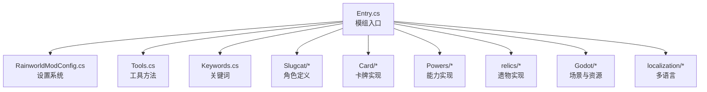
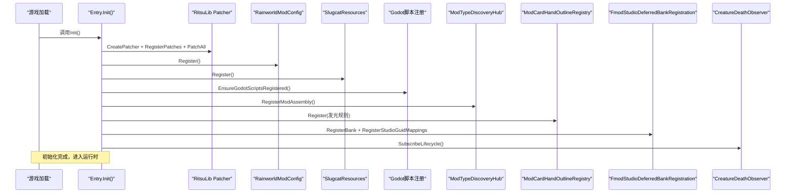
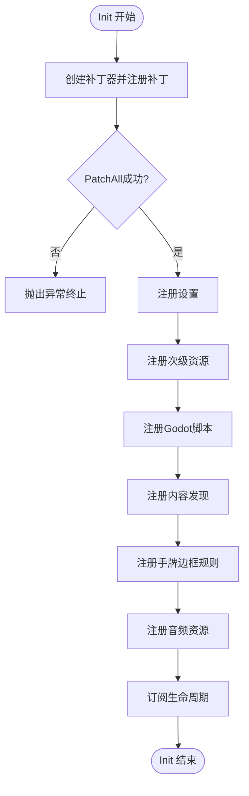
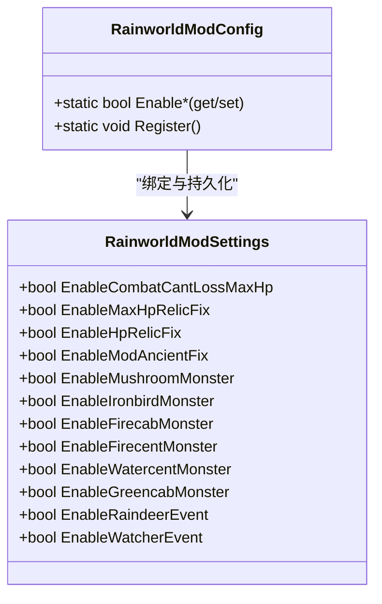
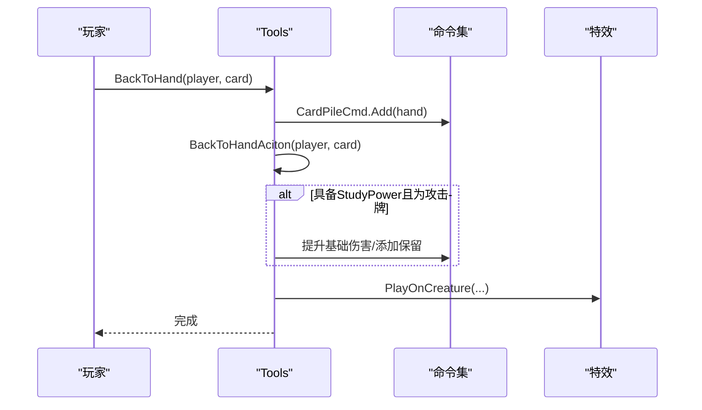
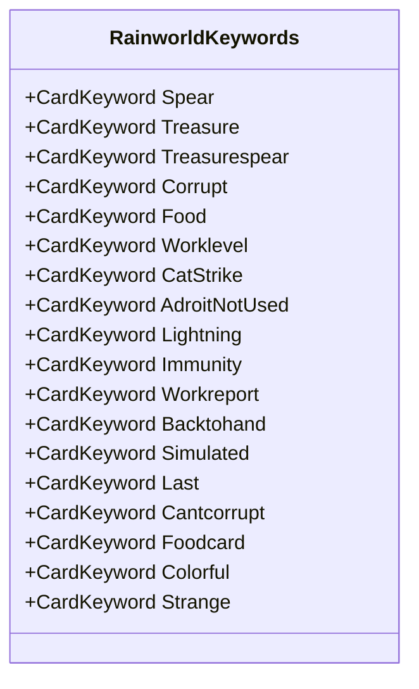
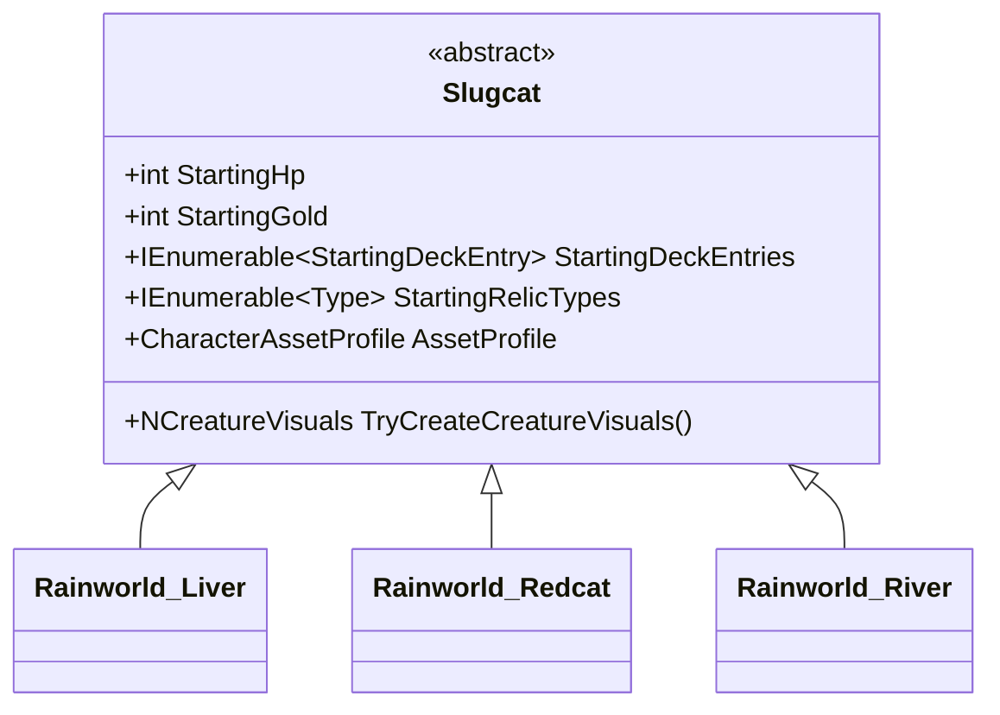
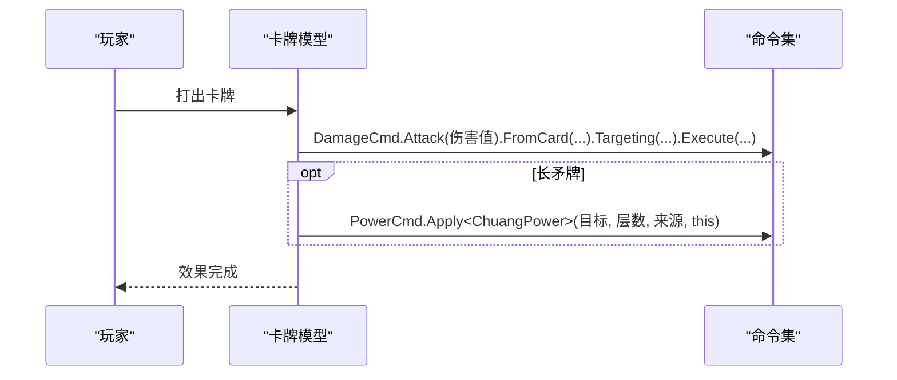
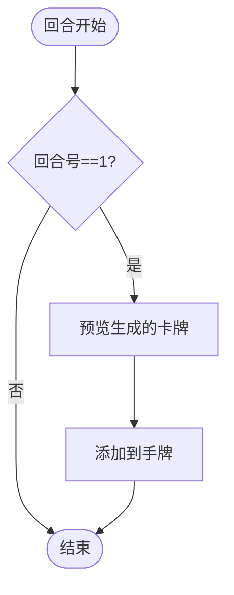
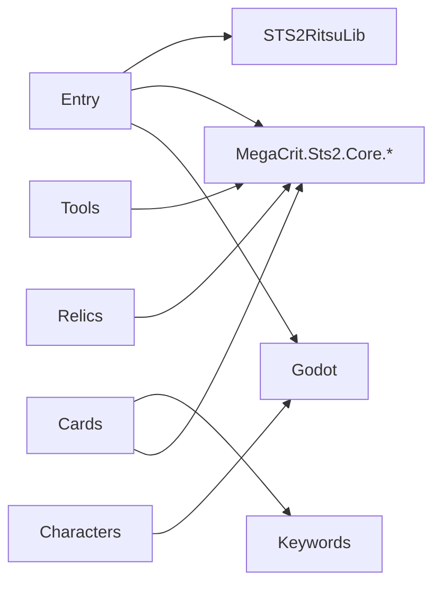

# API参考

<cite>
**本文引用的文件**
- [Entry.cs](file://Scripts/Entry.cs)
- [RainworldModConfig.cs](file://Scripts/RainworldModConfig.cs)
- [Tools.cs](file://Scripts/Tools.cs)
- [Keywords.cs](file://Scripts/Keywords.cs)
- [Rainworld_Liver.cs](file://Scripts/Slugcat/Rainworld_Liver.cs)
- [Rainworld_Redcat.cs](file://Scripts/Slugcat/Rainworld_Redcat.cs)
- [Rainworld_River.cs](file://Scripts/Slugcat/Rainworld_River.cs)
- [Rainworld_Liver_Strike.cs](file://Scripts/Card/Liver/Attack/Rainworld_Liver_Strike.cs)
- [Rainworld_Liver_Spear.cs](file://Scripts/Card/Liver/Attack/Rainworld_Liver_Spear.cs)
- [Liver_Fruit1.cs](file://Scripts/relics/Liver_Fruit1.cs)
</cite>

## 目录
1. [简介](#简介)
2. [项目结构](#项目结构)
3. [核心组件](#核心组件)
4. [架构总览](#架构总览)
5. [详细组件分析](#详细组件分析)
6. [依赖关系分析](#依赖关系分析)
7. [性能注意事项](#性能注意事项)
8. [故障排查指南](#故障排查指南)
9. [结论](#结论)
10. [附录](#附录)

## 简介
本API参考面向ST2（Slugcat The Spire II）模组开发者，聚焦RitsuLib框架与STS2核心API在本项目中的集成方式。文档覆盖：
- 公共接口与方法签名概览（以类、方法、参数、返回值为维度）
- RitsuLib框架API使用示例（补丁、配置、内容注册、生命周期等）
- STS2核心API集成方法（卡牌、能力、遗物、角色、事件等）
- 自定义API设计模式（关键词、目标选择、动态变量、命令式效果）
- 类的继承关系、接口实现与事件处理
- 错误处理、异常与最佳实践
- 完整代码示例路径（通过源码引用定位）

## 项目结构
本项目采用“按功能域组织”的结构：
- Scripts/Entry.cs：模组入口，负责初始化、补丁注册、内容发现、音频资源注册、生命周期订阅等
- Scripts/RainworldModConfig.cs：基于RitsuLib的模组设置系统，提供可持久化的开关项
- Scripts/Tools.cs：通用工具方法，封装常用战斗逻辑（回手、工作回报、引雷等）
- Scripts/Keywords.cs：自定义卡牌关键词定义与本地化绑定
- Scripts/Slugcat/*：三个角色（求生者、猎手、溪流）的角色定义与资产配置
- Scripts/Card/*：各角色的攻击、技能、能力牌实现
- Scripts/Powers/*：各类能力（Power）的实现
- Scripts/relics/*：遗物实现
- Godot/*：Godot场景与资源（角色、UI、怪物等）
- SlugcatTheSpireII/localization/*：多语言本地化资源

图表来源
- [Entry.cs:20-76](file://Scripts/Entry.cs#L20-L76)
- [RainworldModConfig.cs:166-234](file://Scripts/RainworldModConfig.cs#L166-L234)

章节来源
- [Entry.cs:20-76](file://Scripts/Entry.cs#L20-L76)
- [RainworldModConfig.cs:166-234](file://Scripts/RainworldModConfig.cs#L166-L234)

## 核心组件
- 模组入口与初始化
  - 创建日志器、补丁器，注册补丁并执行PatchAll
  - 注册模组配置、次级资源、Godot脚本、自动内容发现
  - 注册卡牌手牌边框规则、FMOD音频资源、生命周期观察者
- 设置系统
  - 使用ModSettingsValueBinding将布尔选项与UI开关绑定
  - 通过RegisterModSettings构建设置页面，支持分组与本地化
- 工具方法
  - 提供回手、工作回报、随机长矛生成、腐化应用、引雷等通用逻辑
- 关键词系统
  - 自定义关键词并通过属性注册到内容注册表，供卡牌描述与逻辑使用
- 角色定义
  - 继承自基类，配置初始生命、金币、起始卡组、初始遗物、视觉与音频资源
- 卡牌实现
  - 继承各自角色基类卡牌模型，声明费用、类型、稀有度、目标、动态变量
  - 重写OnPlay实现效果，重写OnUpgrade实现升级变化
- 遗物实现
  - 继承ModRelicTemplate，在BeforeHandDraw等生命周期钩子中触发效果

章节来源
- [Entry.cs:20-76](file://Scripts/Entry.cs#L20-L76)
- [RainworldModConfig.cs:11-234](file://Scripts/RainworldModConfig.cs#L11-L234)
- [Tools.cs:27-221](file://Scripts/Tools.cs#L27-L221)
- [Keywords.cs:9-50](file://Scripts/Keywords.cs#L9-L50)
- [Rainworld_Liver.cs:28-117](file://Scripts/Slugcat/Rainworld_Liver.cs#L28-L117)
- [Rainworld_Redcat.cs:29-128](file://Scripts/Slugcat/Rainworld_Redcat.cs#L29-L128)
- [Rainworld_River.cs:31-114](file://Scripts/Slugcat/Rainworld_River.cs#L31-L114)
- [Rainworld_Liver_Strike.cs:9-57](file://Scripts/Card/Liver/Attack/Rainworld_Liver_Strike.cs#L9-L57)
- [Rainworld_Liver_Spear.cs:13-65](file://Scripts/Card/Liver/Attack/Rainworld_Liver_Spear.cs#L13-L65)
- [Liver_Fruit1.cs:30-50](file://Scripts/relics/Liver_Fruit1.cs#L30-L50)

## 架构总览
下图展示模组初始化流程与关键子系统交互：

图表来源
- [Entry.cs:26-74](file://Scripts/Entry.cs#L26-L74)

章节来源
- [Entry.cs:26-74](file://Scripts/Entry.cs#L26-L74)

## 详细组件分析

### 模组入口与初始化（Entry）
- 职责
  - 创建日志器与补丁器，注册并执行补丁
  - 注册设置、资源、Godot脚本、内容发现、手牌边框规则、音频资源、生命周期观察者
- 关键方法与调用链
  - Init(): 统一初始化入口
  - CreatePatcher/SubscribeLifecycle/RegisterModAssembly等由RitsuLibFramework提供
- 错误处理
  - 若补丁失败抛出InvalidOperationException，阻止模组继续运行

图表来源
- [Entry.cs:26-74](file://Scripts/Entry.cs#L26-L74)

章节来源
- [Entry.cs:26-74](file://Scripts/Entry.cs#L26-L74)

### 设置系统（RainworldModConfig）
- 数据结构
  - RainworldModSettings：包含多个布尔开关（如启用/禁用特定怪物、事件、HP修复等）
- 绑定与持久化
  - 使用ModSettingsValueBinding<T, bool>将字段与全局存储绑定
  - 提供静态属性读写并自动保存
- UI注册
  - RegisterModSettings构建设置页，分组general/monster/event，支持本地化标题与说明
- 典型用法
  - 在运行时读取配置以控制行为（例如是否启用某怪物或事件）

图表来源
- [RainworldModConfig.cs:11-234](file://Scripts/RainworldModConfig.cs#L11-L234)

章节来源
- [RainworldModConfig.cs:11-234](file://Scripts/RainworldModConfig.cs#L11-L234)

### 工具方法（Tools）
- 主要方法
  - BackToHand(player, card): 将卡牌放回手牌并触发相关动作
  - BackToHandAciton(player, card): 根据能力（如StudyPower）调整数值、添加保留、处理特殊卡牌
  - WorkReport(player): 在工作回报时根据能力（ExcitePower、TwistPower）执行伤害与抽牌
  - getrandomSpear(upgraded, player): 从牌库检索带“长矛”关键词的卡牌，可选择升级并添加关键词后加入手牌
  - CorruptCard(player, card): 对卡牌施加“腐化”关键词，考虑免疫与状态限制
  - ChangeEventImg(img): 更改事件房间头像图片
  - Yinlei(cardPlay, choiceContext): 引雷逻辑，区分持有特定遗物的玩家目标与普通目标，造成伤害与增益
- 数据流与命令
  - 大量使用DamageCmd、CardPileCmd、PowerCmd、VfxCmd等命令式API
- 错误与边界
  - 空目标检查、条件判断（关键词、能力存在性）、多人模式下目标区分

图表来源
- [Tools.cs:123-155](file://Scripts/Tools.cs#L123-L155)
- [Tools.cs:157-220](file://Scripts/Tools.cs#L157-L220)

章节来源
- [Tools.cs:27-221](file://Scripts/Tools.cs#L27-L221)

### 关键词系统（Keywords）
- 自定义关键词
  - Spear、Treasure、Treasurespear、Corrupt、Food、Worklevel、CatStrike、AdroitNotUsed、Lightning、Immunity、Workreport、Backtohand、Simulated、Last、Cantcorrupt、Foodcard、Colorful、Strange
- 注册方式
  - 使用[RegisterOwnedCardKeyword]属性，指定显示位置与名称
  - 通过ModContentRegistry获取限定ID并转换为ModCardKeyword
- 使用场景
  - 卡牌逻辑判断（如是否可被腐化、是否为长矛牌）
  - 手牌边框发光规则（结合Entry中的注册）

图表来源
- [Keywords.cs:9-50](file://Scripts/Keywords.cs#L9-L50)

章节来源
- [Keywords.cs:9-50](file://Scripts/Keywords.cs#L9-L50)

### 角色定义（Slugcat）
- 角色列表
  - 求生者（Rainworld_Liver）
  - 猎手（Rainworld_Redcat）
  - 溪流（Rainworld_River）
- 共同特性
  - 继承自Slugcat<TCardPool, TRelicPool, TPotionPool>
  - 配置AssetProfile（场景、UI、音频、多人图标、原版遗物视觉覆盖）
  - 定义StartingHp、StartingGold、StartingDeckEntries、StartingRelicTypes
  - 重写TryCreateCreatureVisuals以加载Godot场景
- 差异点
  - 不同角色拥有不同的初始生命、食物上限、颜色主题、音效与起始卡组

图表来源
- [Rainworld_Liver.cs:28-117](file://Scripts/Slugcat/Rainworld_Liver.cs#L28-L117)
- [Rainworld_Redcat.cs:29-128](file://Scripts/Slugcat/Rainworld_Redcat.cs#L29-L128)
- [Rainworld_River.cs:31-114](file://Scripts/Slugcat/Rainworld_River.cs#L31-L114)

章节来源
- [Rainworld_Liver.cs:28-117](file://Scripts/Slugcat/Rainworld_Liver.cs#L28-L117)
- [Rainworld_Redcat.cs:29-128](file://Scripts/Slugcat/Rainworld_Redcat.cs#L29-L128)
- [Rainworld_River.cs:31-114](file://Scripts/Slugcat/Rainworld_River.cs#L31-L114)

### 卡牌实现（示例）
- 基础攻击牌（Rainworld_Liver_Strike）
  - 费用、类型、稀有度、目标类型、标签与关键词
  - 动态变量Damage，OnPlay调用DamageCmd.Attack执行伤害
  - OnUpgrade增加伤害值
- 长矛牌（Rainworld_Liver_Spear）
  - 附加Chuang动态变量，OnPlay同时施加ChuangPower
  - 使用WithHitFx播放命中特效
- 设计模式
  - 使用DynamicVar表达可变数值
  - 使用Command式API（DamageCmd、PowerCmd）确保一致性与可测试性
  - 通过AdditionalHoverTips关联能力提示

图表来源
- [Rainworld_Liver_Strike.cs:41-56](file://Scripts/Card/Liver/Attack/Rainworld_Liver_Strike.cs#L41-L56)
- [Rainworld_Liver_Spear.cs:45-64](file://Scripts/Card/Liver/Attack/Rainworld_Liver_Spear.cs#L45-L64)

章节来源
- [Rainworld_Liver_Strike.cs:9-57](file://Scripts/Card/Liver/Attack/Rainworld_Liver_Strike.cs#L9-L57)
- [Rainworld_Liver_Spear.cs:13-65](file://Scripts/Card/Liver/Attack/Rainworld_Liver_Spear.cs#L13-L65)

### 遗物实现（示例）
- Liver_Fruit1
  - 作为起始遗物，在回合开始前（BeforeHandDraw）检测条件并生成一张特定卡牌加入手牌
  - 使用CardPileCmd.AddGeneratedCardsToCombat与CardCmd.PreviewCardPileAdd进行预览与插入
- 设计要点
  - 在合适的生命周期钩子中触发效果，避免重复或冲突
  - 使用Owner与combatState上下文判断时机与范围

图表来源
- [Liver_Fruit1.cs:41-49](file://Scripts/relics/Liver_Fruit1.cs#L41-L49)

章节来源
- [Liver_Fruit1.cs:30-50](file://Scripts/relics/Liver_Fruit1.cs#L30-L50)

## 依赖关系分析
- 外部依赖
  - STS2RitsuLib：提供补丁、设置、内容注册、生命周期、命令式API等
  - MegaCrit.Sts2.Core.*：游戏核心API（实体、命令、模型、房间、运行状态等）
  - Godot：场景与资源加载
- 内部依赖
  - Entry依赖所有子系统（补丁、设置、资源、发现、边框规则、音频、生命周期）
  - 卡牌依赖关键词、命令、动态变量
  - 工具方法依赖命令与特效
  - 角色依赖Godot场景与资源

图表来源
- [Entry.cs:1-76](file://Scripts/Entry.cs#L1-L76)
- [Keywords.cs:1-50](file://Scripts/Keywords.cs#L1-L50)
- [Tools.cs:1-221](file://Scripts/Tools.cs#L1-L221)
- [Rainworld_Liver.cs:1-117](file://Scripts/Slugcat/Rainworld_Liver.cs#L1-L117)
- [Liver_Fruit1.cs:1-50](file://Scripts/relics/Liver_Fruit1.cs#L1-L50)

章节来源
- [Entry.cs:1-76](file://Scripts/Entry.cs#L1-L76)
- [Keywords.cs:1-50](file://Scripts/Keywords.cs#L1-L50)
- [Tools.cs:1-221](file://Scripts/Tools.cs#L1-L221)
- [Rainworld_Liver.cs:1-117](file://Scripts/Slugcat/Rainworld_Liver.cs#L1-L117)
- [Liver_Fruit1.cs:1-50](file://Scripts/relics/Liver_Fruit1.cs#L1-L50)

## 性能注意事项
- 命令式API优先：使用DamageCmd、CardPileCmd、PowerCmd等保证一致性，避免手动循环造成的性能问题
- 批量操作：尽量使用批量命令（如AddGeneratedCardsToCombat）减少多次IO
- 特效与音频：合理使用VfxCmd与FMOD资源，避免每帧频繁播放
- 条件判断：在OnPlay与生命周期钩子中进行必要的前置检查，减少无效计算
- 多人模式：注意目标选择与同步，避免不一致导致的卡顿或崩溃

## 故障排查指南
- 初始化失败
  - 检查补丁是否全部成功（PatchAll返回值），失败会抛出异常
  - 确认Godot脚本与资源路径正确
- 设置未生效
  - 确认RegisterModSettings已调用，且绑定字段与UI键一致
  - 检查SaveScope与文件名是否正确
- 卡牌效果异常
  - 检查动态变量是否正确声明与升级
  - 检查OnPlay中的目标与上下文是否为空
  - 检查关键词与能力是否存在
- 遗物触发时机
  - 确认在正确的生命周期钩子（如BeforeHandDraw）中触发
  - 检查Owner与combatState上下文

章节来源
- [Entry.cs:31-34](file://Scripts/Entry.cs#L31-L34)
- [RainworldModConfig.cs:166-234](file://Scripts/RainworldModConfig.cs#L166-L234)
- [Tools.cs:123-220](file://Scripts/Tools.cs#L123-L220)
- [Liver_Fruit1.cs:41-49](file://Scripts/relics/Liver_Fruit1.cs#L41-L49)

## 结论
本项目基于RitsuLib与STS2核心API，构建了完整的角色、卡牌、能力、遗物与设置系统。通过命令式API与生命周期钩子，实现了清晰、可扩展且易于维护的模组架构。建议开发者遵循本文档的模式与最佳实践，确保API使用的准确性与稳定性。

## 附录
- 使用示例路径
  - 攻击牌：[Rainworld_Liver_Strike.cs:41-56](file://Scripts/Card/Liver/Attack/Rainworld_Liver_Strike.cs#L41-L56)
  - 长矛牌：[Rainworld_Liver_Spear.cs:45-64](file://Scripts/Card/Liver/Attack/Rainworld_Liver_Spear.cs#L45-L64)
  - 回手工具：[Tools.cs:123-155](file://Scripts/Tools.cs#L123-L155)
  - 引雷工具：[Tools.cs:157-220](file://Scripts/Tools.cs#L157-L220)
  - 遗物触发：[Liver_Fruit1.cs:41-49](file://Scripts/relics/Liver_Fruit1.cs#L41-L49)
  - 设置注册：[RainworldModConfig.cs:166-234](file://Scripts/RainworldModConfig.cs#L166-L234)
  - 关键词定义：[Keywords.cs:9-50](file://Scripts/Keywords.cs#L9-L50)
  - 角色定义：[Rainworld_Liver.cs:28-117](file://Scripts/Slugcat/Rainworld_Liver.cs#L28-L117)、[Rainworld_Redcat.cs:29-128](file://Scripts/Slugcat/Rainworld_Redcat.cs#L29-L128)、[Rainworld_River.cs:31-114](file://Scripts/Slugcat/Rainworld_River.cs#L31-L114)