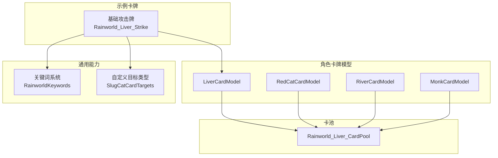
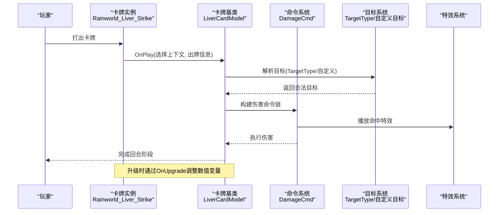
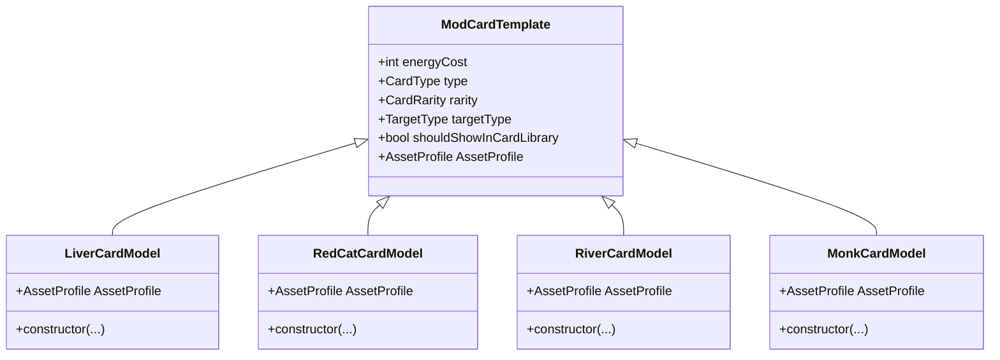
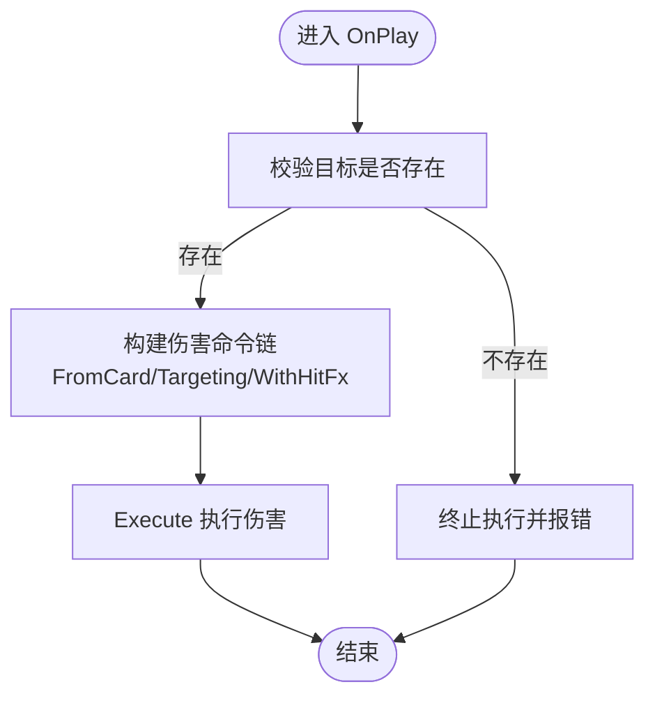
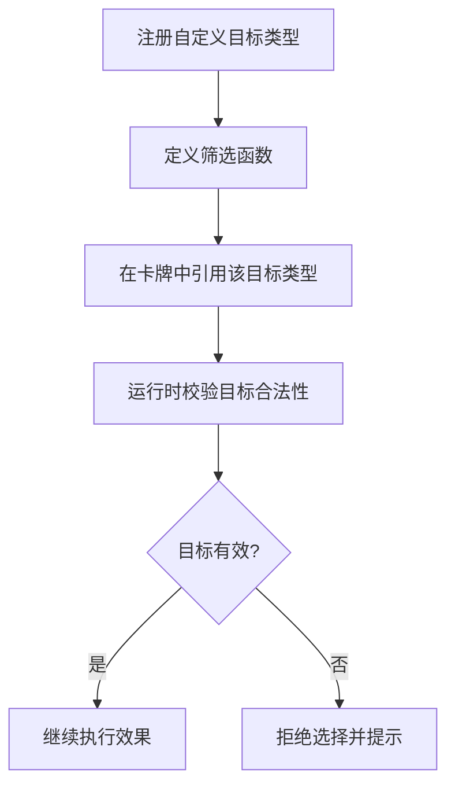
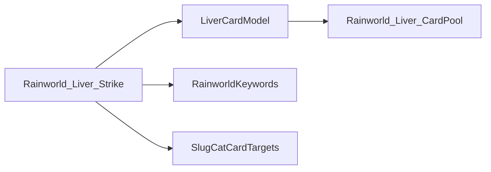

# 卡牌API

<cite>
**本文引用的文件**
- [LiverCardModel.cs](file://Scripts/Card/Liver/LiverCardModel.cs)
- [RedCatCardModel.cs](file://Scripts/Card/RedCat/RedCatCardModel.cs)
- [RiverCardModel.cs](file://Scripts/Card/River/RiverCardModel.cs)
- [MonkCardModel.cs](file://Scripts/Card/Monk/MonkCardModel.cs)
- [Rainworld_Liver_CardPool.cs](file://Scripts/Card/Liver/Rainworld_Liver_CardPool.cs)
- [SlugCatCardTargets.cs](file://Scripts/Card/SlugCatCardTargets.cs)
- [Keywords.cs](file://Scripts/Keywords.cs)
- [Rainworld_Liver_Strike.cs](file://Scripts/Card/Liver/Attack/Rainworld_Liver_Strike.cs)
</cite>

## 目录
1. [简介](#简介)
2. [项目结构](#项目结构)
3. [核心组件](#核心组件)
4. [架构总览](#架构总览)
5. [详细组件分析](#详细组件分析)
6. [依赖关系分析](#依赖关系分析)
7. [性能考量](#性能考量)
8. [故障排查指南](#故障排查指南)
9. [结论](#结论)
10. [附录](#附录)

## 简介
本文件为“卡牌系统API”的完整接口文档，面向卡牌开发者与集成者。内容覆盖：
- CardModel基类与各角色卡牌模型的公共接口（创建、效果执行、目标选择等）
- 攻击卡牌、技能卡牌、能力卡牌的实现模式差异
- 卡牌池管理、卡牌升级、卡牌过滤相关API
- 关键词系统、目标验证、效果链式调用使用方法
- 卡牌开发示例与最佳实践

## 项目结构
本项目采用按角色分层的卡牌组织方式，每个角色拥有独立的卡牌模型基类与卡池定义；具体卡牌实现位于对应角色的 Attack/Skills/Powers 子目录中。关键词与自定义目标类型在共享模块中集中管理。

图示来源
- [LiverCardModel.cs:14-38](file://Scripts/Card/Liver/LiverCardModel.cs#L14-L38)
- [RedCatCardModel.cs:13-39](file://Scripts/Card/RedCat/RedCatCardModel.cs#L13-L39)
- [RiverCardModel.cs:14-39](file://Scripts/Card/River/RiverCardModel.cs#L14-L39)
- [MonkCardModel.cs:13-39](file://Scripts/Card/Monk/MonkCardModel.cs#L13-L39)
- [Rainworld_Liver_CardPool.cs:10-23](file://Scripts/Card/Liver/Rainworld_Liver_CardPool.cs#L10-L23)
- [Keywords.cs:9-50](file://Scripts/Keywords.cs#L9-L50)
- [SlugCatCardTargets.cs:8-34](file://Scripts/Card/SlugCatCardTargets.cs#L8-L34)
- [Rainworld_Liver_Strike.cs:9-57](file://Scripts/Card/Liver/Attack/Rainworld_Liver_Strike.cs#L9-L57)

章节来源
- [LiverCardModel.cs:14-38](file://Scripts/Card/Liver/LiverCardModel.cs#L14-L38)
- [RedCatCardModel.cs:13-39](file://Scripts/Card/RedCat/RedCatCardModel.cs#L13-L39)
- [RiverCardModel.cs:14-39](file://Scripts/Card/River/RiverCardModel.cs#L14-L39)
- [MonkCardModel.cs:13-39](file://Scripts/Card/Monk/MonkCardModel.cs#L13-L39)
- [Rainworld_Liver_CardPool.cs:10-23](file://Scripts/Card/Liver/Rainworld_Liver_CardPool.cs#L10-L23)
- [Keywords.cs:9-50](file://Scripts/Keywords.cs#L9-L50)
- [SlugCatCardTargets.cs:8-34](file://Scripts/Card/SlugCatCardTargets.cs#L8-L34)
- [Rainworld_Liver_Strike.cs:9-57](file://Scripts/Card/Liver/Attack/Rainworld_Liver_Strike.cs#L9-L57)

## 核心组件
- 卡牌模型基类
  - 各角色均提供抽象基类，统一资源路径与卡框样式，简化卡牌创建流程。
  - 关键属性：能量消耗、卡牌类型、稀有度、目标类型、是否显示于图鉴。
  - 资源配置：根据卡牌类型自动选择对应卡框纹理。
- 卡牌池
  - 通过 TypeListCardPoolModel 派生实现，定义卡池标题、能量颜色、图标、配色等。
- 关键词系统
  - 集中注册并暴露常用关键词常量，供卡牌声明使用。
- 自定义目标类型
  - 提供可复用的单目标筛选器，便于在卡牌中快速限定合法目标集合。

章节来源
- [LiverCardModel.cs:14-38](file://Scripts/Card/Liver/LiverCardModel.cs#L14-L38)
- [RedCatCardModel.cs:13-39](file://Scripts/Card/RedCat/RedCatCardModel.cs#L13-L39)
- [RiverCardModel.cs:14-39](file://Scripts/Card/River/RiverCardModel.cs#L14-L39)
- [MonkCardModel.cs:13-39](file://Scripts/Card/Monk/MonkCardModel.cs#L13-L39)
- [Rainworld_Liver_CardPool.cs:10-23](file://Scripts/Card/Liver/Rainworld_Liver_CardPool.cs#L10-L23)
- [Keywords.cs:9-50](file://Scripts/Keywords.cs#L9-L50)
- [SlugCatCardTargets.cs:8-34](file://Scripts/Card/SlugCatCardTargets.cs#L8-L34)

## 架构总览
下图展示了从卡牌声明到效果执行的典型调用链，包括目标选择、关键词处理、伤害命令链式调用以及升级逻辑。

图示来源
- [Rainworld_Liver_Strike.cs:40-56](file://Scripts/Card/Liver/Attack/Rainworld_Liver_Strike.cs#L40-L56)
- [LiverCardModel.cs:14-38](file://Scripts/Card/Liver/LiverCardModel.cs#L14-L38)
- [SlugCatCardTargets.cs:14-33](file://Scripts/Card/SlugCatCardTargets.cs#L14-L33)

## 详细组件分析

### 卡牌模型基类与角色扩展
- 基类职责
  - 统一资源路径与卡框选择策略，减少重复代码。
  - 构造参数包含能量消耗、卡牌类型、稀有度、目标类型、图鉴可见性。
- 角色差异
  - 不同角色的基类仅资源路径不同，行为一致，便于跨角色复用。
- 建议
  - 新增角色时复制基类并修改资源路径即可快速接入。

图示来源
- [LiverCardModel.cs:14-38](file://Scripts/Card/Liver/LiverCardModel.cs#L14-L38)
- [RedCatCardModel.cs:13-39](file://Scripts/Card/RedCat/RedCatCardModel.cs#L13-L39)
- [RiverCardModel.cs:14-39](file://Scripts/Card/River/RiverCardModel.cs#L14-L39)
- [MonkCardModel.cs:13-39](file://Scripts/Card/Monk/MonkCardModel.cs#L13-L39)

章节来源
- [LiverCardModel.cs:14-38](file://Scripts/Card/Liver/LiverCardModel.cs#L14-L38)
- [RedCatCardModel.cs:13-39](file://Scripts/Card/RedCat/RedCatCardModel.cs#L13-L39)
- [RiverCardModel.cs:14-39](file://Scripts/Card/River/RiverCardModel.cs#L14-L39)
- [MonkCardModel.cs:13-39](file://Scripts/Card/Monk/MonkCardModel.cs#L13-L39)

### 攻击卡牌实现模式（以基础攻击为例）
- 声明要素
  - 能量消耗、类型、稀有度、目标类型、图鉴可见性。
  - 标签与关键词：如“Strike”标签与角色专属关键词。
  - 动态变量：伤害值等随升级变化的数值。
- 效果执行
  - 重写 OnPlay，使用命令系统构建伤害链式调用，指定来源卡牌、目标、命中特效等。
- 升级逻辑
  - 重写 OnUpgrade，对动态变量进行增量调整。

图示来源
- [Rainworld_Liver_Strike.cs:40-56](file://Scripts/Card/Liver/Attack/Rainworld_Liver_Strike.cs#L40-L56)

章节来源
- [Rainworld_Liver_Strike.cs:9-57](file://Scripts/Card/Liver/Attack/Rainworld_Liver_Strike.cs#L9-L57)

### 技能卡牌与能力卡牌实现模式
- 技能卡牌
  - 通常不造成直接伤害，而是触发状态变化、抽牌、护盾、增益等效果。
  - 可通过命令系统与状态系统组合实现复杂效果。
- 能力卡牌
  - 多为持续效果或被动加成，常通过添加 Power 或临时状态实现。
- 共同点
  - 均继承角色基类，遵循相同的生命周期方法（OnPlay/OnUpgrade）。
  - 可使用相同的目标系统与关键词系统。

章节来源
- [LiverCardModel.cs:14-38](file://Scripts/Card/Liver/LiverCardModel.cs#L14-L38)
- [Rainworld_Liver_Strike.cs:9-57](file://Scripts/Card/Liver/Attack/Rainworld_Liver_Strike.cs#L9-L57)

### 卡牌池管理
- 卡池类型
  - 基于 TypeListCardPoolModel 的派生类，用于集中管理某角色的卡牌集合。
- 外观与主题
  - 支持设置卡池标题、能量颜色、图标、配色等，统一视觉风格。
- 扩展建议
  - 如需自定义卡框材质，可使用提供的着色器材质工具。

章节来源
- [Rainworld_Liver_CardPool.cs:10-23](file://Scripts/Card/Liver/Rainworld_Liver_CardPool.cs#L10-L23)

### 卡牌升级机制
- 升级入口
  - 通过重写 OnUpgrade 对动态变量进行数值调整。
- 变量管理
  - 使用动态变量（如伤害）统一管理基础值与升级增量，保证一致性。
- 最佳实践
  - 将升级逻辑集中在 OnUpgrade，避免分散修改导致不一致。

章节来源
- [Rainworld_Liver_Strike.cs:52-56](file://Scripts/Card/Liver/Attack/Rainworld_Liver_Strike.cs#L52-L56)

### 卡牌过滤与目标选择
- 目标类型
  - 内置多种目标类型（如任意敌人），也可通过自定义目标类型精确筛选。
- 自定义目标
  - 通过注册单目标类型，结合运行时条件（如拥有特定状态、阵营关系）限制可选目标。
- 使用场景
  - 适用于需要特殊规则的目标选择（如仅对特定状态敌人生效、仅对盟友生效等）。

图示来源
- [SlugCatCardTargets.cs:14-33](file://Scripts/Card/SlugCatCardTargets.cs#L14-L33)

章节来源
- [SlugCatCardTargets.cs:8-34](file://Scripts/Card/SlugCatCardTargets.cs#L8-L34)

### 关键词系统
- 关键词注册
  - 集中注册所有关键词，并提供静态常量以便卡牌引用。
- 描述位置
  - 支持在卡牌描述前插入关键词说明，提升可读性。
- 使用建议
  - 将关键词与卡牌标签配合使用，形成清晰的语义表达。

章节来源
- [Keywords.cs:9-50](file://Scripts/Keywords.cs#L9-L50)

## 依赖关系分析
- 组件耦合
  - 卡牌模型依赖基类与命令系统；卡牌池依赖资源与主题配置；关键词与目标类型为共享依赖。
- 外部依赖
  - 命令系统（伤害、目标、特效）、资源系统（图片、材质）、本地化（关键词描述）。
- 潜在循环
  - 当前结构清晰分层，未见明显循环依赖。

图示来源
- [Rainworld_Liver_Strike.cs:9-57](file://Scripts/Card/Liver/Attack/Rainworld_Liver_Strike.cs#L9-L57)
- [LiverCardModel.cs:14-38](file://Scripts/Card/Liver/LiverCardModel.cs#L14-L38)
- [Keywords.cs:9-50](file://Scripts/Keywords.cs#L9-L50)
- [SlugCatCardTargets.cs:8-34](file://Scripts/Card/SlugCatCardTargets.cs#L8-L34)
- [Rainworld_Liver_CardPool.cs:10-23](file://Scripts/Card/Liver/Rainworld_Liver_CardPool.cs#L10-L23)

章节来源
- [Rainworld_Liver_Strike.cs:9-57](file://Scripts/Card/Liver/Attack/Rainworld_Liver_Strike.cs#L9-L57)
- [LiverCardModel.cs:14-38](file://Scripts/Card/Liver/LiverCardModel.cs#L14-L38)
- [Keywords.cs:9-50](file://Scripts/Keywords.cs#L9-L50)
- [SlugCatCardTargets.cs:8-34](file://Scripts/Card/SlugCatCardTargets.cs#L8-L34)
- [Rainworld_Liver_CardPool.cs:10-23](file://Scripts/Card/Liver/Rainworld_Liver_CardPool.cs#L10-L23)

## 性能考量
- 命令链式调用
  - 尽量合并操作，减少多次系统调用开销。
- 目标筛选
  - 自定义目标筛选函数应保持轻量，避免复杂计算影响回合流畅度。
- 资源加载
  - 复用卡框与材质，避免重复创建着色器材质。
- 升级与变量
  - 使用动态变量统一管理数值，降低维护成本与错误率。

## 故障排查指南
- 目标为空
  - 检查 OnPlay 中对目标的判空与异常抛出，确保目标选择阶段正确。
- 关键词未生效
  - 确认关键词已注册且卡牌声明中引用了正确的关键词常量。
- 卡框或资源缺失
  - 核对基类中的资源路径是否与资源目录一致，必要时调整路径或材质。
- 升级无效
  - 检查 OnUpgrade 是否正确更新动态变量，并确保变量绑定到实际效果。

章节来源
- [Rainworld_Liver_Strike.cs:40-56](file://Scripts/Card/Liver/Attack/Rainworld_Liver_Strike.cs#L40-L56)
- [Keywords.cs:9-50](file://Scripts/Keywords.cs#L9-L50)
- [LiverCardModel.cs:14-38](file://Scripts/Card/Liver/LiverCardModel.cs#L14-L38)

## 结论
本卡牌系统通过统一的基类、灵活的关键词与目标系统、以及清晰的命令链式调用，提供了高内聚、低耦合的卡牌开发体验。开发者可基于角色基类快速实现攻击、技能、能力卡牌，并通过卡池与关键词系统进行管理与展示。遵循本文档的最佳实践，可有效提升卡牌质量与可维护性。

## 附录
- 开发清单
  - 确定卡牌类型、稀有度、目标类型与能量消耗
  - 声明标签与关键词
  - 定义动态变量与升级逻辑
  - 在 OnPlay 中实现效果（命令链式调用）
  - 注册到对应角色卡池
- 参考路径
  - 攻击卡牌示例：[Rainworld_Liver_Strike.cs](file://Scripts/Card/Liver/Attack/Rainworld_Liver_Strike.cs)
  - 角色基类：[LiverCardModel.cs](file://Scripts/Card/Liver/LiverCardModel.cs)、[RedCatCardModel.cs](file://Scripts/Card/RedCat/RedCatCardModel.cs)、[RiverCardModel.cs](file://Scripts/Card/River/RiverCardModel.cs)、[MonkCardModel.cs](file://Scripts/Card/Monk/MonkCardModel.cs)
  - 卡池定义：[Rainworld_Liver_CardPool.cs](file://Scripts/Card/Liver/Rainworld_Liver_CardPool.cs)
  - 关键词系统：[Keywords.cs](file://Scripts/Keywords.cs)
  - 自定义目标：[SlugCatCardTargets.cs](file://Scripts/Card/SlugCatCardTargets.cs)