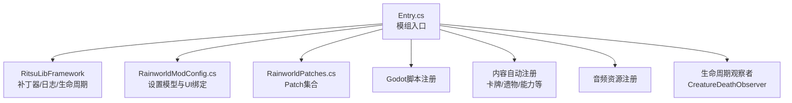
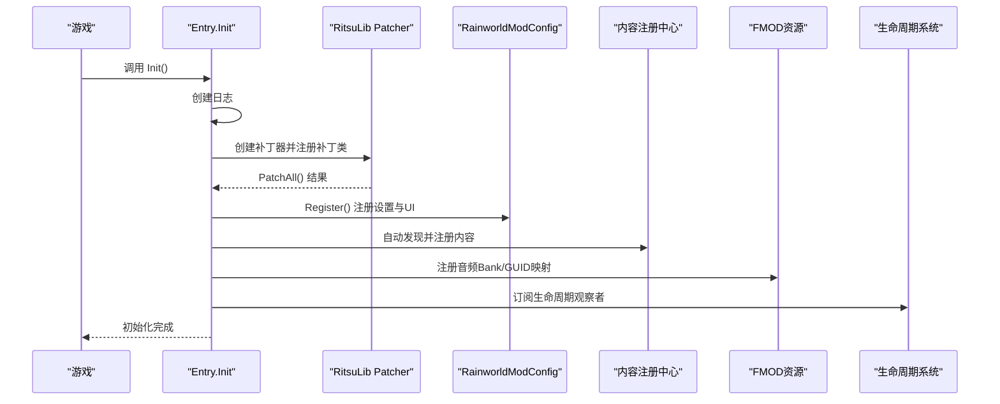
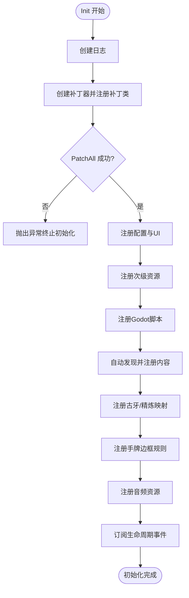
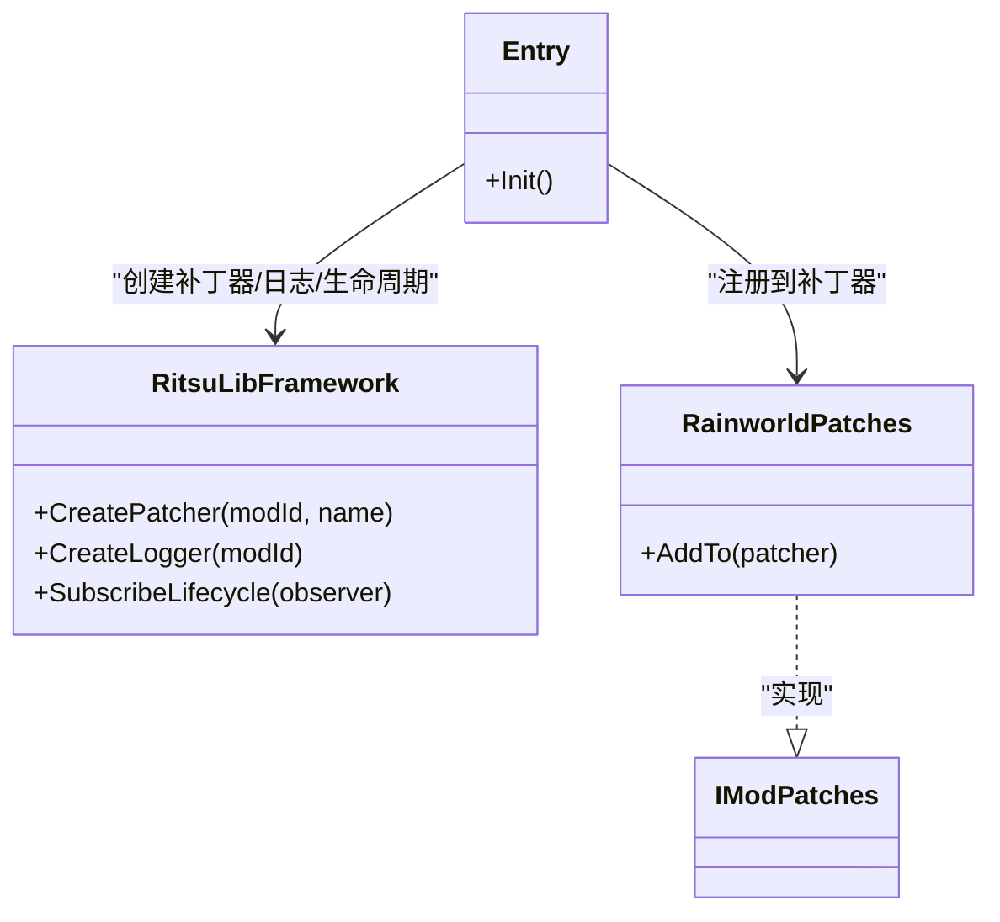
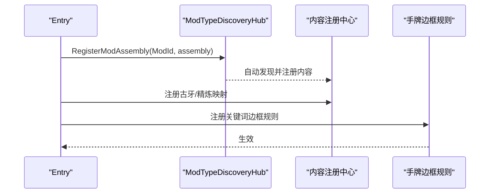
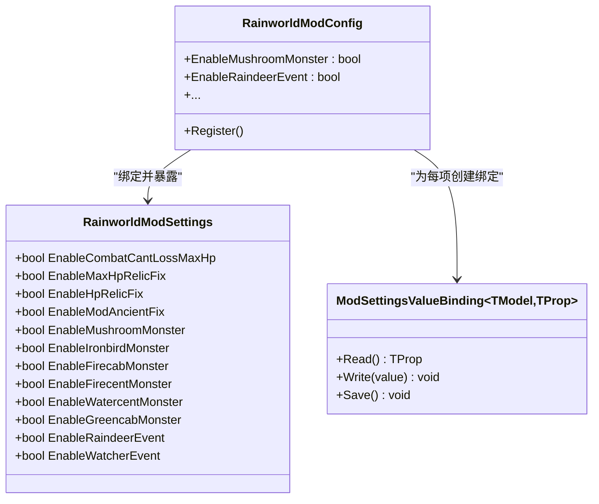
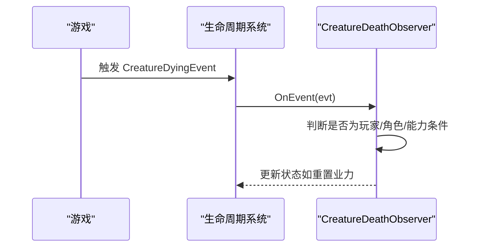
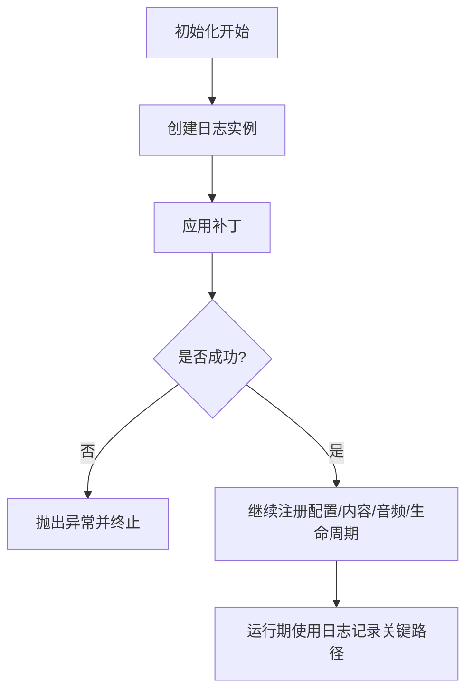
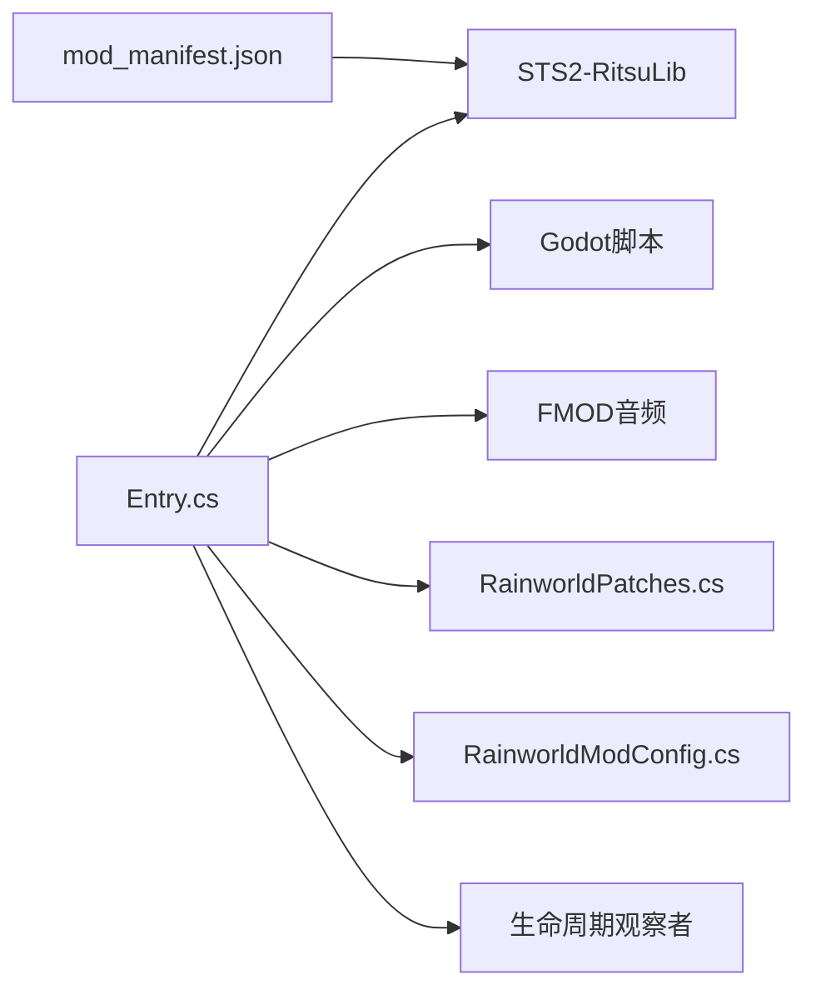

# 模组框架API

<cite>
**本文引用的文件**   
- [Entry.cs](file://Scripts/Entry.cs)
- [RainworldModConfig.cs](file://Scripts/RainworldModConfig.cs)
- [mod_manifest.json](file://mod_manifest.json)
- [RainworldPatches.cs](file://Scripts/patches/RainworldPatches.cs)
- [LogSingleton.cs](file://Scripts/patches/Singleton/LogSingleton.cs)
- [CreatureDeathObserver.cs](file://Scripts/patches/Lifecycle/CreatureDeathObserver.cs)
- [Tools.cs](file://Scripts/Tools.cs)
- [settings_ui.json](file://SlugcatTheSpireII/localization/zhs/settings_ui.json)
</cite>

## 目录
1. [简介](#简介)
2. [项目结构](#项目结构)
3. [核心组件](#核心组件)
4. [架构总览](#架构总览)
5. [详细组件分析](#详细组件分析)
6. [依赖关系分析](#依赖关系分析)
7. [性能与兼容性建议](#性能与兼容性建议)
8. [故障排查指南](#故障排查指南)
9. [结论](#结论)
10. [附录](#附录)

## 简介
本文件为“模组框架API”的权威接口文档，面向模组开发者，覆盖以下主题：
- Entry 入口点的使用方法、模组初始化流程与生命周期管理
- RitsuLib 框架集成方式、补丁系统与内容注册机制
- 配置系统 API、设置界面开发与运行时配置管理
- 日志记录、错误处理与调试工具使用
- 最佳实践、性能优化与兼容性处理

## 项目结构
该模组基于 STS2 的模组生态，采用 RitsuLib 提供的统一框架能力。关键组织方式如下：
- Scripts/Entry.cs：模组入口，负责创建日志、注册补丁、注册配置、注册 Godot 脚本、自动发现并注册内容、注册音频资源、订阅生命周期事件等
- Scripts/RainworldModConfig.cs：定义模组设置模型与 UI 绑定，提供运行时读写与持久化
- Scripts/patches/*：集中放置各类 Patch（游戏行为修改）、单例、生命周期观察者等
- SlugcatTheSpireII/localization/*：本地化资源，包含设置界面文案
- mod_manifest.json：模组清单，声明依赖（STS2-RitsuLib）及版本要求

图表来源
- [Entry.cs:20-76](file://Scripts/Entry.cs#L20-L76)
- [RainworldPatches.cs:8-33](file://Scripts/patches/RainworldPatches.cs#L8-L33)
- [RainworldModConfig.cs:11-235](file://Scripts/RainworldModConfig.cs#L11-L235)
- [CreatureDeathObserver.cs:11-27](file://Scripts/patches/Lifecycle/CreatureDeathObserver.cs#L11-L27)

章节来源
- [Entry.cs:20-76](file://Scripts/Entry.cs#L20-L76)
- [mod_manifest.json:1-14](file://mod_manifest.json#L1-L14)

## 核心组件
- 模组入口 Entry：通过特性标记被框架调用，完成初始化全流程
- 补丁系统 RainworldPatches：集中注册所有需要 Hook 的原版方法
- 配置系统 RainworldModConfig：以强类型模型 + 值绑定 + UI 构建的方式暴露可配置项
- 生命周期观察 CreatureDeathObserver：订阅框架事件，实现跨战斗/房间的状态联动
- 工具集 Tools：封装常用逻辑（如卡牌腐化、回手、特效播放等），降低重复代码

章节来源
- [Entry.cs:20-76](file://Scripts/Entry.cs#L20-L76)
- [RainworldPatches.cs:8-33](file://Scripts/patches/RainworldPatches.cs#L8-L33)
- [RainworldModConfig.cs:11-235](file://Scripts/RainworldModConfig.cs#L11-L235)
- [CreatureDeathObserver.cs:11-27](file://Scripts/patches/Lifecycle/CreatureDeathObserver.cs#L11-L27)
- [Tools.cs:27-221](file://Scripts/Tools.cs#L27-L221)

## 架构总览
模组启动时，Entry.Init 按顺序执行：
1) 创建日志实例
2) 创建补丁器并注册补丁类，批量应用补丁
3) 注册模组配置（数据模型与设置UI）
4) 注册次级资源（如饱食度、业力等级等）
5) 注册 Godot 脚本（用于场景/动画/交互）
6) 自动发现并注册内容（卡牌、遗物、能力、事件等）
7) 注册特定映射（如古牙升华、奥罗巴斯之触精炼等）
8) 注册卡牌手牌边框规则（关键词发光）
9) 注册 FMOD 音频资源
10) 订阅生命周期事件（如生物死亡）

图表来源
- [Entry.cs:26-76](file://Scripts/Entry.cs#L26-L76)
- [RainworldPatches.cs:8-33](file://Scripts/patches/RainworldPatches.cs#L8-L33)
- [RainworldModConfig.cs:166-235](file://Scripts/RainworldModConfig.cs#L166-L235)

## 详细组件分析

### Entry 入口点与生命周期管理
- 作用：作为模组唯一入口，协调补丁、配置、内容、音频、生命周期等子系统
- 关键点：
  - 使用特性标记被框架识别并调用
  - 通过 RitsuLibFramework 创建日志与补丁器
  - 使用 ModTypeDiscoveryHub 自动发现并注册内容
  - 使用 RitsuLibFramework.RegisterArchaicToothTranscendenceMapping 与 RegisterTouchOfOrobasRefinementMapping 建立内容映射
  - 使用 ModCardHandOutlineRegistry 注册卡牌手牌边框规则
  - 使用 FmodStudioDeferredBankRegistration 注册音频资源
  - 使用 SubscribeLifecycle 订阅生命周期事件

图表来源
- [Entry.cs:26-76](file://Scripts/Entry.cs#L26-L76)

章节来源
- [Entry.cs:20-76](file://Scripts/Entry.cs#L20-L76)

### RitsuLib 框架集成与补丁系统
- 集成方式：
  - 在 manifest 中声明对 STS2-RitsuLib 的依赖
  - 在 Entry 中通过 RitsuLibFramework.CreatePatcher 创建补丁器
  - 将具体补丁类放入统一的 IModPatches 实现中集中注册
- 补丁系统要点：
  - 使用 RegisterPatch<T>() 注册具体补丁类
  - 使用 PatchAll() 一次性应用所有补丁
  - 若关键补丁失败，应抛出异常阻止后续初始化，避免不一致状态

图表来源
- [Entry.cs:26-34](file://Scripts/Entry.cs#L26-L34)
- [RainworldPatches.cs:8-33](file://Scripts/patches/RainworldPatches.cs#L8-L33)

章节来源
- [mod_manifest.json:1-14](file://mod_manifest.json#L1-L14)
- [Entry.cs:26-34](file://Scripts/Entry.cs#L26-L34)
- [RainworldPatches.cs:8-33](file://Scripts/patches/RainworldPatches.cs#L8-L33)

### 内容注册机制
- 自动发现：通过 ModTypeDiscoveryHub.RegisterModAssembly 扫描当前模组程序集，自动注册卡牌、遗物、能力等内容
- 映射注册：
  - 古牙升华映射：将基础卡牌映射到对应升华形态
  - 奥罗巴斯之触精炼映射：将基础遗物映射到精炼形态
- 手牌边框规则：根据关键词（如腐化、宝物矛）为卡牌添加发光边框，提升可读性

图表来源
- [Entry.cs:45-69](file://Scripts/Entry.cs#L45-L69)

章节来源
- [Entry.cs:45-69](file://Scripts/Entry.cs#L45-L69)

### 配置系统 API 与设置界面
- 设置模型：RainworldModSettings 定义所有布尔开关（怪物启用、事件启用、修复开关等）
- 值绑定：每个设置项通过 ModSettingsValueBinding 绑定到读取/写入方法，支持全局范围持久化
- 设置 UI：通过 RitsuLibFramework.RegisterModSettings 构建页面、分区与控件，文案来自本地化键
- 运行时访问：提供静态属性（如 EnableMushroomMonster）供运行时读取/写入并自动保存

图表来源
- [RainworldModConfig.cs:11-235](file://Scripts/RainworldModConfig.cs#L11-L235)

章节来源
- [RainworldModConfig.cs:11-235](file://Scripts/RainworldModConfig.cs#L11-L235)
- [settings_ui.json:1-46](file://SlugcatTheSpireII/localization/zhs/settings_ui.json#L1-L46)

### 生命周期管理与事件处理
- 生命周期观察者：实现 ILifecycleObserver 的类可订阅框架事件
- 示例：CreatureDeathObserver 监听生物死亡事件，当玩家角色为蛞蝓猫且满足条件时，重置业力等级
- 订阅方式：在 Entry 中通过 SubscribeLifecycle 注册观察者

图表来源
- [Entry.cs:73-74](file://Scripts/Entry.cs#L73-L74)
- [CreatureDeathObserver.cs:11-27](file://Scripts/patches/Lifecycle/CreatureDeathObserver.cs#L11-L27)

章节来源
- [Entry.cs:73-74](file://Scripts/Entry.cs#L73-L74)
- [CreatureDeathObserver.cs:11-27](file://Scripts/patches/Lifecycle/CreatureDeathObserver.cs#L11-L27)

### 日志记录、错误处理与调试工具
- 日志：通过 RitsuLibFramework.CreateLogger 创建模块日志实例，便于追踪初始化与运行期信息
- 错误处理：关键步骤（如补丁应用）失败时抛出异常，确保初始化一致性
- 调试单例：LogSingleton 作为钩子单例，可用于注入调试逻辑或扩展日志输出

图表来源
- [Entry.cs:24-34](file://Scripts/Entry.cs#L24-L34)
- [LogSingleton.cs:23-33](file://Scripts/patches/Singleton/LogSingleton.cs#L23-L33)

章节来源
- [Entry.cs:24-34](file://Scripts/Entry.cs#L24-L34)
- [LogSingleton.cs:23-33](file://Scripts/patches/Singleton/LogSingleton.cs#L23-L33)

### 工具与常见操作
- Tools 提供通用方法：
  - 获取随机卡牌并附加关键词、加入手牌
  - 卡牌腐化（考虑免疫/特殊能力）
  - 工作回报（Boss/精英/怪物战后效果）
  - 回手与动作联动（如增加连击计数）
  - 闪电特效与伤害计算（结合遗物/能力）
- 这些方法简化了复杂逻辑，减少重复代码，提高一致性

章节来源
- [Tools.cs:27-221](file://Scripts/Tools.cs#L27-L221)

## 依赖关系分析
- 外部依赖：
  - STS2-RitsuLib：提供补丁、内容注册、生命周期、设置、日志等核心能力
  - Godot：用于场景、动画、资源加载
  - FMOD：音频资源注册与播放
- 内部耦合：
  - Entry 高度聚合，承担协调职责；建议保持其轻量，将复杂逻辑下沉至各子系统
  - 补丁集中在 RainworldPatches，便于维护与审计
  - 配置与 UI 解耦，通过本地化键管理文案

图表来源
- [mod_manifest.json:1-14](file://mod_manifest.json#L1-L14)
- [Entry.cs:26-76](file://Scripts/Entry.cs#L26-L76)

章节来源
- [mod_manifest.json:1-14](file://mod_manifest.json#L1-L14)
- [Entry.cs:26-76](file://Scripts/Entry.cs#L26-L76)

## 性能与兼容性建议
- 性能
  - 尽量使用自动内容注册，避免手动遍历大量对象
  - 将耗时操作（如资源加载、网络请求）延迟到合适时机
  - 合理使用异步方法（如 Tools 中的 async Task），避免阻塞主线程
- 兼容性
  - 严格遵循 RitsuLib 的版本依赖，manifest 中声明最小版本
  - 补丁前检查目标方法是否存在，避免版本差异导致崩溃
  - 使用配置开关控制可选功能（如怪物/事件启用），便于不同环境测试
- 最佳实践
  - 保持 Entry 简洁，将业务逻辑拆分到独立模块
  - 使用本地化键管理所有用户可见文本，便于多语言支持
  - 对关键路径添加日志，便于问题定位

[本节为通用指导，不直接分析具体文件]

## 故障排查指南
- 初始化失败
  - 检查补丁应用是否全部成功，必要时逐个禁用补丁定位问题
  - 查看日志输出，确认依赖是否加载成功
- 配置未生效
  - 确认设置项已正确绑定并保存到全局范围
  - 检查本地化键是否正确映射到 UI
- 内容未注册
  - 确认自动发现已启用，程序集引用完整
  - 检查映射是否正确（古牙/精炼映射）
- 生命周期事件未触发
  - 确认观察者已正确订阅
  - 检查事件条件是否符合预期（角色、能力、状态）

章节来源
- [Entry.cs:26-76](file://Scripts/Entry.cs#L26-L76)
- [RainworldModConfig.cs:166-235](file://Scripts/RainworldModConfig.cs#L166-L235)
- [CreatureDeathObserver.cs:11-27](file://Scripts/patches/Lifecycle/CreatureDeathObserver.cs#L11-L27)

## 结论
本模组基于 RitsuLib 构建了清晰的模块化架构：Entry 作为统一入口协调各子系统，补丁系统集中管理原版行为修改，配置系统提供灵活的运行时控制，生命周期观察者实现跨阶段状态联动。通过自动内容注册与映射机制，大幅降低了开发复杂度。建议在后续迭代中持续优化性能、增强兼容性，并完善日志与调试工具，以提升用户体验与开发效率。

[本节为总结，不直接分析具体文件]

## 附录
- 本地化键参考：设置界面文案位于 localization/zhs/settings_ui.json，便于对照配置项与显示文本
- 日志文件：log.txt 记录了版本更新与已知问题，可作为问题回溯参考

章节来源
- [settings_ui.json:1-46](file://SlugcatTheSpireII/localization/zhs/settings_ui.json#L1-L46)
- [log.txt:1-215](file://log.txt#L1-L215)