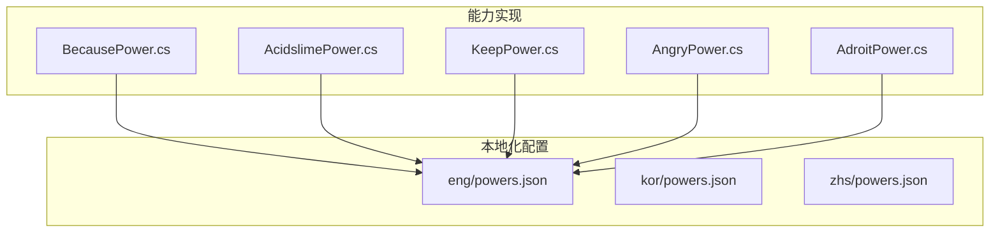
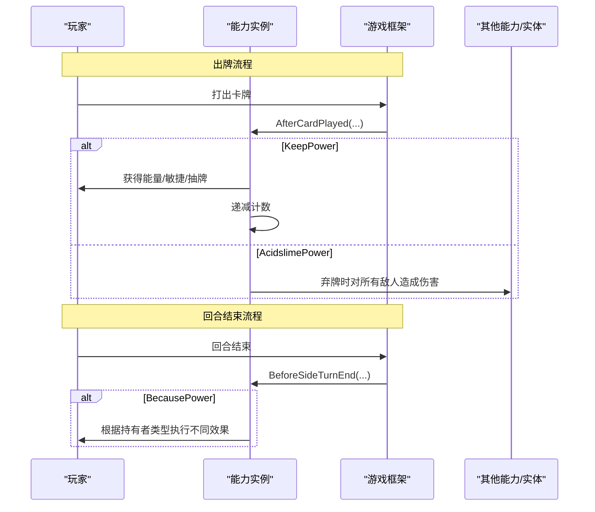
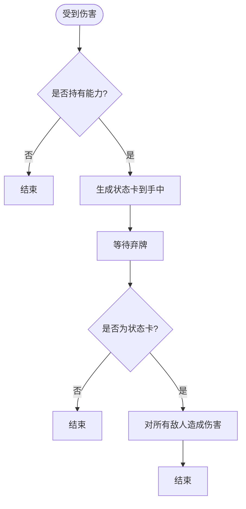
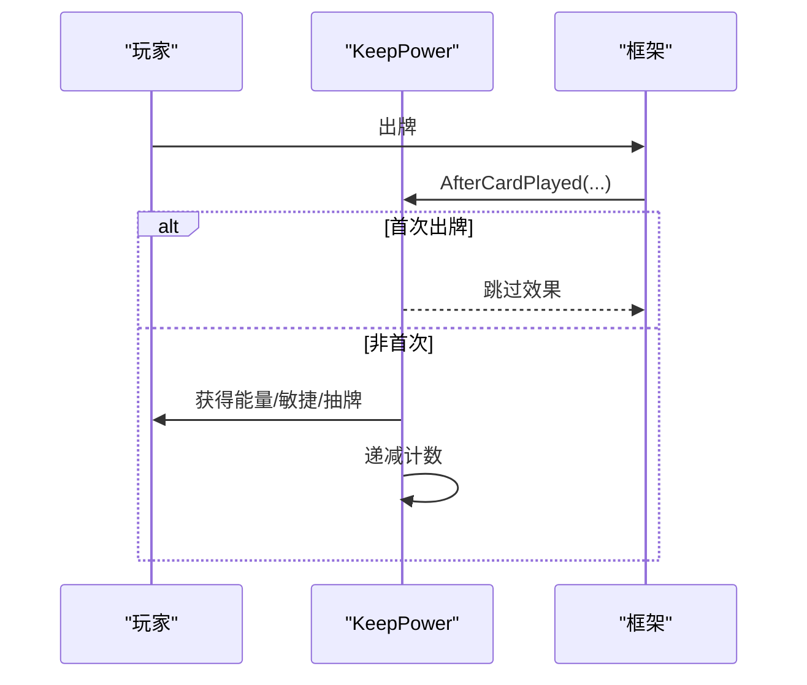
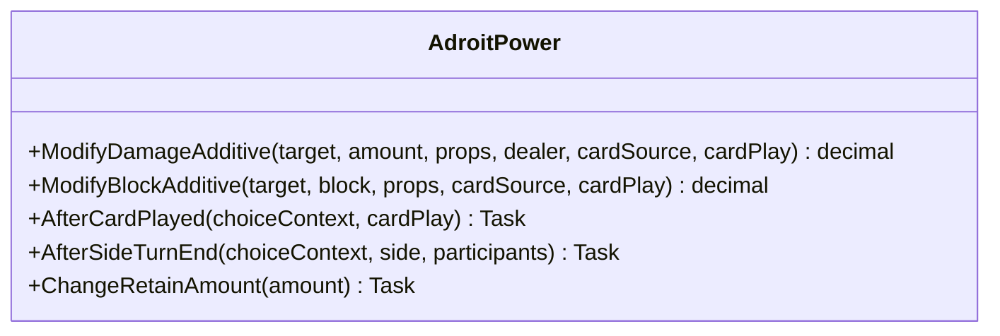
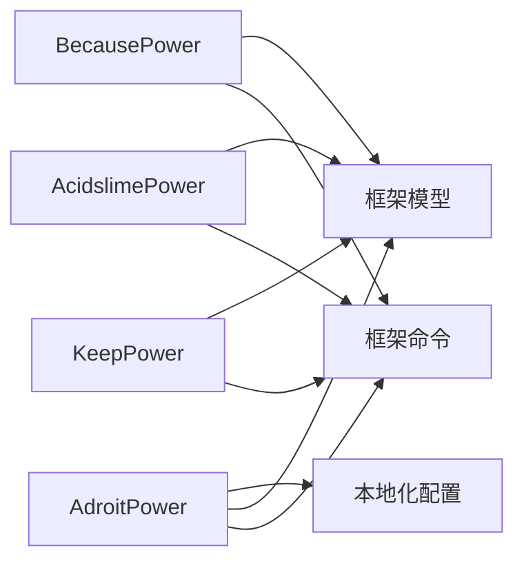

# 能力API

<cite>
**本文引用的文件**
- [BecausePower.cs](file://Scripts/Powers/BecausePower.cs)
- [AcidslimePower.cs](file://Scripts/Powers/Liver/AcidslimePower.cs)
- [KeepPower.cs](file://Scripts/Powers/Liver/KeepPower.cs)
- [AngryPower.cs](file://Scripts/Powers/RedCat/AngryPower.cs)
- [AdroitPower.cs](file://Scripts/Powers/River/AdroitPower.cs)
- [powers.json（英文）](file://SlugcatTheSpireII/localization/eng/powers.json)
- [powers.json（韩文）](file://SlugcatTheSpireII/localization/kor/powers.json)
- [powers.json（中文）](file://SlugcatTheSpireII/localization/zhs/powers.json)
</cite>

## 目录
1. [简介](#简介)
2. [项目结构](#项目结构)
3. [核心组件](#核心组件)
4. [架构总览](#架构总览)
5. [详细组件分析](#详细组件分析)
6. [依赖关系分析](#依赖关系分析)
7. [性能考量](#性能考量)
8. [故障排查指南](#故障排查指南)
9. [结论](#结论)
10. [附录](#附录)

## 简介
本文件面向“能力与状态效果”系统，聚焦基于 ModPowerTemplate 的能力实现模式，覆盖能力注册、生命周期钩子、数值修正、状态管理与交互机制。文档通过仓库中的具体能力实现，总结被动能力、主动能力、持续效果的通用范式，并给出自定义能力开发的最佳实践与优化建议。

## 项目结构
- 能力脚本统一位于 Scripts/Powers 下，按角色或主题分目录组织（如 Liver、RedCat、River）。
- 每个能力类继承自 ModPowerTemplate，并通过特性进行自动注册。
- 能力文案与描述由 localization 下的 powers.json 管理，支持多语言。

图表来源
- [BecausePower.cs:27-58](file://Scripts/Powers/BecausePower.cs#L27-L58)
- [AcidslimePower.cs:27-57](file://Scripts/Powers/Liver/AcidslimePower.cs#L27-L57)
- [KeepPower.cs:23-58](file://Scripts/Powers/Liver/KeepPower.cs#L23-L58)
- [AngryPower.cs:27-47](file://Scripts/Powers/RedCat/AngryPower.cs#L27-L47)
- [AdroitPower.cs:28-117](file://Scripts/Powers/River/AdroitPower.cs#L28-L117)
- [powers.json（英文）:207-267](file://SlugcatTheSpireII/localization/eng/powers.json#L207-L267)

章节来源
- [BecausePower.cs:27-58](file://Scripts/Powers/BecausePower.cs#L27-L58)
- [AcidslimePower.cs:27-57](file://Scripts/Powers/Liver/AcidslimePower.cs#L27-L57)
- [KeepPower.cs:23-58](file://Scripts/Powers/Liver/KeepPower.cs#L23-L58)
- [AngryPower.cs:27-47](file://Scripts/Powers/RedCat/AngryPower.cs#L27-L47)
- [AdroitPower.cs:28-117](file://Scripts/Powers/River/AdroitPower.cs#L28-L117)
- [powers.json（英文）:207-267](file://SlugcatTheSpireII/localization/eng/powers.json#L207-L267)

## 核心组件
- 能力基类：ModPowerTemplate（由框架提供），所有能力均继承该类以复用生命周期与命令体系。
- 能力注册：使用 [RegisterPower] 特性完成自动注册。
- 能力属性：
  - PowerType：能力类型（如 Buff）。
  - PowerStackType：堆叠方式（如 Counter）。
  - AssetProfile：图标资源路径。
  - CanonicalVars：动态变量声明（如能量）。
- 生命周期钩子（示例）：
  - BeforeSideTurnEnd：回合结束前触发。
  - AfterCardPlayed：出牌后触发。
  - AfterEnergySpent：消耗能量后触发。
  - AfterDamageReceived：受到伤害后触发。
  - AfterCardExhausted：弃牌后触发。
  - ModifyDamageAdditive / ModifyBlockAdditive：数值修正钩子。
- 常用命令：
  - PlayerCmd.GainEnergy：增加能量。
  - PowerCmd.Apply / Decrement / Remove：施加/递减/移除能力。
  - CardPileCmd.Draw / AddGeneratedCardToCombat：抽牌/生成卡牌加入战斗。
  - CreatureCmd.Damage / Kill：造成伤害/击杀。

章节来源
- [BecausePower.cs:27-58](file://Scripts/Powers/BecausePower.cs#L27-L58)
- [AcidslimePower.cs:27-57](file://Scripts/Powers/Liver/AcidslimePower.cs#L27-L57)
- [KeepPower.cs:23-58](file://Scripts/Powers/Liver/KeepPower.cs#L23-L58)
- [AngryPower.cs:27-47](file://Scripts/Powers/RedCat/AngryPower.cs#L27-L47)
- [AdroitPower.cs:28-117](file://Scripts/Powers/River/AdroitPower.cs#L28-L117)

## 架构总览
能力系统围绕“事件驱动 + 数值修正”的架构展开：
- 事件驱动：通过生命周期钩子在关键时机执行逻辑（回合阶段、出牌、伤害等）。
- 数值修正：在伤害/防御计算中插入修改量，实现增益/减益。
- 状态管理：通过能力自身 Amount/状态标志控制持续时间与次数。
- 交互机制：能力之间通过 HasPower/GetPower 查询与协作，或通过公共关键词/状态联动。

图表来源
- [KeepPower.cs:41-58](file://Scripts/Powers/Liver/KeepPower.cs#L41-L58)
- [AcidslimePower.cs:41-57](file://Scripts/Powers/Liver/AcidslimePower.cs#L41-L57)
- [BecausePower.cs:40-58](file://Scripts/Powers/BecausePower.cs#L40-L58)

## 详细组件分析

### 基础能力接口与模式
- 能力注册：[RegisterPower] 特性用于自动发现与注册能力。
- 能力元数据：
  - AssetProfile：定义图标资源路径。
  - Type：能力类型（例如 Buff）。
  - StackType：堆叠方式（例如 Counter）。
  - CanonicalVars：声明动态变量（如能量）。
- 生命周期钩子：
  - 回合相关：BeforeSideTurnEnd、AfterSideTurnEnd。
  - 卡牌相关：AfterCardPlayed、AfterCardExhausted。
  - 能量相关：AfterEnergySpent。
  - 伤害相关：AfterDamageReceived、ModifyDamageAdditive、ModifyBlockAdditive。

章节来源
- [BecausePower.cs:27-58](file://Scripts/Powers/BecausePower.cs#L27-L58)
- [AcidslimePower.cs:27-57](file://Scripts/Powers/Liver/AcidslimePower.cs#L27-L57)
- [KeepPower.cs:23-58](file://Scripts/Powers/Liver/KeepPower.cs#L23-L58)
- [AngryPower.cs:27-47](file://Scripts/Powers/RedCat/AngryPower.cs#L27-L47)
- [AdroitPower.cs:28-117](file://Scripts/Powers/River/AdroitPower.cs#L28-L117)

### 被动能力：酸液黏液（AcidslimePower）
- 行为模式：
  - 受到伤害时：为持有者生成一张“点状物”状态卡进入手牌。
  - 弃牌时：若弃掉的是该状态卡，则对所有敌人造成伤害。
- 关键点：
  - 使用 AfterDamageReceived 监听伤害事件。
  - 使用 AfterCardExhausted 监听弃牌事件。
  - 通过 CombatState.CreateCard 与 CardPileCmd.AddGeneratedCardToCombat 生成并加入手牌。

图表来源
- [AcidslimePower.cs:41-57](file://Scripts/Powers/Liver/AcidslimePower.cs#L41-L57)

章节来源
- [AcidslimePower.cs:27-57](file://Scripts/Powers/Liver/AcidslimePower.cs#L27-L57)

### 主动能力：保持推进（KeepPower）
- 行为模式：
  - 首次出牌跳过一次触发。
  - 后续每次出牌：获得能量、获得敏捷、抽牌，并递减计数。
- 关键点：
  - 使用 AfterCardPlayed 监听出牌事件。
  - 使用内部标志 first 控制首次跳过。
  - 使用 PowerCmd.Decrement 递减计数。

图表来源
- [KeepPower.cs:41-58](file://Scripts/Powers/Liver/KeepPower.cs#L41-L58)

章节来源
- [KeepPower.cs:23-58](file://Scripts/Powers/Liver/KeepPower.cs#L23-L58)

### 能量驱动能力：愤怒（AngryPower）
- 行为模式：
  - 消耗能量后：根据消耗的能量数量给予持有者“活力”。
- 关键点：
  - 使用 AfterEnergySpent 监听能量消耗。
  - 通过 PowerCmd.Apply 施加活力能力。

章节来源
- [AngryPower.cs:27-47](file://Scripts/Powers/RedCat/AngryPower.cs#L27-L47)

### 数值修正能力：灵巧（AdroitPower）
- 行为模式：
  - 修改伤害与防御：对移动类或特定来源的牌提供额外加成。
  - 出牌后消耗“灵巧”计数，并与其它能力/遗物联动。
  - 回合结束时若无“节水”能力则移除自身。
- 关键点：
  - 使用 ModifyDamageAdditive / ModifyBlockAdditive 进行数值修正。
  - 使用 AfterCardPlayed 处理消耗与联动。
  - 使用 AfterSideTurnEnd 清理状态。

图表来源
- [AdroitPower.cs:40-117](file://Scripts/Powers/River/AdroitPower.cs#L40-L117)

章节来源
- [AdroitPower.cs:28-117](file://Scripts/Powers/River/AdroitPower.cs#L28-L117)

### 回合结束能力：因为（BecausePower）
- 行为模式：
  - 回合结束前：若持有者为特定角色则减少工作等级；否则直接杀死持有者。
- 关键点：
  - 使用 BeforeSideTurnEnd 在回合结束前执行。
  - 根据持有者类型分支执行不同效果。

章节来源
- [BecausePower.cs:27-58](file://Scripts/Powers/BecausePower.cs#L27-L58)

### 能力间交互与优先级
- 能力查询：通过 HasPower/GetPower 判断是否存在某能力，从而调整行为（如 AdventurePower 影响 AdroitPower 的数值）。
- 联动消费：某些能力在其它能力消耗资源时同步响应（如 WetPower 减少灵巧）。
- 优先级：
  - 数值修正钩子在伤害/防御计算链中插入，确保全局一致性。
  - 生命周期钩子按框架顺序调用，注意副作用顺序（如先抽牌再递减计数）。

章节来源
- [AdroitPower.cs:40-117](file://Scripts/Powers/River/AdroitPower.cs#L40-L117)

## 依赖关系分析
- 外部依赖：
  - 框架命令：PlayerCmd、PowerCmd、CardPileCmd、CreatureCmd。
  - 框架模型：CombatState、ValueProp、CardModel、CardPlay。
  - 本地化：powers.json 提供能力标题与描述。
- 耦合性：
  - 能力之间通过 HasPower/GetPower 松耦合协作。
  - 数值修正集中处理，避免分散逻辑导致不一致。

图表来源
- [AdroitPower.cs:28-117](file://Scripts/Powers/River/AdroitPower.cs#L28-L117)
- [KeepPower.cs:23-58](file://Scripts/Powers/Liver/KeepPower.cs#L23-L58)
- [AcidslimePower.cs:27-57](file://Scripts/Powers/Liver/AcidslimePower.cs#L27-L57)
- [BecausePower.cs:27-58](file://Scripts/Powers/BecausePower.cs#L27-L58)

章节来源
- [AdroitPower.cs:28-117](file://Scripts/Powers/River/AdroitPower.cs#L28-L117)
- [KeepPower.cs:23-58](file://Scripts/Powers/Liver/KeepPower.cs#L23-L58)
- [AcidslimePower.cs:27-57](file://Scripts/Powers/Liver/AcidslimePower.cs#L27-L57)
- [BecausePower.cs:27-58](file://Scripts/Powers/BecausePower.cs#L27-L58)

## 性能考量
- 事件过滤：在钩子中尽早返回，避免不必要的计算（如条件不满足时直接返回）。
- 批量操作：尽量合并多次命令调用，减少帧开销。
- 状态缓存：对频繁查询的状态（如是否有某能力）可缓存至局部变量。
- 资源加载：图标等资源路径应稳定且复用，避免重复解析。

## 故障排查指南
- 常见问题：
  - 能力未生效：检查是否正确注册（[RegisterPower]）、是否在正确的生命周期钩子中执行。
  - 数值异常：检查 ModifyDamageAdditive/ModifyBlockAdditive 的条件与返回值。
  - 状态残留：确认 AfterSideTurnEnd 或相应清理逻辑是否执行。
- 调试建议：
  - 使用日志单例记录关键事件（如出牌、伤害、能力应用）。
  - 通过本地化文案快速定位能力标识，结合日志追踪。

章节来源
- [powers.json（英文）:207-267](file://SlugcatTheSpireII/localization/eng/powers.json#L207-L267)
- [powers.json（韩文）:239-265](file://SlugcatTheSpireII/localization/kor/powers.json#L239-L265)
- [powers.json（中文）:298-312](file://SlugcatTheSpireII/localization/zhs/powers.json#L298-L312)

## 结论
本能力系统以 ModPowerTemplate 为核心，通过生命周期钩子与数值修正实现灵活的能力扩展。借助统一的命令体系与本地化配置，开发者可以快速构建被动、主动与持续型能力，并通过能力间协作实现复杂机制。遵循本文档的模式与建议，可有效提升可维护性与性能。

## 附录
- 自定义能力开发步骤：
  1. 新建能力类并继承 ModPowerTemplate。
  2. 使用 [RegisterPower] 注册能力。
  3. 设置 AssetProfile、Type、StackType、CanonicalVars。
  4. 在合适的生命周期钩子中实现逻辑。
  5. 在 powers.json 中添加标题与描述。
- 最佳实践：
  - 明确能力职责，单一职责原则。
  - 使用幂等操作，避免副作用导致的不可预测行为。
  - 充分测试边界情况（如无目标、无能量、无卡牌等）。