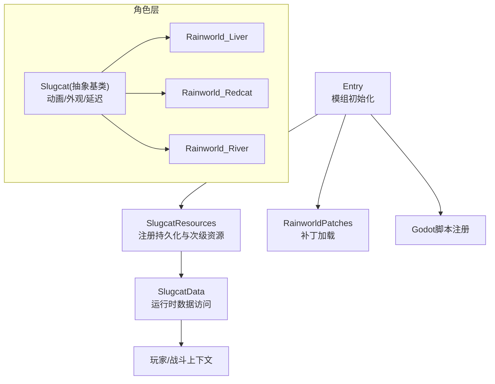
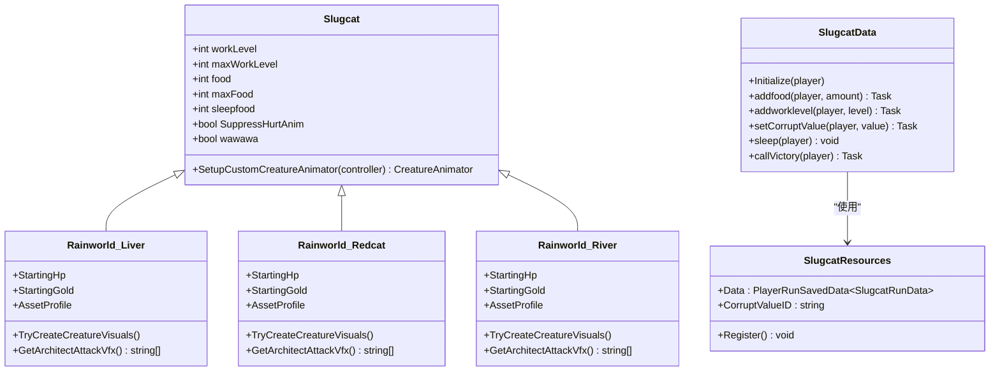
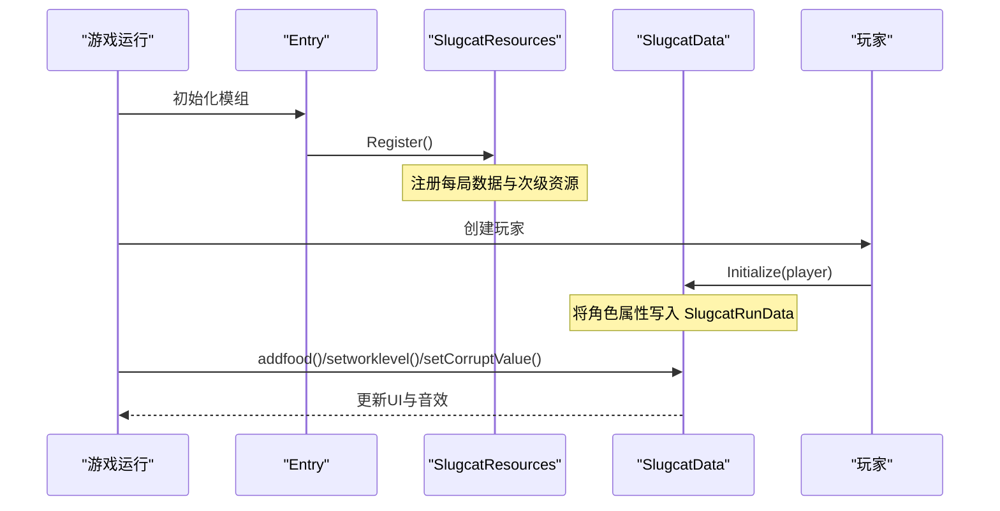
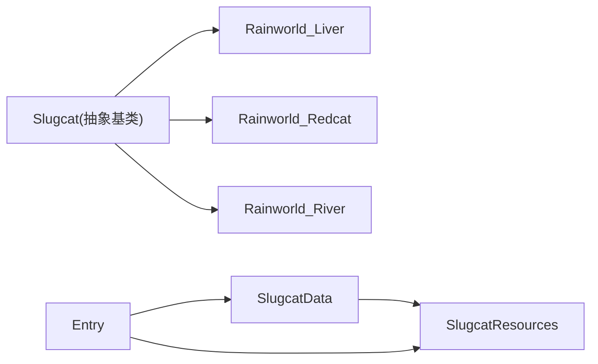

# 角色API

<cite>
**本文引用的文件**
- [Scripts/Slugcat/Slugcat.cs](file://Scripts/Slugcat/Slugcat.cs)
- [Scripts/Slugcat/Rainworld_Liver.cs](file://Scripts/Slugcat/Rainworld_Liver.cs)
- [Scripts/Slugcat/Rainworld_Redcat.cs](file://Scripts/Slugcat/Rainworld_Redcat.cs)
- [Scripts/Slugcat/Rainworld_River.cs](file://Scripts/Slugcat/Rainworld_River.cs)
- [Scripts/Slugcat/SlugcatData.cs](file://Scripts/Slugcat/SlugcatData.cs)
- [Scripts/Slugcat/SecondaryResource/SlugcatResources.cs](file://Scripts/Slugcat/SecondaryResource/SlugcatResources.cs)
- [Scripts/Slugcat/SecondaryResource/SlugcatRunData.cs](file://Scripts/Slugcat/SecondaryResource/SlugcatRunData.cs)
- [Scripts/Entry.cs](file://Scripts/Entry.cs)
</cite>

## 目录
1. [简介](#简介)
2. [项目结构](#项目结构)
3. [核心组件](#核心组件)
4. [架构总览](#架构总览)
5. [详细组件分析](#详细组件分析)
6. [依赖关系分析](#依赖关系分析)
7. [性能与资源管理](#性能与资源管理)
8. [故障排查指南](#故障排查指南)
9. [结论](#结论)
10. [附录：最佳实践与示例](#附录最佳实践与示例)

## 简介
本文件为“角色系统API”的权威文档，聚焦于 Slugcat 基类及其三个具体角色（Liver、RedCat、River）的扩展方法与专属API。内容涵盖：
- 角色初始化、动画控制、状态管理等核心接口
- 角色数据模型、资源管理与生命周期方法签名说明
- 与 RitsuLib 框架集成的特殊方法与注意事项
- 角色创建、配置与自定义的最佳实践示例

## 项目结构
本项目围绕“角色系统”的核心代码位于 Scripts/Slugcat 目录，包含：
- 基类与接口：Slugcat 接口与抽象基类，提供通用能力（动画、外观、延迟等）
- 具体角色：Rainworld_Liver、Rainworld_Redcat、Rainworld_River，分别定义初始牌组、遗物、资源与视觉资源
- 数据与资源：SlugcatData 负责运行时数据读写；SlugcatResources 注册持久化数据与次级资源（腐化值）
- 入口与集成：Entry 完成模组初始化、RitsuLib 集成、资源注册与补丁加载

图表来源
- [Scripts/Entry.cs:20-77](file://Scripts/Entry.cs#L20-L77)
- [Scripts/Slugcat/SecondaryResource/SlugcatResources.cs:7-49](file://Scripts/Slugcat/SecondaryResource/SlugcatResources.cs#L7-L49)
- [Scripts/Slugcat/SlugcatData.cs:32-104](file://Scripts/Slugcat/SlugcatData.cs#L32-L104)

章节来源
- [Scripts/Entry.cs:20-77](file://Scripts/Entry.cs#L20-L77)
- [Scripts/Slugcat/SecondaryResource/SlugcatResources.cs:7-49](file://Scripts/Slugcat/SecondaryResource/SlugcatResources.cs#L7-L49)

## 核心组件
- Slugcat 接口与抽象基类：定义角色公共属性（工作等级、食物、睡眠消耗等）、动画控制（攻击/施法延迟）、外观颜色、以及 CreatureAnimator 的自定义设置
- 三个具体角色：各自实现起始生命值、金币、起始牌组、起始遗物、资源路径、多人模式手势纹理、默认颜色等
- 数据与资源：通过 SlugcatData 暴露静态方法对玩家数据进行读写；通过 SlugcatResources 注册每局数据与次级资源（腐化值）

章节来源
- [Scripts/Slugcat/Slugcat.cs:40-135](file://Scripts/Slugcat/Slugcat.cs#L40-L135)
- [Scripts/Slugcat/Rainworld_Liver.cs:28-117](file://Scripts/Slugcat/Rainworld_Liver.cs#L28-L117)
- [Scripts/Slugcat/Rainworld_Redcat.cs:29-128](file://Scripts/Slugcat/Rainworld_Redcat.cs#L29-L128)
- [Scripts/Slugcat/Rainworld_River.cs:31-114](file://Scripts/Slugcat/Rainworld_River.cs#L31-L114)
- [Scripts/Slugcat/SlugcatData.cs:32-104](file://Scripts/Slugcat/SlugcatData.cs#L32-L104)
- [Scripts/Slugcat/SecondaryResource/SlugcatResources.cs:7-49](file://Scripts/Slugcat/SecondaryResource/SlugcatResources.cs#L7-L49)

## 架构总览
角色系统采用“模板+具体实现”的分层设计：
- 抽象基类封装通用行为（动画状态机、外观、延迟），具体角色仅关注差异化配置
- 数据层通过 SlugcatData 统一访问玩家数据，避免直接耦合底层存储
- 资源层通过 SlugcatResources 集中注册持久化数据与次级资源，保证跨模块一致性
- 入口 Entry 负责整体初始化流程，确保 RitsuLib 生态（补丁、资源、Godot脚本）正确装配

图表来源
- [Scripts/Slugcat/Slugcat.cs:61-135](file://Scripts/Slugcat/Slugcat.cs#L61-L135)
- [Scripts/Slugcat/Rainworld_Liver.cs:28-117](file://Scripts/Slugcat/Rainworld_Liver.cs#L28-L117)
- [Scripts/Slugcat/Rainworld_Redcat.cs:29-128](file://Scripts/Slugcat/Rainworld_Redcat.cs#L29-L128)
- [Scripts/Slugcat/Rainworld_River.cs:31-114](file://Scripts/Slugcat/Rainworld_River.cs#L31-L114)
- [Scripts/Slugcat/SlugcatData.cs:32-104](file://Scripts/Slugcat/SlugcatData.cs#L32-L104)
- [Scripts/Slugcat/SecondaryResource/SlugcatResources.cs:7-49](file://Scripts/Slugcat/SecondaryResource/SlugcatResources.cs#L7-L49)

## 详细组件分析

### Slugcat 基类与接口
- 公共属性
  - workLevel/maxWorkLevel：当前与最大工作等级
  - food/maxFood/sleepfood：当前食物、最大食物、睡眠所需食物
  - enemyfood/jyFood/bossfood/roomfood：不同房间类型奖励的食物基数
  - SuppressHurtAnim/wawawa：控制受击动画抑制与特定交互标志
- 动画控制
  - SetupCustomCreatureAnimator：定义 idle、attack、cast、hurt、die、relaxed、sleep、corrupt、meow、fakeDeath 等状态，并绑定到 CreatureAnimator
  - AttackAnimDelay/CastAnimDelay：攻击与施法动画延迟
- 外观与颜色
  - NameColor/EnergyLabelOutlineColor/DialogueColor/MapDrawingColor/RemoteTargetingLineColor/RemoteTargetingLineOutline：角色名称、能量标签、对话、地图绘制、远程瞄准线颜色
- 特效
  - GetArchitectAttackVfx：返回攻击特效列表

章节来源
- [Scripts/Slugcat/Slugcat.cs:40-135](file://Scripts/Slugcat/Slugcat.cs#L40-L135)

### 角色：Liver
- 起始属性
  - StartingHp=9，StartingGold=99
- 资源与场景
  - AssetProfile：合并基础资产，指定可视化场景、能量计数器、商人动画、休息点动画、UI图标、选择背景、多人手势纹理、覆盖原版遗物贴图
- 起始牌组与遗物
  - StartingDeckEntries：包含若干攻击、防御、技能卡牌
  - StartingRelicTypes：初始遗物
- 动画与颜色
  - 继承基类延迟与颜色，可覆盖
- 视觉创建
  - TryCreateCreatureVisuals：从场景路径创建 NCreatureVisuals

章节来源
- [Scripts/Slugcat/Rainworld_Liver.cs:28-117](file://Scripts/Slugcat/Rainworld_Liver.cs#L28-L117)

### 角色：RedCat
- 起始属性
  - StartingHp=11，StartingGold=99
- 资源与场景
  - AssetProfile：同上，但使用 RedCat 的资源路径与图标
- 起始牌组与遗物
  - StartingDeckEntries：包含攻击、防御、技能与腐化相关卡牌
  - StartingRelicTypes：初始遗物
- 动画与颜色
  - 覆盖名称颜色、地图绘制颜色、远程瞄准线颜色等
- 视觉创建
  - TryCreateCreatureVisuals：从场景路径创建 NCreatureVisuals

章节来源
- [Scripts/Slugcat/Rainworld_Redcat.cs:29-128](file://Scripts/Slugcat/Rainworld_Redcat.cs#L29-L128)

### 角色：River
- 起始属性
  - StartingHp=8，StartingGold=99
- 资源与场景
  - AssetProfile：River 专用资源路径与图标
- 起始牌组与遗物
  - StartingDeckEntries：包含攻击、防御、技能卡牌
  - StartingRelicTypes：初始遗物
- 动画与颜色
  - 覆盖名称颜色、地图绘制颜色、远程瞄准线颜色等
- 视觉创建
  - TryCreateCreatureVisuals：从场景路径创建 NCreatureVisuals

章节来源
- [Scripts/Slugcat/Rainworld_River.cs:31-114](file://Scripts/Slugcat/Rainworld_River.cs#L31-L114)

### 数据模型与资源管理
- SlugcatRunData：保存每局数据（工作等级、最大工作等级、食物、最大食物、睡眠食物、初始化标记、是否拥有超生）
- SlugcatResources：注册每局数据（按玩家维度）、遗物过滤数据、次级资源“腐化值”（范围0-5，战斗中持久化）
- SlugcatData：提供静态方法访问与修改数据，包括：
  - Initialize：在玩家初始化时填充数据
  - addfood/addMaxWorkLevel/setworklevel：食物与工作等级变更
  - setCorruptValue/addCorruptValue：腐化值设置与增加（含能力联动）
  - reLive/cansleep/trysleep/sleep：复活与睡眠逻辑
  - callVictory/getRewordFood：胜利后根据房间类型发放食物与工作等级提升

图表来源
- [Scripts/Entry.cs:20-77](file://Scripts/Entry.cs#L20-L77)
- [Scripts/Slugcat/SecondaryResource/SlugcatResources.cs:7-49](file://Scripts/Slugcat/SecondaryResource/SlugcatResources.cs#L7-L49)
- [Scripts/Slugcat/SlugcatData.cs:76-104](file://Scripts/Slugcat/SlugcatData.cs#L76-L104)

章节来源
- [Scripts/Slugcat/SecondaryResource/SlugcatRunData.cs:1-14](file://Scripts/Slugcat/SecondaryResource/SlugcatRunData.cs#L1-L14)
- [Scripts/Slugcat/SecondaryResource/SlugcatResources.cs:7-49](file://Scripts/Slugcat/SecondaryResource/SlugcatResources.cs#L7-L49)
- [Scripts/Slugcat/SlugcatData.cs:32-104](file://Scripts/Slugcat/SlugcatData.cs#L32-L104)

## 依赖关系分析
- 角色与基类：三个具体角色均继承自 Slugcat 抽象基类，复用动画与外观逻辑
- 数据与资源：SlugcatData 依赖 SlugcatResources 提供的数据存取与次级资源定义
- 入口与框架：Entry 调用 RitsuLib 进行补丁、资源、Godot脚本注册，并订阅生命周期事件

图表来源
- [Scripts/Slugcat/Slugcat.cs:61-135](file://Scripts/Slugcat/Slugcat.cs#L61-L135)
- [Scripts/Slugcat/Rainworld_Liver.cs:28-117](file://Scripts/Slugcat/Rainworld_Liver.cs#L28-L117)
- [Scripts/Slugcat/Rainworld_Redcat.cs:29-128](file://Scripts/Slugcat/Rainworld_Redcat.cs#L29-L128)
- [Scripts/Slugcat/Rainworld_River.cs:31-114](file://Scripts/Slugcat/Rainworld_River.cs#L31-L114)
- [Scripts/Slugcat/SlugcatData.cs:32-104](file://Scripts/Slugcat/SlugcatData.cs#L32-L104)
- [Scripts/Slugcat/SecondaryResource/SlugcatResources.cs:7-49](file://Scripts/Slugcat/SecondaryResource/SlugcatResources.cs#L7-L49)
- [Scripts/Entry.cs:20-77](file://Scripts/Entry.cs#L20-L77)

章节来源
- [Scripts/Entry.cs:20-77](file://Scripts/Entry.cs#L20-L77)

## 性能与资源管理
- 动画状态机：通过 CreatureAnimator 统一管理状态切换，减少重复逻辑，提高渲染效率
- 资源路径：每个角色通过 AssetProfile 集中声明资源路径，便于维护与替换
- 数据持久化：使用 RitsuLib 的 RunSavedData 与 SecondaryResource，确保跨房间/战斗的数据一致性与同步
- 声音与特效：通过 SfxCmd 与 VFX 列表触发音效与特效，避免阻塞主线程

[本节为通用指导，不直接分析具体文件]

## 故障排查指南
- 初始化失败：检查 Entry 是否正确调用 SlugcatResources.Register 与 Godot 脚本注册
- 数据未生效：确认 SlugcatData.Initialize 被调用且玩家 Character 类型为 Slugcat
- 动画异常：检查 SetupCustomCreatureAnimator 中状态绑定与条件（如 SuppressHurtAnim）
- 资源路径错误：核对 AssetProfile 中的 Scenes、Ui、Audio 路径是否存在
- 次级资源异常：验证 CorruptValue 的注册与范围限制（0-5）

章节来源
- [Scripts/Entry.cs:20-77](file://Scripts/Entry.cs#L20-L77)
- [Scripts/Slugcat/SlugcatData.cs:76-104](file://Scripts/Slugcat/SlugcatData.cs#L76-L104)
- [Scripts/Slugcat/Slugcat.cs:93-135](file://Scripts/Slugcat/Slugcat.cs#L93-L135)
- [Scripts/Slugcat/Rainworld_Liver.cs:41-79](file://Scripts/Slugcat/Rainworld_Liver.cs#L41-L79)
- [Scripts/Slugcat/Rainworld_Redcat.cs:44-84](file://Scripts/Slugcat/Rainworld_Redcat.cs#L44-L84)
- [Scripts/Slugcat/Rainworld_River.cs:47-85](file://Scripts/Slugcat/Rainworld_River.cs#L47-L85)
- [Scripts/Slugcat/SecondaryResource/SlugcatResources.cs:39-49](file://Scripts/Slugcat/SecondaryResource/SlugcatResources.cs#L39-L49)

## 结论
本角色系统以清晰的层次结构与模块化设计实现了可扩展的角色API。Slugcat 基类提供统一的动画与外观控制，三个具体角色专注于差异化配置。数据与资源通过 RitsuLib 统一管理，确保稳定性与可维护性。遵循本文档的最佳实践，可高效扩展新角色或定制现有角色行为。

[本节为总结，不直接分析具体文件]

## 附录：最佳实践与示例
- 角色创建
  - 继承 Slugcat 抽象基类，实现 StartingHp、StartingGold、AssetProfile、StartingDeckEntries、StartingRelicTypes
  - 使用 [RegisterCharacter] 装饰器自动注册角色
- 配置与自定义
  - 通过 AssetProfile 配置场景、UI、音频、多人手势纹理
  - 覆盖 NameColor、EnergyLabelOutlineColor、DialogueColor 等颜色属性
  - 使用 TryCreateCreatureVisuals 从场景路径创建可视化节点
- 数据与资源
  - 使用 SlugcatData 的静态方法进行数据读写（addfood、setworklevel、setCorruptValue 等）
  - 通过 SlugcatResources.Register 注册每局数据与次级资源
- RitsuLib 集成
  - 在 Entry.Init 中调用 RitsuLibFramework 的补丁、资源、脚本注册
  - 使用 ModTypeDiscoveryHub 自动发现内容（卡牌、遗物、能力等）
  - 利用 RegisterArchaicToothTranscendenceMapping 与 RegisterTouchOfOrobasRefinementMapping 建立卡牌与遗物的关联映射

章节来源
- [Scripts/Slugcat/Rainworld_Liver.cs:28-117](file://Scripts/Slugcat/Rainworld_Liver.cs#L28-L117)
- [Scripts/Slugcat/Rainworld_Redcat.cs:29-128](file://Scripts/Slugcat/Rainworld_Redcat.cs#L29-L128)
- [Scripts/Slugcat/Rainworld_River.cs:31-114](file://Scripts/Slugcat/Rainworld_River.cs#L31-L114)
- [Scripts/Slugcat/SlugcatData.cs:32-104](file://Scripts/Slugcat/SlugcatData.cs#L32-L104)
- [Scripts/Slugcat/SecondaryResource/SlugcatResources.cs:7-49](file://Scripts/Slugcat/SecondaryResource/SlugcatResources.cs#L7-L49)
- [Scripts/Entry.cs:20-77](file://Scripts/Entry.cs#L20-L77)