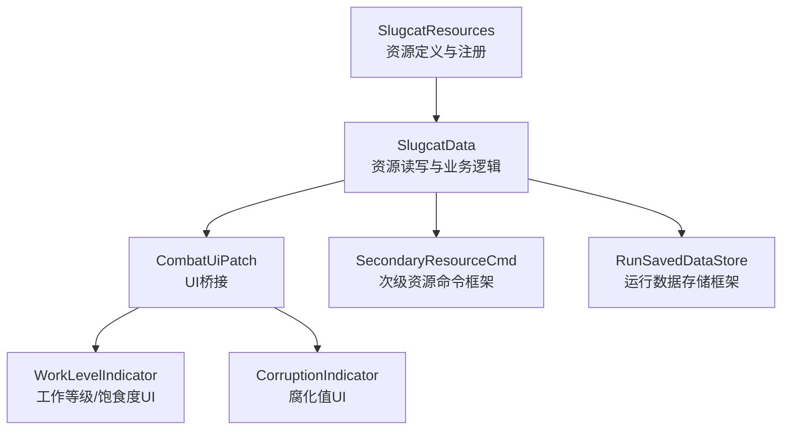
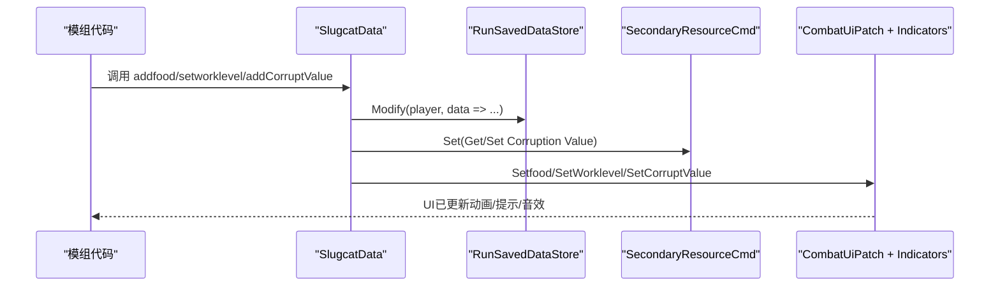
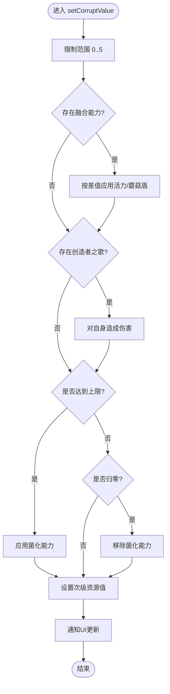
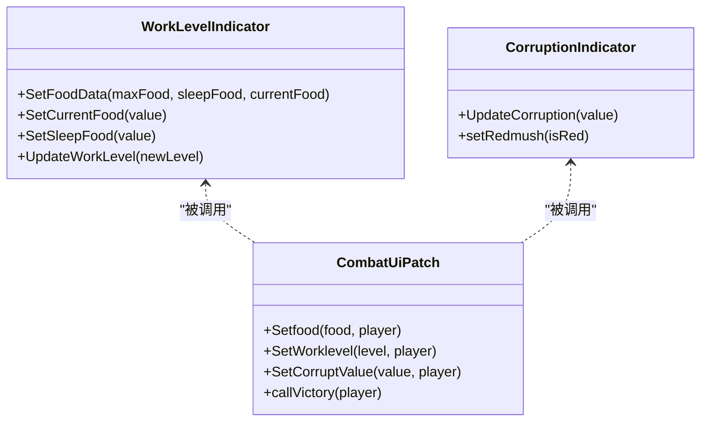
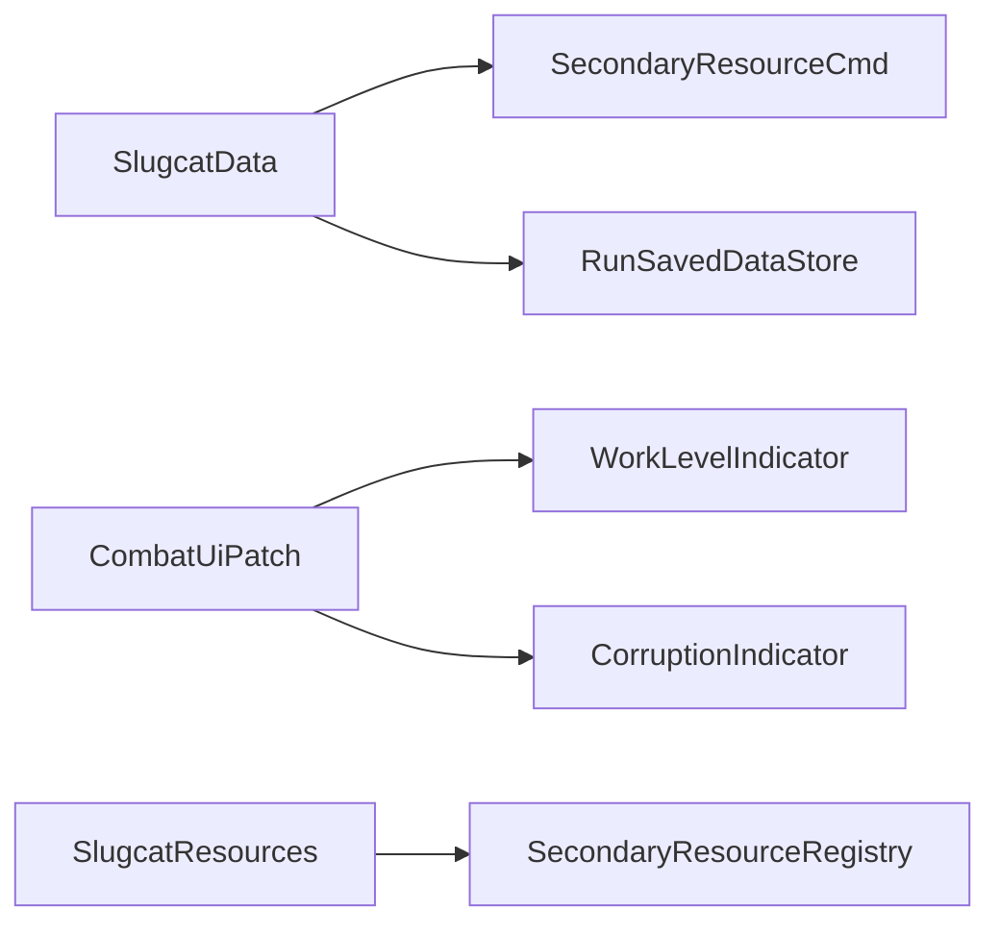

# 资源API

<cite>
**本文引用的文件**
- [SlugcatResources.cs](file://Scripts/Slugcat/SecondaryResource/SlugcatResources.cs)
- [SlugcatRunData.cs](file://Scripts/Slugcat/SecondaryResource/SlugcatRunData.cs)
- [RelicFilterRunData.cs](file://Scripts/Slugcat/SecondaryResource/RelicFilterRunData.cs)
- [SlugcatData.cs](file://Scripts/Slugcat/SlugcatData.cs)
- [CombatUiPatch.cs](file://Scripts/patches/CombatUiPatch.cs)
- [CorruptionIndicator.cs](file://Godot/CombatUI/CorruptionIndicator.cs)
- [WorkLevelIndicator.cs](file://Godot/CombatUI/WorkLevelIndicator.cs)
- [settings_ui.json（中）](file://SlugcatTheSpireII/localization/zhs/settings_ui.json)
- [settings_ui.json（英）](file://SlugcatTheSpireII/localization/eng/settings_ui.json)
- [log.txt](file://log.txt)
</cite>

## 目录
1. [简介](#简介)
2. [项目结构](#项目结构)
3. [核心组件](#核心组件)
4. [架构总览](#架构总览)
5. [详细组件分析](#详细组件分析)
6. [依赖关系分析](#依赖关系分析)
7. [性能与同步特性](#性能与同步特性)
8. [故障排查指南](#故障排查指南)
9. [结论](#结论)
10. [附录：扩展与自定义资源开发指南](#附录：扩展与自定义资源开发指南)

## 简介
本文件为“资源管理系统API”的完整接口文档，聚焦于次级资源的定义、注册与管理，覆盖食物、工作等级（业力）、腐化值等游戏内资源。文档说明资源数据的持久化、同步与版本兼容性处理；记录资源变更事件、监听器与回调机制；提供资源平衡性调整、数值计算与显示更新的API；并给出资源系统扩展与自定义资源开发的方法指南。

## 项目结构
资源系统由以下关键部分组成：
- 资源定义与注册：在模块初始化时注册次级资源与运行数据存储
- 运行时数据模型：玩家回合数据（工作等级、饱食度、休眠阈值等）
- 资源访问与修改API：统一的读取/写入与业务逻辑封装
- UI指示器：工作等级与饱食度、腐化值的可视化更新
- 补丁桥接：将资源变化推送到UI层

图表来源
- [SlugcatResources.cs:15-48](file://Scripts/Slugcat/SecondaryResource/SlugcatResources.cs#L15-L48)
- [SlugcatData.cs:32-366](file://Scripts/Slugcat/SlugcatData.cs#L32-L366)
- [CombatUiPatch.cs:16-136](file://Scripts/patches/CombatUiPatch.cs#L16-L136)
- [WorkLevelIndicator.cs:14-269](file://Godot/CombatUI/WorkLevelIndicator.cs#L14-L269)
- [CorruptionIndicator.cs:12-148](file://Godot/CombatUI/CorruptionIndicator.cs#L12-L148)

章节来源
- [SlugcatResources.cs:15-48](file://Scripts/Slugcat/SecondaryResource/SlugcatResources.cs#L15-L48)
- [CombatUiPatch.cs:16-136](file://Scripts/patches/CombatUiPatch.cs#L16-L136)

## 核心组件
- 资源定义与注册
  - 通过框架提供的注册入口，注册玩家级运行数据与次级资源
  - 工作等级、饱食度、休眠阈值等以玩家级运行数据形式持久化
  - 腐化值作为次级资源进行战斗内持久化与同步
- 运行时数据模型
  - 工作等级、最大工作等级、饱食度、最大饱食度、休眠阈值、初始化标志、特殊状态标记
- 资源访问与修改API
  - 提供获取/设置工作等级、饱食度、腐化值等方法，并在必要时触发UI更新与联动效果
- UI指示器
  - 工作等级与饱食度指示器负责展示当前状态与动画切换
  - 腐化值指示器负责展示当前腐化等级与菌化状态提示
- 补丁桥接
  - 将资源变化统一转发到对应UI组件，确保多端同步与显示一致

章节来源
- [SlugcatRunData.cs:3-14](file://Scripts/Slugcat/SecondaryResource/SlugcatRunData.cs#L3-L14)
- [SlugcatData.cs:32-366](file://Scripts/Slugcat/SlugcatData.cs#L32-L366)
- [WorkLevelIndicator.cs:14-269](file://Godot/CombatUI/WorkLevelIndicator.cs#L14-L269)
- [CorruptionIndicator.cs:12-148](file://Godot/CombatUI/CorruptionIndicator.cs#L12-L148)
- [CombatUiPatch.cs:16-136](file://Scripts/patches/CombatUiPatch.cs#L16-L136)

## 架构总览
资源系统的整体流程如下：
- 初始化阶段：注册运行数据与次级资源，准备UI组件
- 运行时阶段：通过API修改资源值，触发业务逻辑与UI更新
- 同步阶段：使用框架的保存策略与同步选项，保证多人模式下的数据一致性
- 事件阶段：资源变更触发能力联动、UI刷新、音效播放等副作用

图表来源
- [SlugcatData.cs:117-221](file://Scripts/Slugcat/SlugcatData.cs#L117-L221)
- [SlugcatData.cs:239-325](file://Scripts/Slugcat/SlugcatData.cs#L239-L325)
- [CombatUiPatch.cs:95-123](file://Scripts/patches/CombatUiPatch.cs#L95-L123)

## 详细组件分析

### 资源定义与注册（SlugcatResources）
- 功能要点
  - 注册玩家级运行数据：键名固定，默认工厂创建数据对象，写策略为“当设置时写入”，开启大厅同步
  - 注册次级资源：腐化值，默认值为0，基础上限为5，回合开始策略为无，持久化策略为战斗内
  - 暴露腐化值ID供其他模块引用
- 设计考量
  - 使用框架的存储与次级资源注册机制，避免自行实现序列化与同步
  - 通过常量ID解耦资源标识与具体实现，便于扩展与测试

章节来源
- [SlugcatResources.cs:15-48](file://Scripts/Slugcat/SecondaryResource/SlugcatResources.cs#L15-L48)

### 运行时数据模型（SlugcatRunData / RelicFilterRunData）
- 字段说明
  - 工作等级、最大工作等级：控制重生与生命提升效率
  - 饱食度、最大饱食度、休眠阈值：用于休眠行为判定与UI展示
  - 初始化标志：防止重复初始化
  - 特殊状态标记：如“超生”状态
  - 遗物过滤配置：用于兼容性与功能开关
- 复杂度
  - 数据结构简单，时间复杂度O(1)，空间占用小
- 数据流
  - 初始化时从角色属性拷贝到运行数据
  - 修改后通过存储层持久化并触发同步

章节来源
- [SlugcatRunData.cs:3-14](file://Scripts/Slugcat/SecondaryResource/SlugcatRunData.cs#L3-L14)
- [RelicFilterRunData.cs:3-8](file://Scripts/Slugcat/SecondaryResource/RelicFilterRunData.cs#L3-L8)
- [SlugcatData.cs:76-104](file://Scripts/Slugcat/SlugcatData.cs#L76-L104)

### 资源访问与修改API（SlugcatData）
- 工作等级
  - 获取/设置工作等级，包含边界检查、音效播放、生命值回满、能力联动（错误工作等级保护）
  - 死亡重活逻辑：根据能力与遗物决定降级或恢复
- 饱食度
  - 增加饱食度，超过上限时转换为力量（胖世界能力），播放音效，更新UI
  - 休眠判定：满足阈值且存活且非假死状态
- 腐化值
  - 设置/增加腐化值，包含上限限制、能力联动（融合、创造者之歌扣血、畸变形态加力量、菌化状态切换）
  - 通过次级资源命令设置值，并通知UI更新
- 胜利奖励
  - 根据房间类型给予饱食度与工作等级提升，特定角色额外提升最大工作等级

图表来源
- [SlugcatData.cs:239-325](file://Scripts/Slugcat/SlugcatData.cs#L239-L325)

章节来源
- [SlugcatData.cs:117-221](file://Scripts/Slugcat/SlugcatData.cs#L117-L221)
- [SlugcatData.cs:239-325](file://Scripts/Slugcat/SlugcatData.cs#L239-L325)
- [SlugcatData.cs:339-365](file://Scripts/Slugcat/SlugcatData.cs#L339-L365)

### UI指示器与桥接（WorkLevelIndicator / CorruptionIndicator / CombatUiPatch）
- 工作等级与饱食度指示器
  - 动态加载纹理，构建食物图标容器，支持分界点显示
  - 提供设置当前饱食度、休眠阈值、更新工作等级的方法
  - 根据能力状态切换纹理与颜色（红蘑菇、工作等级锁）
- 腐化值指示器
  - 加载背景与填充纹理，支持闪烁动画
  - 根据腐化值选择对应填充图，显示菌化状态
- 补丁桥接
  - 在战斗UI就绪时注入按钮与指示器
  - 在激活时初始化数据与可见性
  - 提供统一方法更新工作等级、饱食度、腐化值，并处理多人同步场景

图表来源
- [WorkLevelIndicator.cs:127-269](file://Godot/CombatUI/WorkLevelIndicator.cs#L127-L269)
- [CorruptionIndicator.cs:128-148](file://Godot/CombatUI/CorruptionIndicator.cs#L128-L148)
- [CombatUiPatch.cs:95-136](file://Scripts/patches/CombatUiPatch.cs#L95-L136)

章节来源
- [WorkLevelIndicator.cs:14-269](file://Godot/CombatUI/WorkLevelIndicator.cs#L14-L269)
- [CorruptionIndicator.cs:12-148](file://Godot/CombatUI/CorruptionIndicator.cs#L12-L148)
- [CombatUiPatch.cs:16-136](file://Scripts/patches/CombatUiPatch.cs#L16-L136)

## 依赖关系分析
- 组件耦合
  - SlugcatData依赖框架的次级资源命令与运行数据存储
  - CombatUiPatch依赖UI组件实例，负责将数据变化广播到界面
  - 指示器依赖纹理资源与本地化文本
- 外部依赖
  - STS2RitsuLib：提供次级资源与运行数据存储能力
  - 游戏框架：战斗UI生命周期、能力系统、音效系统
- 潜在循环依赖
  - 通过静态桥接类解耦，避免直接循环引用
- 接口契约
  - 次级资源ID作为稳定契约，允许跨模块引用
  - 运行数据键名与写策略作为存储契约

图表来源
- [SlugcatData.cs:239-325](file://Scripts/Slugcat/SlugcatData.cs#L239-L325)
- [SlugcatResources.cs:15-48](file://Scripts/Slugcat/SecondaryResource/SlugcatResources.cs#L15-L48)
- [CombatUiPatch.cs:16-136](file://Scripts/patches/CombatUiPatch.cs#L16-L136)

章节来源
- [SlugcatData.cs:239-325](file://Scripts/Slugcat/SlugcatData.cs#L239-L325)
- [SlugcatResources.cs:15-48](file://Scripts/Slugcat/SecondaryResource/SlugcatResources.cs#L15-L48)
- [CombatUiPatch.cs:16-136](file://Scripts/patches/CombatUiPatch.cs#L16-L136)

## 性能与同步特性
- 持久化策略
  - 运行数据采用“当设置时写入”，减少不必要的磁盘IO
  - 次级资源采用“战斗内持久化”，适合战斗期间频繁变更的资源
- 同步策略
  - 开启大厅同步，确保多人模式下数据一致
  - UI更新仅在目标玩家与当前战斗房间有效，避免无效广播
- 已知问题与版本影响
  - 日志提及多人模式下某些资源可能不同步，需在后续版本逐步修复
  - 版本更新涉及能力重做与数值调整，需注意兼容性

章节来源
- [SlugcatResources.cs:15-48](file://Scripts/Slugcat/SecondaryResource/SlugcatResources.cs#L15-L48)
- [log.txt:1-73](file://log.txt#L1-L73)

## 故障排查指南
- UI未更新
  - 检查桥接方法是否被调用，确认当前房间与玩家匹配
  - 验证指示器实例是否有效，避免空引用
- 资源值异常
  - 检查边界限制与能力联动逻辑，确认是否被其他能力覆盖
  - 核对次级资源ID与注册信息是否一致
- 多人不同步
  - 确认运行数据与次级资源均启用同步
  - 关注日志中的已知问题，优先修复高优先级场景

章节来源
- [CombatUiPatch.cs:95-136](file://Scripts/patches/CombatUiPatch.cs#L95-L136)
- [log.txt:1-73](file://log.txt#L1-L73)

## 结论
本资源系统通过清晰的定义、注册与API封装，实现了食物、工作等级、腐化值等核心资源的统一管理。结合框架的持久化与同步机制，保证了单人与多人模式下的数据一致性。UI层通过桥接方式及时响应资源变化，提供直观的状态反馈。未来可通过扩展次级资源与运行数据，进一步丰富游戏机制与玩法。

## 附录：扩展与自定义资源开发指南
- 新增次级资源
  - 在模块注册阶段调用次级资源注册表，定义默认值、基础上限、回合策略与持久化策略
  - 暴露资源ID供其他模块引用
- 新增运行数据
  - 在运行数据存储中注册玩家级数据，设置默认工厂与写策略
  - 在初始化时从角色属性拷贝数据，确保一致性
- 资源变更事件与监听
  - 通过API修改资源值时，在内部触发能力联动与UI更新
  - 如需外部监听，可在桥接层暴露事件或回调，供其他模块订阅
- 数值计算与显示更新
  - 在资源修改逻辑中加入边界检查与能力联动
  - 通过桥接方法统一更新UI，确保多端一致
- 版本兼容性与平衡性调整
  - 使用配置与本地化文本管理数值与描述
  - 在日志中记录版本改动与已知问题，逐步优化

章节来源
- [SlugcatResources.cs:15-48](file://Scripts/Slugcat/SecondaryResource/SlugcatResources.cs#L15-L48)
- [SlugcatData.cs:117-221](file://Scripts/Slugcat/SlugcatData.cs#L117-L221)
- [CombatUiPatch.cs:16-136](file://Scripts/patches/CombatUiPatch.cs#L16-L136)
- [settings_ui.json（中）:1-24](file://SlugcatTheSpireII/localization/zhs/settings_ui.json#L1-L24)
- [settings_ui.json（英）:1-37](file://SlugcatTheSpireII/localization/eng/settings_ui.json#L1-L37)
- [log.txt:1-73](file://log.txt#L1-L73)