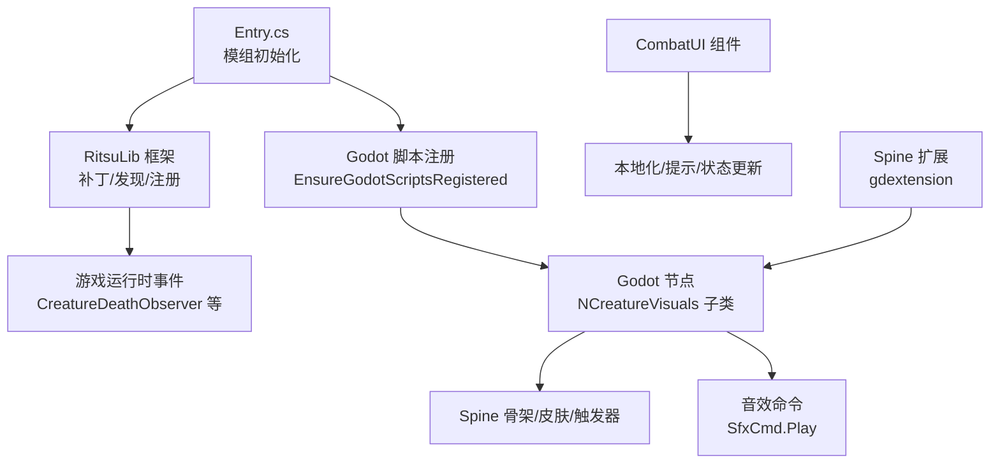
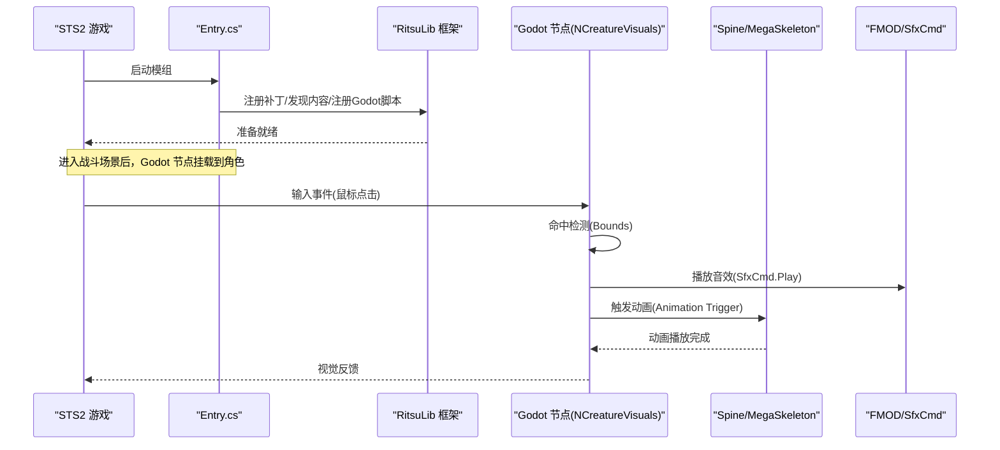
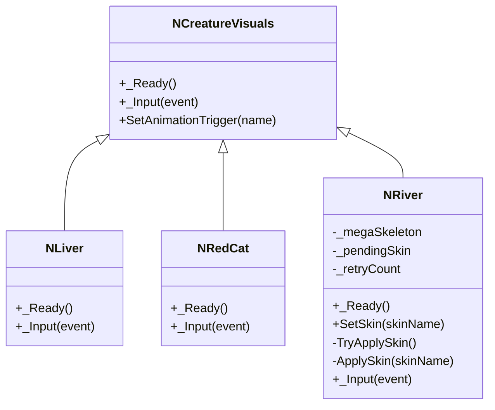
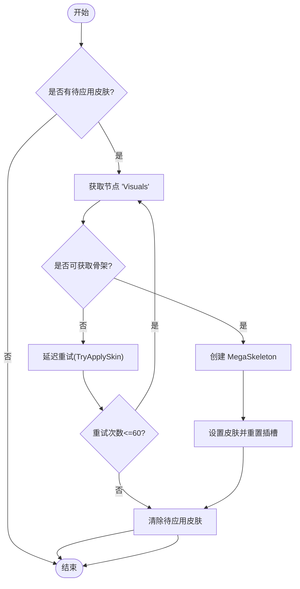
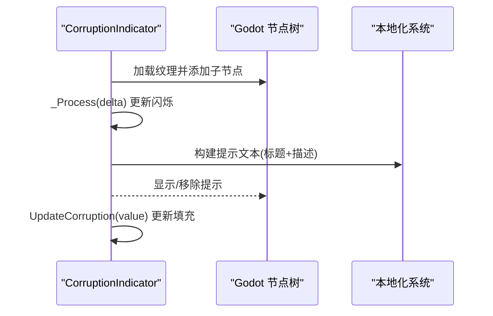
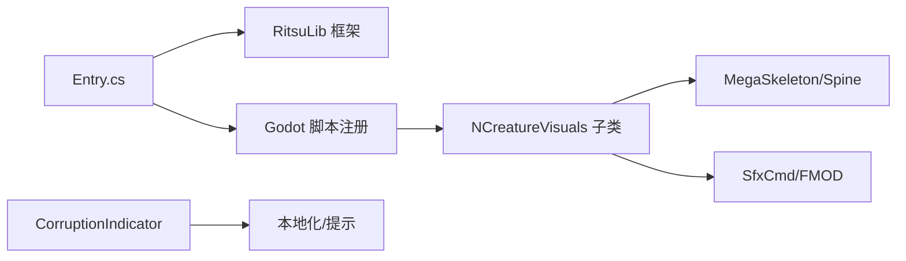

# Godot引擎集成

<cite>
**本文引用的文件**
- [project.godot](file://project.godot)
- [mod_manifest.json](file://mod_manifest.json)
- [Entry.cs](file://Scripts/Entry.cs)
- [RainworldModConfig.cs](file://Scripts/RainworldModConfig.cs)
- [NLiver.cs](file://Godot/Character/Liver/NLiver.cs)
- [NRedCat.cs](file://Godot/Character/RedCat/NRedCat.cs)
- [NRiver.cs](file://Godot/Character/River/NRiver.cs)
- [CorruptionIndicator.cs](file://Godot/CombatUI/CorruptionIndicator.cs)
- [EnergyCounter.cs](file://Godot/SlugCatEnergyCounter/EnergyCounter.cs)
- [spine_godot_extension.gdextension](file://bin/spine_godot_extension.gdextension)
</cite>

## 目录
1. [简介](#简介)
2. [项目结构](#项目结构)
3. [核心组件](#核心组件)
4. [架构总览](#架构总览)
5. [详细组件分析](#详细组件分析)
6. [依赖关系分析](#依赖关系分析)
7. [性能考虑](#性能考虑)
8. [故障排查指南](#故障排查指南)
9. [结论](#结论)
10. [附录](#附录)

## 简介
本技术文档面向在 Slay the Spire 2（STS2）中使用 RitsuLib 与 Godot 集成的模组开发，重点说明：
- C# 与 Godot 脚本的通信机制（通过 RitsuLib 桥接、Godot 节点扩展）。
- 角色模型的加载与动画控制（Spine 骨架、皮肤切换、触发器）。
- 角色动画系统、UI 组件开发与 3D/2D 渲染集成。
- Spine 动画集成、资源管理与性能优化。
- Godot 扩展使用方法与自定义节点开发。
- 角色模型制作规范、动画绑定指南与材质设置建议。
- 调试技巧与常见问题解决方案。
- 最佳实践示例（以代码片段路径引用为主）。

该项目基于 Godot 4.5 + C#，并通过 RitsuLib 将 STS2 游戏逻辑与 Godot 可视化层解耦，实现战斗内角色与 UI 的动态展示。

## 项目结构
- 配置与入口
  - project.godot：启用 C#、移动端渲染目标等。
  - mod_manifest.json：模组元数据与依赖声明。
  - Entry.cs：模组初始化、补丁注册、内容发现、音频银行注册、生命周期订阅等。
  - RainworldModConfig.cs：模组设置项定义与 UI 注册。
- Godot 可视化层
  - Character：各角色（Liver/RedCat/River）的 NCreatureVisuals 子类，处理输入、音效播放与动画触发。
  - CombatUI：战斗界面组件（如 CorruptionIndicator）。
  - SlugCatEnergyCounter：能量计数器扩展。
  - RestSiteAnim：休息点相关占位类。
- Spine 集成
  - bin/spine_godot_extension.gdextension：Spine Godot 扩展配置，支持多平台二进制。

图表来源
- [Entry.cs:26-76](file://Scripts/Entry.cs#L26-L76)
- [spine_godot_extension.gdextension:1-40](file://bin/spine_godot_extension.gdextension#L1-L40)

章节来源
- [project.godot:9-28](file://project.godot#L9-L28)
- [mod_manifest.json:1-14](file://mod_manifest.json#L1-L14)
- [Entry.cs:26-76](file://Scripts/Entry.cs#L26-L76)
- [RainworldModConfig.cs:166-234](file://Scripts/RainworldModConfig.cs#L166-L234)

## 核心组件
- 模组入口与初始化
  - 使用 RitsuLib 创建补丁器并注册核心补丁；注册模组配置；注册次级资源；确保 Godot 脚本被注册；自动发现卡牌/遗物/能力等；注册手牌边框规则；注册 FMOD 音频库与 GUID 映射；订阅生命周期观察者。
- 角色可视化（Godot 节点）
  - 继承自 NCreatureVisuals，启用输入处理，检测鼠标点击命中“Bounds”，校验角色状态后播放对应音效并触发“Meow”动画。
  - River 角色额外实现了皮肤切换逻辑（根据遗物状态选择皮肤），通过 MegaSkeleton 调用 SetSkinByName 并重置插槽到初始姿态。
- 战斗 UI
  - CorruptionIndicator：动态构建背景/填充/边框纹理，按值更新显示，支持聚焦时显示本地化提示，支持闪烁效果。
- 能量计数器
  - EnergyCounter：继承 NEnergyCounter，作为 Godot 侧的能量计数可视化扩展点。
- Spine 集成
  - 通过 gdextension 提供多平台 Spine 运行时，配合 Godot 节点中的 MegaSkeleton 进行皮肤与动画控制。

章节来源
- [Entry.cs:26-76](file://Scripts/Entry.cs#L26-L76)
- [NLiver.cs:14-48](file://Godot/Character/Liver/NLiver.cs#L14-L48)
- [NRedCat.cs:15-53](file://Godot/Character/RedCat/NRedCat.cs#L15-L53)
- [NRiver.cs:17-84](file://Godot/Character/River/NRiver.cs#L17-L84)
- [NRiver.cs:86-114](file://Godot/Character/River/NRiver.cs#L86-L114)
- [CorruptionIndicator.cs:38-148](file://Godot/CombatUI/CorruptionIndicator.cs#L38-L148)
- [EnergyCounter.cs:1-9](file://Godot/SlugCatEnergyCounter/EnergyCounter.cs#L1-L9)
- [spine_godot_extension.gdextension:1-40](file://bin/spine_godot_extension.gdextension#L1-L40)

## 架构总览
下图展示了从模组初始化到 Godot 角色可视化的关键流程，包括输入事件、音效播放与动画触发。

图表来源
- [Entry.cs:26-76](file://Scripts/Entry.cs#L26-L76)
- [NLiver.cs:20-48](file://Godot/Character/Liver/NLiver.cs#L20-L48)
- [NRedCat.cs:21-53](file://Godot/Character/RedCat/NRedCat.cs#L21-L53)
- [NRiver.cs:86-114](file://Godot/Character/River/NRiver.cs#L86-L114)

## 详细组件分析

### 角色可视化组件（Liver/RedCat/River）
- 共同模式
  - 继承 NCreatureVisuals，启用输入处理。
  - 监听鼠标左键点击，命中 Bounds 区域后检查角色状态（存活、玩家角色、抑制标志、全局开关）。
  - 播放对应音效并触发“Meow”动画。
- Liver
  - 基础交互与音效/动画触发。
- RedCat
  - 与 Liver 类似，但音效路径不同。
- River
  - 额外实现皮肤切换：根据玩家拥有的 Battery 遗物及其使用状态选择皮肤名称；延迟获取 Visuals 节点的骨架对象，使用 MegaSkeleton 设置皮肤并重置插槽到初始姿态。

图表来源
- [NLiver.cs:12-48](file://Godot/Character/Liver/NLiver.cs#L12-L48)
- [NRedCat.cs:13-53](file://Godot/Character/RedCat/NRedCat.cs#L13-L53)
- [NRiver.cs:11-84](file://Godot/Character/River/NRiver.cs#L11-L84)

章节来源
- [NLiver.cs:14-48](file://Godot/Character/Liver/NLiver.cs#L14-L48)
- [NRedCat.cs:15-53](file://Godot/Character/RedCat/NRedCat.cs#L15-L53)
- [NRiver.cs:17-84](file://Godot/Character/River/NRiver.cs#L17-L84)
- [NRiver.cs:86-114](file://Godot/Character/River/NRiver.cs#L86-L114)

### 皮肤切换算法（River）

图表来源
- [NRiver.cs:37-84](file://Godot/Character/River/NRiver.cs#L37-L84)

章节来源
- [NRiver.cs:37-84](file://Godot/Character/River/NRiver.cs#L37-L84)

### 战斗 UI 组件（CorruptionIndicator）
- 功能要点
  - 在 _Ready 中加载背景、填充、边框纹理并构建层级。
  - _Process 中根据时间计算透明度闪烁。
  - OnFocus/OnUnfocus 管理本地化提示的显示与移除。
  - UpdateCorruption 根据当前腐败值更新填充纹理可见性与贴图。
  - setRedmush 控制红色蘑菇背景可见性。

图表来源
- [CorruptionIndicator.cs:38-148](file://Godot/CombatUI/CorruptionIndicator.cs#L38-L148)

章节来源
- [CorruptionIndicator.cs:38-148](file://Godot/CombatUI/CorruptionIndicator.cs#L38-L148)

### 能量计数器（EnergyCounter）
- 作为 NEnergyCounter 的 Godot 扩展点，用于在 Godot 侧渲染能量计数。具体行为由基类与 Godot 节点组合决定。

章节来源
- [EnergyCounter.cs:1-9](file://Godot/SlugCatEnergyCounter/EnergyCounter.cs#L1-L9)

### Spine 动画集成
- 通过 gdextension 提供多平台 Spine 运行时，使 Godot 能够加载 .skel/.atlas 等资源并进行皮肤与动画控制。
- 在角色节点中通过 MegaSkeleton 调用 SetSkinByName 与 SetSlotsToSetupPose 完成皮肤切换与姿态重置。

章节来源
- [spine_godot_extension.gdextension:1-40](file://bin/spine_godot_extension.gdextension#L1-L40)
- [NRiver.cs:61-84](file://Godot/Character/River/NRiver.cs#L61-L84)

## 依赖关系分析
- 模组入口依赖 RitsuLib 提供的补丁、发现、设置、音频等能力。
- Godot 节点依赖 STS2 Core 的节点与命令（如 NCreatureVisuals、SfxCmd）。
- River 角色依赖 MegaSkeleton 进行 Spine 操作。
- UI 组件依赖本地化与提示系统。

图表来源
- [Entry.cs:26-76](file://Scripts/Entry.cs#L26-L76)
- [NLiver.cs:20-48](file://Godot/Character/Liver/NLiver.cs#L20-L48)
- [NRiver.cs:61-84](file://Godot/Character/River/NRiver.cs#L61-L84)
- [CorruptionIndicator.cs:38-148](file://Godot/CombatUI/CorruptionIndicator.cs#L38-L148)

章节来源
- [Entry.cs:26-76](file://Scripts/Entry.cs#L26-L76)
- [NLiver.cs:20-48](file://Godot/Character/Liver/NLiver.cs#L20-L48)
- [NRiver.cs:61-84](file://Godot/Character/River/NRiver.cs#L61-L84)
- [CorruptionIndicator.cs:38-148](file://Godot/CombatUI/CorruptionIndicator.cs#L38-L148)

## 性能考虑
- 避免每帧重复加载纹理或创建节点：在 _Ready 中一次性加载并缓存资源（参考 CorruptionIndicator 的做法）。
- 延迟获取骨架：当 Visuals 尚未就绪时使用 CallDeferred 重试，防止空引用与频繁查询（参考 NRiver 的重试逻辑）。
- 限制重试次数：超过阈值清理待应用状态，避免无限循环（参考 NRiver 的重试计数）。
- 合理使用动画触发：仅在命中检测与条件满足时触发，减少不必要的动画开销。
- 音频播放：按需播放，避免同时过多音效导致卡顿。

[本节为通用指导，不直接分析具体文件]

## 故障排查指南
- 骨架为空或无法获取
  - 现象：SetSkin 无效或报错。
  - 排查：确认 Visuals 节点已存在且 get_skeleton 返回有效对象；使用延迟重试机制（参考 NRiver 的 TryApplySkin）。
- 动画未触发
  - 现象：点击无反应或动画未播放。
  - 排查：检查命中检测（Bounds）、角色状态（IsDead、SuppressHurtAnim、needmeow）、音效与触发器是否正确设置（参考 NLiver/NRedCat/NRiver 的输入处理）。
- UI 不显示或闪烁异常
  - 现象：腐败条不更新或闪烁异常。
  - 排查：确认纹理路径正确、UpdateCorruption 被调用、_Process 中 delta 累积正常（参考 CorruptionIndicator）。
- 音频无响应
  - 现象：点击无声音。
  - 排查：确认 SfxCmd 路径与音量参数正确，FMOD 银行与 GUID 映射已注册（参考 Entry 的音频注册）。

章节来源
- [NRiver.cs:61-84](file://Godot/Character/River/NRiver.cs#L61-L84)
- [NLiver.cs:20-48](file://Godot/Character/Liver/NLiver.cs#L20-L48)
- [NRedCat.cs:21-53](file://Godot/Character/RedCat/NRedCat.cs#L21-L53)
- [CorruptionIndicator.cs:93-148](file://Godot/CombatUI/CorruptionIndicator.cs#L93-L148)
- [Entry.cs:70-73](file://Scripts/Entry.cs#L70-L73)

## 结论
本项目通过 RitsuLib 将 STS2 的游戏逻辑与 Godot 可视化层解耦，利用 Godot 节点与 Spine 实现角色动画与 UI 的动态展示。角色可视化组件统一了输入处理与动画触发流程，River 角色的皮肤切换展示了延迟获取与重试的最佳实践。UI 组件提供了可复用的显示与提示机制。整体架构清晰、可扩展性强，适合进一步扩展更多角色与 UI 功能。

[本节为总结，不直接分析具体文件]

## 附录

### C# 与 Godot 通信机制
- 通过 RitsuLib 的 EnsureGodotScriptsRegistered 将 Godot 脚本纳入运行时。
- Godot 节点通过 STS2 Core 的节点类型（如 NCreatureVisuals）访问游戏实体与命令（如 SetAnimationTrigger、SfxCmd）。
- 建议在 Godot 侧仅做可视化与交互，业务逻辑尽量留在 C# 层，保持职责分离。

章节来源
- [Entry.cs:42-46](file://Scripts/Entry.cs#L42-L46)
- [NLiver.cs:20-48](file://Godot/Character/Liver/NLiver.cs#L20-L48)
- [NRiver.cs:86-114](file://Godot/Character/River/NRiver.cs#L86-L114)

### 角色模型加载与动画控制
- 加载：通过 Visuals 节点获取骨架，使用 MegaSkeleton 进行操作。
- 控制：SetSkinByName 切换皮肤，SetSlotsToSetupPose 重置插槽；SetAnimationTrigger 触发命名动画。
- 建议：在 _Ready 中完成必要的初始化，避免在 _Process 中进行昂贵操作。

章节来源
- [NRiver.cs:61-84](file://Godot/Character/River/NRiver.cs#L61-L84)
- [NLiver.cs:40-46](file://Godot/Character/Liver/NLiver.cs#L40-L46)
- [NRedCat.cs:45-51](file://Godot/Character/RedCat/NRedCat.cs#L45-L51)

### 角色动画系统
- 使用 Spine 骨架与皮肤组织动画资源。
- 通过触发器（如 “Meow”）驱动特定动画片段。
- 建议为每个角色维护独立的皮肤与触发器命名规范，便于管理与调试。

章节来源
- [NRiver.cs:61-84](file://Godot/Character/River/NRiver.cs#L61-L84)
- [NLiver.cs:40-46](file://Godot/Character/Liver/NLiver.cs#L40-L46)

### UI 组件开发
- 使用 Godot 的 Control/TextureRect 构建 UI，结合本地化与提示系统提升用户体验。
- 在 _Ready 中加载资源并建立层级，在 _Process 中执行轻量更新。
- 对外暴露方法（如 UpdateCorruption）供 C# 层调用以同步状态。

章节来源
- [CorruptionIndicator.cs:38-148](file://Godot/CombatUI/CorruptionIndicator.cs#L38-L148)

### 3D/2D 渲染集成
- 当前项目主要使用 2D 节点与 Spine 进行角色与 UI 渲染。
- 若需 3D，可在 Godot 场景中引入 3D 节点并与 2D UI 叠加，注意坐标与缩放的一致性。

[本节为概念性说明，不直接分析具体文件]

### Spine 动画集成与资源管理
- 通过 gdextension 加载 Spine 运行时，支持多平台。
- 资源管理：集中加载纹理与骨架，避免重复 IO；使用延迟重试确保骨架就绪。
- 建议：为每个角色维护独立的资源目录与命名约定，便于版本管理与替换。

章节来源
- [spine_godot_extension.gdextension:1-40](file://bin/spine_godot_extension.gdextension#L1-L40)
- [NRiver.cs:61-84](file://Godot/Character/River/NRiver.cs#L61-L84)

### Godot 扩展与自定义节点
- 使用 gdextension 集成第三方运行时（如 Spine）。
- 自定义节点：继承现有节点（如 NCreatureVisuals、NEnergyCounter），扩展行为并保持与游戏框架兼容。
- 建议：在节点中封装复杂逻辑，对外暴露简洁 API 供 C# 调用。

章节来源
- [spine_godot_extension.gdextension:1-40](file://bin/spine_godot_extension.gdextension#L1-L40)
- [EnergyCounter.cs:1-9](file://Godot/SlugCatEnergyCounter/EnergyCounter.cs#L1-L9)

### 角色模型制作规范、动画绑定与材质设置
- 模型规范：分层清晰、命名一致，便于在 Spine 中绑定与切换皮肤。
- 动画绑定：为常见动作（如 Meow）设置触发器，确保与 C# 侧调用一致。
- 材质设置：使用合适的图集与压缩格式，平衡画质与性能；避免过度透明叠加。

[本节为通用指导，不直接分析具体文件]

### 调试技巧与常见问题
- 日志与断点：在 Entry 与 Godot 节点中记录关键状态（如皮肤名称、重试次数）。
- 逐步验证：先确保骨架获取成功，再测试皮肤切换与动画触发。
- 回退策略：对失败操作设置超时与清理逻辑，避免状态泄漏。

章节来源
- [NRiver.cs:49-84](file://Godot/Character/River/NRiver.cs#L49-L84)
- [Entry.cs:26-76](file://Scripts/Entry.cs#L26-L76)

### 最佳实践示例（代码片段路径）
- 模组初始化与 Godot 脚本注册：[Entry.cs:26-76](file://Scripts/Entry.cs#L26-L76)
- 角色输入与动画触发（Liver）：[NLiver.cs:20-48](file://Godot/Character/Liver/NLiver.cs#L20-L48)
- 角色输入与动画触发（RedCat）：[NRedCat.cs:21-53](file://Godot/Character/RedCat/NRedCat.cs#L21-L53)
- 皮肤切换与骨架获取（River）：[NRiver.cs:37-84](file://Godot/Character/River/NRiver.cs#L37-L84)
- 战斗 UI 构建与更新（CorruptionIndicator）：[CorruptionIndicator.cs:38-148](file://Godot/CombatUI/CorruptionIndicator.cs#L38-L148)
- Spine 扩展配置：[spine_godot_extension.gdextension:1-40](file://bin/spine_godot_extension.gdextension#L1-L40)