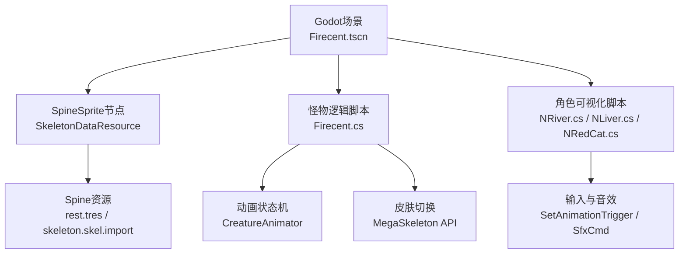
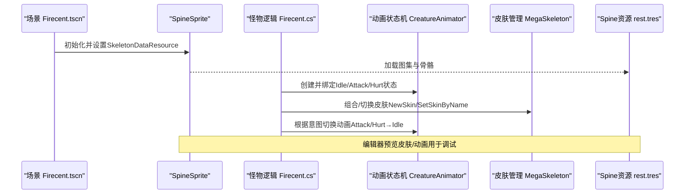
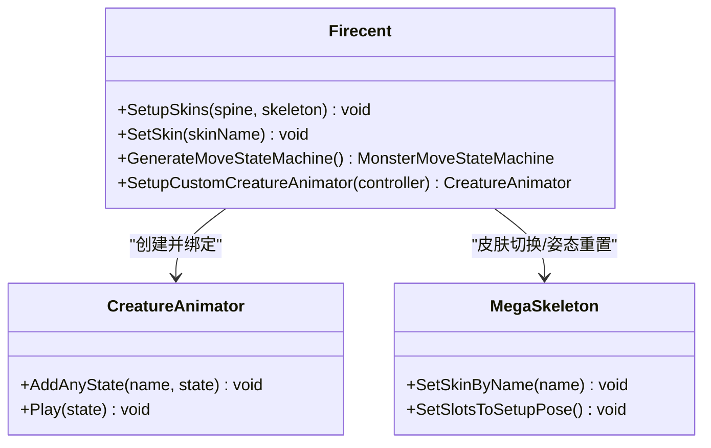
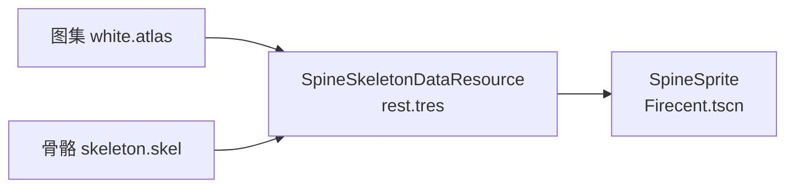
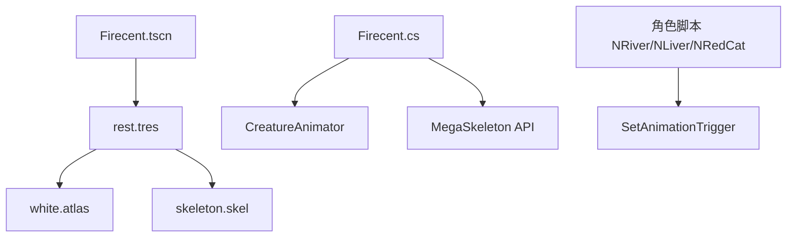

# Spine动画集成

<cite>
**本文引用的文件**
- [NLiver.cs](file://Godot/Character/Liver/NLiver.cs)
- [NRedCat.cs](file://Godot/Character/RedCat/NRedCat.cs)
- [NRiver.cs](file://Godot/Character/River/NRiver.cs)
- [Firecent.cs](file://Scripts/Monster/Firecent.cs)
- [Firecent.tscn](file://Godot/Monster/Firecent.tscn)
- [rest.tres](file://Godot/Character/Liver/spine/rest.tres)
- [skeleton.skel.import](file://Godot/Character/Liver/spine/skeleton.skel.import)
- [project.godot](file://project.godot)
</cite>

## 目录
1. [简介](#简介)
2. [项目结构](#项目结构)
3. [核心组件](#核心组件)
4. [架构总览](#架构总览)
5. [详细组件分析](#详细组件分析)
6. [依赖关系分析](#依赖关系分析)
7. [性能考虑](#性能考虑)
8. [故障排查指南](#故障排查指南)
9. [结论](#结论)
10. [附录](#附录)

## 简介
本技术文档围绕项目中Spine动画的集成与使用，系统说明以下方面：
- Spine资源导入与配置（骨骼、图集、皮肤）
- 角色与怪物的骨骼结构与动画状态机设置
- 纹理图集管理、多分辨率支持与内存优化策略
- 动画混合、过渡效果与状态切换实现方法
- Spine运行时API的使用（播放控制、事件回调、参数调节）
- 动画性能优化技巧（批渲染、LOD、缓存）
- 复杂角色动画序列与交互式动画效果的构建方法

本项目基于Godot引擎与MegaCrit STS2框架，通过Spine扩展加载并驱动Spine精灵，结合自定义脚本完成动画状态机、皮肤切换与交互触发。

## 项目结构
- Godot场景与资源
  - 角色可视化：Godot/Character/{Liver, RedCat, River}，包含Spine资源与对应C#脚本
  - 怪物可视化：Godot/Monster/*，包含Spine资源与怪物逻辑脚本
  - 场景文件：如Firecent.tscn定义SpineSprite节点及其预览皮肤/动画
- 游戏逻辑与绑定
  - Scripts/Monster/*：怪物行为、意图状态机、动画状态机绑定
  - Godot/Character/*/*.cs：角色可视化脚本，处理输入、音效与动画触发
- 引擎配置
  - project.godot：启用C#与移动端渲染等特性



**图表来源**
- [Firecent.tscn:1-37](file://Godot/Monster/Firecent.tscn#L1-L37)
- [rest.tres:1-9](file://Godot/Character/Liver/spine/rest.tres#L1-L9)
- [skeleton.skel.import:1-15](file://Godot/Character/Liver/spine/skeleton.skel.import#L1-L15)
- [Firecent.cs:46-61](file://Scripts/Monster/Firecent.cs#L46-L61)
- [NRiver.cs:37-84](file://Godot/Character/River/NRiver.cs#L37-L84)
- [NLiver.cs:20-47](file://Godot/Character/Liver/NLiver.cs#L20-L47)
- [NRedCat.cs:21-53](file://Godot/Character/RedCat/NRedCat.cs#L21-L53)

**章节来源**
- [project.godot:11-28](file://project.godot#L11-L28)
- [Firecent.tscn:1-37](file://Godot/Monster/Firecent.tscn#L1-L37)
- [rest.tres:1-9](file://Godot/Character/Liver/spine/rest.tres#L1-L9)
- [skeleton.skel.import:1-15](file://Godot/Character/Liver/spine/skeleton.skel.import#L1-L15)

## 核心组件
- 角色可视化脚本
  - NRiver.cs：动态获取并应用皮肤，延迟重试机制确保骨架可用后应用
  - NLiver.cs / NRedCat.cs：监听鼠标点击，播放音效并通过SetAnimationTrigger触发Spine事件
- 怪物逻辑与动画
  - Firecent.cs：定义怪物意图状态机，绑定攻击/受击/闲置动画；支持皮肤组合与切换
- Spine资源
  - rest.tres：引用图集与骨骼文件，作为SpineSkeletonDataResource
  - skeleton.skel.import：导入配置，将.spel导入为.spskel资源

关键职责与交互：
- 角色脚本负责输入与事件触发，调用NCreature.SetAnimationTrigger以驱动Spine事件
- 怪物脚本负责动画状态机与皮肤管理，通过MegaSkeleton API进行皮肤切换与姿态重置
- 场景文件定义SpineSprite节点与预览皮肤/动画，便于编辑器调试

**章节来源**
- [NRiver.cs:17-84](file://Godot/Character/River/NRiver.cs#L17-L84)
- [NLiver.cs:14-47](file://Godot/Character/Liver/NLiver.cs#L14-L47)
- [NRedCat.cs:15-53](file://Godot/Character/RedCat/NRedCat.cs#L15-L53)
- [Firecent.cs:46-61](file://Scripts/Monster/Firecent.cs#L46-L61)
- [rest.tres:1-9](file://Godot/Character/Liver/spine/rest.tres#L1-L9)
- [skeleton.skel.import:1-15](file://Godot/Character/Liver/spine/skeleton.skel.import#L1-L15)

## 架构总览
下图展示从场景到脚本再到Spine资源的整体数据流与控制流：



**图表来源**
- [Firecent.tscn:1-37](file://Godot/Monster/Firecent.tscn#L1-L37)
- [Firecent.cs:168-189](file://Scripts/Monster/Firecent.cs#L168-L189)
- [Firecent.cs:46-61](file://Scripts/Monster/Firecent.cs#L46-L61)
- [rest.tres:1-9](file://Godot/Character/Liver/spine/rest.tres#L1-L9)

## 详细组件分析

### 角色可视化与交互（NRiver / NLiver / NRedCat）
- 功能要点
  - 监听鼠标点击，判断命中区域Bounds
  - 播放音效（不同角色使用不同音效路径）
  - 通过SetAnimationTrigger触发Spine事件（如“Meow”）
- 皮肤与骨架
  - NRiver在Ready阶段计算皮肤名（依据遗物状态），延迟获取Visuals节点的骨架并应用
  - 使用CallDeferred与重试计数避免骨架未就绪导致的空引用

```mermaid
flowchart TD
Start(["输入事件"]) --> CheckBounds["检查命中区域"]
CheckBounds --> |命中| PlaySfx["播放角色专属音效"]
CheckBounds --> |未命中| End(["结束"])
PlaySfx --> TriggerAnim["调用 SetAnimationTrigger(\"Meow\")"]
TriggerAnim --> End
```

**图表来源**
- [NRiver.cs:86-114](file://Godot/Character/River/NRiver.cs#L86-L114)
- [NLiver.cs:20-47](file://Godot/Character/Liver/NLiver.cs#L20-L47)
- [NRedCat.cs:21-53](file://Godot/Character/RedCat/NRedCat.cs#L21-L53)

**章节来源**
- [NRiver.cs:17-84](file://Godot/Character/River/NRiver.cs#L17-L84)
- [NLiver.cs:14-47](file://Godot/Character/Liver/NLiver.cs#L14-L47)
- [NRedCat.cs:15-53](file://Godot/Character/RedCat/NRedCat.cs#L15-L53)

### 怪物动画状态机与皮肤管理（Firecent）
- 动画状态机
  - 定义闲置、攻击、受击三种状态，攻击/受击结束后自动回到闲置
  - 通过AddAnyState将状态名映射到动画名称
- 皮肤管理
  - SetupSkins中创建组合皮肤，添加多个子皮肤并应用到骨架
  - 提供SetSkin方法按名称切换皮肤并重置插槽姿态



**图表来源**
- [Firecent.cs:46-61](file://Scripts/Monster/Firecent.cs#L46-L61)
- [Firecent.cs:168-189](file://Scripts/Monster/Firecent.cs#L168-L189)

**章节来源**
- [Firecent.cs:93-146](file://Scripts/Monster/Firecent.cs#L93-L146)
- [Firecent.cs:168-189](file://Scripts/Monster/Firecent.cs#L168-L189)

### Spine资源导入与配置（rest.tres / skeleton.skel.import）
- rest.tres
  - 类型：SpineSkeletonDataResource
  - 引用图集资源与骨骼文件，作为SpineSprite的SkeletonDataResource
- skeleton.skel.import
  - 指定导入器为spine.skel，生成.spskel资源
  - 记录源文件与目标导入文件路径



**图表来源**
- [rest.tres:1-9](file://Godot/Character/Liver/spine/rest.tres#L1-L9)
- [skeleton.skel.import:1-15](file://Godot/Character/Liver/spine/skeleton.skel.import#L1-L15)
- [Firecent.tscn:1-37](file://Godot/Monster/Firecent.tscn#L1-L37)

**章节来源**
- [rest.tres:1-9](file://Godot/Character/Liver/spine/rest.tres#L1-L9)
- [skeleton.skel.import:1-15](file://Godot/Character/Liver/spine/skeleton.skel.import#L1-L15)
- [Firecent.tscn:1-37](file://Godot/Monster/Firecent.tscn#L1-L37)

## 依赖关系分析
- 场景依赖
  - Firecent.tscn依赖SpineSkeletonDataResource（rest.tres）
- 脚本依赖
  - Firecent.cs依赖MegaCrit框架的动画与命令模块，以及MegaSpine绑定
  - 角色脚本依赖Godot输入系统与MegaCrit命令模块
- 资源依赖
  - Spine资源依赖图集与骨骼文件，导入过程由引擎处理



**图表来源**
- [Firecent.tscn:1-37](file://Godot/Monster/Firecent.tscn#L1-L37)
- [rest.tres:1-9](file://Godot/Character/Liver/spine/rest.tres#L1-L9)
- [Firecent.cs:46-61](file://Scripts/Monster/Firecent.cs#L46-L61)
- [NRiver.cs:86-114](file://Godot/Character/River/NRiver.cs#L86-L114)

**章节来源**
- [Firecent.tscn:1-37](file://Godot/Monster/Firecent.tscn#L1-L37)
- [Firecent.cs:46-61](file://Scripts/Monster/Firecent.cs#L46-L61)
- [NRiver.cs:86-114](file://Godot/Character/River/NRiver.cs#L86-L114)

## 性能考虑
- 批渲染与图集
  - 使用Spine图集减少绘制批次，合理组织图集页以降低纹理切换
  - 在Godot中使用mobile渲染器，注意材质与着色器对批渲染的影响
- 动画状态机
  - 尽量复用动画片段，避免频繁切换长动画造成开销
  - 使用短动画+状态切换实现复杂动作（如攻击→受击→闲置）
- 皮肤与插槽
  - 使用组合皮肤减少重复资源，按需切换而非每帧重建
  - 切换皮肤后调用SetSlotsToSetupPose保证姿态正确
- 延迟与重试
  - 角色脚本采用CallDeferred与重试计数，避免骨架未就绪导致的无效操作
- 内存优化
  - 图集尺寸与压缩格式需平衡清晰度与内存占用
  - 及时释放不再使用的资源引用，避免内存泄漏

[本节为通用性能建议，不直接分析具体文件]

## 故障排查指南
- 骨架为空或无法获取
  - 现象：角色脚本尝试获取Visuals节点的骨架时返回空
  - 处理：使用CallDeferred延迟执行TryApplySkin，增加重试次数上限，避免无限等待
  - 参考路径：[NRiver.cs:49-78](file://Godot/Character/River/NRiver.cs#L49-L78)
- 皮肤切换无效
  - 现象：SetSkinByName后无变化
  - 处理：确认皮肤名称存在，并在切换后调用SetSlotsToSetupPose重置插槽姿态
  - 参考路径：[Firecent.cs:57-61](file://Scripts/Monster/Firecent.cs#L57-L61)
- 动画未触发
  - 现象：SetAnimationTrigger未生效
  - 处理：确认Spine事件中已定义对应事件名，且角色脚本正确调用
  - 参考路径：[NLiver.cs:40-46](file://Godot/Character/Liver/NLiver.cs#L40-L46), [NRedCat.cs:45-51](file://Godot/Character/RedCat/NRedCat.cs#L45-L51)
- 导入失败或资源缺失
  - 现象：Spine资源加载失败
  - 处理：检查图集与骨骼文件路径，确认import配置正确
  - 参考路径：[skeleton.skel.import:1-15](file://Godot/Character/Liver/spine/skeleton.skel.import#L1-L15), [rest.tres:1-9](file://Godot/Character/Liver/spine/rest.tres#L1-L9)

**章节来源**
- [NRiver.cs:49-78](file://Godot/Character/River/NRiver.cs#L49-L78)
- [Firecent.cs:57-61](file://Scripts/Monster/Firecent.cs#L57-L61)
- [NLiver.cs:40-46](file://Godot/Character/Liver/NLiver.cs#L40-L46)
- [NRedCat.cs:45-51](file://Godot/Character/RedCat/NRedCat.cs#L45-L51)
- [skeleton.skel.import:1-15](file://Godot/Character/Liver/spine/skeleton.skel.import#L1-L15)
- [rest.tres:1-9](file://Godot/Character/Liver/spine/rest.tres#L1-L9)

## 结论
本项目通过Godot与MegaCrit框架成功集成了Spine动画，实现了角色与怪物的动画状态机、皮肤管理与交互触发。借助合理的资源导入配置、延迟重试机制与动画状态机设计，保证了动画的稳定性和可维护性。后续可在图集优化、动画混合与性能监控方面进一步改进，以提升整体体验。

[本节为总结性内容，不直接分析具体文件]

## 附录
- 常用API与流程参考
  - 皮肤切换：MegaSkeleton.SetSkinByName + SetSlotsToSetupPose
  - 动画状态机：CreatureAnimator.AddAnyState + 状态切换
  - 事件触发：NCreature.SetAnimationTrigger
  - 资源导入：SpineSkeletonDataResource引用图集与骨骼
- 推荐实践
  - 使用组合皮肤减少资源冗余
  - 通过状态机统一管理动画生命周期
  - 利用延迟与重试提升鲁棒性
  - 保持图集与骨骼命名规范，便于脚本查找与管理

[本节为补充信息，不直接分析具体文件]