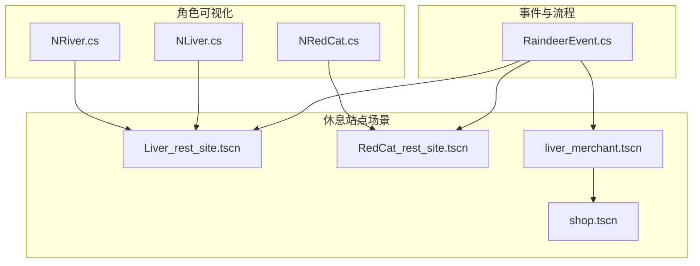
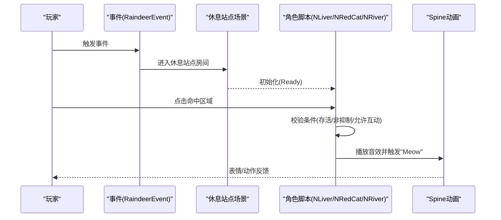
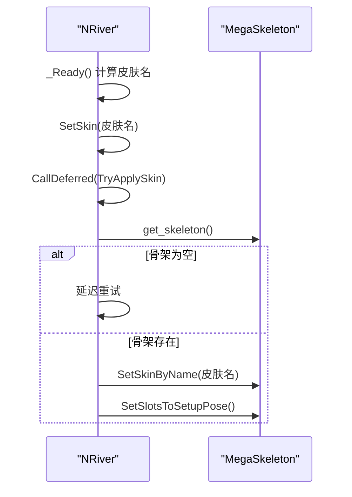
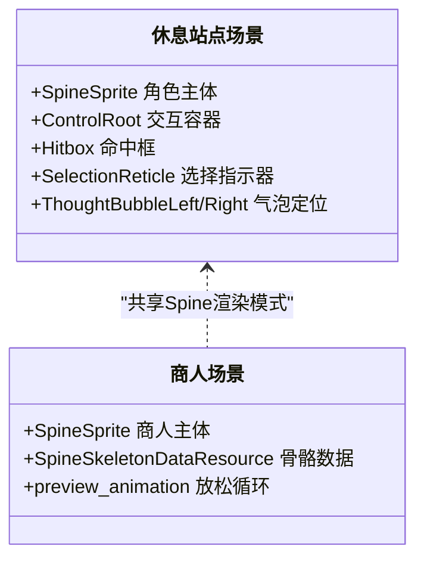
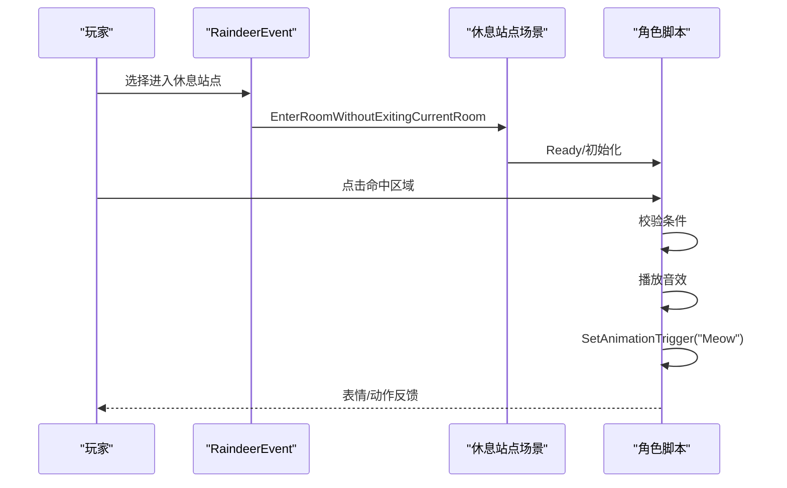
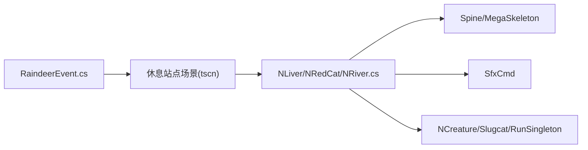

# 休息站点动画

<cite>
**本文引用的文件**
- [RainworldNRestSiteCharacter.cs](file://Godot/RestSiteAnim/RainworldNRestSiteCharacter.cs)
- [NLiver.cs](file://Godot/Character/Liver/NLiver.cs)
- [NRedCat.cs](file://Godot/Character/RedCat/NRedCat.cs)
- [NRiver.cs](file://Godot/Character/River/NRiver.cs)
- [liver_merchant.tscn](file://Godot/RestSiteAnim/liver_merchant.tscn)
- [Liver_rest_site.tscn](file://Godot/Character/Liver/Liver_rest_site.tscn)
- [RedCat_rest_site.tscn](file://Godot/Character/RedCat/RedCat_rest_site.tscn)
- [shop.tscn](file://Godot/Character/Liver/shop.tscn)
- [RaindeerEvent.cs](file://Scripts/Event/RaindeerEvent.cs)
</cite>

## 目录
1. [简介](#简介)
2. [项目结构](#项目结构)
3. [核心组件](#核心组件)
4. [架构总览](#架构总览)
5. [详细组件分析](#详细组件分析)
6. [依赖关系分析](#依赖关系分析)
7. [性能考虑](#性能考虑)
8. [故障排查指南](#故障排查指南)
9. [结论](#结论)
10. [附录](#附录)

## 简介
本技术文档围绕“休息站点”场景中的角色动画与交互实现，重点说明商人NPC的行为动画、交互触发机制、玩家对话流程、表情与动作反馈，以及C#脚本对复杂动画序列的控制方法。同时给出性能优化策略、资源管理方案与扩展自定义角色的指南，帮助开发者快速理解并扩展该模块。

## 项目结构
休息站点相关资源与脚本按“角色/场景/事件”分层组织：
- 角色可视化脚本：各角色（肝猫、红猫、河）的输入处理与动画触发逻辑位于 Godot/Character/* 下的 C# 脚本。
- 休息站点场景：Godot/Character/*/rest_site.tscn 定义了 Spine 骨骼、命中框、气泡位置等。
- 商人场景：Godot/RestSiteAnim/liver_merchant.tscn 与 shop.tscn 提供商店/商人展示。
- 事件入口：Scripts/Event/RaindeerEvent.cs 中进入休息站点的流程。



图表来源
- [NLiver.cs:1-50](file://Godot/Character/Liver/NLiver.cs#L1-L50)
- [NRedCat.cs:1-55](file://Godot/Character/RedCat/NRedCat.cs#L1-L55)
- [NRiver.cs:1-116](file://Godot/Character/River/NRiver.cs#L1-L116)
- [Liver_rest_site.tscn:1-53](file://Godot/Character/Liver/Liver_rest_site.tscn#L1-L53)
- [RedCat_rest_site.tscn:1-45](file://Godot/Character/RedCat/RedCat_rest_site.tscn#L1-L45)
- [liver_merchant.tscn:1-16](file://Godot/RestSiteAnim/liver_merchant.tscn#L1-L16)
- [shop.tscn:1-18](file://Godot/Character/Liver/shop.tscn#L1-L18)
- [RaindeerEvent.cs:105-133](file://Scripts/Event/RaindeerEvent.cs#L105-L133)

章节来源
- [RaindeerEvent.cs:105-133](file://Scripts/Event/RaindeerEvent.cs#L105-L133)

## 核心组件
- 角色输入与动画触发：每个角色脚本继承自 NCreatureVisuals，监听鼠标点击命中区域，播放音效并调用 SetAnimationTrigger("Meow") 触发对应动画。
- 皮肤切换：河角色在就绪时根据持有遗物状态选择不同皮肤，并通过延迟重试机制确保骨架可用后应用。
- 休息站点场景：SpineSprite 作为角色主体，配合 ControlRoot 下的 Hitbox、SelectionReticle、ThoughtBubble 完成交互与UI布局。
- 商人场景：使用 SpineSkeletonDataResource 与 SpineSprite 展示商人模型，默认预览动画为放松循环。

章节来源
- [NLiver.cs:14-48](file://Godot/Character/Liver/NLiver.cs#L14-L48)
- [NRedCat.cs:15-53](file://Godot/Character/RedCat/NRedCat.cs#L15-L53)
- [NRiver.cs:17-84](file://Godot/Character/River/NRiver.cs#L17-L84)
- [Liver_rest_site.tscn:1-53](file://Godot/Character/Liver/Liver_rest_site.tscn#L1-L53)
- [RedCat_rest_site.tscn:1-45](file://Godot/Character/RedCat/RedCat_rest_site.tscn#L1-L45)
- [liver_merchant.tscn:1-16](file://Godot/RestSiteAnim/liver_merchant.tscn#L1-L16)

## 架构总览
休息站点动画由“事件驱动 + 角色脚本 + 场景资源”构成：
- 事件层：通过事件进入休息站点房间，加载对应场景。
- 场景层：SpineSprite 负责渲染骨骼动画；ControlRoot 提供命中检测与UI定位。
- 控制层：角色脚本监听输入，校验条件后播放音效并触发动画。



图表来源
- [RaindeerEvent.cs:105-133](file://Scripts/Event/RaindeerEvent.cs#L105-L133)
- [NLiver.cs:20-48](file://Godot/Character/Liver/NLiver.cs#L20-L48)
- [NRedCat.cs:21-53](file://Godot/Character/RedCat/NRedCat.cs#L21-L53)
- [NRiver.cs:86-114](file://Godot/Character/River/NRiver.cs#L86-L114)

## 详细组件分析

### 角色输入与动画触发（肝猫/红猫/河）
- 统一模式：继承 NCreatureVisuals，启用输入处理；检测鼠标左键点击命中框；校验父节点 NCreature、玩家角色 Slugcat、是否抑制伤害动画、全局开关 needmeow；满足条件则播放音效并调用 SetAnimationTrigger("Meow")。
- 差异点：
  - 肝猫/红猫：直接播放各自音效并触发 Meow。
  - 河：额外支持皮肤切换，基于遗物状态选择皮肤名称，延迟获取骨架并应用。

```mermaid
flowchart TD
Start(["输入事件"]) --> CheckHit["命中区域检测"]
CheckHit --> |否| End(["结束"])
CheckHit --> |是| Validate["校验条件<br/>存活/玩家/抑制/开关"]
Validate --> |不通过| End
Validate --> |通过| PlaySfx["播放音效"]
PlaySfx --> Trigger["SetAnimationTrigger(\"Meow\")"]
Trigger --> End
```

图表来源
- [NLiver.cs:20-48](file://Godot/Character/Liver/NLiver.cs#L20-L48)
- [NRedCat.cs:21-53](file://Godot/Character/RedCat/NRedCat.cs#L21-L53)
- [NRiver.cs:86-114](file://Godot/Character/River/NRiver.cs#L86-L114)

章节来源
- [NLiver.cs:14-48](file://Godot/Character/Liver/NLiver.cs#L14-L48)
- [NRedCat.cs:15-53](file://Godot/Character/RedCat/NRedCat.cs#L15-L53)
- [NRiver.cs:17-84](file://Godot/Character/River/NRiver.cs#L17-L84)

### 河角色皮肤切换机制
- 就绪阶段：根据玩家持有的 Battery 遗物决定皮肤名（未使用/已使用），设置待应用皮肤并延迟尝试应用。
- 延迟重试：若骨架未就绪，周期性重试最多一定次数，避免阻塞主线程。
- 应用皮肤：通过 MegaSkeleton 接口设置皮肤并重置插槽到初始姿态。



图表来源
- [NRiver.cs:17-84](file://Godot/Character/River/NRiver.cs#L17-L84)

章节来源
- [NRiver.cs:17-84](file://Godot/Character/River/NRiver.cs#L17-L84)

### 休息站点场景结构
- 肝猫休息站点：SpineSprite 绑定 rest.tres，ControlRoot 下包含 SelectionReticle、Hitbox、左右 ThoughtBubble，用于交互与气泡定位。
- 红猫休息站点：结构与肝猫类似，但缩放与命中框尺寸不同，适配不同角色比例。
- 商人场景：liver_merchant.tscn 使用 SpineSkeletonDataResource 与 SpineSprite，默认预览动画为放松循环；shop.tscn 提供静态背景展示。



图表来源
- [Liver_rest_site.tscn:1-53](file://Godot/Character/Liver/Liver_rest_site.tscn#L1-L53)
- [RedCat_rest_site.tscn:1-45](file://Godot/Character/RedCat/RedCat_rest_site.tscn#L1-L45)
- [liver_merchant.tscn:1-16](file://Godot/RestSiteAnim/liver_merchant.tscn#L1-L16)
- [shop.tscn:1-18](file://Godot/Character/Liver/shop.tscn#L1-L18)

章节来源
- [Liver_rest_site.tscn:1-53](file://Godot/Character/Liver/Liver_rest_site.tscn#L1-L53)
- [RedCat_rest_site.tscn:1-45](file://Godot/Character/RedCat/RedCat_rest_site.tscn#L1-L45)
- [liver_merchant.tscn:1-16](file://Godot/RestSiteAnim/liver_merchant.tscn#L1-L16)
- [shop.tscn:1-18](file://Godot/Character/Liver/shop.tscn#L1-L18)

### 玩家与休息站点角色的交互流程
- 事件触发：通过 RaindeerEvent 进入休息站点房间。
- 场景加载：加载对应角色的休息站点场景，初始化 SpineSprite 与 UI。
- 输入响应：玩家点击命中区域，角色脚本校验条件后播放音效并触发 Meow 动画。
- 反馈呈现：表情/动作变化由 Spine 动画与气泡位置共同体现。



图表来源
- [RaindeerEvent.cs:105-133](file://Scripts/Event/RaindeerEvent.cs#L105-L133)
- [NLiver.cs:20-48](file://Godot/Character/Liver/NLiver.cs#L20-L48)
- [NRedCat.cs:21-53](file://Godot/Character/RedCat/NRedCat.cs#L21-L53)
- [NRiver.cs:86-114](file://Godot/Character/River/NRiver.cs#L86-L114)

章节来源
- [RaindeerEvent.cs:105-133](file://Scripts/Event/RaindeerEvent.cs#L105-L133)

## 依赖关系分析
- 角色脚本依赖：
  - Godot 输入系统：InputEventMouseButton。
  - 音频命令：SfxCmd 播放音效。
  - 战斗/实体：NCreature、Slugcat、RunSingleton 等用于状态判断。
  - 动画框架：MegaSkeleton（河角色）与 Spine 资源。
- 场景依赖：
  - SpineSkeletonDataResource：定义骨骼与动画。
  - ControlRoot：管理命中框与气泡。
- 事件依赖：
  - RunManager：进入房间。
  - CreatureCmd：伤害与死亡流程（分支）。



图表来源
- [RaindeerEvent.cs:105-133](file://Scripts/Event/RaindeerEvent.cs#L105-L133)
- [NLiver.cs:1-50](file://Godot/Character/Liver/NLiver.cs#L1-L50)
- [NRedCat.cs:1-55](file://Godot/Character/RedCat/NRedCat.cs#L1-L55)
- [NRiver.cs:1-116](file://Godot/Character/River/NRiver.cs#L1-L116)

章节来源
- [RaindeerEvent.cs:105-133](file://Scripts/Event/RaindeerEvent.cs#L105-L133)
- [NLiver.cs:1-50](file://Godot/Character/Liver/NLiver.cs#L1-L50)
- [NRedCat.cs:1-55](file://Godot/Character/RedCat/NRedCat.cs#L1-L55)
- [NRiver.cs:1-116](file://Godot/Character/River/NRiver.cs#L1-L116)

## 性能考虑
- 延迟应用骨架：河角色使用 CallDeferred 与重试计数，避免在骨架未就绪时阻塞，提升启动稳定性。
- 命中检测优化：仅在命中区域内进行后续校验，减少无效计算。
- 资源复用：SpineSkeletonDataResource 与 SpineSprite 可跨场景复用，降低内存占用。
- 音效播放：按需触发，避免常驻播放造成开销。
- 建议：
  - 将常用动画预加载，减少运行时加载延迟。
  - 合并小图纹理至图集，减少绘制批次。
  - 对复杂场景分帧初始化，避免卡顿。

[本节为通用性能指导，无需具体文件引用]

## 故障排查指南
- 无法触发动画：
  - 检查命中框是否存在且坐标正确（参考 Liver_rest_site.tscn 与 RedCat_rest_site.tscn 的 Hitbox）。
  - 确认父节点 NCreature 与玩家 Slugcat 类型匹配，且未被抑制伤害动画。
  - 检查全局开关 needmeow 是否开启。
- 皮肤未生效：
  - 观察 TryApplySkin 的重试逻辑，确认骨架是否成功获取。
  - 验证皮肤名称是否正确，以及 MegaSkeleton.SetSkinByName 是否被调用。
- 音效未播放：
  - 确认 SfxCmd 路径与参数正确，且事件确实进入校验通过的分支。

章节来源
- [NLiver.cs:20-48](file://Godot/Character/Liver/NLiver.cs#L20-L48)
- [NRedCat.cs:21-53](file://Godot/Character/RedCat/NRedCat.cs#L21-L53)
- [NRiver.cs:49-84](file://Godot/Character/River/NRiver.cs#L49-L84)
- [Liver_rest_site.tscn:18-36](file://Godot/Character/Liver/Liver_rest_site.tscn#L18-L36)
- [RedCat_rest_site.tscn:23-34](file://Godot/Character/RedCat/RedCat_rest_site.tscn#L23-L34)

## 结论
休息站点动画通过“事件驱动 + 角色脚本 + Spine 场景”的组合实现了稳定的交互与表现。角色脚本统一了输入处理与动画触发逻辑，河角色展示了动态皮肤切换的最佳实践。借助合理的命中检测、延迟应用与资源复用策略，整体性能与可维护性得到保障。未来可通过扩展角色脚本与场景资源，轻松添加新角色与自定义行为。

[本节为总结性内容，无需具体文件引用]

## 附录

### 扩展方法与自定义角色添加指南
- 新增角色脚本：
  - 创建继承自 NCreatureVisuals 的脚本，启用输入处理。
  - 实现命中检测与条件校验，播放音效并调用 SetAnimationTrigger("Meow")。
  - 如需皮肤切换，参考 NRiver 的 SetSkin/TryApplySkin/ApplySkin 模式。
- 新增休息站点场景：
  - 复制现有 rest_site.tscn，调整 SpineSprite 的骨骼数据与缩放。
  - 配置 ControlRoot 下的 Hitbox、SelectionReticle、ThoughtBubble 位置。
- 集成到事件：
  - 在事件流程中引入新场景，确保进入房间时加载对应资源。
- 资源管理：
  - 将 SpineSkeletonDataResource 与音效资源纳入项目资源池，避免重复加载。
  - 使用图集与预加载策略优化性能。

章节来源
- [NRiver.cs:17-84](file://Godot/Character/River/NRiver.cs#L17-L84)
- [Liver_rest_site.tscn:1-53](file://Godot/Character/Liver/Liver_rest_site.tscn#L1-L53)
- [RedCat_rest_site.tscn:1-45](file://Godot/Character/RedCat/RedCat_rest_site.tscn#L1-L45)
- [RaindeerEvent.cs:105-133](file://Scripts/Event/RaindeerEvent.cs#L105-L133)