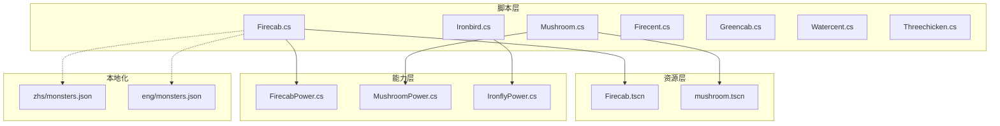
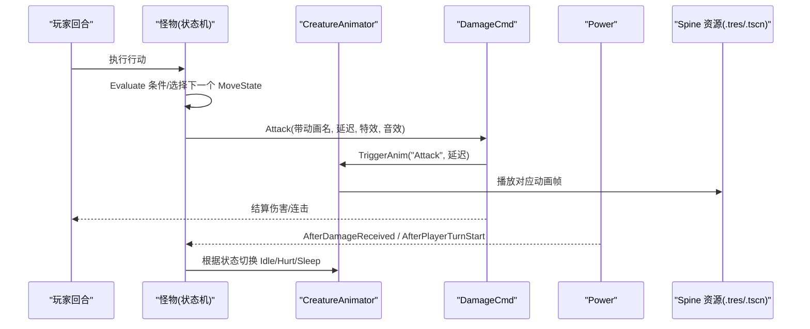
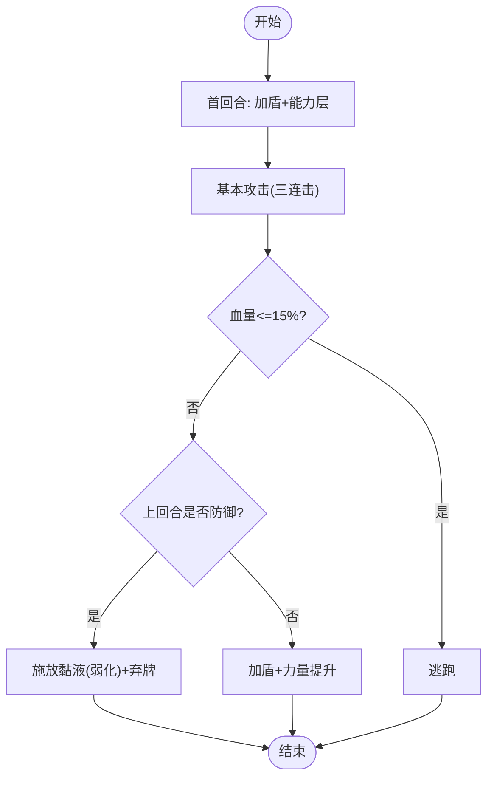
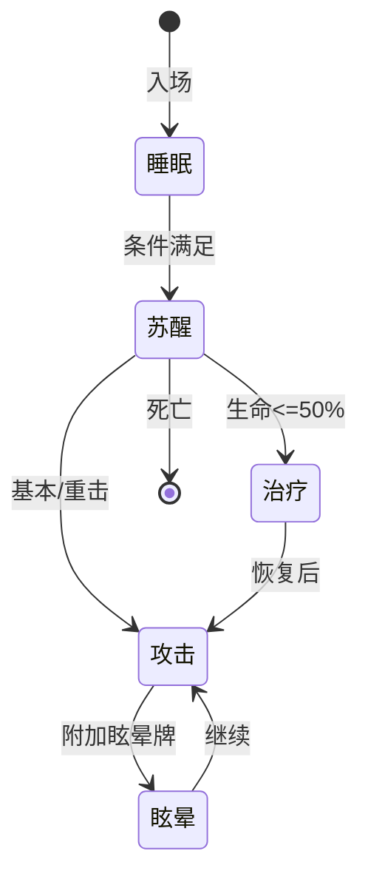
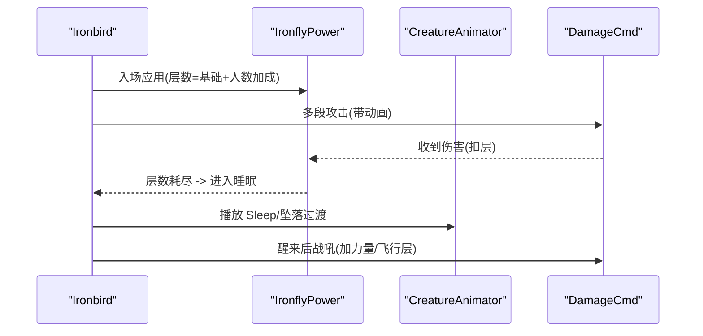
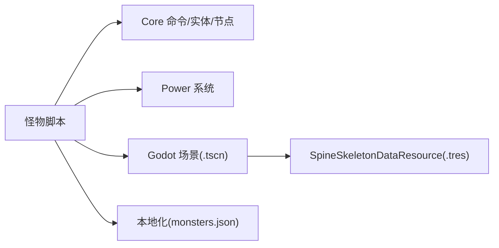

# 怪物动画系统

<cite>
**本文引用的文件**
- [Firecab.cs](file://Scripts/Monster/Firecab.cs)
- [Mushroom.cs](file://Scripts/Monster/Mushroom.cs)
- [Ironbird.cs](file://Scripts/Monster/Ironbird.cs)
- [Firecent.cs](file://Scripts/Monster/Firecent.cs)
- [Greencab.cs](file://Scripts/Monster/Greencab.cs)
- [Watercent.cs](file://Scripts/Monster/Watercent.cs)
- [Threechicken.cs](file://Scripts/Monster/Threechicken.cs)
- [FirecabPower.cs](file://Scripts/Powers/Monster/FirecabPower.cs)
- [MushroomPower.cs](file://Scripts/Powers/Monster/MushroomPower.cs)
- [IronflyPower.cs](file://Scripts/Powers/Monster/IronflyPower.cs)
- [Firecab.tscn](file://Godot/Monster/Firecab.tscn)
- [mushroom.tscn](file://Godot/Monster/mushroom.tscn)
- [monsters.json（中文）](file://SlugcatTheSpireII/localization/zhs/monsters.json)
- [monsters.json（英文）](file://SlugcatTheSpireII/localization/eng/monsters.json)
</cite>

## 目录
1. [简介](#简介)
2. [项目结构](#项目结构)
3. [核心组件](#核心组件)
4. [架构总览](#架构总览)
5. [详细组件分析](#详细组件分析)
6. [依赖关系分析](#依赖关系分析)
7. [性能考虑](#性能考虑)
8. [故障排查指南](#故障排查指南)
9. [结论](#结论)
10. [附录](#附录)

## 简介
本技术文档聚焦于怪物动画系统的实现与集成，覆盖 Firecab、Mushroom、Ironbird、Firecent、Greencab、Watercent、Threechicken 等怪物的行为动画。内容涵盖：
- 状态机设计：意图（Intent）、动作（MoveState）、条件分支（ConditionalBranchState）的组合与流转
- 攻击动作与受击反馈：通过命令式 API 触发攻击动画、命中特效、音效与伤害结算
- 模型加载优化：基于 Godot SpineSkeletonDataResource 的模板化场景与资源复用
- 动画循环与性能调优：Idle 循环、非循环过渡动画、按需切换与延迟触发
- AI 与动画系统集成：动作触发、时序控制、视觉效果同步
- 复用机制与模板化设计：统一的 ModMonsterTemplate 与 CreatureAnimator 绑定模式
- 制作规范与调试工具：命名约定、可视化标记点、本地化键值与日志定位

## 项目结构
- 脚本层：每个怪物一个类，继承自 ModMonsterTemplate，负责数值、意图、状态机与动画绑定
- 资源层：Godot 场景文件（.tscn）定义 SpineSprite、边界框、意图位置、中心点、对话位置等
- 能力层：Power 脚本承载被动/主动效果，并在关键时机触发动画或状态变更
- 本地化：monsters.json 提供怪物名称与意图标题的多语言文本

图表来源
- [Firecab.cs:49-55](file://Scripts/Monster/Firecab.cs#L49-L55)
- [Firecab.tscn:1-35](file://Godot/Monster/Firecab.tscn#L1-L35)
- [Mushroom.cs:75-81](file://Scripts/Monster/Mushroom.cs#L75-L81)
- [mushroom.tscn:1-37](file://Godot/Monster/mushroom.tscn#L1-L37)
- [FirecabPower.cs:31-52](file://Scripts/Powers/Monster/FirecabPower.cs#L31-L52)
- [MushroomPower.cs:30-94](file://Scripts/Powers/Monster/MushroomPower.cs#L30-L94)
- [IronflyPower.cs:31-89](file://Scripts/Powers/Monster/IronflyPower.cs#L31-L89)
- [monsters.json（中文）:1-50](file://SlugcatTheSpireII/localization/zhs/monsters.json#L1-L50)
- [monsters.json（英文）:1-49](file://SlugcatTheSpireII/localization/eng/monsters.json#L1-L49)

章节来源
- [Firecab.cs:23-198](file://Scripts/Monster/Firecab.cs#L23-L198)
- [Mushroom.cs:27-214](file://Scripts/Monster/Mushroom.cs#L27-L214)
- [Ironbird.cs:26-217](file://Scripts/Monster/Ironbird.cs#L26-L217)
- [Firecent.cs:25-191](file://Scripts/Monster/Firecent.cs#L25-L191)
- [Greencab.cs:23-172](file://Scripts/Monster/Greencab.cs#L23-L172)
- [Watercent.cs:24-157](file://Scripts/Monster/Watercent.cs#L24-L157)
- [Threechicken.cs:25-206](file://Scripts/Monster/Threechicken.cs#L25-L206)
- [Firecab.tscn:1-35](file://Godot/Monster/Firecab.tscn#L1-L35)
- [mushroom.tscn:1-37](file://Godot/Monster/mushroom.tscn#L1-L37)
- [monsters.json（中文）:1-50](file://SlugcatTheSpireII/localization/zhs/monsters.json#L1-L50)
- [monsters.json（英文）:1-49](file://SlugcatTheSpireII/localization/eng/monsters.json#L1-L49)

## 核心组件
- 怪物基类与模板：所有怪物继承 ModMonsterTemplate，统一生命周期钩子（AfterAddedToRoom、BeforeCombatStart）与资源装配（TryCreateCreatureVisuals）
- 状态机：使用 MoveState 表达单一意图，配合 ConditionalBranchState 实现条件跳转；初始状态在构造函数中指定
- 动画器：SetupCustomCreatureAnimator 中定义 AnimState（idle_loop、attack、hurt 等），并通过 AddAnyState 将“事件名”映射到具体动画，支持 NextState 自动回退
- 命令式战斗：DamageCmd.Attack 链式调用设置攻击动画、命中特效、音效、连击次数等；PowerCmd/CreatureCmd/CardPileCmd 驱动数值变化与牌堆操作
- 能力系统：Power 在特定回调（AfterApplied、AfterDamageReceived、AfterPlayerTurnStart 等）中修改数值或触发动画/状态切换

章节来源
- [Firecab.cs:58-144](file://Scripts/Monster/Firecab.cs#L58-L144)
- [Mushroom.cs:84-167](file://Scripts/Monster/Mushroom.cs#L84-L167)
- [Ironbird.cs:71-145](file://Scripts/Monster/Ironbird.cs#L71-L145)
- [Firecent.cs:86-146](file://Scripts/Monster/Firecent.cs#L86-L146)
- [Greencab.cs:51-127](file://Scripts/Monster/Greencab.cs#L51-L127)
- [Watercent.cs:54-124](file://Scripts/Monster/Watercent.cs#L54-L124)
- [Threechicken.cs:96-174](file://Scripts/Monster/Threechicken.cs#L96-L174)

## 架构总览
怪物动画系统由“AI 状态机 + 动画器 + 命令式战斗 + 能力系统 + Godot Spine 资源”构成。状态机决定下一回合的意图；命令式战斗在执行时触发攻击动画与命中特效；能力系统在关键时机调整数值并可能改变怪物状态（如眩晕/睡眠）。

图表来源
- [Firecab.cs:65-144](file://Scripts/Monster/Firecab.cs#L65-L144)
- [Firecab.cs:169-196](file://Scripts/Monster/Firecab.cs#L169-L196)
- [Firecab.tscn:1-35](file://Godot/Monster/Firecab.tscn#L1-L35)
- [IronflyPower.cs:69-89](file://Scripts/Powers/Monster/IronflyPower.cs#L69-L89)

## 详细组件分析

### Firecab（烈焰蜥蜴）
- 行为与意图
  - 首回合获得格挡与基础能力层数
  - 基本攻击为三连击，附带攻击动画与命中特效
  - 重击附带虚弱/易伤等减益
  - 低血量时可选择逃跑
  - 可进入“施法/黏液”状态，给对手添加弱化为持续收益
- 动画与状态机
  - Idle 循环，攻击/受击/施法后回到 Idle
  - 条件分支：按血量阈值或上一回合是否防御来决定后续意图
- 与能力集成
  - 入场即施加 FirecabPower，随层数增长提供额外增益

图表来源
- [Firecab.cs:58-144](file://Scripts/Monster/Firecab.cs#L58-L144)
- [Firecab.cs:169-196](file://Scripts/Monster/Firecab.cs#L169-L196)

章节来源
- [Firecab.cs:23-198](file://Scripts/Monster/Firecab.cs#L23-L198)
- [FirecabPower.cs:31-52](file://Scripts/Powers/Monster/FirecabPower.cs#L31-L52)

### Mushroom（变异长腿菌）
- 行为与意图
  - 初始处于睡眠状态，苏醒后获得成长型能力
  - 基本攻击为二连击；重击高伤
  - 眩晕意图向抽牌堆/弃牌堆加入眩晕牌
  - 当生命低于一半时优先治疗
- 动画与状态机
  - 默认 Sleep 循环，苏醒过渡到 Idle
  - 受击/攻击仅在苏醒状态下允许
  - 条件分支根据 needHealth 与 _isAwake 动态选择后续意图
- 与能力集成
  - 能力在卡牌耗尽时回复生命并叠加力量；受击时对玩家造成眩晕累积

图表来源
- [Mushroom.cs:89-167](file://Scripts/Monster/Mushroom.cs#L89-L167)
- [Mushroom.cs:186-211](file://Scripts/Monster/Mushroom.cs#L186-L211)
- [MushroomPower.cs:43-94](file://Scripts/Powers/Monster/MushroomPower.cs#L43-L94)

章节来源
- [Mushroom.cs:27-214](file://Scripts/Monster/Mushroom.cs#L27-L214)
- [MushroomPower.cs:30-94](file://Scripts/Powers/Monster/MushroomPower.cs#L30-L94)

### Ironbird（钢秃鹫）
- 行为与意图
  - 入场赋予飞行能力层数，随回合/升级增加
  - 基本攻击多段啄击；重击高伤
  - 被击落进入睡眠并获得护盾；醒来后战吼强化自身
  - 可施加脆弱/易伤等减益
- 动画与状态机
  - Idle 循环；睡眠/坠落循环；受击/攻击在非眩晕状态下可用
  - 能力移除时强制进入睡眠并播放睡眠动画
- 与能力集成
  - IronflyPower 管理飞行层数、受伤扣层、回合初恢复、移除时触发睡眠动画与状态

图表来源
- [Ironbird.cs:71-145](file://Scripts/Monster/Ironbird.cs#L71-L145)
- [Ironbird.cs:186-214](file://Scripts/Monster/Ironbird.cs#L186-L214)
- [IronflyPower.cs:45-89](file://Scripts/Powers/Monster/IronflyPower.cs#L45-L89)

章节来源
- [Ironbird.cs:26-217](file://Scripts/Monster/Ironbird.cs#L26-L217)
- [IronflyPower.cs:31-89](file://Scripts/Powers/Monster/IronflyPower.cs#L31-L89)

### Firecent（烈焰蜈蚣）
- 行为与意图
  - 入场赋予能力以提供护盾/成长
  - 基本攻击二连击；重击高伤并附加脆弱/易伤
  - 电击意图向抽/弃牌堆各加入一张电系卡
  - 强化意图叠加力量
- 动画与状态机
  - Idle 循环；攻击/受击后回到 Idle
  - 简单线性流转：基本攻击→电击→重击→强化→循环

章节来源
- [Firecent.cs:25-191](file://Scripts/Monster/Firecent.cs#L25-L191)

### Greencab（绿蜥蜴）
- 行为与意图
  - 入场对玩家施加减速；开局先获得护盾
  - 基本攻击单段；重击高伤并附加虚弱
  - 低血量逃跑；可进入蓄力状态后继续进攻
- 动画与状态机
  - Idle 循环；攻击/受击后回到 Idle
  - 条件分支根据血量决定是否逃跑

章节来源
- [Greencab.cs:23-172](file://Scripts/Monster/Greencab.cs#L23-L172)

### Watercent（水蜈蚣）
- 行为与意图
  - 入场赋予能力；具备护盾与力量成长
  - 基本攻击二连击；重击多段低伤
  - 腐蚀/虚弱组合减益；强化意图同时加盾与力量
- 动画与状态机
  - Idle 循环；攻击/受击后回到 Idle
  - 固定顺序流转：减益→基本→强化→重击→循环

章节来源
- [Watercent.cs:24-157](file://Scripts/Monster/Watercent.cs#L24-L157)

### Threechicken（监察者）
- 行为与意图
  - 观察意图叠加捕获能力；攻击指令多段攻击
  - 抓取意图降低玩家最大生命并从手牌/弃牌堆偷取卡牌（按优先级）
- 动画与状态机
  - Idle 循环；攻击/受击后回到 Idle
  - 观察→攻击→抓取→循环

章节来源
- [Threechicken.cs:25-206](file://Scripts/Monster/Threechicken.cs#L25-L206)

## 依赖关系分析
- 脚本依赖
  - 怪物脚本依赖 Core 的 Animation、Commands、Entities、Monsters、Nodes 等模块
  - 通过 PowerCmd/CreatureCmd/CardPileCmd/DamageCmd 与游戏系统进行交互
- 资源依赖
  - 每个怪物通过 MonsterAssetProfile 指向 Godot 场景路径，场景内包含 SpineSkeletonDataResource
  - 场景中的 Visuals 节点为 SpineSprite，用于播放动画
- 能力依赖
  - Power 在关键生命周期回调中修改数值或触发动画/状态切换
- 本地化依赖
  - monsters.json 提供怪物名称与各意图标题的多语言文本

图表来源
- [Firecab.cs:1-20](file://Scripts/Monster/Firecab.cs#L1-L20)
- [Firecab.tscn:1-35](file://Godot/Monster/Firecab.tscn#L1-L35)
- [monsters.json（中文）:1-50](file://SlugcatTheSpireII/localization/zhs/monsters.json#L1-L50)

章节来源
- [Firecab.cs:1-20](file://Scripts/Monster/Firecab.cs#L1-L20)
- [Firecab.tscn:1-35](file://Godot/Monster/Firecab.tscn#L1-L35)
- [monsters.json（中文）:1-50](file://SlugcatTheSpireII/localization/zhs/monsters.json#L1-L50)

## 性能考虑
- 动画循环策略
  - Idle 使用 isLooping=true 的 idle_loop，减少频繁切换开销
  - 攻击/受击等非循环动画设置 NextState=idle，避免手动管理
- 动画触发与延迟
  - 使用 WithAttackerAnim 指定动画名与延迟，确保与伤害/特效同步
  - 对复杂过渡（如睡眠/坠落）使用专用过渡动画，避免跳帧
- 资源复用
  - 通过 MonsterAssetProfile 与 TryCreateCreatureVisuals 统一加载 Spine 资源，减少重复初始化
  - 场景内仅保留必要节点（Visuals、Bounds、IntentPos、CenterPos、TalkPos）
- 条件分支优化
  - 使用 ConditionalBranchState 集中处理血量阈值、状态标志等判断，避免在多个 MoveState 中重复逻辑
- 能力与动画耦合
  - 在 Power 的生命周期回调中触发动画/状态切换，保证数值与表现一致，减少额外轮询

[本节为通用指导，不直接分析具体文件]

## 故障排查指南
- 动画未播放
  - 检查 SetupCustomCreatureAnimator 是否正确注册事件名（Idle/Hit/Attack/Sleep 等）
  - 确认 Godot 场景中 SpineSprite 已正确关联 SkeletonDataResource
- 动画不同步
  - 核对 DamageCmd.WithAttackerAnim 的动画名与延迟是否与动画帧对齐
  - 对于多段攻击，确保 WithHitCount 与动画节奏匹配
- 状态机死锁
  - 检查 FollowUpState 是否全部设置，尤其是 ConditionalBranchState 的分支条件
  - 确认初始状态与所有可达状态的连接完整
- 能力未生效
  - 检查 Power 的 AfterApplied/AfterDamageReceived/AfterPlayerTurnStart 是否被调用
  - 确认 Power 的 Amount 与 StackType 配置正确
- 本地化显示异常
  - 核对 monsters.json 中的键名与代码中使用的 Intent 名称一致

章节来源
- [Firecab.cs:169-196](file://Scripts/Monster/Firecab.cs#L169-L196)
- [Firecab.tscn:1-35](file://Godot/Monster/Firecab.tscn#L1-L35)
- [Mushroom.cs:186-211](file://Scripts/Monster/Mushroom.cs#L186-L211)
- [IronflyPower.cs:69-89](file://Scripts/Powers/Monster/IronflyPower.cs#L69-L89)
- [monsters.json（中文）:1-50](file://SlugcatTheSpireII/localization/zhs/monsters.json#L1-L50)

## 结论
本项目的怪物动画系统以“状态机 + 命令式战斗 + 能力系统 + Godot Spine 资源”为核心，实现了高度模板化的怪物行为与表现。通过统一的 CreatureAnimator 绑定与 DamageCmd 链式调用，保证了动画与战斗逻辑的强一致性。借助 ConditionalBranchState 与 Power 生命周期回调，系统能够灵活表达复杂的怪物行为，同时保持良好的可维护性与扩展性。

[本节为总结，不直接分析具体文件]

## 附录
- 制作规范建议
  - 动画命名：idle_loop、attack、hurt、sleep、fall-to-idel 等保持一致前缀
  - 场景结构：Visuals、Bounds、IntentPos、CenterPos、TalkPos 为标准节点
  - 意图命名：与 monsters.json 中的 key 一一对应，便于本地化
  - 动画延迟：攻击动画延迟建议在 0.2-0.5f 之间，依据实际帧率调整
- 调试工具使用方法
  - 在 Godot 编辑器中预览 Spine 动画，确认帧序列与命名
  - 使用日志输出当前状态机状态与条件分支结果，定位跳转问题
  - 通过本地化文件快速验证意图标题与描述

[本节为通用指导，不直接分析具体文件]