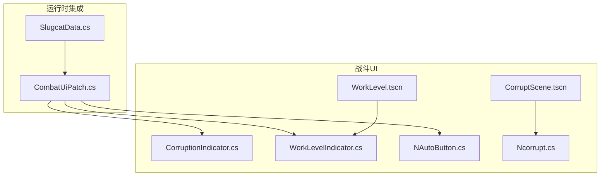
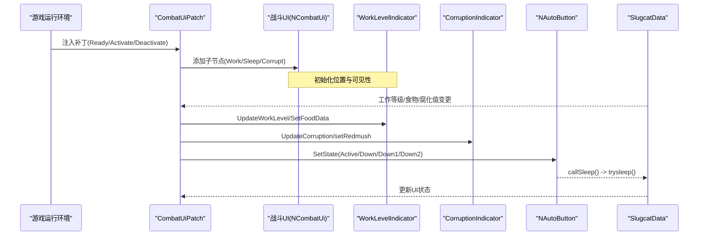
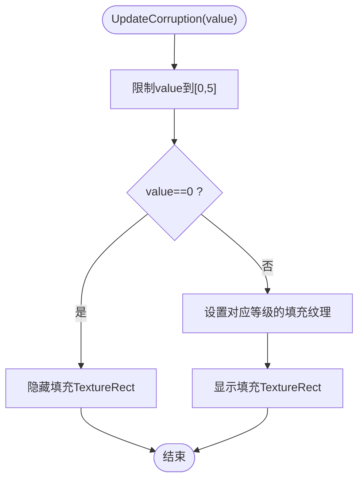
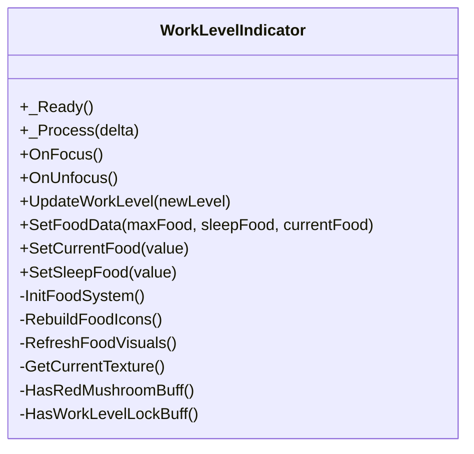
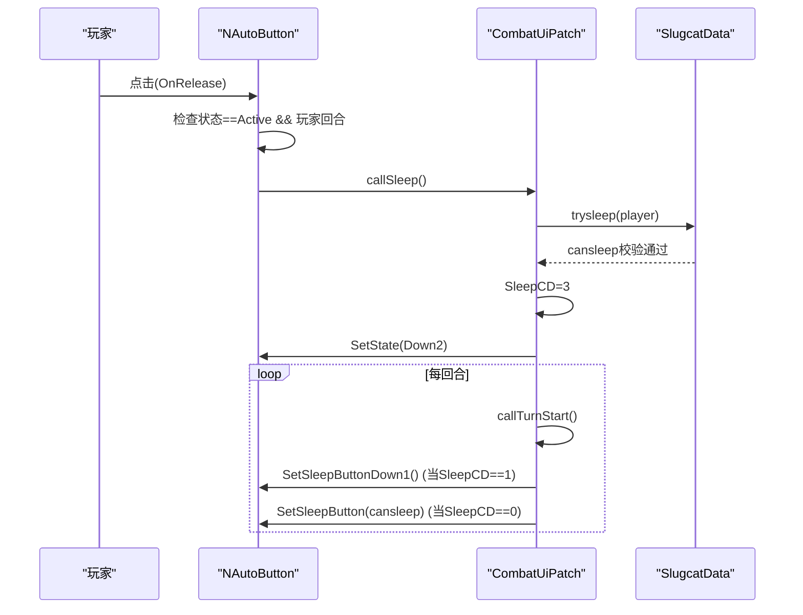
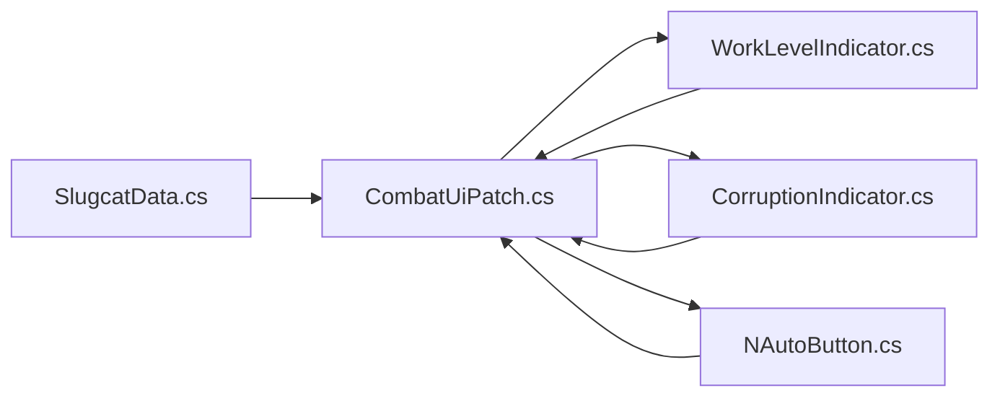

# 战斗UI组件

<cite>
**本文引用的文件**
- [CorruptionIndicator.cs](file://Godot/CombatUI/CorruptionIndicator.cs)
- [WorkLevelIndicator.cs](file://Godot/CombatUI/WorkLevelIndicator.cs)
- [NAutoButton.cs](file://Godot/CombatUI/NAutoButton.cs)
- [Ncorrupt.cs](file://Godot/CombatUI/Ncorrupt.cs)
- [CombatUiPatch.cs](file://Scripts/patches/CombatUiPatch.cs)
- [SlugcatData.cs](file://Scripts/Slugcat/SlugcatData.cs)
- [WorkLevel.tscn](file://Godot/CombatUI/WorkLevel.tscn)
- [CorruptScene.tscn](file://Godot/CombatUI/CorruptScene.tscn)
</cite>

## 目录
1. [简介](#简介)
2. [项目结构](#项目结构)
3. [核心组件](#核心组件)
4. [架构总览](#架构总览)
5. [详细组件分析](#详细组件分析)
6. [依赖关系分析](#依赖关系分析)
7. [性能与资源优化](#性能与资源优化)
8. [故障排查指南](#故障排查指南)
9. [结论](#结论)
10. [附录](#附录)

## 简介
本技术文档围绕战斗界面中的腐化值指示器、工作等级显示、食物点数等核心UI组件，系统阐述其实现方式、生命周期管理、数据绑定与状态更新机制。同时说明自定义按钮组件的开发模式与用户交互处理，并给出UI资源的组织结构、纹理优化与响应式布局建议。最后提供C#脚本控制UI行为的编程模式（事件监听、动画效果、视觉反馈）以及扩展方法与自定义样式配置指引。

## 项目结构
战斗UI相关代码与场景位于 Godot/CombatUI 目录，包含：
- 腐化值指示器：CorruptionIndicator.cs
- 工作等级与食物点：WorkLevelIndicator.cs
- 自动睡眠按钮：NAutoButton.cs
- 通用腐化图标切换：Ncorrupt.cs
- 战斗UI补丁与挂载：CombatUiPatch.cs
- 数据与逻辑：SlugcatData.cs
- 场景文件：WorkLevel.tscn、CorruptScene.tscn

图表来源
- [CombatUiPatch.cs:147-204](file://Scripts/patches/CombatUiPatch.cs#L147-L204)
- [WorkLevel.tscn:1-29](file://Godot/CombatUI/WorkLevel.tscn#L1-L29)
- [CorruptScene.tscn:1-41](file://Godot/CombatUI/CorruptScene.tscn#L1-L41)

章节来源
- [CombatUiPatch.cs:147-204](file://Scripts/patches/CombatUiPatch.cs#L147-L204)
- [WorkLevel.tscn:1-29](file://Godot/CombatUI/WorkLevel.tscn#L1-L29)
- [CorruptScene.tscn:1-41](file://Godot/CombatUI/CorruptScene.tscn#L1-L41)

## 核心组件
- 腐化值指示器（CorruptionIndicator）：展示当前腐化等级，支持闪烁背景与悬停提示；根据数值选择填充纹理。
- 工作等级指示器（WorkLevelIndicator）：以精灵切片显示工作等级，附带食物点数可视化（满/空/分隔），支持等级变化动画与状态色（受Buff影响）。
- 自动睡眠按钮（NAutoButton）：四态按钮（Active/Down/Down1/Down2），点击触发睡眠流程，带冷却倒计时与可点击状态控制。
- 腐化图标切换（Ncorrupt）：基于Sprite2D的简单图片切换工具，用于演示或辅助显示不同腐化阶段。

章节来源
- [CorruptionIndicator.cs:12-148](file://Godot/CombatUI/CorruptionIndicator.cs#L12-L148)
- [WorkLevelIndicator.cs:14-270](file://Godot/CombatUI/WorkLevelIndicator.cs#L14-L270)
- [NAutoButton.cs:14-138](file://Godot/CombatUI/NAutoButton.cs#L14-L138)
- [Ncorrupt.cs:4-78](file://Godot/CombatUI/Ncorrupt.cs#L4-L78)

## 架构总览
战斗UI通过补丁在战斗界面就绪时动态加载并挂载到NCombatUi，随后由数据层（SlugcatData）驱动UI状态更新。整体数据流如下：

图表来源
- [CombatUiPatch.cs:147-204](file://Scripts/patches/CombatUiPatch.cs#L147-L204)
- [CombatUiPatch.cs:216-260](file://Scripts/patches/CombatUiPatch.cs#L216-L260)
- [NAutoButton.cs:102-111](file://Godot/CombatUI/NAutoButton.cs#L102-L111)
- [SlugcatData.cs:223-238](file://Scripts/Slugcat/SlugcatData.cs#L223-L238)

## 详细组件分析

### 腐化值指示器（CorruptionIndicator）
- 职责：展示腐化等级（0-5），根据等级切换填充纹理；当存在红蘑菇Buff时背景闪烁提示。
- 生命周期：
  - _Ready：连接信号、加载纹理、构建层级（边框/填充/背景）、设置尺寸与缩放。
  - _Process：若背景可见则按正弦曲线调节透明度实现闪烁。
  - OnFocus/OnUnfocus：显示/移除悬停提示，动态读取当前腐化值。
  - UpdateCorruption：将值限制在[0,5]，为0时隐藏填充，否则设置对应纹理。
  - setRedmush：控制背景可见性与颜色重置。
- 数据绑定：通过CombatUiPatch.UpdateCorruption/SetCorruptValue间接接收数据。
- 交互：继承自NButton，保留焦点与点击框架，当前未实现特殊点击行为。

图表来源
- [CorruptionIndicator.cs:135-148](file://Godot/CombatUI/CorruptionIndicator.cs#L135-L148)

章节来源
- [CorruptionIndicator.cs:38-148](file://Godot/CombatUI/CorruptionIndicator.cs#L38-L148)
- [CombatUiPatch.cs:49-53](file://Scripts/patches/CombatUiPatch.cs#L49-L53)
- [CombatUiPatch.cs:113-123](file://Scripts/patches/CombatUiPatch.cs#L113-L123)

### 工作等级指示器（WorkLevelIndicator）
- 职责：显示工作等级（精灵切片）、食物点数（满/空/分隔线），并根据Buff改变外观（红蘑菇/工作锁）。
- 生命周期：
  - _Ready：连接信号、获取节点、加载纹理、计算最大等级、初始化食物系统。
  - _Process：每帧刷新精灵UV与调色（根据Buff）。
  - OnFocus/OnUnfocus：显示/移除工作等级与食物的悬停提示。
  - UpdateWorkLevel：目标等级变化时执行Tween动画平滑过渡。
  - SetFoodData/SetCurrentFood/SetSleepFood：重建食物图标并刷新显示。
- 数据绑定：通过CombatUiPatch.SetWorklevel/Setfood/SetSleepfood更新。
- 交互：继承自NButton，保留点击框架但当前无点击行为。

图表来源
- [WorkLevelIndicator.cs:53-270](file://Godot/CombatUI/WorkLevelIndicator.cs#L53-L270)

章节来源
- [WorkLevelIndicator.cs:53-270](file://Godot/CombatUI/WorkLevelIndicator.cs#L53-L270)
- [CombatUiPatch.cs:105-129](file://Scripts/patches/CombatUiPatch.cs#L105-L129)

### 自动睡眠按钮（NAutoButton）
- 职责：提供“睡眠”操作入口，具备四态显示与冷却倒计时，仅在玩家回合且满足条件时可点击。
- 生命周期：
  - _Ready：连接信号、获取节点、加载四张纹理、初始状态设为Down（不可用）。
  - SetState：外部调用切换状态，更新纹理与可点击状态。
  - OnRelease：仅在Active状态且玩家回合时切换到Down2并调用callSleep。
  - OnFocus/OnUnfocus：显示/移除悬停提示。
- 数据绑定：通过CombatUiPatch.SetSleepButton/SetSleepButtonDown1更新状态；callSleep内部维护SleepCD。
- 交互：点击后进入冷却，期间状态依次为Down2→Down1→Active。

图表来源
- [NAutoButton.cs:102-111](file://Godot/CombatUI/NAutoButton.cs#L102-L111)
- [CombatUiPatch.cs:39-48](file://Scripts/patches/CombatUiPatch.cs#L39-L48)
- [CombatUiPatch.cs:62-76](file://Scripts/patches/CombatUiPatch.cs#L62-L76)

章节来源
- [NAutoButton.cs:39-138](file://Godot/CombatUI/NAutoButton.cs#L39-L138)
- [CombatUiPatch.cs:39-76](file://Scripts/patches/CombatUiPatch.cs#L39-L76)

### 腐化图标切换（Ncorrupt）
- 职责：基于Sprite2D加载多张图片并切换显示，提供透明/恢复显示能力。
- 生命周期：
  - _Ready：加载所有图片路径到纹理数组，默认显示第一张。
  - ShowImage：外部调用切换当前索引与纹理。
  - MakeTransparent/RestoreDisplay：控制透明度与可见性，必要时恢复纹理。
- 使用场景：可作为演示或辅助显示不同腐化阶段的独立组件。

章节来源
- [Ncorrupt.cs:22-78](file://Godot/CombatUI/Ncorrupt.cs#L22-L78)

## 依赖关系分析
- 组件与补丁：
  - CombatUiPatch负责在战斗UI生命周期中实例化并挂载WorkLevelIndicator、NAutoButton、CorruptionIndicator，并在激活时初始化数据。
  - SlugcatData作为数据源，暴露工作等级、食物、腐化值等读写接口，并通过CombatUiPatch回调更新UI。
- 组件间耦合：
  - CorruptionIndicator与WorkLevelIndicator均依赖CombatUiPatch提供的静态引用进行数据更新。
  - NAutoButton通过CombatUiPatch.callSleep与SlugcatData交互，形成“按钮→补丁→数据→补丁→UI”的闭环。
- 外部依赖：
  - 使用MegaCrit.Sts2.Core的节点与提示系统（NHoverTipSet、LocString）。
  - 使用STS2RitsuLib的SecondaryResources进行持久化数据存取。

图表来源
- [CombatUiPatch.cs:147-204](file://Scripts/patches/CombatUiPatch.cs#L147-L204)
- [SlugcatData.cs:34-66](file://Scripts/Slugcat/SlugcatData.cs#L34-L66)

章节来源
- [CombatUiPatch.cs:147-204](file://Scripts/patches/CombatUiPatch.cs#L147-L204)
- [SlugcatData.cs:34-66](file://Scripts/Slugcat/SlugcatData.cs#L34-L66)

## 性能与资源优化
- 纹理加载与缓存：
  - 各组件在_Rready中集中加载所需纹理并缓存至字段，避免重复GD.Load开销。
  - WorkLevelIndicator在_ExitTree中释放纹理与Tween，防止内存泄漏。
- 渲染优化：
  - WorkLevelIndicator使用Sprite2D的RegionRect进行精灵切片，减少多纹理绘制。
  - CorruptionIndicator使用Keep拉伸模式保持像素清晰，适合UI图标。
- 动画与更新：
  - 工作等级变化使用Tween缓动，避免每帧直接修改导致卡顿。
  - 腐化背景闪烁采用正弦函数插值Alpha，降低CPU开销。
- 响应式布局：
  - 通过SetAnchorsPreset与Offset设置锚点与偏移，适配不同分辨率。
  - 食物图标使用HBoxContainer居中排列，便于扩展数量。

章节来源
- [WorkLevelIndicator.cs:258-268](file://Godot/CombatUI/WorkLevelIndicator.cs#L258-L268)
- [CorruptionIndicator.cs:93-99](file://Godot/CombatUI/CorruptionIndicator.cs#L93-L99)
- [WorkLevelIndicator.cs:127-141](file://Godot/CombatUI/WorkLevelIndicator.cs#L127-L141)

## 故障排查指南
- UI未显示：
  - 检查CombatUiPatch是否在NCombatUi._Ready与Activate中被正确调用，确保子节点已添加且Visible设置为true。
  - 确认场景路径与资源路径正确，GD.Load返回非空。
- 数据不更新：
  - 确认SlugcatData修改数据后调用了对应的CombatUiPatch更新方法（如SetWorklevel、Setfood、SetCorruptValue）。
  - 检查IsInstanceValid判断是否通过，避免对无效对象调用。
- 按钮无法点击：
  - 检查NAutoButton状态是否为Active，且当前回合为玩家回合。
  - 确认SleepCD计时器是否正确递减，并在为0时恢复可点击状态。
- 动画异常：
  - 检查工作等级更新时Tween是否被正确创建与销毁，避免重复创建导致冲突。
  - 确认精灵RegionRect计算正确，避免显示错位。

章节来源
- [CombatUiPatch.cs:147-204](file://Scripts/patches/CombatUiPatch.cs#L147-L204)
- [CombatUiPatch.cs:216-260](file://Scripts/patches/CombatUiPatch.cs#L216-L260)
- [NAutoButton.cs:102-111](file://Godot/CombatUI/NAutoButton.cs#L102-L111)
- [WorkLevelIndicator.cs:239-256](file://Godot/CombatUI/WorkLevelIndicator.cs#L239-L256)

## 结论
本套战斗UI组件通过清晰的职责划分与统一的数据驱动模式，实现了腐化值、工作等级与食物点数的可视化与交互。CombatUiPatch作为中枢协调UI生命周期与数据同步，SlugcatData提供稳定的数据访问与业务逻辑封装。组件内采用合理的纹理缓存、动画与布局策略，兼顾性能与可扩展性。后续可在此基础上继续扩展更多战斗状态指示与交互功能。

## 附录
- 扩展方法建议：
  - 为WorkLevelIndicator增加自定义样式配置（如颜色主题、动画时长）。
  - 为CorruptionIndicator增加音效播放与粒子效果。
  - 为NAutoButton增加更丰富的状态提示与长按行为。
- 自定义样式配置：
  - 通过Export变量暴露纹理路径与动画参数，便于在编辑器中调整。
  - 使用LocString统一管理多语言文本，便于本地化扩展。