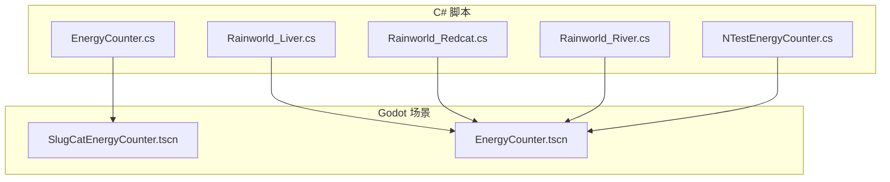
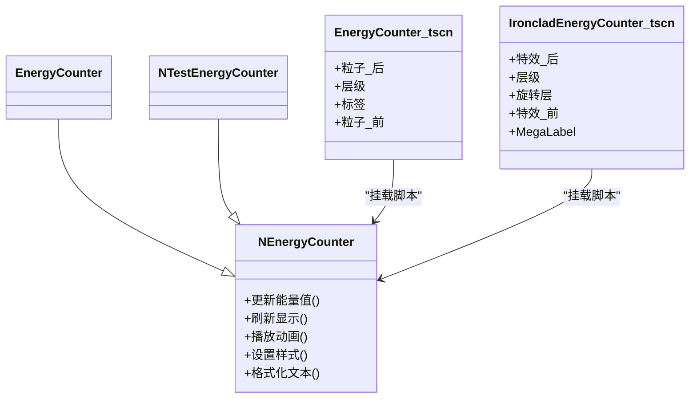
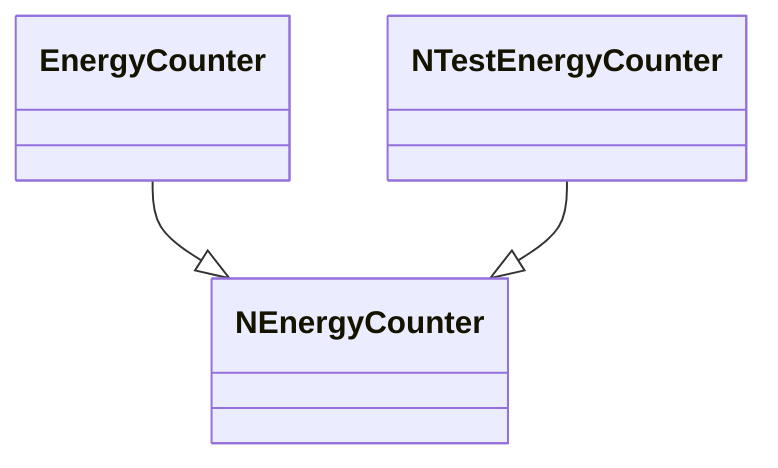
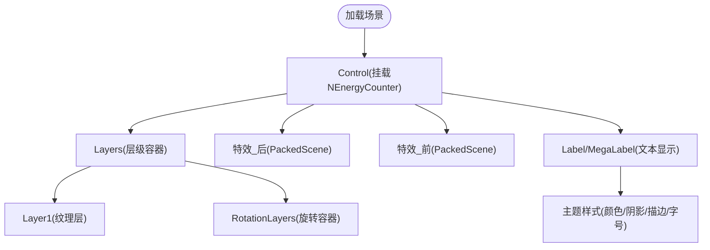
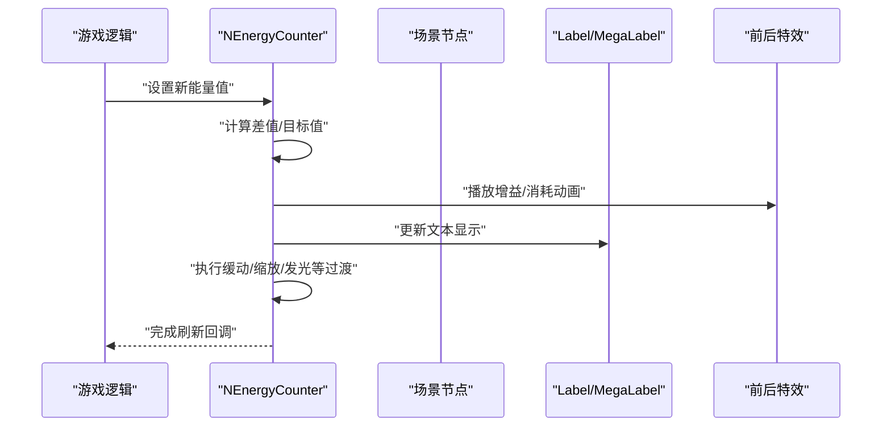
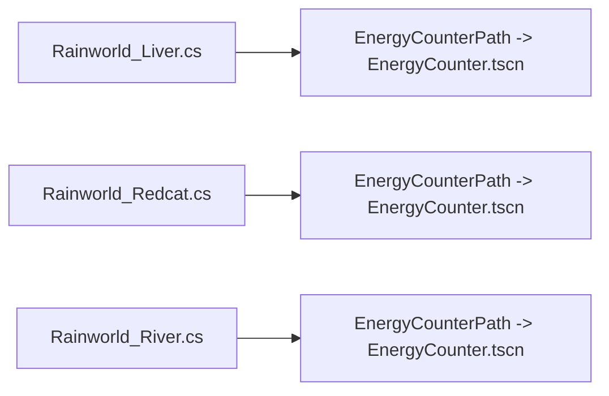
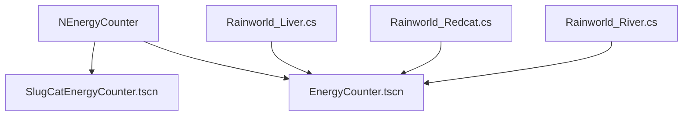

# 能量计数器系统

<cite>
**本文引用的文件**
- [EnergyCounter.cs](file://Godot/SlugCatEnergyCounter/EnergyCounter.cs)
- [NTestEnergyCounter.cs](file://Godot/EnergyLable/NTestEnergyCounter.cs)
- [SlugCatEnergyCounter.tscn](file://Godot/SlugCatEnergyCounter/SlugCatEnergyCounter.tscn)
- [EnergyCounter.tscn](file://Godot/EnergyLable/EnergyCounter.tscn)
- [Rainworld_Liver.cs](file://Scripts/Slugcat/Rainworld_Liver.cs)
- [Rainworld_Redcat.cs](file://Scripts/Slugcat/Rainworld_Redcat.cs)
- [Rainworld_River.cs](file://Scripts/Slugcat/Rainworld_River.cs)
</cite>

## 目录
1. [简介](#简介)
2. [项目结构](#项目结构)
3. [核心组件](#核心组件)
4. [架构总览](#架构总览)
5. [详细组件分析](#详细组件分析)
6. [依赖关系分析](#依赖关系分析)
7. [性能考虑](#性能考虑)
8. [故障排查指南](#故障排查指南)
9. [结论](#结论)
10. [附录](#附录)

## 简介
本技术文档聚焦于“能量计数器系统”，围绕其在 Godot 场景中的 UI 实现、数值显示与动画效果，说明能量值的实时更新机制、状态同步与数据持久化策略。同时记录计数器组件的可配置项（样式定制、动画时长、显示格式），并提供多计数器管理策略与资源优化方案。最后给出 C# 脚本与 Godot UI 节点的交互模式（事件处理与用户反馈）以及扩展方法与自定义显示效果的实现指南。

## 项目结构
能量计数器相关代码与场景主要分布在以下位置：
- Godot/SlugCatEnergyCounter：包含一个基于 NEnergyCounter 的自定义计数器场景与脚本。
- Godot/EnergyLable：包含另一个基于 NEnergyCounter 的能量计数器场景与测试脚本。
- Scripts/Slugcat：角色资产配置中通过 EnergyCounterPath 指定各角色使用的能量计数器场景。

图表来源
- [SlugCatEnergyCounter.tscn:1-50](file://Godot/SlugCatEnergyCounter/SlugCatEnergyCounter.tscn#L1-L50)
- [EnergyCounter.tscn:1-93](file://Godot/EnergyLable/EnergyCounter.tscn#L1-L93)
- [EnergyCounter.cs:1-9](file://Godot/SlugCatEnergyCounter/EnergyCounter.cs#L1-L9)
- [NTestEnergyCounter.cs:1-9](file://Godot/EnergyLable/NTestEnergyCounter.cs#L1-L9)
- [Rainworld_Liver.cs:40-117](file://Scripts/Slugcat/Rainworld_Liver.cs#L40-L117)
- [Rainworld_Redcat.cs:45-128](file://Scripts/Slugcat/Rainworld_Redcat.cs#L45-L128)
- [Rainworld_River.cs:48-114](file://Scripts/Slugcat/Rainworld_River.cs#L48-L114)

章节来源
- [EnergyCounter.cs:1-9](file://Godot/SlugCatEnergyCounter/EnergyCounter.cs#L1-L9)
- [NTestEnergyCounter.cs:1-9](file://Godot/EnergyLable/NTestEnergyCounter.cs#L1-L9)
- [SlugCatEnergyCounter.tscn:1-50](file://Godot/SlugCatEnergyCounter/SlugCatEnergyCounter.tscn#L1-L50)
- [EnergyCounter.tscn:1-93](file://Godot/EnergyLable/EnergyCounter.tscn#L1-L93)
- [Rainworld_Liver.cs:40-117](file://Scripts/Slugcat/Rainworld_Liver.cs#L40-L117)
- [Rainworld_Redcat.cs:45-128](file://Scripts/Slugcat/Rainworld_Redcat.cs#L45-L128)
- [Rainworld_River.cs:48-114](file://Scripts/Slugcat/Rainworld_River.cs#L48-L114)

## 核心组件
- 基类 NEnergyCounter：所有能量计数器的共同基类（由场景引用）。它负责能量数值的更新、显示与动画等通用逻辑。
- 自定义计数器：
  - EnergyCounter.cs：继承自 NEnergyCounter，用于 SlugCatEnergyCounter 场景。
  - NTestEnergyCounter.cs：继承自 NEnergyCounter，用于 EnergyLable 场景的测试用途。
- 场景资源：
  - SlugCatEnergyCounter.tscn：包含粒子、层级、标签与字体等节点，挂载 NEnergyCounter。
  - EnergyCounter.tscn：包含前后特效、纹理层、旋转层与 MegaLabel 文本节点，挂载 NEnergyCounter。
- 角色集成：
  - Rainworld_Liver.cs / Rainworld_Redcat.cs / Rainworld_River.cs：在角色资产配置中通过 EnergyCounterPath 指向 EnergyCounter.tscn，从而将能量计数器绑定到对应角色。

章节来源
- [EnergyCounter.cs:1-9](file://Godot/SlugCatEnergyCounter/EnergyCounter.cs#L1-L9)
- [NTestEnergyCounter.cs:1-9](file://Godot/EnergyLable/NTestEnergyCounter.cs#L1-L9)
- [SlugCatEnergyCounter.tscn:1-50](file://Godot/SlugCatEnergyCounter/SlugCatEnergyCounter.tscn#L1-L50)
- [EnergyCounter.tscn:1-93](file://Godot/EnergyLable/EnergyCounter.tscn#L1-L93)
- [Rainworld_Liver.cs:40-117](file://Scripts/Slugcat/Rainworld_Liver.cs#L40-L117)
- [Rainworld_Redcat.cs:45-128](file://Scripts/Slugcat/Rainworld_Redcat.cs#L45-L128)
- [Rainworld_River.cs:48-114](file://Scripts/Slugcat/Rainworld_River.cs#L48-L114)

## 架构总览
能量计数器系统的整体架构以 NEnergyCounter 为核心，结合 Godot 场景树中的 UI 节点（标签、粒子、纹理层）与角色资产配置完成展示与联动。

图表来源
- [EnergyCounter.cs:1-9](file://Godot/SlugCatEnergyCounter/EnergyCounter.cs#L1-L9)
- [NTestEnergyCounter.cs:1-9](file://Godot/EnergyLable/NTestEnergyCounter.cs#L1-L9)
- [SlugCatEnergyCounter.tscn:1-50](file://Godot/SlugCatEnergyCounter/SlugCatEnergyCounter.tscn#L1-L50)
- [EnergyCounter.tscn:1-93](file://Godot/EnergyLable/EnergyCounter.tscn#L1-L93)

## 详细组件分析

### 能量计数器基类与子类
- NEnergyCounter：提供统一的能量值更新接口、显示刷新、动画控制、样式设置与文本格式化能力。
- EnergyCounter：在 SlugCatEnergyCounter 场景中作为具体实现，可覆盖基类行为以实现特定样式或动画。
- NTestEnergyCounter：在 EnergyLable 场景中用于测试与演示，便于快速验证不同配置下的表现。

图表来源
- [EnergyCounter.cs:1-9](file://Godot/SlugCatEnergyCounter/EnergyCounter.cs#L1-L9)
- [NTestEnergyCounter.cs:1-9](file://Godot/EnergyLable/NTestEnergyCounter.cs#L1-L9)

章节来源
- [EnergyCounter.cs:1-9](file://Godot/SlugCatEnergyCounter/EnergyCounter.cs#L1-L9)
- [NTestEnergyCounter.cs:1-9](file://Godot/EnergyLable/NTestEnergyCounter.cs#L1-L9)

### 场景结构与节点组织
- SlugCatEnergyCounter.tscn：
  - 根节点为 Control，挂载 NEnergyCounter。
  - 包含前后粒子 CPUParticles2D、层级 Control、Sprite2D 背景图、Label 文本节点与字体变体。
- EnergyCounter.tscn（IroncladEnergyCounter）：
  - 根节点为 Control，挂载 NEnergyCounter。
  - 包含前后特效 PackedScene、层级 Control、旋转层 Control、纹理层 TextureRect、MegaLabel 文本节点与主题颜色/阴影/描边配置。

图表来源
- [SlugCatEnergyCounter.tscn:1-50](file://Godot/SlugCatEnergyCounter/SlugCatEnergyCounter.tscn#L1-L50)
- [EnergyCounter.tscn:1-93](file://Godot/EnergyLable/EnergyCounter.tscn#L1-L93)

章节来源
- [SlugCatEnergyCounter.tscn:1-50](file://Godot/SlugCatEnergyCounter/SlugCatEnergyCounter.tscn#L1-L50)
- [EnergyCounter.tscn:1-93](file://Godot/EnergyLable/EnergyCounter.tscn#L1-L93)

### 数值显示与动画流程
能量值变化时，UI 通过 NEnergyCounter 进行刷新并触发动画。典型流程如下：

图表来源
- [EnergyCounter.tscn:1-93](file://Godot/EnergyLable/EnergyCounter.tscn#L1-L93)
- [SlugCatEnergyCounter.tscn:1-50](file://Godot/SlugCatEnergyCounter/SlugCatEnergyCounter.tscn#L1-L50)

章节来源
- [EnergyCounter.tscn:1-93](file://Godot/EnergyLable/EnergyCounter.tscn#L1-L93)
- [SlugCatEnergyCounter.tscn:1-50](file://Godot/SlugCatEnergyCounter/SlugCatEnergyCounter.tscn#L1-L50)

### 角色集成与场景绑定
各角色通过 CharacterAssetProfiles.Scenes.EnergyCounterPath 指定其能量计数器场景，从而实现角色与 UI 的解耦与复用。

图表来源
- [Rainworld_Liver.cs:40-117](file://Scripts/Slugcat/Rainworld_Liver.cs#L40-L117)
- [Rainworld_Redcat.cs:45-128](file://Scripts/Slugcat/Rainworld_Redcat.cs#L45-L128)
- [Rainworld_River.cs:48-114](file://Scripts/Slugcat/Rainworld_River.cs#L48-L114)

章节来源
- [Rainworld_Liver.cs:40-117](file://Scripts/Slugcat/Rainworld_Liver.cs#L40-L117)
- [Rainworld_Redcat.cs:45-128](file://Scripts/Slugcat/Rainworld_Redcat.cs#L45-L128)
- [Rainworld_River.cs:48-114](file://Scripts/Slugcat/Rainworld_River.cs#L48-L114)

### 可配置选项与样式定制
- 文本显示：
  - 使用 MegaLabel 支持动态字号范围与对齐方式；可通过主题设置字体、字号、颜色、阴影与描边。
- 视觉样式：
  - 纹理层材质、粒子特效、旋转层均可独立配置。
- 动画时长：
  - 通过 NEnergyCounter 的动画接口控制过渡时长与缓动曲线（例如数值滚动、缩放、发光强度）。
- 显示格式：
  - 支持“当前/上限”或仅“当前值”的格式化输出，可在 NEnergyCounter 中统一处理。

章节来源
- [EnergyCounter.tscn:1-93](file://Godot/EnergyLable/EnergyCounter.tscn#L1-L93)
- [SlugCatEnergyCounter.tscn:1-50](file://Godot/SlugCatEnergyCounter/SlugCatEnergyCounter.tscn#L1-L50)

### 实时更新机制、状态同步与数据持久化
- 实时更新：
  - 当能量值发生变化时，调用 NEnergyCounter 的更新接口，触发 UI 刷新与动画。
- 状态同步：
  - 建议在多人或异步环境下，对能量值变更进行事件广播或消息队列，确保多个 UI 实例一致。
- 数据持久化：
  - 若需跨局保存能量相关配置（如默认显示格式、动画偏好），可将设置写入本地配置文件或存档数据，并在场景加载时读取应用。

章节来源
- [EnergyCounter.tscn:1-93](file://Godot/EnergyLable/EnergyCounter.tscn#L1-L93)
- [SlugCatEnergyCounter.tscn:1-50](file://Godot/SlugCatEnergyCounter/SlugCatEnergyCounter.tscn#L1-L50)

### 多计数器管理与资源优化
- 管理器设计：
  - 引入 EnergyCounterManager 统一管理多个计数器实例的生命周期、更新调度与资源池。
- 资源复用：
  - 共享 NEnergyCounter 基类与场景模板，减少重复资源加载。
  - 粒子与特效采用对象池，避免频繁创建销毁。
- 批量更新：
  - 使用帧级批处理合并多次能量值变更，降低 UI 刷新开销。
- 按需加载：
  - 仅在可见时加载特效与高开销资源，不可见时暂停动画与渲染。

章节来源
- [EnergyCounter.tscn:1-93](file://Godot/EnergyLable/EnergyCounter.tscn#L1-L93)
- [SlugCatEnergyCounter.tscn:1-50](file://Godot/SlugCatEnergyCounter/SlugCatEnergyCounter.tscn#L1-L50)

### C# 脚本与 Godot UI 节点的交互模式
- 事件处理：
  - 在 NEnergyCounter 中监听能量值变化事件，驱动 Label 文本更新与特效播放。
- 用户反馈：
  - 通过粒子与材质变化提供即时反馈（如能量增加时的光晕增强、减少时的闪烁）。
- 扩展点：
  - 在 EnergyCounter.cs 或 NTestEnergyCounter.cs 中覆写关键方法，注入自定义逻辑（如音效、震动、额外提示）。

章节来源
- [EnergyCounter.cs:1-9](file://Godot/SlugCatEnergyCounter/EnergyCounter.cs#L1-L9)
- [NTestEnergyCounter.cs:1-9](file://Godot/EnergyLable/NTestEnergyCounter.cs#L1-L9)
- [EnergyCounter.tscn:1-93](file://Godot/EnergyLable/EnergyCounter.tscn#L1-L93)
- [SlugCatEnergyCounter.tscn:1-50](file://Godot/SlugCatEnergyCounter/SlugCatEnergyCounter.tscn#L1-L50)

### 扩展方法与自定义显示效果实现指南
- 新增计数器类型：
  - 新建继承自 NEnergyCounter 的脚本，并在场景文件中挂载该脚本。
- 自定义样式：
  - 调整场景中的纹理材质、粒子参数与 MegaLabel 主题，实现不同风格。
- 自定义动画：
  - 在 NEnergyCounter 中扩展动画接口，添加缩放、旋转、透明度渐变等过渡效果。
- 自定义显示格式：
  - 在 NEnergyCounter 中重写格式化方法，支持单位、千分位、小数位数等。
- 接入角色：
  - 在角色资产配置中将 EnergyCounterPath 指向新的场景，即可无缝替换。

章节来源
- [EnergyCounter.cs:1-9](file://Godot/SlugCatEnergyCounter/EnergyCounter.cs#L1-L9)
- [NTestEnergyCounter.cs:1-9](file://Godot/EnergyLable/NTestEnergyCounter.cs#L1-L9)
- [EnergyCounter.tscn:1-93](file://Godot/EnergyLable/EnergyCounter.tscn#L1-L93)
- [SlugCatEnergyCounter.tscn:1-50](file://Godot/SlugCatEnergyCounter/SlugCatEnergyCounter.tscn#L1-L50)
- [Rainworld_Liver.cs:40-117](file://Scripts/Slugcat/Rainworld_Liver.cs#L40-L117)
- [Rainworld_Redcat.cs:45-128](file://Scripts/Slugcat/Rainworld_Redcat.cs#L45-L128)
- [Rainworld_River.cs:48-114](file://Scripts/Slugcat/Rainworld_River.cs#L48-L114)

## 依赖关系分析
- 场景依赖：
  - SlugCatEnergyCounter.tscn 与 EnergyCounter.tscn 均依赖 NEnergyCounter 脚本。
- 角色依赖：
  - 各角色通过 EnergyCounterPath 依赖对应的能量计数器场景。
- 外部资源：
  - 场景引用了纹理、材质、字体变体与特效场景，需在打包时正确导出。

图表来源
- [EnergyCounter.cs:1-9](file://Godot/SlugCatEnergyCounter/EnergyCounter.cs#L1-L9)
- [NTestEnergyCounter.cs:1-9](file://Godot/EnergyLable/NTestEnergyCounter.cs#L1-L9)
- [SlugCatEnergyCounter.tscn:1-50](file://Godot/SlugCatEnergyCounter/SlugCatEnergyCounter.tscn#L1-L50)
- [EnergyCounter.tscn:1-93](file://Godot/EnergyLable/EnergyCounter.tscn#L1-L93)
- [Rainworld_Liver.cs:40-117](file://Scripts/Slugcat/Rainworld_Liver.cs#L40-L117)
- [Rainworld_Redcat.cs:45-128](file://Scripts/Slugcat/Rainworld_Redcat.cs#L45-L128)
- [Rainworld_River.cs:48-114](file://Scripts/Slugcat/Rainworld_River.cs#L48-L114)

章节来源
- [EnergyCounter.cs:1-9](file://Godot/SlugCatEnergyCounter/EnergyCounter.cs#L1-L9)
- [NTestEnergyCounter.cs:1-9](file://Godot/EnergyLable/NTestEnergyCounter.cs#L1-L9)
- [SlugCatEnergyCounter.tscn:1-50](file://Godot/SlugCatEnergyCounter/SlugCatEnergyCounter.tscn#L1-L50)
- [EnergyCounter.tscn:1-93](file://Godot/EnergyLable/EnergyCounter.tscn#L1-L93)
- [Rainworld_Liver.cs:40-117](file://Scripts/Slugcat/Rainworld_Liver.cs#L40-L117)
- [Rainworld_Redcat.cs:45-128](file://Scripts/Slugcat/Rainworld_Redcat.cs#L45-L128)
- [Rainworld_River.cs:48-114](file://Scripts/Slugcat/Rainworld_River.cs#L48-L114)

## 性能考虑
- 动画节流：
  - 对高频能量变化进行合并，避免每帧多次刷新 UI。
- 资源池化：
  - 粒子与特效采用对象池，减少 GC 压力。
- 按需渲染：
  - 不可见时暂停粒子与动画，降低 CPU/GPU 占用。
- 字体与纹理：
  - 使用合适的分辨率与压缩格式，减少内存占用。

[本节为通用指导，不直接分析具体文件]

## 故障排查指南
- 文本未更新：
  - 检查 NEnergyCounter 的刷新接口是否被调用，确认 Label 节点存在且可见。
- 动画无响应：
  - 检查前后特效节点是否启用，确认特效场景已正确加载。
- 角色绑定失败：
  - 核对角色资产配置中的 EnergyCounterPath 是否正确指向场景路径。
- 样式异常：
  - 检查 MegaLabel 主题设置与材质参数，确保颜色、阴影与描边生效。

章节来源
- [EnergyCounter.tscn:1-93](file://Godot/EnergyLable/EnergyCounter.tscn#L1-L93)
- [SlugCatEnergyCounter.tscn:1-50](file://Godot/SlugCatEnergyCounter/SlugCatEnergyCounter.tscn#L1-L50)
- [Rainworld_Liver.cs:40-117](file://Scripts/Slugcat/Rainworld_Liver.cs#L40-L117)
- [Rainworld_Redcat.cs:45-128](file://Scripts/Slugcat/Rainworld_Redcat.cs#L45-L128)
- [Rainworld_River.cs:48-114](file://Scripts/Slugcat/Rainworld_River.cs#L48-L114)

## 结论
能量计数器系统以 NEnergyCounter 为核心，结合 Godot 场景与角色资产配置，实现了灵活、可扩展的能量值显示与动画效果。通过统一的管理策略与资源优化手段，能够在多计数器场景下保持良好性能与一致性。未来可通过扩展 NEnergyCounter 的接口与场景配置，进一步丰富显示样式与交互体验。

[本节为总结性内容，不直接分析具体文件]

## 附录
- 推荐实践：
  - 将能量值变更封装为事件，便于多模块订阅与同步。
  - 使用配置表集中管理显示格式与动画参数，便于调优与本地化。
- 参考路径：
  - 场景与脚本路径参见“项目结构”与“详细组件分析”中的引用。

[本节为补充信息，不直接分析具体文件]