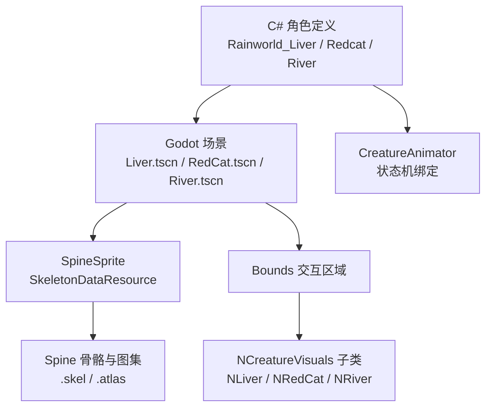
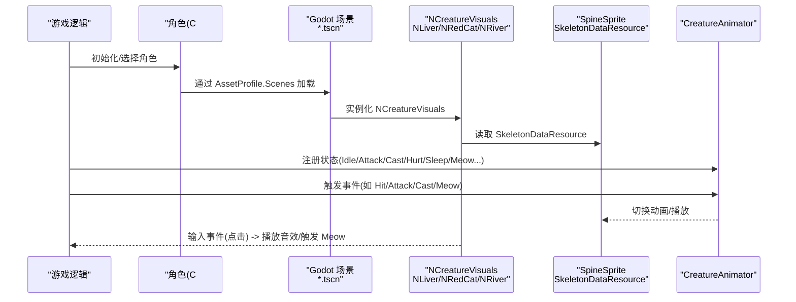
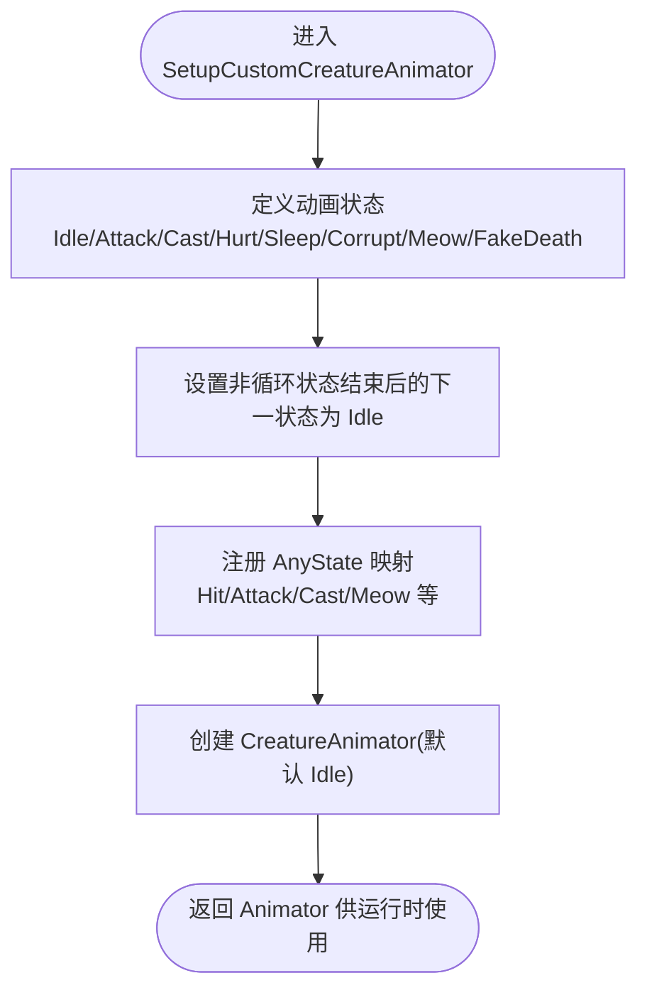
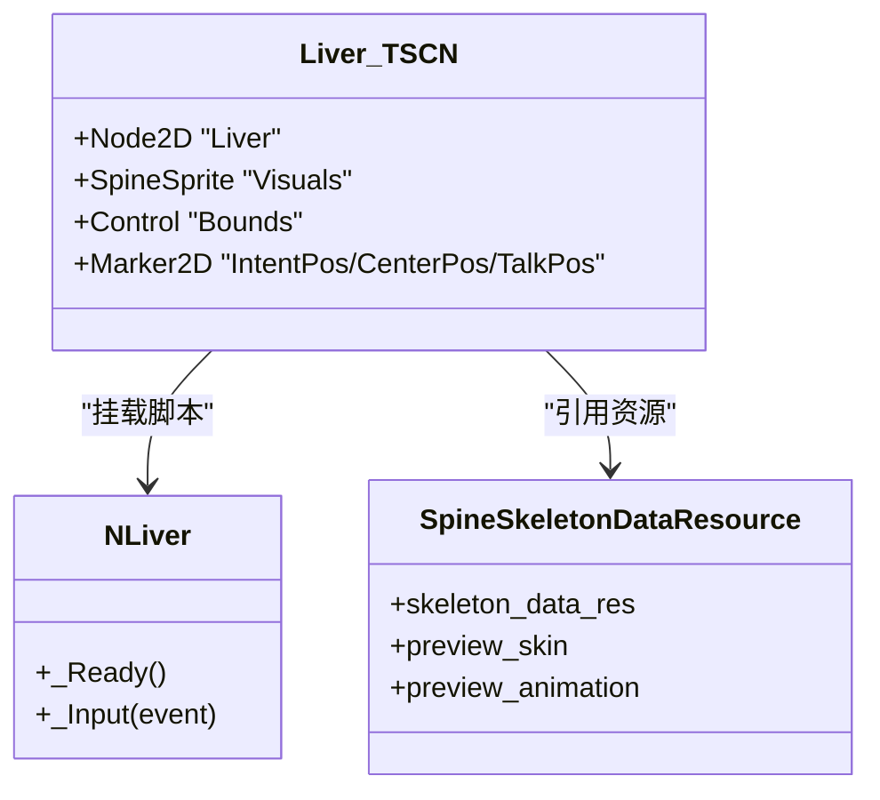
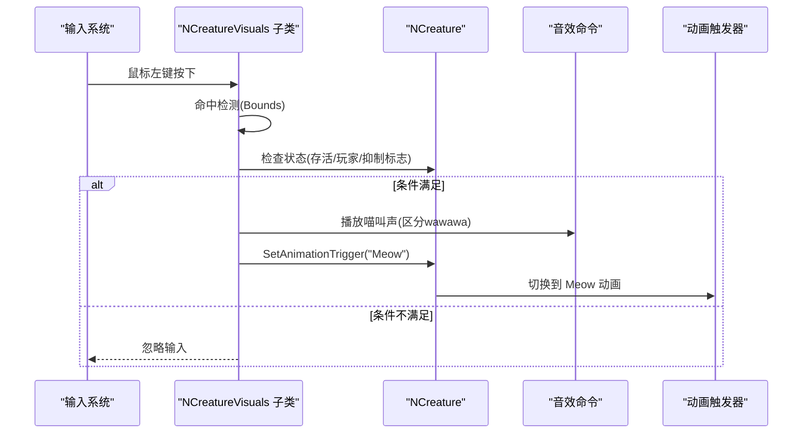
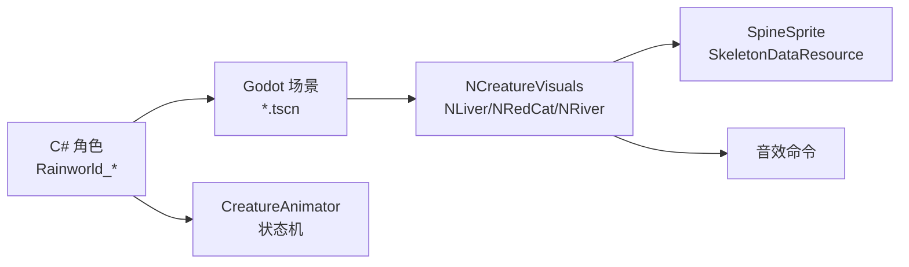

# 角色模型系统

<cite>
**本文引用的文件**
- [NLiver.cs](file://Godot/Character/Liver/NLiver.cs)
- [NRedCat.cs](file://Godot/Character/RedCat/NRedCat.cs)
- [NRiver.cs](file://Godot/Character/River/NRiver.cs)
- [Slugcat.cs](file://Scripts/Slugcat/Slugcat.cs)
- [Rainworld_Liver.cs](file://Scripts/Slugcat/Rainworld_Liver.cs)
- [Rainworld_Redcat.cs](file://Scripts/Slugcat/Rainworld_Redcat.cs)
- [Rainworld_River.cs](file://Scripts/Slugcat/Rainworld_River.cs)
- [Liver.tscn](file://Godot/Character/Liver/Liver.tscn)
- [Head.tscn](file://Godot/Character/Liver/Head.tscn)
- [skeleton.skel.import](file://Godot/Character/Liver/spine/skeleton.skel.import)
- [white.atlas.import](file://Godot/Character/Liver/spine/white.atlas.import)
</cite>

## 目录
1. [简介](#简介)
2. [项目结构](#项目结构)
3. [核心组件](#核心组件)
4. [架构总览](#架构总览)
5. [详细组件分析](#详细组件分析)
6. [依赖关系分析](#依赖关系分析)
7. [性能与资源优化](#性能与资源优化)
8. [故障排查指南](#故障排查指南)
9. [结论](#结论)
10. [附录：制作规范与最佳实践](#附录：制作规范与最佳实践)

## 简介
本技术文档围绕三个 Slugcat 角色（Liver、RedCat、River）的角色模型系统，系统性说明其模型结构、Spine 动画集成、状态管理、加载流程、资源与内存管理、头部组件、身体动画与交互状态实现，以及 C# 脚本与 Godot 节点的通信机制和事件处理模式。目标是帮助开发者快速理解并扩展该系统的可视化表现与运行时行为。

## 项目结构
- 角色定义与资源绑定
  - 每个角色在 C# 中通过 CharacterAssetProfile 声明场景路径、UI 图标、商店与休息点动画、多人手势纹理等。
  - 主视觉场景为 Godot 场景（如 Liver.tscn），内含 SpineSprite 节点与碰撞/交互区域 Bounds。
- Spine 资源
  - 骨骼数据 .skel 与图集 .atlas 由 Godot 的 Spine 导入器生成对应资源，供运行时渲染。
- 交互逻辑
  - 各角色的 NCreatureVisuals 子类监听鼠标输入，触发音效与动画触发器（Meow）。
  - River 额外支持皮肤切换（基于遗物状态）。

图表来源
- [Liver.tscn:1-40](file://Godot/Character/Liver/Liver.tscn#L1-L40)
- [skeleton.skel.import:1-15](file://Godot/Character/Liver/spine/skeleton.skel.import#L1-L15)
- [white.atlas.import:1-17](file://Godot/Character/Liver/spine/white.atlas.import#L1-L17)

章节来源
- [Rainworld_Liver.cs:41-79](file://Scripts/Slugcat/Rainworld_Liver.cs#L41-L79)
- [Rainworld_Redcat.cs:44-84](file://Scripts/Slugcat/Rainworld_Redcat.cs#L44-L84)
- [Rainworld_River.cs:47-85](file://Scripts/Slugcat/Rainworld_River.cs#L47-L85)
- [Liver.tscn:1-40](file://Godot/Character/Liver/Liver.tscn#L1-L40)

## 核心组件
- 角色基类与动画状态机
  - 抽象基类提供 SetupCustomCreatureAnimator，统一注册 Idle、Attack、Cast、Hurt、Sleep、Corrupt、Meow、FakeDeath 等状态，并设置播放后回退到 Idle。
  - 通过 CreatureAnimator.AddAnyState 将游戏内动作事件映射到具体动画状态。
- 角色实例化与资源装配
  - 各角色通过 AssetProfile.Scenes.VisualsPath 指定 Godot 场景；TryCreateCreatureVisuals 使用工厂创建 NCreatureVisuals 实例。
- 可视化脚本
  - NLiver、NRedCat、NRiver 继承自 NCreatureVisuals，负责输入处理、音效播放、动画触发与皮肤切换（River）。

章节来源
- [Slugcat.cs:93-133](file://Scripts/Slugcat/Slugcat.cs#L93-L133)
- [Rainworld_Liver.cs:108-108](file://Scripts/Slugcat/Rainworld_Liver.cs#L108-L108)
- [Rainworld_Redcat.cs:119-119](file://Scripts/Slugcat/Rainworld_Redcat.cs#L119-L119)
- [Rainworld_River.cs:105-105](file://Scripts/Slugcat/Rainworld_River.cs#L105-L105)
- [NLiver.cs:12-49](file://Godot/Character/Liver/NLiver.cs#L12-L49)
- [NRedCat.cs:13-54](file://Godot/Character/RedCat/NRedCat.cs#L13-L54)
- [NRiver.cs:11-84](file://Godot/Character/River/NRiver.cs#L11-L84)

## 架构总览
下图展示了从 C# 角色定义到 Godot 场景与 Spine 渲染的完整链路，以及运行时动画状态机的调用关系。

图表来源
- [Slugcat.cs:93-133](file://Scripts/Slugcat/Slugcat.cs#L93-L133)
- [Rainworld_Liver.cs:41-79](file://Scripts/Slugcat/Rainworld_Liver.cs#L41-L79)
- [Rainworld_Redcat.cs:44-84](file://Scripts/Slugcat/Rainworld_Redcat.cs#L44-L84)
- [Rainworld_River.cs:47-85](file://Scripts/Slugcat/Rainworld_River.cs#L47-L85)
- [Liver.tscn:1-40](file://Godot/Character/Liver/Liver.tscn#L1-L40)
- [NLiver.cs:20-49](file://Godot/Character/Liver/NLiver.cs#L20-L49)
- [NRedCat.cs:21-54](file://Godot/Character/RedCat/NRedCat.cs#L21-L54)
- [NRiver.cs:17-84](file://Godot/Character/River/NRiver.cs#L17-L84)

## 详细组件分析

### 角色基类与动画状态机（Slugcat）
- 状态机设计
  - 定义 Idle、Attack、Cast、Hurt、Sleep、Corrupt、Meow、FakeDeath 等状态，部分状态循环播放（如 idle_loop、sleep）。
  - 非循环状态（attack/cast/hurt/meow）结束后自动回到 Idle。
  - 通过 AddAnyState 将外部事件（Hit、Attack、Cast、Meow）映射到具体动画，并可附加条件（如 SuppressHurtAnim 控制是否允许受击/攻击/施法动画）。
- 动画延迟
  - AttackAnimDelay 与 CastAnimDelay 用于控制动作起始延迟，保证演出节奏一致。

图表来源
- [Slugcat.cs:93-133](file://Scripts/Slugcat/Slugcat.cs#L93-L133)

章节来源
- [Slugcat.cs:93-133](file://Scripts/Slugcat/Slugcat.cs#L93-L133)

### 角色资源与场景装配（Liver / RedCat / River）
- 资源装配
  - 通过 CharacterAssetProfile 合并基础配置，并覆盖 Scenes、Ui、Audio、Multiplayer、VanillaRelicVisualOverrides 等。
  - VisualsPath 指向各自 Godot 场景；EnergyCounterPath、MerchantAnimPath、RestSiteAnimPath 分别对应能量计数、商店动画、休息点动画。
  - TryCreateCreatureVisuals 使用工厂方法从场景路径创建 NCreatureVisuals 实例。
- UI 与音频
  - IconTexturePath、IconPath、CharacterSelectBgPath 等用于角色选择界面与头像显示。
  - CharacterTransitionSfx、CharacterSelectSfx、AttackSfx 等用于过渡与交互音效。

章节来源
- [Rainworld_Liver.cs:41-79](file://Scripts/Slugcat/Rainworld_Liver.cs#L41-L79)
- [Rainworld_Redcat.cs:44-84](file://Scripts/Slugcat/Rainworld_Redcat.cs#L44-L84)
- [Rainworld_River.cs:47-85](file://Scripts/Slugcat/Rainworld_River.cs#L47-L85)
- [Rainworld_Liver.cs:108-108](file://Scripts/Slugcat/Rainworld_Liver.cs#L108-L108)
- [Rainworld_Redcat.cs:119-119](file://Scripts/Slugcat/Rainworld_Redcat.cs#L119-L119)
- [Rainworld_River.cs:105-105](file://Scripts/Slugcat/Rainworld_River.cs#L105-L105)

### Godot 场景与 Spine 集成（以 Liver 为例）
- 场景结构
  - Node2D 根节点挂载脚本 NLiver.cs。
  - SpineSprite 节点引用 SkeletonDataResource（SlugCat_Liver.tres），设置预览皮肤与动画。
  - Bounds 为 Control 节点，用于鼠标命中检测。
  - Marker2D（IntentPos、CenterPos、TalkPos）用于定位对话/意图位置。
- Spine 资源导入
  - skeleton.skel.import 与 white.atlas.import 表明使用 spine.skel 与 spine.atlas 导入器生成资源。
  - 图集参数包含 normal_map_prefix 与 specular_map_prefix，可用于光照贴图前缀约定。

图表来源
- [Liver.tscn:1-40](file://Godot/Character/Liver/Liver.tscn#L1-L40)
- [skeleton.skel.import:1-15](file://Godot/Character/Liver/spine/skeleton.skel.import#L1-L15)
- [white.atlas.import:1-17](file://Godot/Character/Liver/spine/white.atlas.import#L1-L17)

章节来源
- [Liver.tscn:1-40](file://Godot/Character/Liver/Liver.tscn#L1-L40)
- [NLiver.cs:12-49](file://Godot/Character/Liver/NLiver.cs#L12-L49)

### 交互状态与事件处理（NLiver / NRedCat / NRiver）
- 输入处理
  - 重写 _Input，监听鼠标左键按下，判断命中 Bounds 区域。
  - 校验父级 NCreature 存在、未死亡、当前玩家角色为 Slugcat、未抑制受击动画、且需要喵叫（RunSingleton.needmeow）。
  - 根据 wawawa 标志播放不同音效，并调用 creature.SetAnimationTrigger("Meow") 触发动画。
- River 特殊逻辑
  - 在 _Ready 中根据玩家遗物 Battery 的使用状态选择皮肤名称（dianchi/dianchi2/shuiguo）。
  - SetSkin 通过 CallDeferred 延迟尝试获取 Visuals 节点中的骨架，构造 MegaSkeleton 并应用皮肤。

图表来源
- [NLiver.cs:20-49](file://Godot/Character/Liver/NLiver.cs#L20-L49)
- [NRedCat.cs:21-54](file://Godot/Character/RedCat/NRedCat.cs#L21-L54)
- [NRiver.cs:17-84](file://Godot/Character/River/NRiver.cs#L17-L84)
- [NRiver.cs:86-114](file://Godot/Character/River/NRiver.cs#L86-L114)

章节来源
- [NLiver.cs:20-49](file://Godot/Character/Liver/NLiver.cs#L20-L49)
- [NRedCat.cs:21-54](file://Godot/Character/RedCat/NRedCat.cs#L21-L54)
- [NRiver.cs:17-84](file://Godot/Character/River/NRiver.cs#L17-L84)
- [NRiver.cs:86-114](file://Godot/Character/River/NRiver.cs#L86-L114)

### 头部组件与展示（以 Liver 为例）
- Head.tscn 作为角色头像或选择界面的头部显示，包含 Sprite2D 层与缩放比例。
- 通过 CharacterAssetProfile.Ui.IconPath 与 IconTexturePath 引用该场景与纹理。

章节来源
- [Head.tscn:1-21](file://Godot/Character/Liver/Head.tscn#L1-L21)
- [Rainworld_Liver.cs:51-58](file://Scripts/Slugcat/Rainworld_Liver.cs#L51-L58)

## 依赖关系分析
- C# 角色定义依赖 Godot 场景与 Spine 资源
  - 通过 AssetProfile.Scenes 指定 VisualsPath，运行时由工厂创建 NCreatureVisuals。
- NCreatureVisuals 子类依赖 Godot 输入系统与 Spine 节点
  - 通过 GetNode("Visuals") 获取骨架并进行皮肤切换（NRiver）。
- 动画状态机依赖 CreatureAnimator
  - 通过 AddAnyState 将事件映射到动画状态，并在运行时切换。

图表来源
- [Rainworld_Liver.cs:41-79](file://Scripts/Slugcat/Rainworld_Liver.cs#L41-L79)
- [Rainworld_Redcat.cs:44-84](file://Scripts/Slugcat/Rainworld_Redcat.cs#L44-L84)
- [Rainworld_River.cs:47-85](file://Scripts/Slugcat/Rainworld_River.cs#L47-L85)
- [NLiver.cs:20-49](file://Godot/Character/Liver/NLiver.cs#L20-L49)
- [NRedCat.cs:21-54](file://Godot/Character/RedCat/NRedCat.cs#L21-L54)
- [NRiver.cs:17-84](file://Godot/Character/River/NRiver.cs#L17-L84)
- [Slugcat.cs:93-133](file://Scripts/Slugcat/Slugcat.cs#L93-L133)

章节来源
- [Rainworld_Liver.cs:41-79](file://Scripts/Slugcat/Rainworld_Liver.cs#L41-L79)
- [Rainworld_Redcat.cs:44-84](file://Scripts/Slugcat/Rainworld_Redcat.cs#L44-L84)
- [Rainworld_River.cs:47-85](file://Scripts/Slugcat/Rainworld_River.cs#L47-L85)
- [NLiver.cs:20-49](file://Godot/Character/Liver/NLiver.cs#L20-L49)
- [NRedCat.cs:21-54](file://Godot/Character/RedCat/NRedCat.cs#L21-L54)
- [NRiver.cs:17-84](file://Godot/Character/River/NRiver.cs#L17-L84)
- [Slugcat.cs:93-133](file://Scripts/Slugcat/Slugcat.cs#L93-L133)

## 性能与资源优化
- 图集与骨骼资源
  - 使用 Spine 导入器生成 .spatlas/.spkskel 资源，避免重复解析；合理划分图集以减少绘制批次。
  - 图集参数中包含法线/镜面贴图前缀，确保材质正确采样。
- 动画状态机
  - 非循环动画结束后自动回到 Idle，减少状态残留；通过条件开关（SuppressHurtAnim）避免不必要的动画切换。
- 输入与事件
  - 命中检测仅在 Bounds 区域内进行，降低无效计算；延迟应用皮肤（CallDeferred）避免帧间同步问题。
- 内存管理
  - 通过工厂方法按需创建 NCreatureVisuals，避免全局常驻；图集与骨骼资源由引擎统一管理生命周期。

[本节为通用指导，不直接分析具体文件]

## 故障排查指南
- 点击无响应
  - 检查 Bounds 节点是否存在且尺寸合理；确认父级 NCreature 存在且未死亡；验证玩家角色是否为 Slugcat 且未抑制动画；确认 needmeow 标志。
- 皮肤未生效（River）
  - 检查 Visuals 节点是否已加载；确认 get_skeleton 返回值有效；重试次数上限（>60）会放弃应用；确保皮肤名称正确。
- 动画未切换
  - 确认 CreatureAnimator 已注册对应状态；检查事件映射是否正确；验证条件函数（如 SuppressHurtAnim）是否阻止切换。

章节来源
- [NLiver.cs:20-49](file://Godot/Character/Liver/NLiver.cs#L20-L49)
- [NRedCat.cs:21-54](file://Godot/Character/RedCat/NRedCat.cs#L21-L54)
- [NRiver.cs:17-84](file://Godot/Character/River/NRiver.cs#L17-L84)
- [NRiver.cs:86-114](file://Godot/Character/River/NRiver.cs#L86-L114)

## 结论
该系统通过 C# 角色定义与 Godot 场景的解耦设计，结合 Spine 骨骼动画与 CreatureAnimator 状态机，实现了可复用、可扩展的角色可视化方案。各角色共享统一的动画状态机与交互模式，同时保留个性化资源与行为（如 River 的皮肤切换）。遵循本文档的制作规范与优化建议，可进一步提升性能与可维护性。

[本节为总结，不直接分析具体文件]

## 附录：制作规范与最佳实践
- 模型与动画
  - 使用 Spine 导出标准 .skel 与 .atlas；保持骨骼命名一致，便于跨角色复用。
  - 图集按角色拆分，减少无关纹理；合理设置图集尺寸与边距。
- 动画帧率与时长
  - 通过 CreatureAnimator 的状态定义控制循环与非循环；非循环动画结束后自动回到 Idle。
  - 调整 AttackAnimDelay 与 CastAnimDelay 以匹配演出节奏。
- 资源组织
  - 每个角色独立文件夹，包含 tscn、spine 资源与头图；通过 AssetProfile 集中管理路径。
- 交互与事件
  - 使用 Bounds 进行命中检测；统一通过 SetAnimationTrigger 触发动画；音效通过命令播放。
- 性能建议
  - 延迟应用复杂操作（如皮肤切换）；避免每帧重算；合理使用图集与材质参数。

[本节为通用指导，不直接分析具体文件]