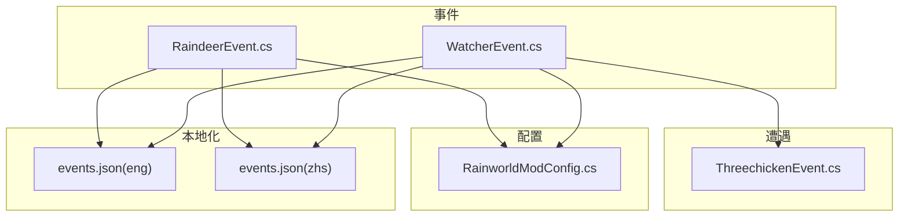
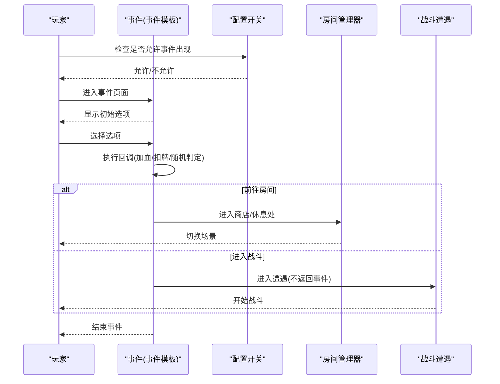
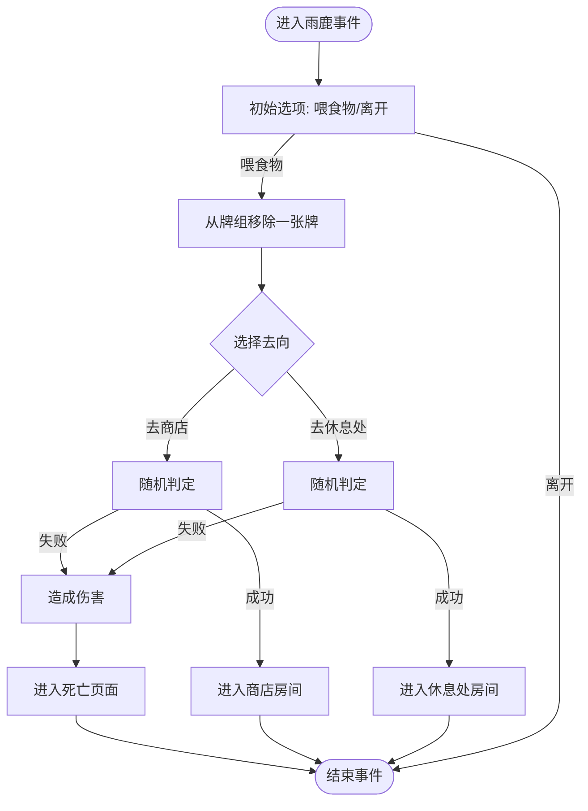
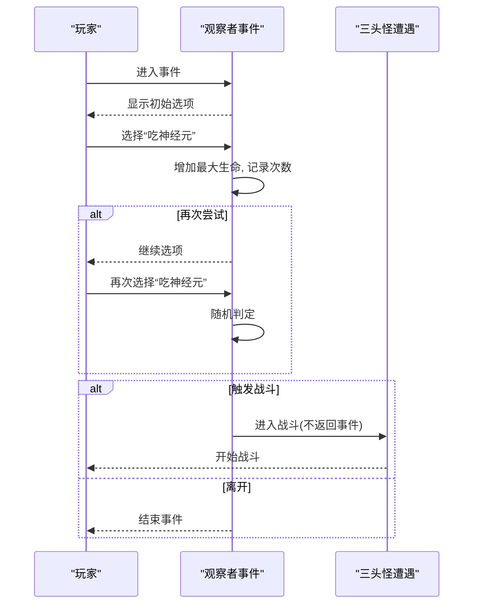
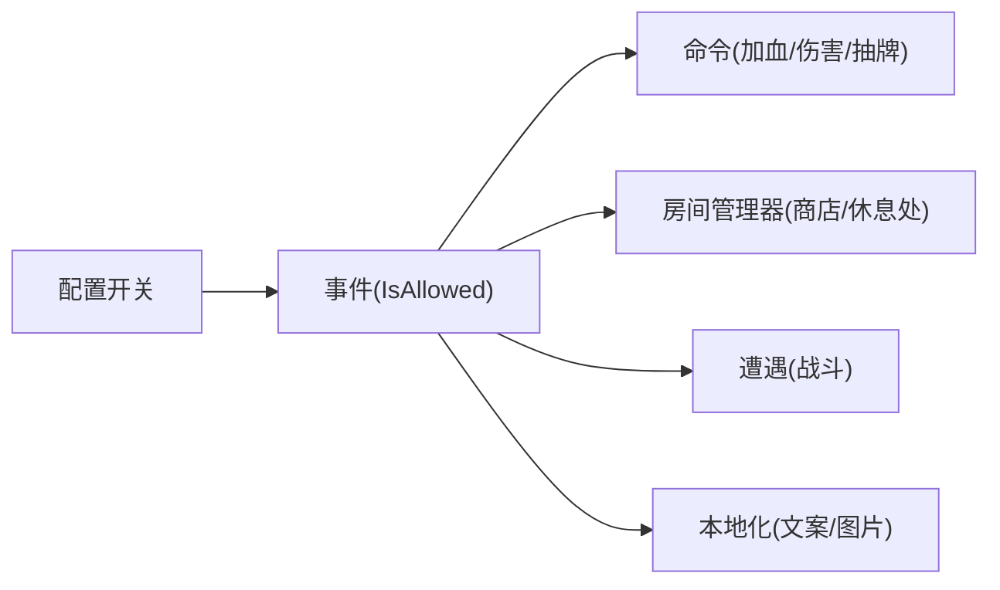

# 事件系统

<cite>
**本文引用的文件**
- [RaindeerEvent.cs](file://Scripts/Event/RaindeerEvent.cs)
- [WatcherEvent.cs](file://Scripts/Event/WatcherEvent.cs)
- [ThreechickenEvent.cs](file://Scripts/Monster/ThreechickenEvent.cs)
- [RainworldModConfig.cs](file://Scripts/RainworldModConfig.cs)
- [events.json（英文）](file://SlugcatTheSpireII/localization/eng/events.json)
- [events.json（中文）](file://SlugcatTheSpireII/localization/zhs/events.json)
</cite>

## 目录
1. [简介](#简介)
2. [项目结构](#项目结构)
3. [核心组件](#核心组件)
4. [架构总览](#架构总览)
5. [详细组件分析](#详细组件分析)
6. [依赖关系分析](#依赖关系分析)
7. [性能与平衡性考虑](#性能与平衡性考虑)
8. [故障排查指南](#故障排查指南)
9. [结论](#结论)
10. [附录：自定义事件开发最佳实践](#附录自定义事件开发最佳实践)

## 简介
本文件为“事件系统”的实现文档，聚焦于事件触发机制、处理流程、用户交互设计、状态管理、选择分支与结果处理。文档以雨鹿事件、观察者事件为例，说明如何创建自定义事件、定义事件条件与奖励机制，并给出与游戏其他系统的集成方法。同时提供事件平衡性与玩家体验优化建议，以及基于仓库代码的“最佳实践”指引（通过路径引用而非直接粘贴代码）。

## 项目结构
事件系统位于 Scripts/Event 目录下，包含两个具体事件实现；事件可触发的战斗遭遇在 Scripts/Monster 中定义；事件开关与配置在 RainworldModConfig 中集中管理；本地化文案在 SlugcatTheSpireII/localization 下按语言分文件存放。

图表来源
- [RaindeerEvent.cs:27-46](file://Scripts/Event/RaindeerEvent.cs#L27-L46)
- [WatcherEvent.cs:27-49](file://Scripts/Event/WatcherEvent.cs#L27-L49)
- [ThreechickenEvent.cs:9-18](file://Scripts/Monster/ThreechickenEvent.cs#L9-L18)
- [RainworldModConfig.cs:85-93](file://Scripts/RainworldModConfig.cs#L85-L93)
- [events.json（英文）:12-31](file://SlugcatTheSpireII/localization/eng/events.json#L12-L31)
- [events.json（中文）:1-31](file://SlugcatTheSpireII/localization/zhs/events.json#L1-L31)

章节来源
- [RaindeerEvent.cs:27-133](file://Scripts/Event/RaindeerEvent.cs#L27-L133)
- [WatcherEvent.cs:27-111](file://Scripts/Event/WatcherEvent.cs#L27-L111)
- [ThreechickenEvent.cs:9-18](file://Scripts/Monster/ThreechickenEvent.cs#L9-L18)
- [RainworldModConfig.cs:11-30](file://Scripts/RainworldModConfig.cs#L11-L30)
- [events.json（英文）:12-31](file://SlugcatTheSpireII/localization/eng/events.json#L12-L31)
- [events.json（中文）:1-31](file://SlugcatTheSpireII/localization/zhs/events.json#L1-L31)

## 核心组件
- 事件基类与框架能力
  - 继承自 ModEventTemplate，使用 RegisterSharedEvent / RegisterActEvent 进行注册。
  - 通过 IsAllowed 控制事件是否允许出现；通过 GenerateInitialOptions 生成初始选项；通过 SetEventState/SetEventFinished 推进事件页面与结束事件。
  - 支持动态变量 CanonicalVars，用于伤害等数值注入。
- 雨鹿事件（RaindeerEvent）
  - 共享事件，IsShared=true。
  - 初始选项：喂食物（移除一张牌）或离开。
  - 第二阶段：骑乘前往商店或休息处，存在随机成功/失败分支；失败时造成固定伤害并进入死亡画面。
- 观察者事件（WatcherEvent）
  - 关联特定行动（RegisterActEvent(typeof(Glory))），可配置为共享事件。
  - 初始选项：吃神经元（获得最大生命，可能重复尝试）或离开。
  - 多次尝试后有一定概率触发与三头怪的战斗；战斗中不返回事件页。
- 遭遇（ThreechickenEvent）
  - 作为事件触发的战斗遭遇，房间类型为怪物房间，背景使用行动战斗背景。
- 配置开关（RainworldModConfig）
  - 提供 EnableRaindeerEvent、EnableWatcherEvent 等开关，供设置界面启用/禁用事件。

章节来源
- [RaindeerEvent.cs:27-46](file://Scripts/Event/RaindeerEvent.cs#L27-L46)
- [WatcherEvent.cs:27-49](file://Scripts/Event/WatcherEvent.cs#L27-L49)
- [ThreechickenEvent.cs:9-18](file://Scripts/Monster/ThreechickenEvent.cs#L9-L18)
- [RainworldModConfig.cs:85-93](file://Scripts/RainworldModConfig.cs#L85-L93)

## 架构总览
事件系统由“事件模板 + 选项回调 + 状态推进 + 资源/房间/命令调用”构成。事件通过配置开关决定是否参与生成；进入事件后展示本地化文本与图片；玩家选择触发对应回调，回调内执行游戏逻辑（如抽牌、加血、造成伤害、跳转房间、进入战斗），最后通过 SetEventState/SetEventFinished 更新界面或结束事件。

图表来源
- [RaindeerEvent.cs:43-46](file://Scripts/Event/RaindeerEvent.cs#L43-L46)
- [RaindeerEvent.cs:50-62](file://Scripts/Event/RaindeerEvent.cs#L50-L62)
- [RaindeerEvent.cs:83-131](file://Scripts/Event/RaindeerEvent.cs#L83-L131)
- [WatcherEvent.cs:53-107](file://Scripts/Event/WatcherEvent.cs#L53-L107)
- [ThreechickenEvent.cs:9-18](file://Scripts/Monster/ThreechickenEvent.cs#L9-L18)

## 详细组件分析

### 雨鹿事件（RaindeerEvent）
- 触发条件
  - 通过 IsAllowed 读取配置开关 EnableRaindeerEvent，决定是否允许该事件出现。
- 初始选项
  - 喂食物：从牌组移除一张牌，然后进入第二阶段。
  - 离开：直接结束事件。
- 第二阶段
  - 骑乘前往商店或休息处，各有一个随机判定：成功则直接进入对应房间；失败则对角色造成伤害并进入“死亡”页面，最终结束事件。
- 资源与数值
  - 定义了动态伤害变量 Damage，用于失败时的伤害值。
- 本地化与素材
  - 初始肖像与后续图片通过工具方法切换；所有文案通过本地化键引用。

图表来源
- [RaindeerEvent.cs:43-46](file://Scripts/Event/RaindeerEvent.cs#L43-L46)
- [RaindeerEvent.cs:50-62](file://Scripts/Event/RaindeerEvent.cs#L50-L62)
- [RaindeerEvent.cs:83-131](file://Scripts/Event/RaindeerEvent.cs#L83-L131)

章节来源
- [RaindeerEvent.cs:27-133](file://Scripts/Event/RaindeerEvent.cs#L27-L133)
- [events.json（中文）:1-17](file://SlugcatTheSpireII/localization/zhs/events.json#L1-L17)

### 观察者事件（WatcherEvent）
- 触发条件
  - 通过 IsAllowed 读取配置开关 EnableWatcherEvent。
- 初始选项
  - 吃神经元：获得最大生命，并可重复尝试；多次尝试后有一定概率触发与三头怪的战斗。
  - 离开：直接结束事件。
- 战斗衔接
  - 触发战斗时直接进入 ThreechickenEvent 遭遇，不返回事件页。
- 本地化与素材
  - 初始肖像与战斗前图片通过工具方法切换；文案通过本地化键引用。

图表来源
- [WatcherEvent.cs:46-49](file://Scripts/Event/WatcherEvent.cs#L46-L49)
- [WatcherEvent.cs:53-107](file://Scripts/Event/WatcherEvent.cs#L53-L107)
- [ThreechickenEvent.cs:9-18](file://Scripts/Monster/ThreechickenEvent.cs#L9-L18)

章节来源
- [WatcherEvent.cs:27-111](file://Scripts/Event/WatcherEvent.cs#L27-L111)
- [events.json（中文）:18-31](file://SlugcatTheSpireII/localization/zhs/events.json#L18-L31)

### 遭遇（ThreechickenEvent）
- 类型与背景
  - 房间类型为怪物房间，使用行动战斗背景。
- 怪物生成
  - 生成单个三头怪实例，作为事件触发的战斗内容。

章节来源
- [ThreechickenEvent.cs:9-18](file://Scripts/Monster/ThreechickenEvent.cs#L9-L18)

### 配置与本地化
- 配置开关
  - EnableRaindeerEvent、EnableWatcherEvent 控制事件是否出现，并在设置界面提供开关。
- 本地化
  - 事件标题、描述、选项文案均通过 events.json 的多语言文件维护，便于扩展与翻译。

章节来源
- [RainworldModConfig.cs:85-93](file://Scripts/RainworldModConfig.cs#L85-L93)
- [events.json（英文）:12-31](file://SlugcatTheSpireII/localization/eng/events.json#L12-L31)
- [events.json（中文）:1-31](file://SlugcatTheSpireII/localization/zhs/events.json#L1-L31)

## 依赖关系分析
- 事件与配置
  - 事件通过 IsAllowed 读取配置开关，决定能否被生成。
- 事件与房间/战斗
  - 事件回调中调用房间管理器进入商店/休息处，或直接进入战斗遭遇。
- 事件与本地化
  - 所有界面文案通过 L10NLookup 引用本地化键，确保多语言一致性。
- 事件与命令
  - 使用命令接口完成加血、造成伤害、卡牌移除等操作，保证跨平台与多人一致性。

图表来源
- [RaindeerEvent.cs:43-46](file://Scripts/Event/RaindeerEvent.cs#L43-L46)
- [WatcherEvent.cs:46-49](file://Scripts/Event/WatcherEvent.cs#L46-L49)
- [RaindeerEvent.cs:83-131](file://Scripts/Event/RaindeerEvent.cs#L83-L131)
- [WatcherEvent.cs:53-107](file://Scripts/Event/WatcherEvent.cs#L53-L107)

章节来源
- [RaindeerEvent.cs:43-131](file://Scripts/Event/RaindeerEvent.cs#L43-L131)
- [WatcherEvent.cs:46-107](file://Scripts/Event/WatcherEvent.cs#L46-L107)

## 性能与平衡性考虑
- 随机性控制
  - 雨鹿事件的随机成功/失败比例影响玩家收益与风险，建议根据测试反馈调整概率，避免过强或过弱。
- 资源消耗与回报
  - 雨鹿事件要求移除一张牌，属于长期资源代价；观察者事件提供最大生命但伴随高风险战斗。两者均需在“即时收益 vs 长期风险”之间取得平衡。
- 难度曲线
  - 观察者事件中的三头怪遭遇强度应与当前阶段匹配，避免过早出现导致挫败感。
- 可配置性
  - 通过配置开关允许玩家关闭事件，提升可玩性与容错度。
- 本地化与可读性
  - 文案清晰表达选项后果，减少误解；图片切换增强叙事表现力。

[本节为通用指导，不直接分析具体文件]

## 故障排查指南
- 事件未出现
  - 检查配置开关是否启用（EnableRaindeerEvent/EnableWatcherEvent）。
  - 确认事件已正确注册（RegisterSharedEvent/RegisterActEvent）。
- 选项无效或卡住
  - 检查回调是否正确调用 SetEventState/SetEventFinished。
  - 确认本地化键是否存在且拼写正确。
- 进入房间/战斗异常
  - 检查房间类型与参数是否正确。
  - 确认遭遇定义完整（怪物列表、房间类型、背景）。
- 伤害/加血无效果
  - 检查命令调用上下文（如 ThrowingPlayerChoiceContext）是否正确。
  - 确认目标对象（Owner.Creature）有效。

章节来源
- [RainworldModConfig.cs:85-93](file://Scripts/RainworldModConfig.cs#L85-L93)
- [RaindeerEvent.cs:83-131](file://Scripts/Event/RaindeerEvent.cs#L83-L131)
- [WatcherEvent.cs:53-107](file://Scripts/Event/WatcherEvent.cs#L53-L107)

## 结论
本事件系统基于统一的模板与命令接口，提供了清晰的触发、选项、状态推进与结果处理流程。雨鹿事件与观察者事件展示了不同风格的事件设计：前者侧重资源交换与随机风险，后者侧重累积收益与高风险战斗。通过配置开关与本地化，事件具备良好的可配置性与多语言支持。建议在后续迭代中持续评估随机概率与难度曲线，确保玩家体验稳定且富有策略性。

[本节为总结，不直接分析具体文件]

## 附录：自定义事件开发最佳实践
- 事件注册与可见性
  - 使用 RegisterSharedEvent 或 RegisterActEvent 注册事件；如需自定义生成条件，可在 IsAllowed 中实现。
- 初始选项与状态推进
  - 在 GenerateInitialOptions 中定义初始选项；在回调中使用 SetEventState 推进到下一阶段，SetEventFinished 结束事件。
- 资源与数值
  - 通过 CanonicalVars 定义动态变量（如伤害），便于统一管理与升级。
- 房间与战斗集成
  - 使用房间管理器进入商店/休息处；使用遭遇模板进入战斗，注意 shouldResumeAfterCombat 的设置。
- 本地化与素材
  - 所有文案通过本地化键引用；图片通过工具方法切换，保持界面一致。
- 参考路径（不包含代码内容）
  - 雨鹿事件实现：[RaindeerEvent.cs:27-133](file://Scripts/Event/RaindeerEvent.cs#L27-L133)
  - 观察者事件实现：[WatcherEvent.cs:27-111](file://Scripts/Event/WatcherEvent.cs#L27-L111)
  - 遭遇定义：[ThreechickenEvent.cs:9-18](file://Scripts/Monster/ThreechickenEvent.cs#L9-L18)
  - 配置开关：[RainworldModConfig.cs:85-93](file://Scripts/RainworldModConfig.cs#L85-L93)
  - 本地化文案：[events.json（中文）:1-31](file://SlugcatTheSpireII/localization/zhs/events.json#L1-L31)

章节来源
- [RaindeerEvent.cs:27-133](file://Scripts/Event/RaindeerEvent.cs#L27-L133)
- [WatcherEvent.cs:27-111](file://Scripts/Event/WatcherEvent.cs#L27-L111)
- [ThreechickenEvent.cs:9-18](file://Scripts/Monster/ThreechickenEvent.cs#L9-L18)
- [RainworldModConfig.cs:85-93](file://Scripts/RainworldModConfig.cs#L85-L93)
- [events.json（中文）:1-31](file://SlugcatTheSpireII/localization/zhs/events.json#L1-L31)