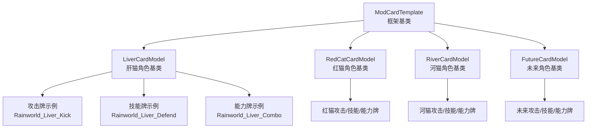
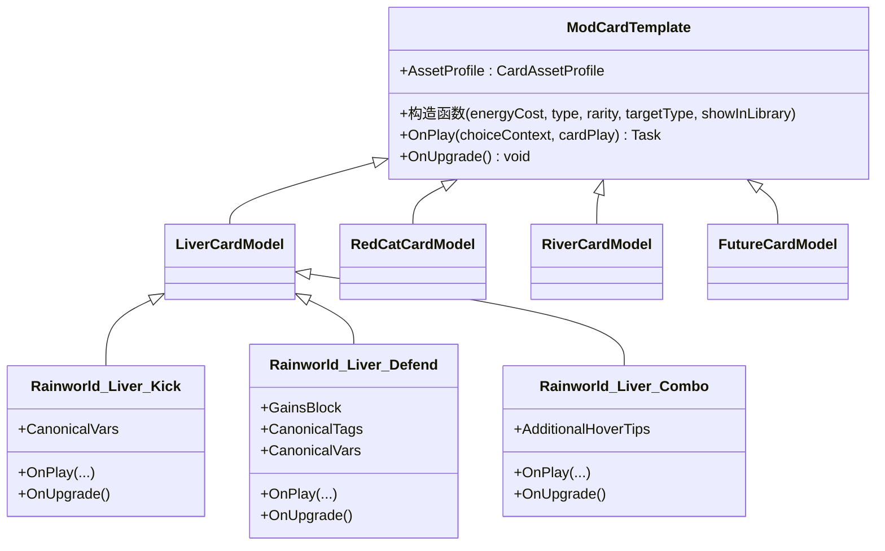
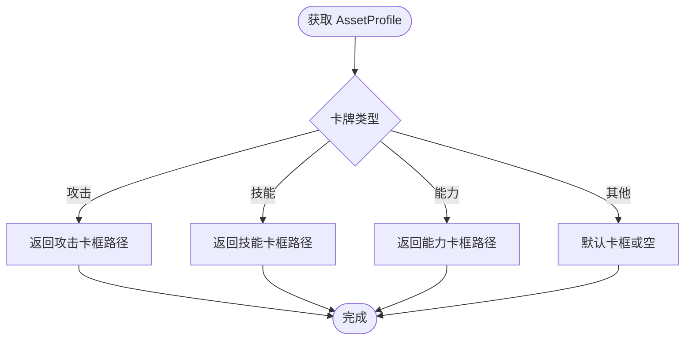
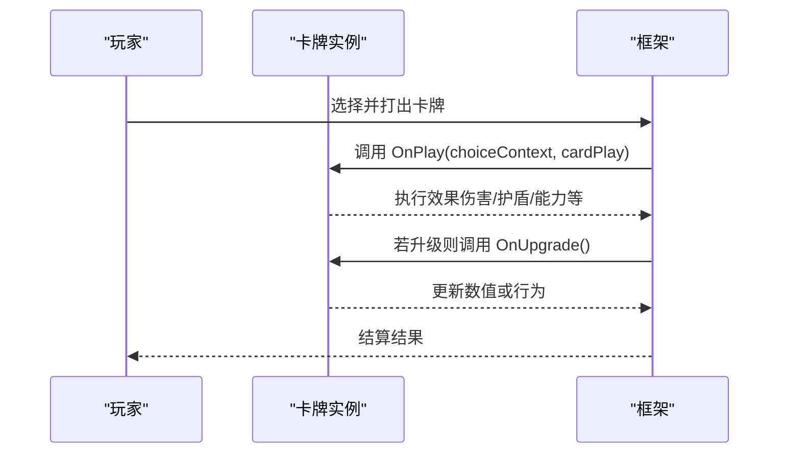
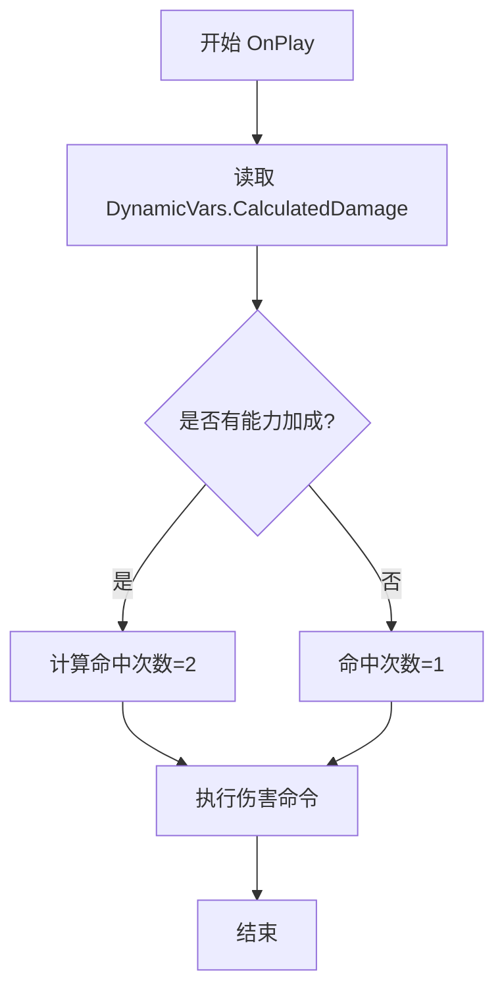
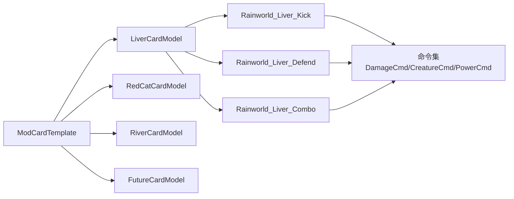

# 卡牌基类架构

<cite>
**本文引用的文件**
- [FutureCardModel.cs](file://Scripts/Card/Future/FutureCardModel.cs)
- [LiverCardModel.cs](file://Scripts/Card/Liver/LiverCardModel.cs)
- [RedCatCardModel.cs](file://Scripts/Card/RedCat/RedCatCardModel.cs)
- [RiverCardModel.cs](file://Scripts/Card/River/RiverCardModel.cs)
- [Rainworld_Liver_Kick.cs](file://Scripts/Card/Liver/Attack/Rainworld_Liver_Kick.cs)
- [Rainworld_Liver_Defend.cs](file://Scripts/Card/Liver/Skills/Rainworld_Liver_Defend.cs)
- [Rainworld_Liver_Combo.cs](file://Scripts/Card/Liver/Powers/Rainworld_Liver_Combo.cs)
</cite>

## 目录
1. [简介](#简介)
2. [项目结构](#项目结构)
3. [核心组件](#核心组件)
4. [架构总览](#架构总览)
5. [详细组件分析](#详细组件分析)
6. [依赖关系分析](#依赖关系分析)
7. [性能考量](#性能考量)
8. [故障排查指南](#故障排查指南)
9. [结论](#结论)
10. [附录](#附录)

## 简介
本技术文档聚焦于卡牌基类架构，围绕 ModCardTemplate 的继承体系与角色专属抽象基类（如 LiverCardModel、RedCatCardModel、RiverCardModel、FutureCardModel）展开，系统阐述：
- 卡牌类型系统与类型判断机制（攻击、技能、能力）
- 资源管理（AssetProfile 配置、卡框设置、图片路径）
- 卡牌属性定义（能量消耗、稀有度、目标类型等）
- 生命周期管理与注册机制
- 自定义卡牌基类的创建方法与不同类型卡牌效果的实现范式

## 项目结构
本项目采用“按角色/主题分目录 + 按卡牌类型再细分”的组织方式。每个角色拥有独立的抽象基类，用于统一资源路径与卡框样式；具体卡牌位于对应角色的 Attack、Skills、Powers 子目录下，便于维护与扩展。

图表来源
- [LiverCardModel.cs:14-38](file://Scripts/Card/Liver/LiverCardModel.cs#L14-L38)
- [RedCatCardModel.cs:13-39](file://Scripts/Card/RedCat/RedCatCardModel.cs#L13-L39)
- [RiverCardModel.cs:14-39](file://Scripts/Card/River/RiverCardModel.cs#L14-L39)
- [FutureCardModel.cs:14-39](file://Scripts/Card/Future/FutureCardModel.cs#L14-L39)
- [Rainworld_Liver_Kick.cs:19-82](file://Scripts/Card/Liver/Attack/Rainworld_Liver_Kick.cs#L19-L82)
- [Rainworld_Liver_Defend.cs:12-55](file://Scripts/Card/Liver/Skills/Rainworld_Liver_Defend.cs#L12-L55)
- [Rainworld_Liver_Combo.cs:15-56](file://Scripts/Card/Liver/Powers/Rainworld_Liver_Combo.cs#L15-L56)

章节来源
- [LiverCardModel.cs:14-38](file://Scripts/Card/Liver/LiverCardModel.cs#L14-L38)
- [RedCatCardModel.cs:13-39](file://Scripts/Card/RedCat/RedCatCardModel.cs#L13-L39)
- [RiverCardModel.cs:14-39](file://Scripts/Card/River/RiverCardModel.cs#L14-L39)
- [FutureCardModel.cs:14-39](file://Scripts/Card/Future/FutureCardModel.cs#L14-L39)

## 核心组件
- 抽象基类族：各角色通过继承 ModCardTemplate 提供统一的资源映射与构造参数约定。
- 资源描述：通过 CardAssetProfile 指定主图与根据 CardType 动态切换的卡框路径。
- 类型系统：使用 CardType（攻击/技能/能力）进行分支处理，确保不同类别显示一致的视觉风格。
- 属性与行为：通过构造函数传入能量消耗、稀有度、目标类型等；在子类中实现 OnPlay、OnUpgrade 等行为。

章节来源
- [LiverCardModel.cs:17-32](file://Scripts/Card/Liver/LiverCardModel.cs#L17-L32)
- [RedCatCardModel.cs:17-33](file://Scripts/Card/RedCat/RedCatCardModel.cs#L17-L33)
- [RiverCardModel.cs:18-33](file://Scripts/Card/River/RiverCardModel.cs#L18-L33)
- [FutureCardModel.cs:18-33](file://Scripts/Card/Future/FutureCardModel.cs#L18-L33)

## 架构总览
下图展示了从抽象基类到具体卡牌的继承与调用关系，以及运行时关键流程（选择目标、执行效果、升级）。

图表来源
- [LiverCardModel.cs:14-38](file://Scripts/Card/Liver/LiverCardModel.cs#L14-L38)
- [RedCatCardModel.cs:13-39](file://Scripts/Card/RedCat/RedCatCardModel.cs#L13-L39)
- [RiverCardModel.cs:14-39](file://Scripts/Card/River/RiverCardModel.cs#L14-L39)
- [FutureCardModel.cs:14-39](file://Scripts/Card/Future/FutureCardModel.cs#L14-L39)
- [Rainworld_Liver_Kick.cs:19-82](file://Scripts/Card/Liver/Attack/Rainworld_Liver_Kick.cs#L19-L82)
- [Rainworld_Liver_Defend.cs:12-55](file://Scripts/Card/Liver/Skills/Rainworld_Liver_Defend.cs#L12-L55)
- [Rainworld_Liver_Combo.cs:15-56](file://Scripts/Card/Liver/Powers/Rainworld_Liver_Combo.cs#L15-L56)

## 详细组件分析

### 抽象基类与资源管理（AssetProfile）
- 资源主图：基于类名生成统一路径，便于自动发现与加载。
- 卡框切换：依据 CardType 返回对应的攻击/技能/能力卡框路径，保证 UI 一致性。
- 扩展点：可继续添加 PortraitBorderPath、BannerTexturePath 等字段以满足更复杂的展示需求。

图表来源
- [LiverCardModel.cs:17-32](file://Scripts/Card/Liver/LiverCardModel.cs#L17-L32)
- [RedCatCardModel.cs:17-33](file://Scripts/Card/RedCat/RedCatCardModel.cs#L17-L33)
- [RiverCardModel.cs:18-33](file://Scripts/Card/River/RiverCardModel.cs#L18-L33)
- [FutureCardModel.cs:18-33](file://Scripts/Card/Future/FutureCardModel.cs#L18-L33)

章节来源
- [LiverCardModel.cs:17-32](file://Scripts/Card/Liver/LiverCardModel.cs#L17-L32)
- [RedCatCardModel.cs:17-33](file://Scripts/Card/RedCat/RedCatCardModel.cs#L17-L33)
- [RiverCardModel.cs:18-33](file://Scripts/Card/River/RiverCardModel.cs#L18-L33)
- [FutureCardModel.cs:18-33](file://Scripts/Card/Future/FutureCardModel.cs#L18-L33)

### 卡牌类型系统与类型判断逻辑
- 类型枚举：CardType 包含 Attack、Skill、Power，用于区分卡牌类别。
- 类型分支：在 AssetProfile 中通过 switch(Type) 为不同类别设置不同的卡框资源。
- 建议：将类型相关的资源策略集中在基类中，避免在具体卡牌中重复实现。

章节来源
- [LiverCardModel.cs:19-25](file://Scripts/Card/Liver/LiverCardModel.cs#L19-L25)
- [RedCatCardModel.cs:20-26](file://Scripts/Card/RedCat/RedCatCardModel.cs#L20-L26)
- [RiverCardModel.cs:20-26](file://Scripts/Card/River/RiverCardModel.cs#L20-L26)
- [FutureCardModel.cs:20-26](file://Scripts/Card/Future/FutureCardModel.cs#L20-L26)

### 卡牌属性定义
- 能量消耗：由构造函数 energyCost 传入，可在升级时通过 EnergyCost.UpgradeBy 调整。
- 稀有度：rarity 决定卡牌在卡池中的分布与出现概率。
- 目标类型：targetType 指定目标范围（如任意敌人、自身等）。
- 图鉴显示：shouldShowInCardLibrary 控制是否在卡牌图鉴中可见。

章节来源
- [LiverCardModel.cs:34-37](file://Scripts/Card/Liver/LiverCardModel.cs#L34-L37)
- [RedCatCardModel.cs:35-38](file://Scripts/Card/RedCat/RedCatCardModel.cs#L35-L38)
- [RiverCardModel.cs:35-38](file://Scripts/Card/River/RiverCardModel.cs#L35-L38)
- [FutureCardModel.cs:35-38](file://Scripts/Card/Future/FutureCardModel.cs#L35-L38)
- [Rainworld_Liver_Kick.cs:22-35](file://Scripts/Card/Liver/Attack/Rainworld_Liver_Kick.cs#L22-L35)
- [Rainworld_Liver_Defend.cs:15-28](file://Scripts/Card/Liver/Skills/Rainworld_Liver_Defend.cs#L15-L28)
- [Rainworld_Liver_Combo.cs:18-31](file://Scripts/Card/Liver/Powers/Rainworld_Liver_Combo.cs#L18-L31)

### 生命周期管理与注册机制
- 注册：通过特性将抽象基类与角色卡池关联，使该基类下的所有具体卡牌自动加入对应卡池。
- 生命周期：
  - 构造：传入基础属性（耗能、类型、稀有度、目标、图鉴显示）。
  - 打出：重写 OnPlay 实现效果逻辑。
  - 升级：重写 OnUpgrade 调整数值或行为。

图表来源
- [Rainworld_Liver_Kick.cs:67-81](file://Scripts/Card/Liver/Attack/Rainworld_Liver_Kick.cs#L67-L81)
- [Rainworld_Liver_Defend.cs:44-54](file://Scripts/Card/Liver/Skills/Rainworld_Liver_Defend.cs#L44-L54)
- [Rainworld_Liver_Combo.cs:45-55](file://Scripts/Card/Liver/Powers/Rainworld_Liver_Combo.cs#L45-L55)

章节来源
- [LiverCardModel.cs:14-37](file://Scripts/Card/Liver/LiverCardModel.cs#L14-L37)
- [RedCatCardModel.cs:13-38](file://Scripts/Card/RedCat/RedCatCardModel.cs#L13-L38)
- [RiverCardModel.cs:14-38](file://Scripts/Card/River/RiverCardModel.cs#L14-L38)
- [FutureCardModel.cs:14-38](file://Scripts/Card/Future/FutureCardModel.cs#L14-L38)
- [Rainworld_Liver_Kick.cs:67-81](file://Scripts/Card/Liver/Attack/Rainworld_Liver_Kick.cs#L67-L81)
- [Rainworld_Liver_Defend.cs:44-54](file://Scripts/Card/Liver/Skills/Rainworld_Liver_Defend.cs#L44-L54)
- [Rainworld_Liver_Combo.cs:45-55](file://Scripts/Card/Liver/Powers/Rainworld_Liver_Combo.cs#L45-L55)

### 攻击牌示例：Rainworld_Liver_Kick
- 属性：能量消耗、类型（攻击）、稀有度、目标（任意敌人）、是否显示于图鉴。
- 变量：基础伤害、额外伤害、计算伤害（受能力影响）。
- 效果：对目标造成伤害，命中次数受能力影响；升级提升基础伤害。

图表来源
- [Rainworld_Liver_Kick.cs:40-74](file://Scripts/Card/Liver/Attack/Rainworld_Liver_Kick.cs#L40-L74)

章节来源
- [Rainworld_Liver_Kick.cs:22-81](file://Scripts/Card/Liver/Attack/Rainworld_Liver_Kick.cs#L22-L81)

### 技能牌示例：Rainworld_Liver_Defend
- 属性：能量消耗、类型（技能）、稀有度、目标（自身）、是否获得格挡。
- 标签：标记为防御类，便于系统识别与联动。
- 变量：格挡值；升级增加格挡量。

章节来源
- [Rainworld_Liver_Defend.cs:15-54](file://Scripts/Card/Liver/Skills/Rainworld_Liver_Defend.cs#L15-L54)

### 能力牌示例：Rainworld_Liver_Combo
- 属性：能量消耗、类型（能力）、稀有度、目标（自身）、是否显示于图鉴。
- 提示：附加悬停提示以说明与其他能力的联动。
- 效果：为目标施加能力；升级降低能耗。

章节来源
- [Rainworld_Liver_Combo.cs:18-55](file://Scripts/Card/Liver/Powers/Rainworld_Liver_Combo.cs#L18-L55)

### 自定义卡牌基类创建指南
- 步骤：
  1) 新建角色抽象基类，继承 ModCardTemplate，并在其中实现 AssetProfile 的资源路径与卡框策略。
  2) 使用注册特性将该基类与角色卡池关联，使派生卡牌自动加入卡池。
  3) 在派生卡牌中声明常量属性（耗能、类型、稀有度、目标、图鉴显示），并通过构造函数传递给基类。
  4) 在 OnPlay 中实现效果逻辑，必要时使用 DynamicVars 与命令集（如 DamageCmd、CreatureCmd、PowerCmd）。
  5) 在 OnUpgrade 中调整数值或行为（例如减少能耗、增加伤害/格挡）。

章节来源
- [LiverCardModel.cs:14-37](file://Scripts/Card/Liver/LiverCardModel.cs#L14-L37)
- [RedCatCardModel.cs:13-38](file://Scripts/Card/RedCat/RedCatCardModel.cs#L13-L38)
- [RiverCardModel.cs:14-38](file://Scripts/Card/River/RiverCardModel.cs#L14-L38)
- [FutureCardModel.cs:14-38](file://Scripts/Card/Future/FutureCardModel.cs#L14-L38)
- [Rainworld_Liver_Kick.cs:22-81](file://Scripts/Card/Liver/Attack/Rainworld_Liver_Kick.cs#L22-L81)
- [Rainworld_Liver_Defend.cs:15-54](file://Scripts/Card/Liver/Skills/Rainworld_Liver_Defend.cs#L15-L54)
- [Rainworld_Liver_Combo.cs:18-55](file://Scripts/Card/Liver/Powers/Rainworld_Liver_Combo.cs#L18-L55)

## 依赖关系分析
- 抽象基类依赖框架提供的 ModCardTemplate 与模型类型（CardType、CardRarity、TargetType）。
- 具体卡牌依赖命令集（DamageCmd、CreatureCmd、PowerCmd）与动态变量（DynamicVars）实现效果。
- 资源路径依赖角色专属目录结构，确保主图与卡框正确加载。

图表来源
- [LiverCardModel.cs:14-38](file://Scripts/Card/Liver/LiverCardModel.cs#L14-L38)
- [RedCatCardModel.cs:13-39](file://Scripts/Card/RedCat/RedCatCardModel.cs#L13-L39)
- [RiverCardModel.cs:14-39](file://Scripts/Card/River/RiverCardModel.cs#L14-L39)
- [FutureCardModel.cs:14-39](file://Scripts/Card/Future/FutureCardModel.cs#L14-L39)
- [Rainworld_Liver_Kick.cs:67-81](file://Scripts/Card/Liver/Attack/Rainworld_Liver_Kick.cs#L67-L81)
- [Rainworld_Liver_Defend.cs:44-54](file://Scripts/Card/Liver/Skills/Rainworld_Liver_Defend.cs#L44-L54)
- [Rainworld_Liver_Combo.cs:45-55](file://Scripts/Card/Liver/Powers/Rainworld_Liver_Combo.cs#L45-L55)

章节来源
- [LiverCardModel.cs:14-38](file://Scripts/Card/Liver/LiverCardModel.cs#L14-L38)
- [RedCatCardModel.cs:13-39](file://Scripts/Card/RedCat/RedCatCardModel.cs#L13-L39)
- [RiverCardModel.cs:14-39](file://Scripts/Card/River/RiverCardModel.cs#L14-L39)
- [FutureCardModel.cs:14-39](file://Scripts/Card/Future/FutureCardModel.cs#L14-L39)

## 性能考量
- 资源路径集中管理：在基类中统一处理卡框与主图路径，减少重复计算与分支判断。
- 动态变量与命令：尽量使用框架提供的命令集与动态变量，避免手动循环与冗余计算。
- 升级优化：仅在 OnUpgrade 中调整必要数值，避免在 OnPlay 中进行复杂条件判断。

## 故障排查指南
- 资源未加载：检查 AssetProfile 的主图与卡框路径是否与角色目录一致，确认命名规则与大小写。
- 类型不匹配：确认 CardType 与卡框分支一致，避免未知类型导致默认分支异常。
- 效果未生效：核对 OnPlay 是否正确调用命令集，目标与上下文参数是否有效。
- 升级无效：确认 OnUpgrade 中对相应变量或能耗进行了正确的 UpgradeBy 操作。

章节来源
- [LiverCardModel.cs:17-32](file://Scripts/Card/Liver/LiverCardModel.cs#L17-L32)
- [RedCatCardModel.cs:17-33](file://Scripts/Card/RedCat/RedCatCardModel.cs#L17-L33)
- [RiverCardModel.cs:18-33](file://Scripts/Card/River/RiverCardModel.cs#L18-L33)
- [FutureCardModel.cs:18-33](file://Scripts/Card/Future/FutureCardModel.cs#L18-L33)
- [Rainworld_Liver_Kick.cs:67-81](file://Scripts/Card/Liver/Attack/Rainworld_Liver_Kick.cs#L67-L81)
- [Rainworld_Liver_Defend.cs:44-54](file://Scripts/Card/Liver/Skills/Rainworld_Liver_Defend.cs#L44-L54)
- [Rainworld_Liver_Combo.cs:45-55](file://Scripts/Card/Liver/Powers/Rainworld_Liver_Combo.cs#L45-L55)

## 结论
本项目通过抽象基类与角色专属基类分层设计，实现了卡牌资源的统一管理、类型系统的清晰划分与生命周期的标准化处理。借助动态变量与命令集，开发者可以高效地实现各类卡牌效果，并通过注册机制将新卡牌无缝接入对应角色卡池。

## 附录
- 最佳实践：
  - 在基类中集中处理资源与类型分支，保持具体卡牌简洁。
  - 使用 DynamicVars 表达可变数值，配合 UpgradeBy 实现升级效果。
  - 合理使用命令集（Damage/Creature/Power）确保效果的一致性与可维护性。
- 参考实现：
  - 攻击牌：[Rainworld_Liver_Kick.cs](file://Scripts/Card/Liver/Attack/Rainworld_Liver_Kick.cs)
  - 技能牌：[Rainworld_Liver_Defend.cs](file://Scripts/Card/Liver/Skills/Rainworld_Liver_Defend.cs)
  - 能力牌：[Rainworld_Liver_Combo.cs](file://Scripts/Card/Liver/Powers/Rainworld_Liver_Combo.cs)