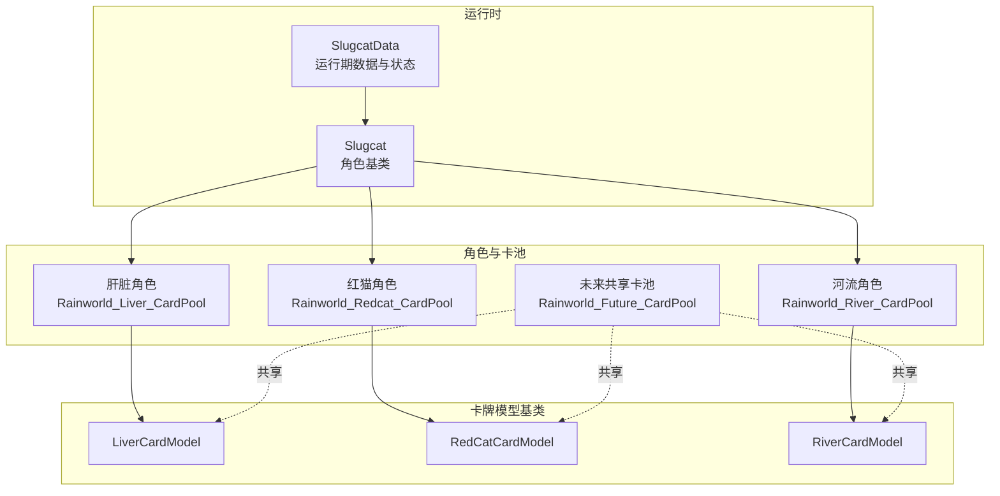
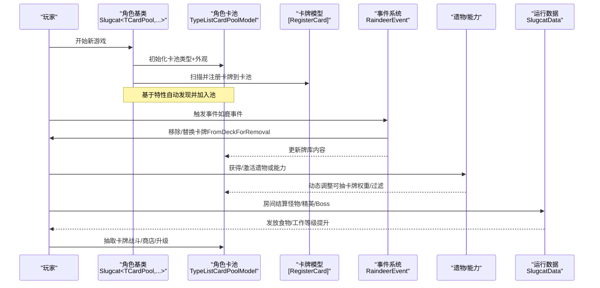
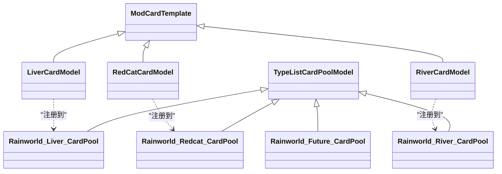
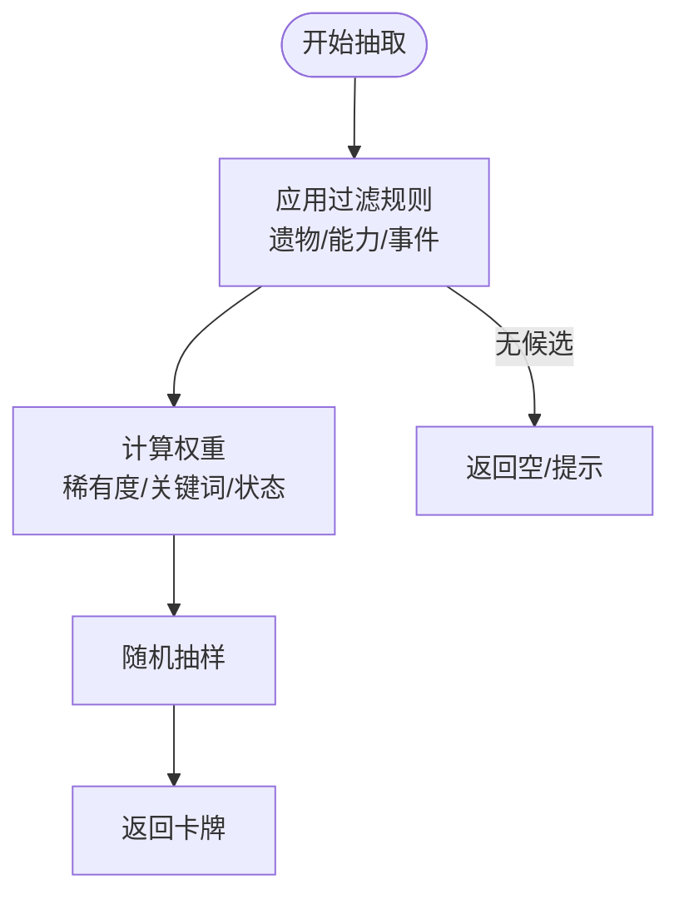
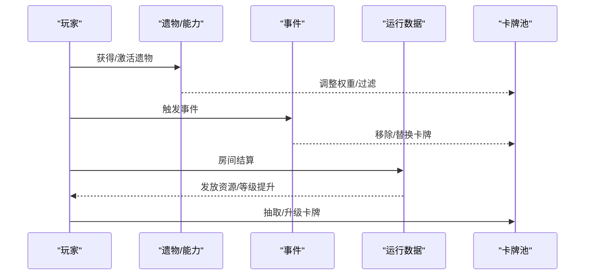
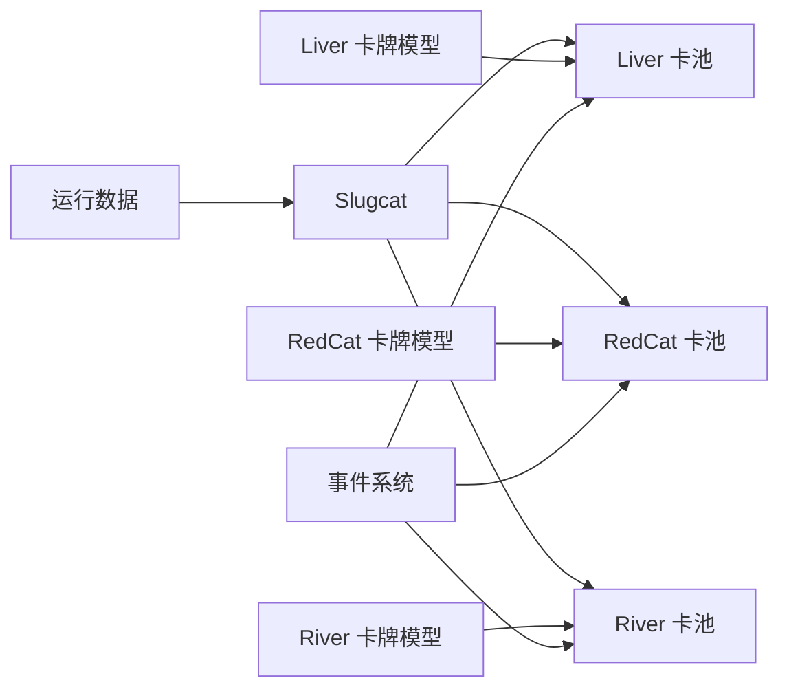

# 卡牌池管理

<cite>
**本文引用的文件**
- [Rainworld_Liver_CardPool.cs](file://Scripts/Card/Liver/Rainworld_Liver_CardPool.cs)
- [Rainworld_Redcat_CardPool.cs](file://Scripts/Card/RedCat/Rainworld_Redcat_CardPool.cs)
- [Rainworld_River_CardPool.cs](file://Scripts/Card/River/Rainworld_River_CardPool.cs)
- [Rainworld_Future_CardPool.cs](file://Scripts/Card/Future/Rainworld_Future_CardPool.cs)
- [LiverCardModel.cs](file://Scripts/Card/Liver/LiverCardModel.cs)
- [RedCatCardModel.cs](file://Scripts/Card/RedCat/RedCatCardModel.cs)
- [RiverCardModel.cs](file://Scripts/Card/River/RiverCardModel.cs)
- [Slugcat.cs](file://Scripts/Slugcat/Slugcat.cs)
- [SlugcatData.cs](file://Scripts/Slugcat/SlugcatData.cs)
- [RaindeerEvent.cs](file://Scripts/Event/RaindeerEvent.cs)
- [cards.json（英文）](file://SlugcatTheSpireII/localization/eng/cards.json)
</cite>

## 目录
1. [简介](#简介)
2. [项目结构](#项目结构)
3. [核心组件](#核心组件)
4. [架构总览](#架构总览)
5. [详细组件分析](#详细组件分析)
6. [依赖关系分析](#依赖关系分析)
7. [性能考量](#性能考量)
8. [故障排查指南](#故障排查指南)
9. [结论](#结论)
10. [附录](#附录)

## 简介
本文件面向“卡牌池管理系统”的实现与使用，覆盖以下主题：
- 卡牌池初始化流程、卡牌添加机制与随机抽取算法
- 不同角色的卡牌池配置（初始卡组、升级卡牌、特殊卡牌的分布）
- 动态调整机制（遗物影响、事件奖励、卡牌升级）
- 性能优化策略（内存管理与加载优化）
- 完整配置示例（为新角色创建自定义卡牌池）
- 平衡性分析与调优建议

## 项目结构
本项目采用“按角色/主题分目录 + 统一卡池基类”的组织方式。每个角色拥有独立的卡牌池类，并通过统一的抽象基类与注册机制接入系统。卡牌模型通过特性标注自动注册到对应卡池。

图表来源
- [Rainworld_Liver_CardPool.cs:10-23](file://Scripts/Card/Liver/Rainworld_Liver_CardPool.cs#L10-L23)
- [Rainworld_Redcat_CardPool.cs:9-23](file://Scripts/Card/RedCat/Rainworld_Redcat_CardPool.cs#L9-L23)
- [Rainworld_River_CardPool.cs:11-26](file://Scripts/Card/River/Rainworld_River_CardPool.cs#L11-L26)
- [Rainworld_Future_CardPool.cs:12-28](file://Scripts/Card/Future/Rainworld_Future_CardPool.cs#L12-L28)
- [LiverCardModel.cs:14-38](file://Scripts/Card/Liver/LiverCardModel.cs#L14-L38)
- [RedCatCardModel.cs:13-39](file://Scripts/Card/RedCat/RedCatCardModel.cs#L13-L39)
- [RiverCardModel.cs:14-39](file://Scripts/Card/River/RiverCardModel.cs#L14-L39)
- [Slugcat.cs:61-65](file://Scripts/Slugcat/Slugcat.cs#L61-L65)

章节来源
- [Rainworld_Liver_CardPool.cs:10-23](file://Scripts/Card/Liver/Rainworld_Liver_CardPool.cs#L10-L23)
- [Rainworld_Redcat_CardPool.cs:9-23](file://Scripts/Card/RedCat/Rainworld_Redcat_CardPool.cs#L9-L23)
- [Rainworld_River_CardPool.cs:11-26](file://Scripts/Card/River/Rainworld_River_CardPool.cs#L11-L26)
- [Rainworld_Future_CardPool.cs:12-28](file://Scripts/Card/Future/Rainworld_Future_CardPool.cs#L12-L28)
- [LiverCardModel.cs:14-38](file://Scripts/Card/Liver/LiverCardModel.cs#L14-L38)
- [RedCatCardModel.cs:13-39](file://Scripts/Card/RedCat/RedCatCardModel.cs#L13-L39)
- [RiverCardModel.cs:14-39](file://Scripts/Card/River/RiverCardModel.cs#L14-L39)
- [Slugcat.cs:61-65](file://Scripts/Slugcat/Slugcat.cs#L61-L65)

## 核心组件
- 角色卡池类：为每个角色定义卡池外观、能量颜色、是否无色等元信息，并作为卡牌注册的容器。
- 卡牌模型基类：通过特性将具体卡牌自动注册到指定卡池，并集中处理资源路径与卡框样式。
- 角色基类：以泛型绑定角色与其卡池、遗物池、药水池，提供动画与通用行为。
- 运行期数据：维护工作等级、食物、腐化值等状态，并在房间结算时发放资源与经验。

章节来源
- [Rainworld_Liver_CardPool.cs:10-23](file://Scripts/Card/Liver/Rainworld_Liver_CardPool.cs#L10-L23)
- [LiverCardModel.cs:14-38](file://Scripts/Card/Liver/LiverCardModel.cs#L14-L38)
- [Slugcat.cs:61-65](file://Scripts/Slugcat/Slugcat.cs#L61-L65)
- [SlugcatData.cs:76-104](file://Scripts/Slugcat/SlugcatData.cs#L76-L104)

## 架构总览
下图展示了从“角色选择”到“卡牌池构建与抽取”的整体流程，以及事件与遗物对牌库的动态影响。

图表来源
- [Slugcat.cs:61-65](file://Scripts/Slugcat/Slugcat.cs#L61-L65)
- [LiverCardModel.cs:14-38](file://Scripts/Card/Liver/LiverCardModel.cs#L14-L38)
- [RaindeerEvent.cs:56-61](file://Scripts/Event/RaindeerEvent.cs#L56-L61)
- [SlugcatData.cs:339-365](file://Scripts/Slugcat/SlugcatData.cs#L339-L365)

## 详细组件分析

### 卡牌池初始化与注册
- 每个角色实现一个卡池类，继承自统一基类，设置标题、能量颜色、卡框材质等视觉属性。
- 卡牌模型通过特性标注，声明所属卡池，框架在启动时扫描并注册到对应池。
- 未来共享卡池用于跨角色共享的卡牌集合，通过特性标记参与全局池。

图表来源
- [Rainworld_Liver_CardPool.cs:10-23](file://Scripts/Card/Liver/Rainworld_Liver_CardPool.cs#L10-L23)
- [Rainworld_Redcat_CardPool.cs:9-23](file://Scripts/Card/RedCat/Rainworld_Redcat_CardPool.cs#L9-L23)
- [Rainworld_River_CardPool.cs:11-26](file://Scripts/Card/River/Rainworld_River_CardPool.cs#L11-L26)
- [Rainworld_Future_CardPool.cs:12-28](file://Scripts/Card/Future/Rainworld_Future_CardPool.cs#L12-L28)
- [LiverCardModel.cs:14-38](file://Scripts/Card/Liver/LiverCardModel.cs#L14-L38)
- [RedCatCardModel.cs:13-39](file://Scripts/Card/RedCat/RedCatCardModel.cs#L13-L39)
- [RiverCardModel.cs:14-39](file://Scripts/Card/River/RiverCardModel.cs#L14-L39)

章节来源
- [Rainworld_Liver_CardPool.cs:10-23](file://Scripts/Card/Liver/Rainworld_Liver_CardPool.cs#L10-L23)
- [Rainworld_Redcat_CardPool.cs:9-23](file://Scripts/Card/RedCat/Rainworld_Redcat_CardPool.cs#L9-L23)
- [Rainworld_River_CardPool.cs:11-26](file://Scripts/Card/River/Rainworld_River_CardPool.cs#L11-L26)
- [Rainworld_Future_CardPool.cs:12-28](file://Scripts/Card/Future/Rainworld_Future_CardPool.cs#L12-L28)
- [LiverCardModel.cs:14-38](file://Scripts/Card/Liver/LiverCardModel.cs#L14-L38)
- [RedCatCardModel.cs:13-39](file://Scripts/Card/RedCat/RedCatCardModel.cs#L13-L39)
- [RiverCardModel.cs:14-39](file://Scripts/Card/River/RiverCardModel.cs#L14-L39)

### 卡牌添加机制
- 新增卡牌：新建卡牌类继承对应角色卡牌模型基类，并在构造中设置费用、类型、稀有度、目标等。
- 自动注册：通过特性将卡牌关联到角色卡池，无需手动维护列表。
- 资源路径：卡牌模型基类集中处理图片与卡框路径，简化重复配置。

章节来源
- [LiverCardModel.cs:14-38](file://Scripts/Card/Liver/LiverCardModel.cs#L14-L38)
- [RedCatCardModel.cs:13-39](file://Scripts/Card/RedCat/RedCatCardModel.cs#L13-L39)
- [RiverCardModel.cs:14-39](file://Scripts/Card/River/RiverCardModel.cs#L14-L39)

### 随机抽取算法
- 抽取入口：由引擎在战斗、商店、升级等阶段调用卡池抽取逻辑。
- 权重与过滤：可通过遗物/能力对池内卡牌进行过滤或加权，从而改变抽取概率。
- 事件干预：事件可在运行时从牌库移除或替换卡牌，间接影响后续抽取结果。

图表来源
- [RaindeerEvent.cs:56-61](file://Scripts/Event/RaindeerEvent.cs#L56-L61)
- [SlugcatData.cs:339-365](file://Scripts/Slugcat/SlugcatData.cs#L339-L365)

章节来源
- [RaindeerEvent.cs:56-61](file://Scripts/Event/RaindeerEvent.cs#L56-L61)
- [SlugcatData.cs:339-365](file://Scripts/Slugcat/SlugcatData.cs#L339-L365)

### 不同角色的卡牌池配置
- 肝脏角色：定义专属卡池外观与能量标识，所有肝脏卡牌通过其模型基类注册至该池。
- 红猫角色：同上，独立卡池与资源路径。
- 河流角色：同上，独立卡池与资源路径。
- 未来共享：跨角色共享的卡牌集合，通过共享卡池参与抽取。

章节来源
- [Rainworld_Liver_CardPool.cs:10-23](file://Scripts/Card/Liver/Rainworld_Liver_CardPool.cs#L10-L23)
- [Rainworld_Redcat_CardPool.cs:9-23](file://Scripts/Card/RedCat/Rainworld_Redcat_CardPool.cs#L9-L23)
- [Rainworld_River_CardPool.cs:11-26](file://Scripts/Card/River/Rainworld_River_CardPool.cs#L11-L26)
- [Rainworld_Future_CardPool.cs:12-28](file://Scripts/Card/Future/Rainworld_Future_CardPool.cs#L12-L28)

### 动态调整机制
- 遗物影响：某些遗物/能力会改变可抽卡牌集合或权重（例如增加特定关键词卡牌出现概率）。
- 事件奖励：事件可移除或替换牌库中的卡牌，从而改变后续抽取分布。
- 卡牌升级：升级后降低费用或增强效果，影响抽取价值与实战强度。

图表来源
- [RaindeerEvent.cs:56-61](file://Scripts/Event/RaindeerEvent.cs#L56-L61)
- [SlugcatData.cs:339-365](file://Scripts/Slugcat/SlugcatData.cs#L339-L365)

章节来源
- [RaindeerEvent.cs:56-61](file://Scripts/Event/RaindeerEvent.cs#L56-L61)
- [SlugcatData.cs:339-365](file://Scripts/Slugcat/SlugcatData.cs#L339-L365)

### 性能优化策略
- 内存管理
  - 复用卡框材质：各卡池使用静态材质实例，避免重复创建。
  - 资源路径集中：卡牌模型基类统一处理图片与卡框路径，减少冗余。
- 加载优化
  - 特性自动注册：减少手工维护列表的开销，降低耦合。
  - 按需加载：仅在需要时访问资源路径，避免启动时全量加载。

章节来源
- [Rainworld_Liver_CardPool.cs:12-13](file://Scripts/Card/Liver/Rainworld_Liver_CardPool.cs#L12-L13)
- [Rainworld_Redcat_CardPool.cs:11-12](file://Scripts/Card/RedCat/Rainworld_Redcat_CardPool.cs#L11-L12)
- [Rainworld_River_CardPool.cs:15-16](file://Scripts/Card/River/Rainworld_River_CardPool.cs#L15-L16)
- [LiverCardModel.cs:17-32](file://Scripts/Card/Liver/LiverCardModel.cs#L17-L32)
- [RedCatCardModel.cs:17-33](file://Scripts/Card/RedCat/RedCatCardModel.cs#L17-L33)
- [RiverCardModel.cs:18-33](file://Scripts/Card/River/RiverCardModel.cs#L18-L33)

### 配置示例：为新角色创建自定义卡牌池
步骤概览：
1. 新建角色卡池类，继承统一基类，设置标题、能量颜色、卡框材质等。
2. 新建角色卡牌模型基类，使用特性将卡牌注册到该卡池，并集中处理资源路径。
3. 编写具体卡牌类，继承角色卡牌模型基类，设置费用、类型、稀有度、目标等。
4. 在角色基类中以泛型绑定新卡池，完成集成。

章节来源
- [Rainworld_Liver_CardPool.cs:10-23](file://Scripts/Card/Liver/Rainworld_Liver_CardPool.cs#L10-L23)
- [LiverCardModel.cs:14-38](file://Scripts/Card/Liver/LiverCardModel.cs#L14-L38)
- [Slugcat.cs:61-65](file://Scripts/Slugcat/Slugcat.cs#L61-L65)

### 平衡性分析与调优建议
- 稀有度分布：合理分配常见/稀有/罕见/独特卡牌比例，确保前期平滑与后期上限。
- 关键词协同：控制高联动关键词的出现频率，避免组合过强或过弱。
- 费用曲线：保证低费解场/防御与高费终结技的均衡，避免卡手或断档。
- 事件与遗物：限制极端强化事件的触发条件，防止破坏整体节奏。
- 测试方法：通过多局统计抽卡命中率、关键卡到达回合、胜率与方差，持续微调。

## 依赖关系分析
- 角色基类通过泛型绑定各自卡池，形成松耦合扩展点。
- 卡牌模型基类通过特性与卡池建立映射，降低硬编码依赖。
- 事件与运行数据在运行时修改牌库与状态，影响抽取结果。

图表来源
- [Slugcat.cs:61-65](file://Scripts/Slugcat/Slugcat.cs#L61-L65)
- [LiverCardModel.cs:14-38](file://Scripts/Card/Liver/LiverCardModel.cs#L14-L38)
- [RedCatCardModel.cs:13-39](file://Scripts/Card/RedCat/RedCatCardModel.cs#L13-L39)
- [RiverCardModel.cs:14-39](file://Scripts/Card/River/RiverCardModel.cs#L14-L39)
- [RaindeerEvent.cs:56-61](file://Scripts/Event/RaindeerEvent.cs#L56-L61)
- [SlugcatData.cs:339-365](file://Scripts/Slugcat/SlugcatData.cs#L339-L365)

章节来源
- [Slugcat.cs:61-65](file://Scripts/Slugcat/Slugcat.cs#L61-L65)
- [LiverCardModel.cs:14-38](file://Scripts/Card/Liver/LiverCardModel.cs#L14-L38)
- [RedCatCardModel.cs:13-39](file://Scripts/Card/RedCat/RedCatCardModel.cs#L13-L39)
- [RiverCardModel.cs:14-39](file://Scripts/Card/River/RiverCardModel.cs#L14-L39)
- [RaindeerEvent.cs:56-61](file://Scripts/Event/RaindeerEvent.cs#L56-L61)
- [SlugcatData.cs:339-365](file://Scripts/Slugcat/SlugcatData.cs#L339-L365)

## 性能考量
- 使用静态材质实例减少对象创建与GC压力。
- 通过特性自动注册，避免启动时大量反射与手工维护。
- 集中资源路径，减少重复IO与字符串拼接。
- 事件与遗物的动态调整尽量批量处理，避免频繁重建池。

## 故障排查指南
- 卡牌未出现在池中：检查卡牌模型是否正确继承对应角色基类，以及特性是否指向正确的卡池。
- 抽取异常：确认事件或遗物未错误清空池；检查过滤逻辑是否过于严格。
- 资源缺失：核对卡牌图片与卡框路径是否与命名约定一致。
- 运行时状态异常：查看运行数据初始化与房间结算逻辑，确保数值边界正确。

章节来源
- [LiverCardModel.cs:17-32](file://Scripts/Card/Liver/LiverCardModel.cs#L17-L32)
- [RedCatCardModel.cs:17-33](file://Scripts/Card/RedCat/RedCatCardModel.cs#L17-L33)
- [RiverCardModel.cs:18-33](file://Scripts/Card/River/RiverCardModel.cs#L18-L33)
- [SlugcatData.cs:76-104](file://Scripts/Slugcat/SlugcatData.cs#L76-L104)
- [SlugcatData.cs:339-365](file://Scripts/Slugcat/SlugcatData.cs#L339-L365)

## 结论
本系统通过统一的卡池基类与特性注册机制，实现了角色卡牌池的模块化与可扩展性。事件与运行数据在运行时动态调整牌库，满足复杂玩法需求。配合合理的稀有度、费用曲线与关键词协同设计，可实现良好的平衡性与可玩性。

## 附录
- 卡牌文本与本地化：参考本地化文件中的卡牌描述与标题键值，便于多语言支持。
- 事件示例：鹿事件演示了从牌库移除卡牌的流程，可作为其他事件模板参考。

章节来源
- [cards.json（英文）:1-16](file://SlugcatTheSpireII/localization/eng/cards.json#L1-L16)
- [RaindeerEvent.cs:56-61](file://Scripts/Event/RaindeerEvent.cs#L56-L61)