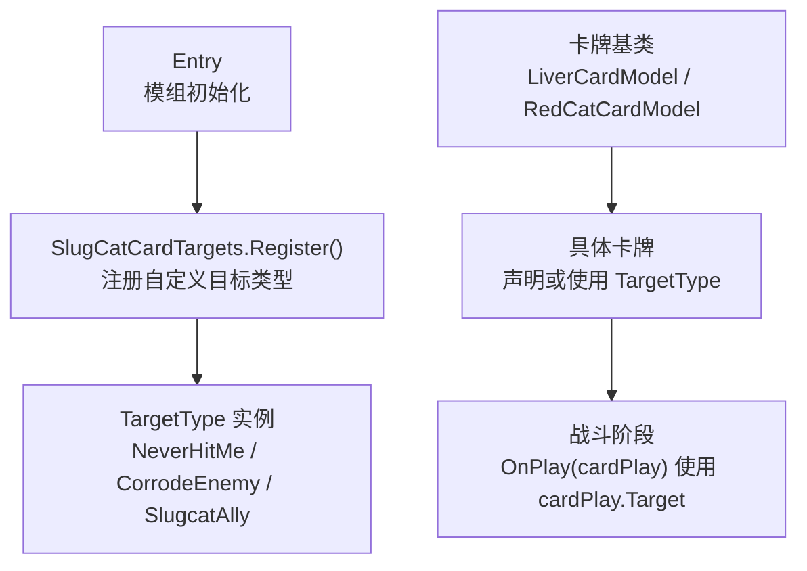
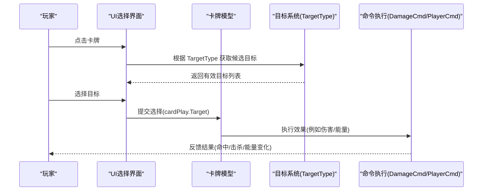
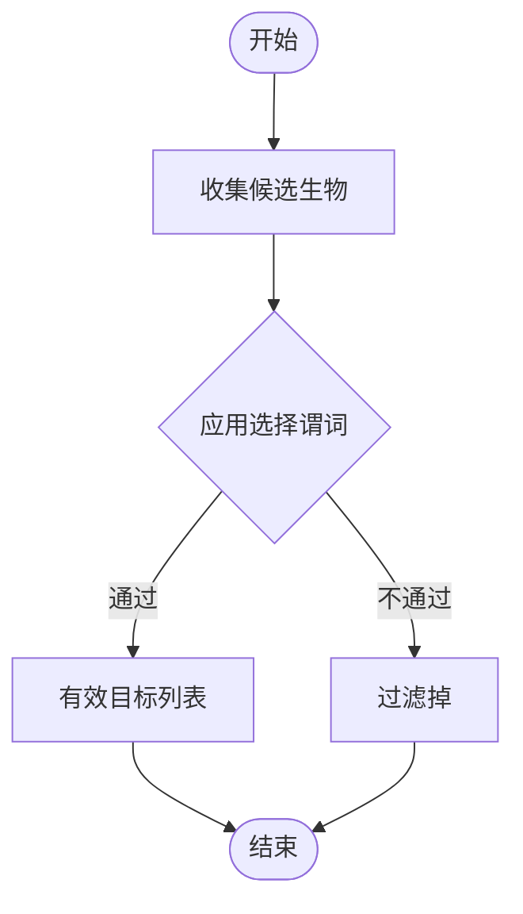
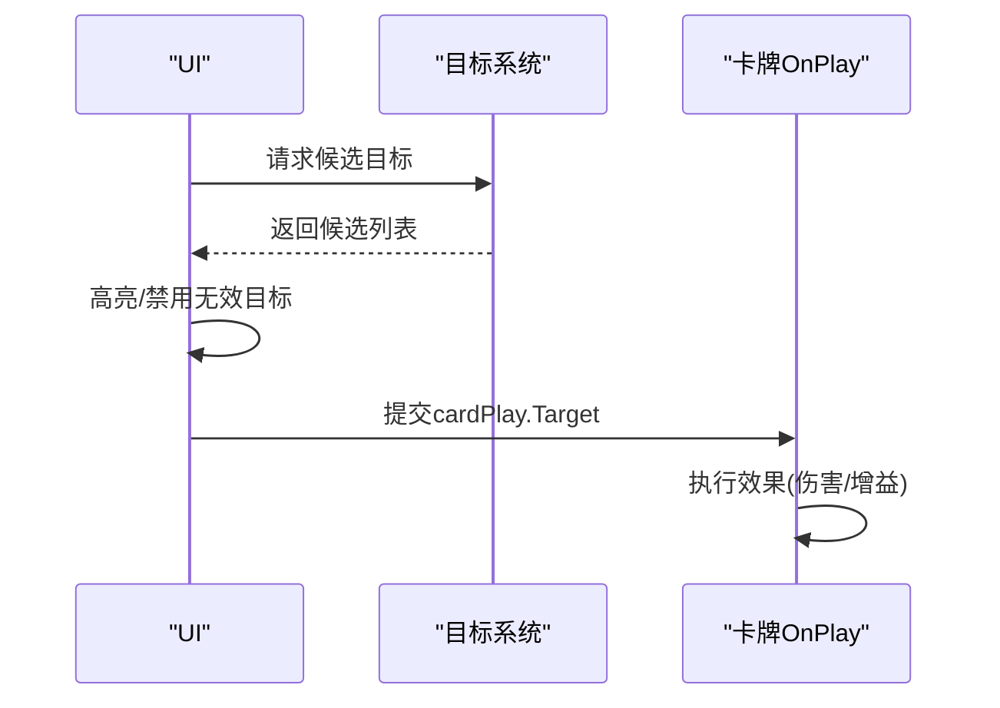
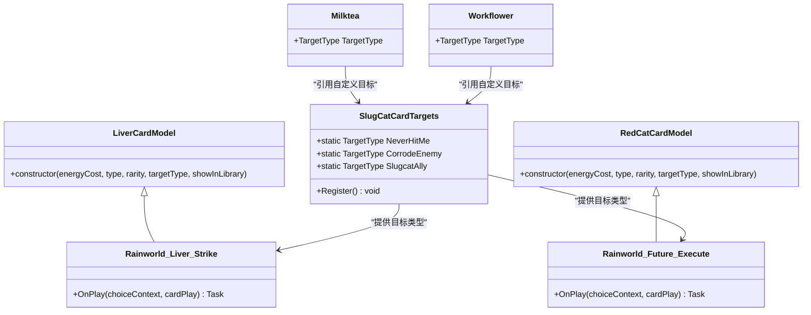
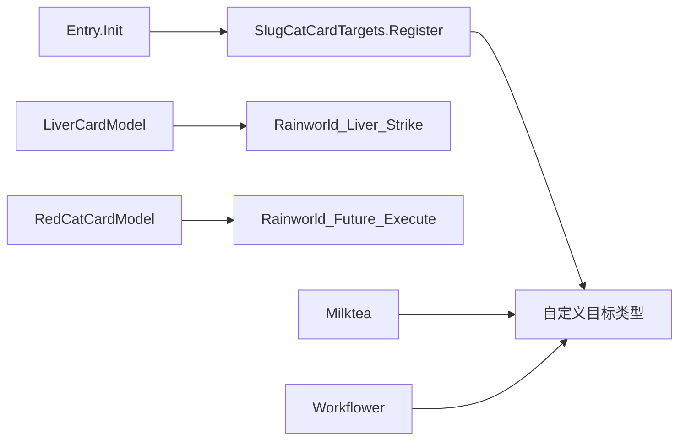

# 卡牌目标系统

<cite>
**本文引用的文件**
- [SlugCatCardTargets.cs](file://Scripts/Card/SlugCatCardTargets.cs)
- [Entry.cs](file://Scripts/Entry.cs)
- [Rainworld_Liver_Strike.cs](file://Scripts/Card/Liver/Attack/Rainworld_Liver_Strike.cs)
- [Rainworld_Future_Execute.cs](file://Scripts/Card/Future/Rainworld_Future_Execute.cs)
- [LiverCardModel.cs](file://Scripts/Card/Liver/LiverCardModel.cs)
- [RedCatCardModel.cs](file://Scripts/Card/RedCat/RedCatCardModel.cs)
- [Milktea.cs](file://Scripts/Potions/Milktea.cs)
- [Workflower.cs](file://Scripts/Potions/Workflower.cs)
</cite>

## 目录
1. [简介](#简介)
2. [项目结构](#项目结构)
3. [核心组件](#核心组件)
4. [架构总览](#架构总览)
5. [详细组件分析](#详细组件分析)
6. [依赖关系分析](#依赖关系分析)
7. [性能考量](#性能考量)
8. [故障排查指南](#故障排查指南)
9. [结论](#结论)
10. [附录](#附录)

## 简介
本技术文档围绕“卡牌目标系统”展开，聚焦于目标类型的定义与选择逻辑、目标验证机制、UI交互流程、特殊目标的实现方式，以及扩展方法与调试测试方法。该系统的核心在于：通过统一的 TargetType 抽象，将“谁可以被选中”的判定从具体卡牌中解耦出来；在运行时由框架完成目标筛选、校验与交互提示；卡牌仅需声明目标类型并在 OnPlay 中使用已选定的目标执行效果。

## 项目结构
本项目采用分层组织：
- 目标注册中心：集中注册自定义目标类型（如“不可被攻击的敌人”“腐蚀敌人”“蛞蝓猫盟友”）。
- 卡牌基类：为不同角色提供统一的目标类型注入点（构造函数或属性覆盖）。
- 具体卡牌：声明常量 TargetType 或通过属性动态返回目标类型，并在 OnPlay 中消费 cardPlay.Target。
- 入口初始化：在模组启动时调用目标注册，确保全局可用。

图表来源
- [Entry.cs:26-48](file://Scripts/Entry.cs#L26-L48)
- [SlugCatCardTargets.cs:14-33](file://Scripts/Card/SlugCatCardTargets.cs#L14-L33)
- [LiverCardModel.cs:34-37](file://Scripts/Card/Liver/LiverCardModel.cs#L34-L37)
- [RedCatCardModel.cs:35-38](file://Scripts/Card/RedCat/RedCatCardModel.cs#L35-L38)
- [Rainworld_Liver_Strike.cs:40-50](file://Scripts/Card/Liver/Attack/Rainworld_Liver_Strike.cs#L40-L50)

章节来源
- [Entry.cs:26-48](file://Scripts/Entry.cs#L26-L48)
- [SlugCatCardTargets.cs:14-33](file://Scripts/Card/SlugCatCardTargets.cs#L14-L33)

## 核心组件
- 自定义目标类型注册器：提供单一目标类型的注册能力，支持按条件筛选可被选中的生物。
- 内置目标类型：项目中广泛使用 AnyEnemy、AllEnemies、Self、AllAllies 等标准目标类型。
- 卡牌基类：为角色牌组提供统一的构造参数，包含 TargetType。
- 药水目标类型覆盖：部分药水通过重写 TargetType 指向自定义目标类型。

章节来源
- [SlugCatCardTargets.cs:14-33](file://Scripts/Card/SlugCatCardTargets.cs#L14-L33)
- [LiverCardModel.cs:34-37](file://Scripts/Card/Liver/LiverCardModel.cs#L34-L37)
- [RedCatCardModel.cs:35-38](file://Scripts/Card/RedCat/RedCatCardModel.cs#L35-L38)
- [Milktea.cs:33](file://Scripts/Potions/Milktea.cs#L33)
- [Workflower.cs:32](file://Scripts/Potions/Workflower.cs#L32)

## 架构总览
目标系统的关键路径如下：
- 启动期：Entry.Init 调用 SlugCatCardTargets.Register，完成自定义目标类型的全局注册。
- 出牌期：卡牌声明 TargetType（常量或动态），框架根据目标类型生成可选目标集合。
- 选择期：玩家通过 UI 选择目标，框架进行有效性校验并回传 cardPlay.Target。
- 执行期：卡牌 OnPlay 基于 cardPlay.Target 执行伤害、增益等效果。

图表来源
- [Rainworld_Liver_Strike.cs:40-50](file://Scripts/Card/Liver/Attack/Rainworld_Liver_Strike.cs#L40-L50)
- [Rainworld_Future_Execute.cs:44-57](file://Scripts/Card/Future/Rainworld_Future_Execute.cs#L44-L57)
- [SlugCatCardTargets.cs:14-33](file://Scripts/Card/SlugCatCardTargets.cs#L14-L33)

## 详细组件分析

### 自定义目标类型注册与选择逻辑
- 注册接口：通过 CustomTargetType.RegisterSingleTargetType 注册单一目标类型，传入 ModId、唯一标识键与选择谓词。
- 示例目标：
  - 不可被攻击的敌人：排除特定对子且非玩家。
  - 腐蚀敌人：目标需拥有指定能力。
  - 蛞蝓猫盟友：目标所属玩家的角色为 Slugcat。
- 选择逻辑：在战斗中选择目标时，框架会遍历当前场景的生物，应用谓词过滤得到候选集；若为空，则提示无法选择。

图表来源
- [SlugCatCardTargets.cs:14-33](file://Scripts/Card/SlugCatCardTargets.cs#L14-L33)

章节来源
- [SlugCatCardTargets.cs:14-33](file://Scripts/Card/SlugCatCardTargets.cs#L14-L33)

### 目标验证机制
- 有效性检查：由目标类型谓词决定；若某生物不满足条件，将被排除在候选之外。
- 空候选处理：当没有合法目标时，UI应阻止确认并给出提示（例如“无有效目标”）。
- 多目标与单目标：当前注册的均为单目标类型；对于多目标（如 AllEnemies）由框架内置目标类型处理。

章节来源
- [SlugCatCardTargets.cs:14-33](file://Scripts/Card/SlugCatCardTargets.cs#L14-L33)

### 目标选择的UI交互流程
- 鼠标悬停：高亮候选目标，显示其状态与是否可被选中。
- 点击确认：提交选择后，框架将 cardPlay.Target 传递给卡牌 OnPlay。
- 错误提示：若无有效目标或选择非法，UI应即时提示并阻止继续。
- 典型用法：攻击类卡牌在 OnPlay 中直接使用 cardPlay.Target 执行伤害。

图表来源
- [Rainworld_Liver_Strike.cs:40-50](file://Scripts/Card/Liver/Attack/Rainworld_Liver_Strike.cs#L40-L50)

章节来源
- [Rainworld_Liver_Strike.cs:40-50](file://Scripts/Card/Liver/Attack/Rainworld_Liver_Strike.cs#L40-L50)

### 特殊目标的实现方式
- 随机目标：可通过自定义谓词结合随机选择策略实现（例如从候选中随机挑选一个）。
- 所有敌人：使用内置 TargetType.AllEnemies。
- 特定条件目标：通过自定义谓词精确匹配（如拥有某能力、属于某阵营等）。
- 动态目标：在卡牌中重写 TargetType 属性以根据状态动态返回目标类型（例如某些药水根据上下文切换目标）。

章节来源
- [Rainworld_Future_Execute.cs:25-27](file://Scripts/Card/Future/Rainworld_Future_Execute.cs#L25-L27)
- [Milktea.cs:33](file://Scripts/Potions/Milktea.cs#L33)
- [Workflower.cs:32](file://Scripts/Potions/Workflower.cs#L32)

### 目标系统的扩展方法
- 新增自定义目标类型：
  - 在 SlugCatCardTargets 中新增静态字段与 Register 条目。
  - 使用 CustomTargetType.RegisterSingleTargetType 注册，传入唯一键与选择谓词。
- 在卡牌中使用：
  - 在构造函数中传入目标类型常量，或在属性中动态返回目标类型。
- 注意事项：
  - 确保谓词高效且无副作用。
  - 避免循环依赖；目标选择不应触发新的目标选择。
  - 多语言本地化键需遵循命名规范。

章节来源
- [SlugCatCardTargets.cs:14-33](file://Scripts/Card/SlugCatCardTargets.cs#L14-L33)
- [LiverCardModel.cs:34-37](file://Scripts/Card/Liver/LiverCardModel.cs#L34-L37)
- [RedCatCardModel.cs:35-38](file://Scripts/Card/RedCat/RedCatCardModel.cs#L35-L38)

### 代码级类图（目标相关）

图表来源
- [SlugCatCardTargets.cs:8-33](file://Scripts/Card/SlugCatCardTargets.cs#L8-L33)
- [LiverCardModel.cs:14-37](file://Scripts/Card/Liver/LiverCardModel.cs#L14-L37)
- [RedCatCardModel.cs:13-38](file://Scripts/Card/RedCat/RedCatCardModel.cs#L13-L38)
- [Rainworld_Liver_Strike.cs:9-50](file://Scripts/Card/Liver/Attack/Rainworld_Liver_Strike.cs#L9-L50)
- [Rainworld_Future_Execute.cs:16-57](file://Scripts/Card/Future/Rainworld_Future_Execute.cs#L16-L57)
- [Milktea.cs:33](file://Scripts/Potions/Milktea.cs#L33)
- [Workflower.cs:32](file://Scripts/Potions/Workflower.cs#L32)

## 依赖关系分析
- Entry 负责初始化并调用目标注册，确保全局可用。
- 卡牌基类为各角色牌组提供统一的目标类型注入点。
- 具体卡牌依赖目标类型进行目标筛选与执行。
- 药水通过重写 TargetType 复用自定义目标类型。

图表来源
- [Entry.cs:26-48](file://Scripts/Entry.cs#L26-L48)
- [SlugCatCardTargets.cs:14-33](file://Scripts/Card/SlugCatCardTargets.cs#L14-L33)
- [LiverCardModel.cs:34-37](file://Scripts/Card/Liver/LiverCardModel.cs#L34-L37)
- [RedCatCardModel.cs:35-38](file://Scripts/Card/RedCat/RedCatCardModel.cs#L35-L38)
- [Milktea.cs:33](file://Scripts/Potions/Milktea.cs#L33)
- [Workflower.cs:32](file://Scripts/Potions/Workflower.cs#L32)

章节来源
- [Entry.cs:26-48](file://Scripts/Entry.cs#L26-L48)
- [SlugCatCardTargets.cs:14-33](file://Scripts/Card/SlugCatCardTargets.cs#L14-L33)

## 性能考量
- 目标谓词应尽量轻量，避免复杂计算或外部IO。
- 对大规模生物集合进行筛选时，优先使用快速过滤条件（如阵营、能力存在性）。
- 避免在目标选择过程中触发新的目标选择或状态变更，防止递归与死锁。
- 合理使用内置目标类型（AllEnemies、AnyEnemy）以减少自定义开销。

[本节为通用指导，无需源码引用]

## 故障排查指南
- 无有效目标：
  - 检查目标谓词是否正确，是否存在误判导致候选为空。
  - 在 UI 层增加“无有效目标”的提示，避免玩家误操作。
- 目标选择异常：
  - 确认卡牌 OnPlay 中对 cardPlay.Target 的使用是否安全（空值保护）。
  - 检查是否有能力或状态改变了目标的有效性（如隐身、无敌）。
- 日志与调试：
  - 在 Entry 中启用日志输出，记录目标选择过程与结果。
  - 针对自定义目标类型添加断点，逐步验证谓词逻辑。

章节来源
- [Rainworld_Liver_Strike.cs:40-50](file://Scripts/Card/Liver/Attack/Rainworld_Liver_Strike.cs#L40-L50)
- [Rainworld_Future_Execute.cs:44-57](file://Scripts/Card/Future/Rainworld_Future_Execute.cs#L44-L57)
- [Entry.cs:26-48](file://Scripts/Entry.cs#L26-L48)

## 结论
该目标系统通过统一的 TargetType 抽象与自定义谓词机制，实现了灵活且可扩展的目标选择逻辑。卡牌只需声明目标类型并在 OnPlay 中消费已选目标，即可实现复杂的战斗行为。未来可通过更多自定义目标类型与动态目标策略，进一步增强卡牌设计与玩法深度。

[本节为总结，无需源码引用]

## 附录
- 常用内置目标类型参考：
  - Self：自身
  - AnyEnemy：任意敌人
  - AllEnemies：所有敌人
  - AllAllies：所有友方
- 扩展建议：
  - 在 SlugCatCardTargets 中集中管理自定义目标类型，便于维护与审计。
  - 为每个自定义目标类型编写单元测试，覆盖边界情况（空集合、全部无效、全部有效）。

[本节为补充信息，无需源码引用]