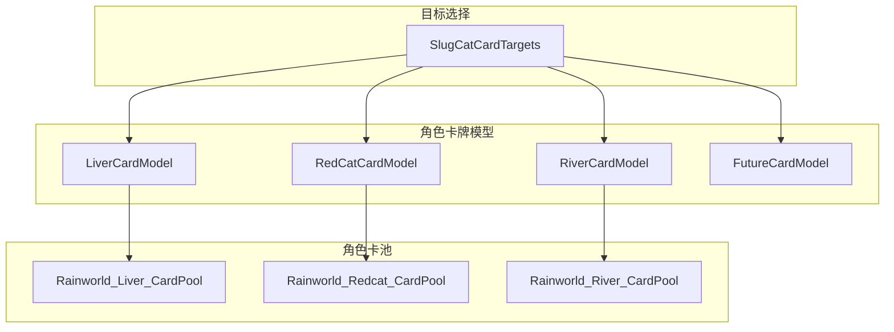
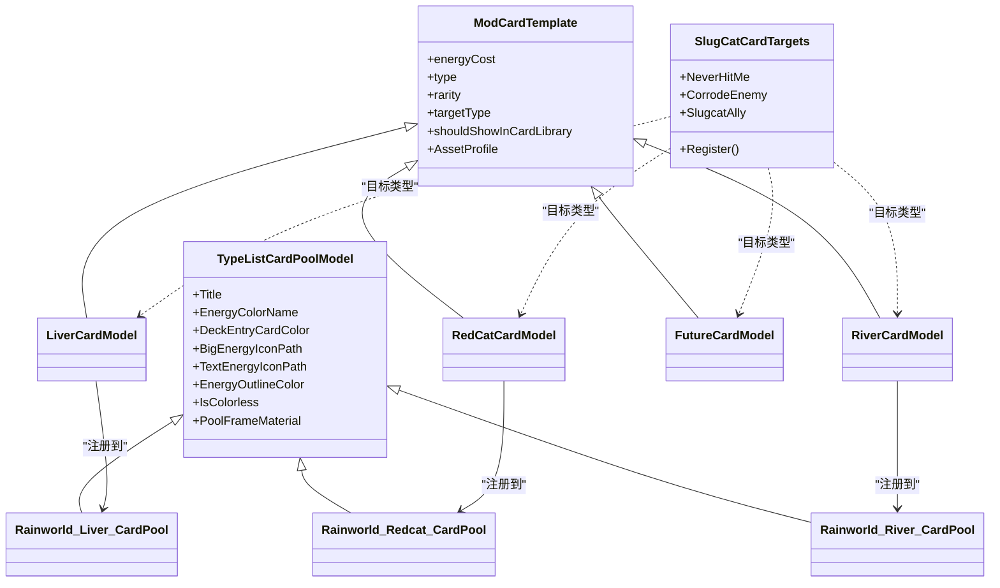
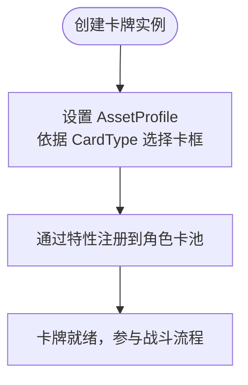
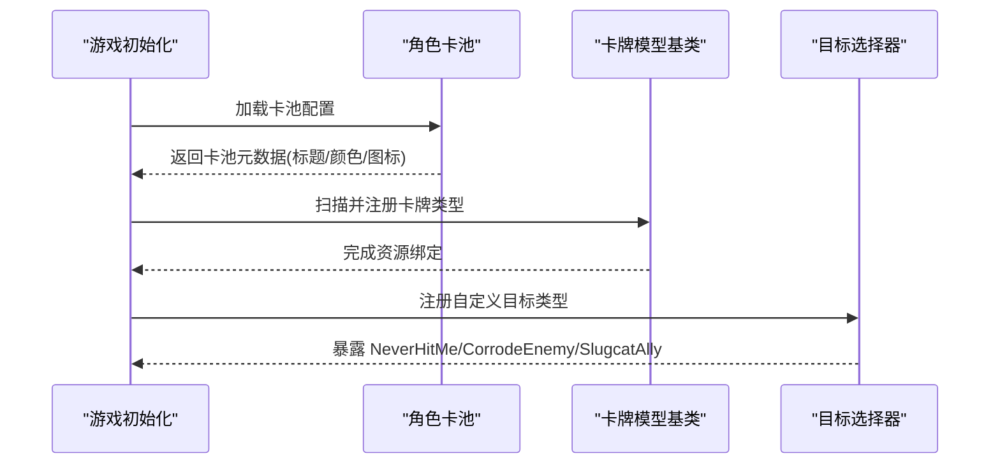
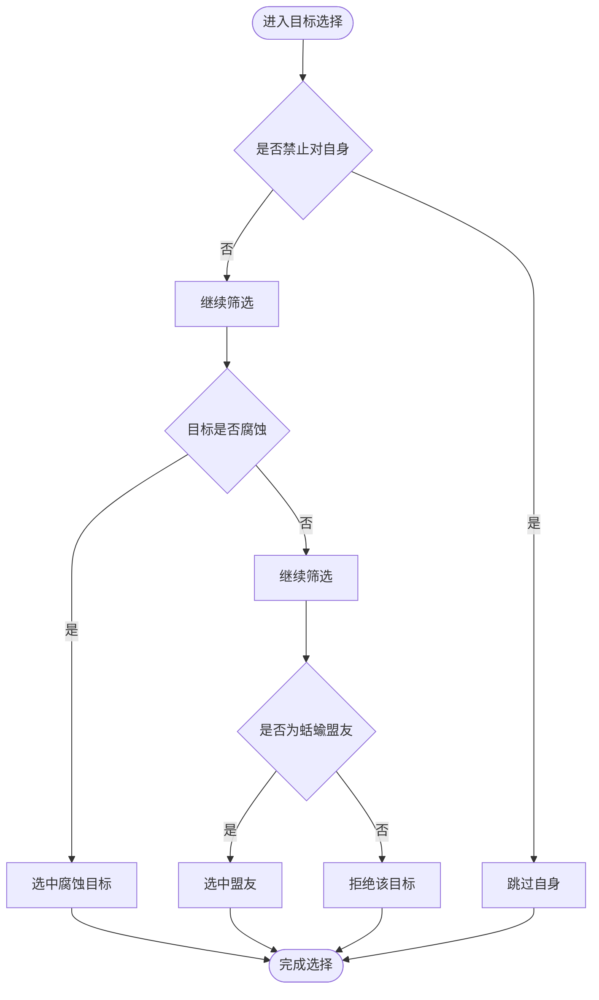
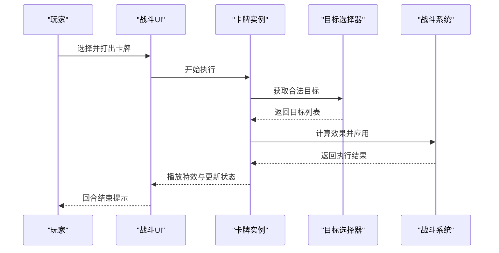
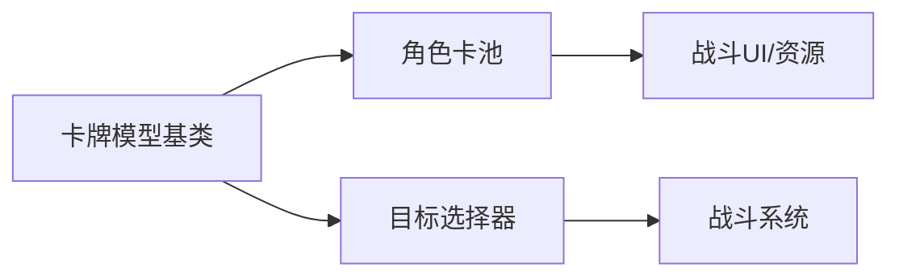

# 卡牌系统

<cite>
**本文引用的文件**
- [SlugCatCardTargets.cs](file://Scripts/Card/SlugCatCardTargets.cs)
- [LiverCardModel.cs](file://Scripts/Card/Liver/LiverCardModel.cs)
- [RedCatCardModel.cs](file://Scripts/Card/RedCat/RedCatCardModel.cs)
- [RiverCardModel.cs](file://Scripts/Card/River/RiverCardModel.cs)
- [Rainworld_Liver_CardPool.cs](file://Scripts/Card/Liver/Rainworld_Liver_CardPool.cs)
- [Rainworld_Redcat_CardPool.cs](file://Scripts/Card/RedCat/Rainworld_Redcat_CardPool.cs)
- [Rainworld_River_CardPool.cs](file://Scripts/Card/River/Rainworld_River_CardPool.cs)
- [FutureCardModel.cs](file://Scripts/Card/Future/FutureCardModel.cs)
</cite>

## 目录
1. [简介](#简介)
2. [项目结构](#项目结构)
3. [核心组件](#核心组件)
4. [架构总览](#架构总览)
5. [详细组件分析](#详细组件分析)
6. [依赖关系分析](#依赖关系分析)
7. [性能考量](#性能考量)
8. [故障排查指南](#故障排查指南)
9. [结论](#结论)
10. [附录：开发指南与最佳实践](#附录开发指南与最佳实践)

## 简介
本文件为“卡牌系统”的全面API文档，聚焦于卡牌基类架构、攻击/技能/能力三类卡牌的实现模式，以及卡牌生命周期、执行流程与效果计算。同时涵盖卡牌池管理、抽牌算法要点、角色差异化设计与平衡性考虑，并提供创建新卡牌类型、实现卡牌效果与集成到角色卡组的开发指南与最佳实践。

## 项目结构
- 按角色划分卡牌模型与卡池：
  - 肝脏（Liver）：卡牌模型基类与卡池定义
  - 红猫（RedCat）：卡牌模型基类与卡池定义
  - 河狸（River）：卡牌模型基类与卡池定义
  - 未来（Future）：通用/跨角色卡牌模型基类
- 目标选择器：提供自定义目标类型，用于限制或筛选可被卡牌选中的单位
- 资源与UI：各角色卡池配置能量图标、颜色、材质等显示属性

图表来源
- [LiverCardModel.cs:14-37](file://Scripts/Card/Liver/LiverCardModel.cs#L14-L37)
- [RedCatCardModel.cs:13-38](file://Scripts/Card/RedCat/RedCatCardModel.cs#L13-L38)
- [RiverCardModel.cs:14-38](file://Scripts/Card/River/RiverCardModel.cs#L14-L38)
- [FutureCardModel.cs:14-38](file://Scripts/Card/Future/FutureCardModel.cs#L14-L38)
- [Rainworld_Liver_CardPool.cs:10-23](file://Scripts/Card/Liver/Rainworld_Liver_CardPool.cs#L10-L23)
- [Rainworld_Redcat_CardPool.cs:9-23](file://Scripts/Card/RedCat/Rainworld_Redcat_CardPool.cs#L9-L23)
- [Rainworld_River_CardPool.cs:11-26](file://Scripts/Card/River/Rainworld_River_CardPool.cs#L11-L26)
- [SlugCatCardTargets.cs:8-33](file://Scripts/Card/SlugCatCardTargets.cs#L8-L33)

章节来源
- [LiverCardModel.cs:14-37](file://Scripts/Card/Liver/LiverCardModel.cs#L14-L37)
- [RedCatCardModel.cs:13-38](file://Scripts/Card/RedCat/RedCatCardModel.cs#L13-L38)
- [RiverCardModel.cs:14-38](file://Scripts/Card/River/RiverCardModel.cs#L14-L38)
- [FutureCardModel.cs:14-38](file://Scripts/Card/Future/FutureCardModel.cs#L14-L38)
- [Rainworld_Liver_CardPool.cs:10-23](file://Scripts/Card/Liver/Rainworld_Liver_CardPool.cs#L10-L23)
- [Rainworld_Redcat_CardPool.cs:9-23](file://Scripts/Card/RedCat/Rainworld_Redcat_CardPool.cs#L9-L23)
- [Rainworld_River_CardPool.cs:11-26](file://Scripts/Card/River/Rainworld_River_CardPool.cs#L11-L26)
- [SlugCatCardTargets.cs:8-33](file://Scripts/Card/SlugCatCardTargets.cs#L8-L33)

## 核心组件
- 卡牌模型基类（ModCardTemplate 派生）
  - 每个角色拥有独立的抽象基类，统一设置资源路径、卡框与横幅等展示信息
  - 通过特性注册到对应角色的卡池中，便于自动发现与装配
- 角色卡池（TypeListCardPoolModel 派生）
  - 定义角色专属的卡池外观、能量图标、颜色与是否无色牌等元数据
- 目标选择器（CustomTargetType）
  - 提供“不可命中自身”、“腐蚀敌人”、“蛞蝓盟友”等自定义目标类型，供卡牌在运行时进行目标筛选

章节来源
- [LiverCardModel.cs:14-37](file://Scripts/Card/Liver/LiverCardModel.cs#L14-L37)
- [RedCatCardModel.cs:13-38](file://Scripts/Card/RedCat/RedCatCardModel.cs#L13-L38)
- [RiverCardModel.cs:14-38](file://Scripts/Card/River/RiverCardModel.cs#L14-L38)
- [FutureCardModel.cs:14-38](file://Scripts/Card/Future/FutureCardModel.cs#L14-L38)
- [Rainworld_Liver_CardPool.cs:10-23](file://Scripts/Card/Liver/Rainworld_Liver_CardPool.cs#L10-L23)
- [Rainworld_Redcat_CardPool.cs:9-23](file://Scripts/Card/RedCat/Rainworld_Redcat_CardPool.cs#L9-L23)
- [Rainworld_River_CardPool.cs:11-26](file://Scripts/Card/River/Rainworld_River_CardPool.cs#L11-L26)
- [SlugCatCardTargets.cs:8-33](file://Scripts/Card/SlugCatCardTargets.cs#L8-L33)

## 架构总览
卡牌系统采用“角色隔离 + 统一基类”的设计：
- 所有卡牌继承自 ModCardTemplate，并按角色进一步细分基类，以承载各自的美术资源与展示逻辑
- 每个角色维护一个 TypeListCardPoolModel 派生的卡池，负责声明该角色可用的卡牌集合与外观
- 目标选择器集中管理自定义 TargetType，使不同卡牌可以复用统一的筛选规则

图表来源
- [LiverCardModel.cs:14-37](file://Scripts/Card/Liver/LiverCardModel.cs#L14-L37)
- [RedCatCardModel.cs:13-38](file://Scripts/Card/RedCat/RedCatCardModel.cs#L13-L38)
- [RiverCardModel.cs:14-38](file://Scripts/Card/River/RiverCardModel.cs#L14-L38)
- [FutureCardModel.cs:14-38](file://Scripts/Card/Future/FutureCardModel.cs#L14-L38)
- [Rainworld_Liver_CardPool.cs:10-23](file://Scripts/Card/Liver/Rainworld_Liver_CardPool.cs#L10-L23)
- [Rainworld_Redcat_CardPool.cs:9-23](file://Scripts/Card/RedCat/Rainworld_Redcat_CardPool.cs#L9-L23)
- [Rainworld_River_CardPool.cs:11-26](file://Scripts/Card/River/Rainworld_River_CardPool.cs#L11-L26)
- [SlugCatCardTargets.cs:8-33](file://Scripts/Card/SlugCatCardTargets.cs#L8-L33)

## 详细组件分析

### 卡牌基类与角色模型
- 统一资源路径策略：根据卡牌类型（攻击/技能/能力）动态选择卡框资源
- 自动注册：通过特性将具体卡牌类型关联到对应角色卡池，简化内容装配
- 扩展点：可在基类中集中处理公共展示逻辑（如横幅、边框），降低重复代码

图表来源
- [LiverCardModel.cs:14-37](file://Scripts/Card/Liver/LiverCardModel.cs#L14-L37)
- [RedCatCardModel.cs:13-38](file://Scripts/Card/RedCat/RedCatCardModel.cs#L13-L38)
- [RiverCardModel.cs:14-38](file://Scripts/Card/River/RiverCardModel.cs#L14-L38)
- [FutureCardModel.cs:14-38](file://Scripts/Card/Future/FutureCardModel.cs#L14-L38)

章节来源
- [LiverCardModel.cs:14-37](file://Scripts/Card/Liver/LiverCardModel.cs#L14-L37)
- [RedCatCardModel.cs:13-38](file://Scripts/Card/RedCat/RedCatCardModel.cs#L13-L38)
- [RiverCardModel.cs:14-38](file://Scripts/Card/River/RiverCardModel.cs#L14-L38)
- [FutureCardModel.cs:14-38](file://Scripts/Card/Future/FutureCardModel.cs#L14-L38)

### 卡牌池管理
- 角色卡池定义外观与能量主题：包括标题键、能量色名、入场牌颜色、能量图标路径、描边色、是否无色牌等
- 材质支持：使用 HSV 着色器材质作为卡池背景，便于统一风格化
- 可扩展：新增角色只需新增 CardPool 与 CardModel 基类并注册即可

图表来源
- [Rainworld_Liver_CardPool.cs:10-23](file://Scripts/Card/Liver/Rainworld_Liver_CardPool.cs#L10-L23)
- [Rainworld_Redcat_CardPool.cs:9-23](file://Scripts/Card/RedCat/Rainworld_Redcat_CardPool.cs#L9-L23)
- [Rainworld_River_CardPool.cs:11-26](file://Scripts/Card/River/Rainworld_River_CardPool.cs#L11-L26)
- [SlugCatCardTargets.cs:14-33](file://Scripts/Card/SlugCatCardTargets.cs#L14-L33)

章节来源
- [Rainworld_Liver_CardPool.cs:10-23](file://Scripts/Card/Liver/Rainworld_Liver_CardPool.cs#L10-L23)
- [Rainworld_Redcat_CardPool.cs:9-23](file://Scripts/Card/RedCat/Rainworld_Redcat_CardPool.cs#L9-L23)
- [Rainworld_River_CardPool.cs:11-26](file://Scripts/Card/River/Rainworld_River_CardPool.cs#L11-L26)
- [SlugCatCardTargets.cs:14-33](file://Scripts/Card/SlugCatCardTargets.cs#L14-L33)

### 目标选择与效果计算
- 自定义目标类型：
  - 不可命中自身：避免对玩家造成伤害的特定组合
  - 腐蚀敌人：仅对有腐蚀状态的目标生效
  - 蛞蝓盟友：限定友方单位范围
- 效果计算建议：
  - 在卡牌执行阶段读取目标状态（如是否有腐蚀），再决定伤害倍率、附加效果或触发条件
  - 将复杂判定封装为目标选择器，保持卡牌逻辑简洁

图表来源
- [SlugCatCardTargets.cs:14-33](file://Scripts/Card/SlugCatCardTargets.cs#L14-L33)

章节来源
- [SlugCatCardTargets.cs:14-33](file://Scripts/Card/SlugCatCardTargets.cs#L14-L33)

### 攻击/技能/能力卡牌实现模式
- 攻击卡牌：通常包含基础伤害与额外效果（如连击、穿透、元素附加），需结合目标选择器进行精准打击
- 技能卡牌：侧重资源调度、防御、增益或场景交互（如抽牌、回手、护盾）
- 能力卡牌：提供持续性的被动或主动效果，常与状态/力量系统联动
- 共同点：
  - 均继承对应角色 CardModel 基类，确保资源与展示一致
  - 通过目标类型与状态检查实现差异化效果
  - 在卡牌执行时调用统一的效果计算入口，保证流程可控

章节来源
- [LiverCardModel.cs:14-37](file://Scripts/Card/Liver/LiverCardModel.cs#L14-L37)
- [RedCatCardModel.cs:13-38](file://Scripts/Card/RedCat/RedCatCardModel.cs#L13-L38)
- [RiverCardModel.cs:14-38](file://Scripts/Card/River/RiverCardModel.cs#L14-L38)
- [FutureCardModel.cs:14-38](file://Scripts/Card/Future/FutureCardModel.cs#L14-L38)
- [SlugCatCardTargets.cs:14-33](file://Scripts/Card/SlugCatCardTargets.cs#L14-L33)

### 卡牌生命周期与执行流程
- 生命周期阶段：
  - 构建期：卡牌实例化、资源绑定、目标类型注册
  - 出牌期：消耗能量、目标选择、前置校验
  - 执行期：效果计算、状态变更、动画与反馈
  - 结算期：移除临时状态、记录日志、清理引用
- 执行流程图（概念）：

[此图为概念流程，不直接映射具体源码]

## 依赖关系分析
- 低耦合：卡牌模型与卡池通过特性解耦，便于扩展新角色与新卡牌
- 目标选择器独立：将目标筛选逻辑从卡牌中剥离，提升复用性与可测试性
- 资源路径集中：通过 CardModel 基类统一管理美术资源，减少硬编码分散

图表来源
- [LiverCardModel.cs:14-37](file://Scripts/Card/Liver/LiverCardModel.cs#L14-L37)
- [RedCatCardModel.cs:13-38](file://Scripts/Card/RedCat/RedCatCardModel.cs#L13-L38)
- [RiverCardModel.cs:14-38](file://Scripts/Card/River/RiverCardModel.cs#L14-L38)
- [FutureCardModel.cs:14-38](file://Scripts/Card/Future/FutureCardModel.cs#L14-L38)
- [Rainworld_Liver_CardPool.cs:10-23](file://Scripts/Card/Liver/Rainworld_Liver_CardPool.cs#L10-L23)
- [Rainworld_Redcat_CardPool.cs:9-23](file://Scripts/Card/RedCat/Rainworld_Redcat_CardPool.cs#L9-L23)
- [Rainworld_River_CardPool.cs:11-26](file://Scripts/Card/River/Rainworld_River_CardPool.cs#L11-L26)
- [SlugCatCardTargets.cs:14-33](file://Scripts/Card/SlugCatCardTargets.cs#L14-L33)

章节来源
- [LiverCardModel.cs:14-37](file://Scripts/Card/Liver/LiverCardModel.cs#L14-L37)
- [RedCatCardModel.cs:13-38](file://Scripts/Card/RedCat/RedCatCardModel.cs#L13-L38)
- [RiverCardModel.cs:14-38](file://Scripts/Card/River/RiverCardModel.cs#L14-L38)
- [FutureCardModel.cs:14-38](file://Scripts/Card/Future/FutureCardModel.cs#L14-L38)
- [Rainworld_Liver_CardPool.cs:10-23](file://Scripts/Card/Liver/Rainworld_Liver_CardPool.cs#L10-L23)
- [Rainworld_Redcat_CardPool.cs:9-23](file://Scripts/Card/RedCat/Rainworld_Redcat_CardPool.cs#L9-L23)
- [Rainworld_River_CardPool.cs:11-26](file://Scripts/Card/River/Rainworld_River_CardPool.cs#L11-L26)
- [SlugCatCardTargets.cs:14-33](file://Scripts/Card/SlugCatCardTargets.cs#L14-L33)

## 性能考量
- 目标选择器应高效：避免在每帧进行昂贵计算，尽量缓存或延迟计算
- 资源路径集中：减少重复查找与字符串拼接开销
- 卡牌执行批处理：将同类效果合并处理，降低系统调用次数
- 内存管理：及时释放临时对象与事件订阅，防止内存泄漏

[本节为通用指导，不直接分析具体文件]

## 故障排查指南
- 目标选择异常
  - 现象：无法选中预期目标或误选
  - 排查：检查自定义目标类型的注册与判断条件是否正确
  - 参考：[SlugCatCardTargets.cs:14-33](file://Scripts/Card/SlugCatCardTargets.cs#L14-L33)
- 卡牌未出现在卡池
  - 现象：角色卡池中缺少某张卡牌
  - 排查：确认卡牌模型是否通过特性正确注册到对应卡池
  - 参考：[LiverCardModel.cs:14-37](file://Scripts/Card/Liver/LiverCardModel.cs#L14-L37)、[RedCatCardModel.cs:13-38](file://Scripts/Card/RedCat/RedCatCardModel.cs#L13-L38)、[RiverCardModel.cs:14-38](file://Scripts/Card/River/RiverCardModel.cs#L14-L38)、[FutureCardModel.cs:14-38](file://Scripts/Card/Future/FutureCardModel.cs#L14-L38)
- 资源加载失败
  - 现象：卡牌无图或卡框错误
  - 排查：核对 AssetProfile 中资源路径是否与资源目录一致
  - 参考：[LiverCardModel.cs:17-32](file://Scripts/Card/Liver/LiverCardModel.cs#L17-L32)、[RedCatCardModel.cs:17-33](file://Scripts/Card/RedCat/RedCatCardModel.cs#L17-L33)、[RiverCardModel.cs:17-33](file://Scripts/Card/River/RiverCardModel.cs#L17-L33)、[FutureCardModel.cs:17-33](file://Scripts/Card/Future/FutureCardModel.cs#L17-L33)

章节来源
- [SlugCatCardTargets.cs:14-33](file://Scripts/Card/SlugCatCardTargets.cs#L14-L33)
- [LiverCardModel.cs:17-32](file://Scripts/Card/Liver/LiverCardModel.cs#L17-L32)
- [RedCatCardModel.cs:17-33](file://Scripts/Card/RedCat/RedCatCardModel.cs#L17-L33)
- [RiverCardModel.cs:17-33](file://Scripts/Card/River/RiverCardModel.cs#L17-L33)
- [FutureCardModel.cs:17-33](file://Scripts/Card/Future/FutureCardModel.cs#L17-L33)

## 结论
本卡牌系统通过角色化的 CardModel 与 CardPool 实现了清晰的模块化与可扩展性；借助自定义目标选择器，卡牌效果得以灵活而安全地作用于战场。遵循本文的开发指南与最佳实践，可以快速创建新的卡牌类型、实现复杂效果，并将其无缝集成到角色卡组中。

## 附录：开发指南与最佳实践

### 如何创建新的卡牌类型
- 步骤
  - 新建卡牌类，继承对应角色的 CardModel 基类
  - 在构造函数中设置能量消耗、类型、稀有度、目标类型与是否在图鉴显示
  - 如需自定义目标，优先复用 SlugCatCardTargets 提供的目标类型
  - 将卡牌加入角色卡池（通过特性自动注册）
- 参考
  - [LiverCardModel.cs:14-37](file://Scripts/Card/Liver/LiverCardModel.cs#L14-L37)
  - [RedCatCardModel.cs:13-38](file://Scripts/Card/RedCat/RedCatCardModel.cs#L13-L38)
  - [RiverCardModel.cs:14-38](file://Scripts/Card/River/RiverCardModel.cs#L14-L38)
  - [FutureCardModel.cs:14-38](file://Scripts/Card/Future/FutureCardModel.cs#L14-L38)
  - [SlugCatCardTargets.cs:14-33](file://Scripts/Card/SlugCatCardTargets.cs#L14-L33)

### 实现卡牌效果与执行流程
- 建议
  - 将效果计算拆分为“目标选择 -> 前置校验 -> 效果计算 -> 状态更新 -> 结算”
  - 使用目标选择器进行目标筛选，避免在卡牌内部写死条件
  - 对复杂效果进行单元测试，确保在不同状态下行为一致
- 参考
  - [SlugCatCardTargets.cs:14-33](file://Scripts/Card/SlugCatCardTargets.cs#L14-L33)

### 集成到角色卡组
- 步骤
  - 确保卡牌模型已继承对应角色 CardModel
  - 通过特性将卡牌类型注册到角色卡池
  - 验证卡池外观与能量图标是否正确显示
- 参考
  - [Rainworld_Liver_CardPool.cs:10-23](file://Scripts/Card/Liver/Rainworld_Liver_CardPool.cs#L10-L23)
  - [Rainworld_Redcat_CardPool.cs:9-23](file://Scripts/Card/RedCat/Rainworld_Redcat_CardPool.cs#L9-L23)
  - [Rainworld_River_CardPool.cs:11-26](file://Scripts/Card/River/Rainworld_River_CardPool.cs#L11-L26)

### 抽牌算法与卡牌升级机制
- 抽牌算法
  - 基于角色卡池的类型列表进行随机抽取，注意去重与权重控制
  - 建议在抽取前进行过滤（如排除已弃置、已升级的卡牌）
- 卡牌升级
  - 可通过修改卡牌稀有度、能量消耗或效果数值实现
  - 升级后需确保资源路径与展示一致，必要时调整卡框或横幅
- 说明
  - 本节为通用设计建议，具体实现需结合战斗系统与卡牌模型扩展点

### 角色设计风格与平衡性考虑
- 肝脏（Liver）
  - 风格：高机动与多段伤害，强调连携与资源循环
  - 平衡：控制单发伤害与连击上限，避免爆发过高
- 红猫（RedCat）
  - 风格：强攻与状态叠加，注重爆发与控制
  - 平衡：限制状态持续时间与叠加层数，防止无限强化
- 河狸（River）
  - 风格：控场与辅助，强调地形与资源调度
  - 平衡：控制辅助效果的强度与冷却，避免过度干扰对手节奏
- 未来（Future）
  - 风格：跨角色通用能力，偏向策略与变数
  - 平衡：限制使用频率与效果范围，确保与其他角色互补而非替代

[本节为概念性内容，不直接分析具体文件]