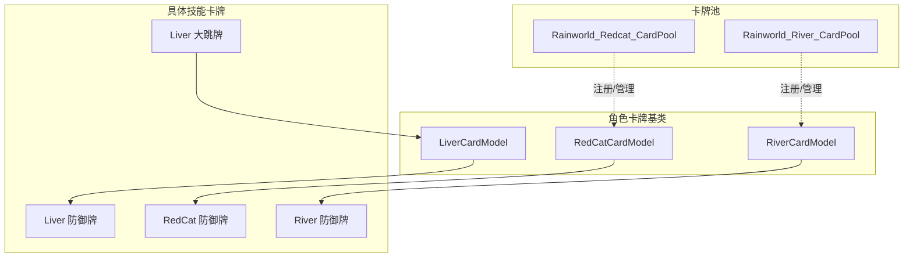
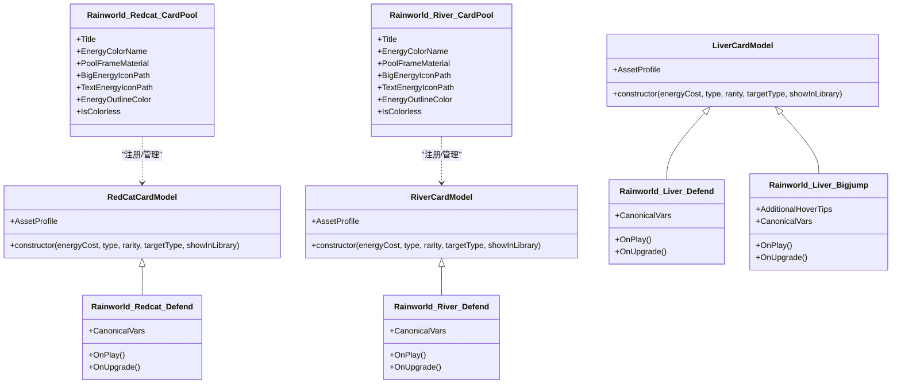
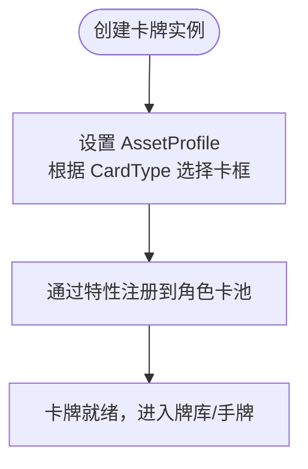
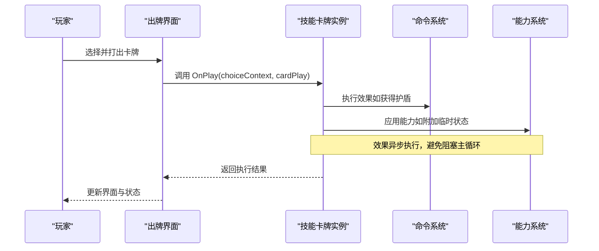
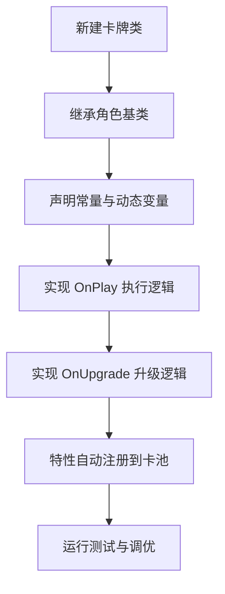
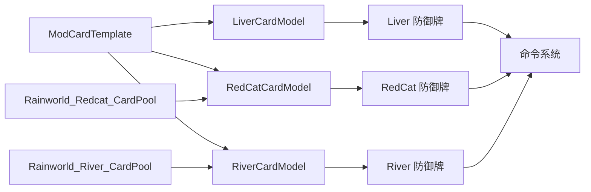

# 技能卡牌框架

<cite>
**本文引用的文件**
- [LiverCardModel.cs](file://Scripts/Card/Liver/LiverCardModel.cs)
- [RedCatCardModel.cs](file://Scripts/Card/RedCat/RedCatCardModel.cs)
- [RiverCardModel.cs](file://Scripts/Card/River/RiverCardModel.cs)
- [Rainworld_Redcat_CardPool.cs](file://Scripts/Card/RedCat/Rainworld_Redcat_CardPool.cs)
- [Rainworld_River_CardPool.cs](file://Scripts/Card/River/Rainworld_River_CardPool.cs)
- [Rainworld_Liver_Defend.cs](file://Scripts/Card/Liver/Skills/Rainworld_Liver_Defend.cs)
- [Rainworld_Redcat_Defend.cs](file://Scripts/Card/RedCat/Skills/Rainworld_Redcat_Defend.cs)
- [Rainworld_River_Defend.cs](file://Scripts/Card/River/Skill/Rainworld_River_Defend.cs)
- [Rainworld_Liver_Bigjump.cs](file://Scripts/Card/Liver/Skills/Rainworld_Liver_Bigjump.cs)
</cite>

## 目录
1. [简介](#简介)
2. [项目结构](#项目结构)
3. [核心组件](#核心组件)
4. [架构总览](#架构总览)
5. [详细组件分析](#详细组件分析)
6. [依赖关系分析](#依赖关系分析)
7. [性能考量](#性能考量)
8. [故障排查指南](#故障排查指南)
9. [结论](#结论)
10. [附录](#附录)

## 简介
本技术文档围绕“技能卡牌框架”展开，聚焦于三类角色（肝、红猫、河）的技能卡牌基类与继承体系，系统阐述从创建、执行到销毁的生命周期管理，并总结关键接口（如 OnPlay、OnUpgrade）的实现规范。同时提供自定义技能卡牌的完整开发指南、最佳实践与常见问题解决方案，帮助开发者快速构建稳定、可维护且高性能的技能卡牌内容。

## 项目结构
本项目采用按角色与卡牌类型分层的组织方式：
- 角色基类：LiverCardModel、RedCatCardModel、RiverCardModel，分别定义各自角色的卡牌资源路径与默认外观。
- 卡牌池：每个角色拥有独立的卡池模型（例如 Rainworld_Redcat_CardPool、Rainworld_River_CardPool），用于注册与管理该角色的卡牌集合。
- 具体卡牌实现：位于各角色的 Skills（或 Attack/Power）目录下，以具体类实现技能逻辑，统一继承对应角色基类。

图示来源
- [LiverCardModel.cs:14-38](file://Scripts/Card/Liver/LiverCardModel.cs#L14-L38)
- [RedCatCardModel.cs:13-39](file://Scripts/Card/RedCat/RedCatCardModel.cs#L13-L39)
- [RiverCardModel.cs:14-39](file://Scripts/Card/River/RiverCardModel.cs#L14-L39)
- [Rainworld_Redcat_CardPool.cs:9-23](file://Scripts/Card/RedCat/Rainworld_Redcat_CardPool.cs#L9-L23)
- [Rainworld_River_CardPool.cs:11-26](file://Scripts/Card/River/Rainworld_River_CardPool.cs#L11-L26)

章节来源
- [LiverCardModel.cs:14-38](file://Scripts/Card/Liver/LiverCardModel.cs#L14-L38)
- [RedCatCardModel.cs:13-39](file://Scripts/Card/RedCat/RedCatCardModel.cs#L13-L39)
- [RiverCardModel.cs:14-39](file://Scripts/Card/River/RiverCardModel.cs#L14-L39)
- [Rainworld_Redcat_CardPool.cs:9-23](file://Scripts/Card/RedCat/Rainworld_Redcat_CardPool.cs#L9-L23)
- [Rainworld_River_CardPool.cs:11-26](file://Scripts/Card/River/Rainworld_River_CardPool.cs#L11-L26)

## 核心组件
- 角色基类（LiverCardModel、RedCatCardModel、RiverCardModel）
  - 职责：统一资源路径与卡框样式；通过特性注解将子类自动注册到对应卡池；提供统一的构造参数（耗能、类型、稀有度、目标类型、图鉴显示）。
  - 关键点：AssetProfile 根据 CardType 动态选择不同卡框纹理；构造函数透传基础属性给基类。
- 卡牌池（TypeListCardPoolModel 派生）
  - 职责：为角色定义卡池标题、能量颜色、卡池边框材质、能量图标等视觉与元数据。
  - 关键点：使用 MaterialUtils 创建不随模组变色的卡框材质，保证视觉一致性。
- 具体技能卡牌
  - 职责：声明卡牌常量（耗能、类型、稀有度、目标类型、图鉴显示）、动态变量（如护盾值）、标签（如防御标签）、额外提示（可选）、执行逻辑（OnPlay）、升级逻辑（OnUpgrade）。
  - 关键点：通过 CreatureCmd/PowerCmd 等命令执行战斗效果；通过 DynamicVars 管理可变数值并在升级时调整。

章节来源
- [LiverCardModel.cs:14-38](file://Scripts/Card/Liver/LiverCardModel.cs#L14-L38)
- [RedCatCardModel.cs:13-39](file://Scripts/Card/RedCat/RedCatCardModel.cs#L13-L39)
- [RiverCardModel.cs:14-39](file://Scripts/Card/River/RiverCardModel.cs#L14-L39)
- [Rainworld_Redcat_CardPool.cs:9-23](file://Scripts/Card/RedCat/Rainworld_Redcat_CardPool.cs#L9-L23)
- [Rainworld_River_CardPool.cs:11-26](file://Scripts/Card/River/Rainworld_River_CardPool.cs#L11-L26)
- [Rainworld_Liver_Defend.cs:11-55](file://Scripts/Card/Liver/Skills/Rainworld_Liver_Defend.cs#L11-L55)
- [Rainworld_Redcat_Defend.cs:9-52](file://Scripts/Card/RedCat/Skills/Rainworld_Redcat_Defend.cs#L9-L52)
- [Rainworld_River_Defend.cs:11-40](file://Scripts/Card/River/Skill/Rainworld_River_Defend.cs#L11-L40)
- [Rainworld_Liver_Bigjump.cs:13-60](file://Scripts/Card/Liver/Skills/Rainworld_Liver_Bigjump.cs#L13-L60)

## 架构总览
下图展示了角色基类、卡牌池与具体技能卡牌之间的关系，以及卡牌在运行时被调用执行的流程。

图示来源
- [LiverCardModel.cs:14-38](file://Scripts/Card/Liver/LiverCardModel.cs#L14-L38)
- [RedCatCardModel.cs:13-39](file://Scripts/Card/RedCat/RedCatCardModel.cs#L13-L39)
- [RiverCardModel.cs:14-39](file://Scripts/Card/River/RiverCardModel.cs#L14-L39)
- [Rainworld_Redcat_CardPool.cs:9-23](file://Scripts/Card/RedCat/Rainworld_Redcat_CardPool.cs#L9-L23)
- [Rainworld_River_CardPool.cs:11-26](file://Scripts/Card/River/Rainworld_River_CardPool.cs#L11-L26)
- [Rainworld_Liver_Defend.cs:11-55](file://Scripts/Card/Liver/Skills/Rainworld_Liver_Defend.cs#L11-L55)
- [Rainworld_Redcat_Defend.cs:9-52](file://Scripts/Card/RedCat/Skills/Rainworld_Redcat_Defend.cs#L9-L52)
- [Rainworld_River_Defend.cs:11-40](file://Scripts/Card/River/Skill/Rainworld_River_Defend.cs#L11-L40)
- [Rainworld_Liver_Bigjump.cs:13-60](file://Scripts/Card/Liver/Skills/Rainworld_Liver_Bigjump.cs#L13-L60)

## 详细组件分析

### 基类架构与继承体系
- LiverCardModel、RedCatCardModel、RiverCardModel 均继承自 ModCardTemplate，并通过特性将子类自动注册到对应卡池。
- AssetProfile 中根据 CardType 动态设置卡框纹理，确保攻击/技能/能力三类卡牌在不同角色下具有统一视觉风格。
- 构造函数接收统一参数，便于在子类中以常量形式声明卡牌基础信息。

图示来源
- [LiverCardModel.cs:14-38](file://Scripts/Card/Liver/LiverCardModel.cs#L14-L38)
- [RedCatCardModel.cs:13-39](file://Scripts/Card/RedCat/RedCatCardModel.cs#L13-L39)
- [RiverCardModel.cs:14-39](file://Scripts/Card/River/RiverCardModel.cs#L14-L39)

章节来源
- [LiverCardModel.cs:14-38](file://Scripts/Card/Liver/LiverCardModel.cs#L14-L38)
- [RedCatCardModel.cs:13-39](file://Scripts/Card/RedCat/RedCatCardModel.cs#L13-L39)
- [RiverCardModel.cs:14-39](file://Scripts/Card/River/RiverCardModel.cs#L14-L39)

### 生命周期管理（创建→执行→销毁）
- 创建阶段
  - 通过特性将具体卡牌类注册到角色卡池；卡牌池负责聚合与展示。
  - 实例化时传入耗能、类型、稀有度、目标类型、是否显示在图鉴等基础信息。
- 执行阶段
  - 玩家打出卡牌后，框架调用 OnPlay；在 OnPlay 中通过命令（如 CreatureCmd.GainBlock、PowerCmd.Apply）执行效果。
  - 若卡牌具备升级机制，则在升级时调用 OnUpgrade 调整动态变量（如增加护盾值）。
- 销毁阶段
  - 卡牌完成回合或移出战场后，由框架回收；开发者无需手动释放资源，但应避免在 OnPlay/OnUpgrade 中持有跨回合的强引用。

图示来源
- [Rainworld_Liver_Defend.cs:44-55](file://Scripts/Card/Liver/Skills/Rainworld_Liver_Defend.cs#L44-L55)
- [Rainworld_Redcat_Defend.cs:41-52](file://Scripts/Card/RedCat/Skills/Rainworld_Redcat_Defend.cs#L41-L52)
- [Rainworld_River_Defend.cs:31-40](file://Scripts/Card/River/Skill/Rainworld_River_Defend.cs#L31-L40)
- [Rainworld_Liver_Bigjump.cs:48-60](file://Scripts/Card/Liver/Skills/Rainworld_Liver_Bigjump.cs#L48-L60)

章节来源
- [Rainworld_Liver_Defend.cs:44-55](file://Scripts/Card/Liver/Skills/Rainworld_Liver_Defend.cs#L44-L55)
- [Rainworld_Redcat_Defend.cs:41-52](file://Scripts/Card/RedCat/Skills/Rainworld_Redcat_Defend.cs#L41-L52)
- [Rainworld_River_Defend.cs:31-40](file://Scripts/Card/River/Skill/Rainworld_River_Defend.cs#L31-L40)
- [Rainworld_Liver_Bigjump.cs:48-60](file://Scripts/Card/Liver/Skills/Rainworld_Liver_Bigjump.cs#L48-L60)

### 核心接口与方法规范
- OnPlay(PlayerChoiceContext, CardPlay)
  - 作用：定义卡牌打出时的核心逻辑。
  - 规范：使用异步方法；通过命令系统执行效果；避免直接修改全局状态；尽量复用已有命令（如 CreatureCmd、PowerCmd）。
- OnUpgrade()
  - 作用：定义卡牌升级后的数值或行为变化。
  - 规范：仅调整 DynamicVars 或相关配置；不改变卡牌类型或目标类型；保持幂等性。
- CanonicalVars
  - 作用：声明卡牌的动态变量（如护盾值、伤害值），支持移动/升级等属性联动。
- AdditionalHoverTips（可选）
  - 作用：为卡牌添加额外的悬浮提示，提升可读性与引导性。

章节来源
- [Rainworld_Liver_Defend.cs:34-55](file://Scripts/Card/Liver/Skills/Rainworld_Liver_Defend.cs#L34-L55)
- [Rainworld_Redcat_Defend.cs:31-52](file://Scripts/Card/RedCat/Skills/Rainworld_Redcat_Defend.cs#L31-L52)
- [Rainworld_River_Defend.cs:22-40](file://Scripts/Card/River/Skill/Rainworld_River_Defend.cs#L22-L40)
- [Rainworld_Liver_Bigjump.cs:34-60](file://Scripts/Card/Liver/Skills/Rainworld_Liver_Bigjump.cs#L34-L60)

### 开发指南：自定义技能卡牌步骤
- 步骤一：确定角色与类型
  - 选择对应的角色基类（Liver/RedCat/River）与卡牌类型（Attack/Skill/Power）。
- 步骤二：声明常量与变量
  - 在子类中声明 energyCost、type、rarity、targetType、shouldShowInLibrary。
  - 在 CanonicalVars 中定义动态变量（如 BlockVar），并指定 ValueProp。
- 步骤三：实现执行逻辑
  - 重写 OnPlay，使用命令系统执行效果（如获得护盾、施加能力）。
- 步骤四：实现升级逻辑
  - 重写 OnUpgrade，调整动态变量的数值（如增加护盾值）。
- 步骤五：注册与测试
  - 通过特性自动注册到角色卡池；在实战中验证效果与升级行为。

章节来源
- [LiverCardModel.cs:14-38](file://Scripts/Card/Liver/LiverCardModel.cs#L14-L38)
- [RedCatCardModel.cs:13-39](file://Scripts/Card/RedCat/RedCatCardModel.cs#L13-L39)
- [RiverCardModel.cs:14-39](file://Scripts/Card/River/RiverCardModel.cs#L14-L39)
- [Rainworld_Liver_Defend.cs:11-55](file://Scripts/Card/Liver/Skills/Rainworld_Liver_Defend.cs#L11-L55)
- [Rainworld_Redcat_Defend.cs:9-52](file://Scripts/Card/RedCat/Skills/Rainworld_Redcat_Defend.cs#L9-L52)
- [Rainworld_River_Defend.cs:11-40](file://Scripts/Card/River/Skill/Rainworld_River_Defend.cs#L11-L40)

### 最佳实践
- 使用命令系统执行效果，避免直接操作游戏状态。
- 将动态变量集中在 CanonicalVars 中声明，便于管理与升级。
- 对复杂效果使用 AdditionalHoverTips 提供清晰说明。
- 在 OnPlay 中使用异步调用，避免阻塞主线程。
- 保持 OnUpgrade 的幂等性，确保多次升级不会引发异常。

章节来源
- [Rainworld_Liver_Bigjump.cs:34-60](file://Scripts/Card/Liver/Skills/Rainworld_Liver_Bigjump.cs#L34-L60)
- [Rainworld_Liver_Defend.cs:44-55](file://Scripts/Card/Liver/Skills/Rainworld_Liver_Defend.cs#L44-L55)
- [Rainworld_Redcat_Defend.cs:41-52](file://Scripts/Card/RedCat/Skills/Rainworld_Redcat_Defend.cs#L41-L52)
- [Rainworld_River_Defend.cs:31-40](file://Scripts/Card/River/Skill/Rainworld_River_Defend.cs#L31-L40)

### 常见问题与解决
- 问题：卡牌未出现在卡池中
  - 检查是否正确继承角色基类，并确保特性已包含正确的卡池类型。
- 问题：升级无效
  - 确认 OnUpgrade 中是否修改了正确的 DynamicVars；确保升级逻辑只影响数值而非类型。
- 问题：效果未生效
  - 检查 OnPlay 中是否使用了正确的命令；确认目标类型与上下文参数正确。
- 问题：视觉不一致
  - 确认 AssetProfile 中的卡框路径与 CardType 匹配；必要时使用卡牌池的 PoolFrameMaterial。

章节来源
- [LiverCardModel.cs:14-38](file://Scripts/Card/Liver/LiverCardModel.cs#L14-L38)
- [RedCatCardModel.cs:13-39](file://Scripts/Card/RedCat/RedCatCardModel.cs#L13-L39)
- [RiverCardModel.cs:14-39](file://Scripts/Card/River/RiverCardModel.cs#L14-L39)
- [Rainworld_Redcat_CardPool.cs:9-23](file://Scripts/Card/RedCat/Rainworld_Redcat_CardPool.cs#L9-L23)
- [Rainworld_River_CardPool.cs:11-26](file://Scripts/Card/River/Rainworld_River_CardPool.cs#L11-L26)

## 依赖关系分析
- 角色基类依赖 ModCardTemplate 与资源系统（AssetProfile）。
- 卡牌池依赖 TypeListCardPoolModel 与材料工具（MaterialUtils）。
- 具体卡牌依赖命令系统（CreatureCmd、PowerCmd）与动态变量系统（DynamicVars）。

图示来源
- [LiverCardModel.cs:14-38](file://Scripts/Card/Liver/LiverCardModel.cs#L14-L38)
- [RedCatCardModel.cs:13-39](file://Scripts/Card/RedCat/RedCatCardModel.cs#L13-L39)
- [RiverCardModel.cs:14-39](file://Scripts/Card/River/RiverCardModel.cs#L14-L39)
- [Rainworld_Redcat_CardPool.cs:9-23](file://Scripts/Card/RedCat/Rainworld_Redcat_CardPool.cs#L9-L23)
- [Rainworld_River_CardPool.cs:11-26](file://Scripts/Card/River/Rainworld_River_CardPool.cs#L11-L26)
- [Rainworld_Liver_Defend.cs:44-55](file://Scripts/Card/Liver/Skills/Rainworld_Liver_Defend.cs#L44-L55)
- [Rainworld_Redcat_Defend.cs:41-52](file://Scripts/Card/RedCat/Skills/Rainworld_Redcat_Defend.cs#L41-L52)
- [Rainworld_River_Defend.cs:31-40](file://Scripts/Card/River/Skill/Rainworld_River_Defend.cs#L31-L40)

章节来源
- [LiverCardModel.cs:14-38](file://Scripts/Card/Liver/LiverCardModel.cs#L14-L38)
- [RedCatCardModel.cs:13-39](file://Scripts/Card/RedCat/RedCatCardModel.cs#L13-L39)
- [RiverCardModel.cs:14-39](file://Scripts/Card/River/RiverCardModel.cs#L14-L39)
- [Rainworld_Redcat_CardPool.cs:9-23](file://Scripts/Card/RedCat/Rainworld_Redcat_CardPool.cs#L9-L23)
- [Rainworld_River_CardPool.cs:11-26](file://Scripts/Card/River/Rainworld_River_CardPool.cs#L11-L26)

## 性能考量
- 异步执行：OnPlay 使用异步方法，避免阻塞主循环，提高帧率稳定性。
- 命令复用：通过命令系统集中处理效果，减少重复代码与潜在的性能开销。
- 资源路径：AssetProfile 使用静态路径与条件判断，降低运行时资源查找成本。
- 变量管理：DynamicVars 集中声明与升级，便于缓存与批量更新。

[本节为通用指导，不直接分析具体文件]

## 故障排查指南
- 检查特性注册：确保卡牌类继承正确的角色基类，且特性中包含正确的卡池类型。
- 核对动态变量：确认 CanonicalVars 中定义的变量名称与 OnUpgrade 中使用的变量一致。
- 验证命令调用：确保 OnPlay 中使用的命令参数正确（如目标、上下文）。
- 调试输出：结合日志单例或调试工具，追踪执行流程与状态变化。

章节来源
- [LiverCardModel.cs:14-38](file://Scripts/Card/Liver/LiverCardModel.cs#L14-L38)
- [RedCatCardModel.cs:13-39](file://Scripts/Card/RedCat/RedCatCardModel.cs#L13-L39)
- [RiverCardModel.cs:14-39](file://Scripts/Card/River/RiverCardModel.cs#L14-L39)
- [Rainworld_Liver_Defend.cs:44-55](file://Scripts/Card/Liver/Skills/Rainworld_Liver_Defend.cs#L44-L55)
- [Rainworld_Redcat_Defend.cs:41-52](file://Scripts/Card/RedCat/Skills/Rainworld_Redcat_Defend.cs#L41-L52)
- [Rainworld_River_Defend.cs:31-40](file://Scripts/Card/River/Skill/Rainworld_River_Defend.cs#L31-L40)

## 结论
本框架通过角色基类与卡牌池的解耦设计，实现了技能卡牌的统一管理与灵活扩展。开发者只需关注具体卡牌的逻辑实现，即可快速构建高质量的内容。遵循本文档的最佳实践与规范，可有效提升开发效率与运行稳定性。

[本节为总结性内容，不直接分析具体文件]

## 附录
- 参考示例
  - 防御牌：Liver/RedCat/River 的防御牌实现，展示了基础的护盾获取与升级逻辑。
  - 复合牌：Liver 的大跳牌展示了护盾与能力应用的组合效果。

章节来源
- [Rainworld_Liver_Defend.cs:11-55](file://Scripts/Card/Liver/Skills/Rainworld_Liver_Defend.cs#L11-L55)
- [Rainworld_Redcat_Defend.cs:9-52](file://Scripts/Card/RedCat/Skills/Rainworld_Redcat_Defend.cs#L9-L52)
- [Rainworld_River_Defend.cs:11-40](file://Scripts/Card/River/Skill/Rainworld_River_Defend.cs#L11-L40)
- [Rainworld_Liver_Bigjump.cs:13-60](file://Scripts/Card/Liver/Skills/Rainworld_Liver_Bigjump.cs#L13-L60)