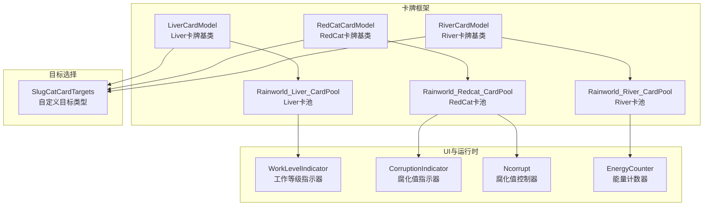
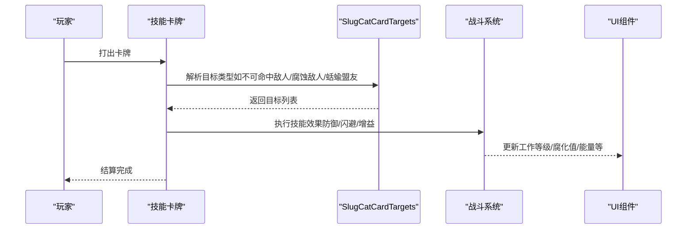
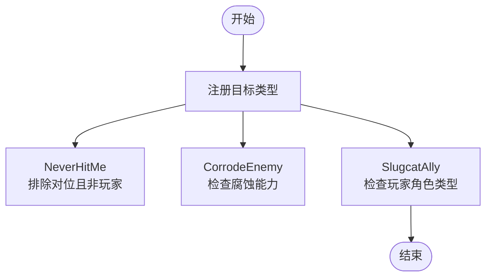
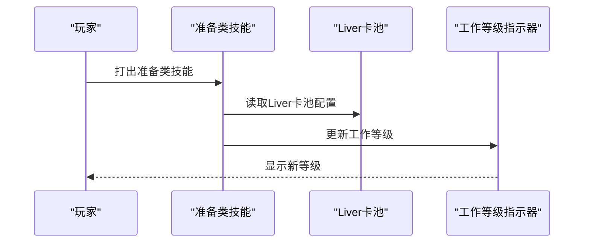
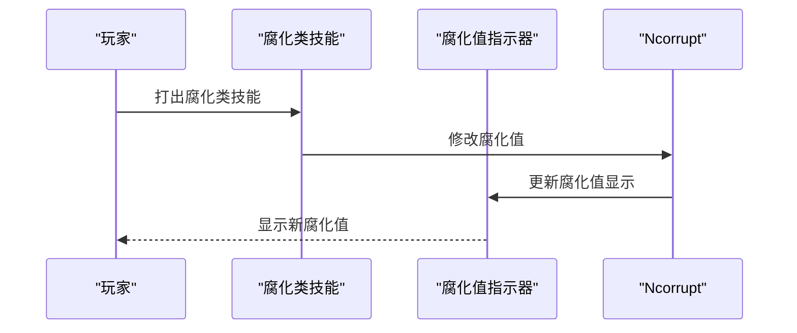
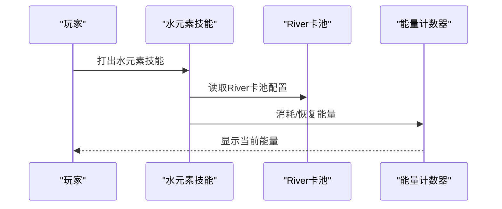
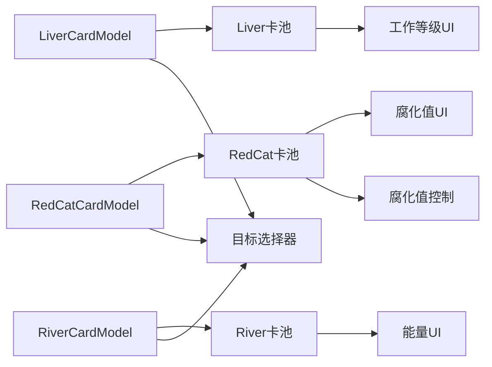

# 技能卡牌系统

<cite>
**本文引用的文件**
- [SlugCatCardTargets.cs](file://Scripts/Card/SlugCatCardTargets.cs)
- [LiverCardModel.cs](file://Scripts/Card/Liver/LiverCardModel.cs)
- [RedCatCardModel.cs](file://Scripts/Card/RedCat/RedCatCardModel.cs)
- [RiverCardModel.cs](file://Scripts/Card/River/RiverCardModel.cs)
- [Rainworld_Liver_CardPool.cs](file://Scripts/Card/Liver/Rainworld_Liver_CardPool.cs)
- [Rainworld_Redcat_CardPool.cs](file://Scripts/Card/RedCat/Rainworld_Redcat_CardPool.cs)
- [Rainworld_River_CardPool.cs](file://Scripts/Card/River/Rainworld_River_CardPool.cs)
- [WorkLevelIndicator.cs](file://Godot/CombatUI/WorkLevelIndicator.cs)
- [CorruptionIndicator.cs](file://Godot/CombatUI/CorruptionIndicator.cs)
- [Ncorrupt.cs](file://Godot/CombatUI/Ncorrupt.cs)
- [EnergyCounter.cs](file://Godot/SlugCatEnergyCounter/EnergyCounter.cs)
- [Rainworld_Liver_Prepare.cs](file://Scripts/Card/Liver/Skills/Rainworld_Liver_Prepare.cs)
- [Rainworld_Redcat_Corrupt.cs](file://Scripts/Card/RedCat/Skills/Rainworld_Redcat_Corrupt.cs)
- [Rainworld_River_Defend.cs](file://Scripts/Card/River/Skill/Rainworld_River_Defend.cs)
</cite>

## 目录
1. [简介](#简介)
2. [项目结构](#项目结构)
3. [核心组件](#核心组件)
4. [架构总览](#架构总览)
5. [详细组件分析](#详细组件分析)
6. [依赖关系分析](#依赖关系分析)
7. [性能考虑](#性能考虑)
8. [故障排查指南](#故障排查指南)
9. [结论](#结论)
10. [附录：开发指南与最佳实践](#附录开发指南与最佳实践)

## 简介
本文件为“技能卡牌系统”的开发文档，面向实现防御、闪避、增益等常见技能类型，并覆盖执行时机、持续效果与状态管理。同时记录角色独特机制（Liver的准备工作等级、RedCat的腐化值控制、River的水元素互动），说明与游戏系统的集成方式（UI显示、动画播放、音效触发），并提供完整开发指南与性能优化建议。

## 项目结构
本项目采用按角色分目录的组织方式，每个角色拥有独立的卡牌模型基类与卡池配置；通用目标选择逻辑集中在统一的目标注册器中；UI层提供工作等级、腐化值、能量等可视化组件。

图表来源
- [LiverCardModel.cs:14-38](file://Scripts/Card/Liver/LiverCardModel.cs#L14-L38)
- [RedCatCardModel.cs:13-39](file://Scripts/Card/RedCat/RedCatCardModel.cs#L13-L39)
- [RiverCardModel.cs:14-39](file://Scripts/Card/River/RiverCardModel.cs#L14-L39)
- [Rainworld_Liver_CardPool.cs:10-23](file://Scripts/Card/Liver/Rainworld_Liver_CardPool.cs#L10-L23)
- [Rainworld_Redcat_CardPool.cs:9-23](file://Scripts/Card/RedCat/Rainworld_Redcat_CardPool.cs#L9-L23)
- [Rainworld_River_CardPool.cs:11-26](file://Scripts/Card/River/Rainworld_River_CardPool.cs#L11-L26)
- [SlugCatCardTargets.cs:8-34](file://Scripts/Card/SlugCatCardTargets.cs#L8-L34)
- [WorkLevelIndicator.cs](file://Godot/CombatUI/WorkLevelIndicator.cs)
- [CorruptionIndicator.cs](file://Godot/CombatUI/CorruptionIndicator.cs)
- [Ncorrupt.cs](file://Godot/CombatUI/Ncorrupt.cs)
- [EnergyCounter.cs](file://Godot/SlugCatEnergyCounter/EnergyCounter.cs)

章节来源
- [LiverCardModel.cs:14-38](file://Scripts/Card/Liver/LiverCardModel.cs#L14-L38)
- [RedCatCardModel.cs:13-39](file://Scripts/Card/RedCat/RedCatCardModel.cs#L13-L39)
- [RiverCardModel.cs:14-39](file://Scripts/Card/River/RiverCardModel.cs#L14-L39)
- [Rainworld_Liver_CardPool.cs:10-23](file://Scripts/Card/Liver/Rainworld_Liver_CardPool.cs#L10-L23)
- [Rainworld_Redcat_CardPool.cs:9-23](file://Scripts/Card/RedCat/Rainworld_Redcat_CardPool.cs#L9-L23)
- [Rainworld_River_CardPool.cs:11-26](file://Scripts/Card/River/Rainworld_River_CardPool.cs#L11-L26)
- [SlugCatCardTargets.cs:8-34](file://Scripts/Card/SlugCatCardTargets.cs#L8-L34)

## 核心组件
- 卡牌模型基类：每个角色一个抽象基类，负责资源路径与卡框映射，便于统一外观与扩展。
- 卡池配置：定义角色专属卡池的标题、能量颜色、图标与是否无色牌等元数据。
- 目标选择器：集中注册自定义目标类型，供技能卡牌在结算时精准选择目标。
- UI组件：工作等级、腐化值、能量计数器等用于展示角色特有状态。

章节来源
- [LiverCardModel.cs:14-38](file://Scripts/Card/Liver/LiverCardModel.cs#L14-L38)
- [RedCatCardModel.cs:13-39](file://Scripts/Card/RedCat/RedCatCardModel.cs#L13-L39)
- [RiverCardModel.cs:14-39](file://Scripts/Card/River/RiverCardModel.cs#L14-L39)
- [Rainworld_Liver_CardPool.cs:10-23](file://Scripts/Card/Liver/Rainworld_Liver_CardPool.cs#L10-L23)
- [Rainworld_Redcat_CardPool.cs:9-23](file://Scripts/Card/RedCat/Rainworld_Redcat_CardPool.cs#L9-L23)
- [Rainworld_River_CardPool.cs:11-26](file://Scripts/Card/River/Rainworld_River_CardPool.cs#L11-L26)
- [SlugCatCardTargets.cs:8-34](file://Scripts/Card/SlugCatCardTargets.cs#L8-L34)

## 架构总览
技能卡牌通过各自角色的卡牌模型基类继承统一框架，使用卡池进行注册与展示；在执行阶段，卡牌调用目标选择器确定目标，随后根据技能类型执行即时或持续效果，并通过UI组件反馈状态变化。

图表来源
- [SlugCatCardTargets.cs:8-34](file://Scripts/Card/SlugCatCardTargets.cs#L8-L34)
- [WorkLevelIndicator.cs](file://Godot/CombatUI/WorkLevelIndicator.cs)
- [CorruptionIndicator.cs](file://Godot/CombatUI/CorruptionIndicator.cs)
- [Ncorrupt.cs](file://Godot/CombatUI/Ncorrupt.cs)
- [EnergyCounter.cs](file://Godot/SlugCatEnergyCounter/EnergyCounter.cs)

## 详细组件分析

### 目标选择器 SlugCatCardTargets
- 功能：注册三种自定义目标类型，供技能卡牌在结算时筛选目标。
- 关键点：
  - “不可命中敌人”：排除特定对位且非玩家单位。
  - “腐蚀敌人”：仅选择具备腐蚀能力的敌人。
  - “蛞蝓盟友”：仅选择玩家角色为蛞蝓的盟友。
- 适用场景：防御、闪避、增益等技能需要精确目标时。

图表来源
- [SlugCatCardTargets.cs:8-34](file://Scripts/Card/SlugCatCardTargets.cs#L8-L34)

章节来源
- [SlugCatCardTargets.cs:8-34](file://Scripts/Card/SlugCatCardTargets.cs#L8-L34)

### Liver 角色：准备工作等级
- 卡牌模型：LiverCardModel 提供统一的资源路径与卡框映射。
- 卡池：Rainworld_Liver_CardPool 定义Liver卡池的视觉与能量样式。
- 工作等级UI：WorkLevelIndicator 用于在工作等级相关技能中显示当前等级。
- 典型流程（以准备类技能为例）：
  - 打出准备类技能后，提升或锁定工作等级。
  - 后续攻击或技能根据工作等级获得额外收益。
  - UI实时更新工作等级指示。

图表来源
- [LiverCardModel.cs:14-38](file://Scripts/Card/Liver/LiverCardModel.cs#L14-L38)
- [Rainworld_Liver_CardPool.cs:10-23](file://Scripts/Card/Liver/Rainworld_Liver_CardPool.cs#L10-L23)
- [WorkLevelIndicator.cs](file://Godot/CombatUI/WorkLevelIndicator.cs)
- [Rainworld_Liver_Prepare.cs](file://Scripts/Card/Liver/Skills/Rainworld_Liver_Prepare.cs)

章节来源
- [LiverCardModel.cs:14-38](file://Scripts/Card/Liver/LiverCardModel.cs#L14-L38)
- [Rainworld_Liver_CardPool.cs:10-23](file://Scripts/Card/Liver/Rainworld_Liver_CardPool.cs#L10-L23)
- [WorkLevelIndicator.cs](file://Godot/CombatUI/WorkLevelIndicator.cs)
- [Rainworld_Liver_Prepare.cs](file://Scripts/Card/Liver/Skills/Rainworld_Liver_Prepare.cs)

### RedCat 角色：腐化值控制
- 卡牌模型：RedCatCardModel 提供统一的资源路径与卡框映射。
- 卡池：Rainworld_Redcat_CardPool 定义RedCat卡池的视觉与能量样式。
- 腐化值UI：CorruptionIndicator 与 Ncorrupt 共同维护腐化值的显示与控制。
- 典型流程（以腐化类技能为例）：
  - 打出腐化类技能，增加或调整腐化值。
  - 腐化值影响后续伤害、防御或特殊效果。
  - UI实时刷新腐化值指示。

图表来源
- [RedCatCardModel.cs:13-39](file://Scripts/Card/RedCat/RedCatCardModel.cs#L13-L39)
- [Rainworld_Redcat_CardPool.cs:9-23](file://Scripts/Card/RedCat/Rainworld_Redcat_CardPool.cs#L9-L23)
- [CorruptionIndicator.cs](file://Godot/CombatUI/CorruptionIndicator.cs)
- [Ncorrupt.cs](file://Godot/CombatUI/Ncorrupt.cs)
- [Rainworld_Redcat_Corrupt.cs](file://Scripts/Card/RedCat/Skills/Rainworld_Redcat_Corrupt.cs)

章节来源
- [RedCatCardModel.cs:13-39](file://Scripts/Card/RedCat/RedCatCardModel.cs#L13-L39)
- [Rainworld_Redcat_CardPool.cs:9-23](file://Scripts/Card/RedCat/Rainworld_Redcat_CardPool.cs#L9-L23)
- [CorruptionIndicator.cs](file://Godot/CombatUI/CorruptionIndicator.cs)
- [Ncorrupt.cs](file://Godot/CombatUI/Ncorrupt.cs)
- [Rainworld_Redcat_Corrupt.cs](file://Scripts/Card/RedCat/Skills/Rainworld_Redcat_Corrupt.cs)

### River 角色：水元素互动
- 卡牌模型：RiverCardModel 提供统一的资源路径与卡框映射。
- 卡池：Rainworld_River_CardPool 定义River卡池的视觉与能量样式。
- 能量UI：EnergyCounter 用于显示与管理能量。
- 典型流程（以水元素防御/增益为例）：
  - 打出水元素技能，可能生成护盾或临时增益。
  - 与其他水元素效果联动，形成连锁反应。
  - 能量消耗与恢复由能量计数器管理。

图表来源
- [RiverCardModel.cs:14-39](file://Scripts/Card/River/RiverCardModel.cs#L14-L39)
- [Rainworld_River_CardPool.cs:11-26](file://Scripts/Card/River/Rainworld_River_CardPool.cs#L11-L26)
- [EnergyCounter.cs](file://Godot/SlugCatEnergyCounter/EnergyCounter.cs)
- [Rainworld_River_Defend.cs](file://Scripts/Card/River/Skill/Rainworld_River_Defend.cs)

章节来源
- [RiverCardModel.cs:14-39](file://Scripts/Card/River/RiverCardModel.cs#L14-L39)
- [Rainworld_River_CardPool.cs:11-26](file://Scripts/Card/River/Rainworld_River_CardPool.cs#L11-L26)
- [EnergyCounter.cs](file://Godot/SlugCatEnergyCounter/EnergyCounter.cs)
- [Rainworld_River_Defend.cs](file://Scripts/Card/River/Skill/Rainworld_River_Defend.cs)

### 技能类型与执行时机
- 防御类：在受到伤害前或回合开始时提供护盾或减伤，通常结合目标选择器确保只对正确目标生效。
- 闪避类：在敌方行动阶段规避伤害或位移，常配合工作等级或环境状态。
- 增益类：在回合开始或结束时施加持续效果（如攻击力提升、能量恢复、状态免疫）。
- 持续效果：通过状态或能力持久化到后续回合，需与UI同步更新。

章节来源
- [SlugCatCardTargets.cs:8-34](file://Scripts/Card/SlugCatCardTargets.cs#L8-L34)
- [WorkLevelIndicator.cs](file://Godot/CombatUI/WorkLevelIndicator.cs)
- [CorruptionIndicator.cs](file://Godot/CombatUI/CorruptionIndicator.cs)
- [Ncorrupt.cs](file://Godot/CombatUI/Ncorrupt.cs)
- [EnergyCounter.cs](file://Godot/SlugCatEnergyCounter/EnergyCounter.cs)

## 依赖关系分析
- 卡牌模型依赖卡池配置以获取资源与样式。
- 技能卡牌依赖目标选择器进行目标筛选。
- UI组件依赖运行时状态（工作等级、腐化值、能量）进行显示。
- 各角色模块相对独立，耦合度低，便于扩展与维护。

图表来源
- [LiverCardModel.cs:14-38](file://Scripts/Card/Liver/LiverCardModel.cs#L14-L38)
- [RedCatCardModel.cs:13-39](file://Scripts/Card/RedCat/RedCatCardModel.cs#L13-L39)
- [RiverCardModel.cs:14-39](file://Scripts/Card/River/RiverCardModel.cs#L14-L39)
- [Rainworld_Liver_CardPool.cs:10-23](file://Scripts/Card/Liver/Rainworld_Liver_CardPool.cs#L10-L23)
- [Rainworld_Redcat_CardPool.cs:9-23](file://Scripts/Card/RedCat/Rainworld_Redcat_CardPool.cs#L9-L23)
- [Rainworld_River_CardPool.cs:11-26](file://Scripts/Card/River/Rainworld_River_CardPool.cs#L11-L26)
- [SlugCatCardTargets.cs:8-34](file://Scripts/Card/SlugCatCardTargets.cs#L8-L34)
- [WorkLevelIndicator.cs](file://Godot/CombatUI/WorkLevelIndicator.cs)
- [CorruptionIndicator.cs](file://Godot/CombatUI/CorruptionIndicator.cs)
- [Ncorrupt.cs](file://Godot/CombatUI/Ncorrupt.cs)
- [EnergyCounter.cs](file://Godot/SlugCatEnergyCounter/EnergyCounter.cs)

章节来源
- [LiverCardModel.cs:14-38](file://Scripts/Card/Liver/LiverCardModel.cs#L14-L38)
- [RedCatCardModel.cs:13-39](file://Scripts/Card/RedCat/RedCatCardModel.cs#L13-L39)
- [RiverCardModel.cs:14-39](file://Scripts/Card/River/RiverCardModel.cs#L14-L39)
- [Rainworld_Liver_CardPool.cs:10-23](file://Scripts/Card/Liver/Rainworld_Liver_CardPool.cs#L10-L23)
- [Rainworld_Redcat_CardPool.cs:9-23](file://Scripts/Card/RedCat/Rainworld_Redcat_CardPool.cs#L9-L23)
- [Rainworld_River_CardPool.cs:11-26](file://Scripts/Card/River/Rainworld_River_CardPool.cs#L11-L26)
- [SlugCatCardTargets.cs:8-34](file://Scripts/Card/SlugCatCardTargets.cs#L8-L34)

## 性能考虑
- 目标选择器缓存：避免每帧重复计算目标条件，可在回合开始时批量计算并缓存结果。
- UI更新节流：将工作等级、腐化值、能量的UI更新合并到固定帧率或事件驱动，减少频繁重绘。
- 资源路径复用：卡牌模型统一资源路径映射，减少重复字符串拼接与查找开销。
- 状态同步最小化：仅在状态变化时推送UI更新，避免无意义的渲染。

[本节为通用性能建议，不直接分析具体文件]

## 故障排查指南
- 目标选择异常：
  - 检查自定义目标类型的注册是否正确，确认过滤条件符合预期。
  - 核对对位关系与玩家角色判断逻辑。
- UI未更新：
  - 确认工作等级、腐化值、能量等状态变更已通知对应UI组件。
  - 检查UI组件的生命周期与绑定是否正确。
- 卡牌资源加载失败：
  - 校验卡牌模型中的资源路径是否与实际文件一致。
  - 确认卡池配置的标题与能量颜色名称与本地化资源匹配。

章节来源
- [SlugCatCardTargets.cs:8-34](file://Scripts/Card/SlugCatCardTargets.cs#L8-L34)
- [WorkLevelIndicator.cs](file://Godot/CombatUI/WorkLevelIndicator.cs)
- [CorruptionIndicator.cs](file://Godot/CombatUI/CorruptionIndicator.cs)
- [Ncorrupt.cs](file://Godot/CombatUI/Ncorrupt.cs)
- [EnergyCounter.cs](file://Godot/SlugCatEnergyCounter/EnergyCounter.cs)
- [LiverCardModel.cs:14-38](file://Scripts/Card/Liver/LiverCardModel.cs#L14-L38)
- [RedCatCardModel.cs:13-39](file://Scripts/Card/RedCat/RedCatCardModel.cs#L13-L39)
- [RiverCardModel.cs:14-39](file://Scripts/Card/River/RiverCardModel.cs#L14-L39)

## 结论
技能卡牌系统通过角色化的卡牌模型与卡池配置实现了清晰的模块化架构；目标选择器提供了灵活而精确的目标筛选能力；UI组件与工作等级、腐化值、能量等状态紧密集成，保证了良好的用户体验。按照本文档的开发指南与最佳实践，可高效扩展新的技能类型与角色机制。

[本节为总结性内容，不直接分析具体文件]

## 附录：开发指南与最佳实践
- 新增技能步骤：
  - 在对应角色的 Skills 目录下创建新脚本，继承该角色的卡牌模型基类。
  - 在卡池配置中注册新卡牌，设置能量消耗、稀有度与目标类型。
  - 如需自定义目标，使用目标选择器注册新的目标类型并在技能中调用。
  - 若涉及状态变化，确保更新对应的UI组件（工作等级、腐化值、能量）。
- 复杂效果实现：
  - 将复合效果拆分为多个小步骤，逐步应用并记录日志以便调试。
  - 使用能力或状态对象承载持续效果，并在回合结束时清理。
- 动画与音效：
  - 在技能执行的关键节点触发动画与音效，确保与UI更新顺序一致。
  - 避免在同一帧内触发过多特效，必要时进行队列化处理。
- 性能优化：
  - 批量处理目标选择与状态更新，减少每帧计算量。
  - 复用资源路径与材质，降低内存占用。
  - 对高频UI更新进行节流或合并。

[本节为通用开发指导，不直接分析具体文件]