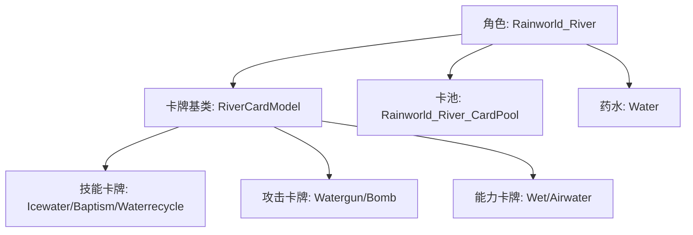
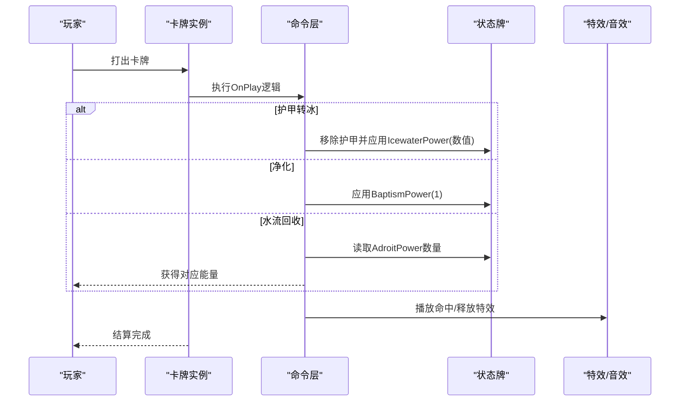
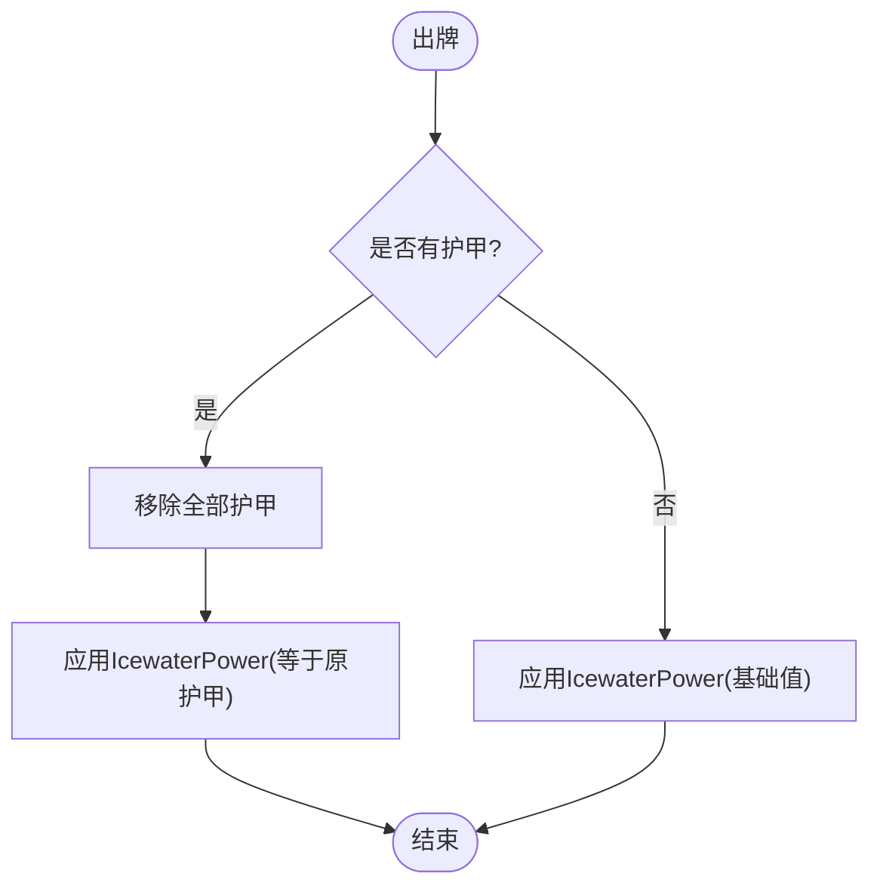
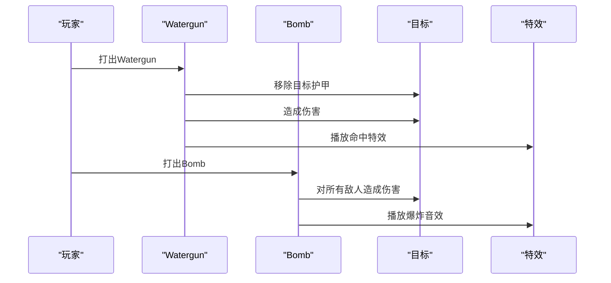
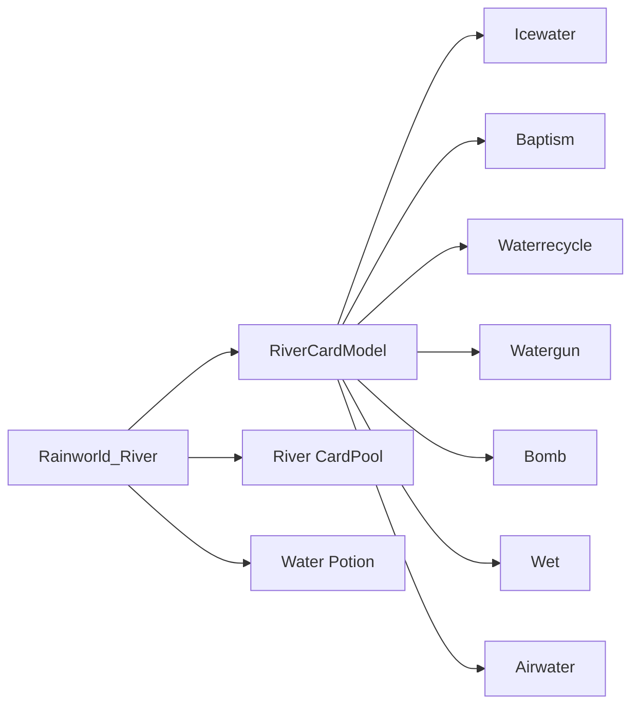

# 河流角色技能卡牌

<cite>
**本文引用的文件**
- [Rainworld_River.cs](file://Scripts/Slugcat/Rainworld_River.cs)
- [RiverCardModel.cs](file://Scripts/Card/River/RiverCardModel.cs)
- [Rainworld_River_CardPool.cs](file://Scripts/Card/River/Rainworld_River_CardPool.cs)
- [Rainworld_River_Icewater.cs](file://Scripts/Card/River/Skill/Rainworld_River_Icewater.cs)
- [Rainworld_River_Baptism.cs](file://Scripts/Card/River/Skill/Rainworld_River_Baptism.cs)
- [Rainworld_River_Waterrecycle.cs](file://Scripts/Card/River/Skill/Rainworld_River_Waterrecycle.cs)
- [Rainworld_River_Watergun.cs](file://Scripts/Card/River/Attack/Rainworld_River_Watergun.cs)
- [Rainworld_River_Bomb.cs](file://Scripts/Card/River/Attack/Rainworld_River_Bomb.cs)
- [Rainworld_River_Wet.cs](file://Scripts/Card/River/Power/Rainworld_River_Wet.cs)
- [Rainworld_River_Airwater.cs](file://Scripts/Card/River/Power/Rainworld_River_Airwater.cs)
- [Water.cs](file://Scripts/Potions/Water.cs)
</cite>

## 目录
1. [简介](#简介)
2. [项目结构](#项目结构)
3. [核心组件](#核心组件)
4. [架构总览](#架构总览)
5. [详细组件分析](#详细组件分析)
6. [依赖关系分析](#依赖关系分析)
7. [性能考量](#性能考量)
8. [故障排查指南](#故障排查指南)
9. [结论](#结论)
10. [附录：开发指南](#附录：开发指南)

## 简介
本文件为“河流”角色的技能卡牌系统提供完整的技术与玩法文档。围绕水元素主题，文档说明以下要点：
- 水元素互动机制：水的生成、消耗与转化（如将护甲转化为持续增益、通过状态牌联动回能等）。
- 河流角色独特能力：冰冻（护甲转冰）、净化（多人生存向）、水流操控（护甲削减、范围伤害、能量回收）等。
- 开发指南：水元素状态管理、视觉效果集成、性能优化策略与扩展建议。

## 项目结构
河流角色相关代码主要分布在以下位置：
- 角色定义与资源装配：Scripts/Slugcat/Rainworld_River.cs
- 卡牌基类与卡池：Scripts/Card/River/RiverCardModel.cs、Scripts/Card/River/Rainworld_River_CardPool.cs
- 技能/攻击/能力卡牌：Scripts/Card/River/{Skill, Attack, Power}/*
- 药水：Scripts/Potions/Water.cs

图表来源
- [Rainworld_River.cs:31-105](file://Scripts/Slugcat/Rainworld_River.cs#L31-L105)
- [RiverCardModel.cs:14-39](file://Scripts/Card/River/RiverCardModel.cs#L14-L39)
- [Rainworld_River_CardPool.cs:11-26](file://Scripts/Card/River/Rainworld_River_CardPool.cs#L11-L26)
- [Water.cs:20-53](file://Scripts/Potions/Water.cs#L20-L53)

章节来源
- [Rainworld_River.cs:31-105](file://Scripts/Slugcat/Rainworld_River.cs#L31-L105)
- [RiverCardModel.cs:14-39](file://Scripts/Card/River/RiverCardModel.cs#L14-L39)
- [Rainworld_River_CardPool.cs:11-26](file://Scripts/Card/River/Rainworld_River_CardPool.cs#L11-L26)

## 核心组件
- 角色入口：Rainworld_River 负责角色资源、初始卡组、起始遗物、动画延迟与UI颜色等配置。
- 卡牌基类：RiverCardModel 统一处理卡牌资源路径与类型化卡框。
- 卡池：Rainworld_River_CardPool 定义河流卡池的视觉与能量图标。
- 水元素状态牌：IcewaterPower、AdroitPower、CorrodePower 等由卡牌或药水应用，驱动水元素效果。
- 药水：Water 对友方施加腐蚀与灵巧等状态，体现“水”的辅助与转化特性。

章节来源
- [Rainworld_River.cs:31-105](file://Scripts/Slugcat/Rainworld_River.cs#L31-L105)
- [RiverCardModel.cs:14-39](file://Scripts/Card/River/RiverCardModel.cs#L14-L39)
- [Rainworld_River_CardPool.cs:11-26](file://Scripts/Card/River/Rainworld_River_CardPool.cs#L11-L26)
- [Water.cs:20-53](file://Scripts/Potions/Water.cs#L20-L53)

## 架构总览
河流角色的水元素体系以“卡牌→状态牌→战斗效果”为主线，辅以药水作为全局状态注入。典型流程如下：

图表来源
- [Rainworld_River_Icewater.cs:34-48](file://Scripts/Card/River/Skill/Rainworld_River_Icewater.cs#L34-L48)
- [Rainworld_River_Baptism.cs:26-30](file://Scripts/Card/River/Skill/Rainworld_River_Baptism.cs#L26-L30)
- [Rainworld_River_Waterrecycle.cs:29-37](file://Scripts/Card/River/Skill/Rainworld_River_Waterrecycle.cs#L29-L37)
- [Rainworld_River_Watergun.cs:28-38](file://Scripts/Card/River/Attack/Rainworld_River_Watergun.cs#L28-L38)
- [Rainworld_River_Bomb.cs:55-63](file://Scripts/Card/River/Attack/Rainworld_River_Bomb.cs#L55-L63)

## 详细组件分析

### 水元素状态与转化：冰冻（Icewater）
- 设计意图：将当前护甲转化为更强的持续防御（冰冻），体现“水凝成冰”的转化。
- 关键行为：
  - 若目标有护甲，则移除全部护甲，并将该数值作为参数应用到 IcewaterPower。
  - 若无护甲，直接按基础值应用 IcewaterPower。
  - 升级时提升护甲转化基数。
- 交互提示：通过附加悬停提示指向 IcewaterPower。

图表来源
- [Rainworld_River_Icewater.cs:21-53](file://Scripts/Card/River/Skill/Rainworld_River_Icewater.cs#L21-L53)

章节来源
- [Rainworld_River_Icewater.cs:21-53](file://Scripts/Card/River/Skill/Rainworld_River_Icewater.cs#L21-L53)

### 净化（Baptism）：多人生存向
- 设计意图：在多人模式中提供生存保障，体现“净化”的水之庇护。
- 关键行为：
  - 仅可在多人模式使用。
  - 应用 BaptismPower(1)。
  - 升级后移除“耗尽”关键词，增强可用性。

章节来源
- [Rainworld_River_Baptism.cs:10-36](file://Scripts/Card/River/Skill/Rainworld_River_Baptism.cs#L10-L36)

### 水流操控：护甲削减与范围伤害
- 护甲削减攻击（Watergun）：
  - 对单体敌人先移除其护甲，再造成伤害，体现“冲刷”。
  - 升级提升伤害。
- 范围爆炸（Bomb）：
  - 对所有敌人造成范围伤害，附带自定义音效。
  - 升级提升伤害。

图表来源
- [Rainworld_River_Watergun.cs:19-43](file://Scripts/Card/River/Attack/Rainworld_River_Watergun.cs#L19-L43)
- [Rainworld_River_Bomb.cs:19-69](file://Scripts/Card/River/Attack/Rainworld_River_Bomb.cs#L19-L69)

章节来源
- [Rainworld_River_Watergun.cs:19-43](file://Scripts/Card/River/Attack/Rainworld_River_Watergun.cs#L19-L43)
- [Rainworld_River_Bomb.cs:19-69](file://Scripts/Card/River/Attack/Rainworld_River_Bomb.cs#L19-L69)

### 能量回收：水流循环（Waterrecycle）
- 设计意图：将“灵巧”（AdroitPower）转化为能量，体现“水循环”的回流。
- 关键行为：
  - 检测自身是否拥有 AdroitPower，若有且数量大于0，则获得相应能量。
  - 升级降低费用。

章节来源
- [Rainworld_River_Waterrecycle.cs:12-43](file://Scripts/Card/River/Skill/Rainworld_River_Waterrecycle.cs#L12-L43)

### 能力牌：湿（Wet）与空气水（Airwater）
- 湿（Wet）：
  - 应用 WetPower(1)，用于后续与水元素联动的状态标记。
  - 升级降低费用。
- 空气水（Airwater）：
  - 应用 AirwaterPower(1)，可能用于环境/机动性相关的持续效果。
  - 升级降低费用。

章节来源
- [Rainworld_River_Wet.cs:11-32](file://Scripts/Card/River/Power/Rainworld_River_Wet.cs#L11-L32)
- [Rainworld_River_Airwater.cs:10-31](file://Scripts/Card/River/Power/Rainworld_River_Airwater.cs#L10-L31)

### 药水：水（Water）
- 设计意图：为友方提供腐蚀与灵巧，体现“水”的侵蚀与润滑作用。
- 关键行为：
  - 对目标施加 CorrodePower(10)。
  - 若目标是玩家，额外施加 AdroitPower(3)。
  - 悬停提示同时展示多个关联状态牌。

章节来源
- [Water.cs:20-53](file://Scripts/Potions/Water.cs#L20-L53)

## 依赖关系分析
- 角色依赖：
  - 角色定义引用了攻击/技能/能力卡牌类型，构成初始卡组。
  - 角色定义了场景、UI、音频等资源路径。
- 卡牌依赖：
  - 所有河流卡牌继承自 RiverCardModel，统一资源与卡框。
  - 卡牌通过命令层调用状态牌，形成“卡牌→状态牌→效果”的解耦链路。
- 卡池依赖：
  - 卡池提供统一的能量图标与卡框材质，便于主题化呈现。

图表来源
- [Rainworld_River.cs:89-96](file://Scripts/Slugcat/Rainworld_River.cs#L89-L96)
- [RiverCardModel.cs:14-39](file://Scripts/Card/River/RiverCardModel.cs#L14-L39)
- [Rainworld_River_CardPool.cs:11-26](file://Scripts/Card/River/Rainworld_River_CardPool.cs#L11-L26)
- [Water.cs:20-53](file://Scripts/Potions/Water.cs#L20-L53)

章节来源
- [Rainworld_River.cs:89-96](file://Scripts/Slugcat/Rainworld_River.cs#L89-L96)
- [RiverCardModel.cs:14-39](file://Scripts/Card/River/RiverCardModel.cs#L14-L39)
- [Rainworld_River_CardPool.cs:11-26](file://Scripts/Card/River/Rainworld_River_CardPool.cs#L11-L26)
- [Water.cs:20-53](file://Scripts/Potions/Water.cs#L20-L53)

## 性能考量
- 特效与音效：
  - 攻击与范围伤害使用命中特效与音效，注意控制频率与对象复用，避免每帧创建新对象。
- 状态牌数量：
  - 大量状态牌会提高每回合扫描成本，建议合并同类状态或使用批处理更新。
- 动态变量与升级：
  - 升级仅在 OnUpgrade 中调整数值，避免在每回合重复计算。
- 资源加载：
  - 卡牌图片与卡框路径集中管理，减少运行时查找开销。

[本节为通用指导，不直接分析具体文件]

## 故障排查指南
- 卡片未生效：
  - 检查 OnPlay 是否正确调用命令层（DamageCmd/PlayerCmd/CreatureCmd/PowerCmd）。
  - 确认目标存在且满足条件（例如多人模式限制）。
- 状态牌未显示或数值异常：
  - 核对 Applied 的 Amount 是否与预期一致（如 Icewater 的护甲转移逻辑）。
  - 检查悬停提示是否绑定到正确的状态牌类型。
- 资源缺失：
  - 确认卡牌图片、卡框、音效路径是否存在并可被引擎加载。
  - 本地化图片回退逻辑需保证默认资源可用。

章节来源
- [Rainworld_River_Icewater.cs:34-48](file://Scripts/Card/River/Skill/Rainworld_River_Icewater.cs#L34-L48)
- [Rainworld_River_Bomb.cs:31-45](file://Scripts/Card/River/Attack/Rainworld_River_Bomb.cs#L31-L45)
- [Water.cs:45-53](file://Scripts/Potions/Water.cs#L45-L53)

## 结论
河流角色的水元素体系通过“护甲转化、净化、水流操控与能量回收”四大方向构建差异化玩法。卡牌与状态牌解耦清晰，配合药水可快速扩展水主题组合。建议在后续迭代中：
- 完善状态牌的可视化与提示，强化“水”的主题表达。
- 引入更多连锁反应（如水→冰→蒸汽）以提升策略深度。
- 优化特效与状态牌批处理，确保高并发下的稳定表现。

[本节为总结，不直接分析具体文件]

## 附录：开发指南

### 水元素状态管理
- 状态牌命名与职责：
  - IcewaterPower：冻结护甲，提供持续防御。
  - AdroitPower：灵巧，影响抽牌/能量等机制。
  - CorrodePower：腐蚀，对敌人造成持续伤害或削弱。
  - WetPower/AirwaterPower：环境与机动性相关状态。
- 生命周期：
  - 通过 PowerCmd.Apply 在出牌或用药水时应用。
  - 在状态牌内部实现每回合更新逻辑（如扣血、增能、改抽牌等）。
- 调试建议：
  - 在关键节点输出日志（应用前/后数值）。
  - 使用悬停提示展示当前状态牌详情。

章节来源
- [Rainworld_River_Icewater.cs:21-53](file://Scripts/Card/River/Skill/Rainworld_River_Icewater.cs#L21-L53)
- [Water.cs:45-53](file://Scripts/Potions/Water.cs#L45-L53)

### 视觉效果集成
- 命中特效：
  - 攻击类卡牌通过 WithHitFx 指定命中特效，保持风格统一。
- 音效：
  - 范围伤害使用自定义音效增强打击感。
- 资源路径：
  - 卡牌图片与卡框路径集中在基类或单卡覆盖，便于维护。

章节来源
- [Rainworld_River_Watergun.cs:28-38](file://Scripts/Card/River/Attack/Rainworld_River_Watergun.cs#L28-L38)
- [Rainworld_River_Bomb.cs:55-63](file://Scripts/Card/River/Attack/Rainworld_River_Bomb.cs#L55-L63)
- [RiverCardModel.cs:18-33](file://Scripts/Card/River/RiverCardModel.cs#L18-L33)

### 性能优化策略
- 对象复用：
  - 特效与音效尽量复用，避免频繁分配。
- 批量更新：
  - 将同类型状态牌更新合并，减少每回合遍历次数。
- 资源预加载：
  - 将常用图片与音效提前加载，减少运行时卡顿。

[本节为通用指导，不直接分析具体文件]