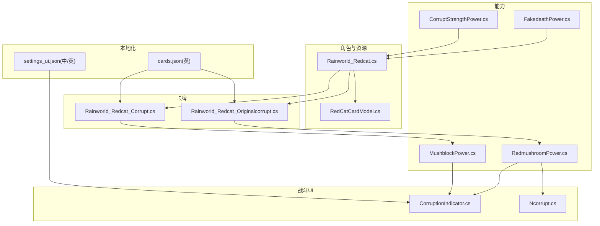
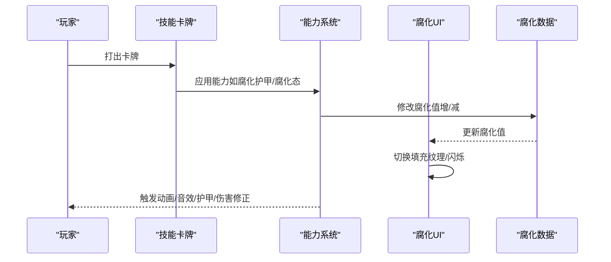
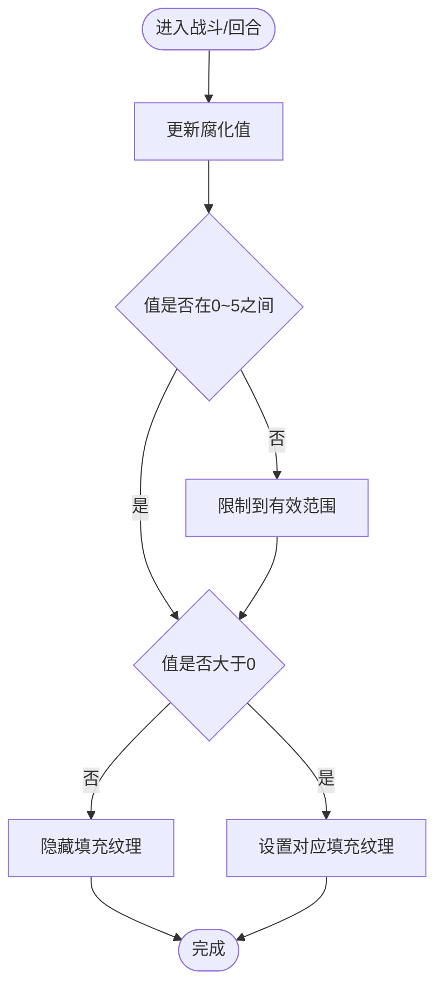
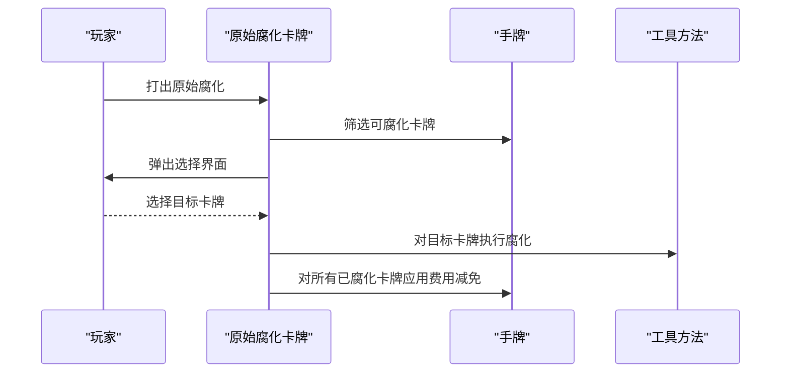
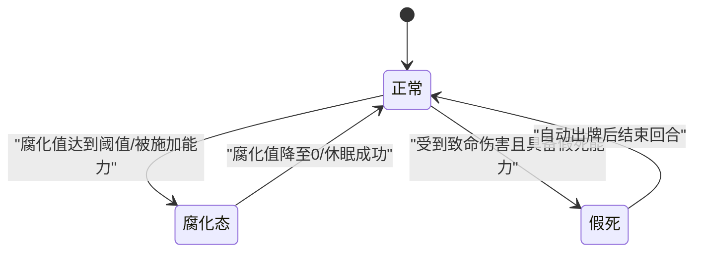
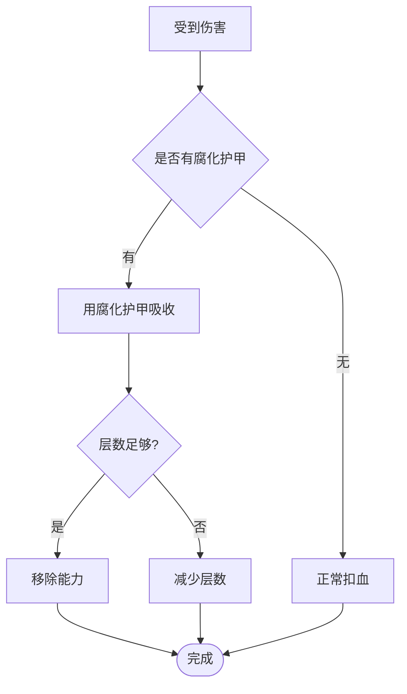
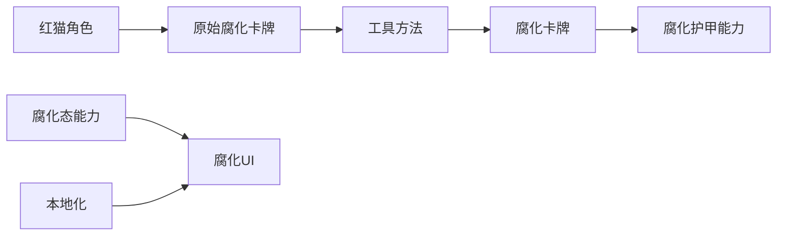

# 红猫角色技能卡牌

<cite>
**本文引用的文件**
- [Rainworld_Redcat.cs](file://Scripts/Slugcat/Rainworld_Redcat.cs)
- [RedCatCardModel.cs](file://Scripts/Card/RedCat/RedCatCardModel.cs)
- [CorruptionIndicator.cs](file://Godot/CombatUI/CorruptionIndicator.cs)
- [Ncorrupt.cs](file://Godot/CombatUI/Ncorrupt.cs)
- [Rainworld_Redcat_Corrupt.cs](file://Scripts/Card/RedCat/Skills/Rainworld_Redcat_Corrupt.cs)
- [Rainworld_Redcat_Originalcorrupt.cs](file://Scripts/Card/RedCat/Skills/Rainworld_Redcat_Originalcorrupt.cs)
- [RedmushroomPower.cs](file://Scripts/Powers/RedCat/RedmushroomPower.cs)
- [MushblockPower.cs](file://Scripts/Powers/RedCat/MushblockPower.cs)
- [FakedeathPower.cs](file://Scripts/Powers/RedCat/FakedeathPower.cs)
- [CorruptStrengthPower.cs](file://Scripts/Powers/RedCat/CorruptStrengthPower.cs)
- [settings_ui.json（英文）](file://SlugcatTheSpireII/localization/eng/settings_ui.json)
- [settings_ui.json（中文）](file://SlugcatTheSpireII/localization/zhs/settings_ui.json)
- [cards.json（英文）](file://SlugcatTheSpireII/localization/eng/cards.json)
</cite>

## 目录
1. [简介](#简介)
2. [项目结构](#项目结构)
3. [核心组件](#核心组件)
4. [架构总览](#架构总览)
5. [详细组件分析](#详细组件分析)
6. [依赖关系分析](#依赖关系分析)
7. [性能与实现建议](#性能与实现建议)
8. [故障排查指南](#故障排查指南)
9. [结论](#结论)
10. [附录：开发指南](#附录：开发指南)

## 简介
本文件为“红猫”角色的技能卡牌系统提供完整技术文档，重点说明其独特的“腐化值”控制机制、腐化相关技能卡牌的实现原理、以及形态转换与腐蚀效果等高级能力。文档同时给出复杂状态管理、UI反馈与动画集成的开发指南，帮助开发者快速理解并扩展该系统的行为。

## 项目结构
红猫角色在项目中以角色类、卡牌模型、能力（Power）、战斗UI组件和国际化资源组织：
- 角色定义：包含初始牌组、资源属性、视觉与音频配置
- 卡牌基类：统一红猫卡牌的资产与卡框设置
- 腐化相关技能：腐化、原始腐化等卡牌逻辑
- 能力体系：腐化态、腐化护甲、假死、腐化力量等
- 战斗UI：腐化值指示器与动态纹理切换
- 本地化：腐化提示、卡牌描述等文本

图表来源
- [Rainworld_Redcat.cs:29-105](file://Scripts/Slugcat/Rainworld_Redcat.cs#L29-L105)
- [RedCatCardModel.cs:13-33](file://Scripts/Card/RedCat/RedCatCardModel.cs#L13-L33)
- [Rainworld_Redcat_Corrupt.cs:18-74](file://Scripts/Card/RedCat/Skills/Rainworld_Redcat_Corrupt.cs#L18-L74)
- [Rainworld_Redcat_Originalcorrupt.cs:11-45](file://Scripts/Card/RedCat/Skills/Rainworld_Redcat_Originalcorrupt.cs#L11-L45)
- [RedmushroomPower.cs:32-94](file://Scripts/Powers/RedCat/RedmushroomPower.cs#L32-L94)
- [MushblockPower.cs:27-61](file://Scripts/Powers/RedCat/MushblockPower.cs#L27-L61)
- [FakedeathPower.cs:26-115](file://Scripts/Powers/RedCat/FakedeathPower.cs#L26-L115)
- [CorruptionIndicator.cs:12-148](file://Godot/CombatUI/CorruptionIndicator.cs#L12-L148)
- [Ncorrupt.cs:4-78](file://Godot/CombatUI/Ncorrupt.cs#L4-L78)
- [settings_ui.json（中文）:10-13](file://SlugcatTheSpireII/localization/zhs/settings_ui.json#L10-L13)
- [settings_ui.json（英文）:10-13](file://SlugcatTheSpireII/localization/eng/settings_ui.json#L10-L13)
- [cards.json（英文）:294-300](file://SlugcatTheSpireII/localization/eng/cards.json#L294-L300)

章节来源
- [Rainworld_Redcat.cs:29-105](file://Scripts/Slugcat/Rainworld_Redcat.cs#L29-L105)
- [RedCatCardModel.cs:13-33](file://Scripts/Card/RedCat/RedCatCardModel.cs#L13-L33)

## 核心组件
- 红猫角色：定义起始生命、金币、饱食度、工作等级等；配置初始牌组（含“原始腐化”）；绑定角色场景、能量计数器、商店与休息点动画；设置颜色与特效。
- 红猫卡牌基类：统一卡牌资源路径与卡框选择（攻击/技能/能力）。
- 腐化值UI：腐化指示器根据当前腐化值显示不同填充纹理，支持闪烁与悬浮提示；辅助节点用于切换图片与透明度。
- 腐化能力：非腐化卡牌打出后减少腐化值；进入腐化态时获得护甲、触发动画与音效；退出腐化态时将腐化护甲转为格挡并移除相关能力。
- 腐化护甲：吸收伤害，按层数抵扣直至移除。
- 假死能力：免疫致命伤害，自动出牌并结束回合。
- 腐化力量：在特定条件下增强伤害。

章节来源
- [Rainworld_Redcat.cs:32-105](file://Scripts/Slugcat/Rainworld_Redcat.cs#L32-L105)
- [RedCatCardModel.cs:13-33](file://Scripts/Card/RedCat/RedCatCardModel.cs#L13-L33)
- [CorruptionIndicator.cs:12-148](file://Godot/CombatUI/CorruptionIndicator.cs#L12-L148)
- [Ncorrupt.cs:4-78](file://Godot/CombatUI/Ncorrupt.cs#L4-L78)
- [RedmushroomPower.cs:32-94](file://Scripts/Powers/RedCat/RedmushroomPower.cs#L32-L94)
- [MushblockPower.cs:27-61](file://Scripts/Powers/RedCat/MushblockPower.cs#L27-L61)
- [FakedeathPower.cs:26-115](file://Scripts/Powers/RedCat/FakedeathPower.cs#L26-L115)
- [CorruptStrengthPower.cs:27-51](file://Scripts/Powers/RedCat/CorruptStrengthPower.cs#L27-L51)

## 架构总览
红猫的核心循环围绕“腐化值”展开：通过腐化相关卡牌增加或减少腐化值，配合能力改变战斗行为与数值。腐化值达到阈值会进入“腐化态”，提供额外防御与特殊效果；离开腐化态时进行资源转换。

图表来源
- [Rainworld_Redcat_Corrupt.cs:70-74](file://Scripts/Card/RedCat/Skills/Rainworld_Redcat_Corrupt.cs#L70-L74)
- [Rainworld_Redcat_Originalcorrupt.cs:30-45](file://Scripts/Card/RedCat/Skills/Rainworld_Redcat_Originalcorrupt.cs#L30-L45)
- [RedmushroomPower.cs:44-69](file://Scripts/Powers/RedCat/RedmushroomPower.cs#L44-L69)
- [CorruptionIndicator.cs:135-148](file://Godot/CombatUI/CorruptionIndicator.cs#L135-L148)

## 详细组件分析

### 腐化值与UI
- 腐化值上限为5，UI根据当前值选择对应填充纹理，并在高腐化时闪烁提示。
- 悬浮提示读取当前腐化值并展示。
- 辅助节点可切换图片索引、透明度和恢复显示。

图表来源
- [CorruptionIndicator.cs:33-148](file://Godot/CombatUI/CorruptionIndicator.cs#L33-L148)
- [Ncorrupt.cs:22-78](file://Godot/CombatUI/Ncorrupt.cs#L22-L78)

章节来源
- [CorruptionIndicator.cs:12-148](file://Godot/CombatUI/CorruptionIndicator.cs#L12-L148)
- [Ncorrupt.cs:4-78](file://Godot/CombatUI/Ncorrupt.cs#L4-L78)
- [settings_ui.json（中文）:10-13](file://SlugcatTheSpireII/localization/zhs/settings_ui.json#L10-L13)
- [settings_ui.json（英文）:10-13](file://SlugcatTheSpireII/localization/eng/settings_ui.json#L10-L13)

### 腐化相关技能卡牌
- 腐化（技能）：赋予“腐化护甲”（数量由动态变量计算），用于吸收伤害。
- 原始腐化（技能）：从手牌中选择一张非腐化且无免疫关键词的卡牌进行腐化；本回合内所有已腐化卡牌下次打出费用-1；升级后保留关键词。

图表来源
- [Rainworld_Redcat_Originalcorrupt.cs:30-45](file://Scripts/Card/RedCat/Skills/Rainworld_Redcat_Originalcorrupt.cs#L30-L45)
- [cards.json（英文）:294-296](file://SlugcatTheSpireII/localization/eng/cards.json#L294-L296)

章节来源
- [Rainworld_Redcat_Corrupt.cs:18-74](file://Scripts/Card/RedCat/Skills/Rainworld_Redcat_Corrupt.cs#L18-L74)
- [Rainworld_Redcat_Originalcorrupt.cs:11-45](file://Scripts/Card/RedCat/Skills/Rainworld_Redcat_Originalcorrupt.cs#L11-L45)
- [cards.json（英文）:294-300](file://SlugcatTheSpireII/localization/eng/cards.json#L294-L300)

### 腐化态能力（红蘑菇）
- 非腐化卡牌打出后减少1点腐化值。
- 进入腐化态：触发角色动画、播放音效、获得腐化护甲；若处于假死/睡眠则抑制受伤动画。
- 退出腐化态：将腐化护甲全部转换为格挡，移除腐化护甲与腐化力量（除非具备特定能力）。

图表来源
- [RedmushroomPower.cs:44-94](file://Scripts/Powers/RedCat/RedmushroomPower.cs#L44-L94)
- [FakedeathPower.cs:53-93](file://Scripts/Powers/RedCat/FakedeathPower.cs#L53-L93)

章节来源
- [RedmushroomPower.cs:32-94](file://Scripts/Powers/RedCat/RedmushroomPower.cs#L32-L94)
- [FakedeathPower.cs:26-115](file://Scripts/Powers/RedCat/FakedeathPower.cs#L26-L115)

### 腐化护甲（真菌甲壳）
- 作为独立能力存在，类型为增益，堆叠方式为计数。
- 在受到伤害时优先消耗腐化护甲层数，完全抵消或部分抵消后移除能力或减少层数。

图表来源
- [MushblockPower.cs:41-61](file://Scripts/Powers/RedCat/MushblockPower.cs#L41-L61)

章节来源
- [MushblockPower.cs:27-61](file://Scripts/Powers/RedCat/MushblockPower.cs#L27-L61)

### 腐化力量（腐化之力）
- 在满足条件时（例如拥有腐化态能力且对敌人造成伤害）对伤害进行加成。
- 具体条件与乘区需结合其他能力与上下文判断。

章节来源
- [CorruptStrengthPower.cs:27-51](file://Scripts/Powers/RedCat/CorruptStrengthPower.cs#L27-L51)

### 角色与卡牌基类
- 角色类定义了起始牌组（包含原始腐化）、资源属性与视觉资源路径。
- 卡牌基类统一了红猫卡牌的资源路径与卡框类型选择。

章节来源
- [Rainworld_Redcat.cs:29-105](file://Scripts/Slugcat/Rainworld_Redcat.cs#L29-L105)
- [RedCatCardModel.cs:13-33](file://Scripts/Card/RedCat/RedCatCardModel.cs#L13-L33)

## 依赖关系分析
- 卡牌依赖能力：腐化卡牌通过命令应用腐化护甲；原始腐化卡牌通过工具方法对目标卡牌执行腐化。
- 能力依赖UI：腐化态进入/退出时触发角色动画与音效，UI同步更新腐化值。
- 角色依赖卡牌：初始牌组包含原始腐化，确保角色开局即可参与腐化循环。
- 本地化依赖UI：腐化UI的悬浮提示使用本地化键值显示当前腐化值。

图表来源
- [Rainworld_Redcat_Corrupt.cs:70-74](file://Scripts/Card/RedCat/Skills/Rainworld_Redcat_Corrupt.cs#L70-L74)
- [Rainworld_Redcat_Originalcorrupt.cs:30-45](file://Scripts/Card/RedCat/Skills/Rainworld_Redcat_Originalcorrupt.cs#L30-L45)
- [RedmushroomPower.cs:44-69](file://Scripts/Powers/RedCat/RedmushroomPower.cs#L44-L69)
- [CorruptionIndicator.cs:101-112](file://Godot/CombatUI/CorruptionIndicator.cs#L101-L112)
- [Rainworld_Redcat.cs:94-100](file://Scripts/Slugcat/Rainworld_Redcat.cs#L94-L100)

章节来源
- [Rainworld_Redcat_Corrupt.cs:18-74](file://Scripts/Card/RedCat/Skills/Rainworld_Redcat_Corrupt.cs#L18-L74)
- [Rainworld_Redcat_Originalcorrupt.cs:11-45](file://Scripts/Card/RedCat/Skills/Rainworld_Redcat_Originalcorrupt.cs#L11-L45)
- [RedmushroomPower.cs:32-94](file://Scripts/Powers/RedCat/RedmushroomPower.cs#L32-L94)
- [CorruptionIndicator.cs:12-148](file://Godot/CombatUI/CorruptionIndicator.cs#L12-L148)
- [Rainworld_Redcat.cs:94-100](file://Scripts/Slugcat/Rainworld_Redcat.cs#L94-L100)

## 性能与实现建议
- 避免频繁加载纹理：腐化UI已在就绪阶段缓存纹理数组，后续仅切换引用，降低运行时开销。
- 合理使用异步：卡牌与能力的副作用（如动画、音效、数值变更）采用异步流程，避免阻塞主线程。
- 控制状态更新频率：腐化值变化仅在关键节点（卡牌打出、能力生效/移除）触发UI更新，减少不必要的重绘。
- 本地化键值复用：UI悬浮提示与卡牌描述使用统一的本地化键，便于维护与多语言支持。

## 故障排查指南
- 腐化UI不显示：检查腐化值是否为0；确认填充纹理路径正确；验证UpdateCorruption调用是否被执行。
- 腐化态未触发：确认腐化值是否达到阈值；检查能力是否正确施加；查看动画触发与音效播放是否被抑制（如假死/睡眠）。
- 腐化护甲未生效：确认能力是否存在；检查ModifyHpLostAfterOsty是否被调用；核对伤害量与层数关系。
- 原始腐化无效：检查手牌是否包含可腐化卡牌（不含腐化/免疫关键词）；确认选择界面与工具方法调用成功。

章节来源
- [CorruptionIndicator.cs:135-148](file://Godot/CombatUI/CorruptionIndicator.cs#L135-L148)
- [RedmushroomPower.cs:44-94](file://Scripts/Powers/RedCat/RedmushroomPower.cs#L44-L94)
- [MushblockPower.cs:41-61](file://Scripts/Powers/RedCat/MushblockPower.cs#L41-L61)
- [Rainworld_Redcat_Originalcorrupt.cs:30-45](file://Scripts/Card/RedCat/Skills/Rainworld_Redcat_Originalcorrupt.cs#L30-L45)

## 结论
红猫角色的腐化值系统与技能卡牌紧密耦合，通过能力与UI的协同实现了“腐化态”的动态循环。腐化护甲提供生存保障，原始腐化提供策略性资源转换，假死能力提供容错与自动化输出。整体架构清晰、可扩展性强，适合进一步扩展更多腐化主题卡牌与能力。

## 附录：开发指南
- 复杂状态管理
  - 腐化值增减：通过能力钩子在卡牌打出后调整腐化值，并触发UI更新。
  - 腐化态生命周期：在进入/退出时集中处理动画、音效、护甲转换与能力移除。
  - 假死状态：拦截致命伤害，自动出牌并结束回合，避免误触发死亡流程。
- UI反馈
  - 腐化指示器：根据腐化值切换填充纹理，支持闪烁与悬浮提示。
  - 辅助节点：提供图片切换、透明度控制与恢复显示功能。
- 动画集成
  - 角色动画触发：在能力生效时调用SetAnimationTrigger，确保视觉反馈一致。
  - 音效播放：在关键节点播放音效，增强沉浸感。
- 扩展建议
  - 新增腐化卡牌：继承卡牌基类，定义关键词与动态变量，实现OnPlay逻辑。
  - 新增能力：注册能力模板，定义堆叠类型与数值修正钩子。
  - 本地化：为新增内容添加多语言键值，确保UI与卡牌描述一致性。

章节来源
- [RedmushroomPower.cs:44-94](file://Scripts/Powers/RedCat/RedmushroomPower.cs#L44-L94)
- [CorruptionIndicator.cs:12-148](file://Godot/CombatUI/CorruptionIndicator.cs#L12-L148)
- [Ncorrupt.cs:22-78](file://Godot/CombatUI/Ncorrupt.cs#L22-L78)
- [Rainworld_Redcat_Corrupt.cs:18-74](file://Scripts/Card/RedCat/Skills/Rainworld_Redcat_Corrupt.cs#L18-L74)
- [Rainworld_Redcat_Originalcorrupt.cs:11-45](file://Scripts/Card/RedCat/Skills/Rainworld_Redcat_Originalcorrupt.cs#L11-L45)
- [settings_ui.json（中文）:10-13](file://SlugcatTheSpireII/localization/zhs/settings_ui.json#L10-L13)
- [settings_ui.json（英文）:10-13](file://SlugcatTheSpireII/localization/eng/settings_ui.json#L10-L13)
- [cards.json（英文）:294-300](file://SlugcatTheSpireII/localization/eng/cards.json#L294-L300)