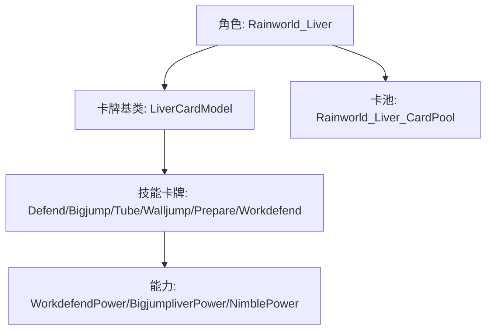
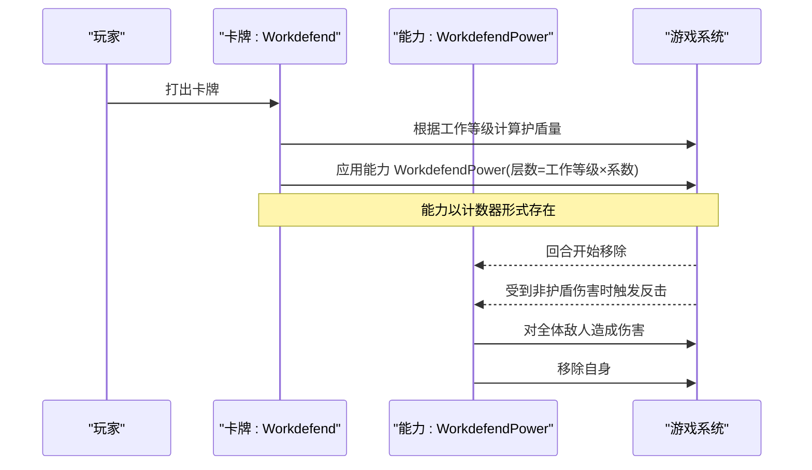
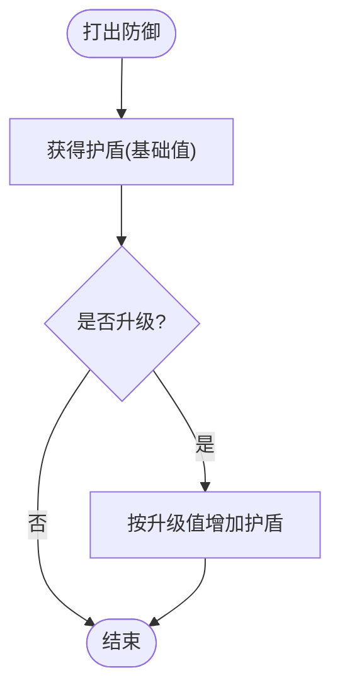
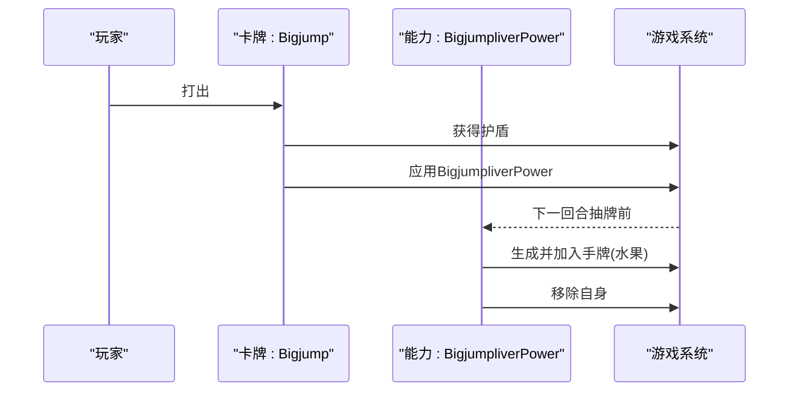
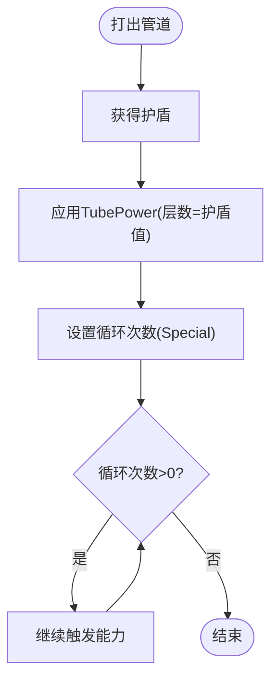
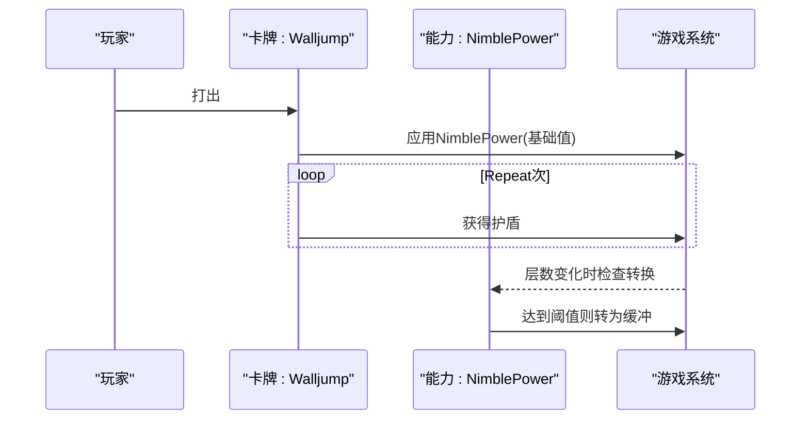
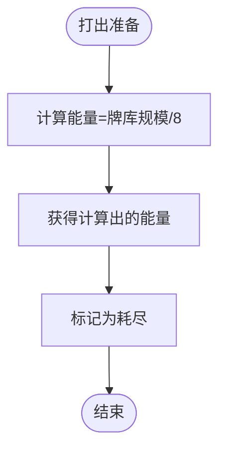
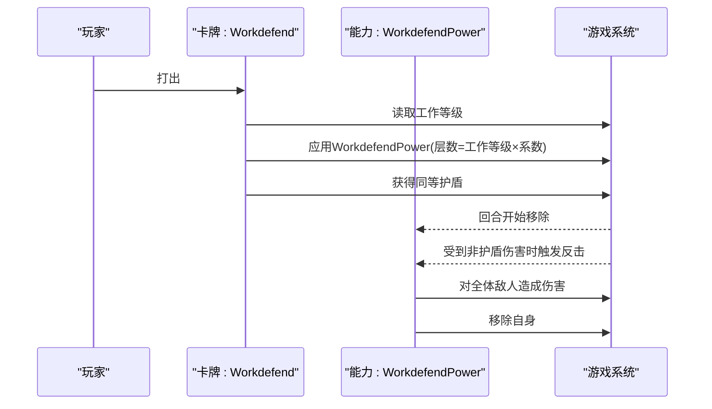

# 肝脏角色技能卡牌

<cite>
**本文引用的文件**
- [Rainworld_Liver.cs](file://Scripts/Slugcat/Rainworld_Liver.cs)
- [LiverCardModel.cs](file://Scripts/Card/Liver/LiverCardModel.cs)
- [Rainworld_Liver_CardPool.cs](file://Scripts/Card/Liver/Rainworld_Liver_CardPool.cs)
- [Rainworld_Liver_Defend.cs](file://Scripts/Card/Liver/Skills/Rainworld_Liver_Defend.cs)
- [Rainworld_Liver_Bigjump.cs](file://Scripts/Card/Liver/Skills/Rainworld_Liver_Bigjump.cs)
- [Rainworld_Liver_Tube.cs](file://Scripts/Card/Liver/Skills/Rainworld_Liver_Tube.cs)
- [Rainworld_Liver_Walljump.cs](file://Scripts/Card/Liver/Skills/Rainworld_Liver_Walljump.cs)
- [Rainworld_Liver_Prepare.cs](file://Scripts/Card/Liver/Skills/Rainworld_Liver_Prepare.cs)
- [Rainworld_Liver_Workdefend.cs](file://Scripts/Card/Liver/Skills/Rainworld_Liver_Workdefend.cs)
- [WorkdefendPower.cs](file://Scripts/Powers/Liver/WorkdefendPower.cs)
- [BigjumpliverPower.cs](file://Scripts/Powers/Liver/BigjumpliverPower.cs)
- [NimblePower.cs](file://Scripts/Powers/Liver/NimblePower.cs)
</cite>

## 目录
1. [简介](#简介)
2. [项目结构](#项目结构)
3. [核心组件](#核心组件)
4. [架构总览](#架构总览)
5. [详细组件分析](#详细组件分析)
6. [依赖关系分析](#依赖关系分析)
7. [性能考量](#性能考量)
8. [故障排查指南](#故障排查指南)
9. [结论](#结论)
10. [附录：开发指南与最佳实践](#附录开发指南与最佳实践)

## 简介
本文件为“肝脏角色”的技能卡牌系统提供系统化文档，聚焦防御、跳跃、管道等核心机制，解释各技能卡牌的执行逻辑、升级效果以及与游戏系统的交互方式。同时说明肝脏角色的工作等级机制如何通过技能卡牌实现（包括准备、休息恢复等关键功能），并给出新技能卡牌的添加方法与性能优化建议，帮助开发者快速扩展与维护。

## 项目结构
肝脏角色相关代码主要分布在以下位置：
- 角色定义与资源：Scripts/Slugcat/Rainworld_Liver.cs
- 卡牌基类与卡池：Scripts/Card/Liver/LiverCardModel.cs、Scripts/Card/Liver/Rainworld_Liver_CardPool.cs
- 技能卡牌：Scripts/Card/Liver/Skills/*（如防御、跳跃、管道、准备、工作防御等）
- 能力（Power）：Scripts/Powers/Liver/*（与工作等级、跳跃、敏捷等相关）

图表来源
- [Rainworld_Liver.cs:28-99](file://Scripts/Slugcat/Rainworld_Liver.cs#L28-L99)
- [LiverCardModel.cs:14-38](file://Scripts/Card/Liver/LiverCardModel.cs#L14-L38)
- [Rainworld_Liver_CardPool.cs:10-23](file://Scripts/Card/Liver/Rainworld_Liver_CardPool.cs#L10-L23)

章节来源
- [Rainworld_Liver.cs:28-99](file://Scripts/Slugcat/Rainworld_Liver.cs#L28-L99)
- [LiverCardModel.cs:14-38](file://Scripts/Card/Liver/LiverCardModel.cs#L14-L38)
- [Rainworld_Liver_CardPool.cs:10-23](file://Scripts/Card/Liver/Rainworld_Liver_CardPool.cs#L10-L23)

## 核心组件
- 角色与起始牌组
  - 角色定义包含起始生命值、金币、起始牌组（攻击/防御/技能）、初始遗物等配置。
  - 起始牌组包含基础攻击、防御与技能，便于新手上手。
- 卡牌基类与卡池
  - 统一卡牌资源路径与类型区分（攻击/技能/能力）。
  - 自定义卡池用于管理肝脏角色的卡牌集合与能量颜色。
- 关键技能卡牌
  - 防御：基础护盾生成，支持升级提升护盾值。
  - 跳跃：结合能力在抽牌阶段生成特殊卡牌，或叠加护盾与临时增益。
  - 管道：将护盾转化为可重复触发的能力层数，配合特殊计数实现连锁效果。
  - 准备：消耗牌库规模计算额外能量，属于耗尽型策略卡。
  - 工作防御：基于工作等级生成护盾并附加反击能力，体现工作等级机制。

章节来源
- [Rainworld_Liver.cs:87-99](file://Scripts/Slugcat/Rainworld_Liver.cs#L87-L99)
- [LiverCardModel.cs:14-38](file://Scripts/Card/Liver/LiverCardModel.cs#L14-L38)
- [Rainworld_Liver_CardPool.cs:10-23](file://Scripts/Card/Liver/Rainworld_Liver_CardPool.cs#L10-L23)
- [Rainworld_Liver_Defend.cs:11-55](file://Scripts/Card/Liver/Skills/Rainworld_Liver_Defend.cs#L11-L55)
- [Rainworld_Liver_Bigjump.cs:13-60](file://Scripts/Card/Liver/Skills/Rainworld_Liver_Bigjump.cs#L13-L60)
- [Rainworld_Liver_Tube.cs:12-62](file://Scripts/Card/Liver/Skills/Rainworld_Liver_Tube.cs#L12-L62)
- [Rainworld_Liver_Walljump.cs:14-65](file://Scripts/Card/Liver/Skills/Rainworld_Liver_Walljump.cs#L14-L65)
- [Rainworld_Liver_Prepare.cs:12-65](file://Scripts/Card/Liver/Skills/Rainworld_Liver_Prepare.cs#L12-L65)
- [Rainworld_Liver_Workdefend.cs:15-62](file://Scripts/Card/Liver/Skills/Rainworld_Liver_Workdefend.cs#L15-L62)

## 架构总览
肝脏角色通过“卡牌→能力→战斗事件”的链路实现复杂机制：
- 卡牌在OnPlay中调用命令（如获得护盾、应用能力）。
- 能力在特定回合事件（如抽牌前、回合开始、受到伤害后）触发，执行增伤、反伤、生成卡牌等逻辑。
- 工作等级通过角色属性与卡牌联动，影响护盾量与反击强度。

图表来源
- [Rainworld_Liver_Workdefend.cs:47-56](file://Scripts/Card/Liver/Skills/Rainworld_Liver_Workdefend.cs#L47-L56)
- [WorkdefendPower.cs:43-55](file://Scripts/Powers/Liver/WorkdefendPower.cs#L43-L55)

章节来源
- [Rainworld_Liver_Workdefend.cs:47-56](file://Scripts/Card/Liver/Skills/Rainworld_Liver_Workdefend.cs#L47-L56)
- [WorkdefendPower.cs:43-55](file://Scripts/Powers/Liver/WorkdefendPower.cs#L43-L55)

## 详细组件分析

### 防御卡牌：Rainworld_Liver_Defend
- 作用：为自己获得护盾，标记为防御标签，支持升级提升护盾值。
- 执行流程：
  - OnPlay：调用命令为拥有者增加护盾。
  - OnUpgrade：提升护盾数值。
- 与系统交互：使用动态变量Block进行护盾增减，遵循移动属性规则。

图表来源
- [Rainworld_Liver_Defend.cs:30-55](file://Scripts/Card/Liver/Skills/Rainworld_Liver_Defend.cs#L30-L55)

章节来源
- [Rainworld_Liver_Defend.cs:30-55](file://Scripts/Card/Liver/Skills/Rainworld_Liver_Defend.cs#L30-L55)

### 跳跃卡牌：Rainworld_Liver_Bigjump
- 作用：获得护盾，并在抽牌前生成一张特殊卡牌（水果），随后移除该能力。
- 执行流程：
  - OnPlay：获得护盾；应用BigjumpliverPower。
  - 能力BeforeHandDraw：为玩家手牌添加生成的水果卡牌，然后移除自身。
- 升级效果：提升护盾值。

图表来源
- [Rainworld_Liver_Bigjump.cs:48-60](file://Scripts/Card/Liver/Skills/Rainworld_Liver_Bigjump.cs#L48-L60)
- [BigjumpliverPower.cs:42-55](file://Scripts/Powers/Liver/BigjumpliverPower.cs#L42-L55)

章节来源
- [Rainworld_Liver_Bigjump.cs:48-60](file://Scripts/Card/Liver/Skills/Rainworld_Liver_Bigjump.cs#L48-L60)
- [BigjumpliverPower.cs:42-55](file://Scripts/Powers/Liver/BigjumpliverPower.cs#L42-L55)

### 管道卡牌：Rainworld_Liver_Tube
- 作用：获得护盾，并将护盾量作为层数应用到管道能力；Special计数控制循环次数。
- 执行流程：
  - OnPlay：获得护盾；应用TubePower，层数为当前护盾值；设置rounder为Special值。
  - 升级：提升护盾与Special计数。
- 与系统交互：通过动态变量Block与Special协同，形成“护盾→能力层数→循环”的管道机制。

图表来源
- [Rainworld_Liver_Tube.cs:47-62](file://Scripts/Card/Liver/Skills/Rainworld_Liver_Tube.cs#L47-L62)

章节来源
- [Rainworld_Liver_Tube.cs:47-62](file://Scripts/Card/Liver/Skills/Rainworld_Liver_Tube.cs#L47-L62)

### 墙跳卡牌：Rainworld_Liver_Walljump
- 作用：获得敏捷（Nimble）层数，并按Repeat次数获得护盾。
- 执行流程：
  - OnPlay：应用NimblePower；循环Repeat次获得护盾。
  - 升级：提升Repeat次数。
- 与系统交互：NimblePower在层数达到阈值时转换为缓冲（Buffer），体现高机动性。

图表来源
- [Rainworld_Liver_Walljump.cs:50-65](file://Scripts/Card/Liver/Skills/Rainworld_Liver_Walljump.cs#L50-L65)
- [NimblePower.cs:40-51](file://Scripts/Powers/Liver/NimblePower.cs#L40-L51)

章节来源
- [Rainworld_Liver_Walljump.cs:50-65](file://Scripts/Card/Liver/Skills/Rainworld_Liver_Walljump.cs#L50-L65)
- [NimblePower.cs:40-51](file://Scripts/Powers/Liver/NimblePower.cs#L40-L51)

### 准备卡牌：Rainworld_Liver_Prepare
- 作用：根据牌库大小计算额外能量，属于耗尽型（Exhaust）卡牌。
- 执行流程：
  - OnPlay：计算能量（牌库规模/8），为玩家增加能量。
  - 升级：降低耗能。
- 与系统交互：使用计算变量CalculatedEnergy与牌堆PileType.Deck交互。

图表来源
- [Rainworld_Liver_Prepare.cs:33-65](file://Scripts/Card/Liver/Skills/Rainworld_Liver_Prepare.cs#L33-L65)

章节来源
- [Rainworld_Liver_Prepare.cs:33-65](file://Scripts/Card/Liver/Skills/Rainworld_Liver_Prepare.cs#L33-L65)

### 工作防御卡牌：Rainworld_Liver_Workdefend
- 作用：基于工作等级生成护盾，并施加WorkdefendPower（受击反击）。
- 执行流程：
  - OnPlay：读取工作等级，计算层数（工作等级×系数），应用能力并直接获得同等护盾。
  - 升级：不改变层数公式（由能力与卡牌共同决定）。
- 与系统交互：WorkdefendPower在受到非护盾伤害时对全体敌人造成反击伤害，并在回合开始时移除。

图表来源
- [Rainworld_Liver_Workdefend.cs:47-56](file://Scripts/Card/Liver/Skills/Rainworld_Liver_Workdefend.cs#L47-L56)
- [WorkdefendPower.cs:43-55](file://Scripts/Powers/Liver/WorkdefendPower.cs#L43-L55)

章节来源
- [Rainworld_Liver_Workdefend.cs:47-56](file://Scripts/Card/Liver/Skills/Rainworld_Liver_Workdefend.cs#L47-L56)
- [WorkdefendPower.cs:43-55](file://Scripts/Powers/Liver/WorkdefendPower.cs#L43-L55)

## 依赖关系分析
- 角色与卡牌
  - 角色定义起始牌组与资源路径，卡牌通过基类统一资源加载。
- 卡牌与能力
  - 技能卡牌通过命令应用能力，能力在回合事件中执行副作用（生成卡牌、反击、转换状态）。
- 能力之间的协作
  - NimblePower将敏捷层数转换为缓冲，提高生存与容错。
  - WorkdefendPower在工作等级驱动下提供强力的反击保护。
  - BigjumpliverPower在抽牌阶段提供资源补充。

图表来源
- [Rainworld_Liver.cs:28-99](file://Scripts/Slugcat/Rainworld_Liver.cs#L28-L99)
- [LiverCardModel.cs:14-38](file://Scripts/Card/Liver/LiverCardModel.cs#L14-L38)
- [WorkdefendPower.cs:43-55](file://Scripts/Powers/Liver/WorkdefendPower.cs#L43-L55)
- [BigjumpliverPower.cs:42-55](file://Scripts/Powers/Liver/BigjumpliverPower.cs#L42-L55)
- [NimblePower.cs:40-51](file://Scripts/Powers/Liver/NimblePower.cs#L40-L51)

章节来源
- [Rainworld_Liver.cs:28-99](file://Scripts/Slugcat/Rainworld_Liver.cs#L28-L99)
- [LiverCardModel.cs:14-38](file://Scripts/Card/Liver/LiverCardModel.cs#L14-L38)
- [WorkdefendPower.cs:43-55](file://Scripts/Powers/Liver/WorkdefendPower.cs#L43-L55)
- [BigjumpliverPower.cs:42-55](file://Scripts/Powers/Liver/BigjumpliverPower.cs#L42-L55)
- [NimblePower.cs:40-51](file://Scripts/Powers/Liver/NimblePower.cs#L40-L51)

## 性能考量
- 避免在高频事件中执行昂贵操作：
  - 能力的事件回调（如AfterDamageReceived、BeforeHandDraw）应尽量减少对象分配与复杂计算。
- 合理使用动态变量与计算变量：
  - 将复杂计算封装到计算变量中，减少运行时开销。
- 控制循环与重复：
  - 对于Walljump等Repeat机制，确保循环上限合理，避免极端情况下的性能问题。
- 资源路径与材质：
  - 使用统一的卡池材质与资源路径，减少重复加载。

[本节为通用指导，无需具体文件引用]

## 故障排查指南
- 工作等级未生效
  - 检查Workdefend卡牌是否正确读取工作等级并计算层数。
  - 确认WorkdefendPower在受击与回合开始时的行为是否符合预期。
- 管道循环异常
  - 检查Tube卡牌的Special计数与rounder设置是否正确。
  - 确认能力层数与循环次数匹配。
- 跳跃生成卡牌失败
  - 检查BigjumpliverPower的BeforeHandDraw是否在正确时机执行。
  - 确认生成的卡牌类型与加入手牌的命令参数。
- 敏捷转换缓冲失败
  - 检查NimblePower的AfterPowerAmountChanged逻辑与阈值判断。
  - 确认是否存在其他能力（如Slugfeel）影响阈值。

章节来源
- [Rainworld_Liver_Workdefend.cs:47-56](file://Scripts/Card/Liver/Skills/Rainworld_Liver_Workdefend.cs#L47-L56)
- [WorkdefendPower.cs:43-55](file://Scripts/Powers/Liver/WorkdefendPower.cs#L43-L55)
- [Rainworld_Liver_Tube.cs:47-62](file://Scripts/Card/Liver/Skills/Rainworld_Liver_Tube.cs#L47-L62)
- [Rainworld_Liver_Bigjump.cs:48-60](file://Scripts/Card/Liver/Skills/Rainworld_Liver_Bigjump.cs#L48-L60)
- [BigjumpliverPower.cs:42-55](file://Scripts/Powers/Liver/BigjumpliverPower.cs#L42-L55)
- [NimblePower.cs:40-51](file://Scripts/Powers/Liver/NimblePower.cs#L40-L51)

## 结论
肝脏角色的技能卡牌系统围绕“防御、跳跃、管道、准备、工作防御”五大核心机制构建，通过卡牌与能力的紧密协作，实现了丰富的战术组合。工作等级机制在防御与反击中扮演关键角色，而管道与跳跃则提供了资源管理与机动性的平衡。遵循本文的开发指南与性能建议，可有效扩展与维护该系统。

[本节为总结，无需具体文件引用]

## 附录：开发指南与最佳实践
- 新增技能卡牌步骤
  - 在Scripts/Card/Liver/Skills目录下创建新脚本，继承LiverCardModel。
  - 定义基础属性（耗能、类型、稀有度、目标类型、图鉴显示）。
  - 在CanonicalVars中声明动态变量（护盾、能量、重复次数等）。
  - 实现OnPlay逻辑，使用命令（CreatureCmd、PlayerCmd、PowerCmd）与系统交互。
  - 如需能力，实现OnUpgrade调整数值或行为。
- 新增能力（Power）步骤
  - 在Scripts/Powers/Liver目录下创建新脚本，继承ModPowerTemplate。
  - 定义图标、类型、堆叠方式。
  - 在相应事件回调（如BeforeHandDraw、AfterDamageReceived、AfterPlayerTurnStart）中实现逻辑。
  - 使用PowerCmd进行增删改与移除。
- 工作等级机制集成
  - 通过角色属性与工作等级读取接口获取当前等级。
  - 在卡牌OnPlay中根据等级计算护盾或能力层数。
  - 在能力中根据层数执行反击或资源生成。
- 性能优化建议
  - 将复杂计算放入计算变量，避免在事件回调中进行大量运算。
  - 控制循环次数与条件分支，防止极端情况导致卡顿。
  - 复用资源路径与材质，减少内存占用。
- 调试与测试
  - 使用日志单例记录关键事件（如能力应用、卡牌生成）。
  - 在本地环境中验证不同升级状态下的行为一致性。
  - 针对边界情况（如零牌库、零工作等级）进行测试。

[本节为通用指导，无需具体文件引用]