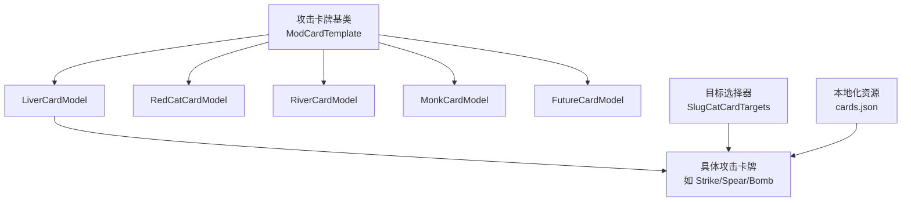
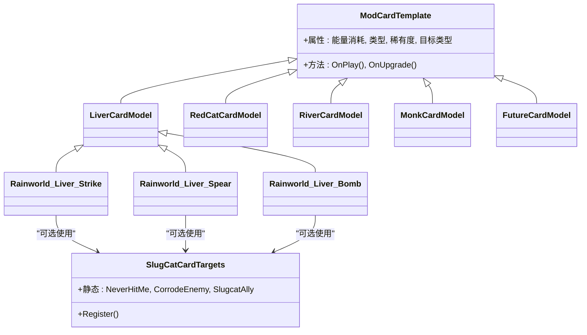
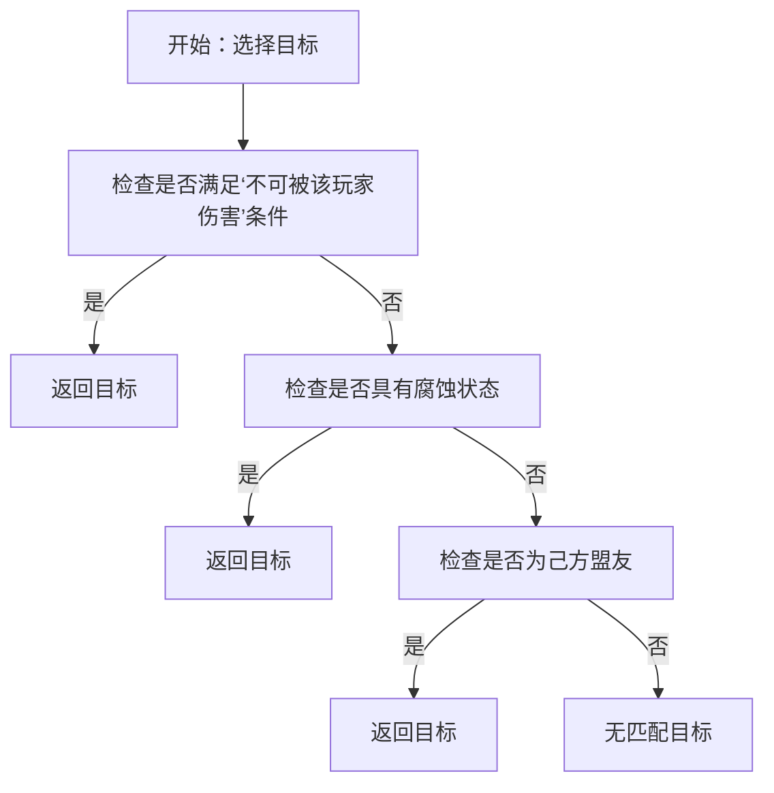
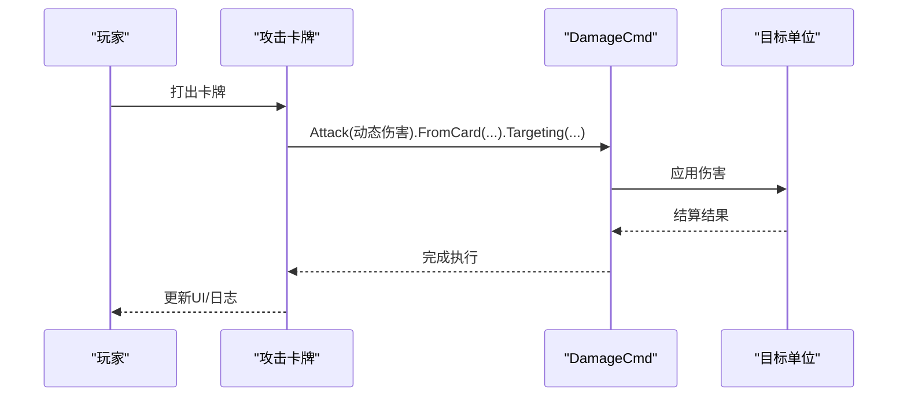
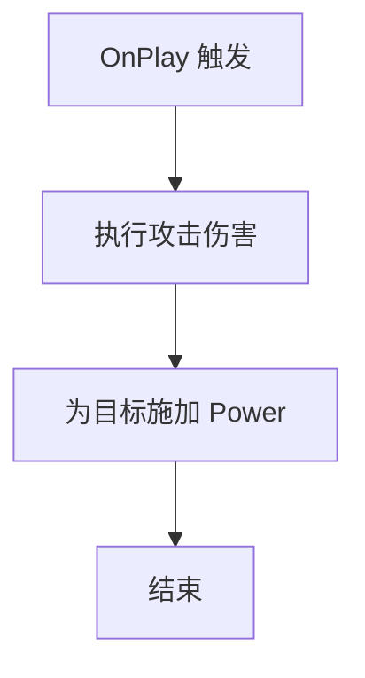
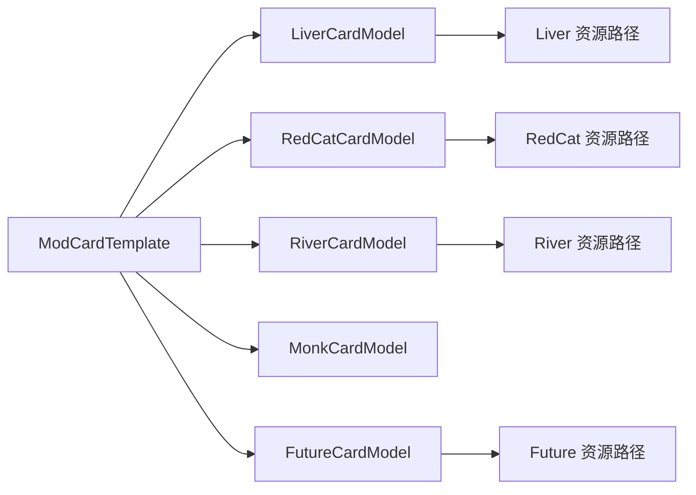
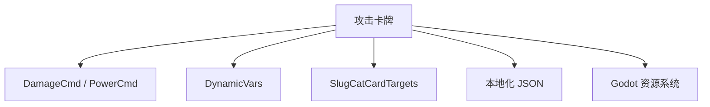

# 攻击卡牌基础框架

<cite>
**本文引用的文件**
- [SlugCatCardTargets.cs](file://Scripts/Card/SlugCatCardTargets.cs)
- [LiverCardModel.cs](file://Scripts/Card/Liver/LiverCardModel.cs)
- [RedCatCardModel.cs](file://Scripts/Card/RedCat/RedCatCardModel.cs)
- [RiverCardModel.cs](file://Scripts/Card/River/RiverCardModel.cs)
- [MonkCardModel.cs](file://Scripts/Card/Monk/MonkCardModel.cs)
- [FutureCardModel.cs](file://Scripts/Card/Future/FutureCardModel.cs)
- [Rainworld_Liver_Strike.cs](file://Scripts/Card/Liver/Attack/Rainworld_Liver_Strike.cs)
- [Rainworld_Liver_Spear.cs](file://Scripts/Card/Liver/Attack/Rainworld_Liver_Spear.cs)
- [Rainworld_Liver_Bomb.cs](file://Scripts/Card/Liver/Attack/Rainworld_Liver_Bomb.cs)
- [cards.json（英文本地化）](file://SlugcatTheSpireII/localization/eng/cards.json)
- [cards.json（韩文本地化）](file://SlugcatTheSpireII/localization/kor/cards.json)
</cite>

## 目录
1. [简介](#简介)
2. [项目结构](#项目结构)
3. [核心组件](#核心组件)
4. [架构总览](#架构总览)
5. [详细组件分析](#详细组件分析)
6. [依赖关系分析](#依赖关系分析)
7. [性能考量](#性能考量)
8. [故障排查指南](#故障排查指南)
9. [结论](#结论)
10. [附录](#附录)

## 简介
本技术文档围绕“攻击卡牌基础框架”展开，系统性阐述：
- 基类设计模式、继承层次与接口约定
- 目标选择系统、伤害计算引擎与执行流程控制
- 不同角色卡牌模型的抽象与差异化实现
- 卡牌生命周期管理、事件系统与状态同步机制
- 配置数据结构、序列化格式与版本兼容性处理
- 扩展开发指南（自定义效果、性能监控、错误处理）
- 与 RitsuLib 框架的集成方式与最佳实践

## 项目结构
本项目采用按“角色/功能域”组织代码的结构。攻击卡牌相关代码主要位于 Scripts/Card 下，其中：
- 各角色的卡牌模型基类分别位于 Liver、RedCat、River、Monk、Future 子目录
- 具体攻击卡牌实现集中在 Liver/Attack 等子目录
- 目标选择器集中定义在 SlugCatCardTargets.cs
- 本地化资源位于 SlugcatTheSpireII/localization 下的多语言 JSON

图表来源
- [LiverCardModel.cs:14-38](file://Scripts/Card/Liver/LiverCardModel.cs#L14-L38)
- [RedCatCardModel.cs:13-39](file://Scripts/Card/RedCat/RedCatCardModel.cs#L13-L39)
- [RiverCardModel.cs:14-39](file://Scripts/Card/River/RiverCardModel.cs#L14-L39)
- [MonkCardModel.cs:13-39](file://Scripts/Card/Monk/MonkCardModel.cs#L13-L39)
- [FutureCardModel.cs:14-39](file://Scripts/Card/Future/FutureCardModel.cs#L14-L39)
- [SlugCatCardTargets.cs:8-34](file://Scripts/Card/SlugCatCardTargets.cs#L8-L34)

章节来源
- [LiverCardModel.cs:14-38](file://Scripts/Card/Liver/LiverCardModel.cs#L14-L38)
- [RedCatCardModel.cs:13-39](file://Scripts/Card/RedCat/RedCatCardModel.cs#L13-L39)
- [RiverCardModel.cs:14-39](file://Scripts/Card/River/RiverCardModel.cs#L14-L39)
- [MonkCardModel.cs:13-39](file://Scripts/Card/Monk/MonkCardModel.cs#L13-L39)
- [FutureCardModel.cs:14-39](file://Scripts/Card/Future/FutureCardModel.cs#L14-L39)
- [SlugCatCardTargets.cs:8-34](file://Scripts/Card/SlugCatCardTargets.cs#L8-L34)

## 核心组件
- 卡牌模型基类与角色派生类
  - 所有攻击卡牌均继承自统一的 ModCardTemplate，并通过角色专属基类（如 LiverCardModel、RedCatCardModel 等）统一资源路径与卡框样式。
- 目标选择系统
  - 通过 CustomTargetType 注册自定义目标类型，提供细粒度筛选逻辑（例如“不可被该玩家伤害的敌人”、“具有特定状态的敌人”、“己方盟友”）。
- 伤害计算与执行
  - 使用 DamageCmd 构建攻击命令，支持动态变量（DamageVar）、命中特效、音效、多目标打击等。
- 升级与动态变量
  - 通过 OnUpgrade 调整动态变量数值，实现升级增益。
- 本地化与资源
  - 卡牌标题、描述、提示等通过 localization JSON 管理；部分卡牌支持根据当前语言切换图片资源。

章节来源
- [LiverCardModel.cs:14-38](file://Scripts/Card/Liver/LiverCardModel.cs#L14-L38)
- [RedCatCardModel.cs:13-39](file://Scripts/Card/RedCat/RedCatCardModel.cs#L13-L39)
- [RiverCardModel.cs:14-39](file://Scripts/Card/River/RiverCardModel.cs#L14-L39)
- [MonkCardModel.cs:13-39](file://Scripts/Card/Monk/MonkCardModel.cs#L13-L39)
- [FutureCardModel.cs:14-39](file://Scripts/Card/Future/FutureCardModel.cs#L14-L39)
- [SlugCatCardTargets.cs:8-34](file://Scripts/Card/SlugCatCardTargets.cs#L8-L34)
- [Rainworld_Liver_Strike.cs:9-57](file://Scripts/Card/Liver/Attack/Rainworld_Liver_Strike.cs#L9-L57)
- [Rainworld_Liver_Spear.cs:13-65](file://Scripts/Card/Liver/Attack/Rainworld_Liver_Spear.cs#L13-L65)
- [Rainworld_Liver_Bomb.cs:17-92](file://Scripts/Card/Liver/Attack/Rainworld_Liver_Bomb.cs#L17-L92)
- [cards.json（英文本地化）:132-140](file://SlugcatTheSpireII/localization/eng/cards.json#L132-L140)
- [cards.json（韩文本地化）:281-394](file://SlugcatTheSpireII/localization/kor/cards.json#L281-L394)

## 架构总览
攻击卡牌框架以“基类 + 角色派生 + 具体实现”的分层模式组织，结合 RitsuLib 提供的模板与命令式 API，形成高内聚、低耦合的可扩展体系。

图表来源
- [LiverCardModel.cs:14-38](file://Scripts/Card/Liver/LiverCardModel.cs#L14-L38)
- [RedCatCardModel.cs:13-39](file://Scripts/Card/RedCat/RedCatCardModel.cs#L13-L39)
- [RiverCardModel.cs:14-39](file://Scripts/Card/River/RiverCardModel.cs#L14-L39)
- [MonkCardModel.cs:13-39](file://Scripts/Card/Monk/MonkCardModel.cs#L13-L39)
- [FutureCardModel.cs:14-39](file://Scripts/Card/Future/FutureCardModel.cs#L14-L39)
- [SlugCatCardTargets.cs:8-34](file://Scripts/Card/SlugCatCardTargets.cs#L8-L34)
- [Rainworld_Liver_Strike.cs:9-57](file://Scripts/Card/Liver/Attack/Rainworld_Liver_Strike.cs#L9-L57)
- [Rainworld_Liver_Spear.cs:13-65](file://Scripts/Card/Liver/Attack/Rainworld_Liver_Spear.cs#L13-L65)
- [Rainworld_Liver_Bomb.cs:17-92](file://Scripts/Card/Liver/Attack/Rainworld_Liver_Bomb.cs#L17-L92)

## 详细组件分析

### 目标选择系统（SlugCatCardTargets）
- 提供三类预置目标类型：
  - “不可被该玩家伤害的敌人”：基于工作等级对与玩家的关系判断
  - “具有腐蚀状态的敌人”：通过拥有特定 Power 判定
  - “己方盟友”：通过玩家角色类型判断
- 通过 Register 统一注册，供卡牌在目标选择阶段调用

图表来源
- [SlugCatCardTargets.cs:8-34](file://Scripts/Card/SlugCatCardTargets.cs#L8-L34)

章节来源
- [SlugCatCardTargets.cs:8-34](file://Scripts/Card/SlugCatCardTargets.cs#L8-L34)

### 伤害计算引擎与执行流程（DamageCmd）
- 单目标攻击：DamageCmd.Attack(...) 指定目标并执行
- 多目标攻击：TargetingAllOpponents(CombatState) 对所有对手造成伤害
- 动态变量：DamageVar 支持移动值、升级加成等
- 特效与音效：WithHitFx 可附加命中特效或音效

图表来源
- [Rainworld_Liver_Strike.cs:40-50](file://Scripts/Card/Liver/Attack/Rainworld_Liver_Strike.cs#L40-L50)
- [Rainworld_Liver_Bomb.cs:75-85](file://Scripts/Card/Liver/Attack/Rainworld_Liver_Bomb.cs#L75-L85)

章节来源
- [Rainworld_Liver_Strike.cs:9-57](file://Scripts/Card/Liver/Attack/Rainworld_Liver_Strike.cs#L9-L57)
- [Rainworld_Liver_Bomb.cs:17-92](file://Scripts/Card/Liver/Attack/Rainworld_Liver_Bomb.cs#L17-L92)

### 复杂逻辑示例：附带效果的攻击（Spear）
- 先对目标造成攻击伤害
- 再为目标施加一个 Power（ChuangPower），数值来自动态变量
- 升级时同时提升伤害与附加数值

图表来源
- [Rainworld_Liver_Spear.cs:45-65](file://Scripts/Card/Liver/Attack/Rainworld_Liver_Spear.cs#L45-L65)

章节来源
- [Rainworld_Liver_Spear.cs:13-65](file://Scripts/Card/Liver/Attack/Rainworld_Liver_Spear.cs#L13-L65)

### 角色卡牌模型的抽象与差异化
- 共同抽象
  - 统一继承自 ModCardTemplate，提供一致的构造参数与生命周期钩子
  - 统一通过 AssetProfile 设置卡牌图像与卡框
- 差异化实现
  - 各角色基类指定不同的资源路径与卡框素材
  - 未来卡牌（FutureCardModel）复用 Liver 的卡框资源作为默认
  - 某些角色（如 Monk）暂未启用自动注册（注释掉 RegisterCard）

图表来源
- [LiverCardModel.cs:14-38](file://Scripts/Card/Liver/LiverCardModel.cs#L14-L38)
- [RedCatCardModel.cs:13-39](file://Scripts/Card/RedCat/RedCatCardModel.cs#L13-L39)
- [RiverCardModel.cs:14-39](file://Scripts/Card/River/RiverCardModel.cs#L14-L39)
- [MonkCardModel.cs:13-39](file://Scripts/Card/Monk/MonkCardModel.cs#L13-L39)
- [FutureCardModel.cs:14-39](file://Scripts/Card/Future/FutureCardModel.cs#L14-L39)

章节来源
- [LiverCardModel.cs:14-38](file://Scripts/Card/Liver/LiverCardModel.cs#L14-L38)
- [RedCatCardModel.cs:13-39](file://Scripts/Card/RedCat/RedCatCardModel.cs#L13-L39)
- [RiverCardModel.cs:14-39](file://Scripts/Card/River/RiverCardModel.cs#L14-L39)
- [MonkCardModel.cs:13-39](file://Scripts/Card/Monk/MonkCardModel.cs#L13-L39)
- [FutureCardModel.cs:14-39](file://Scripts/Card/Future/FutureCardModel.cs#L14-L39)

### 卡牌生命周期管理与事件系统
- 生命周期钩子
  - OnPlay：卡牌打出时的主逻辑入口
  - OnUpgrade：升级时的数值调整
- 事件与状态
  - 通过 DynamicVars 驱动 UI 显示与数值变化
  - 通过 Power 系统持久化状态（如 ChuangPower）
  - 本地化文本与提示（HoverTip）增强交互体验

章节来源
- [Rainworld_Liver_Strike.cs:40-57](file://Scripts/Card/Liver/Attack/Rainworld_Liver_Strike.cs#L40-L57)
- [Rainworld_Liver_Spear.cs:45-65](file://Scripts/Card/Liver/Attack/Rainworld_Liver_Spear.cs#L45-L65)
- [cards.json（英文本地化）:132-140](file://SlugcatTheSpireII/localization/eng/cards.json#L132-L140)

### 配置数据结构、序列化与版本兼容
- 配置数据
  - 卡牌元数据（能量、类型、稀有度、目标类型）在类中声明
  - 动态变量（DamageVar 等）用于运行时数值与升级
- 序列化与本地化
  - 卡牌标题与描述通过 cards.json 的多语言文件管理
  - 部分卡牌根据当前语言加载对应图片资源（如 Bomb 的 GetLocalizedCardImage）
- 版本兼容
  - 通过动态变量与条件逻辑（如 IfUpgraded）保持新旧版本行为一致
  - 资源路径回退策略确保缺失资源时仍能正常显示

章节来源
- [Rainworld_Liver_Bomb.cs:21-46](file://Scripts/Card/Liver/Attack/Rainworld_Liver_Bomb.cs#L21-L46)
- [cards.json（英文本地化）:132-140](file://SlugcatTheSpireII/localization/eng/cards.json#L132-L140)
- [cards.json（韩文本地化）:281-394](file://SlugcatTheSpireII/localization/kor/cards.json#L281-L394)

### 扩展开发指南
- 自定义效果实现
  - 新建攻击卡牌类，继承对应角色基类
  - 在 OnPlay 中使用 DamageCmd 或其他命令组合实现效果
  - 如需附加状态，使用 PowerCmd.Apply 施加 Power
- 性能监控
  - 避免在 OnPlay 中进行重型计算，尽量将耗时逻辑异步化
  - 合理使用动态变量减少重复计算
- 错误处理策略
  - 对空引用进行防御性检查（如 cardPlay.Target）
  - 为异常路径提供降级逻辑（如资源不存在时回退默认路径）

章节来源
- [Rainworld_Liver_Strike.cs:40-50](file://Scripts/Card/Liver/Attack/Rainworld_Liver_Strike.cs#L40-L50)
- [Rainworld_Liver_Bomb.cs:21-46](file://Scripts/Card/Liver/Attack/Rainworld_Liver_Bomb.cs#L21-L46)

### 与 RitsuLib 框架的集成与最佳实践
- 内容注册
  - 使用 [RegisterCard] 将卡牌模型关联到对应卡池
- 模板与命令
  - 基于 ModCardTemplate 提供统一生命周期
  - 使用 DamageCmd、PowerCmd 等命令式 API 简化逻辑
- 本地化与资源
  - 通过 localization JSON 管理多语言文本
  - 利用 TranslationServer 与 ResourceLoader 实现资源动态加载

章节来源
- [LiverCardModel.cs:14-38](file://Scripts/Card/Liver/LiverCardModel.cs#L14-L38)
- [RedCatCardModel.cs:13-39](file://Scripts/Card/RedCat/RedCatCardModel.cs#L13-L39)
- [RiverCardModel.cs:14-39](file://Scripts/Card/River/RiverCardModel.cs#L14-L39)
- [MonkCardModel.cs:13-39](file://Scripts/Card/Monk/MonkCardModel.cs#L13-L39)
- [FutureCardModel.cs:14-39](file://Scripts/Card/Future/FutureCardModel.cs#L14-L39)
- [Rainworld_Liver_Bomb.cs:21-46](file://Scripts/Card/Liver/Attack/Rainworld_Liver_Bomb.cs#L21-L46)

## 依赖关系分析
- 组件耦合
  - 攻击卡牌强依赖 DamageCmd 与 DynamicVars
  - 目标选择器与卡牌弱耦合，通过静态注册的方式提供能力
- 外部依赖
  - RitsuLib 提供模板、命令、本地化与资源加载能力
  - Godot 资源系统用于图片与音效加载

图表来源
- [Rainworld_Liver_Strike.cs:40-50](file://Scripts/Card/Liver/Attack/Rainworld_Liver_Strike.cs#L40-L50)
- [Rainworld_Liver_Spear.cs:45-65](file://Scripts/Card/Liver/Attack/Rainworld_Liver_Spear.cs#L45-L65)
- [Rainworld_Liver_Bomb.cs:21-46](file://Scripts/Card/Liver/Attack/Rainworld_Liver_Bomb.cs#L21-L46)
- [SlugCatCardTargets.cs:8-34](file://Scripts/Card/SlugCatCardTargets.cs#L8-L34)
- [cards.json（英文本地化）:132-140](file://SlugcatTheSpireII/localization/eng/cards.json#L132-L140)

章节来源
- [Rainworld_Liver_Strike.cs:40-50](file://Scripts/Card/Liver/Attack/Rainworld_Liver_Strike.cs#L40-L50)
- [Rainworld_Liver_Spear.cs:45-65](file://Scripts/Card/Liver/Attack/Rainworld_Liver_Spear.cs#L45-L65)
- [Rainworld_Liver_Bomb.cs:21-46](file://Scripts/Card/Liver/Attack/Rainworld_Liver_Bomb.cs#L21-L46)
- [SlugCatCardTargets.cs:8-34](file://Scripts/Card/SlugCatCardTargets.cs#L8-L34)
- [cards.json（英文本地化）:132-140](file://SlugcatTheSpireII/localization/eng/cards.json#L132-L140)

## 性能考量
- 避免在 OnPlay 中执行阻塞操作，优先使用异步命令
- 合理使用动态变量缓存计算结果，减少重复运算
- 资源加载采用懒加载与回退策略，降低首帧压力
- 多目标攻击时注意批量处理的开销，必要时分片执行

[本节为通用指导，不直接分析具体文件]

## 故障排查指南
- 常见问题
  - 目标为空：检查 cardPlay.Target 是否为空并进行防御性校验
  - 资源缺失：确认本地化图片路径是否存在，必要时回退到默认资源
  - 升级无效：确认 OnUpgrade 中是否正确调用 UpgradeValueBy
- 调试建议
  - 打印关键变量的当前值（如 DamageVar 的基础值与升级后值）
  - 使用日志单例记录执行流程与异常堆栈

章节来源
- [Rainworld_Liver_Strike.cs:40-50](file://Scripts/Card/Liver/Attack/Rainworld_Liver_Strike.cs#L40-L50)
- [Rainworld_Liver_Bomb.cs:21-46](file://Scripts/Card/Liver/Attack/Rainworld_Liver_Bomb.cs#L21-L46)

## 结论
攻击卡牌基础框架通过清晰的继承层次、标准化的目标选择与伤害执行流程，以及完善的本地化与资源管理机制，提供了高可扩展性与易维护性的开发平台。借助 RitsuLib 的命令式 API 与模板系统，开发者可以快速实现复杂效果并保持代码一致性。建议在扩展过程中遵循动态变量与异步执行的最佳实践，以提升性能与稳定性。

[本节为总结性内容，不直接分析具体文件]

## 附录
- 术语表
  - 动态变量：运行时可变的数值，支持升级与条件显示
  - Power：持久化状态，可在多张卡牌间共享与交互
  - 本地化：多语言文本与资源的统一管理
- 参考路径
  - 卡牌模型基类与角色派生：见 Scripts/Card 下各角色目录
  - 攻击卡牌实现：见 Scripts/Card/Liver/Attack 等目录
  - 目标选择器：见 Scripts/Card/SlugCatCardTargets.cs
  - 本地化资源：见 SlugcatTheSpireII/localization 下各语言 JSON

[本节为补充信息，不直接分析具体文件]