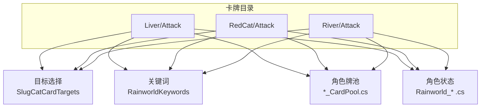
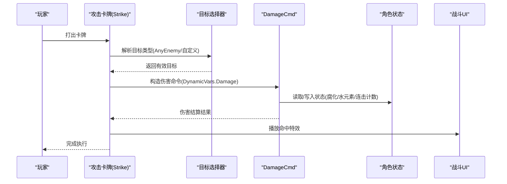
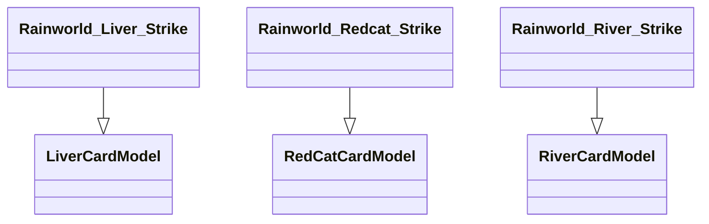
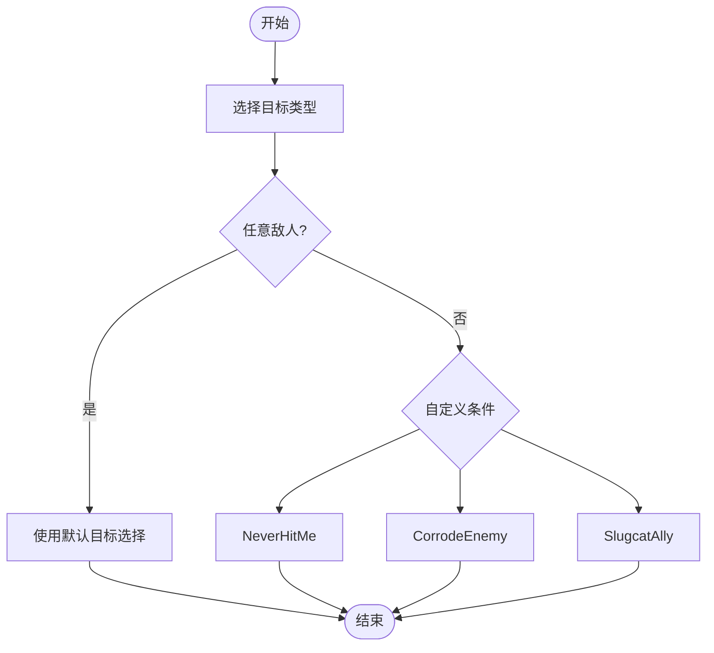
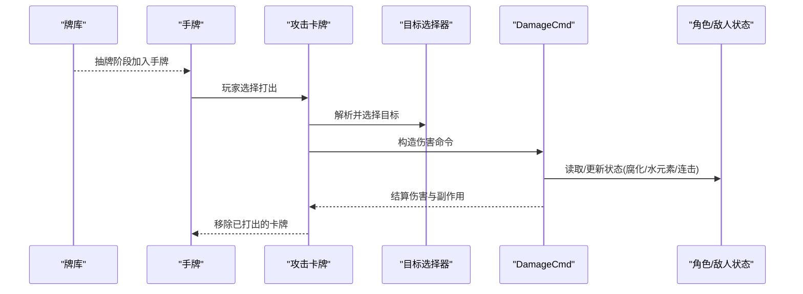
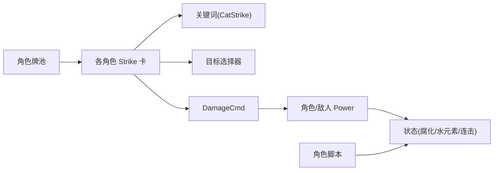

# 攻击卡牌系统

<cite>
**本文引用的文件**
- [SlugCatCardTargets.cs](file://Scripts/Card/SlugCatCardTargets.cs)
- [Rainworld_Liver_Strike.cs](file://Scripts/Card/Liver/Attack/Rainworld_Liver_Strike.cs)
- [Rainworld_Redcat_Strike.cs](file://Scripts/Card/RedCat/Attack/Rainworld_Redcat_Strike.cs)
- [Rainworld_River_Strike.cs](file://Scripts/Card/River/Attack/Rainworld_River_Strike.cs)
- [RainworldKeywords.cs](file://Scripts/Keywords.cs)
- [CorruptionIndicator.cs](file://Godot/CombatUI/CorruptionIndicator.cs)
- [Ncorrupt.cs](file://Godot/CombatUI/Ncorrupt.cs)
- [Rainworld_Redcat_CardPool.cs](file://Scripts/Card/RedCat/Rainworld_Redcat_CardPool.cs)
- [Rainworld_Liver_CardPool.cs](file://Scripts/Card/Liver/Rainworld_Liver_CardPool.cs)
- [Rainworld_River_CardPool.cs](file://Scripts/Card/River/Rainworld_River_CardPool.cs)
- [Rainworld_Redcat.cs](file://Scripts/Slugcat/Rainworld_Redcat.cs)
- [Rainworld_River.cs](file://Scripts/Slugcat/Rainworld_River.cs)
- [Rainworld_Liver.cs](file://Scripts/Slugcat/Rainworld_Liver.cs)
- [WorkLevelSingleton.cs](file://Scripts/patches/Singleton/WorkLevelSingleton.cs)
- [LogSingleton.cs](file://Scripts/patches/Singleton/LogSingleton.cs)
</cite>

## 目录
1. [简介](#简介)
2. [项目结构](#项目结构)
3. [核心组件](#核心组件)
4. [架构总览](#架构总览)
5. [详细组件分析](#详细组件分析)
6. [依赖关系分析](#依赖关系分析)
7. [性能考量](#性能考量)
8. [故障排查指南](#故障排查指南)
9. [结论](#结论)
10. [附录：创建新攻击卡牌示例](#附录创建新攻击卡牌示例)

## 简介
本文件为“攻击卡牌系统”的完整实现文档，聚焦以下目标：
- 基类设计与伤害计算机制、目标选择逻辑
- 角色特色与差异化：Liver 连击机制、RedCat 腐化值利用、River 水元素效果
- 攻击卡牌生命周期：从抽牌到执行完成的完整流程
- 伤害计算公式、暴击机制与特殊效果的实现方式
- 升级系统与平衡性调整策略
- 创建新攻击卡牌的完整示例（参数配置、效果实现、调试技巧）

## 项目结构
本项目将攻击卡牌按角色分目录组织，基础攻击卡以 Strike 命名，复杂攻击卡位于对应角色的 Attack 子目录。目标选择通过自定义 TargetType 注册，便于扩展。

图表来源
- [SlugCatCardTargets.cs:8-33](file://Scripts/Card/SlugCatCardTargets.cs#L8-L33)
- [Rainworld_Liver_Strike.cs:9-56](file://Scripts/Card/Liver/Attack/Rainworld_Liver_Strike.cs#L9-L56)
- [Rainworld_Redcat_Strike.cs:9-56](file://Scripts/Card/RedCat/Attack/Rainworld_Redcat_Strike.cs#L9-L56)
- [Rainworld_River_Strike.cs:9-56](file://Scripts/Card/River/Attack/Rainworld_River_Strike.cs#L9-L56)

章节来源
- [SlugCatCardTargets.cs:8-33](file://Scripts/Card/SlugCatCardTargets.cs#L8-L33)
- [Rainworld_Liver_Strike.cs:9-56](file://Scripts/Card/Liver/Attack/Rainworld_Liver_Strike.cs#L9-L56)
- [Rainworld_Redcat_Strike.cs:9-56](file://Scripts/Card/RedCat/Attack/Rainworld_Redcat_Strike.cs#L9-L56)
- [Rainworld_River_Strike.cs:9-56](file://Scripts/Card/River/Attack/Rainworld_River_Strike.cs#L9-L56)

## 核心组件
- 目标选择器：提供 NeverHitMe、CorrodeEnemy、SlugcatAlly 等自定义目标类型，用于限制或筛选可被选中的单位。
- 基础攻击卡模板：各角色 Strike 卡统一继承各自 CardModel，使用 DamageCmd 进行伤害结算，并通过 DynamicVars.Damage 管理数值与升级。
- 关键词系统：通过 RainworldKeywords.CatStrike 标记基础攻击卡，便于与其他系统联动（如连击、特效）。
- 角色牌池与状态：各角色 CardPool 负责生成与过滤卡牌；角色脚本维护腐化值、水元素等状态，供卡牌读取与修改。

章节来源
- [SlugCatCardTargets.cs:8-33](file://Scripts/Card/SlugCatCardTargets.cs#L8-L33)
- [Rainworld_Liver_Strike.cs:9-56](file://Scripts/Card/Liver/Attack/Rainworld_Liver_Strike.cs#L9-L56)
- [Rainworld_Redcat_Strike.cs:9-56](file://Scripts/Card/RedCat/Attack/Rainworld_Redcat_Strike.cs#L9-L56)
- [Rainworld_River_Strike.cs:9-56](file://Scripts/Card/River/Attack/Rainworld_River_Strike.cs#L9-L56)

## 架构总览
攻击卡牌的执行由“选择目标 → 构建伤害命令 → 执行伤害 → 应用特效/状态变更 → 完成回合”的流程构成。不同角色通过关键词、状态变量和牌池策略实现差异化。

图表来源
- [SlugCatCardTargets.cs:14-33](file://Scripts/Card/SlugCatCardTargets.cs#L14-L33)
- [Rainworld_Liver_Strike.cs:41-50](file://Scripts/Card/Liver/Attack/Rainworld_Liver_Strike.cs#L41-L50)
- [Rainworld_Redcat_Strike.cs:41-50](file://Scripts/Card/RedCat/Attack/Rainworld_Redcat_Strike.cs#L41-L50)
- [Rainworld_River_Strike.cs:41-50](file://Scripts/Card/River/Attack/Rainworld_River_Strike.cs#L41-L50)

## 详细组件分析

### 基类设计与伤害计算
- 基础攻击卡（各角色 Strike）均继承各自 CardModel，声明能量消耗、卡牌类型、稀有度、目标类型与是否显示在图鉴中。
- 通过 CanonicalTags 与 CanonicalKeywords 标注标签与关键词（如 CatStrike），使系统能识别并联动其他机制。
- 伤害数值通过 DynamicVars.Damage 暴露给本地化与升级系统，OnPlay 中使用 DamageCmd.Attack 发起伤害，FromCard 绑定来源，Targeting 指定目标，WithHitFx 设置命中特效，Execute 触发结算。
- OnUpgrade 中通过 UpgradeValueBy 提升伤害数值，体现升级系统。

图表来源
- [Rainworld_Liver_Strike.cs:9-56](file://Scripts/Card/Liver/Attack/Rainworld_Liver_Strike.cs#L9-L56)
- [Rainworld_Redcat_Strike.cs:9-56](file://Scripts/Card/RedCat/Attack/Rainworld_Redcat_Strike.cs#L9-L56)
- [Rainworld_River_Strike.cs:9-56](file://Scripts/Card/River/Attack/Rainworld_River_Strike.cs#L9-L56)

章节来源
- [Rainworld_Liver_Strike.cs:9-56](file://Scripts/Card/Liver/Attack/Rainworld_Liver_Strike.cs#L9-L56)
- [Rainworld_Redcat_Strike.cs:9-56](file://Scripts/Card/RedCat/Attack/Rainworld_Redcat_Strike.cs#L9-L56)
- [Rainworld_River_Strike.cs:9-56](file://Scripts/Card/River/Attack/Rainworld_River_Strike.cs#L9-L56)

### 目标选择逻辑
- 自定义目标类型通过 CustomTargetType.RegisterSingleTargetType 注册，支持条件判断：
  - NeverHitMe：排除特定对位且非玩家的单位
  - CorrodeEnemy：仅选中拥有腐蚀状态的敌人
  - SlugcatAlly：仅选中玩家侧的 Slugcat 盟友
- 这些目标类型可在具体卡牌的目标选择阶段使用，以实现精准控制。

图表来源
- [SlugCatCardTargets.cs:14-33](file://Scripts/Card/SlugCatCardTargets.cs#L14-L33)

章节来源
- [SlugCatCardTargets.cs:8-33](file://Scripts/Card/SlugCatCardTargets.cs#L8-L33)

### 角色特色与差异化

#### Liver 连击机制
- 基础攻击卡标记为 CatStrike，配合角色能力与关键词可实现连击计数与额外收益。
- 连击通常通过 Power 或全局计数器在回合内累计，并在后续卡牌或回合结束时触发奖励。
- 建议在新增攻击卡时复用 CatStrike 标签，以便与现有连击系统无缝集成。

章节来源
- [Rainworld_Liver_Strike.cs:27-28](file://Scripts/Card/Liver/Attack/Rainworld_Liver_Strike.cs#L27-L28)
- [RainworldKeywords.cs](file://Scripts/Keywords.cs)

#### RedCat 腐化值利用
- 腐化值（Corruption）在战斗 UI 中通过 CorruptionIndicator 与 Ncorrupt 管理，角色脚本 Rainworld_Redcat.cs 维护当前腐化值。
- 攻击卡可通过读取腐化值动态调整伤害或附加效果（例如腐化越高伤害越高或附加负面状态）。
- 建议在新攻击卡中结合腐化值进行伤害修正或附加状态，体现 RedCat 的高风险高回报风格。

章节来源
- [CorruptionIndicator.cs](file://Godot/CombatUI/CorruptionIndicator.cs)
- [Ncorrupt.cs](file://Godot/CombatUI/Ncorrupt.cs)
- [Rainworld_Redcat.cs](file://Scripts/Slugcat/Rainworld_Redcat.cs)

#### River 水元素效果
- River 角色通过 Water 相关 Power 与水元素状态影响伤害与防御（如腐蚀、减速、护盾破坏等）。
- 攻击卡可在水元素存在时触发额外效果（如附加腐蚀、降低敌方护盾、增加抽牌等）。
- 建议在 River 攻击卡中检测水元素状态，并据此增强或改变行为，突出水系主题。

章节来源
- [Rainworld_River.cs](file://Scripts/Slugcat/Rainworld_River.cs)

### 生命周期：从抽牌到执行完成

图表来源
- [Rainworld_Liver_Strike.cs:41-50](file://Scripts/Card/Liver/Attack/Rainworld_Liver_Strike.cs#L41-L50)
- [Rainworld_Redcat_Strike.cs:41-50](file://Scripts/Card/RedCat/Attack/Rainworld_Redcat_Strike.cs#L41-L50)
- [Rainworld_River_Strike.cs:41-50](file://Scripts/Card/River/Attack/Rainworld_River_Strike.cs#L41-L50)

### 伤害计算公式、暴击机制与特殊效果
- 伤害公式：基础伤害来自 DynamicVars.Damage.BaseValue，受角色属性、Power、关键词与状态修正影响。升级通过 UpgradeValueBy 直接提升基础值。
- 暴击机制：若项目未显式实现暴击，则伤害为线性叠加；如需引入暴击，应在 DamageCmd 或 Power 层添加随机判定与倍率修正。
- 特殊效果：通过 Power 与关键词联动实现（如腐蚀、水元素、连击计数），在 OnPlay 中调用相应 Power 或状态更新方法。

章节来源
- [Rainworld_Liver_Strike.cs:31-56](file://Scripts/Card/Liver/Attack/Rainworld_Liver_Strike.cs#L31-L56)
- [Rainworld_Redcat_Strike.cs:31-56](file://Scripts/Card/RedCat/Attack/Rainworld_Redcat_Strike.cs#L31-L56)
- [Rainworld_River_Strike.cs:31-56](file://Scripts/Card/River/Attack/Rainworld_River_Strike.cs#L31-L56)

### 升级系统与平衡性调整策略
- 升级：在 OnUpgrade 中通过 UpgradeValueBy 提升伤害数值，保持与其他卡牌的数值一致性。
- 平衡性：
  - 通过牌池权重与出现频率控制强度
  - 使用关键词与状态联动限制过强组合
  - 针对不同角色设计差异化代价与收益（如 RedCat 高风险高回报、River 环境控制）
  - 定期测试并依据日志与实战数据微调数值

章节来源
- [Rainworld_Liver_Strike.cs:53-56](file://Scripts/Card/Liver/Attack/Rainworld_Liver_Strike.cs#L53-L56)
- [Rainworld_Redcat_Strike.cs:53-56](file://Scripts/Card/RedCat/Attack/Rainworld_Redcat_Strike.cs#L53-L56)
- [Rainworld_River_Strike.cs:53-56](file://Scripts/Card/River/Attack/Rainworld_River_Strike.cs#L53-L56)

## 依赖关系分析

图表来源
- [RainworldKeywords.cs](file://Scripts/Keywords.cs)
- [SlugCatCardTargets.cs:14-33](file://Scripts/Card/SlugCatCardTargets.cs#L14-L33)
- [Rainworld_Liver_Strike.cs:41-50](file://Scripts/Card/Liver/Attack/Rainworld_Liver_Strike.cs#L41-L50)
- [Rainworld_Redcat_Strike.cs:41-50](file://Scripts/Card/RedCat/Attack/Rainworld_Redcat_Strike.cs#L41-L50)
- [Rainworld_River_Strike.cs:41-50](file://Scripts/Card/River/Attack/Rainworld_River_Strike.cs#L41-L50)

章节来源
- [RainworldKeywords.cs](file://Scripts/Keywords.cs)
- [SlugCatCardTargets.cs:14-33](file://Scripts/Card/SlugCatCardTargets.cs#L14-L33)
- [Rainworld_Liver_Strike.cs:41-50](file://Scripts/Card/Liver/Attack/Rainworld_Liver_Strike.cs#L41-L50)
- [Rainworld_Redcat_Strike.cs:41-50](file://Scripts/Card/RedCat/Attack/Rainworld_Redcat_Strike.cs#L41-L50)
- [Rainworld_River_Strike.cs:41-50](file://Scripts/Card/River/Attack/Rainworld_River_Strike.cs#L41-L50)

## 性能考量
- 避免在 OnPlay 中进行昂贵计算，尽量将逻辑拆分到 Power 或事件回调中。
- 合理使用目标选择器减少无效遍历，提高选择效率。
- 使用 DynamicVars 管理数值，避免硬编码导致的重复计算。
- 通过日志单例记录关键路径，便于定位性能瓶颈。

[本节为通用指导，不直接分析具体文件]

## 故障排查指南
- 目标选择异常：检查自定义目标类型的注册与条件是否正确，确保 WorkLevelSingleton 的对位关系与玩家标识无误。
- 伤害未生效：确认 DamageCmd 的 FromCard、Targeting、Execute 调用链完整，且目标有效。
- 升级无效：验证 OnUpgrade 中是否调用 UpgradeValueBy，并确保本地化变量绑定正确。
- 日志调试：使用 LogSingleton 输出关键步骤信息，辅助定位问题。

章节来源
- [SlugCatCardTargets.cs:14-33](file://Scripts/Card/SlugCatCardTargets.cs#L14-L33)
- [Rainworld_Liver_Strike.cs:41-56](file://Scripts/Card/Liver/Attack/Rainworld_Liver_Strike.cs#L41-L56)
- [LogSingleton.cs](file://Scripts/patches/Singleton/LogSingleton.cs)

## 结论
攻击卡牌系统通过统一的基类与命令式伤害结算，结合角色关键词与状态，实现了高度可扩展与差异化的战斗体验。Liver 的连击、RedCat 的腐化值、River 的水元素效果分别体现了不同角色的核心玩法。通过合理的升级与平衡策略，以及完善的调试手段，开发者可以快速创建并优化新的攻击卡牌。

[本节为总结，不直接分析具体文件]

## 附录：创建新攻击卡牌示例
以下为创建新攻击卡的步骤与要点（不展示代码内容，仅提供路径参考）：
- 新建攻击卡文件：在对应角色的 Attack 目录下创建新类，继承该角色的 CardModel。
  - 参考路径：[Rainworld_Liver_Strike.cs:9-56](file://Scripts/Card/Liver/Attack/Rainworld_Liver_Strike.cs#L9-L56)
- 配置基本属性：设置能量消耗、卡牌类型、稀有度、目标类型与是否显示在图鉴中。
  - 参考路径：[Rainworld_Redcat_Strike.cs:12-25](file://Scripts/Card/RedCat/Attack/Rainworld_Redcat_Strike.cs#L12-L25)
- 定义标签与关键词：添加 CatStrike 或其他必要关键词，以便与系统联动。
  - 参考路径：[Rainworld_River_Strike.cs:27-28](file://Scripts/Card/River/Attack/Rainworld_River_Strike.cs#L27-L28)
- 定义动态变量：使用 DynamicVars.Damage 暴露伤害数值，便于本地化与升级。
  - 参考路径：[Rainworld_Liver_Strike.cs:31-34](file://Scripts/Card/Liver/Attack/Rainworld_Liver_Strike.cs#L31-L34)
- 实现 OnPlay：使用 DamageCmd 构造伤害命令，指定来源、目标与特效。
  - 参考路径：[Rainworld_Redcat_Strike.cs:41-50](file://Scripts/Card/RedCat/Attack/Rainworld_Redcat_Strike.cs#L41-L50)
- 实现 OnUpgrade：通过 UpgradeValueBy 提升伤害数值。
  - 参考路径：[Rainworld_River_Strike.cs:53-56](file://Scripts/Card/River/Attack/Rainworld_River_Strike.cs#L53-L56)
- 目标选择：如需自定义目标，使用 SlugCatCardTargets 注册并调用。
  - 参考路径：[SlugCatCardTargets.cs:14-33](file://Scripts/Card/SlugCatCardTargets.cs#L14-L33)
- 角色联动：根据角色特性（腐化值、水元素、连击）在 OnPlay 中读取/更新状态。
  - 参考路径：[Rainworld_Redcat.cs](file://Scripts/Slugcat/Rainworld_Redcat.cs)、[Rainworld_River.cs](file://Scripts/Slugcat/Rainworld_River.cs)
- 调试技巧：使用 LogSingleton 输出关键步骤，检查目标选择与伤害结算。
  - 参考路径：[LogSingleton.cs](file://Scripts/patches/Singleton/LogSingleton.cs)

章节来源
- [Rainworld_Liver_Strike.cs:9-56](file://Scripts/Card/Liver/Attack/Rainworld_Liver_Strike.cs#L9-L56)
- [Rainworld_Redcat_Strike.cs:12-56](file://Scripts/Card/RedCat/Attack/Rainworld_Redcat_Strike.cs#L12-L56)
- [Rainworld_River_Strike.cs:27-56](file://Scripts/Card/River/Attack/Rainworld_River_Strike.cs#L27-L56)
- [SlugCatCardTargets.cs:14-33](file://Scripts/Card/SlugCatCardTargets.cs#L14-L33)
- [Rainworld_Redcat.cs](file://Scripts/Slugcat/Rainworld_Redcat.cs)
- [Rainworld_River.cs](file://Scripts/Slugcat/Rainworld_River.cs)
- [LogSingleton.cs](file://Scripts/patches/Singleton/LogSingleton.cs)