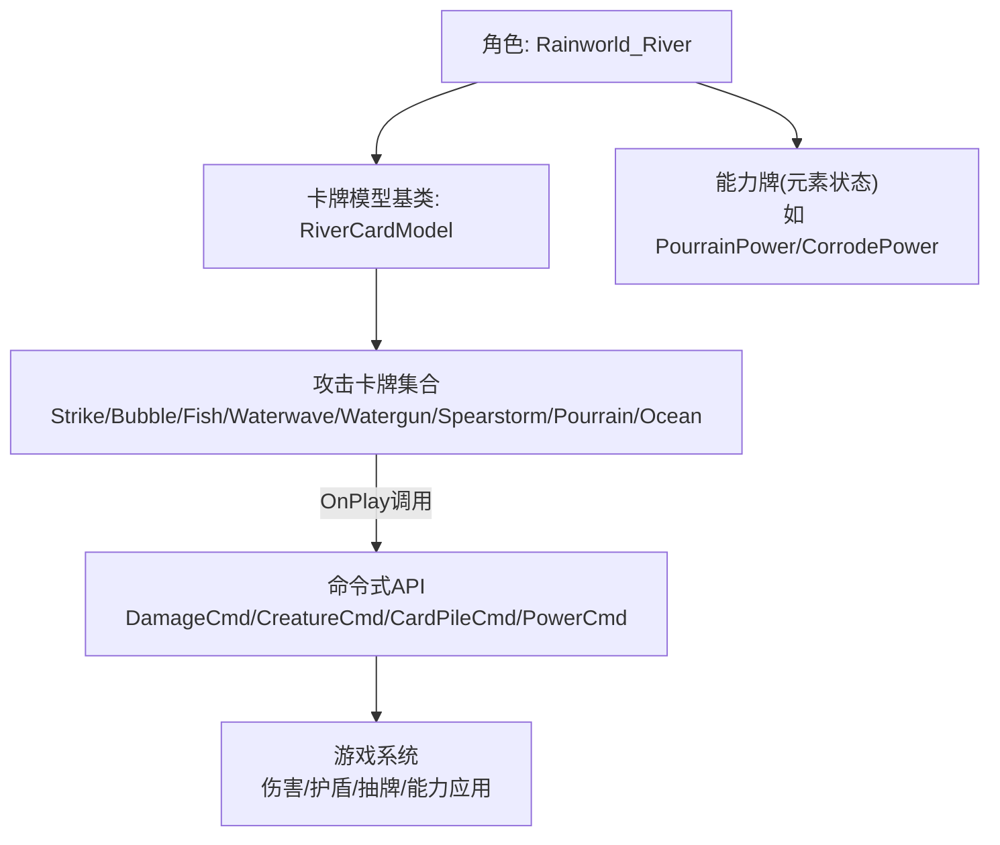
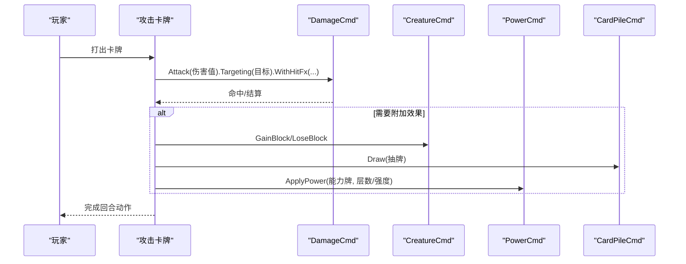
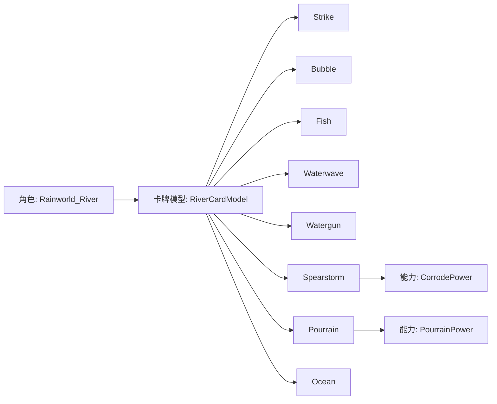

# 河流角色攻击卡牌

<cite>
**本文引用的文件**
- [Rainworld_River.cs](file://Scripts/Slugcat/Rainworld_River.cs)
- [RiverCardModel.cs](file://Scripts/Card/River/RiverCardModel.cs)
- [Rainworld_River_CardPool.cs](file://Scripts/Card/River/Rainworld_River_CardPool.cs)
- [Slugcat.cs](file://Scripts/Slugcat/Slugcat.cs)
- [Rainworld_River_Strike.cs](file://Scripts/Card/River/Attack/Rainworld_River_Strike.cs)
- [Rainworld_River_Bubble.cs](file://Scripts/Card/River/Attack/Rainworld_River_Bubble.cs)
- [Rainworld_River_Fish.cs](file://Scripts/Card/River/Attack/Rainworld_River_Fish.cs)
- [Rainworld_River_Waterwave.cs](file://Scripts/Card/River/Attack/Rainworld_River_Waterwave.cs)
- [Rainworld_River_Watergun.cs](file://Scripts/Card/River/Attack/Rainworld_River_Watergun.cs)
- [Rainworld_River_Spearstorm.cs](file://Scripts/Card/River/Attack/Rainworld_River_Spearstorm.cs)
- [Rainworld_River_Pourrain.cs](file://Scripts/Card/River/Attack/Rainworld_River_Pourrain.cs)
- [Rainworld_River_Ocean.cs](file://Scripts/Card/River/Attack/Rainworld_River_Ocean.cs)
</cite>

## 目录
1. [简介](#简介)
2. [项目结构](#项目结构)
3. [核心组件](#核心组件)
4. [架构总览](#架构总览)
5. [详细组件分析](#详细组件分析)
6. [依赖关系分析](#依赖关系分析)
7. [性能考量](#性能考量)
8. [故障排查指南](#故障排查指南)
9. [结论](#结论)
10. [附录：创建新河流攻击卡牌指南](#附录：创建新河流攻击卡牌指南)

## 简介
本文件为“河流”角色的攻击卡牌系统提供完整实现文档。围绕水元素主题，系统化说明水流、泡泡、鱼群等战斗方式的设计与实现；解释伤害计算、目标选择、连招组合与元素反应（通过能力牌联动）的机制；并给出动画、粒子与音效集成要点，以及新增攻击卡牌的落地流程与调试方法。

## 项目结构
- 角色定义与资源绑定位于角色类中，负责初始卡组、资源颜色、动画延迟、VFX列表等。
- 卡牌基类统一了资源路径、卡框与类型区分，便于扩展。
- 攻击卡牌均继承自河流卡牌基类，使用命令式API完成伤害、护盾、抽牌、能力应用等操作。
- 能力牌作为“元素状态”载体，被攻击卡牌在命中或打出时触发，形成水系连招与反应。

图表来源
- [Rainworld_River.cs:31-114](file://Scripts/Slugcat/Rainworld_River.cs#L31-L114)
- [RiverCardModel.cs:14-39](file://Scripts/Card/River/RiverCardModel.cs#L14-L39)
- [Rainworld_River_Strike.cs:9-57](file://Scripts/Card/River/Attack/Rainworld_River_Strike.cs#L9-L57)
- [Rainworld_River_Spearstorm.cs:15-82](file://Scripts/Card/River/Attack/Rainworld_River_Spearstorm.cs#L15-L82)

章节来源
- [Rainworld_River.cs:31-114](file://Scripts/Slugcat/Rainworld_River.cs#L31-L114)
- [RiverCardModel.cs:14-39](file://Scripts/Card/River/RiverCardModel.cs#L14-L39)

## 核心组件
- 角色类：定义初始卡组、能量颜色、动画延迟、攻击VFX列表、资源场景与UI图标等。
- 卡牌基类：统一资源路径、卡框、类型映射与构造参数。
- 攻击卡牌：基于命令式API实现伤害、护盾、抽牌、能力应用、随机目标、全敌目标等。
- 能力牌：承载“水元素”状态，被攻击卡牌在特定条件下触发，形成连招与反应。

章节来源
- [Rainworld_River.cs:31-114](file://Scripts/Slugcat/Rainworld_River.cs#L31-L114)
- [RiverCardModel.cs:14-39](file://Scripts/Card/River/RiverCardModel.cs#L14-L39)

## 架构总览
河流攻击卡牌采用“声明式变量 + 命令式执行”的模式：
- 声明阶段：在 CanonicalVars 中声明伤害、护盾等动态数值，支持升级变化。
- 执行阶段：在 OnPlay 中通过 DamageCmd、CreatureCmd、CardPileCmd、PowerCmd 等执行具体效果。
- 元素反应：通过 HasPower/ApplyPower 检查或施加能力牌，实现水元素叠加与连锁。

图表来源
- [Rainworld_River_Strike.cs:41-50](file://Scripts/Card/River/Attack/Rainworld_River_Strike.cs#L41-L50)
- [Rainworld_River_Fish.cs:29-39](file://Scripts/Card/River/Attack/Rainworld_River_Fish.cs#L29-L39)
- [Rainworld_River_Pourrain.cs:29-33](file://Scripts/Card/River/Attack/Rainworld_River_Pourrain.cs#L29-L33)

## 详细组件分析

### 基础攻击：水流直伤（Strike）
- 功能：对单一敌人造成基础伤害，附带命中特效。
- 目标选择：指定任意敌人。
- 升级：提升伤害值。
- 动画与音效：使用通用命中特效，角色攻击动画延迟由角色类配置。

章节来源
- [Rainworld_River_Strike.cs:9-57](file://Scripts/Card/River/Attack/Rainworld_River_Strike.cs#L9-L57)
- [Rainworld_River.cs:98-113](file://Scripts/Slugcat/Rainworld_River.cs#L98-L113)

### 泡泡攻击：单体伤害或护盾（Bubble）
- 功能：若目标为特定怪物则造成极高伤害；否则对目标造成伤害，并为自身获得护盾。
- 目标选择：可自定义目标类型（Anyone）。
- 升级：同时提升伤害与护盾值。
- 设计要点：条件分支处理特殊目标，避免误伤。

章节来源
- [Rainworld_River_Bubble.cs:14-65](file://Scripts/Card/River/Attack/Rainworld_River_Bubble.cs#L14-L65)

### 鱼群攻击：低伤+护盾+抽牌（Fish）
- 功能：对随机敌人造成少量伤害，获得护盾并抽一张牌。
- 目标选择：随机敌人。
- 升级：提升伤害与护盾。
- 连招价值：配合其他增伤或抽牌能力，快速展开。

章节来源
- [Rainworld_River_Fish.cs:9-46](file://Scripts/Card/River/Attack/Rainworld_River_Fish.cs#L9-L46)

### 水波攻击：伤害+护盾（Waterwave）
- 功能：对单一敌人造成伤害，并为自身获得护盾。
- 关键词：具备“灵巧”相关关键词（不用于当前场景）。
- 升级：伤害与护盾同步提升。

章节来源
- [Rainworld_River_Waterwave.cs:9-48](file://Scripts/Card/River/Attack/Rainworld_River_Waterwave.cs#L9-L48)

### 水枪攻击：破盾+伤害（Watergun）
- 功能：先移除目标的护盾，再对其造成伤害。
- 目标选择：指定任意敌人。
- 升级：提升伤害。
- 战术意义：克制高护盾敌人，打开输出窗口。

章节来源
- [Rainworld_River_Watergun.cs:11-44](file://Scripts/Card/River/Attack/Rainworld_River_Watergun.cs#L11-L44)

### 矛风暴：元素反应（Spearstorm）
- 功能：对单一敌人造成伤害；若目标拥有“腐蚀”能力，则伤害翻倍。
- 目标选择：指定任意敌人。
- 升级：提升伤害。
- 元素反应：通过 HasPower 检测能力状态，实现水元素与能力的协同。

章节来源
- [Rainworld_River_Spearstorm.cs:15-82](file://Scripts/Card/River/Attack/Rainworld_River_Spearstorm.cs#L15-L82)

### 倾盆大雨：范围伤害（Pourrain）
- 功能：对所有敌人造成高额伤害。
- 目标选择：所有敌人。
- 升级：提升伤害。
- 适用场景：清场或终结战局。

章节来源
- [Rainworld_River_Pourrain.cs:12-39](file://Scripts/Card/River/Attack/Rainworld_River_Pourrain.cs#L12-L39)

### 海洋：消耗+自动施放能力（Ocean）
- 功能：对单一敌人造成伤害；从抽牌堆查找一张能力牌并自动打出。
- 目标选择：指定任意敌人。
- 升级：提升伤害，并获得“固有”关键词。
- 连招价值：将能力牌纳入输出循环，增强策略深度。

章节来源
- [Rainworld_River_Ocean.cs:9-49](file://Scripts/Card/River/Attack/Rainworld_River_Ocean.cs#L9-L49)

### 角色与动画系统
- 攻击动画延迟与施法动画延迟由角色类配置，确保出牌节奏一致。
- 攻击命中特效通过 WithHitFx 指定，支持视觉反馈。
- 角色资源场景、图标、能量颜色、地图绘制色等均在角色类中集中管理。

章节来源
- [Rainworld_River.cs:45-113](file://Scripts/Slugcat/Rainworld_River.cs#L45-L113)
- [Slugcat.cs:93-133](file://Scripts/Slugcat/Slugcat.cs#L93-L133)

## 依赖关系分析
- 角色依赖卡牌池与资源路径，决定初始卡组与视觉表现。
- 攻击卡牌依赖命令式API进行伤害、护盾、抽牌、能力应用。
- 能力牌作为状态容器，被攻击卡牌在命中或打出时读取或施加，形成元素反应。

图表来源
- [Rainworld_River.cs:31-114](file://Scripts/Slugcat/Rainworld_River.cs#L31-L114)
- [RiverCardModel.cs:14-39](file://Scripts/Card/River/RiverCardModel.cs#L14-L39)
- [Rainworld_River_Spearstorm.cs:15-82](file://Scripts/Card/River/Attack/Rainworld_River_Spearstorm.cs#L15-L82)
- [Rainworld_River_Pourrain.cs:12-39](file://Scripts/Card/River/Attack/Rainworld_River_Pourrain.cs#L12-L39)

章节来源
- [Rainworld_River.cs:31-114](file://Scripts/Slugcat/Rainworld_River.cs#L31-L114)
- [RiverCardModel.cs:14-39](file://Scripts/Card/River/RiverCardModel.cs#L14-L39)

## 性能考量
- 目标选择算法：
  - 指定目标：直接命中，开销最小。
  - 随机目标：需从敌方列表随机选取，注意避免空集合异常。
  - 全体目标：遍历所有敌人，适合范围伤害但需注意帧内批处理。
- 动画与特效：
  - 命中特效通过字符串路径加载，建议复用常见特效以减少资源切换。
  - 角色攻击动画延迟固定，避免频繁刷新导致卡顿。
- 能力检测与施加：
  - HasPower/ApplyPower 为轻量操作，但应避免在每帧重复调用。
  - 能力层数与强度建议在卡牌升级时集中调整，减少运行时计算。

[本节为通用性能指导，不直接分析具体文件]

## 故障排查指南
- 目标为空：
  - 现象：OnPlay 中 Target 为 null 导致异常。
  - 处理：在执行前进行非空校验，必要时回退到默认行为（如改为护盾或抽牌）。
- 特殊目标误伤：
  - 现象：对特定怪物造成过高伤害。
  - 处理：精确判断目标类型，限制条件分支范围。
- 能力未生效：
  - 现象：期望的元素反应未触发。
  - 处理：确认能力是否已正确施加，检查 HasPower 条件与能力生命周期。
- 动画与音效不同步：
  - 现象：命中特效与攻击动画错位。
  - 处理：核对 WithHitFx 与角色攻击动画延迟配置，确保时间轴一致。

章节来源
- [Rainworld_River_Strike.cs:41-50](file://Scripts/Card/River/Attack/Rainworld_River_Strike.cs#L41-L50)
- [Rainworld_River_Bubble.cs:33-58](file://Scripts/Card/River/Attack/Rainworld_River_Bubble.cs#L33-L58)
- [Rainworld_River_Spearstorm.cs:62-75](file://Scripts/Card/River/Attack/Rainworld_River_Spearstorm.cs#L62-L75)

## 结论
河流角色的攻击卡牌系统以“水元素”为核心，通过基础直伤、范围伤害、破盾、护盾与抽牌等多样化手段构建丰富的战斗体验。借助能力牌的元素状态，实现了连招组合与反应机制。统一的卡牌基类与命令式API降低了实现复杂度，便于扩展新卡牌与优化性能。

[本节为总结性内容，不直接分析具体文件]

## 附录：创建新河流攻击卡牌指南
- 步骤概览
  - 新建攻击卡牌类，继承自 RiverCardModel。
  - 设置耗能、类型、稀有度、目标类型与图鉴显示。
  - 在 CanonicalVars 中声明伤害、护盾等动态数值。
  - 在 OnPlay 中使用命令式API实现效果（伤害、护盾、抽牌、能力应用）。
  - 在 OnUpgrade 中定义升级后的数值变化。
- 水元素配置
  - 通过能力牌承载水元素状态（如腐蚀、降雨等），在攻击卡牌中检测或施加。
  - 使用 HasPower 判断目标状态，结合 ApplyPower 施加新状态。
- 效果链实现
  - 单目标：指定目标，直接命中。
  - 多目标：使用随机或全体目标，注意性能与边界情况。
  - 连招：先施加能力，再由后续卡牌触发反应，形成伤害放大或控制链。
- 调试方法
  - 日志输出：在关键分支打印目标、伤害、能力状态。
  - 逐步验证：先实现基础伤害，再添加护盾、抽牌、能力应用。
  - 动画与音效：先用通用特效测试，再替换为专属资源。
- 与物理系统的交互
  - 命中特效与角色动画延迟保持一致，避免视觉错位。
  - 范围伤害尽量批量处理，减少逐帧计算。
- 性能优化策略
  - 复用特效路径，减少资源加载。
  - 避免在 OnPlay 中进行复杂循环，必要时拆分到能力牌。
  - 合理使用关键词（如消耗、固有）控制卡牌频率。

[本节为实践指导，不直接分析具体文件]