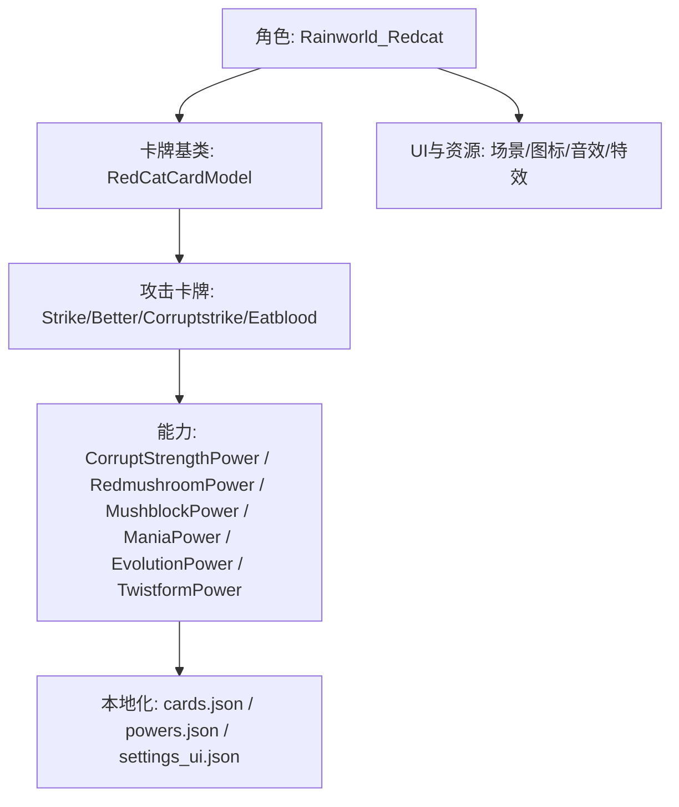
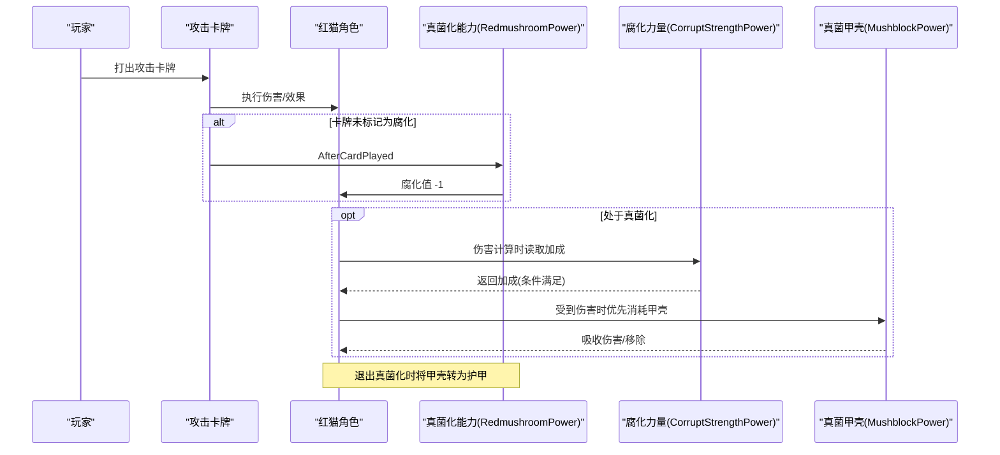
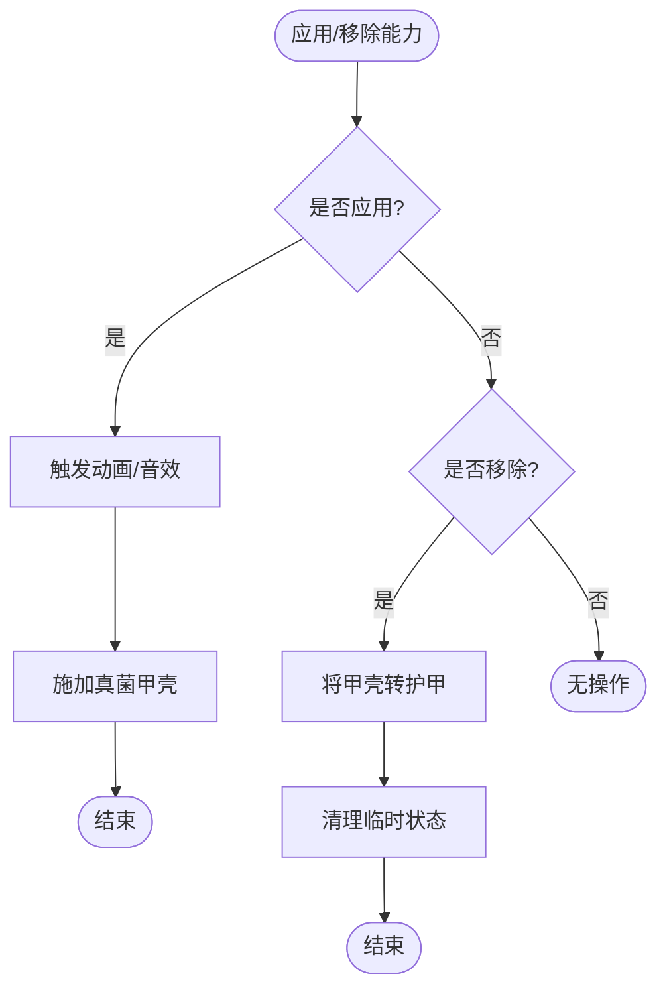
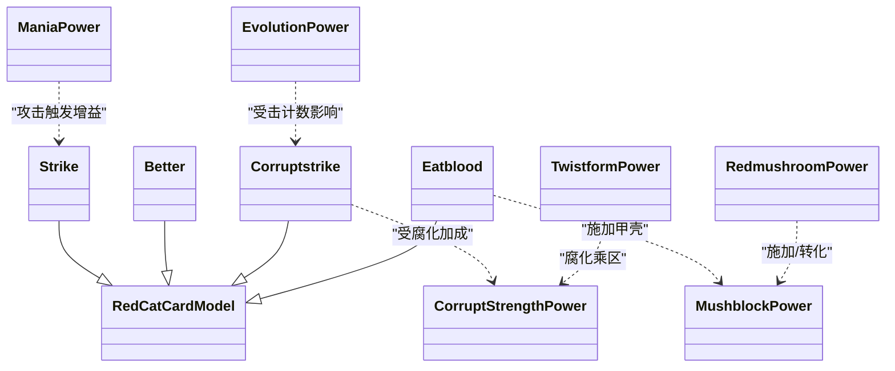
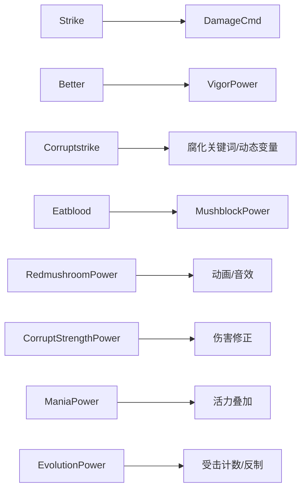

# 红猫角色攻击卡牌

<cite>
**本文引用的文件**
- [Rainworld_Redcat.cs](file://Scripts/Slugcat/Rainworld_Redcat.cs)
- [RedCatCardModel.cs](file://Scripts/Card/RedCat/RedCatCardModel.cs)
- [Rainworld_Redcat_Strike.cs](file://Scripts/Card/RedCat/Attack/Rainworld_Redcat_Strike.cs)
- [Rainworld_Redcat_Better.cs](file://Scripts/Card/RedCat/Attack/Rainworld_Redcat_Better.cs)
- [Rainworld_Redcat_Corruptstrike.cs](file://Scripts/Card/RedCat/Attack/Rainworld_Redcat_Corruptstrike.cs)
- [Rainworld_Redcat_Eatblood.cs](file://Scripts/Card/RedCat/Attack/Rainworld_Redcat_Eatblood.cs)
- [CorruptStrengthPower.cs](file://Scripts/Powers/RedCat/CorruptStrengthPower.cs)
- [RedmushroomPower.cs](file://Scripts/Powers/RedCat/RedmushroomPower.cs)
- [MushblockPower.cs](file://Scripts/Powers/RedCat/MushblockPower.cs)
- [ManiaPower.cs](file://Scripts/Powers/RedCat/ManiaPower.cs)
- [EvolutionPower.cs](file://Scripts/Powers/RedCat/EvolutionPower.cs)
- [TwistformPower.cs](file://Scripts/Powers/RedCat/TwistformPower.cs)
- [cards.json](file://SlugcatTheSpireII/localization/eng/cards.json)
- [powers.json](file://SlugcatTheSpireII/localization/eng/powers.json)
- [settings_ui.json](file://SlugcatTheSpireII/localization/eng/settings_ui.json)
</cite>

## 目录
1. [简介](#简介)
2. [项目结构](#项目结构)
3. [核心组件](#核心组件)
4. [架构总览](#架构总览)
5. [详细组件分析](#详细组件分析)
6. [依赖关系分析](#依赖关系分析)
7. [性能考量](#性能考量)
8. [故障排查指南](#故障排查指南)
9. [结论](#结论)
10. [附录：创建新红猫攻击卡牌的完整示例](#附录：创建新红猫攻击卡牌的完整示例)

## 简介
本文件面向“红猫”角色的攻击卡牌系统，围绕腐化值（Corruption）与“真菌化”状态展开，说明以下要点：
- 腐化值如何转换为伤害、护甲与增益；
- 变异形态（真菌化）下的特殊能力与限制；
- 攻击卡牌如何利用腐化值增强攻击力；
- 连击系统与狂暴机制的实现方式；
- 攻击卡牌的生命周期管理、状态效果与视觉反馈；
- 新增红猫攻击卡牌的完整流程（含腐化值处理、动画控制、音效集成）；
- 与腐化值系统的交互逻辑与性能优化建议。

## 项目结构
红猫相关代码主要分布在以下位置：
- 角色定义与资源：Scripts/Slugcat/Rainworld_Redcat.cs
- 卡牌基类与卡池：Scripts/Card/RedCat/RedCatCardModel.cs
- 攻击卡牌实现：Scripts/Card/RedCat/Attack/*.cs
- 能力（Power）与状态：Scripts/Powers/RedCat/*.cs
- 本地化文案：SlugcatTheSpireII/localization/eng/*.json

图表来源
- [Rainworld_Redcat.cs:44-84](file://Scripts/Slugcat/Rainworld_Redcat.cs#L44-L84)
- [RedCatCardModel.cs:17-33](file://Scripts/Card/RedCat/RedCatCardModel.cs#L17-L33)
- [Rainworld_Redcat_Strike.cs:31-49](file://Scripts/Card/RedCat/Attack/Rainworld_Redcat_Strike.cs#L31-L49)
- [CorruptStrengthPower.cs:40-48](file://Scripts/Powers/RedCat/CorruptStrengthPower.cs#L40-L48)
- [RedmushroomPower.cs:44-69](file://Scripts/Powers/RedCat/RedmushroomPower.cs#L44-L69)
- [MushblockPower.cs:41-59](file://Scripts/Powers/RedCat/MushblockPower.cs#L41-L59)
- [ManiaPower.cs:39-60](file://Scripts/Powers/RedCat/ManiaPower.cs#L39-L60)
- [EvolutionPower.cs:42-61](file://Scripts/Powers/RedCat/EvolutionPower.cs#L42-L61)
- [TwistformPower.cs:28-37](file://Scripts/Powers/RedCat/TwistformPower.cs#L28-L37)
- [cards.json:294-302](file://SlugcatTheSpireII/localization/eng/cards.json#L294-L302)
- [powers.json:122-157](file://SlugcatTheSpireII/localization/eng/powers.json#L122-L157)
- [settings_ui.json:10-14](file://SlugcatTheSpireII/localization/eng/settings_ui.json#L10-L14)

章节来源
- [Rainworld_Redcat.cs:32-128](file://Scripts/Slugcat/Rainworld_Redcat.cs#L32-L128)
- [RedCatCardModel.cs:15-39](file://Scripts/Card/RedCat/RedCatCardModel.cs#L15-L39)

## 核心组件
- 角色层：红猫角色定义了初始牌组、资源、视觉与音频等，并暴露攻击/施法动画延迟等参数。
- 卡牌层：所有红猫攻击卡牌继承自 RedCatCardModel，统一资源路径与类型映射。
- 能力层：通过一系列 Power 实现腐化值获取/消耗、护甲转换、伤害修正、连击/狂暴等机制。
- 数据与本地化：通过 JSON 文案描述卡牌与能力的行为提示，便于玩家理解。

章节来源
- [Rainworld_Redcat.cs:94-102](file://Scripts/Slugcat/Rainworld_Redcat.cs#L94-L102)
- [RedCatCardModel.cs:17-33](file://Scripts/Card/RedCat/RedCatCardModel.cs#L17-L33)
- [cards.json:294-302](file://SlugcatTheSpireII/localization/eng/cards.json#L294-L302)
- [powers.json:122-157](file://SlugcatTheSpireII/localization/eng/powers.json#L122-L157)

## 架构总览
红猫的攻击体系以“腐化值”为核心资源，驱动“真菌化”状态与多种增益/代价。典型流程如下：
- 非腐化卡牌打出后，若具备“真菌化”能力，会减少腐化值；
- 进入“真菌化”时获得“真菌甲壳”（护盾），并在退出时转化为护甲；
- 在“真菌化”期间，部分能力提供伤害加成或额外收益；
- 特定能力在每回合结束时移除自身，形成循环；
- 连击/狂暴类能力根据攻击行为触发额外增益或限制。

图表来源
- [RedmushroomPower.cs:44-69](file://Scripts/Powers/RedCat/RedmushroomPower.cs#L44-L69)
- [CorruptStrengthPower.cs:40-48](file://Scripts/Powers/RedCat/CorruptStrengthPower.cs#L40-L48)
- [MushblockPower.cs:41-59](file://Scripts/Powers/RedCat/MushblockPower.cs#L41-L59)

## 详细组件分析

### 腐化值与真菌化（RedmushroomPower）
- 行为要点：
  - 打出非“腐化”关键词的卡牌时，减少腐化值；
  - 应用该能力时，触发角色动画、播放音效、施加“真菌甲壳”；
  - 移除该能力时，将“真菌甲壳”全部转化为护甲，并清理其他临时状态。
- 交互点：
  - 与 UI 的腐化值显示联动；
  - 与“假死/睡眠”状态配合，避免重复触发。

图表来源
- [RedmushroomPower.cs:55-93](file://Scripts/Powers/RedCat/RedmushroomPower.cs#L55-L93)

章节来源
- [RedmushroomPower.cs:44-93](file://Scripts/Powers/RedCat/RedmushroomPower.cs#L44-L93)
- [settings_ui.json:10-14](file://SlugcatTheSpireII/localization/eng/settings_ui.json#L10-L14)

### 腐化力量（CorruptStrengthPower）
- 作用：在满足条件时（由腐化值驱动的增伤/状态），对伤害进行加法修正。
- 使用场景：当角色拥有“真菌化”能力且攻击来自玩家时生效。

章节来源
- [CorruptStrengthPower.cs:40-48](file://Scripts/Powers/RedCat/CorruptStrengthPower.cs#L40-L48)

### 真菌甲壳（MushblockPower）
- 作用：作为一次性护盾，在受到致命伤害时吸收伤害并移除自身；否则按比例扣减。
- 与真菌化的协同：进入/退出真菌化时自动施加/转化。

章节来源
- [MushblockPower.cs:41-59](file://Scripts/Powers/RedCat/MushblockPower.cs#L41-L59)

### 连击与狂暴（ManiaPower, EvolutionPower）
- 狂暴（ManiaPower）：
  - 阻止技能自动出牌；
  - 每次打出攻击牌时闪烁并叠加活力；
  - 玩家回合结束时移除自身，形成限时增益。
- 进化（EvolutionPower）：
  - 记录受到的攻击次数；
  - 在受到伤害时对来源造成反制性修正（降低其后续伤害）。

章节来源
- [ManiaPower.cs:39-60](file://Scripts/Powers/RedCat/ManiaPower.cs#L39-L60)
- [EvolutionPower.cs:42-61](file://Scripts/Powers/RedCat/EvolutionPower.cs#L42-L61)

### 攻击卡牌示例

#### 基础攻击：Strike
- 特点：标准攻击，附带命中特效；升级提升伤害。
- 生命周期：OnPlay 执行伤害，OnUpgrade 调整数值。

章节来源
- [Rainworld_Redcat_Strike.cs:31-56](file://Scripts/Card/RedCat/Attack/Rainworld_Redcat_Strike.cs#L31-L56)

#### 复合攻击：Better
- 特点：先造成伤害，再将伤害量转化为活力（Vigor）。
- 生命周期：OnPlay 中顺序执行伤害与增益；OnUpgrade 提升基础伤害。

章节来源
- [Rainworld_Redcat_Better.cs:38-63](file://Scripts/Card/RedCat/Attack/Rainworld_Redcat_Better.cs#L38-L63)

#### 腐化攻击：Corruptstrike
- 特点：带有“腐化”关键词，可回手；伤害基于移动属性与蘑菇块数量动态计算。
- 生命周期：OnPlay 计算伤害并执行攻击；OnUpgrade 提升基础值。

章节来源
- [Rainworld_Redcat_Corruptstrike.cs:23-57](file://Scripts/Card/RedCat/Attack/Rainworld_Redcat_Corruptstrike.cs#L23-L57)

#### 资源型攻击：Eatblood
- 特点：消耗能量造成固定伤害，同时施加“真菌甲壳”；支持外部增加伤害/召唤量。
- 生命周期：OnPlay 执行伤害并施加甲壳；OnUpgrade 提升伤害。

章节来源
- [Rainworld_Redcat_Eatblood.cs:80-121](file://Scripts/Card/RedCat/Attack/Rainworld_Redcat_Eatblood.cs#L80-L121)

### 卡牌与能力关系图

图表来源
- [RedCatCardModel.cs:15-39](file://Scripts/Card/RedCat/RedCatCardModel.cs#L15-L39)
- [Rainworld_Redcat_Strike.cs:31-56](file://Scripts/Card/RedCat/Attack/Rainworld_Redcat_Strike.cs#L31-L56)
- [Rainworld_Redcat_Better.cs:38-63](file://Scripts/Card/RedCat/Attack/Rainworld_Redcat_Better.cs#L38-L63)
- [Rainworld_Redcat_Corruptstrike.cs:23-57](file://Scripts/Card/RedCat/Attack/Rainworld_Redcat_Corruptstrike.cs#L23-L57)
- [Rainworld_Redcat_Eatblood.cs:80-121](file://Scripts/Card/RedCat/Attack/Rainworld_Redcat_Eatblood.cs#L80-L121)
- [CorruptStrengthPower.cs:40-48](file://Scripts/Powers/RedCat/CorruptStrengthPower.cs#L40-L48)
- [RedmushroomPower.cs:44-93](file://Scripts/Powers/RedCat/RedmushroomPower.cs#L44-L93)
- [MushblockPower.cs:41-59](file://Scripts/Powers/RedCat/MushblockPower.cs#L41-L59)
- [ManiaPower.cs:39-60](file://Scripts/Powers/RedCat/ManiaPower.cs#L39-L60)
- [EvolutionPower.cs:42-61](file://Scripts/Powers/RedCat/EvolutionPower.cs#L42-L61)
- [TwistformPower.cs:28-37](file://Scripts/Powers/RedCat/TwistformPower.cs#L28-L37)

## 依赖关系分析
- 卡牌到能力：
  - Corruptstrike 依赖腐化关键词与动态变量，间接受益于腐化力量；
  - Eatblood 直接施加真菌甲壳；
  - Better 将伤害结果转化为活力。
- 能力到角色：
  - 真菌化能力在应用/移除时操控角色动画与音效；
  - 腐化力量在伤害阶段介入；
  - 狂暴/进化在战斗事件钩子中修改行为。
- 本地化依赖：
  - cards.json 与 powers.json 提供卡牌/能力文案；
  - settings_ui.json 提供腐化值 UI 文案。

图表来源
- [Rainworld_Redcat_Strike.cs:41-49](file://Scripts/Card/RedCat/Attack/Rainworld_Redcat_Strike.cs#L41-L49)
- [Rainworld_Redcat_Better.cs:48-57](file://Scripts/Card/RedCat/Attack/Rainworld_Redcat_Better.cs#L48-L57)
- [Rainworld_Redcat_Corruptstrike.cs:23-51](file://Scripts/Card/RedCat/Attack/Rainworld_Redcat_Corruptstrike.cs#L23-L51)
- [Rainworld_Redcat_Eatblood.cs:104-115](file://Scripts/Card/RedCat/Attack/Rainworld_Redcat_Eatblood.cs#L104-L115)
- [RedmushroomPower.cs:55-69](file://Scripts/Powers/RedCat/RedmushroomPower.cs#L55-L69)
- [CorruptStrengthPower.cs:40-48](file://Scripts/Powers/RedCat/CorruptStrengthPower.cs#L40-L48)
- [ManiaPower.cs:46-60](file://Scripts/Powers/RedCat/ManiaPower.cs#L46-L60)
- [EvolutionPower.cs:42-61](file://Scripts/Powers/RedCat/EvolutionPower.cs#L42-L61)

章节来源
- [cards.json:294-302](file://SlugcatTheSpireII/localization/eng/cards.json#L294-L302)
- [powers.json:122-157](file://SlugcatTheSpireII/localization/eng/powers.json#L122-L157)
- [settings_ui.json:10-14](file://SlugcatTheSpireII/localization/eng/settings_ui.json#L10-L14)

## 性能考量
- 事件钩子使用：
  - 尽量在 AfterCardPlayed/AfterDamageReceived 等轻量钩子中做最小必要计算；
  - 避免在高频路径中进行昂贵对象分配。
- 动画与音效：
  - 仅在必要时触发 SetAnimationTrigger 与音效播放；
  - 复用已有特效字符串，减少资源加载。
- 数值计算：
  - 使用 DynamicVars 集中管理可变数值，减少重复计算；
  - 对复杂公式进行缓存或分步计算，避免每帧重算。
- 状态管理：
  - 使用 Power 的堆叠/计数器特性，避免全局状态污染；
  - 在能力移除时及时清理副作用（如动画、临时增益）。

[本节为通用指导，不直接分析具体文件]

## 故障排查指南
- 症状：腐化值未变化
  - 检查是否错误地给卡牌添加了“腐化”关键词；
  - 确认非腐化卡牌打出的时机是否正确触发 AfterCardPlayed。
- 症状：真菌化未生效或异常退出
  - 检查是否在应用/移除能力时触发了正确的动画与音效；
  - 确认假死/睡眠状态下是否抑制了重复触发。
- 症状：伤害未按预期修正
  - 检查腐化力量的条件判断（目标、来源、是否真菌化）；
  - 确认动态变量的更新与升级逻辑一致。
- 症状：连击/狂暴异常
  - 检查 ShouldPlay 与 AfterCardPlayed 的拦截逻辑；
  - 确认回合结束时正确移除能力。

章节来源
- [RedmushroomPower.cs:44-93](file://Scripts/Powers/RedCat/RedmushroomPower.cs#L44-L93)
- [CorruptStrengthPower.cs:40-48](file://Scripts/Powers/RedCat/CorruptStrengthPower.cs#L40-L48)
- [ManiaPower.cs:39-60](file://Scripts/Powers/RedCat/ManiaPower.cs#L39-L60)

## 结论
红猫的攻击体系以腐化值为枢纽，通过“真菌化”状态与多种能力组合，实现了高爆发与高风险的策略空间。攻击卡牌通过统一的基类与动态变量机制，能够灵活接入腐化值系统，结合连击与狂暴机制，形成丰富的战斗节奏。遵循本文档的扩展指南，可快速创建新的红猫攻击卡牌并确保与现有系统的良好协作。

[本节为总结，不直接分析具体文件]

## 附录：创建新红猫攻击卡牌的完整示例
以下为创建一张新红猫攻击卡牌的步骤清单（不含具体代码内容）：
- 新建类并继承 RedCatCardModel，设置耗能、类型、稀有度、目标与图鉴显示；
- 定义关键词与标签（如需“腐化”、“耗尽”等）；
- 使用 DynamicVars 声明伤害/召唤/其他数值，并在 OnUpgrade 中调整；
- 在 OnPlay 中：
  - 校验目标有效性；
  - 使用 DamageCmd 执行伤害，指定命中特效；
  - 根据需要施加能力（如真菌甲壳）、改变腐化值或附加状态；
- 与腐化值系统交互：
  - 若需减少腐化值，调用对应方法；
  - 若需从腐化值获取增益，确保在伤害修正阶段被读取；
- 动画与音效：
  - 在需要时触发角色动画触发器；
  - 播放合适的音效事件；
- 本地化：
  - 在 cards.json 中添加标题与描述；
  - 在 powers.json 中补充相关能力文案；
- 测试与调试：
  - 验证升级前后数值变化；
  - 检查与真菌化、连击、狂暴等能力的交互；
  - 观察动画与音效是否正常触发。

章节来源
- [RedCatCardModel.cs:15-39](file://Scripts/Card/RedCat/RedCatCardModel.cs#L15-L39)
- [Rainworld_Redcat_Strike.cs:31-56](file://Scripts/Card/RedCat/Attack/Rainworld_Redcat_Strike.cs#L31-L56)
- [Rainworld_Redcat_Corruptstrike.cs:23-57](file://Scripts/Card/RedCat/Attack/Rainworld_Redcat_Corruptstrike.cs#L23-L57)
- [Rainworld_Redcat_Eatblood.cs:80-121](file://Scripts/Card/RedCat/Attack/Rainworld_Redcat_Eatblood.cs#L80-L121)
- [RedmushroomPower.cs:44-93](file://Scripts/Powers/RedCat/RedmushroomPower.cs#L44-L93)
- [cards.json:294-302](file://SlugcatTheSpireII/localization/eng/cards.json#L294-L302)
- [powers.json:122-157](file://SlugcatTheSpireII/localization/eng/powers.json#L122-L157)