# 肝脏角色攻击卡牌

<cite>
**本文引用的文件**
- [LiverCardModel.cs](file://Scripts/Card/Liver/LiverCardModel.cs)
- [Rainworld_Liver.cs](file://Scripts/Slugcat/Rainworld_Liver.cs)
- [NLiver.cs](file://Godot/Character/Liver/NLiver.cs)
- [Rainworld_Liver_Strike.cs](file://Scripts/Card/Liver/Attack/Rainworld_Liver_Strike.cs)
- [Rainworld_Liver_Spear.cs](file://Scripts/Card/Liver/Attack/Rainworld_Liver_Spear.cs)
- [Rainworld_Liver_Rolling.cs](file://Scripts/Card/Liver/Attack/Rainworld_Liver_Rolling.cs)
- [Rainworld_Liver_Bomb.cs](file://Scripts/Card/Liver/Attack/Rainworld_Liver_Bomb.cs)
- [Rainworld_Liver_Spearboom.cs](file://Scripts/Card/Liver/Attack/Rainworld_Liver_Spearboom.cs)
- [Rainworld_Liver_Jumphit.cs](file://Scripts/Card/Liver/Attack/Rainworld_Liver_Jumphit.cs)
- [Rainworld_Liver_Spearfire.cs](file://Scripts/Card/Liver/Attack/Rainworld_Liver_Spearfire.cs)
- [Rainworld_Liver_Tearwound.cs](file://Scripts/Card/Liver/Attack/Rainworld_Liver_Tearwound.cs)
- [ComboPower.cs](file://Scripts/Powers/ComboPower.cs)
</cite>

## 目录
1. [简介](#简介)
2. [项目结构](#项目结构)
3. [核心组件](#核心组件)
4. [架构总览](#架构总览)
5. [详细组件分析](#详细组件分析)
6. [依赖关系分析](#依赖关系分析)
7. [性能考量](#性能考量)
8. [故障排查指南](#故障排查指南)
9. [结论](#结论)
10. [附录：新增攻击卡牌实现指南](#附录新增攻击卡牌实现指南)

## 简介
本文件为“肝脏角色”的攻击卡牌系统提供系统化、可操作的文档。内容覆盖肝脏角色的独特攻击机制（长矛、滚动、炸弹等），每种攻击的伤害计算、目标选择与特殊效果；记录连击系统与能量管理机制；给出升级效果与平衡性调整策略；并提供创建新攻击卡牌的完整步骤，包括参数配置、动画触发与音效播放，以及与 Godot 引擎集成的动画系统细节。

## 项目结构
肝脏角色攻击卡牌位于 Scripts/Card/Liver/Attack 目录下，所有攻击卡牌继承自 LiverCardModel，统一资源路径与卡框样式由基类管理。角色定义在 Scripts/Slugcat/Rainworld_Liver.cs，负责初始牌组、视觉场景、音频与动画延迟等。Godot 侧的角色可视化脚本 NLiver.cs 处理点击交互与动画触发。

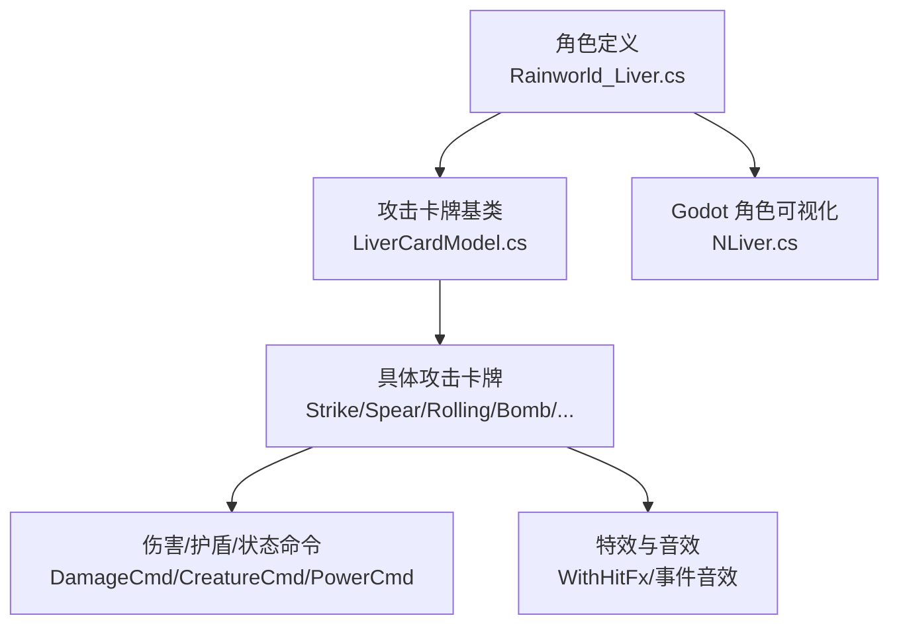

图表来源
- [Rainworld_Liver.cs:41-117](file://Scripts/Slugcat/Rainworld_Liver.cs#L41-L117)
- [LiverCardModel.cs:14-38](file://Scripts/Card/Liver/LiverCardModel.cs#L14-L38)
- [NLiver.cs:12-49](file://Godot/Character/Liver/NLiver.cs#L12-L49)

章节来源
- [Rainworld_Liver.cs:41-117](file://Scripts/Slugcat/Rainworld_Liver.cs#L41-L117)
- [LiverCardModel.cs:14-38](file://Scripts/Card/Liver/LiverCardModel.cs#L14-L38)
- [NLiver.cs:12-49](file://Godot/Character/Liver/NLiver.cs#L12-L49)

## 核心组件
- 角色定义（Rainworld_Liver）：设置初始牌组、角色资源、攻击/施法动画延迟、VFX 列表等。
- 攻击卡牌基类（LiverCardModel）：统一资源路径、卡框类型映射、构造参数封装。
- 具体攻击卡牌：实现 OnPlay 逻辑、动态变量、关键词、升级逻辑、目标选择、特效与音效。
- 连击能力（ComboPower）：在同一回合内打出技能+攻击后叠加力量与敏捷。
- Godot 集成（NLiver）：监听输入、触发 Spine 动画与音效。

章节来源
- [Rainworld_Liver.cs:87-117](file://Scripts/Slugcat/Rainworld_Liver.cs#L87-L117)
- [LiverCardModel.cs:14-38](file://Scripts/Card/Liver/LiverCardModel.cs#L14-L38)
- [ComboPower.cs:27-68](file://Scripts/Powers/ComboPower.cs#L27-L68)
- [NLiver.cs:12-49](file://Godot/Character/Liver/NLiver.cs#L12-L49)

## 架构总览
肝脏角色攻击系统围绕“卡牌模型 + 命令系统 + 动态变量 + 特效/音效 + Godot 动画”构建。卡牌通过 DamageCmd/CreatureCmd/PowerCmd 等命令执行战斗逻辑，使用 WithHitFx 或事件音效驱动视觉与听觉反馈；Godot 侧通过 NCreatureVisuals 子类控制角色动画与交互。

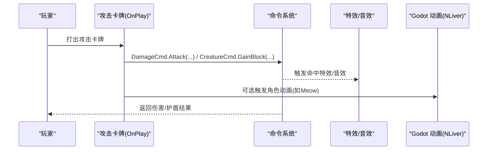

图表来源
- [Rainworld_Liver_Spear.cs:45-57](file://Scripts/Card/Liver/Attack/Rainworld_Liver_Spear.cs#L45-L57)
- [Rainworld_Liver_Rolling.cs:48-58](file://Scripts/Card/Liver/Attack/Rainworld_Liver_Rolling.cs#L48-L58)
- [Rainworld_Liver_Bomb.cs:75-85](file://Scripts/Card/Liver/Attack/Rainworld_Liver_Bomb.cs#L75-L85)
- [NLiver.cs:20-46](file://Godot/Character/Liver/NLiver.cs#L20-L46)

## 详细组件分析

### 基础攻击：打击（Strike）
- 功能：对单一敌人造成基础伤害，附带简单命中特效。
- 伤害计算：基于 DynamicVars.Damage 的基础值，可通过升级提升。
- 目标选择：AnyEnemy。
- 升级效果：伤害增加固定数值。
- 关键词/标签：包含角色专属关键词与 Strike 标签。

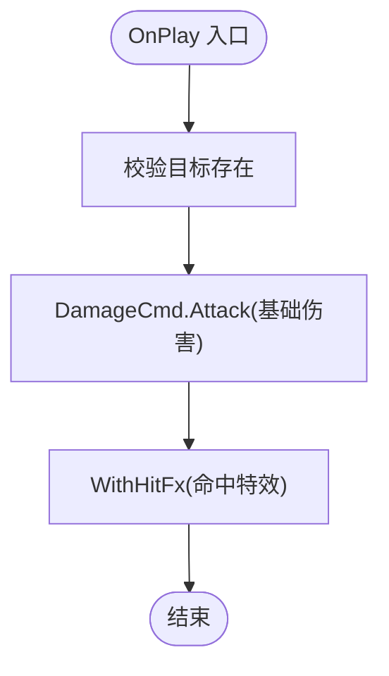

图表来源
- [Rainworld_Liver_Strike.cs:40-50](file://Scripts/Card/Liver/Attack/Rainworld_Liver_Strike.cs#L40-L50)

章节来源
- [Rainworld_Liver_Strike.cs:12-57](file://Scripts/Card/Liver/Attack/Rainworld_Liver_Strike.cs#L12-L57)

### 长矛攻击（Spear）
- 功能：对单一敌人造成带“穿刺”效果的伤害，并为目标施加“Chuang”状态。
- 伤害计算：DynamicVars.Damage.BaseValue，升级时提升。
- 目标选择：AnyEnemy。
- 特殊效果：通过 PowerCmd.Apply 为目标添加 ChuangPower，影响后续互动。
- 关键词：包含“Spear”关键词。

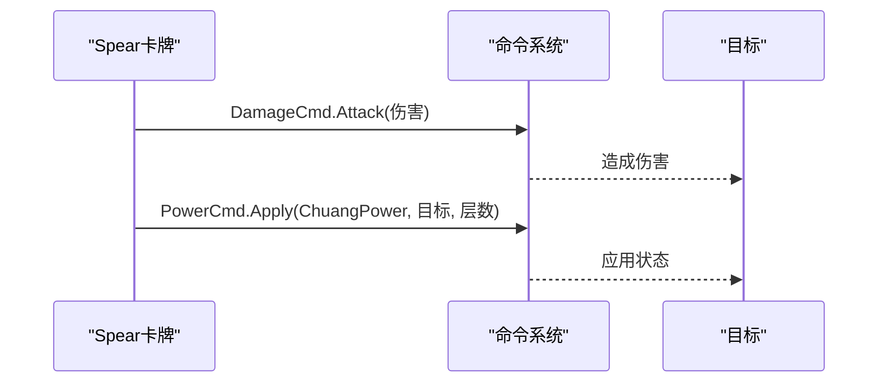

图表来源
- [Rainworld_Liver_Spear.cs:45-57](file://Scripts/Card/Liver/Attack/Rainworld_Liver_Spear.cs#L45-L57)

章节来源
- [Rainworld_Liver_Spear.cs:16-65](file://Scripts/Card/Liver/Attack/Rainworld_Liver_Spear.cs#L16-L65)

### 滚动攻击（Rolling）
- 功能：根据 X 能量消耗进行多次攻击，并为自身获得护盾。
- 伤害计算：DamageVar 为基础伤害，攻击次数 = ResolveEnergyXValue()。
- 目标选择：AnyEnemy。
- 特殊效果：每次攻击后为自身增加 BlockVar 的护盾值。
- 升级效果：伤害与护盾均提升。

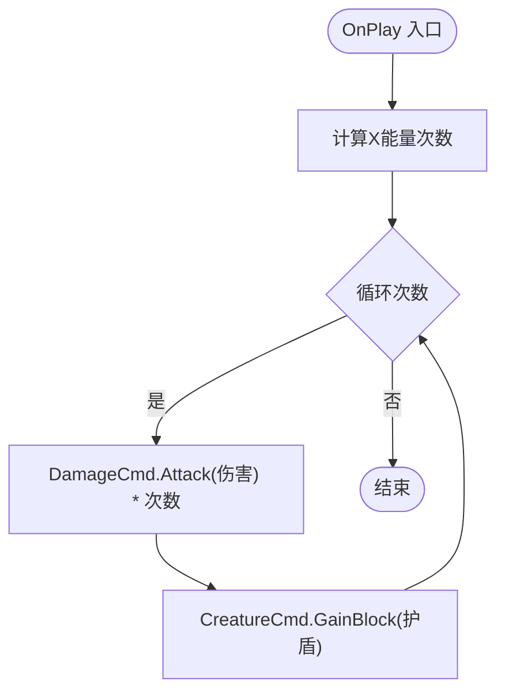

图表来源
- [Rainworld_Liver_Rolling.cs:48-58](file://Scripts/Card/Liver/Attack/Rainworld_Liver_Rolling.cs#L48-L58)

章节来源
- [Rainworld_Liver_Rolling.cs:16-66](file://Scripts/Card/Liver/Attack/Rainworld_Liver_Rolling.cs#L16-L66)

### 炸弹攻击（Bomb）
- 功能：对所有敌人造成范围伤害，附带爆炸音效与特效。
- 伤害计算：DynamicVars.Damage.BaseValue。
- 目标选择：AllEnemies。
- 特殊效果：使用事件音效与命中特效增强表现。
- 关键词：包含 Exhaust 与 Treasure 关键词。

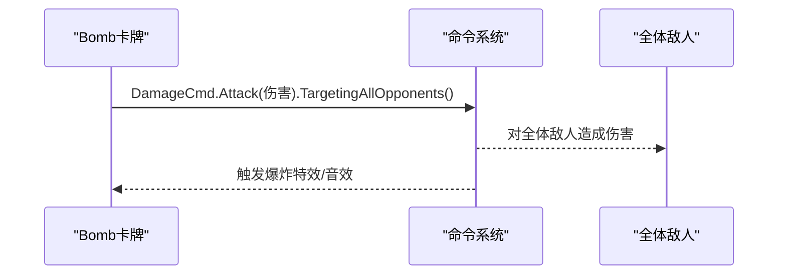

图表来源
- [Rainworld_Liver_Bomb.cs:75-85](file://Scripts/Card/Liver/Attack/Rainworld_Liver_Bomb.cs#L75-L85)

章节来源
- [Rainworld_Liver_Bomb.cs:21-92](file://Scripts/Card/Liver/Attack/Rainworld_Liver_Bomb.cs#L21-L92)

### 复合攻击：长矛爆破（Spearboom）
- 功能：先对单体造成高伤害，随后延时对全体敌人造成二次伤害，并丢弃该卡牌；出牌后将自身转换为一张长矛牌（若升级则转换后的长矛也升级）。
- 伤害计算：首次伤害与二次伤害均为 DynamicVars.Damage.BaseValue。
- 目标选择：先 AnyEnemy，再 AllEnemies。
- 特殊效果：延时执行、丢弃卡牌、卡牌变换。
- 关键词：包含 Spear 与 Treasure 关键词。

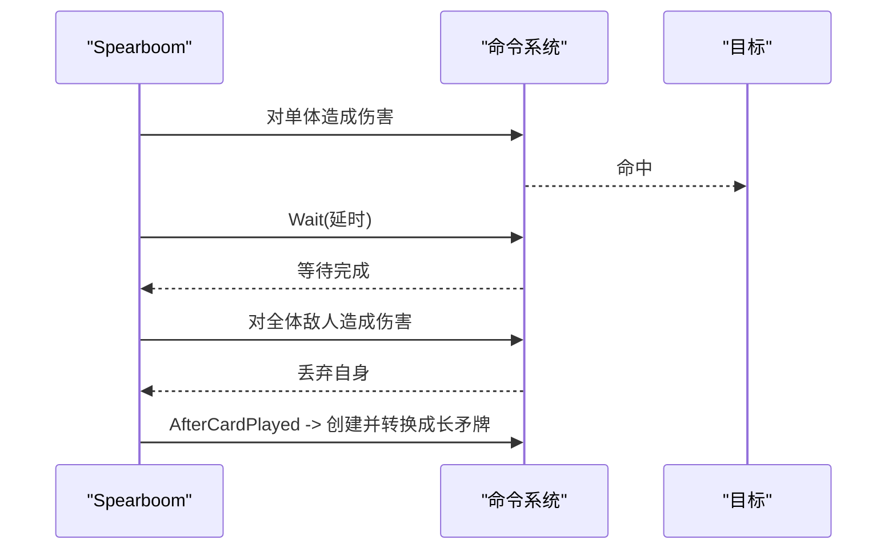

图表来源
- [Rainworld_Liver_Spearboom.cs:76-112](file://Scripts/Card/Liver/Attack/Rainworld_Liver_Spearboom.cs#L76-L112)

章节来源
- [Rainworld_Liver_Spearboom.cs:22-119](file://Scripts/Card/Liver/Attack/Rainworld_Liver_Spearboom.cs#L22-L119)

### 跳跃攻击（Jumphit）
- 功能：对单体造成伤害，并根据敌方意图决定攻击次数，同时为自身获得护盾。
- 伤害计算：DynamicVars.Damage.BaseValue，攻击次数可能翻倍。
- 目标选择：AnyEnemy。
- 特殊效果：当敌方准备攻击时，攻击次数×2；之后为自身增加 BlockVar 护盾。
- 升级效果：伤害与护盾均提升。

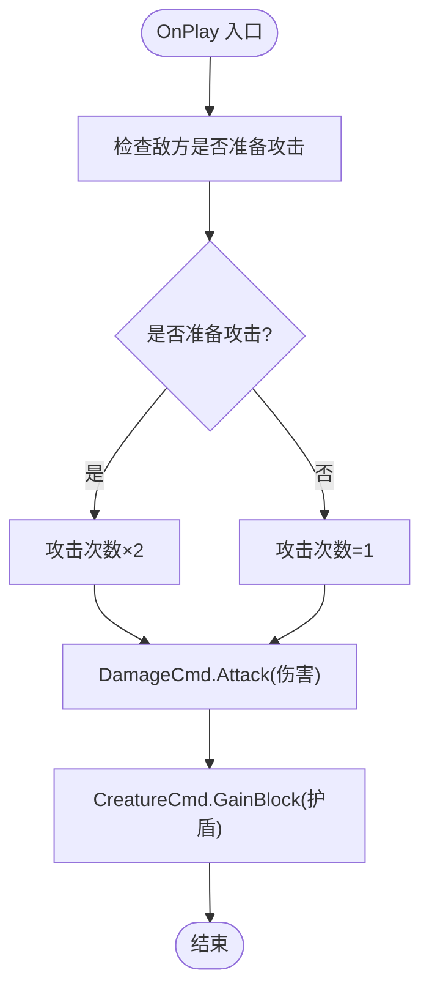

图表来源
- [Rainworld_Liver_Jumphit.cs:45-58](file://Scripts/Card/Liver/Attack/Rainworld_Liver_Jumphit.cs#L45-L58)

章节来源
- [Rainworld_Liver_Jumphit.cs:16-67](file://Scripts/Card/Liver/Attack/Rainworld_Liver_Jumphit.cs#L16-L67)

### 火焰长矛（Spearfire）
- 功能：对单体造成高额伤害，并为目标施加“Chuang”状态；若击杀目标且目标具备致命死亡触发条件，则永久提升该牌伤害。
- 伤害计算：BaseDamage + IncreasedDamage，IncreasedDamage 在满足条件时增长。
- 目标选择：AnyEnemy。
- 特殊效果：条件性增益、持久化伤害提升（保存属性）。
- 升级效果：基础伤害、Chuang 层数、Increase 增量均提升。

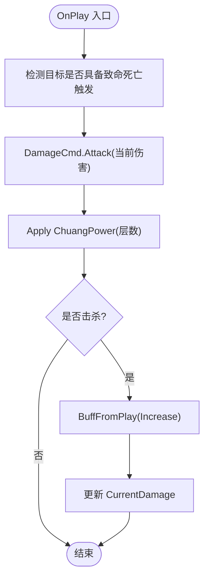

图表来源
- [Rainworld_Liver_Spearfire.cs:91-131](file://Scripts/Card/Liver/Attack/Rainworld_Liver_Spearfire.cs#L91-L131)

章节来源
- [Rainworld_Liver_Spearfire.cs:21-131](file://Scripts/Card/Liver/Attack/Rainworld_Liver_Spearfire.cs#L21-L131)

### 撕裂伤口（Tearwound）
- 功能：对单体造成低额伤害，若目标存活且拥有“Chuang”状态，则复制其层数再次施加（升级时翻倍）。
- 伤害计算：DynamicVars.Damage.BaseValue。
- 目标选择：AnyEnemy。
- 特殊效果：读取目标 ChuangPower 层数并追加。
- 关键词：Exhaust。

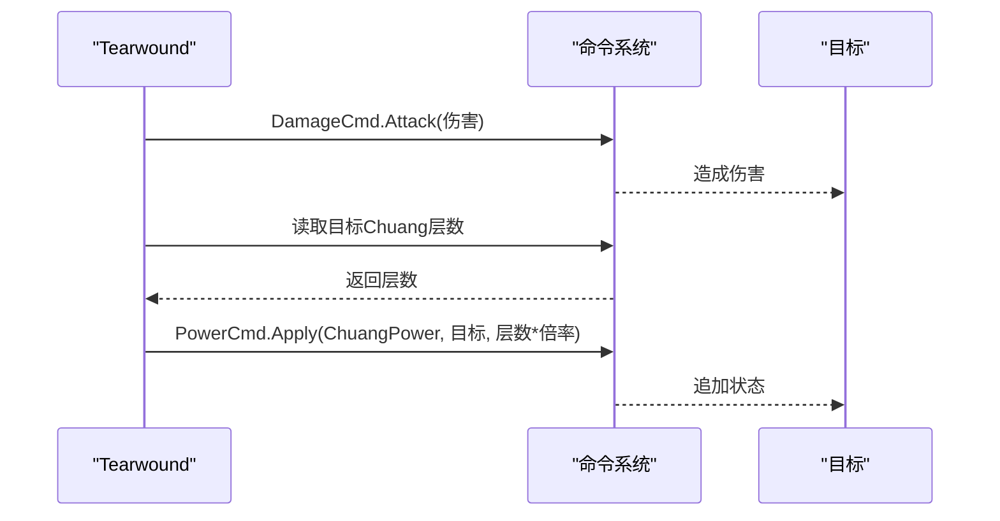

图表来源
- [Rainworld_Liver_Tearwound.cs:46-60](file://Scripts/Card/Liver/Attack/Rainworld_Liver_Tearwound.cs#L46-L60)

章节来源
- [Rainworld_Liver_Tearwound.cs:17-67](file://Scripts/Card/Liver/Attack/Rainworld_Liver_Tearwound.cs#L17-L67)

### 连击系统（ComboPower）
- 功能：在同一回合内，若先后打出技能与攻击，则叠加力量与敏捷。
- 触发时机：回合开始重置标记；每打出一张牌后检查类型。
- 效果：同时应用 StrengthPower 与 DexterityPower。

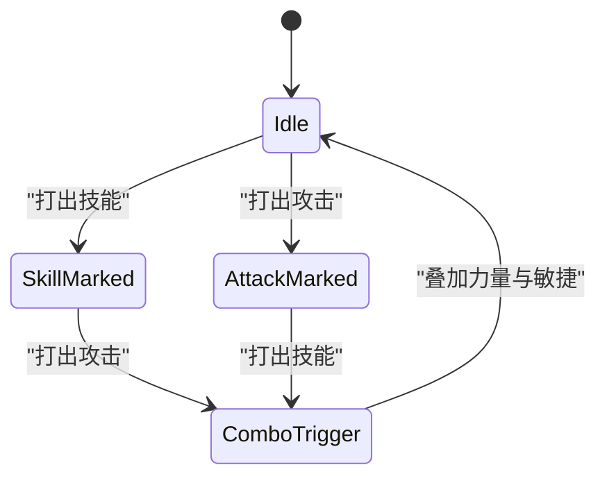

图表来源
- [ComboPower.cs:43-66](file://Scripts/Powers/ComboPower.cs#L43-L66)

章节来源
- [ComboPower.cs:27-68](file://Scripts/Powers/ComboPower.cs#L27-L68)

### 能量管理机制
- 角色级动画延迟：AttackAnimDelay 与 CastAnimDelay 控制攻击与施法的动画间隔，影响节奏与帧同步。
- 能量标签颜色：自定义能量标签轮廓色以匹配角色主题。
- 多平台/多人模式：手臂指示与手势贴图用于多人交互。

章节来源
- [Rainworld_Liver.cs:100-106](file://Scripts/Slugcat/Rainworld_Liver.cs#L100-L106)

### Godot 动画系统集成
- 角色可视化：通过 RitsuGodotNodeFactories 从场景创建 NCreatureVisuals。
- 输入交互：NLiver 监听鼠标左键点击，判断是否在边界内，触发 Meow 动画与音效。
- 动画触发：SetAnimationTrigger("Meow") 调用 Spine 动画；SfxCmd.Play 播放事件音效。

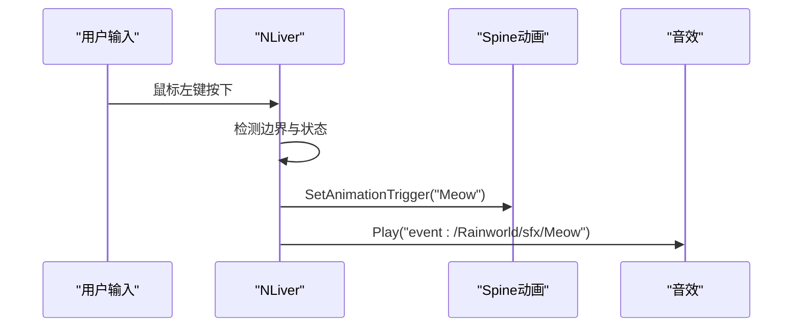

图表来源
- [NLiver.cs:20-46](file://Godot/Character/Liver/NLiver.cs#L20-L46)

章节来源
- [NLiver.cs:12-49](file://Godot/Character/Liver/NLiver.cs#L12-L49)

## 依赖关系分析
- 攻击卡牌依赖命令系统（DamageCmd/CreatureCmd/PowerCmd）执行战斗逻辑。
- 卡牌通过 WithHitFx 或事件音效驱动视觉与听觉反馈。
- 角色定义依赖 Godot 场景与资源路径，确保动画与 UI 正确显示。
- 连击能力依赖卡牌类型判定与回合生命周期钩子。

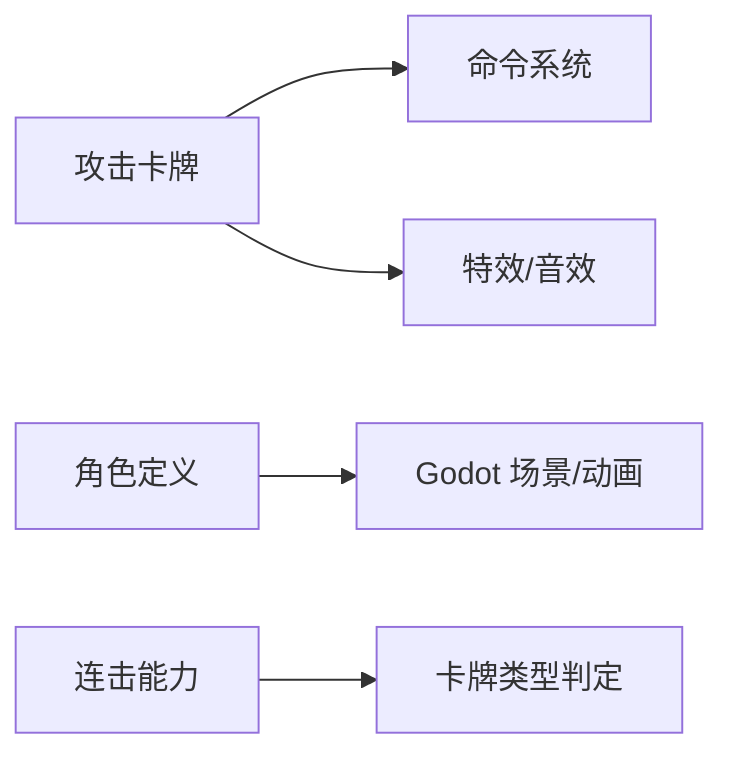

图表来源
- [Rainworld_Liver_Strike.cs:40-50](file://Scripts/Card/Liver/Attack/Rainworld_Liver_Strike.cs#L40-L50)
- [Rainworld_Liver.cs:41-117](file://Scripts/Slugcat/Rainworld_Liver.cs#L41-L117)
- [ComboPower.cs:43-66](file://Scripts/Powers/ComboPower.cs#L43-L66)

章节来源
- [Rainworld_Liver_Strike.cs:40-50](file://Scripts/Card/Liver/Attack/Rainworld_Liver_Strike.cs#L40-L50)
- [Rainworld_Liver.cs:41-117](file://Scripts/Slugcat/Rainworld_Liver.cs#L41-L117)
- [ComboPower.cs:43-66](file://Scripts/Powers/ComboPower.cs#L43-L66)

## 性能考量
- 批量攻击（如 Rolling）应合理限制最大次数，避免过多指令导致卡顿。
- 延时操作（如 Spearboom）需确保等待时间不影响整体回合流畅度。
- 特效与音效数量较多时，建议复用资源与合并触发点。
- 动态变量与保存属性（如 Spearfire 的 IncreasedDamage）应在升级/降级时正确更新，避免不一致。

[本节为通用指导，不直接分析具体文件]

## 故障排查指南
- 目标为空异常：确保 OnPlay 中校验 cardPlay.Target 非空后再执行攻击。
- 动画未触发：检查 NLiver 的输入绑定与边界检测逻辑，确认角色状态允许触发。
- 音效未播放：确认事件音效路径正确，且运行时资源已加载。
- 升级效果不生效：检查 OnUpgrade 中对 DynamicVars 的修改是否正确，以及 AfterDowngraded 中的回退逻辑。

章节来源
- [Rainworld_Liver_Spear.cs:45-57](file://Scripts/Card/Liver/Attack/Rainworld_Liver_Spear.cs#L45-L57)
- [NLiver.cs:20-46](file://Godot/Character/Liver/NLiver.cs#L20-L46)
- [Rainworld_Liver_Spearfire.cs:116-131](file://Scripts/Card/Liver/Attack/Rainworld_Liver_Spearfire.cs#L116-L131)

## 结论
肝脏角色的攻击卡牌体系通过统一的基类与命令系统实现了高度可扩展的战斗逻辑。长矛、滚动、炸弹等核心攻击各具特色，配合连击能力与 Godot 动画系统，提供了丰富的战术组合与视听体验。遵循本文档的实现规范与最佳实践，可高效扩展新的攻击卡牌并保持平衡性与稳定性。

[本节为总结，不直接分析具体文件]

## 附录：新增攻击卡牌实现指南
- 创建新类：新建一个继承自 LiverCardModel 的类，放置在 Scripts/Card/Liver/Attack 下。
- 配置基本属性：设置 energyCost、type、rarity、targetType、shouldShowInCardLibrary。
- 声明动态变量：使用 DynamicVars 定义伤害、护盾或其他数值，支持 Move 与升级。
- 实现 OnPlay：使用 DamageCmd/CreatureCmd/PowerCmd 执行逻辑，必要时使用 WithHitFx 或事件音效。
- 实现 OnUpgrade：在升级时提升相关动态变量的值。
- 关键词与标签：根据需要添加 CardKeyword 或角色专属关键词。
- 动画与音效：如需角色动画，可在 OnPlay 中结合 Godot 节点触发；音效建议使用事件音效路径。
- 测试与调试：在实战中验证目标选择、伤害计算、特效与音效是否正常。

章节来源
- [LiverCardModel.cs:14-38](file://Scripts/Card/Liver/LiverCardModel.cs#L14-L38)
- [Rainworld_Liver_Strike.cs:12-57](file://Scripts/Card/Liver/Attack/Rainworld_Liver_Strike.cs#L12-L57)
- [NLiver.cs:20-46](file://Godot/Character/Liver/NLiver.cs#L20-L46)