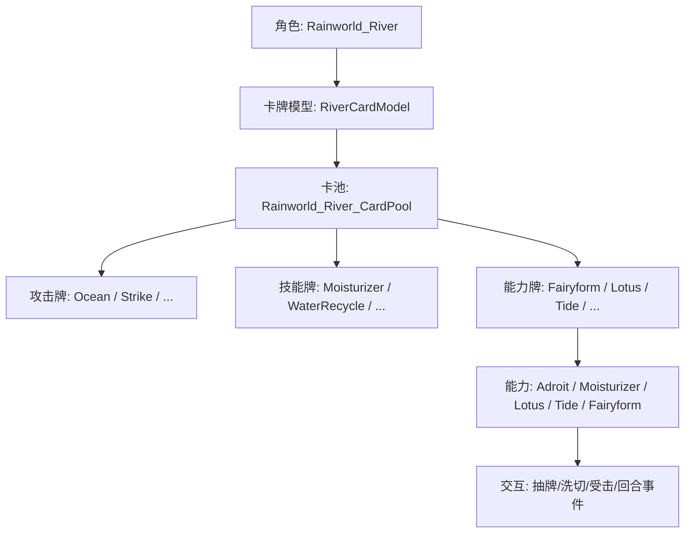
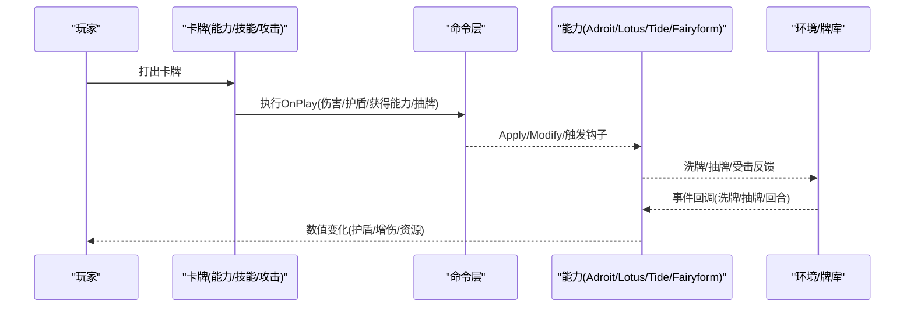
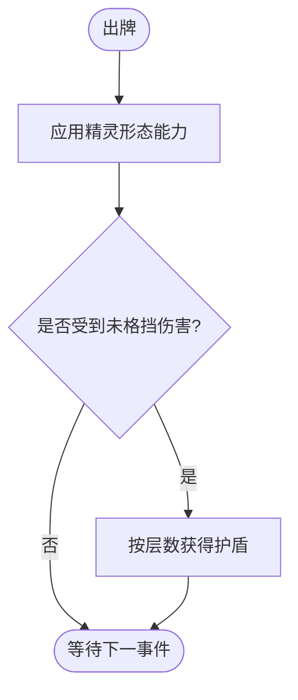
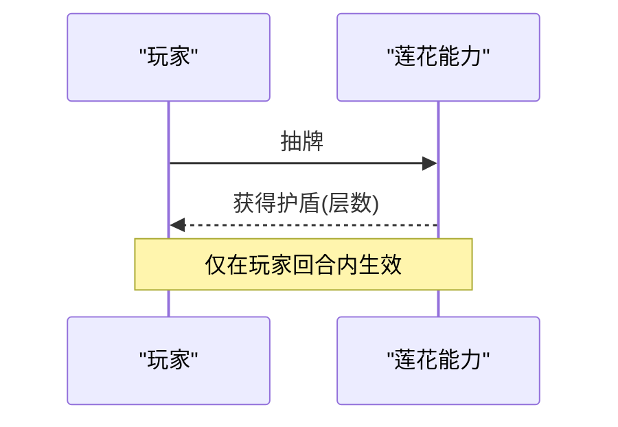
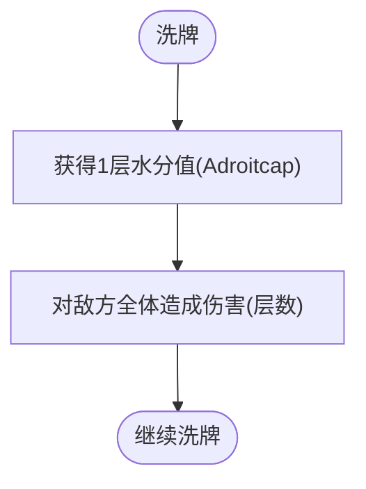
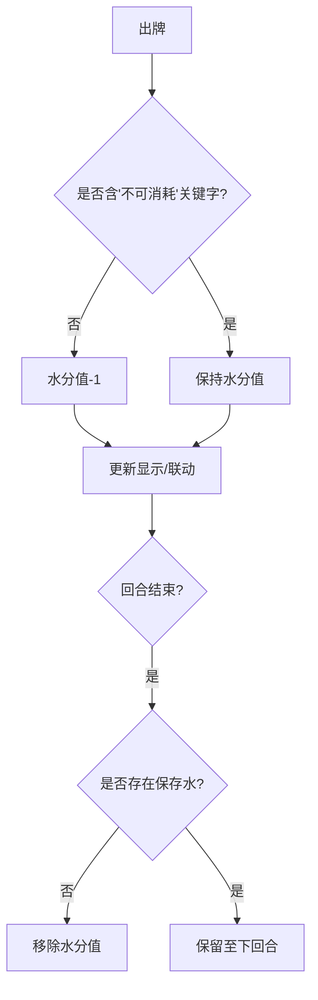
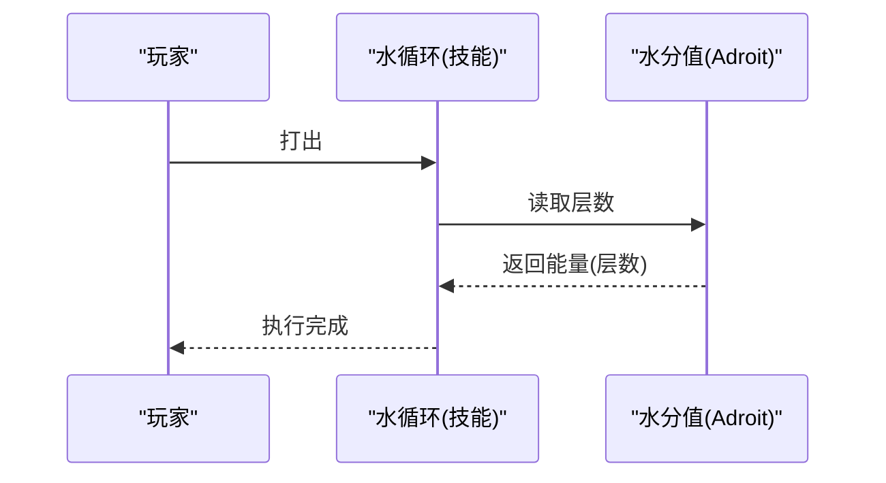
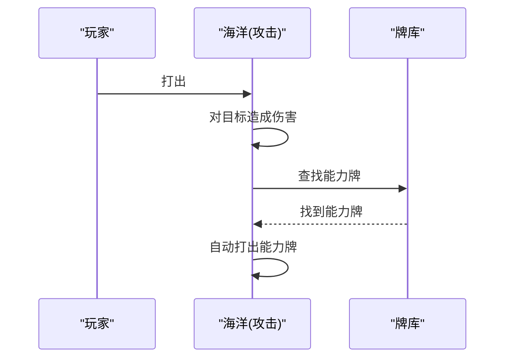
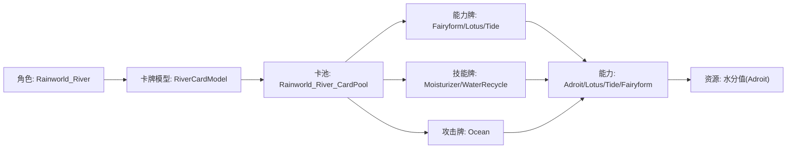

# 河流角色能力卡牌

<cite>
**本文引用的文件**
- [Rainworld_River.cs](file://Scripts/Slugcat/Rainworld_River.cs)
- [RiverCardModel.cs](file://Scripts/Card/River/RiverCardModel.cs)
- [Rainworld_River_CardPool.cs](file://Scripts/Card/River/Rainworld_River_CardPool.cs)
- [Rainworld_River_Fairyform.cs](file://Scripts/Card/River/Power/Rainworld_River_Fairyform.cs)
- [Rainworld_River_Lotus.cs](file://Scripts/Card/River/Power/Rainworld_River_Lotus.cs)
- [Rainworld_River_Tide.cs](file://Scripts/Card/River/Power/Rainworld_River_Tide.cs)
- [Rainworld_River_Moisturizer.cs](file://Scripts/Card/River/Skill/Rainworld_River_Moisturizer.cs)
- [Rainworld_River_Waterrecycle.cs](file://Scripts/Card/River/Skill/Rainworld_River_Waterrecycle.cs)
- [Rainworld_River_Ocean.cs](file://Scripts/Card/River/Attack/Rainworld_River_Ocean.cs)
- [FairyformPower.cs](file://Scripts/Powers/River/FairyformPower.cs)
- [LotusPower.cs](file://Scripts/Powers/River/LotusPower.cs)
- [TidePower.cs](file://Scripts/Powers/River/TidePower.cs)
- [AdroitPower.cs](file://Scripts/Powers/River/AdroitPower.cs)
- [MoisturizerPower.cs](file://Scripts/Powers/River/MoisturizerPower.cs)
- [Water.cs](file://Scripts/Potions/Water.cs)
</cite>

## 目录
1. [简介](#简介)
2. [项目结构](#项目结构)
3. [核心组件](#核心组件)
4. [架构总览](#架构总览)
5. [详细组件分析](#详细组件分析)
6. [依赖关系分析](#依赖关系分析)
7. [性能考量](#性能考量)
8. [故障排查指南](#故障排查指南)
9. [结论](#结论)
10. [附录：开发规范与测试方法](#附录开发规范与测试方法)

## 简介
本技术文档围绕“河流”角色的能力卡牌系统，系统性阐述水系主题的核心机制：水域控制、精灵形态、莲花守护等。重点说明能力卡牌与环境互动的实现方式（如水面效果、降雨影响、潮汐变化），以及与河流角色资源系统的集成（水分值、海洋关联）。同时给出复杂环境效果的计算逻辑、性能优化建议，以及开发与测试规范，帮助开发者快速理解并扩展该体系。

## 项目结构
河流角色能力卡牌采用分层组织：
- 角色定义：注册角色、初始牌组、资源与外观配置
- 卡牌基类与卡池：统一资源、能量图标、卡框与类型区分
- 卡牌实现：攻击/技能/能力三类，按主题分目录
- 能力（状态）系统：以“能力”承载持久或回合级效果，驱动环境与资源联动
- 药水：提供临时增益与资源注入

图表来源
- [Rainworld_River.cs:31-96](file://Scripts/Slugcat/Rainworld_River.cs#L31-L96)
- [RiverCardModel.cs:14-33](file://Scripts/Card/River/RiverCardModel.cs#L14-L33)
- [Rainworld_River_CardPool.cs:11-25](file://Scripts/Card/River/Rainworld_River_CardPool.cs#L11-L25)

章节来源
- [Rainworld_River.cs:31-105](file://Scripts/Slugcat/Rainworld_River.cs#L31-L105)
- [RiverCardModel.cs:14-33](file://Scripts/Card/River/RiverCardModel.cs#L14-L33)
- [Rainworld_River_CardPool.cs:11-25](file://Scripts/Card/River/Rainworld_River_CardPool.cs#L11-L25)

## 核心组件
- 角色与资源
  - 角色入口：定义初始生命、金币、初始牌组、资源颜色与视觉资源路径
  - 能量与UI：自定义能量图标、边框色、地图绘制色等
- 卡牌基类与卡池
  - 统一资源路径与卡框选择（攻击/技能/能力）
  - 卡池材质与能量图标定制
- 能力（状态）系统
  - 通过“能力”实现持久或回合级效果，如护盾、增伤、抽牌保护、洗切联动等
- 药水
  - 战斗内使用，提供腐蚀、水分值（Adroit）等资源注入

章节来源
- [Rainworld_River.cs:45-105](file://Scripts/Slugcat/Rainworld_River.cs#L45-L105)
- [RiverCardModel.cs:14-33](file://Scripts/Card/River/RiverCardModel.cs#L14-L33)
- [Rainworld_River_CardPool.cs:11-25](file://Scripts/Card/River/Rainworld_River_CardPool.cs#L11-L25)
- [Water.cs:20-52](file://Scripts/Potions/Water.cs#L20-L52)

## 架构总览
河流角色能力卡牌的运行时流程如下：
- 玩家出牌触发 OnPlay
- 根据卡牌类型调用相应命令（伤害、护盾、获得能力、抽取/自动出牌等）
- 能力在关键生命周期钩子中响应（受击、抽牌、洗牌、回合开始/结束、出牌后等）
- 资源（水分值 Adroit）在出牌、回合结束时增减，并与特定卡牌/能力联动

图表来源
- [Rainworld_River_Fairyform.cs:26-29](file://Scripts/Card/River/Power/Rainworld_River_Fairyform.cs#L26-L29)
- [Rainworld_River_Lotus.cs:28-32](file://Scripts/Card/River/Power/Rainworld_River_Lotus.cs#L28-L32)
- [Rainworld_River_Tide.cs:29-33](file://Scripts/Card/River/Power/Rainworld_River_Tide.cs#L29-L33)
- [Rainworld_River_Moisturizer.cs:24-43](file://Scripts/Card/River/Skill/Rainworld_River_Moisturizer.cs#L24-L43)
- [Rainworld_River_Waterrecycle.cs:29-37](file://Scripts/Card/River/Skill/Rainworld_River_Waterrecycle.cs#L29-L37)
- [Rainworld_River_Ocean.cs:28-42](file://Scripts/Card/River/Attack/Rainworld_River_Ocean.cs#L28-L42)
- [AdroitPower.cs:106-117](file://Scripts/Powers/River/AdroitPower.cs#L106-L117)
- [LotusPower.cs:54-60](file://Scripts/Powers/River/LotusPower.cs#L54-L60)
- [TidePower.cs:35-45](file://Scripts/Powers/River/TidePower.cs#L35-L45)
- [FairyformPower.cs:37-44](file://Scripts/Powers/River/FairyformPower.cs#L37-L44)

## 详细组件分析

### 精灵形态（Fairyform）
- 定位：稀有能力牌，赋予“无形”关键词，并在受击时基于自身层数给予护盾
- 升级：移除“无形”，增强生存曲线
- 能力：受击后为拥有者附加护盾，层数即护盾量

图表来源
- [Rainworld_River_Fairyform.cs:20-34](file://Scripts/Card/River/Power/Rainworld_River_Fairyform.cs#L20-L34)
- [FairyformPower.cs:37-44](file://Scripts/Powers/River/FairyformPower.cs#L37-L44)

章节来源
- [Rainworld_River_Fairyform.cs:12-34](file://Scripts/Card/River/Power/Rainworld_River_Fairyform.cs#L12-L34)
- [FairyformPower.cs:24-44](file://Scripts/Powers/River/FairyformPower.cs#L24-L44)

### 莲花守护（Lotus）
- 定位：非稀有能力牌，提供“每回合抽牌时获得护盾”的保护机制
- 动态变量：Special=3（可升级提升）
- 能力：在玩家回合内，每次抽牌为拥有者增加护盾

图表来源
- [Rainworld_River_Lotus.cs:19-37](file://Scripts/Card/River/Power/Rainworld_River_Lotus.cs#L19-L37)
- [LotusPower.cs:35-60](file://Scripts/Powers/River/LotusPower.cs#L35-L60)

章节来源
- [Rainworld_River_Lotus.cs:11-37](file://Scripts/Card/River/Power/Rainworld_River_Lotus.cs#L11-L37)
- [LotusPower.cs:23-60](file://Scripts/Powers/River/LotusPower.cs#L23-L60)

### 潮汐（Tide）
- 定位：非稀有能力牌，提供“洗切牌堆时获得水分值并对敌方全体造成伤害”的联动
- 动态变量：Special=6（可升级降低费用）
- 能力：每次洗牌为拥有者增加一层水分值，并对所有敌人造成固定伤害

图表来源
- [Rainworld_River_Tide.cs:19-38](file://Scripts/Card/River/Power/Rainworld_River_Tide.cs#L19-L38)
- [TidePower.cs:35-45](file://Scripts/Powers/River/TidePower.cs#L35-L45)

章节来源
- [Rainworld_River_Tide.cs:12-38](file://Scripts/Card/River/Power/Rainworld_River_Tide.cs#L12-L38)
- [TidePower.cs:23-45](file://Scripts/Powers/River/TidePower.cs#L23-L45)

### 水分值（Adroit）与湿润（Moisturizer）
- 水分值（Adroit）
  - 作用：作为“水资源”计数，影响移动相关伤害与护盾；出牌时消耗，部分卡牌/能力会读取并消费
  - 消耗时机：出牌后减少；回合结束时若不存在“保存水”则移除
  - 联动：与“回海”、“管道”等卡牌/能力配合，形成资源循环
- 湿润（Moisturizer）
  - 作用：使水分值在回合结束后不立即消耗，延长资源窗口
  - 消耗时机：对手回合结束时递减

图表来源
- [AdroitPower.cs:106-117](file://Scripts/Powers/River/AdroitPower.cs#L106-L117)
- [AdroitPower.cs:96-103](file://Scripts/Powers/River/AdroitPower.cs#L96-L103)
- [MoisturizerPower.cs:36-45](file://Scripts/Powers/River/MoisturizerPower.cs#L36-L45)
- [Rainworld_River_Moisturizer.cs:24-43](file://Scripts/Card/River/Skill/Rainworld_River_Moisturizer.cs#L24-L43)

章节来源
- [AdroitPower.cs:28-119](file://Scripts/Powers/River/AdroitPower.cs#L28-L119)
- [MoisturizerPower.cs:23-45](file://Scripts/Powers/River/MoisturizerPower.cs#L23-L45)
- [Rainworld_River_Moisturizer.cs:10-48](file://Scripts/Card/River/Skill/Rainworld_River_Moisturizer.cs#L10-L48)

### 水循环（WaterRecycle）
- 定位：稀有技能牌，消耗并返还等同于当前水分值的能量
- 条件：仅当存在水分值时生效
- 升级：降低费用

图表来源
- [Rainworld_River_Waterrecycle.cs:19-42](file://Scripts/Card/River/Skill/Rainworld_River_Waterrecycle.cs#L19-L42)

章节来源
- [Rainworld_River_Waterrecycle.cs:12-42](file://Scripts/Card/River/Skill/Rainworld_River_Waterrecycle.cs#L12-L42)

### 海洋（Ocean）
- 定位：非稀有攻击牌，消耗并随机自动打出一张能力牌
- 升级：提升伤害并添加“固有”关键词
- 联动：通过能力牌触发更多资源与环境互动

图表来源
- [Rainworld_River_Ocean.cs:17-48](file://Scripts/Card/River/Attack/Rainworld_River_Ocean.cs#L17-L48)

章节来源
- [Rainworld_River_Ocean.cs:9-48](file://Scripts/Card/River/Attack/Rainworld_River_Ocean.cs#L9-L48)

### 药水：水（Water）
- 定位：非稀有药水，战斗中使用
- 效果：为目标施加腐蚀；若目标为玩家，额外赋予水分值
- 提示：在悬浮提示中展示相关能力信息

章节来源
- [Water.cs:20-52](file://Scripts/Potions/Water.cs#L20-L52)

## 依赖关系分析
- 角色依赖卡牌模型与卡池，卡牌模型统一资源路径与类型区分
- 能力通过命令层与游戏事件钩子（洗牌、抽牌、受击、回合）进行联动
- 水分值是核心资源，被多张卡牌与能力读取/修改，形成闭环

图表来源
- [Rainworld_River.cs:31-96](file://Scripts/Slugcat/Rainworld_River.cs#L31-L96)
- [RiverCardModel.cs:14-33](file://Scripts/Card/River/RiverCardModel.cs#L14-L33)
- [Rainworld_River_CardPool.cs:11-25](file://Scripts/Card/River/Rainworld_River_CardPool.cs#L11-L25)
- [AdroitPower.cs:28-119](file://Scripts/Powers/River/AdroitPower.cs#L28-L119)

章节来源
- [Rainworld_River.cs:31-105](file://Scripts/Slugcat/Rainworld_River.cs#L31-L105)
- [RiverCardModel.cs:14-33](file://Scripts/Card/River/RiverCardModel.cs#L14-L33)
- [Rainworld_River_CardPool.cs:11-25](file://Scripts/Card/River/Rainworld_River_CardPool.cs#L11-L25)
- [AdroitPower.cs:28-119](file://Scripts/Powers/River/AdroitPower.cs#L28-L119)

## 性能考量
- 事件钩子频率控制
  - 洗牌、抽牌、回合事件频繁触发，应避免在钩子中进行昂贵计算或大量对象分配
  - 将复杂计算延迟到必要时机（如出牌或回合结算）
- 批量操作与最小化副作用
  - 在 AfterShuffle/AfterCardDrawn 中尽量合并多次增益，减少多次命令调用
- 资源访问缓存
  - 对频繁读取的资源（如水分值）可在局部作用域缓存，避免重复查询
- UI与VFX
  - 限制每回合特效数量，避免帧率抖动
- 日志与调试
  - 仅在开发阶段输出详细日志，发布版本关闭冗余打印

[本节为通用性能建议，无需具体文件引用]

## 故障排查指南
- 水分值异常
  - 检查是否在出牌后被正确递减；确认是否包含“不可消耗”关键字
  - 回合结束时是否被正确移除或保留（依据“保存水”）
- 莲花守护无效
  - 确认是否在玩家回合内抽牌；检查 BeforeSideTurnEnd 标志位是否正确设置
- 潮汐无效果
  - 确认洗牌事件是否触发；检查对敌方伤害是否生效
- 精灵形态未加护盾
  - 确认受击是否为未格挡伤害；检查层数是否正确
- 水循环未返还能量
  - 确认当前水分值是否大于0；检查命令执行顺序

章节来源
- [AdroitPower.cs:106-117](file://Scripts/Powers/River/AdroitPower.cs#L106-L117)
- [LotusPower.cs:35-60](file://Scripts/Powers/River/LotusPower.cs#L35-L60)
- [TidePower.cs:35-45](file://Scripts/Powers/River/TidePower.cs#L35-L45)
- [FairyformPower.cs:37-44](file://Scripts/Powers/River/FairyformPower.cs#L37-L44)
- [Rainworld_River_Waterrecycle.cs:29-37](file://Scripts/Card/River/Skill/Rainworld_River_Waterrecycle.cs#L29-L37)

## 结论
河流角色的能力卡牌系统以“水分值”为核心资源，通过能力与技能的组合，实现了水域控制、精灵形态与莲花守护等主题机制。卡牌与环境（洗牌、抽牌、受击、回合）深度耦合，形成丰富的策略空间。遵循本文档的开发规范与测试方法，可高效扩展新的水系能力与卡牌，并确保稳定性与性能。

## 附录：开发规范与测试方法
- 开发规范
  - 卡牌基类：统一继承 RiverCardModel，明确能量、类型、稀有度、目标与显示设置
  - 能力设计：优先使用 ModPowerTemplate，利用生命周期钩子处理事件；避免在钩子中做重计算
  - 资源管理：水分值（Adroit）的增减需严格在出牌与回合结束时处理；必要时通过“保存水”延长窗口
  - 动态变量：使用 DynamicVar 表达可升级数值，确保升级逻辑清晰
  - 提示与本地化：通过 HoverTip 与本地化键值完善描述
- 测试方法
  - 单元测试：针对能力钩子（洗牌、抽牌、受击、回合）编写用例，验证数值变化
  - 集成测试：模拟完整回合流程，验证卡牌与能力的联动（如水循环、潮汐、莲花守护）
  - 边界测试：水分值为0、无能力、无牌库等极端情况
  - 性能测试：高频率洗牌/抽牌场景下的帧率与内存占用

章节来源
- [RiverCardModel.cs:14-33](file://Scripts/Card/River/RiverCardModel.cs#L14-L33)
- [Rainworld_River_Moisturizer.cs:24-43](file://Scripts/Card/River/Skill/Rainworld_River_Moisturizer.cs#L24-L43)
- [Rainworld_River_Waterrecycle.cs:29-37](file://Scripts/Card/River/Skill/Rainworld_River_Waterrecycle.cs#L29-L37)
- [TidePower.cs:35-45](file://Scripts/Powers/River/TidePower.cs#L35-L45)
- [LotusPower.cs:54-60](file://Scripts/Powers/River/LotusPower.cs#L54-L60)
- [FairyformPower.cs:37-44](file://Scripts/Powers/River/FairyformPower.cs#L37-L44)