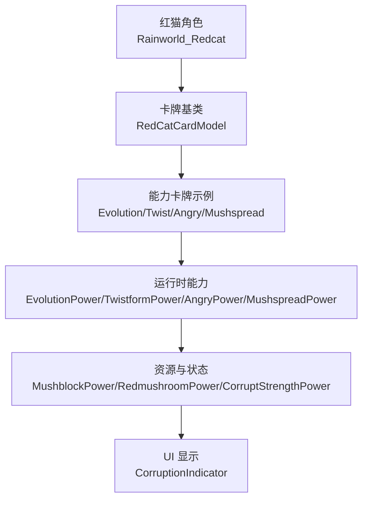
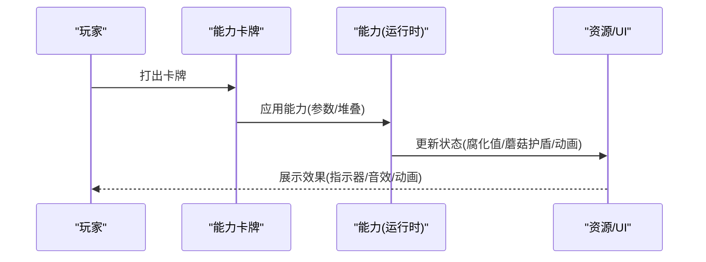
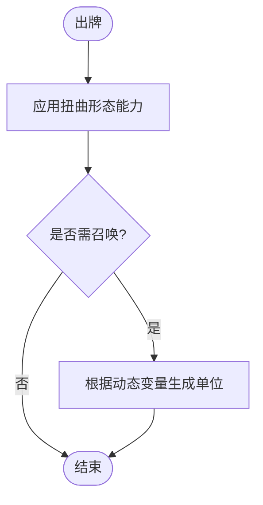
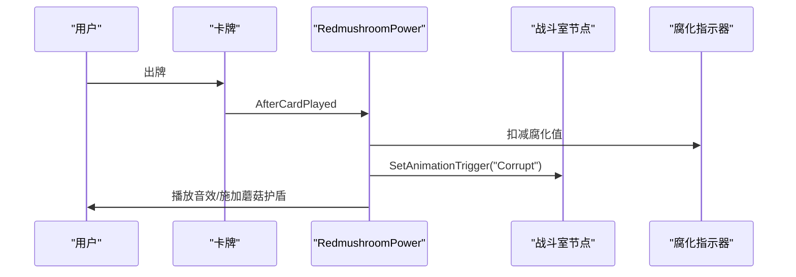
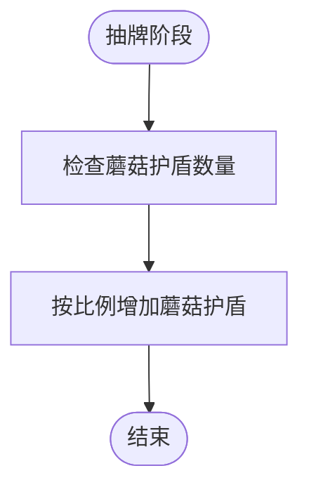
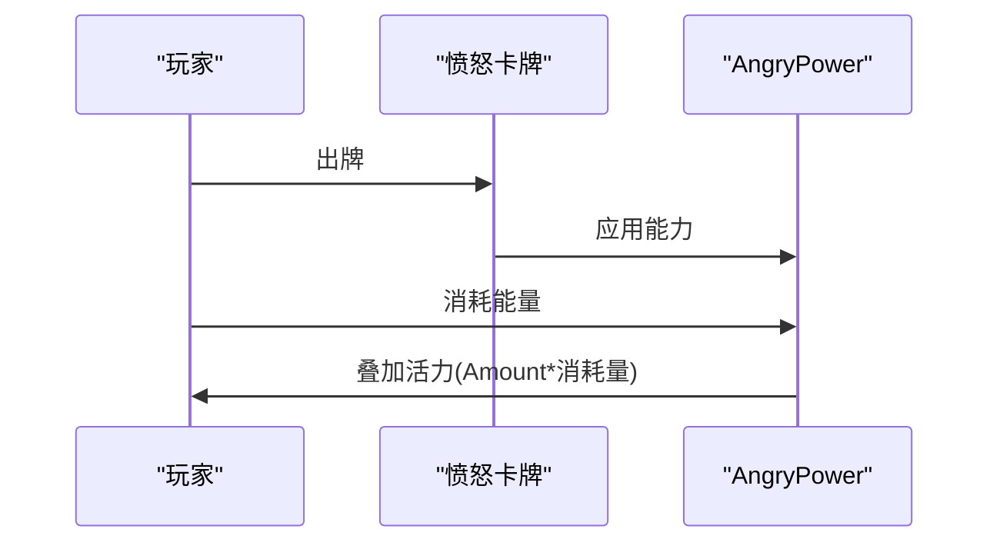
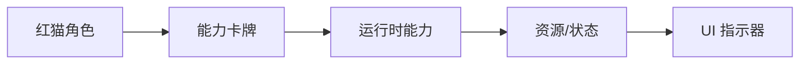

# 红猫角色能力卡牌

<cite>
**本文引用的文件**
- [Rainworld_Redcat.cs](file://Scripts/Slugcat/Rainworld_Redcat.cs)
- [RedCatCardModel.cs](file://Scripts/Card/RedCat/RedCatCardModel.cs)
- [Rainworld_Redcat_Evolution.cs](file://Scripts/Card/RedCat/Powers/Rainworld_Redcat_Evolution.cs)
- [Rainworld_Redcat_Twist.cs](file://Scripts/Card/RedCat/Powers/Rainworld_Redcat_Twist.cs)
- [Rainworld_Redcat_Angry.cs](file://Scripts/Card/RedCat/Powers/Rainworld_Redcat_Angry.cs)
- [Rainworld_Redcat_Mushspread.cs](file://Scripts/Card/RedCat/Powers/Rainworld_Redcat_Mushspread.cs)
- [EvolutionPower.cs](file://Scripts/Powers/RedCat/EvolutionPower.cs)
- [TwistformPower.cs](file://Scripts/Powers/RedCat/TwistformPower.cs)
- [AngryPower.cs](file://Scripts/Powers/RedCat/AngryPower.cs)
- [MushspreadPower.cs](file://Scripts/Powers/RedCat/MushspreadPower.cs)
- [MushblockPower.cs](file://Scripts/Powers/RedCat/MushblockPower.cs)
- [RedmushroomPower.cs](file://Scripts/Powers/RedCat/RedmushroomPower.cs)
- [CorruptStrengthPower.cs](file://Scripts/Powers/RedCat/CorruptStrengthPower.cs)
- [CorruptionIndicator.cs](file://Godot/CombatUI/CorruptionIndicator.cs)
</cite>

## 目录
1. [简介](#简介)
2. [项目结构](#项目结构)
3. [核心组件](#核心组件)
4. [架构总览](#架构总览)
5. [详细组件分析](#详细组件分析)
6. [依赖关系分析](#依赖关系分析)
7. [性能考量](#性能考量)
8. [故障排查指南](#故障排查指南)
9. [结论](#结论)
10. [附录](#附录)

## 简介
本文件为“红猫”角色的能力卡牌系统提供全面文档，重点覆盖：
- 形态转换机制（扭曲形态、进化）
- 腐化值系统与视觉效果联动
- 蘑菇传播与护盾资源（蘑菇标记）的交互逻辑
- 核心能力卡牌的实现原理：进化、扭曲、愤怒等
- 状态管理、条件判断与视觉反馈
- 设计模式与最佳实践

## 项目结构
红猫能力体系由“卡牌模型 + 能力（Power）+ 角色/资源 + UI”构成：
- 卡牌模型：定义费用、稀有度、目标类型、动态变量、升级效果与出牌行为
- 能力（Power）：承载运行时状态、数值修正、事件钩子（如伤害、抽牌、能量消耗）
- 角色与资源：红猫角色初始化、起始牌组、资源（腐化值、工作等级等）
- UI：腐化值指示器、蘑菇护盾叠加提示等

图表来源
- [Rainworld_Redcat.cs:29-102](file://Scripts/Slugcat/Rainworld_Redcat.cs#L29-L102)
- [RedCatCardModel.cs:15-39](file://Scripts/Card/RedCat/RedCatCardModel.cs#L15-L39)
- [Rainworld_Redcat_Evolution.cs:15-38](file://Scripts/Card/RedCat/Powers/Rainworld_Redcat_Evolution.cs#L15-L38)
- [EvolutionPower.cs:28-64](file://Scripts/Powers/RedCat/EvolutionPower.cs#L28-L64)
- [MushblockPower.cs:27-61](file://Scripts/Powers/RedCat/MushblockPower.cs#L27-L61)
- [CorruptionIndicator.cs](file://Godot/CombatUI/CorruptionIndicator.cs)

章节来源
- [Rainworld_Redcat.cs:29-102](file://Scripts/Slugcat/Rainworld_Redcat.cs#L29-L102)
- [RedCatCardModel.cs:15-39](file://Scripts/Card/RedCat/RedCatCardModel.cs#L15-L39)

## 核心组件
- 红猫角色：定义初始生命、金币、起始牌组、场景与音效资源等
- 卡牌模型基类：统一资源路径、卡框与类型区分
- 关键能力卡牌：
  - 进化：获得“进化”能力，记录受击次数并降低后续受到的伤害
  - 扭曲：获得“扭曲形态”，可召唤单位（通过动态变量控制）
  - 愤怒：获得“愤怒”能力，消耗能量时叠加活力（Vigor）
  - 蘑菇传播：在抽牌阶段根据现有蘑菇护盾数量增加新的蘑菇护盾
- 关键能力（Power）：
  - 蘑菇护盾：吸收伤害并在移除时转化为护盾或清理相关能力
  - 腐化蘑菇房间：进入后触发动画、播放音效、施加蘑菇护盾；出牌时扣减腐化值
  - 腐化力量：与腐化值联动的增伤能力（具体数值由配置决定）
  - 扭曲形态：作为形态标识的能力，配合其他逻辑使用
  - 进化：统计受击次数并对伤害进行递减修正
  - 愤怒：基于能量消耗叠加活力

章节来源
- [Rainworld_Redcat.cs:29-102](file://Scripts/Slugcat/Rainworld_Redcat.cs#L29-L102)
- [Rainworld_Redcat_Evolution.cs:15-38](file://Scripts/Card/RedCat/Powers/Rainworld_Redcat_Evolution.cs#L15-L38)
- [Rainworld_Redcat_Twist.cs:15-44](file://Scripts/Card/RedCat/Powers/Rainworld_Redcat_Twist.cs#L15-L44)
- [Rainworld_Redcat_Angry.cs:15-57](file://Scripts/Card/RedCat/Powers/Rainworld_Redcat_Angry.cs#L15-L57)
- [Rainworld_Redcat_Mushspread.cs:15-45](file://Scripts/Card/RedCat/Powers/Rainworld_Redcat_Mushspread.cs#L15-L45)
- [EvolutionPower.cs:28-64](file://Scripts/Powers/RedCat/EvolutionPower.cs#L28-L64)
- [TwistformPower.cs:27-40](file://Scripts/Powers/RedCat/TwistformPower.cs#L27-L40)
- [AngryPower.cs:27-48](file://Scripts/Powers/RedCat/AngryPower.cs#L27-L48)
- [MushspreadPower.cs:23-47](file://Scripts/Powers/RedCat/MushspreadPower.cs#L23-L47)
- [MushblockPower.cs:27-61](file://Scripts/Powers/RedCat/MushblockPower.cs#L27-L61)
- [RedmushroomPower.cs:32-94](file://Scripts/Powers/RedCat/RedmushroomPower.cs#L32-L94)
- [CorruptStrengthPower.cs](file://Scripts/Powers/RedCat/CorruptStrengthPower.cs)

## 架构总览
红猫能力体系采用“卡牌驱动 + 能力承载”的分层架构：
- 卡牌负责声明式配置（费用、稀有度、目标、动态变量、升级）
- 能力负责运行时状态与事件处理（伤害修正、能量消耗、抽牌阶段、出牌后）
- 资源与UI负责可视化与持久化（腐化值、蘑菇护盾、战斗室节点动画）

图表来源
- [Rainworld_Redcat_Evolution.cs:29-32](file://Scripts/Card/RedCat/Powers/Rainworld_Redcat_Evolution.cs#L29-L32)
- [EvolutionPower.cs:42-62](file://Scripts/Powers/RedCat/EvolutionPower.cs#L42-L62)
- [MushspreadPower.cs:37-46](file://Scripts/Powers/RedCat/MushspreadPower.cs#L37-L46)
- [RedmushroomPower.cs:44-69](file://Scripts/Powers/RedCat/RedmushroomPower.cs#L44-L69)
- [CorruptionIndicator.cs](file://Godot/CombatUI/CorruptionIndicator.cs)

## 详细组件分析

### 形态转换机制（扭曲形态与进化）
- 扭曲形态（Twist）
  - 卡牌：Rainworld_Redcat_Twist，设置动态变量“Summon”用于控制召唤数量
  - 能力：TwistformPower 作为形态标识，配合其他逻辑实现形态切换
  - 流程：出牌 → 应用 TwistPower → 根据动态变量执行召唤/形态切换
- 进化（Evolution）
  - 卡牌：Rainworld_Redcat_Evolution，出牌即获得 EvolutionPower
  - 能力：EvolutionPower 维护每个敌人的受击计数，并在受到伤害时按计数递减
  - 升级：卡牌升级降低费用

图表来源
- [Rainworld_Redcat_Twist.cs:35-38](file://Scripts/Card/RedCat/Powers/Rainworld_Redcat_Twist.cs#L35-L38)
- [TwistformPower.cs:27-40](file://Scripts/Powers/RedCat/TwistformPower.cs#L27-L40)
- [Rainworld_Redcat_Evolution.cs:29-32](file://Scripts/Card/RedCat/Powers/Rainworld_Redcat_Evolution.cs#L29-L32)
- [EvolutionPower.cs:42-62](file://Scripts/Powers/RedCat/EvolutionPower.cs#L42-L62)

章节来源
- [Rainworld_Redcat_Twist.cs:15-44](file://Scripts/Card/RedCat/Powers/Rainworld_Redcat_Twist.cs#L15-L44)
- [TwistformPower.cs:27-40](file://Scripts/Powers/RedCat/TwistformPower.cs#L27-L40)
- [Rainworld_Redcat_Evolution.cs:15-38](file://Scripts/Card/RedCat/Powers/Rainworld_Redcat_Evolution.cs#L15-L38)
- [EvolutionPower.cs:28-64](file://Scripts/Powers/RedCat/EvolutionPower.cs#L28-L64)

### 腐化值系统与视觉效果
- 腐化值扣减：当红猫出牌且非腐化关键词、非特定例外卡牌时，扣减腐化值
- 进入腐化状态：获得 RedmushroomPower 后触发战斗室节点的动画触发器，播放音效，并施加蘑菇护盾
- 移除腐化状态：若未处于假死/睡眠，恢复动画；将蘑菇护盾转为真实护盾并清理相关能力
- UI：CorruptionIndicator 用于显示当前腐化值

图表来源
- [RedmushroomPower.cs:44-69](file://Scripts/Powers/RedCat/RedmushroomPower.cs#L44-L69)
- [CorruptionIndicator.cs](file://Godot/CombatUI/CorruptionIndicator.cs)

章节来源
- [RedmushroomPower.cs:32-94](file://Scripts/Powers/RedCat/RedmushroomPower.cs#L32-L94)
- [CorruptionIndicator.cs](file://Godot/CombatUI/CorruptionIndicator.cs)

### 蘑菇传播能力与护盾资源
- 蘑菇传播（Mushspread）
  - 卡牌：Rainworld_Redcat_Mushspread，出牌获得 MushspreadPower
  - 能力：在抽牌阶段，读取自身蘑菇护盾数量，按比例增加新蘑菇护盾
- 蘑菇护盾（Mushblock）
  - 能力：在受到致命伤害前吸收伤害；移除时可将剩余量转为护盾或清理能力
- 交互：腐化状态进入时施加蘑菇护盾；移除时根据条件转换为护盾

图表来源
- [Rainworld_Redcat_Mushspread.cs:36-39](file://Scripts/Card/RedCat/Powers/Rainworld_Redcat_Mushspread.cs#L36-L39)
- [MushspreadPower.cs:37-46](file://Scripts/Powers/RedCat/MushspreadPower.cs#L37-L46)
- [MushblockPower.cs:41-60](file://Scripts/Powers/RedCat/MushblockPower.cs#L41-L60)
- [RedmushroomPower.cs:55-69](file://Scripts/Powers/RedCat/RedmushroomPower.cs#L55-L69)

章节来源
- [Rainworld_Redcat_Mushspread.cs:15-45](file://Scripts/Card/RedCat/Powers/Rainworld_Redcat_Mushspread.cs#L15-L45)
- [MushspreadPower.cs:23-47](file://Scripts/Powers/RedCat/MushspreadPower.cs#L23-L47)
- [MushblockPower.cs:27-61](file://Scripts/Powers/RedCat/MushblockPower.cs#L27-L61)
- [RedmushroomPower.cs:32-94](file://Scripts/Powers/RedCat/RedmushroomPower.cs#L32-L94)

### 愤怒状态与能量消耗联动
- 愤怒（Angry）
  - 卡牌：Rainworld_Redcat_Angry，出牌获得 AngryPower
  - 能力：每次消耗能量时，根据消耗量叠加活力（Vigor），提升后续输出
- 升级：卡牌升级不改变费用，但可通过能力参数调整增益强度

图表来源
- [Rainworld_Redcat_Angry.cs:47-51](file://Scripts/Card/RedCat/Powers/Rainworld_Redcat_Angry.cs#L47-L51)
- [AngryPower.cs:43-47](file://Scripts/Powers/RedCat/AngryPower.cs#L43-L47)

章节来源
- [Rainworld_Redcat_Angry.cs:15-57](file://Scripts/Card/RedCat/Powers/Rainworld_Redcat_Angry.cs#L15-L57)
- [AngryPower.cs:27-48](file://Scripts/Powers/RedCat/AngryPower.cs#L27-L48)

### 能力卡牌与特殊资源的交互逻辑
- 腐化值：通过 RedmushroomPower 在出牌时扣减，并在进入/移除腐化状态时触发视觉效果与护盾转换
- 蘑菇标记：以 MushroomblockPower 的堆叠形式存在，参与伤害吸收与传播
- 工作等级：角色属性中定义工作等级，部分卡牌提示关联工作等级（如扭曲卡牌的额外提示）

章节来源
- [RedmushroomPower.cs:44-69](file://Scripts/Powers/RedCat/RedmushroomPower.cs#L44-L69)
- [MushblockPower.cs:41-60](file://Scripts/Powers/RedCat/MushblockPower.cs#L41-L60)
- [Rainworld_Redcat_Twist.cs:24-29](file://Scripts/Card/RedCat/Powers/Rainworld_Redcat_Twist.cs#L24-L29)
- [Rainworld_Redcat.cs:34-38](file://Scripts/Slugcat/Rainworld_Redcat.cs#L34-L38)

### 形态转换的条件判断、状态管理与视觉效果
- 条件判断
  - 扭曲形态：通过动态变量控制召唤数量，结合 TwistPower 的状态标识
  - 进化：基于受击计数对伤害进行递减修正
  - 愤怒：基于能量消耗量计算活力叠加
- 状态管理
  - 腐化状态：进入时施加蘑菇护盾并播放音效；移除时转换为护盾并清理能力
  - 蘑菇护盾：吸收伤害并在移除时根据条件转为真实护盾
- 视觉效果
  - 战斗室节点动画触发器（Corrupt/Idle）
  - 音效播放（工作错误音效）
  - 腐化指示器更新

章节来源
- [Rainworld_Redcat_Twist.cs:35-38](file://Scripts/Card/RedCat/Powers/Rainworld_Redcat_Twist.cs#L35-L38)
- [EvolutionPower.cs:42-62](file://Scripts/Powers/RedCat/EvolutionPower.cs#L42-L62)
- [AngryPower.cs:43-47](file://Scripts/Powers/RedCat/AngryPower.cs#L43-L47)
- [RedmushroomPower.cs:55-94](file://Scripts/Powers/RedCat/RedmushroomPower.cs#L55-L94)
- [MushblockPower.cs:41-60](file://Scripts/Powers/RedCat/MushblockPower.cs#L41-L60)

### 设计模式与最佳实践
- 分层职责清晰
  - 卡牌仅负责声明式配置与调用能力
  - 能力承载运行时状态与事件钩子
  - 资源与UI负责展示与持久化
- 事件驱动
  - 使用 AfterDamageReceived、AfterEnergySpent、BeforeHandDraw、AfterCardPlayed 等钩子实现解耦
- 动态变量与堆叠
  - 通过 DynamicVar 传递参数（如召唤数量）
  - 使用 PowerStackType.Counter/Single 管理状态堆叠
- 视觉与反馈
  - 通过战斗室节点动画触发器与音效增强体验
  - 使用指示器同步资源变化（腐化值）

章节来源
- [RedCatCardModel.cs:15-39](file://Scripts/Card/RedCat/RedCatCardModel.cs#L15-L39)
- [EvolutionPower.cs:28-64](file://Scripts/Powers/RedCat/EvolutionPower.cs#L28-L64)
- [AngryPower.cs:27-48](file://Scripts/Powers/RedCat/AngryPower.cs#L27-L48)
- [MushspreadPower.cs:23-47](file://Scripts/Powers/RedCat/MushspreadPower.cs#L23-L47)
- [RedmushroomPower.cs:32-94](file://Scripts/Powers/RedCat/RedmushroomPower.cs#L32-L94)

## 依赖关系分析
- 卡牌到能力：所有能力卡牌通过 PowerCmd.Apply 应用对应能力
- 能力到资源：能力修改腐化值、蘑菇护盾、活力等状态
- 资源到UI：腐化值变化通过 CorruptionIndicator 显示
- 角色到卡牌：红猫角色定义起始牌组，包含能力卡牌

图表来源
- [Rainworld_Redcat_Evolution.cs:29-32](file://Scripts/Card/RedCat/Powers/Rainworld_Redcat_Evolution.cs#L29-L32)
- [EvolutionPower.cs:42-62](file://Scripts/Powers/RedCat/EvolutionPower.cs#L42-L62)
- [MushspreadPower.cs:37-46](file://Scripts/Powers/RedCat/MushspreadPower.cs#L37-L46)
- [RedmushroomPower.cs:44-69](file://Scripts/Powers/RedCat/RedmushroomPower.cs#L44-L69)
- [CorruptionIndicator.cs](file://Godot/CombatUI/CorruptionIndicator.cs)
- [Rainworld_Redcat.cs:94-102](file://Scripts/Slugcat/Rainworld_Redcat.cs#L94-L102)

章节来源
- [Rainworld_Redcat.cs:94-102](file://Scripts/Slugcat/Rainworld_Redcat.cs#L94-L102)
- [Rainworld_Redcat_Evolution.cs:15-38](file://Scripts/Card/RedCat/Powers/Rainworld_Redcat_Evolution.cs#L15-L38)
- [EvolutionPower.cs:28-64](file://Scripts/Powers/RedCat/EvolutionPower.cs#L28-L64)
- [MushspreadPower.cs:23-47](file://Scripts/Powers/RedCat/MushspreadPower.cs#L23-L47)
- [RedmushroomPower.cs:32-94](file://Scripts/Powers/RedCat/RedmushroomPower.cs#L32-L94)
- [CorruptionIndicator.cs](file://Godot/CombatUI/CorruptionIndicator.cs)

## 性能考量
- 事件钩子使用合理，避免每帧轮询
- 状态堆叠与动态变量减少复杂分支判断
- 视觉效果通过节点触发器与音效异步播放，不影响主循环
- 建议：
  - 控制能力数量与堆叠上限，避免过多对象创建
  - 合理使用异步任务，避免阻塞关键路径
  - 对频繁触发的钩子（如伤害修正）进行轻量计算

## 故障排查指南
- 腐化值未扣减
  - 检查是否使用了腐化关键词或特定例外卡牌
  - 确认 RedmushroomPower 已正确应用
- 蘑菇护盾未生效
  - 检查 MushblockPower 是否存在与堆叠数量
  - 确认伤害事件是否正确触发 ModifyHpLostAfterOsty
- 形态转换异常
  - 检查动态变量是否正确设置
  - 确认 TwistPower 与其他形态逻辑的互斥关系
- 愤怒状态未叠加活力
  - 检查能量消耗事件是否触发
  - 确认 AngryPower 的 Amount 与消耗量计算

章节来源
- [RedmushroomPower.cs:44-69](file://Scripts/Powers/RedCat/RedmushroomPower.cs#L44-L69)
- [MushblockPower.cs:41-60](file://Scripts/Powers/RedCat/MushblockPower.cs#L41-L60)
- [Rainworld_Redcat_Twist.cs:35-38](file://Scripts/Card/RedCat/Powers/Rainworld_Redcat_Twist.cs#L35-L38)
- [AngryPower.cs:43-47](file://Scripts/Powers/RedCat/AngryPower.cs#L43-L47)

## 结论
红猫能力卡牌系统通过清晰的层级设计与事件驱动机制，实现了形态转换、腐化值系统与蘑菇传播能力的有机结合。卡牌负责声明式配置，能力承载运行时状态，资源与UI负责展示与反馈。该架构具备良好的扩展性与可维护性，适合进一步扩展更多能力与形态。

## 附录
- 术语说明
  - 腐化值：红猫的特殊资源，影响状态与视觉效果
  - 蘑菇标记：以蘑菇护盾形式存在的资源，用于吸收伤害与传播
  - 形态转换：通过能力与动态变量实现的形态切换
- 相关文件索引
  - 角色：[Rainworld_Redcat.cs](file://Scripts/Slugcat/Rainworld_Redcat.cs)
  - 卡牌模型：[RedCatCardModel.cs](file://Scripts/Card/RedCat/RedCatCardModel.cs)
  - 能力卡牌：[Rainworld_Redcat_Evolution.cs](file://Scripts/Card/RedCat/Powers/Rainworld_Redcat_Evolution.cs)、[Rainworld_Redcat_Twist.cs](file://Scripts/Card/RedCat/Powers/Rainworld_Redcat_Twist.cs)、[Rainworld_Redcat_Angry.cs](file://Scripts/Card/RedCat/Powers/Rainworld_Redcat_Angry.cs)、[Rainworld_Redcat_Mushspread.cs](file://Scripts/Card/RedCat/Powers/Rainworld_Redcat_Mushspread.cs)
  - 能力：[EvolutionPower.cs](file://Scripts/Powers/RedCat/EvolutionPower.cs)、[TwistformPower.cs](file://Scripts/Powers/RedCat/TwistformPower.cs)、[AngryPower.cs](file://Scripts/Powers/RedCat/AngryPower.cs)、[MushspreadPower.cs](file://Scripts/Powers/RedCat/MushspreadPower.cs)、[MushblockPower.cs](file://Scripts/Powers/RedCat/MushblockPower.cs)、[RedmushroomPower.cs](file://Scripts/Powers/RedCat/RedmushroomPower.cs)、[CorruptStrengthPower.cs](file://Scripts/Powers/RedCat/CorruptStrengthPower.cs)
  - UI：[CorruptionIndicator.cs](file://Godot/CombatUI/CorruptionIndicator.cs)