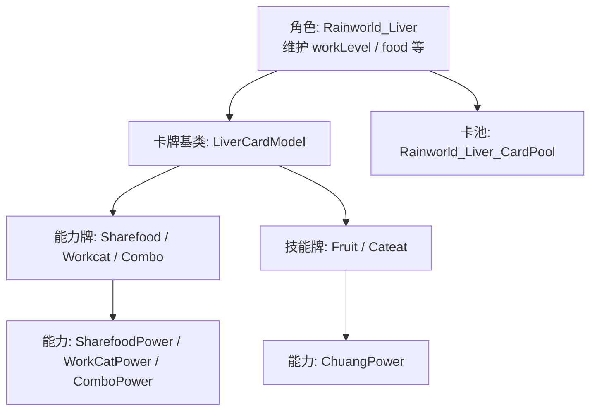
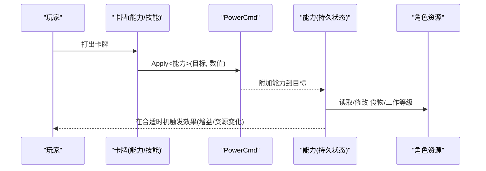
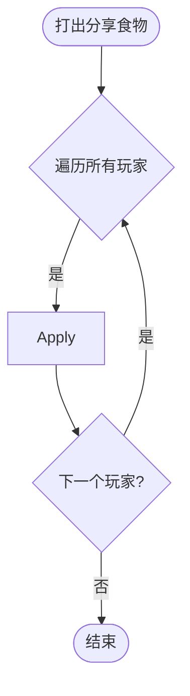
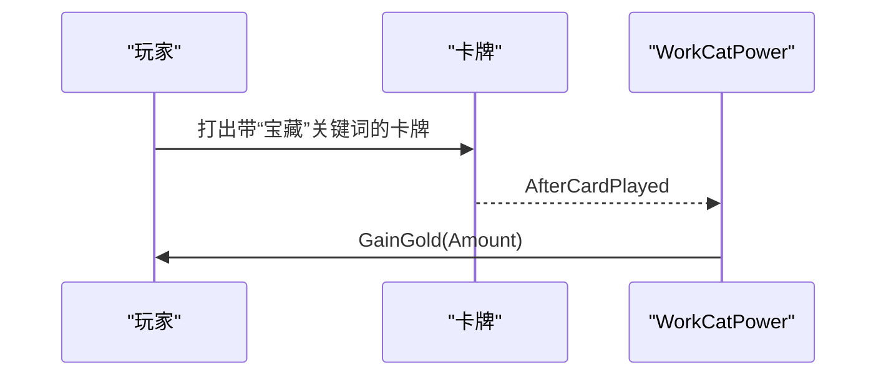
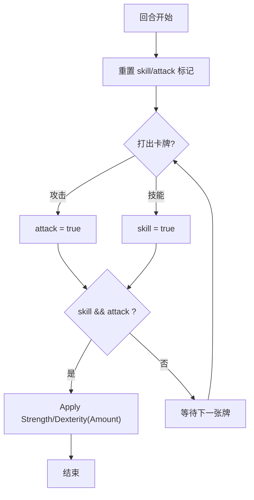
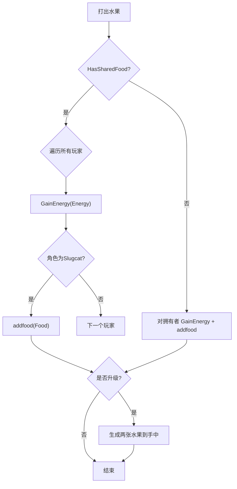
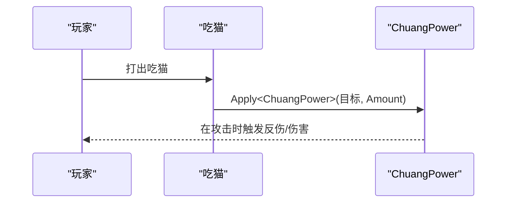
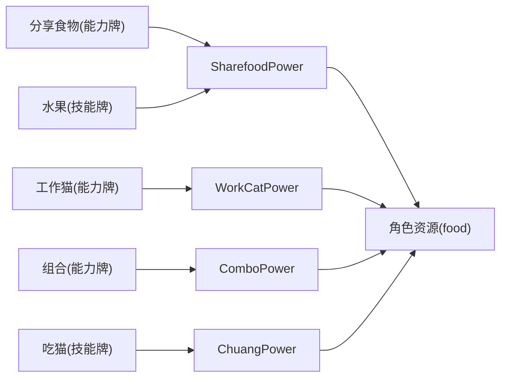

# 肝脏角色能力卡牌

<cite>
**本文引用的文件**
- [LiverCardModel.cs](file://Scripts/Card/Liver/LiverCardModel.cs)
- [Rainworld_Liver_CardPool.cs](file://Scripts/Card/Liver/Rainworld_Liver_CardPool.cs)
- [Rainworld_Liver.cs](file://Scripts/Slugcat/Rainworld_Liver.cs)
- [Rainworld_Liver_Sharefood.cs](file://Scripts/Card/Liver/Powers/Rainworld_Liver_Sharefood.cs)
- [Rainworld_Liver_Workcat.cs](file://Scripts/Card/Liver/Powers/Rainworld_Liver_Workcat.cs)
- [Rainworld_Liver_Combo.cs](file://Scripts/Card/Liver/Powers/Rainworld_Liver_Combo.cs)
- [Rainworld_Liver_Fruit.cs](file://Scripts/Card/Liver/Skills/Rainworld_Liver_Fruit.cs)
- [Rainworld_Liver_Cateat.cs](file://Scripts/Card/Liver/Skills/Rainworld_Liver_Cateat.cs)
- [SharefoodPower.cs](file://Scripts/Powers/Liver/SharefoodPower.cs)
- [WorkCatPower.cs](file://Scripts/Powers/WorkCatPower.cs)
- [ComboPower.cs](file://Scripts/Powers/ComboPower.cs)
- [ChuangPower.cs](file://Scripts/Powers/ChuangPower.cs)
</cite>

## 目录
1. [简介](#简介)
2. [项目结构](#项目结构)
3. [核心组件](#核心组件)
4. [架构总览](#架构总览)
5. [详细组件分析](#详细组件分析)
6. [依赖关系分析](#依赖关系分析)
7. [性能与平衡性考量](#性能与平衡性考量)
8. [故障排查指南](#故障排查指南)
9. [结论](#结论)
10. [附录：开发指南与最佳实践](#附录：开发指南与最佳实践)

## 简介
本文件为“肝脏角色”的能力卡牌系统提供系统化文档，聚焦以下核心机制：
- 组合加成系统：通过能力牌触发“组合”效果，在满足条件时提供增益。
- 食物分享机制：通过共享资源（食物）改变卡牌目标与收益分配。
- 工作猫召唤：以“工作等级/金币”等资源驱动的工作猫能力，实现连锁收益。
- 复杂连锁反应：多张能力牌协同、状态标记与回合事件驱动的联动。

本说明面向开发者与策划，既包含代码级实现细节，也提供可视化流程图与时序图，帮助理解数据流与控制流。

## 项目结构
肝脏角色的卡牌系统围绕以下关键模块组织：
- 角色定义与资源：角色类维护工作等级、食物等专属资源。
- 卡牌基类与卡池：统一的卡牌模板与角色专属卡池。
- 能力牌与技能牌：实现具体效果，并通过“能力（Power）”持久化状态或触发时机。
- 能力（Power）：封装跨回合的被动/主动逻辑，如组合检测、工作猫收益、自伤反击等。

图表来源
- [Rainworld_Liver.cs:28-99](file://Scripts/Slugcat/Rainworld_Liver.cs#L28-L99)
- [LiverCardModel.cs:14-38](file://Scripts/Card/Liver/LiverCardModel.cs#L14-L38)
- [Rainworld_Liver_CardPool.cs:10-23](file://Scripts/Card/Liver/Rainworld_Liver_CardPool.cs#L10-L23)
- [Rainworld_Liver_Sharefood.cs:12-42](file://Scripts/Card/Liver/Powers/Rainworld_Liver_Sharefood.cs#L12-L42)
- [Rainworld_Liver_Workcat.cs:15-57](file://Scripts/Card/Liver/Powers/Rainworld_Liver_Workcat.cs#L15-L57)
- [Rainworld_Liver_Combo.cs:15-56](file://Scripts/Card/Liver/Powers/Rainworld_Liver_Combo.cs#L15-L56)
- [Rainworld_Liver_Fruit.cs:19-115](file://Scripts/Card/Liver/Skills/Rainworld_Liver_Fruit.cs#L19-L115)
- [Rainworld_Liver_Cateat.cs:12-59](file://Scripts/Card/Liver/Skills/Rainworld_Liver_Cateat.cs#L12-L59)
- [SharefoodPower.cs:25-41](file://Scripts/Powers/Liver/SharefoodPower.cs#L25-L41)
- [WorkCatPower.cs:27-48](file://Scripts/Powers/WorkCatPower.cs#L27-L48)
- [ComboPower.cs:27-68](file://Scripts/Powers/ComboPower.cs#L27-L68)
- [ChuangPower.cs:28-109](file://Scripts/Powers/ChuangPower.cs#L28-L109)

章节来源
- [Rainworld_Liver.cs:28-99](file://Scripts/Slugcat/Rainworld_Liver.cs#L28-L99)
- [LiverCardModel.cs:14-38](file://Scripts/Card/Liver/LiverCardModel.cs#L14-L38)
- [Rainworld_Liver_CardPool.cs:10-23](file://Scripts/Card/Liver/Rainworld_Liver_CardPool.cs#L10-L23)

## 核心组件
- 角色资源
  - 工作等级与食物：角色类中定义了工作等级与工作上限、食物及其上限，以及不同场景的食物基数（敌人房间、Boss房间等）。这些数值是能力牌与技能牌的输入与约束。
- 卡牌基类与卡池
  - 统一资产与类型映射；自定义卡池设置能量颜色、图标与标题。
- 能力牌
  - 分享食物：为所有友方施加“共享食物”能力，使后续食物类卡牌可共享给全体玩家。
  - 工作猫：对拥有者施加“工作猫”能力，按计数累计并在打出特定关键词卡牌时获得金币。
  - 组合：对拥有者施加“组合”能力，当一回合内同时打出攻击与技能后，提供力量与敏捷增益。
- 技能牌
  - 水果：消耗0费，获得能量并增加食物；若存在“共享食物”，则对所有玩家生效；升级后可生成额外同牌。
  - 吃猫：对目标施加“戳”能力，造成基于数值的伤害，具备保留关键字。

章节来源
- [Rainworld_Liver.cs:31-39](file://Scripts/Slugcat/Rainworld_Liver.cs#L31-L39)
- [LiverCardModel.cs:14-38](file://Scripts/Card/Liver/LiverCardModel.cs#L14-L38)
- [Rainworld_Liver_CardPool.cs:10-23](file://Scripts/Card/Liver/Rainworld_Liver_CardPool.cs#L10-L23)
- [Rainworld_Liver_Sharefood.cs:12-42](file://Scripts/Card/Liver/Powers/Rainworld_Liver_Sharefood.cs#L12-L42)
- [Rainworld_Liver_Workcat.cs:15-57](file://Scripts/Card/Liver/Powers/Rainworld_Liver_Workcat.cs#L15-L57)
- [Rainworld_Liver_Combo.cs:15-56](file://Scripts/Card/Liver/Powers/Rainworld_Liver_Combo.cs#L15-L56)
- [Rainworld_Liver_Fruit.cs:19-115](file://Scripts/Card/Liver/Skills/Rainworld_Liver_Fruit.cs#L19-L115)
- [Rainworld_Liver_Cateat.cs:12-59](file://Scripts/Card/Liver/Skills/Rainworld_Liver_Cateat.cs#L12-L59)

## 架构总览
肝脏角色的能力体系由“卡牌→能力→运行时钩子”构成：
- 卡牌在 OnPlay 阶段调用命令（如 PowerCmd.Apply），将能力应用到目标。
- 能力在特定生命周期钩子（如 AfterCardPlayed、AfterPlayerTurnStart、BeforeSideTurnEnd）中检查条件并执行效果。
- 角色资源（食物、工作等级）作为全局状态被卡牌与能力读取与修改。

图表来源
- [Rainworld_Liver_Sharefood.cs:30-36](file://Scripts/Card/Liver/Powers/Rainworld_Liver_Sharefood.cs#L30-L36)
- [Rainworld_Liver_Workcat.cs:46-50](file://Scripts/Card/Liver/Powers/Rainworld_Liver_Workcat.cs#L46-L50)
- [Rainworld_Liver_Combo.cs:46-49](file://Scripts/Card/Liver/Powers/Rainworld_Liver_Combo.cs#L46-L49)
- [Rainworld_Liver_Fruit.cs:78-108](file://Scripts/Card/Liver/Skills/Rainworld_Liver_Fruit.cs#L78-L108)
- [SharefoodPower.cs:25-41](file://Scripts/Powers/Liver/SharefoodPower.cs#L25-L41)
- [WorkCatPower.cs:40-46](file://Scripts/Powers/WorkCatPower.cs#L40-L46)
- [ComboPower.cs:43-66](file://Scripts/Powers/ComboPower.cs#L43-L66)

## 详细组件分析

### 分享食物（能力牌）
- 功能：为所有玩家施加“共享食物”能力，使后续食物类卡牌的目标范围扩展至全体玩家。
- 触发：OnPlay 时对 CombatState.Players 循环应用能力。
- 影响：与“水果”技能联动，使食物与能量收益共享。

图表来源
- [Rainworld_Liver_Sharefood.cs:30-36](file://Scripts/Card/Liver/Powers/Rainworld_Liver_Sharefood.cs#L30-L36)
- [SharefoodPower.cs:25-41](file://Scripts/Powers/Liver/SharefoodPower.cs#L25-L41)

章节来源
- [Rainworld_Liver_Sharefood.cs:12-42](file://Scripts/Card/Liver/Powers/Rainworld_Liver_Sharefood.cs#L12-L42)
- [SharefoodPower.cs:25-41](file://Scripts/Powers/Liver/SharefoodPower.cs#L25-L41)

### 工作猫（能力牌）
- 功能：对拥有者施加“工作猫”能力，以计数器形式记录次数；当打出带有“宝藏”关键词的卡牌时，获得对应金币。
- 触发：AfterCardPlayed 钩子中判断卡牌关键词并加金。
- 交互：与角色工作等级/金币资源配合，形成“工作→收益”循环。

图表来源
- [Rainworld_Liver_Workcat.cs:46-50](file://Scripts/Card/Liver/Powers/Rainworld_Liver_Workcat.cs#L46-L50)
- [WorkCatPower.cs:40-46](file://Scripts/Powers/WorkCatPower.cs#L40-L46)

章节来源
- [Rainworld_Liver_Workcat.cs:15-57](file://Scripts/Card/Liver/Powers/Rainworld_Liver_Workcat.cs#L15-L57)
- [WorkCatPower.cs:27-48](file://Scripts/Powers/WorkCatPower.cs#L27-L48)

### 组合（能力牌）
- 功能：在一回合内同时打出攻击与技能后，提供力量与敏捷增益。
- 触发：AfterPlayerTurnStart 重置标记；AfterCardPlayed 根据卡牌类型设置标记；当两者均满足时触发增益。
- 升级：降低费用以提升启动效率。

图表来源
- [Rainworld_Liver_Combo.cs:46-49](file://Scripts/Card/Liver/Powers/Rainworld_Liver_Combo.cs#L46-L49)
- [ComboPower.cs:43-66](file://Scripts/Powers/ComboPower.cs#L43-L66)

章节来源
- [Rainworld_Liver_Combo.cs:15-56](file://Scripts/Card/Liver/Powers/Rainworld_Liver_Combo.cs#L15-L56)
- [ComboPower.cs:27-68](file://Scripts/Powers/ComboPower.cs#L27-L68)

### 水果（技能牌）
- 功能：获得能量并增加食物；若存在“共享食物”，则对所有玩家生效；升级后生成额外同牌。
- 目标选择：动态根据是否具备“共享食物”决定目标范围。
- 连锁：可与分享食物、工作猫等能力形成资源循环。

图表来源
- [Rainworld_Liver_Fruit.cs:68-108](file://Scripts/Card/Liver/Skills/Rainworld_Liver_Fruit.cs#L68-L108)
- [SharefoodPower.cs:25-41](file://Scripts/Powers/Liver/SharefoodPower.cs#L25-L41)

章节来源
- [Rainworld_Liver_Fruit.cs:19-115](file://Scripts/Card/Liver/Skills/Rainworld_Liver_Fruit.cs#L19-L115)
- [Rainworld_Liver_Sharefood.cs:12-42](file://Scripts/Card/Liver/Powers/Rainworld_Liver_Sharefood.cs#L12-L42)

### 吃猫（技能牌）
- 功能：对目标施加“戳”能力，造成伤害；具备保留关键字。
- 数值：通过动态变量控制基础伤害，升级提升伤害。

图表来源
- [Rainworld_Liver_Cateat.cs:48-52](file://Scripts/Card/Liver/Skills/Rainworld_Liver_Cateat.cs#L48-L52)
- [ChuangPower.cs:42-59](file://Scripts/Powers/ChuangPower.cs#L42-L59)

章节来源
- [Rainworld_Liver_Cateat.cs:12-59](file://Scripts/Card/Liver/Skills/Rainworld_Liver_Cateat.cs#L12-L59)
- [ChuangPower.cs:28-109](file://Scripts/Powers/ChuangPower.cs#L28-L109)

### 角色资源与交互
- 工作等级与食物：角色类中定义了初始值与上限，用于限制与驱动能力牌与技能牌的效果。
- 食物共享：通过“共享食物”能力改变食物类卡牌的目标范围，实现多人协作。
- 工作猫收益：通过关键词判定与计数器，在工作等级与金币之间建立反馈回路。

章节来源
- [Rainworld_Liver.cs:31-39](file://Scripts/Slugcat/Rainworld_Liver.cs#L31-L39)
- [Rainworld_Liver_Workcat.cs:46-50](file://Scripts/Card/Liver/Powers/Rainworld_Liver_Workcat.cs#L46-L50)
- [Rainworld_Liver_Fruit.cs:78-108](file://Scripts/Card/Liver/Skills/Rainworld_Liver_Fruit.cs#L78-L108)

## 依赖关系分析
- 卡牌→能力：能力牌通过 PowerCmd.Apply 将能力附加到目标；技能牌通过能力实现复杂效果。
- 能力→角色资源：能力读取/修改角色资源（食物、工作等级），形成状态驱动。
- 能力→生命周期钩子：能力在 AfterCardPlayed、AfterPlayerTurnStart、BeforeSideTurnEnd 等钩子中执行逻辑。

图表来源
- [Rainworld_Liver_Sharefood.cs:30-36](file://Scripts/Card/Liver/Powers/Rainworld_Liver_Sharefood.cs#L30-L36)
- [Rainworld_Liver_Workcat.cs:46-50](file://Scripts/Card/Liver/Powers/Rainworld_Liver_Workcat.cs#L46-L50)
- [Rainworld_Liver_Combo.cs:46-49](file://Scripts/Card/Liver/Powers/Rainworld_Liver_Combo.cs#L46-L49)
- [Rainworld_Liver_Fruit.cs:78-108](file://Scripts/Card/Liver/Skills/Rainworld_Liver_Fruit.cs#L78-L108)
- [Rainworld_Liver_Cateat.cs:48-52](file://Scripts/Card/Liver/Skills/Rainworld_Liver_Cateat.cs#L48-L52)
- [SharefoodPower.cs:25-41](file://Scripts/Powers/Liver/SharefoodPower.cs#L25-L41)
- [WorkCatPower.cs:40-46](file://Scripts/Powers/WorkCatPower.cs#L40-L46)
- [ComboPower.cs:43-66](file://Scripts/Powers/ComboPower.cs#L43-L66)
- [ChuangPower.cs:42-59](file://Scripts/Powers/ChuangPower.cs#L42-L59)

章节来源
- [Rainworld_Liver_Sharefood.cs:12-42](file://Scripts/Card/Liver/Powers/Rainworld_Liver_Sharefood.cs#L12-L42)
- [Rainworld_Liver_Workcat.cs:15-57](file://Scripts/Card/Liver/Powers/Rainworld_Liver_Workcat.cs#L15-L57)
- [Rainworld_Liver_Combo.cs:15-56](file://Scripts/Card/Liver/Powers/Rainworld_Liver_Combo.cs#L15-L56)
- [Rainworld_Liver_Fruit.cs:19-115](file://Scripts/Card/Liver/Skills/Rainworld_Liver_Fruit.cs#L19-L115)
- [Rainworld_Liver_Cateat.cs:12-59](file://Scripts/Card/Liver/Skills/Rainworld_Liver_Cateat.cs#L12-L59)
- [SharefoodPower.cs:25-41](file://Scripts/Powers/Liver/SharefoodPower.cs#L25-L41)
- [WorkCatPower.cs:27-48](file://Scripts/Powers/WorkCatPower.cs#L27-L48)
- [ComboPower.cs:27-68](file://Scripts/Powers/ComboPower.cs#L27-L68)
- [ChuangPower.cs:28-109](file://Scripts/Powers/ChuangPower.cs#L28-L109)

## 性能与平衡性考量
- 性能
  - 能力牌使用计数器与布尔标记，避免每回合重复计算；仅在必要钩子中执行逻辑。
  - 共享食物遍历玩家列表，建议在大规模多人对战中注意循环开销。
- 平衡性
  - 组合：需确保攻击与技能的门槛合理，避免过强的一回合爆发。
  - 工作猫：金币收益应与卡牌关键词稀有度匹配，防止无成本滚雪球。
  - 水果：升级后的生成数量需谨慎，避免手牌膨胀与资源溢出。
  - 分享食物：多人模式下收益放大，应评估团队协同强度。

[本节为通用指导，不直接分析具体文件]

## 故障排查指南
- 分享食物未生效
  - 检查是否在战斗前正确施加 SharefoodPower。
  - 确认水果技能的目标选择逻辑是否正确识别 HasSharedFood。
- 工作猫无收益
  - 确认打出的卡牌是否包含“宝藏”关键词。
  - 检查 WorkCatPower 的 AfterCardPlayed 钩子是否被调用。
- 组合未触发
  - 确认回合开始时 skill/attack 标记已重置。
  - 检查在同一回合内是否确实打出了攻击与技能。
- 水果生成异常
  - 检查升级分支是否正确生成两张水果。
  - 确认 Food 动态变量与能量变量是否正确配置。

章节来源
- [Rainworld_Liver_Sharefood.cs:30-36](file://Scripts/Card/Liver/Powers/Rainworld_Liver_Sharefood.cs#L30-L36)
- [Rainworld_Liver_Fruit.cs:78-108](file://Scripts/Card/Liver/Skills/Rainworld_Liver_Fruit.cs#L78-L108)
- [WorkCatPower.cs:40-46](file://Scripts/Powers/WorkCatPower.cs#L40-L46)
- [ComboPower.cs:43-66](file://Scripts/Powers/ComboPower.cs#L43-L66)

## 结论
肝脏角色的能力卡牌系统通过“能力牌+能力+生命周期钩子”的组合，实现了资源管理（食物）、团队协作（分享食物）、经济循环（工作猫）与战术组合（组合）等多维玩法。其设计强调状态驱动与事件响应，便于扩展更多复杂连锁。建议在新卡牌开发中遵循现有模式，保持资源与能力的清晰边界，并通过测试验证平衡性。

[本节为总结，不直接分析具体文件]

## 附录：开发指南与最佳实践
- 新增能力牌
  - 继承 LiverCardModel，定义能耗、类型、稀有度、目标与显示设置。
  - 在 OnPlay 中使用 PowerCmd.Apply 施加能力，或在必要时直接执行命令。
- 新增能力
  - 继承 ModPowerTemplate，选择合适的 PowerType 与 StackType。
  - 在合适的生命周期钩子（AfterCardPlayed、AfterPlayerTurnStart、BeforeSideTurnEnd）中实现逻辑。
- 资源交互
  - 通过角色类中的 workLevel、food 等字段进行读写，确保数值在合理范围内。
  - 使用动态变量（DynamicVar）表达可变数值，便于升级与提示。
- 调试与日志
  - 在关键路径添加日志输出，追踪能力触发与资源变化。
  - 使用单元测试或实战回放验证复杂连锁的正确性。

[本节为通用指导，不直接分析具体文件]