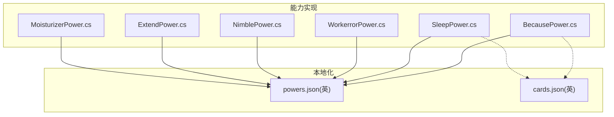
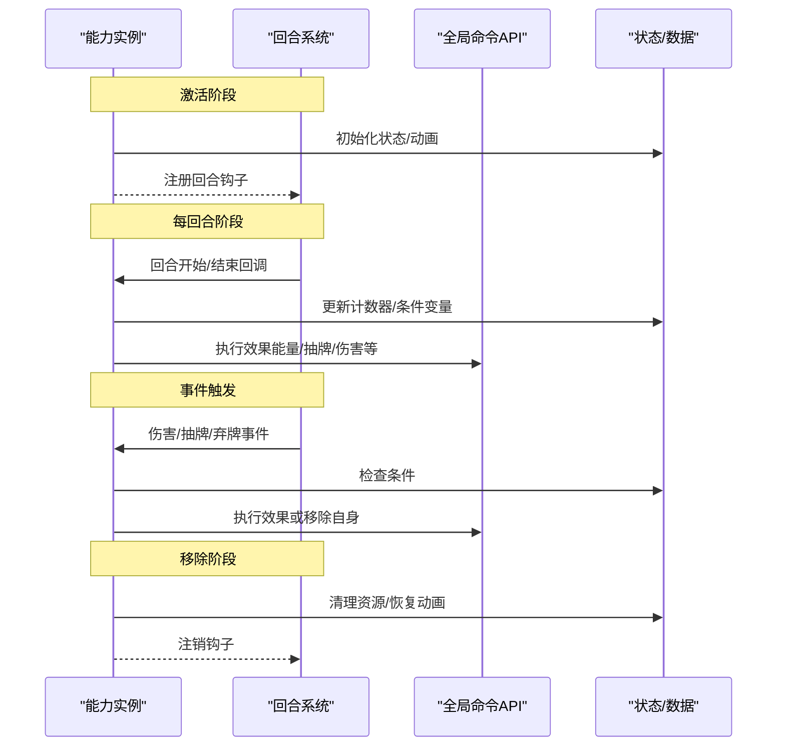
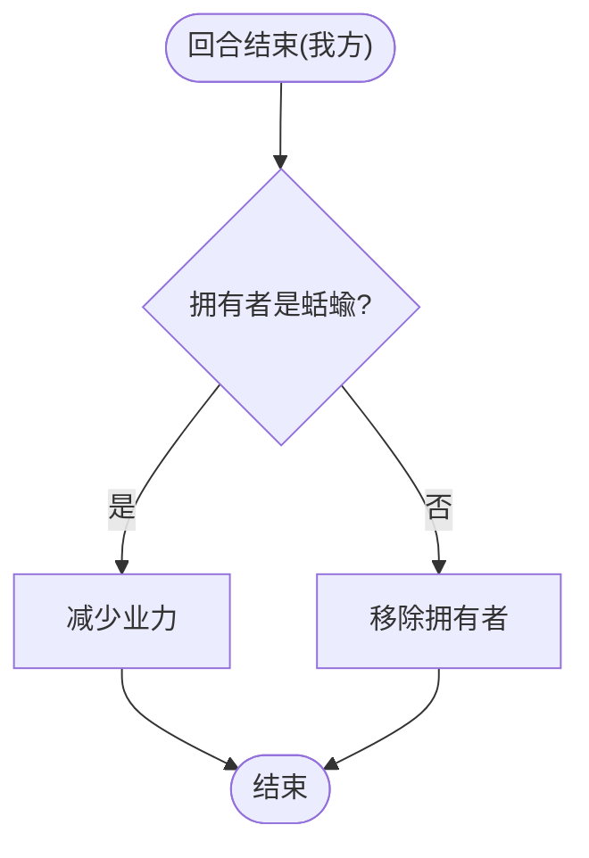
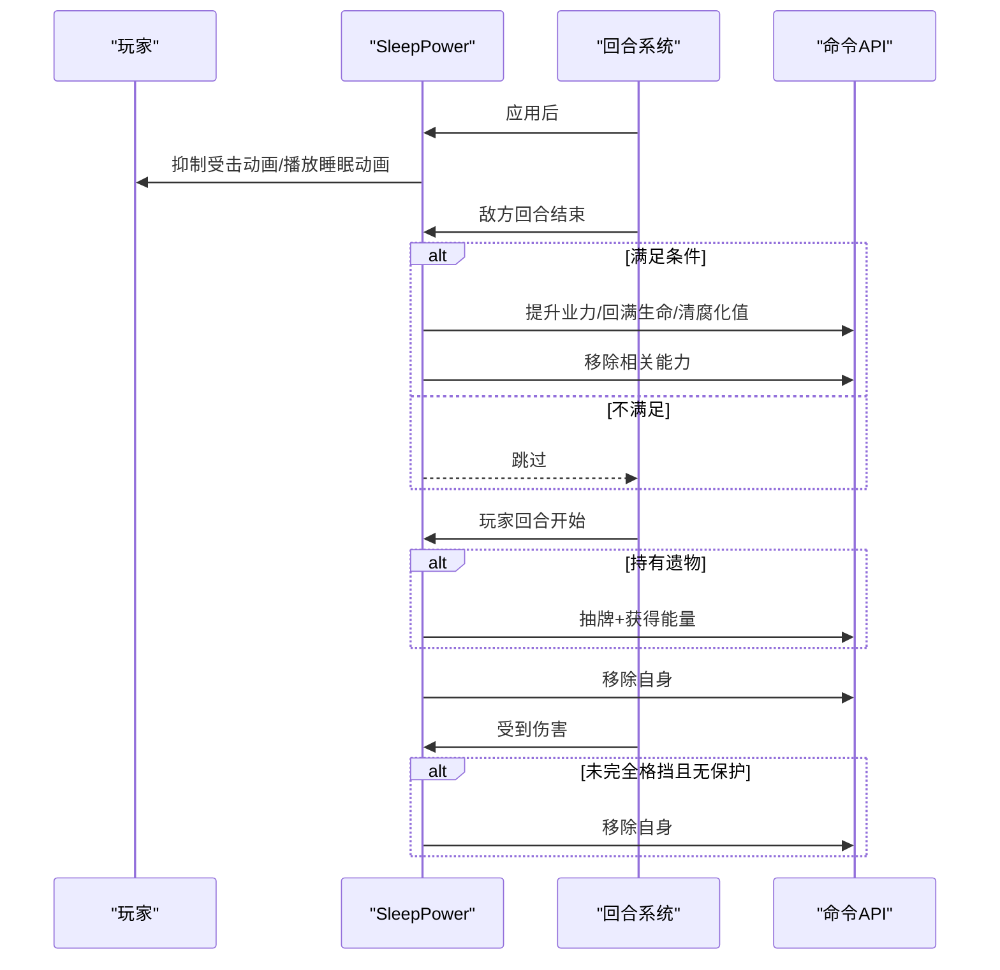
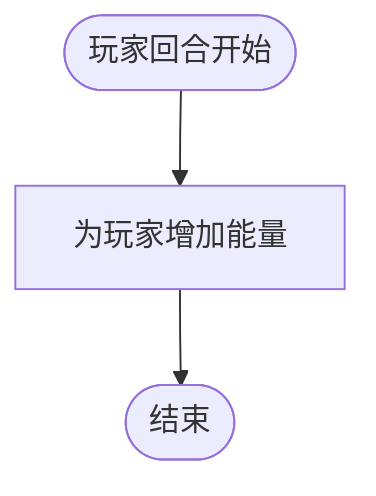
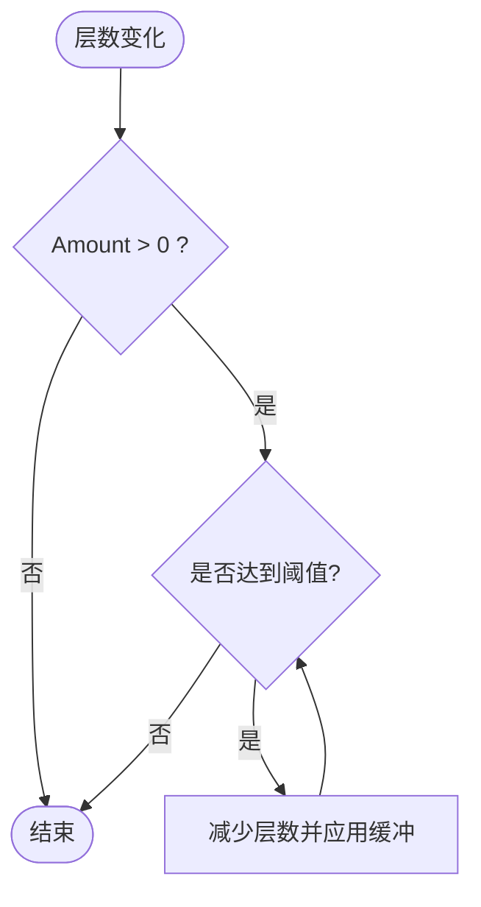
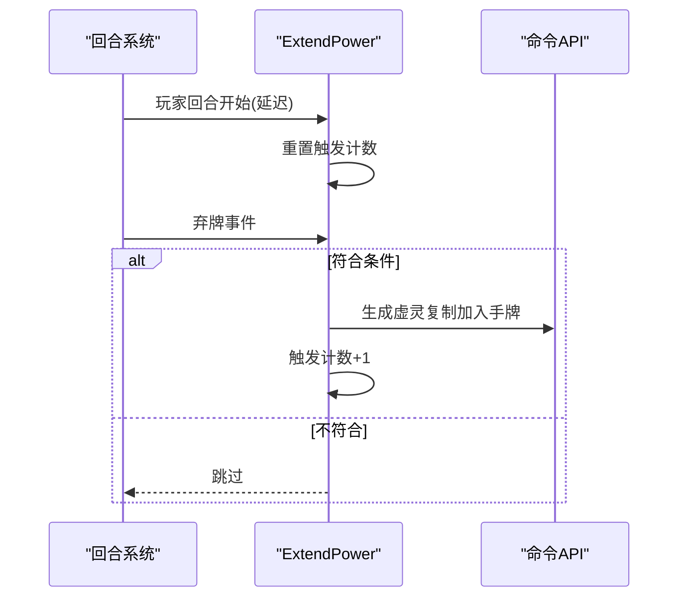
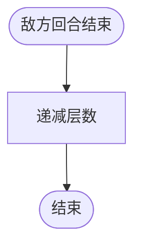
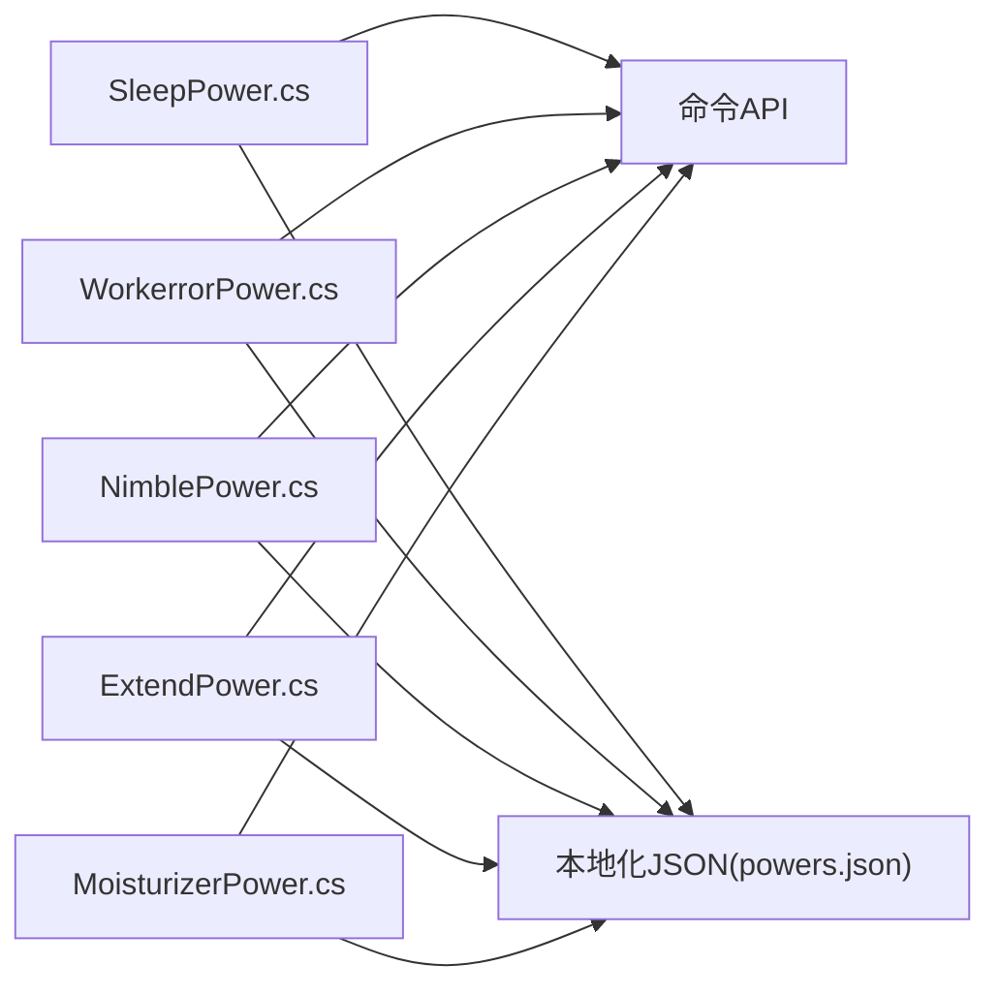

# 能力卡牌生命周期管理

<cite>
**本文引用的文件**
- [BecausePower.cs](file://Scripts/Powers/BecausePower.cs)
- [SleepPower.cs](file://Scripts/Powers/SleepPower.cs)
- [WorkerrorPower.cs](file://Scripts/Powers/WorkerrorPower.cs)
- [NimblePower.cs](file://Scripts/Powers/Liver/NimblePower.cs)
- [ExtendPower.cs](file://Scripts/Powers/RedCat/ExtendPower.cs)
- [MoisturizerPower.cs](file://Scripts/Powers/River/MoisturizerPower.cs)
- [powers.json（英文）](file://SlugcatTheSpireII/localization/eng/powers.json)
- [cards.json（英文）](file://SlugcatTheSpireII/localization/eng/cards.json)
</cite>

## 目录
1. [简介](#简介)
2. [项目结构](#项目结构)
3. [核心组件](#核心组件)
4. [架构总览](#架构总览)
5. [详细组件分析](#详细组件分析)
6. [依赖关系分析](#依赖关系分析)
7. [性能考量](#性能考量)
8. [故障排除指南](#故障排除指南)
9. [结论](#结论)
10. [附录](#附录)

## 简介
本文件围绕“能力卡牌”的生命周期管理进行系统化说明，覆盖从激活到移除的完整流程：初始化、每回合更新、条件检查、效果执行与资源清理。重点阐述状态跟踪机制（持续时间、计数器、条件变量）、与游戏回合系统的集成点（回合开始/结束处理），以及持久化存储在保存/加载时的恢复策略。最后提供调试与排错的最佳实践，帮助快速定位问题并优化实现。

## 项目结构
本项目采用按功能域划分的模块化组织方式，能力卡牌相关逻辑集中在 Scripts/Powers 目录下，每个能力以独立的类实现，并通过注册特性自动接入框架。本地化描述位于 SlugcatTheSpireII/localization 下，便于多语言配置。

图表来源
- [BecausePower.cs:26-58](file://Scripts/Powers/BecausePower.cs#L26-L58)
- [SleepPower.cs:32-112](file://Scripts/Powers/SleepPower.cs#L32-L112)
- [WorkerrorPower.cs:28-45](file://Scripts/Powers/WorkerrorPower.cs#L28-L45)
- [NimblePower.cs:26-51](file://Scripts/Powers/Liver/NimblePower.cs#L26-L51)
- [ExtendPower.cs:18-48](file://Scripts/Powers/RedCat/ExtendPower.cs#L18-L48)
- [MoisturizerPower.cs:23-45](file://Scripts/Powers/River/MoisturizerPower.cs#L23-L45)
- [powers.json（英文）:49-215](file://SlugcatTheSpireII/localization/eng/powers.json#L49-L215)
- [cards.json（英文）:1-665](file://SlugcatTheSpireII/localization/eng/cards.json#L1-L665)

章节来源
- [BecausePower.cs:26-58](file://Scripts/Powers/BecausePower.cs#L26-L58)
- [SleepPower.cs:32-112](file://Scripts/Powers/SleepPower.cs#L32-L112)
- [WorkerrorPower.cs:28-45](file://Scripts/Powers/WorkerrorPower.cs#L28-L45)
- [NimblePower.cs:26-51](file://Scripts/Powers/Liver/NimblePower.cs#L26-L51)
- [ExtendPower.cs:18-48](file://Scripts/Powers/RedCat/ExtendPower.cs#L18-L48)
- [MoisturizerPower.cs:23-45](file://Scripts/Powers/River/MoisturizerPower.cs#L23-L45)
- [powers.json（英文）:49-215](file://SlugcatTheSpireII/localization/eng/powers.json#L49-L215)
- [cards.json（英文）:1-665](file://SlugcatTheSpireII/localization/eng/cards.json#L1-L665)

## 核心组件
- 能力基类与类型
  - 所有能力继承自统一模板，声明图标、类型与堆叠模式（单件/计数器等）。
  - 通过注册特性自动发现与挂载到战斗系统。
- 回合钩子
  - 使用多种回调方法对接回合阶段：回合开始、回合结束、玩家回合开始、伤害接收等。
- 状态与计时
  - 使用计数器（Amount）表示层数或次数；部分能力维护每回合触发次数等临时变量。
- 效果执行
  - 通过命令式 API 修改能量、血量、抽牌、应用/移除能力等。
- 本地化
  - 能力标题与描述由本地化 JSON 驱动，支持动态变量替换。

章节来源
- [BecausePower.cs:26-38](file://Scripts/Powers/BecausePower.cs#L26-L38)
- [SleepPower.cs:32-43](file://Scripts/Powers/SleepPower.cs#L32-L43)
- [WorkerrorPower.cs:28-39](file://Scripts/Powers/WorkerrorPower.cs#L28-L39)
- [NimblePower.cs:26-37](file://Scripts/Powers/Liver/NimblePower.cs#L26-L37)
- [ExtendPower.cs:18-29](file://Scripts/Powers/RedCat/ExtendPower.cs#L18-L29)
- [MoisturizerPower.cs:23-35](file://Scripts/Powers/River/MoisturizerPower.cs#L23-L35)
- [powers.json（英文）:49-215](file://SlugcatTheSpireII/localization/eng/powers.json#L49-L215)

## 架构总览
能力卡牌生命周期由“事件驱动 + 回合钩子”构成：
- 激活时：设置初始状态、动画或附加效果。
- 每回合：在特定阶段（开始/结束）执行计数衰减、资源获取或条件判定。
- 条件触发：基于伤害、抽牌、弃牌、消耗等事件执行效果。
- 移除时：清理资源、重置状态、恢复动画等。

图表来源
- [SleepPower.cs:45-112](file://Scripts/Powers/SleepPower.cs#L45-L112)
- [WorkerrorPower.cs:42-45](file://Scripts/Powers/WorkerrorPower.cs#L42-L45)
- [NimblePower.cs:40-51](file://Scripts/Powers/Liver/NimblePower.cs#L40-L51)
- [ExtendPower.cs:32-48](file://Scripts/Powers/RedCat/ExtendPower.cs#L32-L48)
- [MoisturizerPower.cs:36-45](file://Scripts/Powers/River/MoisturizerPower.cs#L36-L45)

## 详细组件分析

### 因果（BecausePower）
- 生命周期要点
  - 类型：增益型，堆叠模式为计数。
  - 回合结束（我方）：若拥有者为蛞蝓角色则减少业力；否则直接移除拥有者。
- 状态与条件
  - 无额外计数器，行为由拥有者身份决定。
- 回合集成
  - 使用“侧回合结束”钩子执行效果。
- 资源清理
  - 不显式清理资源，但可能因死亡而移除。

图表来源
- [BecausePower.cs:40-58](file://Scripts/Powers/BecausePower.cs#L40-L58)

章节来源
- [BecausePower.cs:26-58](file://Scripts/Powers/BecausePower.cs#L26-L58)

### 休眠（SleepPower）
- 生命周期要点
  - 应用后：为蛞蝓角色抑制受击动画，播放睡眠动画。
  - 敌方回合结束：根据业力上限与遗物状态决定是否提升业力、回满生命或清除腐化值，并移除相关能力。
  - 玩家回合开始：若持有特定遗物则抽牌加能，然后移除自身。
  - 受到伤害：若未完全格挡且无特定遗物保护，则移除自身。
- 状态与条件
  - 无额外计数器，依赖外部状态（业力、腐化值、遗物）。
- 回合集成
  - 使用“敌方回合结束”、“玩家回合开始”、“伤害接收”等多钩子。
- 资源清理
  - 移除时恢复动画状态。

图表来源
- [SleepPower.cs:45-112](file://Scripts/Powers/SleepPower.cs#L45-L112)

章节来源
- [SleepPower.cs:32-112](file://Scripts/Powers/SleepPower.cs#L32-L112)

### 工作错误（WorkerrorPower）
- 生命周期要点
  - 玩家回合开始：为玩家增加能量。
- 状态与条件
  - 无额外计数器，固定效果。
- 回合集成
  - 使用“玩家回合开始”钩子。
- 资源清理
  - 默认移除时机由框架控制。

图表来源
- [WorkerrorPower.cs:42-45](file://Scripts/Powers/WorkerrorPower.cs#L42-L45)

章节来源
- [WorkerrorPower.cs:28-45](file://Scripts/Powers/WorkerrorPower.cs#L28-L45)

### 灵巧（NimblePower）
- 生命周期要点
  - 当层数变化且为正时，循环将层数转换为缓冲（Buffer）能力，阈值受其他能力影响。
- 状态与条件
  - 使用 Amount 作为计数器；存在 fromtwohand 标记用于区分来源。
- 回合集成
  - 通过“能力数值变化”事件触发转换逻辑。
- 资源清理
  - 转换完成后仍保留剩余层数。

图表来源
- [NimblePower.cs:40-51](file://Scripts/Powers/Liver/NimblePower.cs#L40-L51)

章节来源
- [NimblePower.cs:26-51](file://Scripts/Powers/Liver/NimblePower.cs#L26-L51)

### 延伸（ExtendPower）
- 生命周期要点
  - 每回合开始时重置触发计数。
  - 当队友弃牌且未达到次数限制且非虚灵复制时，生成一张虚灵复制加入手牌。
- 状态与条件
  - hasTriggeredThisTurn 记录本回合已触发次数；Amount 为上限。
- 回合集成
  - 使用“侧回合开始（延迟）”重置计数；使用“弃牌”事件执行效果。
- 资源清理
  - 无特殊清理逻辑。

图表来源
- [ExtendPower.cs:32-48](file://Scripts/Powers/RedCat/ExtendPower.cs#L32-L48)

章节来源
- [ExtendPower.cs:18-48](file://Scripts/Powers/RedCat/ExtendPower.cs#L18-L48)

### 保湿器（MoisturizerPower）
- 生命周期要点
  - 敌方回合结束时递减层数。
- 状态与条件
  - 使用 Amount 作为计数器，随时间自然衰减。
- 回合集成
  - 使用“侧回合结束”钩子执行递减。
- 资源清理
  - 层数为零时由框架移除。

图表来源
- [MoisturizerPower.cs:36-45](file://Scripts/Powers/River/MoisturizerPower.cs#L36-L45)

章节来源
- [MoisturizerPower.cs:23-45](file://Scripts/Powers/River/MoisturizerPower.cs#L23-L45)

## 依赖关系分析
- 内部依赖
  - 各能力均依赖统一的命令 API（如 PowerCmd、PlayerCmd、CardPileCmd、CreatureCmd）执行效果。
  - 通过 NCombatRoom 等节点访问战斗场景中的实体。
- 外部依赖
  - 本地化 JSON 提供能力描述与标题，支持动态变量替换。
- 耦合与内聚
  - 高内聚：每个能力封装独立逻辑，职责清晰。
  - 低耦合：通过命令 API 与框架交互，避免直接操作底层对象。

图表来源
- [SleepPower.cs:45-112](file://Scripts/Powers/SleepPower.cs#L45-L112)
- [WorkerrorPower.cs:42-45](file://Scripts/Powers/WorkerrorPower.cs#L42-L45)
- [NimblePower.cs:40-51](file://Scripts/Powers/Liver/NimblePower.cs#L40-L51)
- [ExtendPower.cs:32-48](file://Scripts/Powers/RedCat/ExtendPower.cs#L32-L48)
- [MoisturizerPower.cs:36-45](file://Scripts/Powers/River/MoisturizerPower.cs#L36-L45)
- [powers.json（英文）:49-215](file://SlugcatTheSpireII/localization/eng/powers.json#L49-L215)

章节来源
- [SleepPower.cs:45-112](file://Scripts/Powers/SleepPower.cs#L45-L112)
- [WorkerrorPower.cs:42-45](file://Scripts/Powers/WorkerrorPower.cs#L42-L45)
- [NimblePower.cs:40-51](file://Scripts/Powers/Liver/NimblePower.cs#L40-L51)
- [ExtendPower.cs:32-48](file://Scripts/Powers/RedCat/ExtendPower.cs#L32-L48)
- [MoisturizerPower.cs:36-45](file://Scripts/Powers/River/MoisturizerPower.cs#L36-L45)
- [powers.json（英文）:49-215](file://SlugcatTheSpireII/localization/eng/powers.json#L49-L215)

## 性能考量
- 事件频率
  - 高频事件（如伤害接收）中应避免复杂计算，尽量简化条件判断。
- 循环与迭代
  - NimblePower 的层数转换使用 while 循环，需确保不会造成无限循环或过大开销。
- 内存与对象创建
  - ExtendPower 生成卡片副本时应注意对象生命周期，避免不必要的重复创建。
- 帧率与动画
  - SleepPower 在应用/移除时切换动画，应确保动画切换不会阻塞主线程。

[本节为通用指导，无需具体文件引用]

## 故障排除指南
- 常见问题
  - 能力未按预期移除：检查对应移除条件（如伤害接收、回合结束）是否正确触发。
  - 计数器异常：确认 Amount 的增减路径与阈值判断逻辑。
  - 动画状态不一致：在 AfterRemoved 中确保恢复默认动画。
- 调试建议
  - 在关键回调中加入日志输出（如回合开始/结束、事件触发）。
  - 使用本地化工具验证动态变量替换是否符合预期。
  - 针对多回合能力，逐回合打印状态变化，定位异常点。
- 参考实现
  - 观察 SleepPower 的多钩子组合与条件分支，作为复杂能力的参考模板。
  - 参考 ExtendPower 的每回合计数重置模式，避免跨回合状态污染。

章节来源
- [SleepPower.cs:45-112](file://Scripts/Powers/SleepPower.cs#L45-L112)
- [ExtendPower.cs:32-48](file://Scripts/Powers/RedCat/ExtendPower.cs#L32-L48)

## 结论
本项目的能力卡牌生命周期管理采用事件驱动与回合钩子的结合方式，实现了清晰的初始化、更新、条件检查、效果执行与清理流程。通过统一的命令 API 与本地化配置，保证了扩展性与可维护性。建议在新增能力时遵循现有模式，合理使用计数器与临时变量，并在关键回调中进行充分的状态校验与日志记录，以确保稳定性与可观测性。

[本节为总结性内容，无需具体文件引用]

## 附录
- 术语表
  - 能力（Power）：赋予单位持续效果的卡牌类型。
  - 回合钩子：在回合不同阶段触发的回调方法。
  - 计数器（Amount）：表示层数或次数的数值属性。
  - 本地化（Localization）：多语言文本与动态变量配置。
- 最佳实践
  - 明确能力类型与堆叠模式。
  - 在合适的回合钩子中执行逻辑，避免在错误阶段修改状态。
  - 对高频事件进行性能优化，减少不必要的计算与对象创建。
  - 完善移除逻辑，确保资源与状态正确清理。

[本节为补充信息，无需具体文件引用]