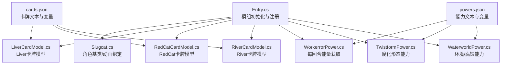
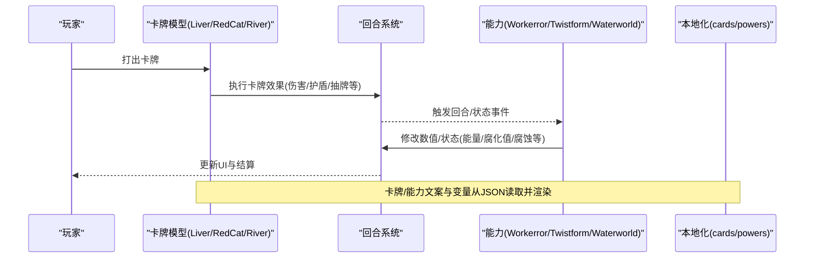
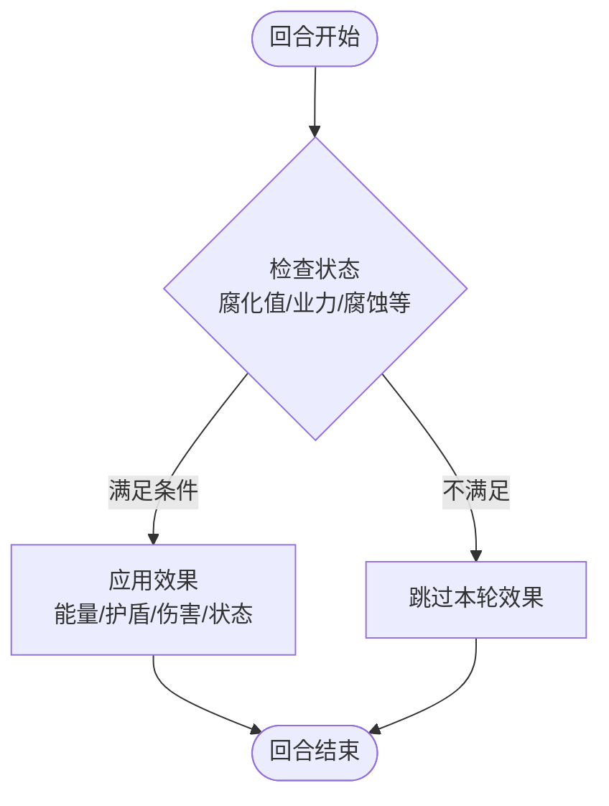
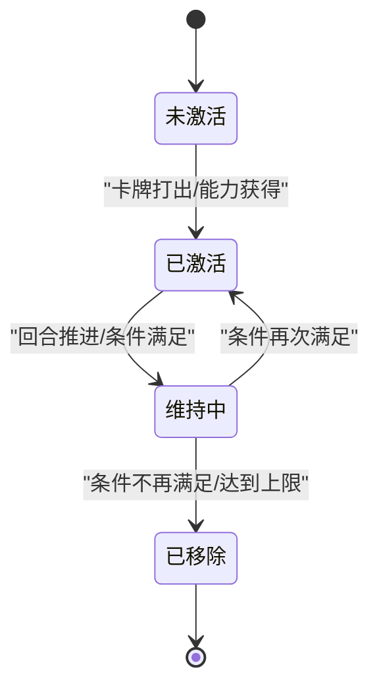
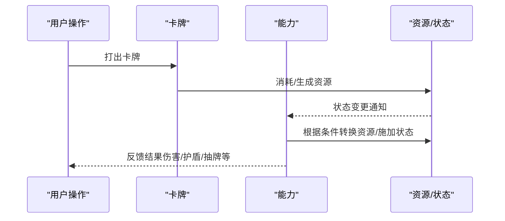
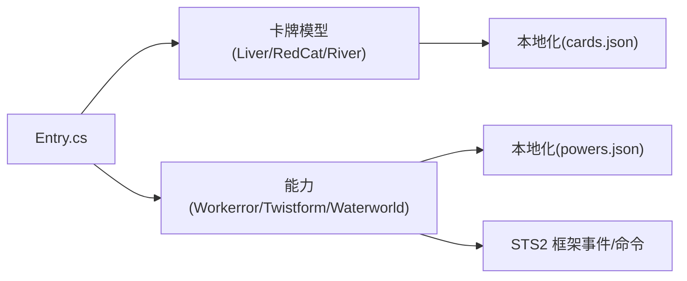

# 能力卡牌系统

<cite>
**本文引用的文件**
- [Entry.cs](file://Scripts/Entry.cs)
- [Slugcat.cs](file://Scripts/Slugcat/Slugcat.cs)
- [LiverCardModel.cs](file://Scripts/Card/Liver/LiverCardModel.cs)
- [RedCatCardModel.cs](file://Scripts/Card/RedCat/RedCatCardModel.cs)
- [RiverCardModel.cs](file://Scripts/Card/River/RiverCardModel.cs)
- [WorkerrorPower.cs](file://Scripts/Powers/WorkerrorPower.cs)
- [TwistformPower.cs](file://Scripts/Powers/RedCat/TwistformPower.cs)
- [WaterworldPower.cs](file://Scripts/Powers/River/WaterworldPower.cs)
- [cards.json（英文）](file://SlugcatTheSpireII/localization/eng/cards.json)
- [powers.json（英文）](file://SlugcatTheSpireII/localization/eng/powers.json)
- [settings_ui.json（英文）](file://SlugcatTheSpireII/localization/eng/settings_ui.json)
</cite>

## 目录
1. [简介](#简介)
2. [项目结构](#项目结构)
3. [核心组件](#核心组件)
4. [架构总览](#架构总览)
5. [详细组件分析](#详细组件分析)
6. [依赖关系分析](#依赖关系分析)
7. [性能考量](#性能考量)
8. [故障排查指南](#故障排查指南)
9. [结论](#结论)
10. [附录](#附录)

## 简介
本技术文档围绕“能力卡牌系统”展开，聚焦以下目标：
- 能力卡牌的持久化机制、状态跟踪与效果计算
- 与游戏回合系统的集成：每回合触发、条件检查、效果更新
- 角色差异化设计：Liver的组合加成、RedCat的形态转换、River的环境影响
- 生命周期管理：激活、维持、移除
- 复杂能力实现：连锁反应、条件触发、资源转换
- 开发最佳实践与常见问题解决方案

## 项目结构
该模组基于 STS2 框架扩展，采用模块化组织：
- 入口与注册：统一在 Entry 中完成补丁、资源、卡牌/能力/遗物等自动注册
- 角色基类：提供通用动画与战斗行为钩子
- 卡牌模型：按角色分目录（Liver/RedCat/River），各自定义资源路径与基础属性
- 能力（Power）：以 ModPowerTemplate 派生类实现，覆盖回合事件、伤害/防御修改、状态管理等
- 本地化：通过 JSON 描述卡牌与能力的标题、说明、智能提示等

图表来源
- [Entry.cs:26-73](file://Scripts/Entry.cs#L26-L73)
- [Slugcat.cs:61-135](file://Scripts/Slugcat/Slugcat.cs#L61-L135)
- [LiverCardModel.cs:14-38](file://Scripts/Card/Liver/LiverCardModel.cs#L14-L38)
- [RedCatCardModel.cs:13-39](file://Scripts/Card/RedCat/RedCatCardModel.cs#L13-L39)
- [RiverCardModel.cs:14-39](file://Scripts/Card/River/RiverCardModel.cs#L14-L39)
- [WorkerrorPower.cs:28-48](file://Scripts/Powers/WorkerrorPower.cs#L28-L48)
- [TwistformPower.cs:27-40](file://Scripts/Powers/RedCat/TwistformPower.cs#L27-L40)
- [WaterworldPower.cs:17-28](file://Scripts/Powers/River/WaterworldPower.cs#L17-L28)

章节来源
- [Entry.cs:26-73](file://Scripts/Entry.cs#L26-L73)
- [Slugcat.cs:61-135](file://Scripts/Slugcat/Slugcat.cs#L61-L135)

## 核心组件
- 卡牌模型基类：为不同角色提供统一的资源路径与类型映射，便于扩展新卡牌
- 能力模板：通过覆盖回合事件、伤害/防御钩子、状态变更回调实现复杂逻辑
- 本地化配置：集中维护卡牌/能力文案与动态变量占位符，支持多语言
- 角色基类：封装动画状态机与受击/攻击/施法等行为控制

章节来源
- [LiverCardModel.cs:14-38](file://Scripts/Card/Liver/LiverCardModel.cs#L14-L38)
- [RedCatCardModel.cs:13-39](file://Scripts/Card/RedCat/RedCatCardModel.cs#L13-L39)
- [RiverCardModel.cs:14-39](file://Scripts/Card/River/RiverCardModel.cs#L14-L39)
- [WorkerrorPower.cs:28-48](file://Scripts/Powers/WorkerrorPower.cs#L28-L48)
- [TwistformPower.cs:27-40](file://Scripts/Powers/RedCat/TwistformPower.cs#L27-L40)
- [WaterworldPower.cs:17-28](file://Scripts/Powers/River/WaterworldPower.cs#L17-L28)
- [Slugcat.cs:61-135](file://Scripts/Slugcat/Slugcat.cs#L61-L135)

## 架构总览
能力卡牌系统由“卡牌模型 + 能力模板 + 回合事件 + 本地化”构成。卡牌负责表达数值与动作，能力负责跨回合的状态与规则修正；两者通过框架的事件总线与命令系统进行交互。

图表来源
- [cards.json:1-16](file://SlugcatTheSpireII/localization/eng/cards.json#L1-L16)
- [powers.json:49-110](file://SlugcatTheSpireII/localization/eng/powers.json#L49-L110)
- [WorkerrorPower.cs:42-45](file://Scripts/Powers/WorkerrorPower.cs#L42-L45)
- [TwistformPower.cs:27-40](file://Scripts/Powers/RedCat/TwistformPower.cs#L27-L40)
- [WaterworldPower.cs:17-28](file://Scripts/Powers/River/WaterworldPower.cs#L17-L28)

## 详细组件分析

### 能力卡牌的持久化与状态跟踪
- 持久化
  - 卡牌与能力通过框架的自动注册机制载入，运行时由引擎负责序列化/反序列化
  - 卡牌模型通过 Resource 路径声明外观资源，确保跨局保存后仍可正确显示
- 状态跟踪
  - 能力通过 PowerStackType 控制堆叠方式（计数器/单次等）
  - 回合事件（如 AfterPlayerTurnStart）用于周期性状态推进
- 效果计算
  - 使用框架提供的命令系统（如增益能量、造成伤害、应用状态）保证同步与一致性
  - 动态变量（如 {Amount}、{Energy:energyIcons()}）在本地化文件中定义并在运行时解析

章节来源
- [Entry.cs:45-56](file://Scripts/Entry.cs#L45-L56)
- [LiverCardModel.cs:17-32](file://Scripts/Card/Liver/LiverCardModel.cs#L17-L32)
- [RedCatCardModel.cs:17-33](file://Scripts/Card/RedCat/RedCatCardModel.cs#L17-L33)
- [RiverCardModel.cs:18-33](file://Scripts/Card/River/RiverCardModel.cs#L18-L33)
- [WorkerrorPower.cs:28-48](file://Scripts/Powers/WorkerrorPower.cs#L28-L48)
- [TwistformPower.cs:27-40](file://Scripts/Powers/RedCat/TwistformPower.cs#L27-L40)
- [WaterworldPower.cs:17-28](file://Scripts/Powers/River/WaterworldPower.cs#L17-L28)
- [powers.json:49-110](file://SlugcatTheSpireII/localization/eng/powers.json#L49-L110)

### 与回合系统的集成（每回合触发、条件检查、效果更新）
- 每回合触发
  - WorkerrorPower 在玩家回合开始时获得能量，体现“每回合固定收益”的能力
- 条件检查
  - 能力可结合状态（如腐化值、业力、腐蚀）进行分支处理
- 效果更新
  - 通过命令系统对玩家或敌人施加增益/减益、资源转换、伤害/护盾变化

图表来源
- [WorkerrorPower.cs:42-45](file://Scripts/Powers/WorkerrorPower.cs#L42-L45)
- [powers.json:149-165](file://SlugcatTheSpireII/localization/eng/powers.json#L149-L165)

章节来源
- [WorkerrorPower.cs:42-45](file://Scripts/Powers/WorkerrorPower.cs#L42-L45)
- [powers.json:149-165](file://SlugcatTheSpireII/localization/eng/powers.json#L149-L165)

### 角色差异化设计
- Liver：组合加成
  - 通过卡牌与能力配合，在同一回合内打出攻击+技能组合时获得属性提升
  - 典型表现：组合计数、额外属性、资源转化
- RedCat：形态转换
  - 腐化值驱动形态切换，影响伤害、防御、抽牌与资源转换
  - 能力提供腐化倍率、菌化状态、业报联动等
- River：环境影响
  - 以“水蚀/湿滑/潮汐”等资源为核心，影响抽牌、伤害、护盾与环境互动
  - 能力将护盾自然衰减转化为伤害，或将资源转换为其他资源

章节来源
- [cards.json:112-139](file://SlugcatTheSpireII/localization/eng/cards.json#L112-L139)
- [powers.json:149-165](file://SlugcatTheSpireII/localization/eng/powers.json#L149-L165)
- [powers.json:207-215](file://SlugcatTheSpireII/localization/eng/powers.json#L207-L215)

### 生命周期管理（激活、维持、移除）
- 激活
  - 卡牌打出时立即生效（伤害、护盾、资源消耗/获取）
  - 能力通过回合事件或状态变更触发
- 维持
  - 能力以堆叠或单次形式存在，持续影响后续回合
  - 某些能力在特定条件下维持（如腐化值阈值、护盾破坏次数）
- 移除
  - 当条件不再满足或达到上限时移除（如腐化值归零退出菌化、护盾被破后失效）

[此图为概念性流程图，无需源码对应]

### 复杂能力效果的实现方法
- 连锁反应
  - 通过能力在回合事件或状态变更时触发二次效果（如业报触发时对全体敌人造成伤害）
- 条件触发
  - 依据腐化值、业力、护盾、资源等条件分支执行不同逻辑
- 资源转换
  - 将一种资源（如腐化值、水蚀、饱食度）转换为另一种资源（如力量、活力、护盾）

图表来源
- [powers.json:149-165](file://SlugcatTheSpireII/localization/eng/powers.json#L149-L165)
- [cards.json:184-195](file://SlugcatTheSpireII/localization/eng/cards.json#L184-L195)

章节来源
- [powers.json:149-165](file://SlugcatTheSpireII/localization/eng/powers.json#L149-L165)
- [cards.json:184-195](file://SlugcatTheSpireII/localization/eng/cards.json#L184-L195)

## 依赖关系分析
- 模块耦合
  - Entry 作为统一入口，负责补丁、注册、资源绑定，降低各模块间直接耦合
  - 卡牌模型与能力模板通过框架接口解耦，便于独立扩展
- 外部依赖
  - 依赖 STS2 框架的命令系统与事件总线
  - 依赖 Godot 脚本与音频资源（Fmod）
- 循环依赖
  - 当前结构未见明显循环依赖，卡牌与能力通过框架事件通信

图表来源
- [Entry.cs:26-73](file://Scripts/Entry.cs#L26-L73)
- [cards.json:1-16](file://SlugcatTheSpireII/localization/eng/cards.json#L1-L16)
- [powers.json:49-110](file://SlugcatTheSpireII/localization/eng/powers.json#L49-L110)

章节来源
- [Entry.cs:26-73](file://Scripts/Entry.cs#L26-L73)

## 性能考量
- 避免在高频事件中执行重计算：将复杂逻辑拆分到回合事件或状态变更回调
- 合理使用堆叠与计数器：减少不必要的对象创建与销毁
- 本地化变量解析开销：尽量复用解析结果，避免重复计算
- 动画与音效：按需加载与延迟注册，减少启动与战斗卡顿

[本节为通用指导，无需源码对应]

## 故障排查指南
- 能力未生效
  - 检查是否覆盖了正确的回合事件（如 AfterPlayerTurnStart）
  - 确认能力已注册且未被其他补丁覆盖
- 文案显示异常
  - 核对本地化键名与变量占位符是否与代码一致
- 资源路径错误
  - 确认卡牌/能力图片路径与资源命名匹配
- 回合事件未触发
  - 检查框架事件订阅是否正确，是否存在前置条件阻止触发

章节来源
- [WorkerrorPower.cs:42-45](file://Scripts/Powers/WorkerrorPower.cs#L42-L45)
- [TwistformPower.cs:27-40](file://Scripts/Powers/RedCat/TwistformPower.cs#L27-L40)
- [WaterworldPower.cs:17-28](file://Scripts/Powers/River/WaterworldPower.cs#L17-L28)
- [cards.json:1-16](file://SlugcatTheSpireII/localization/eng/cards.json#L1-L16)
- [powers.json:49-110](file://SlugcatTheSpireII/localization/eng/powers.json#L49-L110)

## 结论
能力卡牌系统通过清晰的模块化设计与框架事件机制，实现了卡牌效果与回合系统的深度集成。Liver、RedCat、River 三类角色分别以组合加成、形态转换、环境影响为核心特色，形成差异化玩法。遵循本文的最佳实践与排错建议，可有效提升开发效率与稳定性。

## 附录
- 关键流程参考
  - 每回合能量获取：AfterPlayerTurnStart 钩子
  - 腐化形态：腐化值驱动的状态切换与资源转换
  - 环境影响：水蚀/湿滑等资源与护盾/伤害的联动

章节来源
- [WorkerrorPower.cs:42-45](file://Scripts/Powers/WorkerrorPower.cs#L42-L45)
- [powers.json:149-165](file://SlugcatTheSpireII/localization/eng/powers.json#L149-L165)
- [settings_ui.json:1-10](file://SlugcatTheSpireII/localization/eng/settings_ui.json#L1-L10)