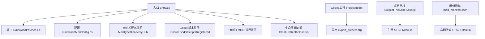
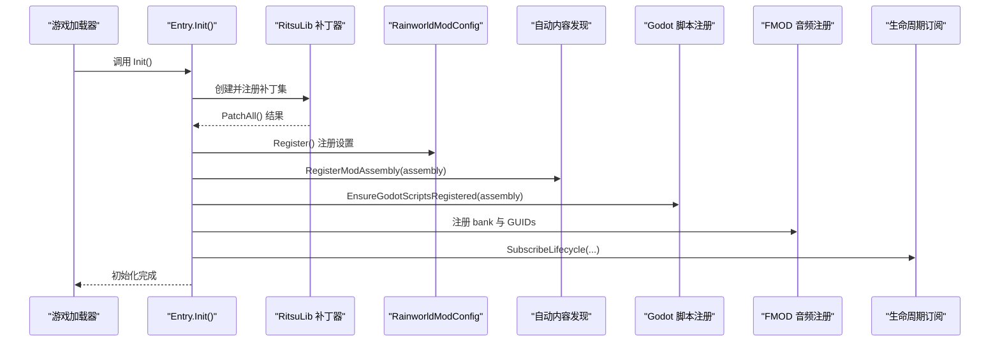
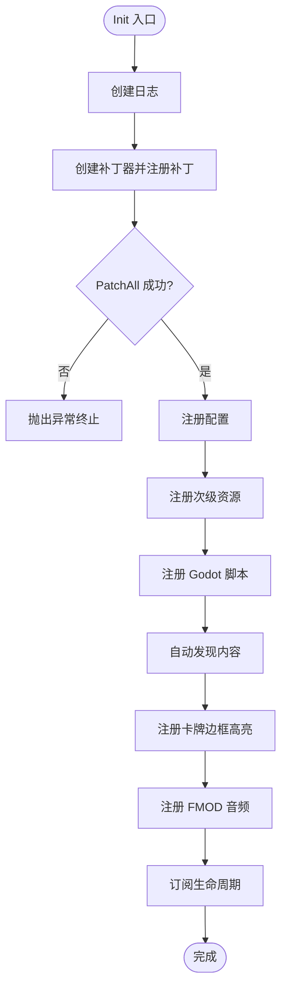
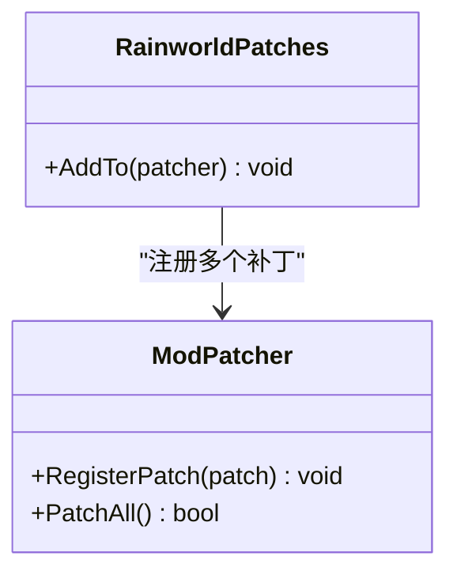
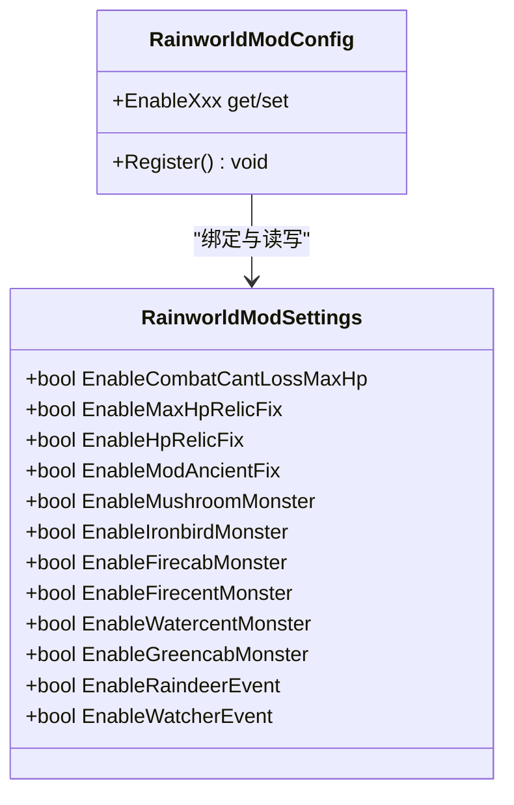
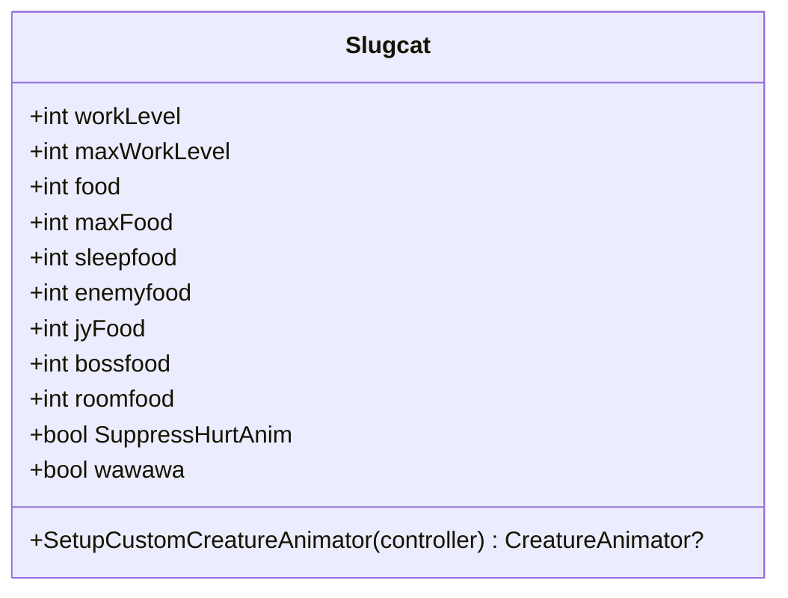
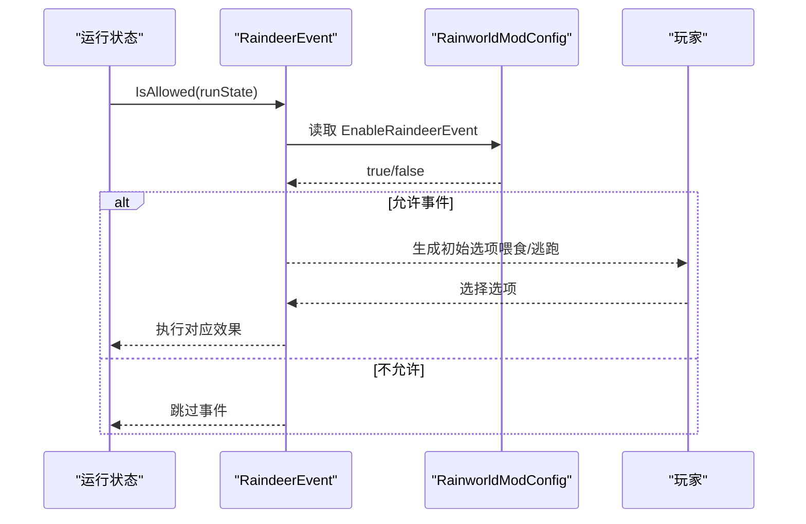
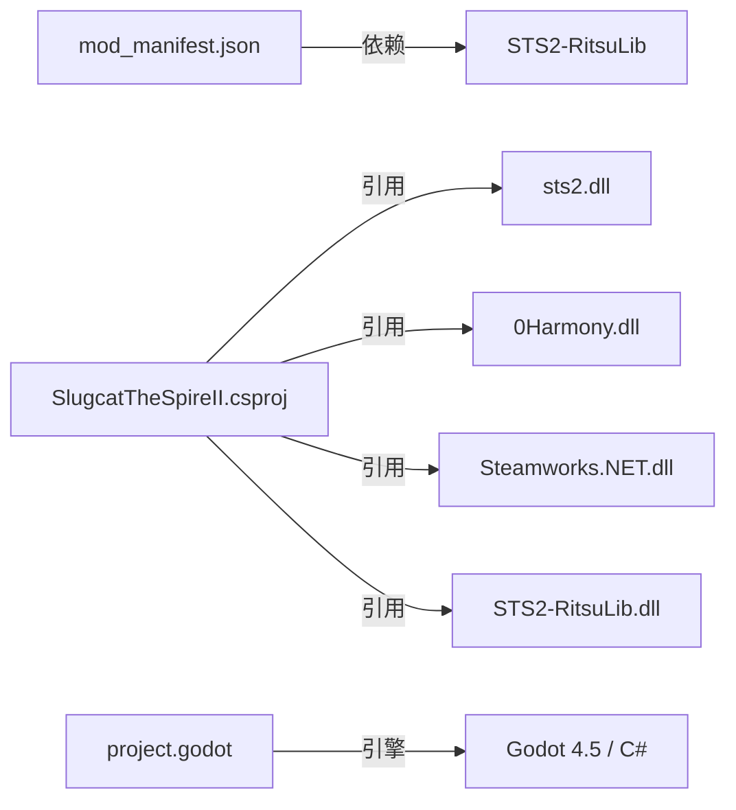

# 快速开始

<cite>
**本文引用的文件**
- [mod_manifest.json](file://mod_manifest.json)
- [Entry.cs](file://Scripts/Entry.cs)
- [RainworldModConfig.cs](file://Scripts/RainworldModConfig.cs)
- [project.godot](file://project.godot)
- [SlugcatTheSpireII.csproj](file://SlugcatTheSpireII.csproj)
- [export_presets.cfg](file://export_presets.cfg)
- [Slugcat.cs](file://Scripts/Slugcat/Slugcat.cs)
- [RainworldPatches.cs](file://Scripts/patches/RainworldPatches.cs)
- [RaindeerEvent.cs](file://Scripts/Event/RaindeerEvent.cs)
</cite>

## 目录
1. [简介](#简介)
2. [项目结构](#项目结构)
3. [核心组件](#核心组件)
4. [架构总览](#架构总览)
5. [详细组件分析](#详细组件分析)
6. [依赖分析](#依赖分析)
7. [性能注意事项](#性能注意事项)
8. [故障排除指南](#故障排除指南)
9. [结论](#结论)
10. [附录](#附录)

## 简介
本指南面向初次接触 SlugcatTheSpireII 模组的开发者，目标是帮助你快速完成环境搭建、依赖安装、项目配置与第一个模组内容的开发。你将了解：
- 如何设置开发环境并导入项目
- 如何编译和运行模组
- RitsuLib 框架的基本使用方式
- 模组生命周期与内容注册机制
- 常见配置项与问题排查

## 项目结构
该模组基于 Godot .NET（C#）与 STS2-RitsuLib 构建，采用“代码 + 资源”的混合组织方式：
- Scripts：C# 逻辑入口、补丁、角色、卡牌、遗物、事件、能力等
- Godot：Godot 场景、动画、UI 等资源
- SlugcatTheSpireII/localization：多语言本地化 JSON
- 根目录清单与工程文件：mod_manifest.json、csproj、project.godot、export_presets.cfg

图表来源
- [Entry.cs:20-76](file://Scripts/Entry.cs#L20-L76)
- [project.godot:11-28](file://project.godot#L11-L28)
- [SlugcatTheSpireII.csproj:17-44](file://SlugcatTheSpireII.csproj#L17-L44)
- [mod_manifest.json:1-14](file://mod_manifest.json#L1-L14)

章节来源
- [Entry.cs:20-76](file://Scripts/Entry.cs#L20-L76)
- [project.godot:11-28](file://project.godot#L11-L28)
- [SlugcatTheSpireII.csproj:17-44](file://SlugcatTheSpireII.csproj#L17-L44)
- [mod_manifest.json:1-14](file://mod_manifest.json#L1-L14)

## 核心组件
- 模组入口与初始化：Entry.cs 负责创建日志、注册补丁、注册配置、注册 Godot 脚本、启用自动内容发现、注册卡牌边框高亮规则、注册 FMOD 音频、订阅生命周期事件。
- 补丁系统：RainworldPatches.cs 集中注册游戏行为修改点（如最大生命值修复、药水过滤、战斗 UI 等）。
- 配置系统：RainworldModConfig.cs 提供可开关的功能选项（怪物、事件、血量修复等），并通过 RitsuLib 的设置界面暴露给用户。
- 角色基类：Slugcat.cs 定义了通用角色模板，包含动画状态机、外观颜色、攻击施法延迟等。
- 事件示例：RaindeerEvent.cs 展示如何使用 RitsuLib 的事件模板与条件判断。

章节来源
- [Entry.cs:20-76](file://Scripts/Entry.cs#L20-L76)
- [RainworldPatches.cs:8-33](file://Scripts/patches/RainworldPatches.cs#L8-L33)
- [RainworldModConfig.cs:11-235](file://Scripts/RainworldModConfig.cs#L11-L235)
- [Slugcat.cs:40-135](file://Scripts/Slugcat/Slugcat.cs#L40-L135)
- [RaindeerEvent.cs:27-67](file://Scripts/Event/RaindeerEvent.cs#L27-L67)

## 架构总览
下图展示了模组从启动到内容注册的总体流程，以及关键子系统之间的交互。

图表来源
- [Entry.cs:26-76](file://Scripts/Entry.cs#L26-L76)

章节来源
- [Entry.cs:26-76](file://Scripts/Entry.cs#L26-L76)

## 详细组件分析

### 模组入口与生命周期
- 入口类 Entry 通过特性标记为模组初始化点，并在 Init 中执行：
  - 创建日志记录器
  - 创建补丁器并注册补丁集合
  - 注册模组配置
  - 注册次级资源（食物、业力等级等）
  - 注册 Godot 脚本
  - 启用自动内容发现（卡牌、遗物、能力等）
  - 注册卡牌手牌边框高亮规则
  - 注册 FMOD 音频资源
  - 订阅生命周期观察者（例如生物死亡观察）

图表来源
- [Entry.cs:26-76](file://Scripts/Entry.cs#L26-L76)

章节来源
- [Entry.cs:26-76](file://Scripts/Entry.cs#L26-L76)

### 补丁系统
- RainworldPatches 作为补丁集合，集中注册需要修改的游戏行为，包括最大生命值修复、药水过滤、遗物池过滤、战斗 UI 相关补丁等。
- 在 Entry 初始化时通过补丁器统一注册并执行 PatchAll。

图表来源
- [RainworldPatches.cs:8-33](file://Scripts/patches/RainworldPatches.cs#L8-L33)
- [Entry.cs:30-34](file://Scripts/Entry.cs#L30-L34)

章节来源
- [RainworldPatches.cs:8-33](file://Scripts/patches/RainworldPatches.cs#L8-L33)
- [Entry.cs:30-34](file://Scripts/Entry.cs#L30-L34)

### 配置系统
- RainworldModSettings 定义所有可配置开关（怪物、事件、血量修复等）。
- RainworldModConfig 将这些开关绑定到持久化存储，并通过 RitsuLib 的设置页面暴露给用户。
- 支持分组（general、monster、event）与本地化标题/描述。

图表来源
- [RainworldModConfig.cs:11-235](file://Scripts/RainworldModConfig.cs#L11-L235)

章节来源
- [RainworldModConfig.cs:11-235](file://Scripts/RainworldModConfig.cs#L11-L235)

### 角色与动画
- Slugcat 抽象基类继承自 RitsuLib 的角色模板，提供统一的性别、名称颜色、攻击/施法延迟、能量标签颜色等。
- SetupCustomCreatureAnimator 定义动画状态机（待机、攻击、施法、受伤、死亡、放松、睡眠、腐败、喵叫、假死），并可控制是否播放受伤动画。

图表来源
- [Slugcat.cs:40-135](file://Scripts/Slugcat/Slugcat.cs#L40-L135)

章节来源
- [Slugcat.cs:40-135](file://Scripts/Slugcat/Slugcat.cs#L40-L135)

### 事件示例
- RaindeerEvent 使用 RitsuLib 的事件模板，定义事件资产、共享标志、动态变量、触发条件、初始选项与后续处理。
- 可通过配置开关控制事件是否出现。

图表来源
- [RaindeerEvent.cs:27-67](file://Scripts/Event/RaindeerEvent.cs#L27-L67)
- [RainworldModConfig.cs:151-161](file://Scripts/RainworldModConfig.cs#L151-L161)

章节来源
- [RaindeerEvent.cs:27-67](file://Scripts/Event/RaindeerEvent.cs#L27-L67)
- [RainworldModConfig.cs:151-161](file://Scripts/RainworldModConfig.cs#L151-L161)

## 依赖分析
- 模组清单声明依赖 STS2-RitsuLib 最低版本，确保运行时可用。
- 项目目标文件引用游戏 DLL、Harmony、Steamworks.NET 与 RitsuLib，并配置了自动复制构建产物与 FMOD 音频资源。
- Godot 工程配置指定引擎版本与渲染后端。

图表来源
- [mod_manifest.json:10-12](file://mod_manifest.json#L10-L12)
- [SlugcatTheSpireII.csproj:17-44](file://SlugcatTheSpireII.csproj#L17-L44)
- [project.godot:11-15](file://project.godot#L11-L15)

章节来源
- [mod_manifest.json:10-12](file://mod_manifest.json#L10-L12)
- [SlugcatTheSpireII.csproj:17-44](file://SlugcatTheSpireII.csproj#L17-L44)
- [project.godot:11-15](file://project.godot#L11-L15)

## 性能注意事项
- 补丁数量与复杂度会影响加载时间，建议按需启用或合并补丁。
- 自动内容发现会扫描程序集类型，避免在大型项目中引入过多无关类型。
- Godot 脚本注册与 FMOD 音频资源加载应在初始化阶段一次性完成，避免运行时重复开销。
- 合理设置动画状态切换与抑制受伤动画可减少不必要的渲染与计算。

## 故障排除指南
- 依赖缺失
  - 确认 mod_manifest.json 中已声明对 STS2-RitsuLib 的依赖，且游戏 mods 目录下存在对应库。
  - 检查 csproj 中的 HintPath 指向正确的游戏数据目录与 RitsuLib 路径。
- 路径配置错误
  - 在 csproj 中修正 Sts2Dir 与 Sts2DataDir，确保能定位 sts2.dll 与 RitsuLib。
  - 如需导出 Godot 资源，核对 export_presets.cfg 中的输出路径与 include_filter。
- 补丁失败
  - Entry 中 PatchAll 失败会抛出异常，检查 RainworldPatches 中注册的补丁是否存在冲突或目标方法变更。
- 音频资源未生效
  - 确认 FMOD bank 与 GUIDs.txt 已复制到 Resource/Sound，并在 Entry 中正确注册。
- 配置不生效
  - 检查 RainworldModConfig.Register 是否被调用，以及设置键名与本地化 key 是否匹配。
- 事件不出现
  - 检查配置开关 EnableRaindeerEvent 是否为 true，并确保事件类使用了正确的注册特性。

章节来源
- [mod_manifest.json:10-12](file://mod_manifest.json#L10-L12)
- [SlugcatTheSpireII.csproj:9-15](file://SlugcatTheSpireII.csproj#L9-L15)
- [export_presets.cfg:1-20](file://export_presets.cfg#L1-L20)
- [Entry.cs:30-34](file://Scripts/Entry.cs#L30-L34)
- [Entry.cs:70-71](file://Scripts/Entry.cs#L70-L71)
- [RainworldModConfig.cs:166-173](file://Scripts/RainworldModConfig.cs#L166-L173)
- [RaindeerEvent.cs:43-46](file://Scripts/Event/RaindeerEvent.cs#L43-L46)

## 结论
通过本指南，你已经了解了 SlugcatTheSpireII 模组的整体架构、核心组件与开发流程。借助 RitsuLib 提供的补丁、配置、自动发现与生命周期管理，你可以高效地扩展游戏内容。建议在熟悉基础后，逐步添加自定义卡牌、遗物、事件与能力，并结合本地化与资源优化提升用户体验。

## 附录

### 环境搭建步骤
- 安装必要工具
  - 安装 .NET SDK（csproj 目标 net9.0）
  - 安装 Godot 引擎（项目使用 4.5，C#）
  - 准备杀戮尖塔2 游戏目录与 data_sts2_windows_x86_64
- 克隆或打开项目
  - 使用 IDE 打开解决方案或项目文件
- 配置路径
  - 在 csproj 中设置 Sts2Dir 与 Sts2DataDir，确保能引用 sts2.dll 与 RitsuLib
  - 如需导出 Godot 资源，调整 export_presets.cfg 的输出路径
- 安装依赖
  - 确保游戏 mods 目录下存在 STS2-RitsuLib（版本不低于清单要求）
- 首次构建
  - 运行 dotnet build，将自动复制 dll 与 FMOD 资源到游戏 mods 目录

章节来源
- [SlugcatTheSpireII.csproj:1-15](file://SlugcatTheSpireII.csproj#L1-L15)
- [SlugcatTheSpireII.csproj:91-100](file://SlugcatTheSpireII.csproj#L91-L100)
- [export_presets.cfg:1-20](file://export_presets.cfg#L1-L20)
- [mod_manifest.json:10-12](file://mod_manifest.json#L10-L12)

### 导入项目与编译运行
- 导入项目
  - 使用 Godot 编辑器打开 project.godot，或在 IDE 中打开 csproj
- 编译
  - 执行 dotnet build；若使用 Godot 导出，按 export_presets.cfg 配置进行打包
- 运行模组
  - 启动游戏，进入模组列表启用 SlugcatTheSpireII
  - 进入游戏后，Entry 将执行初始化流程，加载补丁、配置、内容与资源

章节来源
- [project.godot:11-15](file://project.godot#L11-L15)
- [SlugcatTheSpireII.csproj:91-100](file://SlugcatTheSpireII.csproj#L91-L100)
- [Entry.cs:26-76](file://Scripts/Entry.cs#L26-L76)

### 第一个模组开发教程（概念性步骤）
- 新建内容类
  - 参考现有卡牌、遗物、事件类的结构与特性标注
- 注册内容
  - 使用自动发现或显式注册 API 将新内容加入游戏
- 编写补丁（可选）
  - 在 RainworldPatches 中注册新的补丁以修改游戏行为
- 添加配置项（可选）
  - 在 RainworldModConfig 中添加开关并绑定到设置界面
- 构建与测试
  - 重新构建并启动游戏验证功能

章节来源
- [Entry.cs:45-48](file://Scripts/Entry.cs#L45-L48)
- [RainworldPatches.cs:10-33](file://Scripts/patches/RainworldPatches.cs#L10-L33)
- [RainworldModConfig.cs:166-235](file://Scripts/RainworldModConfig.cs#L166-L235)

### 基本概念介绍
- RitsuLib 框架
  - 提供补丁系统、内容注册、生命周期管理、设置与本地化等能力
  - 通过 ModInitializer 与特性简化入口与内容发现
- 模组生命周期
  - 初始化阶段：创建日志、注册补丁、配置、资源与监听器
  - 运行阶段：根据配置与条件动态启用功能
- 内容注册机制
  - 自动发现：扫描程序集类型并注册卡牌、遗物、能力等
  - 手动注册：通过特定 API 注册边框高亮、音频等

章节来源
- [Entry.cs:20-76](file://Scripts/Entry.cs#L20-L76)
- [RainworldModConfig.cs:166-235](file://Scripts/RainworldModConfig.cs#L166-L235)

### 常见配置选项
- 一般
  - 战斗中无法损失最大生命值
  - 最大生命值遗物修复
  - 生命值遗物修复
  - 模组古代者对话修复
- 怪物
  - 蘑菇怪物
  - 铁鸟怪物
  - 火箱怪物
  - 火心怪物
  - 水心怪物
  - 绿箱怪物
- 事件
  - 雨鹿事件
  - 观察者事件

章节来源
- [RainworldModConfig.cs:11-30](file://Scripts/RainworldModConfig.cs#L11-L30)
- [RainworldModConfig.cs:95-161](file://Scripts/RainworldModConfig.cs#L95-L161)