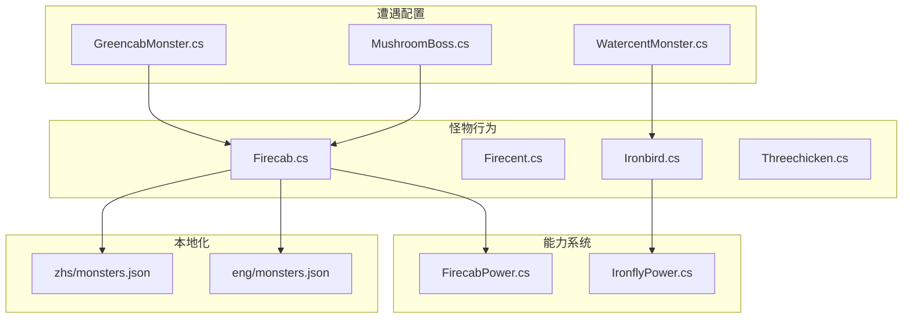
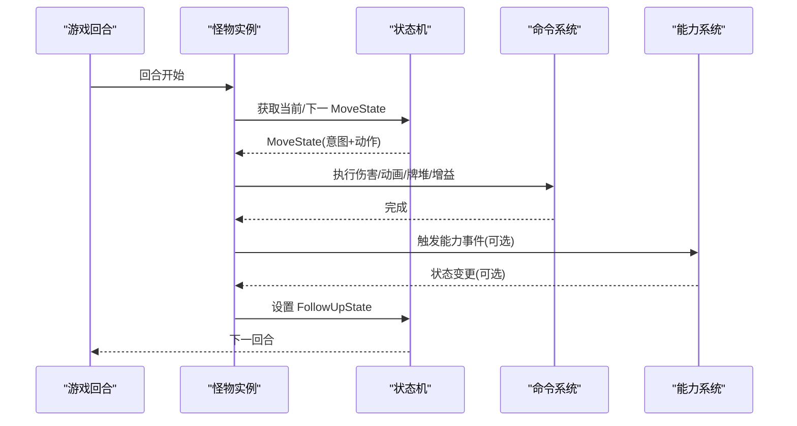
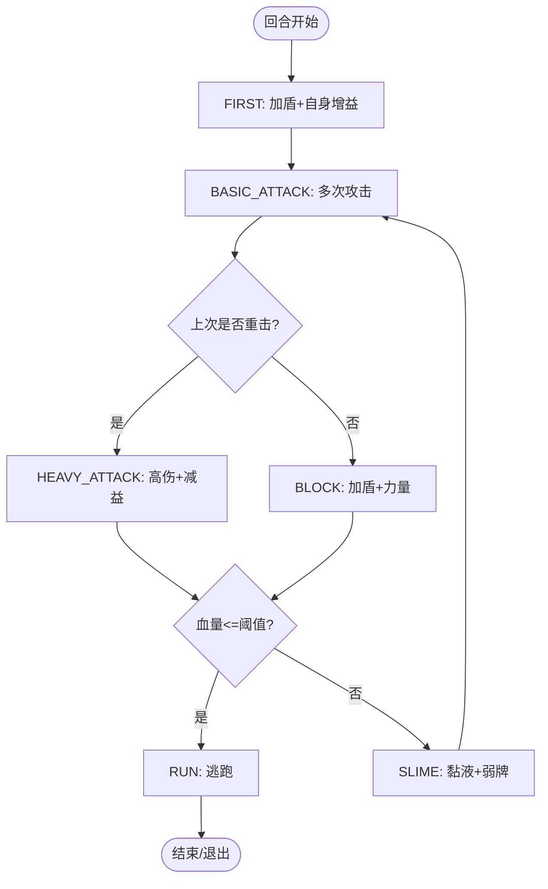
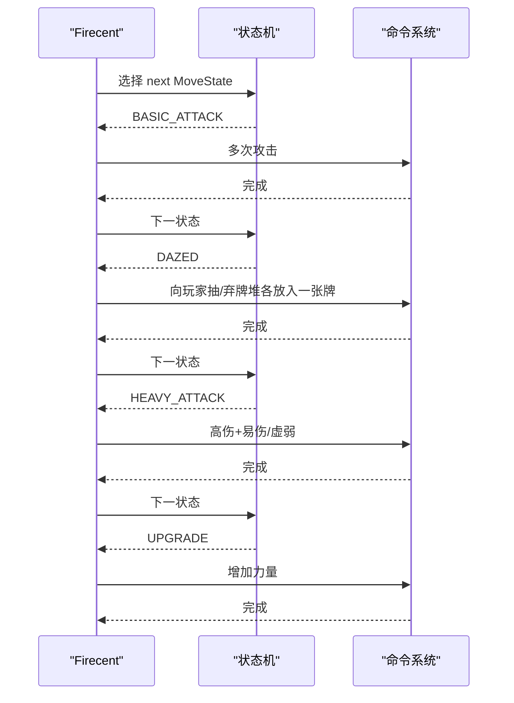
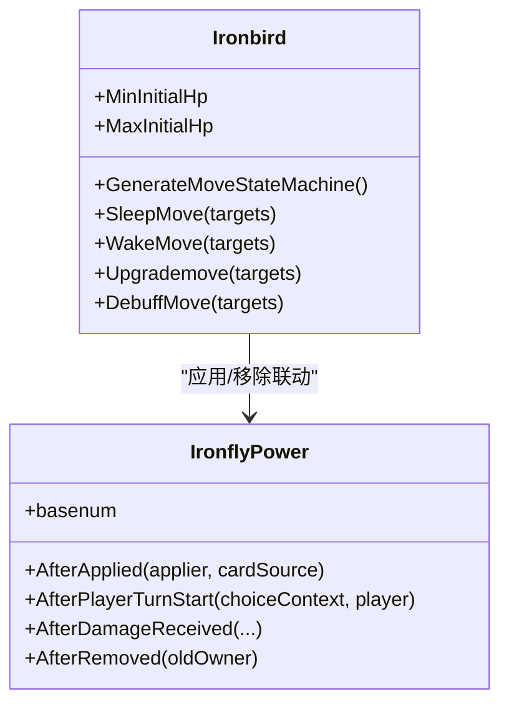
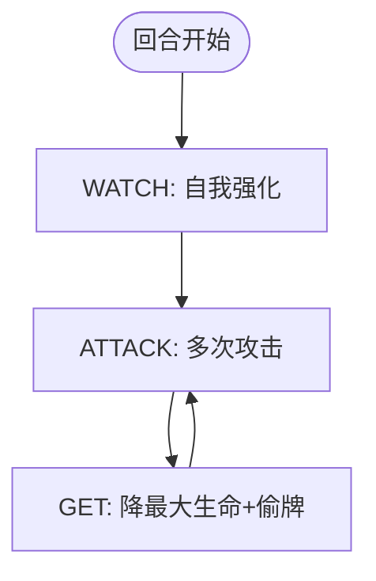
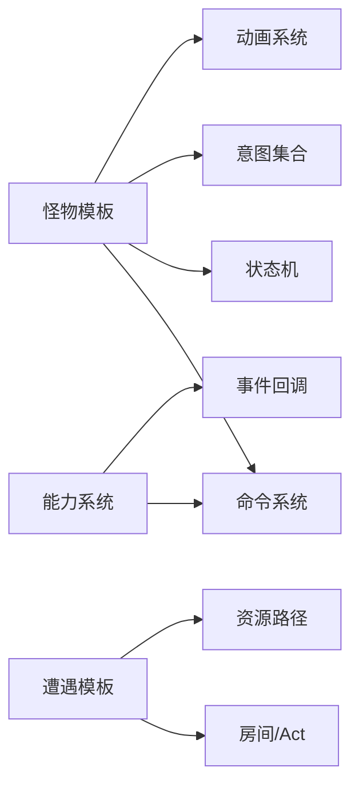

# 怪物AI框架

<cite>
**本文引用的文件**
- [Firecab.cs](file://Scripts/Monster/Firecab.cs)
- [Firecent.cs](file://Scripts/Monster/Firecent.cs)
- [Ironbird.cs](file://Scripts/Monster/Ironbird.cs)
- [Threechicken.cs](file://Scripts/Monster/Threechicken.cs)
- [GreencabMonster.cs](file://Scripts/Monster/GreencabMonster.cs)
- [WatercentMonster.cs](file://Scripts/Monster/WatercentMonster.cs)
- [MushroomBoss.cs](file://Scripts/Monster/MushroomBoss.cs)
- [FirecabPower.cs](file://Scripts/Powers/Monster/FirecabPower.cs)
- [IronflyPower.cs](file://Scripts/Powers/Monster/IronflyPower.cs)
- [monsters.json（中文）](file://SlugcatTheSpireII/localization/zhs/monsters.json)
- [monsters.json（英文）](file://SlugcatTheSpireII/localization/eng/monsters.json)
</cite>

## 目录
1. [简介](#简介)
2. [项目结构](#项目结构)
3. [核心组件](#核心组件)
4. [架构总览](#架构总览)
5. [详细组件分析](#详细组件分析)
6. [依赖关系分析](#依赖关系分析)
7. [性能考量](#性能考量)
8. [故障排查指南](#故障排查指南)
9. [结论](#结论)
10. [附录](#附录)

## 简介
本技术文档面向“怪物AI框架”，系统性说明其基础架构、状态机设计、行为模式实现，覆盖怪物生命周期管理、回合制战斗逻辑与决策算法。同时提供扩展新怪物类型的实践方法（攻击判定、防御机制、特殊能力系统），并给出复杂行为树与条件判断的实现示例、性能优化建议与调试方法。

## 项目结构
- 怪物模板与行为：位于 Scripts/Monster，每个怪物继承统一基类，通过生成 MoveState 与 MonsterMoveStateMachine 定义意图与状态流转。
- 遭遇配置：位于 Scripts/Monster 下的 *Monster.cs 文件，用于将怪物绑定到具体关卡/房间类型与资源。
- 能力系统：位于 Scripts/Powers/Monster，封装怪物的增益、减益、被动效果等。
- 本地化：位于 SlugcatTheSpireII/localization，为各怪物及其动作提供多语言文本。

图表来源
- [Firecab.cs:23-144](file://Scripts/Monster/Firecab.cs#L23-L144)
- [Firecent.cs:93-146](file://Scripts/Monster/Firecent.cs#L93-L146)
- [Ironbird.cs:80-145](file://Scripts/Monster/Ironbird.cs#L80-L145)
- [Threechicken.cs:101-174](file://Scripts/Monster/Threechicken.cs#L101-L174)
- [GreencabMonster.cs:10-33](file://Scripts/Monster/GreencabMonster.cs#L10-L33)
- [WatercentMonster.cs:10-33](file://Scripts/Monster/WatercentMonster.cs#L10-L33)
- [MushroomBoss.cs:10-33](file://Scripts/Monster/MushroomBoss.cs#L10-L33)
- [FirecabPower.cs:31-53](file://Scripts/Powers/Monster/FirecabPower.cs#L31-L53)
- [IronflyPower.cs:31-89](file://Scripts/Powers/Monster/IronflyPower.cs#L31-L89)
- [monsters.json（中文）:1-50](file://SlugcatTheSpireII/localization/zhs/monsters.json#L1-L50)
- [monsters.json（英文）:1-49](file://SlugcatTheSpireII/localization/eng/monsters.json#L1-L49)

章节来源
- [Firecab.cs:23-144](file://Scripts/Monster/Firecab.cs#L23-L144)
- [GreencabMonster.cs:10-33](file://Scripts/Monster/GreencabMonster.cs#L10-L33)
- [WatercentMonster.cs:10-33](file://Scripts/Monster/WatercentMonster.cs#L10-L33)
- [MushroomBoss.cs:10-33](file://Scripts/Monster/MushroomBoss.cs#L10-L33)

## 核心组件
- 怪物模板与状态机：所有怪物均继承统一模板，通过 GenerateMoveStateMachine 构建 MoveState 节点，并以 FollowUpState 串联成有向图；支持条件分支 ConditionalBranchState 与随机分支 RandomBranchState。
- 意图与动作：使用内置 Intent（如 SingleAttackIntent、MultiAttackIntent、DefendIntent、DebuffIntent、BuffIntent、EscapeIntent、StatusIntent、StunIntent、UnknownIntent）表达回合内可见的意图；通过 DamageCmd、CreatureCmd、PowerCmd、CardPileCmd 等命令执行伤害、动画、增益/减益、牌堆操作。
- 生命周期钩子：AfterAddedToRoom 在加入房间时初始化 Buff/能力；SetupCustomCreatureAnimator 设置动画状态机；TryCreateCreatureVisuals 加载可视化场景。
- 遭遇模板：*Monster.cs 将怪物模型注册到特定 Act/房间类型，并提供背景、Boss 节点、图标等资源路径。
- 能力系统：以 Power 形式实现可叠加、可触发的事件式效果（如血量变化回调、回合开始回调、移除回调）。

章节来源
- [Firecab.cs:58-144](file://Scripts/Monster/Firecab.cs#L58-L144)
- [Firecent.cs:85-146](file://Scripts/Monster/Firecent.cs#L85-L146)
- [Ironbird.cs:71-145](file://Scripts/Monster/Ironbird.cs#L71-L145)
- [Threechicken.cs:96-174](file://Scripts/Monster/Threechicken.cs#L96-L174)
- [GreencabMonster.cs:10-33](file://Scripts/Monster/GreencabMonster.cs#L10-L33)
- [WatercentMonster.cs:10-33](file://Scripts/Monster/WatercentMonster.cs#L10-L33)
- [MushroomBoss.cs:10-33](file://Scripts/Monster/MushroomBoss.cs#L10-L33)
- [FirecabPower.cs:31-53](file://Scripts/Powers/Monster/FirecabPower.cs#L31-L53)
- [IronflyPower.cs:31-89](file://Scripts/Powers/Monster/IronflyPower.cs#L31-L89)

## 架构总览
下图展示了怪物AI的核心数据流与控制流：从回合开始到状态机选择下一个 MoveState，再到执行动作与更新状态，最后进入下一回合或根据条件跳转。

图表来源
- [Firecab.cs:65-144](file://Scripts/Monster/Firecab.cs#L65-L144)
- [Firecent.cs:93-146](file://Scripts/Monster/Firecent.cs#L93-L146)
- [Ironbird.cs:80-145](file://Scripts/Monster/Ironbird.cs#L80-L145)
- [Threechicken.cs:101-174](file://Scripts/Monster/Threechicken.cs#L101-L174)

## 详细组件分析

### Firecab（烈焰蜥蜴）
- 行为概述：首回合获得格挡与自身增益；后续在连击、重击、护甲强化、黏液控制与逃跑之间切换；低血量时倾向逃跑。
- 状态机要点：
  - FIRST：开局加盾与自身增益。
  - BASIC_ATTACK：多次攻击。
  - HEAVY_ATTACK：高伤并施加虚弱/易伤。
  - BLOCK：加盾并提升力量。
  - SLIME：施放黏液，给对手添加弱牌并附加减益。
  - RUN：低血量逃跑。
  - AfterAttack/AfterunAttack：条件分支，依据上次动作与血量决定下一动作。
- 动画：自定义 Idle/Attack/Attack2/Cast/Hurt 状态，播放后回到 Idle。

图表来源
- [Firecab.cs:65-144](file://Scripts/Monster/Firecab.cs#L65-L144)
- [Firecab.cs:146-167](file://Scripts/Monster/Firecab.cs#L146-L167)

章节来源
- [Firecab.cs:23-198](file://Scripts/Monster/Firecab.cs#L23-L198)

### Firecent（烈焰蜈蚣）
- 行为概述：连击后进入“电击”状态（对玩家抽弃牌堆各置入一张牌），随后重击并施加易伤/虚弱，再进入“强化”阶段提升力量，循环往复。
- 状态机要点：basicAttack → Dazed → heavyAttack → Upgrade → basicAttack。

图表来源
- [Firecent.cs:93-146](file://Scripts/Monster/Firecent.cs#L93-L146)
- [Firecent.cs:149-166](file://Scripts/Monster/Firecent.cs#L149-L166)

章节来源
- [Firecent.cs:25-191](file://Scripts/Monster/Firecent.cs#L25-L191)

### Ironbird（钢秃鹫）
- 行为概述：拥有飞行能力（IronflyPower），受击掉落进入睡眠，醒来后恢复飞行并持续增强；具备多种攻击与减益组合。
- 状态机要点：sleep → wake → basic_attack → debuff → heavy_attack → upgrade → 循环。
- 能力联动：IronflyPower 在受到伤害时递减层数，归零时使怪物进入睡眠并触发动画。

图表来源
- [Ironbird.cs:80-145](file://Scripts/Monster/Ironbird.cs#L80-L145)
- [Ironbird.cs:146-183](file://Scripts/Monster/Ironbird.cs#L146-L183)
- [IronflyPower.cs:31-89](file://Scripts/Powers/Monster/IronflyPower.cs#L31-L89)

章节来源
- [Ironbird.cs:26-217](file://Scripts/Monster/Ironbird.cs#L26-L217)
- [IronflyPower.cs:31-89](file://Scripts/Powers/Monster/IronflyPower.cs#L31-L89)

### Threechicken（监察者）
- 行为概述：攻击指令、抓取（降低玩家最大生命并从手牌/弃牌堆抽取并移除指定稀有度卡牌）、观察（自我强化）。
- 状态机要点：Upgrade → basicAttack → DEBUFF → 循环。
- 策略：按优先级函数筛选目标牌，体现条件判断与复杂行为树思想。

图表来源
- [Threechicken.cs:101-174](file://Scripts/Monster/Threechicken.cs#L101-L174)
- [Threechicken.cs:177-180](file://Scripts/Monster/Threechicken.cs#L177-L180)

章节来源
- [Threechicken.cs:25-206](file://Scripts/Monster/Threechicken.cs#L25-L206)

### 遭遇模板与房间类型
- GreencabMonster：普通房间，绑定绿蜥蜴怪物。
- WatercentMonster：普通房间，绑定水蜈蚣怪物。
- MushroomBoss：Boss 房间，绑定蘑菇Boss，并配置背景音乐与地图节点。

章节来源
- [GreencabMonster.cs:10-33](file://Scripts/Monster/GreencabMonster.cs#L10-L33)
- [WatercentMonster.cs:10-33](file://Scripts/Monster/WatercentMonster.cs#L10-L33)
- [MushroomBoss.cs:10-33](file://Scripts/Monster/MushroomBoss.cs#L10-L33)

### 能力系统与事件驱动
- FirecabPower：当自身层数变化时，若满足条件则为目标施加活力增益。
- IronflyPower：记录初始层数，回合开始时恢复至基准值；受到未格挡伤害时递减；被移除时使怪物进入睡眠并播放动画。

章节来源
- [FirecabPower.cs:31-53](file://Scripts/Powers/Monster/FirecabPower.cs#L31-L53)
- [IronflyPower.cs:31-89](file://Scripts/Powers/Monster/IronflyPower.cs#L31-L89)

## 依赖关系分析
- 怪物模板依赖：
  - 命令系统：DamageCmd、CreatureCmd、PowerCmd、CardPileCmd 等。
  - 状态机：MoveState、ConditionalBranchState、RandomBranchState、MonsterMoveStateMachine。
  - 意图：SingleAttackIntent、MultiAttackIntent、DefendIntent、DebuffIntent、BuffIntent、EscapeIntent、StatusIntent、StunIntent、UnknownIntent。
  - 动画：CreatureAnimator、AnimState。
- 遭遇模板依赖：
  - 房间类型 RoomType、Act 关联、资源路径（背景、图标、Boss 节点）。
- 能力系统依赖：
  - 事件回调：AfterApplied、AfterPlayerTurnStart、AfterDamageReceived、AfterRemoved、AfterPowerAmountChanged。
  - 命令系统：PowerCmd.ModifyAmount、PowerCmd.Decrement、PowerCmd.Apply。

图表来源
- [Firecab.cs:65-144](file://Scripts/Monster/Firecab.cs#L65-L144)
- [Firecent.cs:93-146](file://Scripts/Monster/Firecent.cs#L93-L146)
- [Ironbird.cs:80-145](file://Scripts/Monster/Ironbird.cs#L80-L145)
- [Threechicken.cs:101-174](file://Scripts/Monster/Threechicken.cs#L101-L174)
- [GreencabMonster.cs:10-33](file://Scripts/Monster/GreencabMonster.cs#L10-L33)
- [WatercentMonster.cs:10-33](file://Scripts/Monster/WatercentMonster.cs#L10-L33)
- [MushroomBoss.cs:10-33](file://Scripts/Monster/MushroomBoss.cs#L10-L33)
- [FirecabPower.cs:31-53](file://Scripts/Powers/Monster/FirecabPower.cs#L31-L53)
- [IronflyPower.cs:31-89](file://Scripts/Powers/Monster/IronflyPower.cs#L31-L89)

章节来源
- [Firecab.cs:65-144](file://Scripts/Monster/Firecab.cs#L65-L144)
- [GreencabMonster.cs:10-33](file://Scripts/Monster/GreencabMonster.cs#L10-L33)
- [FirecabPower.cs:31-53](file://Scripts/Powers/Monster/FirecabPower.cs#L31-L53)

## 性能考量
- 减少异步阻塞：尽量使用命令系统的异步接口，避免在主线程进行耗时计算。
- 复用动画与特效：集中管理 AnimState 与特效路径，减少重复创建。
- 精简状态机：将复杂条件合并为单一 ConditionalBranchState，减少不必要的状态节点。
- 批量操作：对多目标的效果尽量使用批量命令，减少多次调用开销。
- 数值缩放：根据玩家数量与进阶等级动态调整数值，避免极端情况导致帧率下降。
- 日志与统计：仅在关键路径输出必要日志，避免频繁 IO。

[本节为通用指导，不直接分析具体文件]

## 故障排查指南
- 状态机卡死：检查 FollowUpState 是否正确设置，确保无环死锁；必要时打印当前状态名与条件结果。
- 动画不播放：确认 SetupCustomCreatureAnimator 中状态名与 Spine 动画一致；检查 NextState 是否回退到 Idle。
- 能力未生效：核对 Power 的堆叠类型与回调时机；确认 Apply/ModifyAmount/Decrement 调用上下文正确。
- 遭遇未触发：检查 RegisterActEncounter 注解与 AllPossibleMonsters 列表；确认 RoomType 与 Act 匹配。
- 本地化显示异常：核对 monsters.json 中的键名与代码中使用的 Intent/MoveState 名称一致。

章节来源
- [Firecab.cs:169-196](file://Scripts/Monster/Firecab.cs#L169-L196)
- [IronflyPower.cs:64-89](file://Scripts/Powers/Monster/IronflyPower.cs#L64-L89)
- [GreencabMonster.cs:10-33](file://Scripts/Monster/GreencabMonster.cs#L10-L33)
- [monsters.json（中文）:1-50](file://SlugcatTheSpireII/localization/zhs/monsters.json#L1-L50)

## 结论
该怪物AI框架基于统一的模板与状态机，结合意图系统与命令系统，实现了高度可扩展的回合制怪物行为。通过能力系统的事件驱动机制，能够灵活表达复杂的交互逻辑。借助条件分支与随机分支，可以构建丰富的行为树。遵循本文档的实践建议，可高效扩展新的怪物类型并保证性能与可维护性。

[本节为总结性内容，不直接分析具体文件]

## 附录

### 如何扩展新怪物类型（步骤清单）
- 新建怪物类：继承模板，定义最小/最大生命值、资产路径、可视化场景。
- 定义意图与动作：使用 SingleAttackIntent、MultiAttackIntent、DefendIntent、DebuffIntent、BuffIntent、EscapeIntent、StatusIntent、StunIntent、UnknownIntent。
- 构建状态机：创建 MoveState，设置 FollowUpState；必要时使用 ConditionalBranchState/RandomBranchState。
- 实现生命周期：AfterAddedToRoom 初始化 Buff/能力；SetupCustomCreatureAnimator 设置动画。
- 注册遭遇：编写 *Monster.cs，绑定到 Act/房间类型，配置背景与图标。
- 如需特殊能力：新增 Power 类，实现 AfterApplied/AfterPlayerTurnStart/AfterDamageReceived/AfterRemoved 等回调。
- 本地化：在 monsters.json 中添加对应键值，确保 UI 显示正确。

章节来源
- [Firecab.cs:23-144](file://Scripts/Monster/Firecab.cs#L23-L144)
- [GreencabMonster.cs:10-33](file://Scripts/Monster/GreencabMonster.cs#L10-L33)
- [WatercentMonster.cs:10-33](file://Scripts/Monster/WatercentMonster.cs#L10-L33)
- [MushroomBoss.cs:10-33](file://Scripts/Monster/MushroomBoss.cs#L10-L33)
- [FirecabPower.cs:31-53](file://Scripts/Powers/Monster/FirecabPower.cs#L31-L53)
- [monsters.json（中文）:1-50](file://SlugcatTheSpireII/localization/zhs/monsters.json#L1-L50)