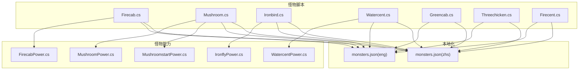
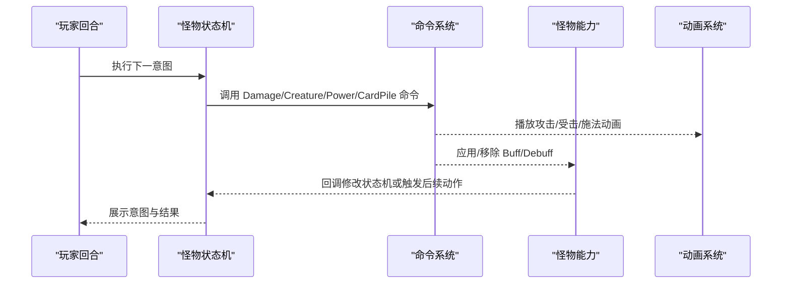
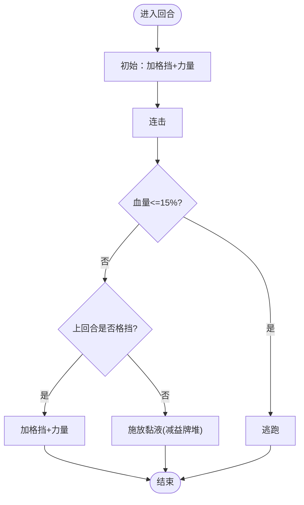
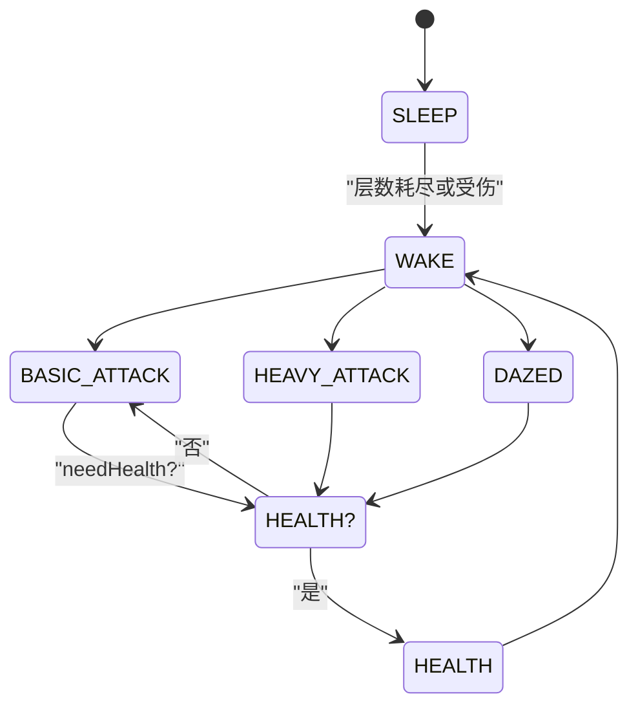
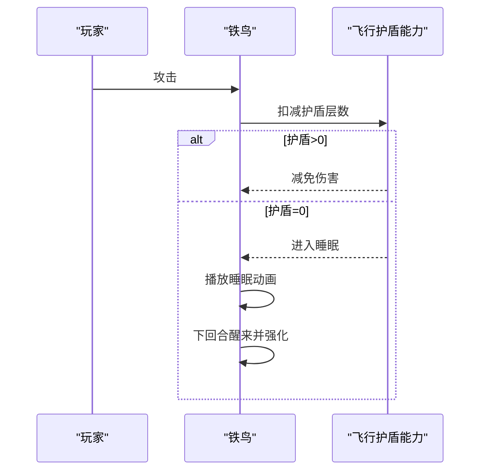
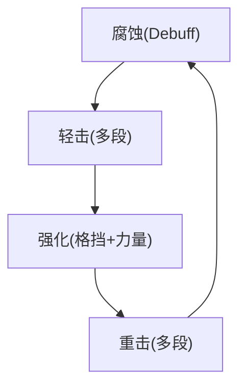

# 怪物系统

<cite>
**本文引用的文件**
- [Firecab.cs](file://Scripts/Monster/Firecab.cs)
- [Mushroom.cs](file://Scripts/Monster/Mushroom.cs)
- [Ironbird.cs](file://Scripts/Monster/Ironbird.cs)
- [Watercent.cs](file://Scripts/Monster/Watercent.cs)
- [Greencab.cs](file://Scripts/Monster/Greencab.cs)
- [Threechicken.cs](file://Scripts/Monster/Threechicken.cs)
- [Firecent.cs](file://Scripts/Monster/Firecent.cs)
- [FirecabPower.cs](file://Scripts/Powers/Monster/FirecabPower.cs)
- [MushroomPower.cs](file://Scripts/Powers/Monster/MushroomPower.cs)
- [IronflyPower.cs](file://Scripts/Powers/Monster/IronflyPower.cs)
- [WatercentPower.cs](file://Scripts/Powers/Monster/WatercentPower.cs)
- [MushroomstartPower.cs](file://Scripts/Powers/Monster/MushroomstartPower.cs)
- [monsters.json（英文）](file://SlugcatTheSpireII/localization/eng/monsters.json)
- [monsters.json（中文）](file://SlugcatTheSpireII/localization/zhs/monsters.json)
</cite>

## 目录
1. [简介](#简介)
2. [项目结构](#项目结构)
3. [核心组件](#核心组件)
4. [架构总览](#架构总览)
5. [详细组件分析](#详细组件分析)
6. [依赖关系分析](#依赖关系分析)
7. [性能与平衡性](#性能与平衡性)
8. [故障排查指南](#故障排查指南)
9. [结论](#结论)
10. [附录：自定义怪物开发指南](#附录自定义怪物开发指南)

## 简介
本文件为“怪物系统”的AI与行为技术文档，覆盖怪物状态机、攻击模式、防御行为、特殊能力、以及各怪物的独特机制。同时提供创建自定义怪物、定义AI行为、集成到战斗系统的步骤说明，并给出平衡性与难度调节建议及具体代码示例路径。

## 项目结构
- 怪物脚本位于 Scripts/Monster 下，每个怪物一个类，继承自 ModMonsterTemplate，通过 GenerateMoveStateMachine 构建状态机，使用 DamageCmd/CreatureCmd/PowerCmd/CardPileCmd 等命令驱动战斗逻辑。
- 怪物专属能力位于 Scripts/Powers/Monster，以 Power 形式实现被动或触发式效果。
- 本地化文案在 SlugcatTheSpireII/localization/*/monsters.json，用于显示怪物名称与各意图标题。



图表来源
- [Firecab.cs:23-144](file://Scripts/Monster/Firecab.cs#L23-L144)
- [Mushroom.cs:89-167](file://Scripts/Monster/Mushroom.cs#L89-L167)
- [Ironbird.cs:80-145](file://Scripts/Monster/Ironbird.cs#L80-L145)
- [Watercent.cs:60-124](file://Scripts/Monster/Watercent.cs#L60-L124)
- [Greencab.cs:62-127](file://Scripts/Monster/Greencab.cs#L62-L127)
- [Threechicken.cs:101-174](file://Scripts/Monster/Threechicken.cs#L101-L174)
- [Firecent.cs:93-146](file://Scripts/Monster/Firecent.cs#L93-L146)
- [monsters.json（英文）:1-43](file://SlugcatTheSpireII/localization/eng/monsters.json#L1-L43)
- [monsters.json（中文）:1-50](file://SlugcatTheSpireII/localization/zhs/monsters.json#L1-L50)

章节来源
- [Firecab.cs:23-144](file://Scripts/Monster/Firecab.cs#L23-L144)
- [Mushroom.cs:89-167](file://Scripts/Monster/Mushroom.cs#L89-L167)
- [Ironbird.cs:80-145](file://Scripts/Monster/Ironbird.cs#L80-L145)
- [Watercent.cs:60-124](file://Scripts/Monster/Watercent.cs#L60-L124)
- [Greencab.cs:62-127](file://Scripts/Monster/Greencab.cs#L62-L127)
- [Threechicken.cs:101-174](file://Scripts/Monster/Threechicken.cs#L101-L174)
- [Firecent.cs:93-146](file://Scripts/Monster/Firecent.cs#L93-L146)
- [monsters.json（英文）:1-43](file://SlugcatTheSpireII/localization/eng/monsters.json#L1-L43)
- [monsters.json（中文）:1-50](file://SlugcatTheSpireII/localization/zhs/monsters.json#L1-L50)

## 核心组件
- 怪物基类与模板：所有怪物继承 ModMonsterTemplate，统一生命周期钩子 AfterAddedToRoom、BeforeCombatStart、GenerateMoveStateMachine、SetupCustomCreatureAnimator。
- 状态机：使用 MoveState 表示单一意图动作，配合 ConditionalBranchState 实现条件分支；初始状态由构造函数指定。
- 命令系统：DamageCmd、CreatureCmd、PowerCmd、CardPileCmd 等封装了伤害、格挡、Buff/Debuff、牌堆操作等。
- 动画系统：CreatureAnimator 管理 Idle/Attack/Hurt/Cast/Sleep 等动画状态切换。
- 能力系统：Power 作为可叠加或单次的被动/主动效果，监听回合、伤害、弃牌等事件。

章节来源
- [Firecab.cs:23-144](file://Scripts/Monster/Firecab.cs#L23-L144)
- [Mushroom.cs:89-167](file://Scripts/Monster/Mushroom.cs#L89-L167)
- [Ironbird.cs:80-145](file://Scripts/Monster/Ironbird.cs#L80-L145)
- [Watercent.cs:60-124](file://Scripts/Monster/Watercent.cs#L60-L124)
- [Greencab.cs:62-127](file://Scripts/Monster/Greencab.cs#L62-L127)
- [Threechicken.cs:101-174](file://Scripts/Monster/Threechicken.cs#L101-L174)
- [Firecent.cs:93-146](file://Scripts/Monster/Firecent.cs#L93-L146)

## 架构总览
下图展示了怪物状态机、命令系统与能力之间的交互关系。



图表来源
- [Firecab.cs:65-144](file://Scripts/Monster/Firecab.cs#L65-L144)
- [Mushroom.cs:89-167](file://Scripts/Monster/Mushroom.cs#L89-L167)
- [Ironbird.cs:80-145](file://Scripts/Monster/Ironbird.cs#L80-L145)
- [Watercent.cs:60-124](file://Scripts/Monster/Watercent.cs#L60-L124)
- [Greencab.cs:62-127](file://Scripts/Monster/Greencab.cs#L62-L127)
- [Threechicken.cs:101-174](file://Scripts/Monster/Threechicken.cs#L101-L174)
- [Firecent.cs:93-146](file://Scripts/Monster/Firecent.cs#L93-L146)

## 详细组件分析

### 火焰甲虫（Firecab）
- 设计思路：基础连击+重击循环，低血量时逃跑；根据上一回合是否格挡决定后续是再次格挡还是释放黏液减益。
- 关键机制：
  - 连击：多段伤害，附带命中特效与动画。
  - 重击：高伤害并对目标施加虚弱/易伤类减益。
  - 格挡：获得格挡并叠加力量。
  - 黏液：给目标添加减益牌堆并刷新标记。
  - 逃跑：血量低于阈值时逃离。
- 状态机要点：FIRST→BASIC_ATTACK/HEAVY_ATTACK→ConditionalBranchState（按血量/上回合选择RUN/SLIME/BLOCK）。
- 动画：Idle/Attack/Attack2/Cast/Hurt。



图表来源
- [Firecab.cs:65-144](file://Scripts/Monster/Firecab.cs#L65-L144)
- [Firecab.cs:146-167](file://Scripts/Monster/Firecab.cs#L146-L167)

章节来源
- [Firecab.cs:23-198](file://Scripts/Monster/Firecab.cs#L23-L198)
- [FirecabPower.cs:31-53](file://Scripts/Powers/Monster/FirecabPower.cs#L31-L53)
- [monsters.json（中文）:18-23](file://SlugcatTheSpireII/localization/zhs/monsters.json#L18-L23)
- [monsters.json（英文）:17-23](file://SlugcatTheSpireII/localization/eng/monsters.json#L17-L23)

### 蘑菇（Mushroom）
- 设计思路：先沉睡自我增殖，受到一定伤害后苏醒，具备眩晕与回血能力，并在低血量时优先回血。
- 关键机制：
  - 睡眠：每回合末回复最大生命的一定比例，层数归零后唤醒。
  - 眩晕：向抽牌堆与弃牌堆加入眩晕牌。
  - 回血：满血回复。
  - 觉醒：醒来后获得持续回血与力量的能力。
- 状态机要点：SLEEP→WAKE→BASIC_ATTACK/HEAVY_ATTACK/DAZED/HEALTH，使用 ConditionalBranchState 根据 needHealth 选择攻击或回血。
- 动画：Sleep/Attack/Hurt/sleeptoidle。



图表来源
- [Mushroom.cs:89-167](file://Scripts/Monster/Mushroom.cs#L89-L167)
- [MushroomstartPower.cs:45-100](file://Scripts/Powers/Monster/MushroomstartPower.cs#L45-L100)

章节来源
- [Mushroom.cs:31-214](file://Scripts/Monster/Mushroom.cs#L31-L214)
- [MushroomPower.cs:31-94](file://Scripts/Powers/Monster/MushroomPower.cs#L31-L94)
- [MushroomstartPower.cs:31-100](file://Scripts/Powers/Monster/MushroomstartPower.cs#L31-L100)
- [monsters.json（中文）:3-8](file://SlugcatTheSpireII/localization/zhs/monsters.json#L3-L8)
- [monsters.json（英文）:2-7](file://SlugcatTheSpireII/localization/eng/monsters.json#L2-L7)

### 铁鸟（Ironbird）
- 设计思路：飞行护盾随回合增长，被击落进入睡眠，醒来后恢复并继续增强；具备多段啄击与重咬，附带易伤/脆弱。
- 关键机制：
  - 飞行护盾：每回合开始恢复层数，受到伤害减少损失，层数为0时进入睡眠。
  - 战吼：提升力量并增加飞行次数。
  - 阴影：对目标施加脆弱与易伤。
- 状态机要点：BASIC_ATTACK→DEBUFF→HEAVY_ATTACK→UPGRADE→BASIC_ATTACK；SLEEP→WAKE→BASIC_ATTACK。
- 动画：Idle/Attack/Hurt/Sleep/fall-to-idle。



图表来源
- [Ironbird.cs:80-145](file://Scripts/Monster/Ironbird.cs#L80-L145)
- [IronflyPower.cs:45-89](file://Scripts/Powers/Monster/IronflyPower.cs#L45-L89)

章节来源
- [Ironbird.cs:29-217](file://Scripts/Monster/Ironbird.cs#L29-L217)
- [IronflyPower.cs:31-89](file://Scripts/Powers/Monster/IronflyPower.cs#L31-L89)
- [monsters.json（中文）:10-16](file://SlugcatTheSpireII/localization/zhs/monsters.json#L10-L16)
- [monsters.json（英文）:9-15](file://SlugcatTheSpireII/localization/eng/monsters.json#L9-L15)

### 水心（Watercent）
- 设计思路：以腐蚀为核心，对带有腐蚀的目标造成双倍伤害；具备多段轻击与重击，周期性强化自身。
- 关键机制：
  - 腐蚀：对目标施加腐蚀，使该目标受到的伤害翻倍。
  - 强化：获得格挡与力量。
  - 攻击：多段轻击与重击。
- 状态机要点：DEBUFF→BASIC_ATTACK→UPGRADE→HEAVY_ATTACK→DEBUFF。



图表来源
- [Watercent.cs:60-124](file://Scripts/Monster/Watercent.cs#L60-L124)
- [WatercentPower.cs:31-55](file://Scripts/Powers/Monster/WatercentPower.cs#L31-L55)

章节来源
- [Watercent.cs:28-157](file://Scripts/Monster/Watercent.cs#L28-L157)
- [WatercentPower.cs:31-55](file://Scripts/Powers/Monster/WatercentPower.cs#L31-L55)
- [monsters.json（中文）:38-42](file://SlugcatTheSpireII/localization/zhs/monsters.json#L38-L42)
- [monsters.json（英文）:37-41](file://SlugcatTheSpireII/localization/eng/monsters.json#L37-L41)

### 绿蜥蜴（Greencab）
- 设计思路：前期高格挡与力量，蓄力后重击；低血量逃跑。
- 关键机制：
  - 蓄力：获得格挡与大量力量。
  - 重击：高伤害并施加虚弱。
  - 逃跑：低血量逃离。
- 状态机要点：BASIC_ATTACK→BLOCK→SLEEP→HEAVY_ATTACK→BASIC_ATTACK，均带低血量逃跑分支。

章节来源
- [Greencab.cs:27-172](file://Scripts/Monster/Greencab.cs#L27-L172)
- [monsters.json（中文）:31-36](file://SlugcatTheSpireII/localization/zhs/monsters.json#L31-L36)
- [monsters.json（英文）:30-35](file://SlugcatTheSpireII/localization/eng/monsters.json#L30-L35)

### 监察者（Threechicken）
- 设计思路：通过观察获取抓取能力，攻击指令多次打击，抓取会削减目标最大生命并从牌堆中偷取卡牌。
- 关键机制：
  - 观察：获得抓取能力（次数与 WatcherEvent.times 相关）。
  - 攻击指令：多段攻击。
  - 抓取：降低目标最大生命并随机抽取一张符合条件的牌移除出战斗。
- 状态机要点：WATCH→ATTACK→GET→ATTACK。

章节来源
- [Threechicken.cs:29-206](file://Scripts/Monster/Threechicken.cs#L29-L206)
- [monsters.json（中文）:44-49](file://SlugcatTheSpireII/localization/zhs/monsters.json#L44-L49)
- [monsters.json（英文）:43-49](file://SlugcatTheSpireII/localization/eng/monsters.json#L43-L49)

### 烈焰蜈蚣（Firecent）
- 设计思路：电击与强化循环，具备多段轻击与重击，周期性将特定牌加入牌堆。
- 关键机制：
  - 电击：向抽牌堆与弃牌堆加入特定牌。
  - 强化：获得力量。
  - 重击：高伤害并施加易伤/脆弱。
- 状态机要点：BASIC_ATTACK→DAZED→HEAVY_ATTACK→UPGRADE→BASIC_ATTACK。

章节来源
- [Firecent.cs:29-191](file://Scripts/Monster/Firecent.cs#L29-L191)
- [monsters.json（中文）:25-29](file://SlugcatTheSpireII/localization/zhs/monsters.json#L25-L29)
- [monsters.json（英文）:24-28](file://SlugcatTheSpireII/localization/eng/monsters.json#L24-L28)

## 依赖关系分析
- 怪物与能力：
  - Firecab → FirecabPower（叠层后给予活力）
  - Mushroom → MushroomstartPower（睡眠/苏醒控制）、MushroomPower（弃牌回血与眩晕）
  - Ironbird → IronflyPower（飞行护盾、击落睡眠）
  - Watercent → WatercentPower（腐蚀伤害倍增）
- 命令与动画：
  - 所有怪物通过 DamageCmd/CreatureCmd/PowerCmd/CardPileCmd 驱动战斗，并通过 CreatureAnimator 绑定动画状态。
- 本地化：
  - 各怪物意图标题与名称通过 monsters.json 配置，便于多语言显示。

```mermaid
graph LR
Firecab --> FirecabPower
Mushroom --> MushroomstartPower
Mushroom --> MushroomPower
Ironbird --> IronflyPower
Watercent --> WatercentPower
Firecab -.-> "Damage/Creature/Power/CardPile"
Mushroom -.-> "Damage/Creature/Power/CardPile"
Ironbird -.-> "Damage/Creature/Power/CardPile"
Watercent -.-> "Damage/Creature/Power/CardPile"
```

图表来源
- [FirecabPower.cs:31-53](file://Scripts/Powers/Monster/FirecabPower.cs#L31-L53)
- [MushroomstartPower.cs:31-100](file://Scripts/Powers/Monster/MushroomstartPower.cs#L31-L100)
- [MushroomPower.cs:31-94](file://Scripts/Powers/Monster/MushroomPower.cs#L31-L94)
- [IronflyPower.cs:31-89](file://Scripts/Powers/Monster/IronflyPower.cs#L31-L89)
- [WatercentPower.cs:31-55](file://Scripts/Powers/Monster/WatercentPower.cs#L31-L55)

章节来源
- [FirecabPower.cs:31-53](file://Scripts/Powers/Monster/FirecabPower.cs#L31-L53)
- [MushroomstartPower.cs:31-100](file://Scripts/Powers/Monster/MushroomstartPower.cs#L31-L100)
- [MushroomPower.cs:31-94](file://Scripts/Powers/Monster/MushroomPower.cs#L31-L94)
- [IronflyPower.cs:31-89](file://Scripts/Powers/Monster/IronflyPower.cs#L31-L89)
- [WatercentPower.cs:31-55](file://Scripts/Powers/Monster/WatercentPower.cs#L31-L55)

## 性能与平衡性
- 进阶难度：
  - 使用 AscensionHelper 根据 ToughEnemies/DeadlyEnemies 调整血量、伤害、强度等数值，确保不同难度下的体验一致。
- 多人模式：
  - 部分数值基于 CombatState.Players.Count 动态缩放（如格挡、飞行次数），保证多人时的挑战度。
- 行为复杂度：
  - 合理使用 ConditionalBranchState 避免过多随机分支导致不可预测性；保持意图清晰，便于玩家理解。
- 动画与特效：
  - 尽量复用动画状态，减少额外开销；仅在必要处触发复杂特效。
- 平衡建议：
  - 控制每回合期望伤害与资源产出；确保防御手段（格挡、护盾）与进攻手段（攻击、强化）形成博弈。
  - 对强力能力（如腐蚀、飞行护盾）设置合理的衰减或限制（层数、回合上限）。

[本节为通用指导，不直接分析具体文件]

## 故障排查指南
- 状态机未生效：
  - 检查 GenerateMoveStateMachine 是否正确注册所有 MoveState 与 ConditionalBranchState，并确保 FollowUpState 链接正确。
  - 参考：[Mushroom.cs:89-167](file://Scripts/Monster/Mushroom.cs#L89-L167)、[Firecab.cs:65-144](file://Scripts/Monster/Firecab.cs#L65-L144)
- 动画未播放：
  - 确认 SetupCustomCreatureAnimator 中已绑定对应状态名（如 Attack/Hurt/Cast/Sleep），且动画名称与 Spine 资源一致。
  - 参考：[Firecab.cs:169-196](file://Scripts/Monster/Firecab.cs#L169-L196)、[Mushroom.cs:186-211](file://Scripts/Monster/Mushroom.cs#L186-L211)
- 能力未触发：
  - 检查 Power 的 AfterApplied/AfterDamageReceived/AfterPlayerTurnStart 等回调是否正确判断 Owner 与条件。
  - 参考：[IronflyPower.cs:45-89](file://Scripts/Powers/Monster/IronflyPower.cs#L45-L89)、[MushroomstartPower.cs:45-100](file://Scripts/Powers/Monster/MushroomstartPower.cs#L45-L100)
- 本地化缺失：
  - 确保 monsters.json 中包含对应怪物与意图的键值，否则UI可能显示为空或默认文本。
  - 参考：[monsters.json（中文）:1-50](file://SlugcatTheSpireII/localization/zhs/monsters.json#L1-L50)、[monsters.json（英文）:1-43](file://SlugcatTheSpireII/localization/eng/monsters.json#L1-L43)

章节来源
- [Mushroom.cs:89-167](file://Scripts/Monster/Mushroom.cs#L89-L167)
- [Firecab.cs:65-144](file://Scripts/Monster/Firecab.cs#L65-L144)
- [Firecab.cs:169-196](file://Scripts/Monster/Firecab.cs#L169-L196)
- [Mushroom.cs:186-211](file://Scripts/Monster/Mushroom.cs#L186-L211)
- [IronflyPower.cs:45-89](file://Scripts/Powers/Monster/IronflyPower.cs#L45-L89)
- [MushroomstartPower.cs:45-100](file://Scripts/Powers/Monster/MushroomstartPower.cs#L45-L100)
- [monsters.json（中文）:1-50](file://SlugcatTheSpireII/localization/zhs/monsters.json#L1-L50)
- [monsters.json（英文）:1-43](file://SlugcatTheSpireII/localization/eng/monsters.json#L1-L43)

## 结论
本怪物系统通过统一的状态机与命令框架，实现了多样化且可维护的AI行为。各怪物围绕核心机制（格挡/力量、腐蚀、飞行护盾、睡眠/苏醒、抓取）展开，既保证了玩法深度，又便于扩展新怪物与能力。结合进阶难度与多人缩放，可在不同场景下提供稳定而富有挑战的战斗体验。

[本节为总结，不直接分析具体文件]

## 附录：自定义怪物开发指南
- 创建步骤：
  1. 新建怪物类继承 ModMonsterTemplate，实现 MinInitialHp/MaxInitialHp、AssetProfile、TryCreateCreatureVisuals。
  2. 在 AfterAddedToRoom 中初始化能力或Buff。
  3. 在 GenerateMoveStateMachine 中定义 MoveState 与 ConditionalBranchState，并设置 FollowUpState 与初始状态。
  4. 在 SetupCustomCreatureAnimator 中绑定动画状态。
  5. 如需能力，新建 Power 并注册，监听所需事件。
  6. 在 monsters.json 中添加名称与意图标题。
- 代码示例路径（仅路径，不含内容）：
  - 基础结构与状态机：[Firecab.cs:23-144](file://Scripts/Monster/Firecab.cs#L23-L144)
  - 睡眠/苏醒流程：[Mushroom.cs:89-167](file://Scripts/Monster/Mushroom.cs#L89-L167)、[MushroomstartPower.cs:45-100](file://Scripts/Powers/Monster/MushroomstartPower.cs#L45-L100)
  - 飞行护盾与击落：[Ironbird.cs:80-145](file://Scripts/Monster/Ironbird.cs#L80-L145)、[IronflyPower.cs:45-89](file://Scripts/Powers/Monster/IronflyPower.cs#L45-L89)
  - 腐蚀与伤害倍增：[Watercent.cs:60-124](file://Scripts/Monster/Watercent.cs#L60-L124)、[WatercentPower.cs:31-55](file://Scripts/Powers/Monster/WatercentPower.cs#L31-L55)
  - 抓牌与最大生命削减：[Threechicken.cs:101-174](file://Scripts/Monster/Threechicken.cs#L101-L174)
  - 本地化配置：[monsters.json（中文）:1-50](file://SlugcatTheSpireII/localization/zhs/monsters.json#L1-L50)、[monsters.json（英文）:1-43](file://SlugcatTheSpireII/localization/eng/monsters.json#L1-L43)

章节来源
- [Firecab.cs:23-144](file://Scripts/Monster/Firecab.cs#L23-L144)
- [Mushroom.cs:89-167](file://Scripts/Monster/Mushroom.cs#L89-L167)
- [MushroomstartPower.cs:45-100](file://Scripts/Powers/Monster/MushroomstartPower.cs#L45-L100)
- [Ironbird.cs:80-145](file://Scripts/Monster/Ironbird.cs#L80-L145)
- [IronflyPower.cs:45-89](file://Scripts/Powers/Monster/IronflyPower.cs#L45-L89)
- [Watercent.cs:60-124](file://Scripts/Monster/Watercent.cs#L60-L124)
- [WatercentPower.cs:31-55](file://Scripts/Powers/Monster/WatercentPower.cs#L31-L55)
- [Threechicken.cs:101-174](file://Scripts/Monster/Threechicken.cs#L101-L174)
- [monsters.json（中文）:1-50](file://SlugcatTheSpireII/localization/zhs/monsters.json#L1-L50)
- [monsters.json（英文）:1-43](file://SlugcatTheSpireII/localization/eng/monsters.json#L1-L43)