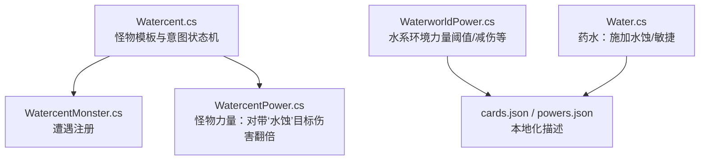
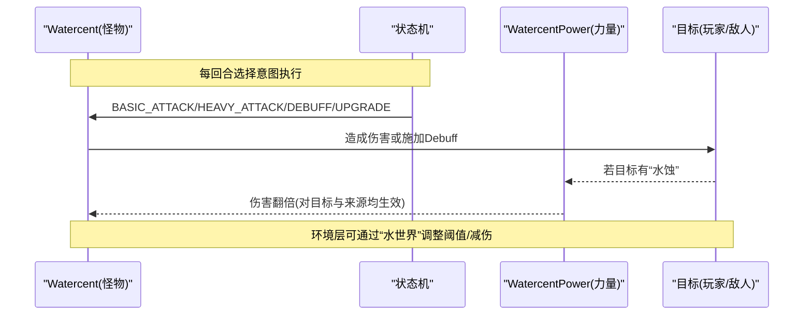
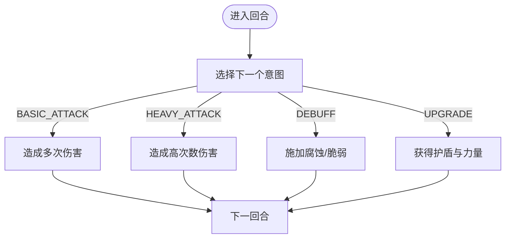
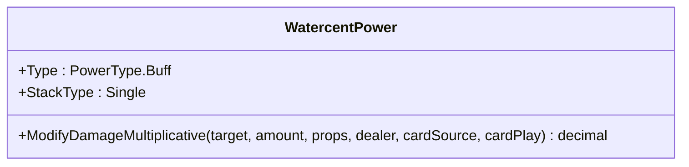
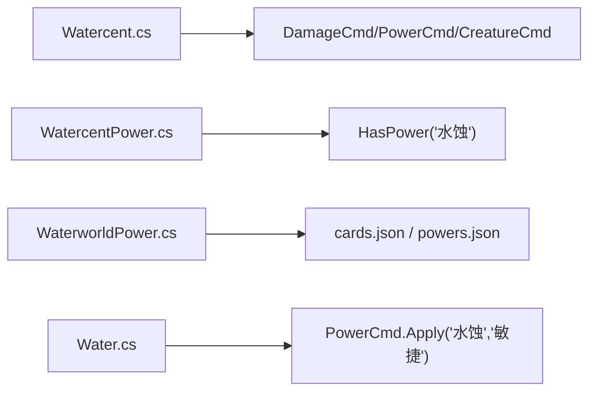
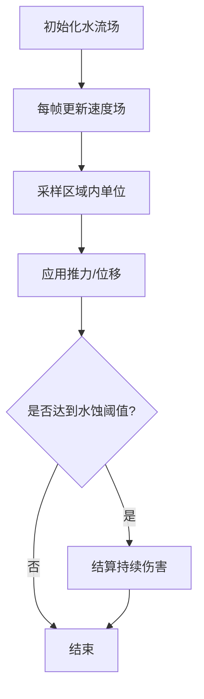

# 水心怪物

<cite>
**本文引用的文件**
- [Watercent.cs](file://Scripts/Monster/Watercent.cs)
- [WatercentMonster.cs](file://Scripts/Monster/WatercentMonster.cs)
- [WatercentPower.cs](file://Scripts/Powers/Monster/WatercentPower.cs)
- [WaterworldPower.cs](file://Scripts/Powers/River/WaterworldPower.cs)
- [Water.cs](file://Scripts/Potions/Water.cs)
- [cards.json](file://SlugcatTheSpireII/localization/eng/cards.json)
- [powers.json](file://SlugcatTheSpireII/localization/eng/powers.json)
</cite>

## 目录
1. [简介](#简介)
2. [项目结构](#项目结构)
3. [核心组件](#核心组件)
4. [架构总览](#架构总览)
5. [详细组件分析](#详细组件分析)
6. [依赖关系分析](#依赖关系分析)
7. [性能与平衡性建议](#性能与平衡性建议)
8. [故障排查指南](#故障排查指南)
9. [结论](#结论)
10. [附录：实现示例与开发指南](#附录实现示例与开发指南)

## 简介
本文件为“水心”怪物的完整实现文档，围绕其水系能力（水流操控、漩涡生成、水压攻击）、普通形态与怪物形态的行为差异、环境互动（水位变化、湿滑效果、溺水伤害）以及数值与机制的平衡性进行系统化说明。同时提供可落地的代码级实现思路与参考路径，帮助开发者扩展或自定义水属性能力。

## 项目结构
本项目采用模块化组织，与水心相关的核心代码位于以下位置：
- 怪物定义与行为状态机：Scripts/Monster/Watercent.cs
- 遭遇配置：Scripts/Monster/WatercentMonster.cs
- 怪物专属力量（被动/主动）：Scripts/Powers/Monster/WatercentPower.cs
- 水系通用力量与环境交互：Scripts/Powers/River/WaterworldPower.cs、Scripts/Potions/Water.cs
- 本地化文案（卡牌/力量描述）：SlugcatTheSpireII/localization/eng/cards.json、powers.json

图表来源
- [Watercent.cs:27-124](file://Scripts/Monster/Watercent.cs#L27-L124)
- [WatercentMonster.cs:10-33](file://Scripts/Monster/WatercentMonster.cs#L10-L33)
- [WatercentPower.cs:31-52](file://Scripts/Powers/Monster/WatercentPower.cs#L31-L52)
- [WaterworldPower.cs:17-28](file://Scripts/Powers/River/WaterworldPower.cs#L17-L28)
- [Water.cs:20-52](file://Scripts/Potions/Water.cs#L20-L52)
- [cards.json:591-601](file://SlugcatTheSpireII/localization/eng/cards.json#L591-L601)
- [powers.json:207-212,328-330:207-212](file://SlugcatTheSpireII/localization/eng/powers.json#L207-L212)

章节来源
- [Watercent.cs:27-124](file://Scripts/Monster/Watercent.cs#L27-L124)
- [WatercentMonster.cs:10-33](file://Scripts/Monster/WatercentMonster.cs#L10-L33)

## 核心组件
- 怪物模板 Watercent：定义血量、基础/重击伤害、防御与强化数值，构建意图状态机（连击、重击、削弱、升级），并绑定动画。
- 遭遇 WatercentMonster：将 Watercent 注册到荣耀路线的怪物房间。
- 怪物力量 WatercentPower：当目标带有“水蚀”时，对其造成的伤害与受到的伤害翻倍。
- 水系力量 WaterworldPower：用于调整“水蚀”触发阈值与受水蚀伤害减免的环境类 Buff。
- 药水 Water：在战斗中使用，为目标施加“水蚀”，若目标为玩家则额外获得“敏捷”。

章节来源
- [Watercent.cs:27-155](file://Scripts/Monster/Watercent.cs#L27-L155)
- [WatercentMonster.cs:10-33](file://Scripts/Monster/WatercentMonster.cs#L10-L33)
- [WatercentPower.cs:31-52](file://Scripts/Powers/Monster/WatercentPower.cs#L31-L52)
- [WaterworldPower.cs:17-28](file://Scripts/Powers/River/WaterworldPower.cs#L17-L28)
- [Water.cs:20-52](file://Scripts/Potions/Water.cs#L20-L52)

## 架构总览
水心怪物的能力由“意图状态机 + 力量系统 + 环境交互”构成：
- 意图状态机驱动攻击、削弱、防御与强化循环，形成稳定的输出节奏。
- 力量系统通过“水蚀”标记与“水心力量”联动，放大对带标记目标的伤害与反伤。
- 环境交互通过“水蚀”阈值与“水世界”Buff 调节整体风险曲线，体现水位变化、湿滑与溺水伤害的抽象化表达。

图表来源
- [Watercent.cs:60-124](file://Scripts/Monster/Watercent.cs#L60-L124)
- [WatercentPower.cs:45-52](file://Scripts/Powers/Monster/WatercentPower.cs#L45-L52)
- [cards.json:591-601](file://SlugcatTheSpireII/localization/eng/cards.json#L591-L601)
- [powers.json:207-212,328-330:207-212](file://SlugcatTheSpireII/localization/eng/powers.json#L207-L212)

## 详细组件分析

### 怪物模板 Watercent
- 血量与难度缩放：根据进阶等级动态调整初始血量区间。
- 基础/重击伤害与防御：随玩家数量与进阶等级变化，保证多人与高难下的威胁度。
- 意图状态机：
  - BASIC_ATTACK：多次攻击，配合动画与音效。
  - HEAVY_ATTACK：更高次数的重击。
  - DEBUFF：对目标施加腐蚀与脆弱等负面效果。
  - UPGRADE：获得护盾与力量，提升后续输出。
- 动画：空闲、攻击、受伤状态切换。

图表来源
- [Watercent.cs:60-124](file://Scripts/Monster/Watercent.cs#L60-L124)

章节来源
- [Watercent.cs:27-155](file://Scripts/Monster/Watercent.cs#L27-L155)

### 遭遇 WatercentMonster
- 将 Watercent 作为荣耀路线的常规怪物遭遇。
- 使用关卡战斗背景，非弱敌。

章节来源
- [WatercentMonster.cs:10-33](file://Scripts/Monster/WatercentMonster.cs#L10-L33)

### 怪物力量 WatercentPower
- 类型：增益型力量，单叠。
- 效果：对带有“水蚀”的目标，造成的伤害与受到的伤害翻倍。
- 适用场景：与水蚀体系深度联动，放大范围伤害与持续伤害的收益。

图表来源
- [WatercentPower.cs:31-52](file://Scripts/Powers/Monster/WatercentPower.cs#L31-L52)

章节来源
- [WatercentPower.cs:31-52](file://Scripts/Powers/Monster/WatercentPower.cs#L31-L52)

### 水系环境力量 WaterworldPower
- 类型：增益型力量，单叠。
- 作用：与“水蚀”相关的环境规则调整（如阈值降低、受水蚀伤害减半等），具体逻辑由卡牌/力量描述与实现共同决定。

章节来源
- [WaterworldPower.cs:17-28](file://Scripts/Powers/River/WaterworldPower.cs#L17-L28)
- [cards.json:591-601](file://SlugcatTheSpireII/localization/eng/cards.json#L591-L601)
- [powers.json:207-212](file://SlugcatTheSpireII/localization/eng/powers.json#L207-L212)

### 药水 Water
- 稀有度：罕见。
- 使用方式：仅战斗中。
- 目标类型：所有盟友。
- 效果：为目标施加“水蚀”；若目标为玩家，额外获得“敏捷”。

章节来源
- [Water.cs:20-52](file://Scripts/Potions/Water.cs#L20-L52)

## 依赖关系分析
- Watercent 依赖 DamageCmd/PowerCmd/CreatureCmd 等命令接口执行伤害、力量应用与资源增减。
- WatercentPower 依赖 HasPower 检测“水蚀”以触发伤害倍增。
- WaterworldPower 与卡牌/力量文案联动，影响“水蚀”触发阈值与伤害减免。
- Water 药水通过 PowerCmd 施加“水蚀”与“敏捷”，参与水系生态。

图表来源
- [Watercent.cs:60-124](file://Scripts/Monster/Watercent.cs#L60-L124)
- [WatercentPower.cs:45-52](file://Scripts/Powers/Monster/WatercentPower.cs#L45-L52)
- [Water.cs:45-52](file://Scripts/Potions/Water.cs#L45-L52)
- [cards.json:591-601](file://SlugcatTheSpireII/localization/eng/cards.json#L591-L601)
- [powers.json:207-212,328-330:207-212](file://SlugcatTheSpireII/localization/eng/powers.json#L207-L212)

章节来源
- [Watercent.cs:60-124](file://Scripts/Monster/Watercent.cs#L60-L124)
- [WatercentPower.cs:45-52](file://Scripts/Powers/Monster/WatercentPower.cs#L45-L52)
- [Water.cs:45-52](file://Scripts/Potions/Water.cs#L45-L52)

## 性能与平衡性建议
- 伤害倍率控制：WatercentPower 对“水蚀”目标的双倍伤害需结合“水蚀”获取速率与持续时间进行平衡，避免爆发过高。
- 阈值与减伤：WaterworldPower 可将“水蚀”触发阈值调低并减少受水蚀伤害，适合高风险高收益的水系玩法。
- 意图频率：BASIC_ATTACK 与 HEAVY_ATTACK 的连击次数应匹配怪物血量与玩家防御，防止过压或过弱。
- 强化时机：UPGRADE 提供护盾与力量，建议在关键回合前触发，增强策略性。
- 区域与范围：若引入范围伤害或区域效果，注意帧率与计算开销，尽量批量处理与缓存结果。

[本节为通用指导，不直接分析具体文件]

## 故障排查指南
- 力量未生效：检查目标是否具备“水蚀”标记，确认 WatercentPower 的 ModifyDamageMultiplicative 条件分支正确。
- 意图异常：核对状态机 FollowUpState 设置，确保 DEBUFF → BASIC_ATTACK → UPGRADE → HEAVY_ATTACK 的顺序符合预期。
- 药水效果：确认 OnUse 中 Apply 的目标与 Owner 是否正确，避免误伤或无效施放。
- 文案不一致：核对 cards.json 与 powers.json 中的变量占位符与实际实现一致，避免显示错误。

章节来源
- [WatercentPower.cs:45-52](file://Scripts/Powers/Monster/WatercentPower.cs#L45-L52)
- [Watercent.cs:116-124](file://Scripts/Monster/Watercent.cs#L116-L124)
- [Water.cs:45-52](file://Scripts/Potions/Water.cs#L45-L52)
- [cards.json:591-601](file://SlugcatTheSpireII/localization/eng/cards.json#L591-L601)
- [powers.json:207-212,328-330:207-212](file://SlugcatTheSpireII/localization/eng/powers.json#L207-L212)

## 结论
水心怪物通过“意图状态机 + 水蚀体系 + 力量倍率”的组合，实现了可控且富有策略性的水系战斗体验。其普通形态强调稳定输出与节奏控制，怪物形态通过强化与削弱组合提升威胁。借助 WaterworldPower 与药水 Water，开发者可以灵活调整环境规则与风险曲线，满足多样化玩法需求。

[本节为总结，不直接分析具体文件]

## 附录：实现示例与开发指南

### 水流物理与区域效果（概念实现）
- 水流强度：以向量场表示，按距离衰减，叠加多个源（怪物、技能）产生合力。
- 区域效果：使用碰撞体或网格采样判定范围内单位，应用推力与持续伤害。
- 持续伤害计算：基于“水蚀”层数与阈值，每回合结算一次伤害，支持阈值下调与伤害减免。

[此图为概念流程，不映射具体源码]

### 代码级参考路径
- 怪物意图与伤害：[Watercent.cs:60-124](file://Scripts/Monster/Watercent.cs#L60-L124)
- 力量倍率与检测：[WatercentPower.cs:45-52](file://Scripts/Powers/Monster/WatercentPower.cs#L45-L52)
- 环境规则与文案：[cards.json:591-601](file://SlugcatTheSpireII/localization/eng/cards.json#L591-L601)、[powers.json:207-212,328-330:207-212](file://SlugcatTheSpireII/localization/eng/powers.json#L207-L212)
- 药水施加水蚀与敏捷：[Water.cs:45-52](file://Scripts/Potions/Water.cs#L45-L52)

### 水系怪物平衡性调整建议
- 调整 BASIC_ATTACK 与 HEAVY_ATTACK 的连击次数与基础伤害，匹配不同难度。
- 修改 WatercentPower 的倍率或添加上限，防止极端情况。
- 通过 WaterworldPower 与卡牌联动，动态调整“水蚀”阈值与减伤比例。
- 在 UPGRADE 中增加护盾与力量的数值，控制强化节奏。

[本节为通用指导，不直接分析具体文件]

### 自定义水属性能力开发指南
- 新增力量：继承 ModPowerTemplate，实现 ModifyDamageMultiplicative 或 OnTurnStart/End 钩子，结合“水蚀”状态。
- 新增卡牌：在 cards.json 中添加描述与变量占位符，并在对应 Card 脚本中实现效果。
- 新增药水：继承 ModPotionTemplate，在 OnUse 中调用 PowerCmd.Apply 施加效果。
- 文案与本地化：确保 cards.json 与 powers.json 的描述与实现一致，变量占位符正确。

[本节为通用指导，不直接分析具体文件]