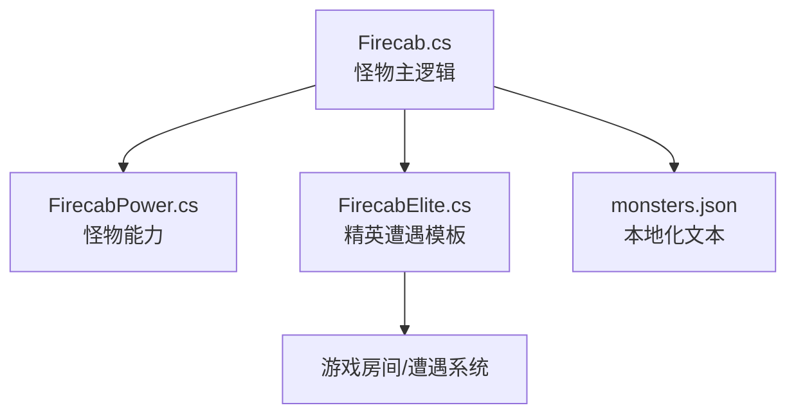
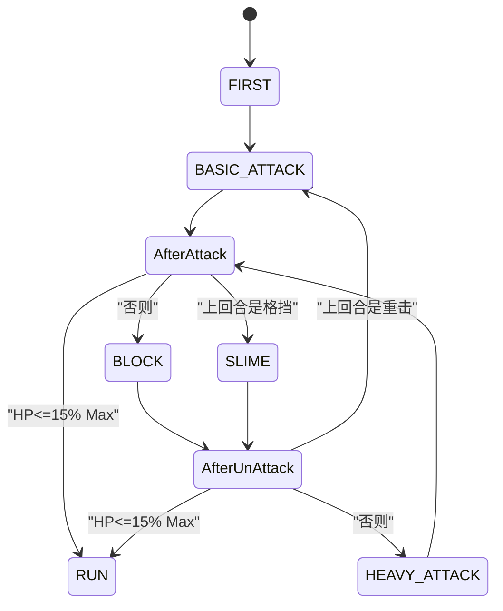
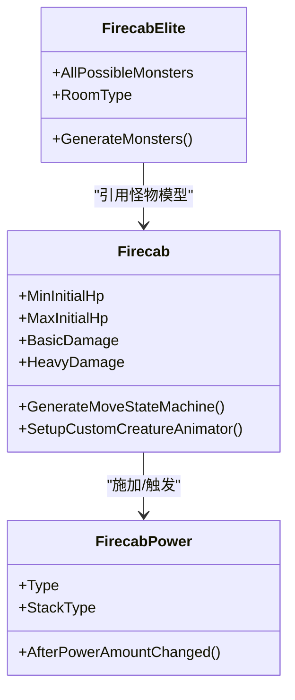

# 火焰甲虫怪物

<cite>
**本文引用的文件**
- [Firecab.cs](file://Scripts/Monster/Firecab.cs)
- [FirecabElite.cs](file://Scripts/Monster/FirecabElite.cs)
- [FirecabPower.cs](file://Scripts/Powers/Monster/FirecabPower.cs)
- [monsters.json（中文本地化）](file://SlugcatTheSpireII/localization/zhs/monsters.json)
- [monsters.json（英文本地化）](file://SlugcatTheSpireII/localization/eng/monsters.json)
</cite>

## 目录
1. [简介](#简介)
2. [项目结构](#项目结构)
3. [核心组件](#核心组件)
4. [架构总览](#架构总览)
5. [详细组件分析](#详细组件分析)
6. [依赖关系分析](#依赖关系分析)
7. [性能与平衡性考量](#性能与平衡性考量)
8. [故障排查指南](#故障排查指南)
9. [结论](#结论)
10. [附录：配置与自定义](#附录：配置与自定义)

## 简介
本文件为“火焰甲虫”怪物的完整实现文档，覆盖其AI行为模式、攻击方式、特殊能力、普通形态与精英形态差异、数值平衡、战斗策略（含蓄力/防御姿态切换）、状态转换流程以及可操作的平衡性调整与自定义方法。该怪物基于项目的怪物模板框架，使用意图机（MoveStateMachine）驱动回合制行动序列，并通过能力（Power）系统提供持续增益效果。

## 项目结构
火焰甲虫相关代码位于以下位置：
- 怪物主逻辑：Scripts/Monster/Firecab.cs
- 精英遭遇模板：Scripts/Monster/FirecabElite.cs
- 怪物能力：Scripts/Powers/Monster/FirecabPower.cs
- 本地化文本：SlugcatTheSpireII/localization/{zhs|eng}/monsters.json

图表来源
- [Firecab.cs:23-144](file://Scripts/Monster/Firecab.cs#L23-L144)
- [FirecabPower.cs:31-52](file://Scripts/Powers/Monster/FirecabPower.cs#L31-L52)
- [FirecabElite.cs:10-33](file://Scripts/Monster/FirecabElite.cs#L10-L33)
- [monsters.json（中文）:18-23](file://SlugcatTheSpireII/localization/zhs/monsters.json#L18-L23)

章节来源
- [Firecab.cs:23-144](file://Scripts/Monster/Firecab.cs#L23-L144)
- [FirecabElite.cs:10-33](file://Scripts/Monster/FirecabElite.cs#L10-L33)
- [FirecabPower.cs:31-52](file://Scripts/Powers/Monster/FirecabPower.cs#L31-L52)
- [monsters.json（中文）:18-23](file://SlugcatTheSpireII/localization/zhs/monsters.json#L18-L23)

## 核心组件
- 怪物类 Firecab：定义血量区间、基础伤害/格挡/火焰层数、重击伤害、状态机、动画绑定、首回合初始化等。
- 能力 FirecabPower：以计数型Buff形式存在，当层数变化时为目标施加对应增益。
- 精英遭遇 FirecabElite：将火焰甲虫注册到精英房间池，复用同一怪物模型。
- 本地化：为怪物及其动作提供多语言名称与描述。

章节来源
- [Firecab.cs:23-144](file://Scripts/Monster/Firecab.cs#L23-L144)
- [FirecabPower.cs:31-52](file://Scripts/Powers/Monster/FirecabPower.cs#L31-L52)
- [FirecabElite.cs:10-33](file://Scripts/Monster/FirecabElite.cs#L10-L33)
- [monsters.json（中文）:18-23](file://SlugcatTheSpireII/localization/zhs/monsters.json#L18-L23)

## 架构总览
火焰甲虫采用“意图机 + 状态分支”的回合制AI架构：
- 初始状态：FIRST（首回合），给予格挡并施加能力。
- 常规循环：BASIC_ATTACK（连击）与 HEAVY_ATTACK（重击）交替，受上次行为标记控制。
- 防御/强化：BLOCK（获得格挡并叠加力量）。
- 干扰：SLIME（对目标施加虚弱并添加牌堆）。
- 逃跑：RUN（低血量时触发）。

图表来源
- [Firecab.cs:65-144](file://Scripts/Monster/Firecab.cs#L65-L144)

章节来源
- [Firecab.cs:65-144](file://Scripts/Monster/Firecab.cs#L65-L144)

## 详细组件分析

### 怪物类 Firecab：AI与数值
- 血量与进阶：根据难度等级动态调整最小/最大初始生命。
- 基础伤害与格挡：随玩家数量与难度提升；基础火焰层数亦随难度提升。
- 重击伤害与附加效果：造成高额单体伤害并对目标施加虚弱/脆弱等减益。
- 首回合：获得格挡并施加自身能力（火焰层数）。
- 状态机：
  - BASIC_ATTACK：三连击，附带命中特效与攻击音效。
  - HEAVY_ATTACK：高伤单体，附带虚弱/脆弱。
  - BLOCK：获得格挡并叠加力量（火焰层数）。
  - SLIME：施放技能，给目标施加虚弱并向弃牌堆添加若干张牌。
  - RUN：低血量逃跑。
- 条件分支：
  - AfterAttack：根据是否刚格挡决定进入SLIME或BLOCK；若血量低于阈值则逃跑。
  - AfterUnAttack：根据上一轮是否为重击决定下一轮攻击类型；低血量逃跑。
- 动画：定义待机、攻击、施法、受伤等状态，并在攻击后自动回到待机。

章节来源
- [Firecab.cs:23-144](file://Scripts/Monster/Firecab.cs#L23-L144)
- [Firecab.cs:146-167](file://Scripts/Monster/Firecab.cs#L146-L167)
- [Firecab.cs:169-196](file://Scripts/Monster/Firecab.cs#L169-L196)

### 能力 FirecabPower：持续增益
- 类型：Buff，计数型堆叠。
- 效果：当层数变化且满足条件时，为目标施加对应增益（例如活力/力量等）。
- 触发时机：AfterPowerAmountChanged。

章节来源
- [FirecabPower.cs:31-52](file://Scripts/Powers/Monster/FirecabPower.cs#L31-L52)

### 精英形态 FirecabElite：遭遇模板
- 将火焰甲虫注册到精英房间池，复用同一怪物模型。
- 设置房间类型为精英，启用关卡战斗背景。

章节来源
- [FirecabElite.cs:10-33](file://Scripts/Monster/FirecabElite.cs#L10-L33)

### 本地化与命名
- 怪物名称与动作标题在本地化文件中定义，便于多语言显示。

章节来源
- [monsters.json（中文）:18-23](file://SlugcatTheSpireII/localization/zhs/monsters.json#L18-L23)
- [monsters.json（英文）:17-22](file://SlugcatTheSpireII/localization/eng/monsters.json#L17-L22)

## 依赖关系分析
- Firecab 依赖：
  - 命令系统：DamageCmd、CreatureCmd、PowerCmd、CardPileCmd。
  - 状态机：MoveState、ConditionalBranchState、各类Intent。
  - 动画：CreatureAnimator、MegaSprite。
  - 能力：FirecabPower、StrengthPower、WeakPower、FrailPower、VigorPower等。
- FirecabPower 依赖：
  - 能力系统：PowerCmd、PowerModel、PowerType、PowerStackType。
- FirecabElite 依赖：
  - 遭遇系统：ModEncounterTemplate、RoomType、Act/Encounter注册。

图表来源
- [Firecab.cs:23-144](file://Scripts/Monster/Firecab.cs#L23-L144)
- [FirecabPower.cs:31-52](file://Scripts/Powers/Monster/FirecabPower.cs#L31-L52)
- [FirecabElite.cs:10-33](file://Scripts/Monster/FirecabElite.cs#L10-L33)

章节来源
- [Firecab.cs:23-144](file://Scripts/Monster/Firecab.cs#L23-L144)
- [FirecabPower.cs:31-52](file://Scripts/Powers/Monster/FirecabPower.cs#L31-L52)
- [FirecabElite.cs:10-33](file://Scripts/Monster/FirecabElite.cs#L10-L33)

## 性能与平衡性考量
- 伤害与生存：
  - 基础连击与重击构成主要输出；BLOCK提供格挡与力量叠加，形成“攻守一体”的节奏。
  - 低血量逃跑机制避免拖尾战，降低长时间战斗的性能压力。
- 状态机复杂度：
  - 条件分支较少，易于理解与维护；可通过调整阈值与概率优化体验。
- 能力叠加：
  - 能力为计数型，注意层数上限与衰减策略，避免无限叠加导致失衡。
- 建议：
  - 根据玩家反馈微调 BasicDamage、HeavyDamage、BasicBlock、Basefire 等数值。
  - 调整逃跑阈值（当前为15% MaxInitialHp）以改变战斗时长与压力曲线。
  - 评估SLIME的牌堆添加数量与频率，确保不破坏玩家手牌管理节奏。

[本节为通用指导，无需特定文件来源]

## 故障排查指南
- 动画未播放：
  - 检查 SetupCustomCreatureAnimator 中动画名是否与资源一致，确认攻击/施法动画已正确绑定。
- 能力未生效：
  - 确认 FirecabPower 的 AfterPowerAmountChanged 条件判断与Owner匹配，避免误判。
- 意图机卡死：
  - 检查 FollowUpState 与 ConditionalBranchState 的条件函数是否正确返回布尔值，避免死循环。
- 低血量未逃跑：
  - 核对 HP<=15% MaxInitialHp 的判断逻辑与当前生命值计算是否一致。

章节来源
- [Firecab.cs:169-196](file://Scripts/Monster/Firecab.cs#L169-L196)
- [FirecabPower.cs:46-52](file://Scripts/Powers/Monster/FirecabPower.cs#L46-L52)
- [Firecab.cs:125-144](file://Scripts/Monster/Firecab.cs#L125-L144)

## 结论
火焰甲虫通过简洁而有效的意图机设计，实现了“连击+重击+防御强化+干扰”的复合战斗风格。其能力系统提供持续成长，配合低血量逃跑机制，既保证挑战性又兼顾流畅度。通过本地化与模块化结构，便于扩展与定制。建议在实战中依据玩家反馈持续调优数值与行为阈值，以获得最佳体验。

[本节为总结，无需特定文件来源]

## 附录：配置与自定义

### 数值平衡调整
- 基础伤害与格挡：
  - 调整 BasicDamage、BasicBlock、Basefire 以改变前期压力与成长曲线。
- 重击伤害与减益：
  - 调整 HeavyDamage 与虚弱/脆弱层数以控制爆发与后续易伤。
- 首回合能力：
  - 调整 Basefire 影响早期力量叠加速度。
- 逃跑阈值：
  - 调整 AfterAttack/AfterUnAttack 中的 HP<=15% MaxInitialHp 以改变战斗时长。

章节来源
- [Firecab.cs:29-44](file://Scripts/Monster/Firecab.cs#L29-L44)
- [Firecab.cs:125-144](file://Scripts/Monster/Firecab.cs#L125-L144)

### 自定义行动序列
- 新增意图：
  - 在 GenerateMoveStateMachine 中添加新的 MoveState，并设定 Intent 与执行逻辑。
- 条件分支：
  - 使用 ConditionalBranchState 组合多个条件，实现更复杂的AI决策。
- 动画与特效：
  - 在 SetupCustomCreatureAnimator 中绑定新动画，并在攻击/施法时调用相应动画与特效。

章节来源
- [Firecab.cs:65-144](file://Scripts/Monster/Firecab.cs#L65-L144)
- [Firecab.cs:169-196](file://Scripts/Monster/Firecab.cs#L169-L196)

### 能力与状态转换示例
- 能力触发：
  - 在 AfterPowerAmountChanged 中根据 Owner 与 Type 判断，安全地施加增益。
- 状态转换：
  - 通过 FollowUpState 与条件函数控制下一回合行为，确保逻辑闭环。

章节来源
- [FirecabPower.cs:46-52](file://Scripts/Powers/Monster/FirecabPower.cs#L46-L52)
- [Firecab.cs:125-144](file://Scripts/Monster/Firecab.cs#L125-L144)

### 精英形态配置
- 将怪物加入精英池：
  - 在 FirecabElite 中设置 AllPossibleMonsters 与 RoomType，确保精英房间正确生成。
- 背景与音乐：
  - 可按需启用关卡战斗背景或自定义BGM路径。

章节来源
- [FirecabElite.cs:10-33](file://Scripts/Monster/FirecabElite.cs#L10-L33)

### 本地化与展示
- 修改怪物名称与动作标题：
  - 在 monsters.json 中更新键值，确保多语言一致性。

章节来源
- [monsters.json（中文）:18-23](file://SlugcatTheSpireII/localization/zhs/monsters.json#L18-L23)
- [monsters.json（英文）:17-22](file://SlugcatTheSpireII/localization/eng/monsters.json#L17-L22)