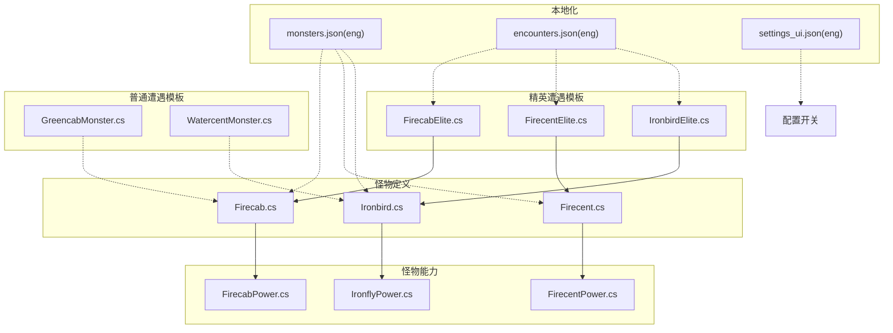
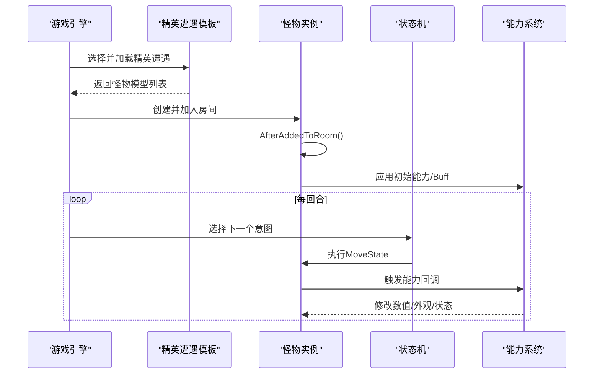
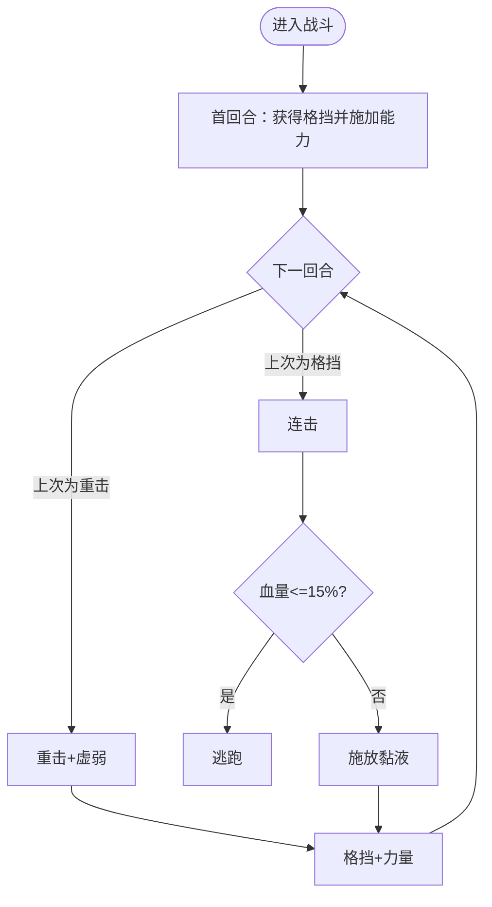
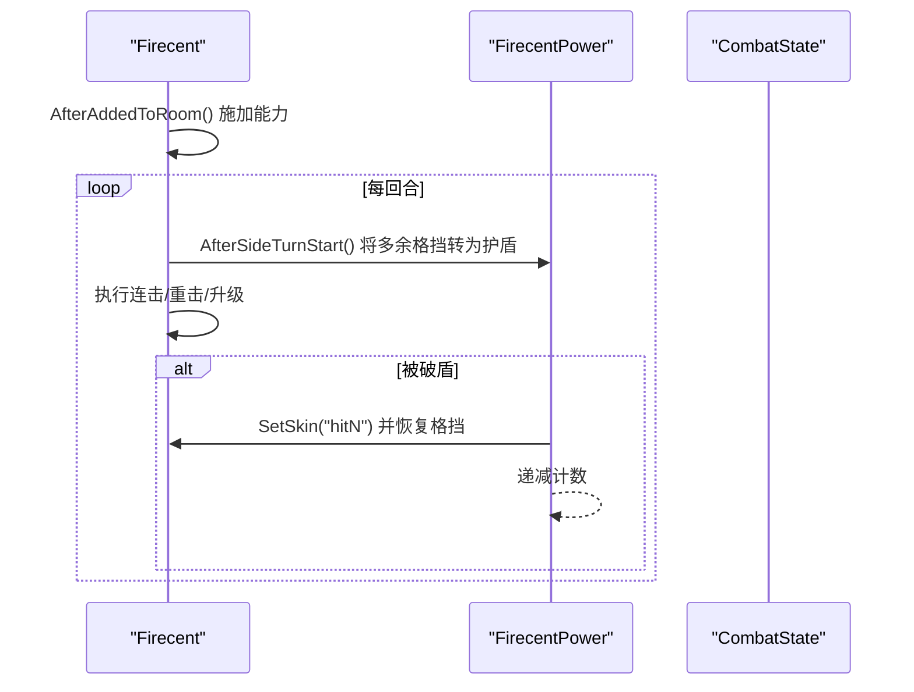
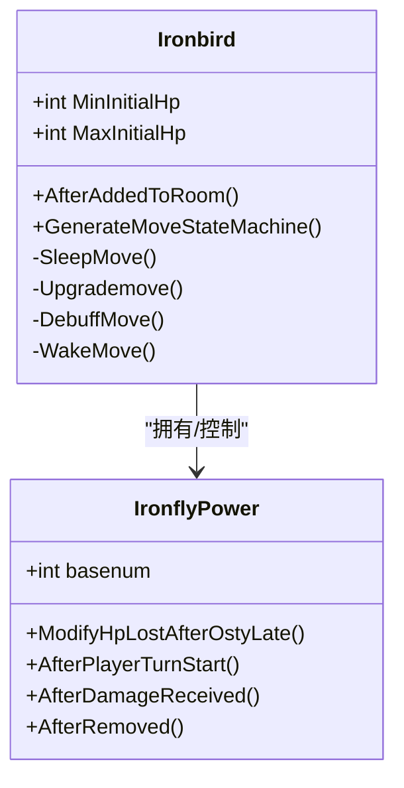
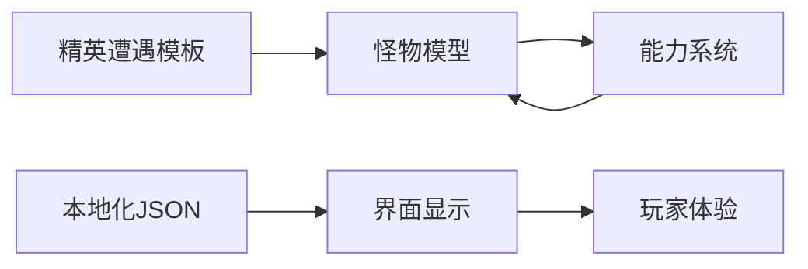

# 精英怪物系统

<cite>
**本文引用的文件**
- [FirecabElite.cs](file://Scripts/Monster/FirecabElite.cs)
- [FirecentElite.cs](file://Scripts/Monster/FirecentElite.cs)
- [IronbirdElite.cs](file://Scripts/Monster/IronbirdElite.cs)
- [Firecab.cs](file://Scripts/Monster/Firecab.cs)
- [Firecent.cs](file://Scripts/Monster/Firecent.cs)
- [Ironbird.cs](file://Scripts/Monster/Ironbird.cs)
- [GreencabMonster.cs](file://Scripts/Monster/GreencabMonster.cs)
- [WatercentMonster.cs](file://Scripts/Monster/WatercentMonster.cs)
- [FirecabPower.cs](file://Scripts/Powers/Monster/FirecabPower.cs)
- [FirecentPower.cs](file://Scripts/Powers/Monster/FirecentPower.cs)
- [IronflyPower.cs](file://Scripts/Powers/Monster/IronflyPower.cs)
- [monsters.json（英文）](file://SlugcatTheSpireII/localization/eng/monsters.json)
- [encounters.json（英文）](file://SlugcatTheSpireII/localization/eng/encounters.json)
- [settings_ui.json（英文）](file://SlugcatTheSpireII/localization/eng/settings_ui.json)
</cite>

## 目录
1. [简介](#简介)
2. [项目结构](#项目结构)
3. [核心组件](#核心组件)
4. [架构总览](#架构总览)
5. [详细组件分析](#详细组件分析)
6. [依赖关系分析](#依赖关系分析)
7. [性能与平衡性考量](#性能与平衡性考量)
8. [故障排查指南](#故障排查指南)
9. [结论](#结论)
10. [附录：开发指南与示例路径](#附录开发指南与示例路径)

## 简介
本技术文档围绕“精英怪物系统”展开，聚焦以下目标：
- 说明精英怪物的增强机制、特殊能力与难度缩放算法。
- 记录精英化改造过程：属性加成、新技能解锁、外观变化。
- 解释精英怪物的AI升级：更智能的决策、更强的攻击模式与更复杂的战术组合。
- 提供实现精英化模板、能力继承与动态难度调整的具体代码示例路径。
- 给出精英怪物平衡性设计与自定义精英化的开发指南。

## 项目结构
本项目采用“按功能模块组织”的结构，怪物相关逻辑集中在 Scripts/Monster 与 Scripts/Powers/Monster，遭遇模板在 Scripts/Monster 中通过 ModEncounterTemplate 注册；本地化文本位于 SlugcatTheSpireII/localization 下。

图表来源
- [Firecab.cs:23-198](file://Scripts/Monster/Firecab.cs#L23-L198)
- [Firecent.cs:25-191](file://Scripts/Monster/Firecent.cs#L25-L191)
- [Ironbird.cs:26-217](file://Scripts/Monster/Ironbird.cs#L26-L217)
- [FirecabElite.cs:10-34](file://Scripts/Monster/FirecabElite.cs#L10-L34)
- [FirecentElite.cs:10-34](file://Scripts/Monster/FirecentElite.cs#L10-L34)
- [IronbirdElite.cs:10-34](file://Scripts/Monster/IronbirdElite.cs#L10-L34)
- [GreencabMonster.cs:10-36](file://Scripts/Monster/GreencabMonster.cs#L10-L36)
- [WatercentMonster.cs:10-36](file://Scripts/Monster/WatercentMonster.cs#L10-L36)
- [monsters.json（英文）:1-23](file://SlugcatTheSpireII/localization/eng/monsters.json#L1-L23)
- [encounters.json（英文）:1-17](file://SlugcatTheSpireII/localization/eng/encounters.json#L1-L17)
- [settings_ui.json（英文）:1-10](file://SlugcatTheSpireII/localization/eng/settings_ui.json#L1-L10)

章节来源
- [Firecab.cs:23-198](file://Scripts/Monster/Firecab.cs#L23-L198)
- [Firecent.cs:25-191](file://Scripts/Monster/Firecent.cs#L25-L191)
- [Ironbird.cs:26-217](file://Scripts/Monster/Ironbird.cs#L26-L217)
- [FirecabElite.cs:10-34](file://Scripts/Monster/FirecabElite.cs#L10-L34)
- [FirecentElite.cs:10-34](file://Scripts/Monster/FirecentElite.cs#L10-L34)
- [IronbirdElite.cs:10-34](file://Scripts/Monster/IronbirdElite.cs#L10-L34)
- [GreencabMonster.cs:10-36](file://Scripts/Monster/GreencabMonster.cs#L10-L36)
- [WatercentMonster.cs:10-36](file://Scripts/Monster/WatercentMonster.cs#L10-L36)
- [monsters.json（英文）:1-23](file://SlugcatTheSpireII/localization/eng/monsters.json#L1-L23)
- [encounters.json（英文）:1-17](file://SlugcatTheSpireII/localization/eng/encounters.json#L1-L17)
- [settings_ui.json（英文）:1-10](file://SlugcatTheSpireII/localization/eng/settings_ui.json#L1-L10)

## 核心组件
- 基础怪物模板：每个怪物类继承自 ModMonsterTemplate，定义初始血量、数值、动画、状态机与战斗开始行为。
- 精英遭遇模板：每个精英类继承自 ModEncounterTemplate，声明房间类型 RoomType.Elite，并生成对应怪物模型。
- 怪物能力：以 Power 形式实现被动或主动效果，如护盾转化、飞行减伤、力量叠加等。
- 本地化：怪物名称、移动意图标题、遭遇标题与失败文案均通过 JSON 配置。

章节来源
- [Firecab.cs:23-198](file://Scripts/Monster/Firecab.cs#L23-L198)
- [Firecent.cs:25-191](file://Scripts/Monster/Firecent.cs#L25-L191)
- [Ironbird.cs:26-217](file://Scripts/Monster/Ironbird.cs#L26-L217)
- [FirecabElite.cs:10-34](file://Scripts/Monster/FirecabElite.cs#L10-L34)
- [FirecentElite.cs:10-34](file://Scripts/Monster/FirecentElite.cs#L10-L34)
- [IronbirdElite.cs:10-34](file://Scripts/Monster/IronbirdElite.cs#L10-L34)
- [monsters.json（英文）:1-23](file://SlugcatTheSpireII/localization/eng/monsters.json#L1-L23)
- [encounters.json（英文）:1-17](file://SlugcatTheSpireII/localization/eng/encounters.json#L1-L17)

## 架构总览
精英怪物系统的整体流程如下：
- 遭遇阶段：引擎根据 Act 与房间类型选择精英遭遇模板，调用 GenerateMonsters 生成可变的怪物模型。
- 初始化阶段：怪物 AfterAddedToRoom 执行入场动作（如施加能力、获得格挡）。
- 战斗阶段：怪物状态机驱动意图切换，结合能力进行伤害、防御、增益/减益、外观变化等。
- 难度缩放：通过 AscensionHelper 读取进阶等级，动态调整血量、伤害、强度等数值。

图表来源
- [FirecabElite.cs:10-34](file://Scripts/Monster/FirecabElite.cs#L10-L34)
- [FirecentElite.cs:10-34](file://Scripts/Monster/FirecentElite.cs#L10-L34)
- [IronbirdElite.cs:10-34](file://Scripts/Monster/IronbirdElite.cs#L10-L34)
- [Firecab.cs:58-144](file://Scripts/Monster/Firecab.cs#L58-L144)
- [Firecent.cs:86-146](file://Scripts/Monster/Firecent.cs#L86-L146)
- [Ironbird.cs:71-145](file://Scripts/Monster/Ironbird.cs#L71-L145)
- [FirecabPower.cs:46-52](file://Scripts/Powers/Monster/FirecabPower.cs#L46-L52)
- [FirecentPower.cs:45-83](file://Scripts/Powers/Monster/FirecentPower.cs#L45-L83)
- [IronflyPower.cs:45-88](file://Scripts/Powers/Monster/IronflyPower.cs#L45-L88)

## 详细组件分析

### 烈焰蜥蜴（Firecab）及其精英化
- 基础特性
  - 血量与伤害随进阶等级调整，使用 AscensionHelper 获取 ToughEnemies 与 DeadlyEnemies 档位。
  - 状态机包含连击、重击、黏液、格挡、逃跑与首回合强化等意图，具备条件分支与循环策略。
  - 首回合施加自身能力 FirecabPower，并在格挡后叠加活力/力量。
- 精英化改造
  - 通过 FirecabElite 将房间类型设为 Elite，并生成 Firecab 的可变模型。
  - 可在 GenerateMonsters 中对模型进行额外增强（例如提升血量、伤害、能力层数），以实现精英专属的数值与能力差异。
- AI升级
  - 条件分支根据血量阈值决定逃跑或释放黏液，体现更智能的生存策略。
  - 连击与重击交替，配合格挡与能力形成复合战术。

图表来源
- [Firecab.cs:58-144](file://Scripts/Monster/Firecab.cs#L58-L144)
- [FirecabPower.cs:46-52](file://Scripts/Powers/Monster/FirecabPower.cs#L46-L52)

章节来源
- [Firecab.cs:23-198](file://Scripts/Monster/Firecab.cs#L23-L198)
- [FirecabElite.cs:10-34](file://Scripts/Monster/FirecabElite.cs#L10-L34)
- [FirecabPower.cs:31-53](file://Scripts/Powers/Monster/FirecabPower.cs#L31-L53)

### 烈焰蜈蚣（Firecent）及其精英化
- 基础特性
  - 血量与伤害随进阶等级调整。
  - 状态机包含连击、眩晕、重击、升级（叠力量）等意图，形成稳定的循环。
  - 能力 FirecentPower 在回合开始时将部分格挡转化为护盾，并在被破盾时逐步改变外观并回血，直至移除能力。
- 精英化改造
  - 通过 FirecentElite 将房间类型设为 Elite，并生成 Firecent 的可变模型。
  - 可在 GenerateMonsters 中增加能力层数或提高初始格挡，使精英更具威胁。
- AI升级
  - 通过“眩晕—重击—升级”的循环，迫使玩家处理资源与防御压力。
  - 外观变化（皮肤切换）提供直观反馈，增强战斗表现力。

图表来源
- [Firecent.cs:86-146](file://Scripts/Monster/Firecent.cs#L86-L146)
- [FirecentPower.cs:45-83](file://Scripts/Powers/Monster/FirecentPower.cs#L45-L83)

章节来源
- [Firecent.cs:25-191](file://Scripts/Monster/Firecent.cs#L25-L191)
- [FirecentElite.cs:10-34](file://Scripts/Monster/FirecentElite.cs#L10-L34)
- [FirecentPower.cs:31-84](file://Scripts/Powers/Monster/FirecentPower.cs#L31-L84)

### 钢秃鹫（Ironbird）及其精英化
- 基础特性
  - 血量与伤害随进阶等级调整。
  - 能力 IronflyPower 提供飞行减伤（受到伤害时按比例减免），并在受到未阻挡伤害时递减层数；当能力移除时进入睡眠状态。
  - 状态机包含睡眠、准备起飞、战吼（叠力量）、阴影（施加脆弱/易伤）、重击与连击等意图。
- 精英化改造
  - 通过 IronbirdElite 将房间类型设为 Elite，并生成 Ironbird 的可变模型。
  - 可在 GenerateMonsters 中提升飞行层数或初始力量，增强精英的持续作战能力。
- AI升级
  - 睡眠—唤醒—战吼—攻击的组合，形成节奏感强的战术链。
  - 能力移除触发睡眠，强制改变战斗节奏，考验玩家爆发时机。

图表来源
- [Ironbird.cs:26-217](file://Scripts/Monster/Ironbird.cs#L26-L217)
- [IronflyPower.cs:31-89](file://Scripts/Powers/Monster/IronflyPower.cs#L31-L89)

章节来源
- [Ironbird.cs:26-217](file://Scripts/Monster/Ironbird.cs#L26-L217)
- [IronbirdElite.cs:10-34](file://Scripts/Monster/IronbirdElite.cs#L10-L34)
- [IronflyPower.cs:31-89](file://Scripts/Powers/Monster/IronflyPower.cs#L31-L89)

### 普通遭遇模板对比
- GreencabMonster 与 WatercentMonster 展示了普通怪物遭遇模板的基本结构，便于对照理解精英模板的差异（房间类型、是否弱敌、生成模型等）。

章节来源
- [GreencabMonster.cs:10-36](file://Scripts/Monster/GreencabMonster.cs#L10-L36)
- [WatercentMonster.cs:10-36](file://Scripts/Monster/WatercentMonster.cs#L10-L36)

## 依赖关系分析
- 遭遇模板依赖怪物模型：精英模板通过 ModelDb.Monster<T>() 获取基础怪物模型，再转换为可变对象进行定制。
- 怪物依赖能力：各怪物在 AfterAddedToRoom 或 MoveState 中通过 PowerCmd 施加能力，能力内部又可能回调怪物方法（如设置皮肤、切换状态机）。
- 本地化依赖：怪物名称与移动意图标题由 monsters.json 管理；遭遇标题与失败文案由 encounters.json 管理；模组配置项由 settings_ui.json 管理。

图表来源
- [FirecabElite.cs:10-34](file://Scripts/Monster/FirecabElite.cs#L10-L34)
- [FirecentElite.cs:10-34](file://Scripts/Monster/FirecentElite.cs#L10-L34)
- [IronbirdElite.cs:10-34](file://Scripts/Monster/IronbirdElite.cs#L10-L34)
- [monsters.json（英文）:1-23](file://SlugcatTheSpireII/localization/eng/monsters.json#L1-L23)
- [encounters.json（英文）:1-17](file://SlugcatTheSpireII/localization/eng/encounters.json#L1-L17)
- [settings_ui.json（英文）:1-10](file://SlugcatTheSpireII/localization/eng/settings_ui.json#L1-L10)

章节来源
- [FirecabElite.cs:10-34](file://Scripts/Monster/FirecabElite.cs#L10-L34)
- [FirecentElite.cs:10-34](file://Scripts/Monster/FirecentElite.cs#L10-L34)
- [IronbirdElite.cs:10-34](file://Scripts/Monster/IronbirdElite.cs#L10-L34)
- [monsters.json（英文）:1-23](file://SlugcatTheSpireII/localization/eng/monsters.json#L1-L23)
- [encounters.json（英文）:1-17](file://SlugcatTheSpireII/localization/eng/encounters.json#L1-L17)
- [settings_ui.json（英文）:1-10](file://SlugcatTheSpireII/localization/eng/settings_ui.json#L1-L10)

## 性能与平衡性考量
- 难度缩放
  - 使用 AscensionHelper 在 ToughEnemies 与 DeadlyEnemies 档位上调整血量与伤害，确保不同难度下的挑战曲线合理。
- 能力强度
  - 能力层数与数值需与怪物基础面板匹配，避免过强或过弱。例如 IronflyPower 的减伤比例与递减频率应保证精英有足够存活时间但不至于不可战胜。
- 视觉与反馈
  - 外观变化（皮肤切换）应在关键节点触发，帮助玩家识别状态变化，同时避免频繁切换造成性能开销。
- 多人模式
  - 某些能力（如飞行次数）会根据玩家数量调整，确保多人模式下难度相对一致。

[本节为通用指导，不直接分析具体文件]

## 故障排查指南
- 遭遇不出现
  - 检查 encounters.json 是否正确注册精英遭遇标题与失败文案。
  - 确认对应精英模板已正确标注 [RegisterActEncounter] 且 RoomType 为 Elite。
- 怪物行为异常
  - 检查状态机的 FollowUpState 设置是否形成闭环，避免死锁。
  - 核对能力回调中的 Owner 与目标判断，防止错误作用到玩家或其他实体。
- 外观不更新
  - 确认 SetupSkins 与 SetSkin 调用时机正确，且在 AfterBlockBroken 等回调中正确切换皮肤。
- 数值异常
  - 检查 AscensionHelper 使用的进阶等级键名是否与配置一致。
  - 验证多人模式下人数相关的计算是否考虑了边界情况。

章节来源
- [encounters.json（英文）:1-17](file://SlugcatTheSpireII/localization/eng/encounters.json#L1-L17)
- [Firecab.cs:58-144](file://Scripts/Monster/Firecab.cs#L58-L144)
- [Firecent.cs:86-146](file://Scripts/Monster/Firecent.cs#L86-L146)
- [Ironbird.cs:71-145](file://Scripts/Monster/Ironbird.cs#L71-L145)
- [FirecentPower.cs:45-83](file://Scripts/Powers/Monster/FirecentPower.cs#L45-L83)
- [IronflyPower.cs:45-88](file://Scripts/Powers/Monster/IronflyPower.cs#L45-L88)

## 结论
精英怪物系统通过“遭遇模板—怪物模型—能力系统—本地化”的分层设计，实现了清晰的职责划分与良好的扩展性。精英化改造主要通过在 GenerateMonsters 中对怪物模型进行可变增强，并结合能力与状态机实现更复杂的战术与更高的难度。未来可在此基础上引入更多精英专属能力、外观与行为，以提升战斗多样性与挑战深度。

[本节为总结，不直接分析具体文件]

## 附录：开发指南与示例路径
- 实现精英化模板
  - 参考路径：[FirecabElite.cs:10-34](file://Scripts/Monster/FirecabElite.cs#L10-L34)、[FirecentElite.cs:10-34](file://Scripts/Monster/FirecentElite.cs#L10-L34)、[IronbirdElite.cs:10-34](file://Scripts/Monster/IronbirdElite.cs#L10-L34)
  - 要点：设置 RoomType.Elite，声明 AllPossibleMonsters，重写 GenerateMonsters 生成可变模型并进行增强。
- 能力继承与动态难度调整
  - 参考路径：[FirecabPower.cs:46-52](file://Scripts/Powers/Monster/FirecabPower.cs#L46-L52)、[FirecentPower.cs:45-83](file://Scripts/Powers/Monster/FirecentPower.cs#L45-L83)、[IronflyPower.cs:45-88](file://Scripts/Powers/Monster/IronflyPower.cs#L45-L88)
  - 要点：在能力回调中根据 Owner 与 CombatState 动态调整数值；使用 AscensionHelper 读取进阶等级。
- 外观变化
  - 参考路径：[Firecent.cs:46-61](file://Scripts/Monster/Firecent.cs#L46-L61)、[FirecentPower.cs:62-80](file://Scripts/Powers/Monster/FirecentPower.cs#L62-L80)
  - 要点：通过 SetupSkins 与 SetSkin 切换皮肤，在关键事件（如破盾）触发外观变化。
- 本地化配置
  - 参考路径：[monsters.json（英文）:1-23](file://SlugcatTheSpireII/localization/eng/monsters.json#L1-L23)、[encounters.json（英文）:1-17](file://SlugcatTheSpireII/localization/eng/encounters.json#L1-L17)、[settings_ui.json（英文）:1-10](file://SlugcatTheSpireII/localization/eng/settings_ui.json#L1-L10)
  - 要点：为怪物与遭遇添加名称、意图标题与失败文案；在设置中提供启用/禁用开关。

章节来源
- [FirecabElite.cs:10-34](file://Scripts/Monster/FirecabElite.cs#L10-L34)
- [FirecentElite.cs:10-34](file://Scripts/Monster/FirecentElite.cs#L10-L34)
- [IronbirdElite.cs:10-34](file://Scripts/Monster/IronbirdElite.cs#L10-L34)
- [FirecabPower.cs:46-52](file://Scripts/Powers/Monster/FirecabPower.cs#L46-L52)
- [FirecentPower.cs:45-83](file://Scripts/Powers/Monster/FirecentPower.cs#L45-L83)
- [IronflyPower.cs:45-88](file://Scripts/Powers/Monster/IronflyPower.cs#L45-L88)
- [Firecent.cs:46-61](file://Scripts/Monster/Firecent.cs#L46-L61)
- [monsters.json（英文）:1-23](file://SlugcatTheSpireII/localization/eng/monsters.json#L1-L23)
- [encounters.json（英文）:1-17](file://SlugcatTheSpireII/localization/eng/encounters.json#L1-L17)
- [settings_ui.json（英文）:1-10](file://SlugcatTheSpireII/localization/eng/settings_ui.json#L1-L10)