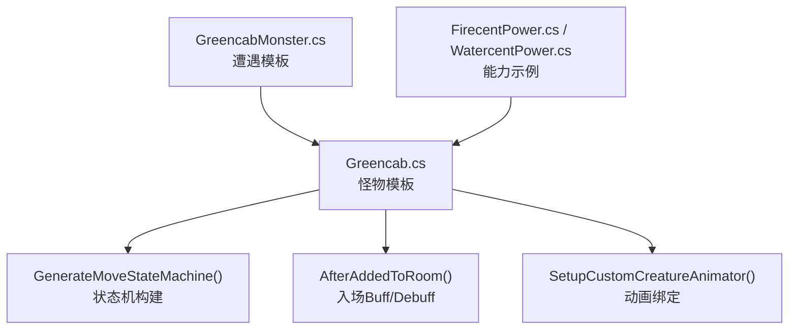
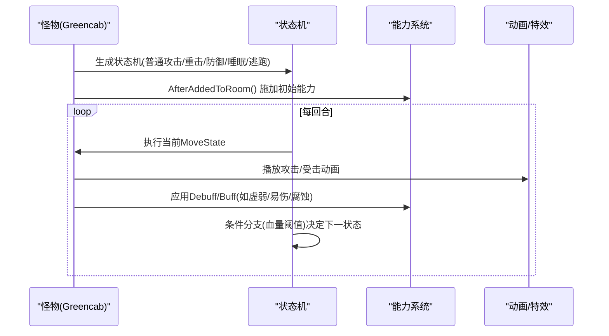
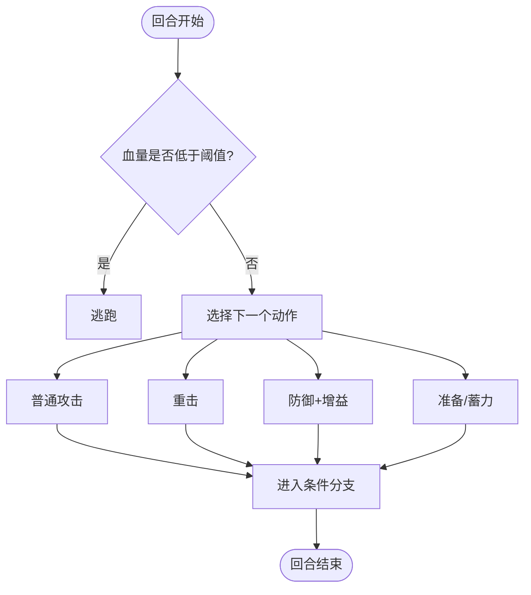
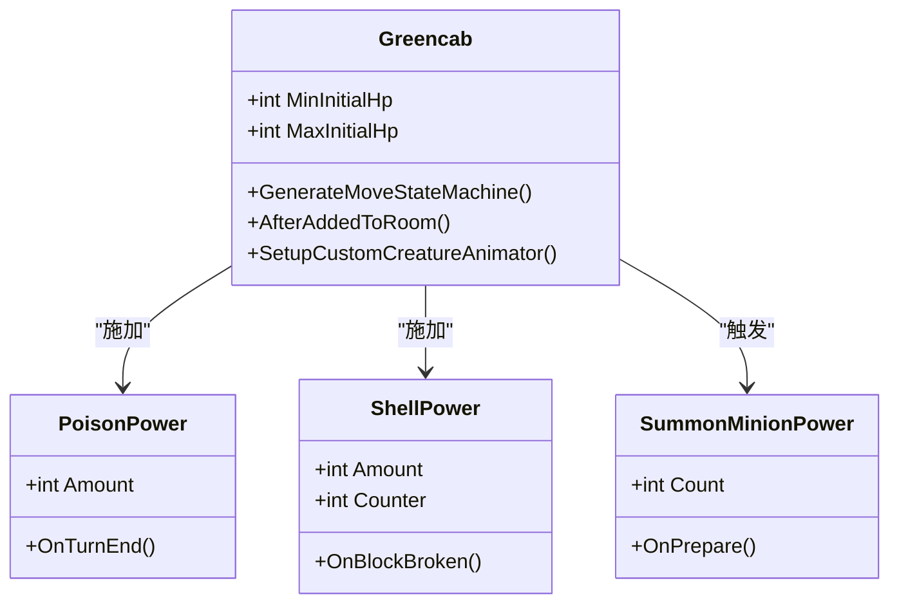
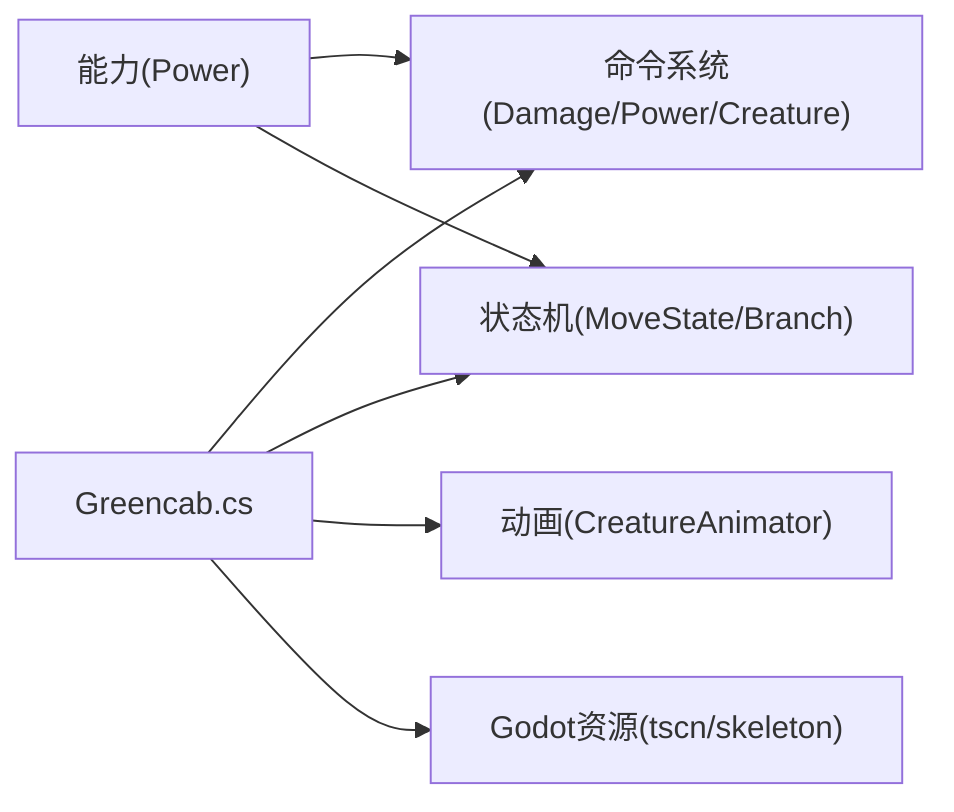

# 绿甲虫怪物

<cite>
**本文引用的文件**
- [Greencab.cs](file://Scripts/Monster/Greencab.cs)
- [GreencabMonster.cs](file://Scripts/Monster/GreencabMonster.cs)
- [FirecentPower.cs](file://Scripts/Powers/Monster/FirecentPower.cs)
- [WatercentPower.cs](file://Scripts/Powers/Monster/WatercentPower.cs)
- [AcidslimePower.cs](file://Scripts/Powers/Liver/AcidslimePower.cs)
- [CatchPower.cs](file://Scripts/Powers/Monster/CatchPower.cs)
- [Firecent.cs](file://Scripts/Monster/Firecent.cs)
- [Watercent.cs](file://Scripts/Monster/Watercent.cs)
</cite>

## 目录
1. [简介](#简介)
2. [项目结构](#项目结构)
3. [核心组件](#核心组件)
4. [架构总览](#架构总览)
5. [详细组件分析](#详细组件分析)
6. [依赖关系分析](#依赖关系分析)
7. [性能与平衡性建议](#性能与平衡性建议)
8. [故障排查指南](#故障排查指南)
9. [结论](#结论)
10. [附录：实现参考与扩展](#附录实现参考与扩展)

## 简介
本文件为“绿甲虫”怪物的完整实现文档，围绕其三大能力展开：毒液喷射、甲壳防御、群体召唤。同时记录普通形态与怪物形态的差异（毒素等级、防御强度、召唤数量），并给出战术AI设计（远程骚扰、近战反击、团队协作）与代码级实现参考。文末提供毒系怪物平衡性与自定义召唤系统的开发建议。

## 项目结构
- 怪物模板与行为：位于 Scripts/Monster 下，使用 ModMonsterTemplate 定义怪物属性、状态机、动画与战斗逻辑。
- 遭遇配置：位于 Scripts/Monster 下的 GreencabMonster.cs，负责将绿甲虫注册到特定章节的遭遇中。
- 能力系统：位于 Scripts/Powers 下，通过 ModPowerTemplate 实现伤害修正、格挡恢复、持续伤害等机制。
- 可视化资源：Godot 场景与 Spine 骨骼位于 Godot/Monster/greencab.tscn 及相关资源。

图表来源
- [Greencab.cs:62-127](file://Scripts/Monster/Greencab.cs#L62-L127)
- [GreencabMonster.cs:10-33](file://Scripts/Monster/GreencabMonster.cs#L10-L33)
- [FirecentPower.cs:45-83](file://Scripts/Powers/Monster/FirecentPower.cs#L45-L83)
- [WatercentPower.cs:45-52](file://Scripts/Powers/Monster/WatercentPower.cs#L45-L52)

章节来源
- [Greencab.cs:27-171](file://Scripts/Monster/Greencab.cs#L27-L171)
- [GreencabMonster.cs:10-33](file://Scripts/Monster/GreencabMonster.cs#L10-L33)

## 核心组件
- 绿甲虫怪物模板（Greencab）：定义初始血量区间、基础攻击/重击数值、状态机、动画与回合事件。
- 遭遇模板（GreencabMonster）：将绿甲虫加入 Overgrowth 章节的怪物房间。
- 能力（Power）：以 FirecentPower（格挡恢复）、WatercentPower（腐蚀伤害倍增）、AcidslimePower（持续伤害/反伤思路）等为参考，用于实现毒液、反射与协作。

章节来源
- [Greencab.cs:27-171](file://Scripts/Monster/Greencab.cs#L27-L171)
- [GreencabMonster.cs:10-33](file://Scripts/Monster/GreencabMonster.cs#L10-L33)
- [FirecentPower.cs:31-83](file://Scripts/Powers/Monster/FirecentPower.cs#L31-L83)
- [WatercentPower.cs:31-52](file://Scripts/Powers/Monster/WatercentPower.cs#L31-L52)
- [AcidslimePower.cs:27-59](file://Scripts/Powers/Liver/AcidslimePower.cs#L27-L59)

## 架构总览
绿甲虫采用“状态机 + 能力”的模块化架构：
- 状态机：由 GenerateMoveStateMachine 定义多个 MoveState（普通攻击、重击、防御、睡眠/准备、逃跑），并通过 ConditionalBranchState 根据血量阈值切换后续动作。
- 能力：通过 PowerCmd.Apply 在入场或行动中施加 Buff/Debuff，如减速、虚弱、易伤、腐蚀等。
- 动画：通过 CreatureAnimator 绑定 Idle/Attack/Hurt 等状态，配合攻击特效与音效。

图表来源
- [Greencab.cs:62-127](file://Scripts/Monster/Greencab.cs#L62-L127)
- [Greencab.cs:51-60](file://Scripts/Monster/Greencab.cs#L51-L60)
- [Greencab.cs:149-170](file://Scripts/Monster/Greencab.cs#L149-L170)

## 详细组件分析

### 绿甲虫基础能力与状态机
- 初始血量：根据进阶难度动态调整 MinInitialHp/MaxInitialHp。
- 普通攻击：对目标造成基础伤害，附带攻击动画与命中特效。
- 重击：高伤害并附加 Debuff（如虚弱/易伤）。
- 防御：获得格挡并叠加力量类增益。
- 睡眠/准备：占位动作，可替换为毒液蓄力或召唤前摇。
- 逃跑：低血量时尝试逃离。

图表来源
- [Greencab.cs:62-127](file://Scripts/Monster/Greencab.cs#L62-L127)

章节来源
- [Greencab.cs:27-171](file://Scripts/Monster/Greencab.cs#L27-L171)

### 毒液喷射（Poison Spray）
- 设计要点：
  - 多段伤害：参考 Firecent 的多段攻击模式，实现“毒液溅射”。
  - 持续伤害：参考 AcidslimePower 的 AfterDamageReceived/AfterCardExhausted 钩子，构造“中毒”层数与每回合伤害。
  - 目标选择：可对单个或多个敌人施加中毒层数，支持升级提升层数与伤害。
- 实现参考路径：
  - 多段攻击：[Firecent.cs:96-110](file://Scripts/Monster/Firecent.cs#L96-L110)
  - 持续伤害/反伤思路：[AcidslimePower.cs:41-59](file://Scripts/Powers/Liver/AcidslimePower.cs#L41-L59)
- 建议数据结构：
  - PoisonPower：Amount=层数；每回合结束时对持有者造成伤害；可被净化移除。
  - 毒液喷射 MoveState：对目标施加 PoisonPower，并根据进阶提高 Amount。

章节来源
- [Firecent.cs:96-110](file://Scripts/Monster/Firecent.cs#L96-L110)
- [AcidslimePower.cs:41-59](file://Scripts/Powers/Liver/AcidslimePower.cs#L41-L59)

### 甲壳防御（Shell Defense）
- 设计要点：
  - 格挡恢复：参考 FirecentPower 的 AfterBlockBroken/AfterSideTurnStart，当格挡被破坏或回合开始时恢复一定格挡。
  - 伤害减免：可结合 WatercentPower 的 ModifyDamageMultiplicative 思路，在特定条件下降低受到的伤害。
  - 视觉反馈：随格挡次数变化皮肤/姿态，增强表现力。
- 实现参考路径：
  - 格挡恢复与阶段变化：[FirecentPower.cs:45-83](file://Scripts/Powers/Monster/FirecentPower.cs#L45-L83)
  - 伤害倍率修正：[WatercentPower.cs:45-52](file://Scripts/Powers/Monster/WatercentPower.cs#L45-L52)
- 建议数据结构：
  - ShellPower：Amount=恢复量；Counter=剩余恢复次数；触发条件为格挡被破或回合开始。
  - 在 AfterBlockBroken 中递减 Counter，达到阈值后移除能力。

章节来源
- [FirecentPower.cs:45-83](file://Scripts/Powers/Monster/FirecentPower.cs#L45-L83)
- [WatercentPower.cs:45-52](file://Scripts/Powers/Monster/WatercentPower.cs#L45-L52)

### 群体召唤（Summon Minions）
- 设计要点：
  - 召唤时机：可在“准备/蓄力”状态后触发，或在低血量时作为保命手段。
  - 召唤物类型：小型甲虫单位，具备简单攻击或干扰能力（如施加易伤/腐蚀）。
  - 数量控制：根据进阶难度调整召唤数量，避免过强。
- 实现参考路径：
  - 添加卡牌/效果到战场：[Firecent.cs:121-129](file://Scripts/Monster/Firecent.cs#L121-L129)
  - 回合末增益循环：[CatchPower.cs:60-76](file://Scripts/Powers/Monster/CatchPower.cs#L60-L76)
- 建议数据结构：
  - SummonMinionPower：Amount=召唤数量；在指定 MoveState 中调用 CreatureCmd.Spawn 或 CardPileCmd.AddGeneratedCardToCombat 生成单位。
  - MinionModel：具备独立状态机，可执行简单攻击或施加Debuff。

章节来源
- [Firecent.cs:121-129](file://Scripts/Monster/Firecent.cs#L121-L129)
- [CatchPower.cs:60-76](file://Scripts/Powers/Monster/CatchPower.cs#L60-L76)

### 战术AI（远程骚扰、近战反击、团队协作）
- 远程骚扰：
  - 使用多段攻击 MoveState 进行毒液喷射，施加中毒层数，迫使玩家优先处理或净化。
- 近战反击：
  - 当玩家近身时，切换到防御/反击状态，利用甲壳恢复格挡并对攻击者施加易伤/虚弱。
- 团队协作：
  - 召唤小甲虫协同输出或施加Debuff，形成“主怪+ minions”的复合威胁。
  - 通过 ConditionalBranchState 根据血量与场上单位数量动态选择策略。

图表来源
- [Greencab.cs:27-171](file://Scripts/Monster/Greencab.cs#L27-L171)
- [FirecentPower.cs:45-83](file://Scripts/Powers/Monster/FirecentPower.cs#L45-L83)
- [WatercentPower.cs:45-52](file://Scripts/Powers/Monster/WatercentPower.cs#L45-L52)
- [AcidslimePower.cs:41-59](file://Scripts/Powers/Liver/AcidslimePower.cs#L41-L59)

章节来源
- [Greencab.cs:62-127](file://Scripts/Monster/Greencab.cs#L62-L127)
- [Firecent.cs:96-129](file://Scripts/Monster/Firecent.cs#L96-L129)
- [CatchPower.cs:60-76](file://Scripts/Powers/Monster/CatchPower.cs#L60-L76)

## 依赖关系分析
- 模块耦合：
  - Greencab 依赖状态机框架与命令系统（DamageCmd、PowerCmd、CreatureCmd）。
  - 能力系统通过 PowerCmd.Apply 注入 Buff/Debuff，解耦具体逻辑。
  - 动画与特效通过 CreatureAnimator 与 Vfx 节点绑定，不影响核心逻辑。
- 外部依赖：
  - Godot 场景与 Spine 资源用于可视化表现。
  - 国际化文本（monsters.json、powers.json）用于显示名称与描述。

图表来源
- [Greencab.cs:62-127](file://Scripts/Monster/Greencab.cs#L62-L127)
- [FirecentPower.cs:45-83](file://Scripts/Powers/Monster/FirecentPower.cs#L45-L83)
- [WatercentPower.cs:45-52](file://Scripts/Powers/Monster/WatercentPower.cs#L45-L52)

章节来源
- [Greencab.cs:62-127](file://Scripts/Monster/Greencab.cs#L62-L127)
- [FirecentPower.cs:45-83](file://Scripts/Powers/Monster/FirecentPower.cs#L45-L83)
- [WatercentPower.cs:45-52](file://Scripts/Powers/Monster/WatercentPower.cs#L45-L52)

## 性能与平衡性建议
- 性能：
  - 多段攻击与持续伤害需控制每回合计算量，避免过多对象创建。
  - 召唤单位应复用模型与动画，减少渲染开销。
- 平衡性：
  - 毒液层数与伤害随进阶递增，但需提供净化手段（如净化卡/遗物）。
  - 甲壳防御恢复量与次数需限制，防止无限格挡。
  - 召唤数量与强度需与玩家卡组强度匹配，避免后期碾压。

## 故障排查指南
- 常见问题：
  - 动画未播放：检查 SetupCustomCreatureAnimator 中的状态绑定是否正确。
  - 能力未生效：确认 PowerCmd.Apply 的目标与上下文是否正确。
  - 状态机不跳转：检查 ConditionalBranchState 的条件函数返回值。
- 调试建议：
  - 在关键方法中添加日志输出（如回合开始、能力应用、状态切换）。
  - 使用游戏内调试工具查看状态机当前状态与能力堆叠。

章节来源
- [Greencab.cs:149-170](file://Scripts/Monster/Greencab.cs#L149-L170)
- [FirecentPower.cs:45-83](file://Scripts/Powers/Monster/FirecentPower.cs#L45-L83)

## 结论
绿甲虫通过“状态机 + 能力”的架构实现了毒液喷射、甲壳防御与群体召唤三大核心能力。借助现有 Power 模板与命令系统，可以快速扩展与平衡新机制。建议在后续迭代中完善毒液层数管理、甲壳恢复策略与召唤物AI，以提升战斗深度与可玩性。

## 附录：实现参考与扩展
- 毒液效果实现参考：
  - 多段攻击：[Firecent.cs:96-110](file://Scripts/Monster/Firecent.cs#L96-L110)
  - 持续伤害/反伤思路：[AcidslimePower.cs:41-59](file://Scripts/Powers/Liver/AcidslimePower.cs#L41-L59)
- 伤害反射与防御实现参考：
  - 格挡恢复与阶段变化：[FirecentPower.cs:45-83](file://Scripts/Powers/Monster/FirecentPower.cs#L45-L83)
  - 伤害倍率修正：[WatercentPower.cs:45-52](file://Scripts/Powers/Monster/WatercentPower.cs#L45-L52)
- AI协作与召唤实现参考：
  - 添加卡牌/效果到战场：[Firecent.cs:121-129](file://Scripts/Monster/Firecent.cs#L121-L129)
  - 回合末增益循环：[CatchPower.cs:60-76](file://Scripts/Powers/Monster/CatchPower.cs#L60-L76)