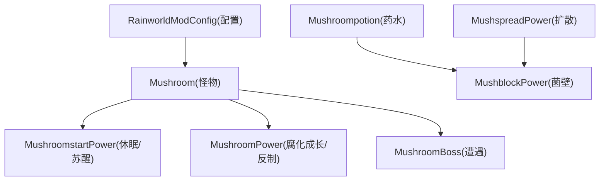
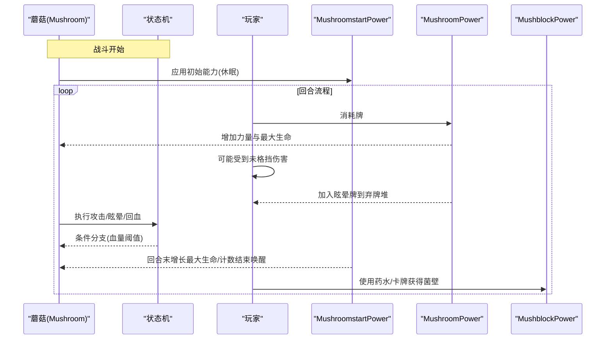
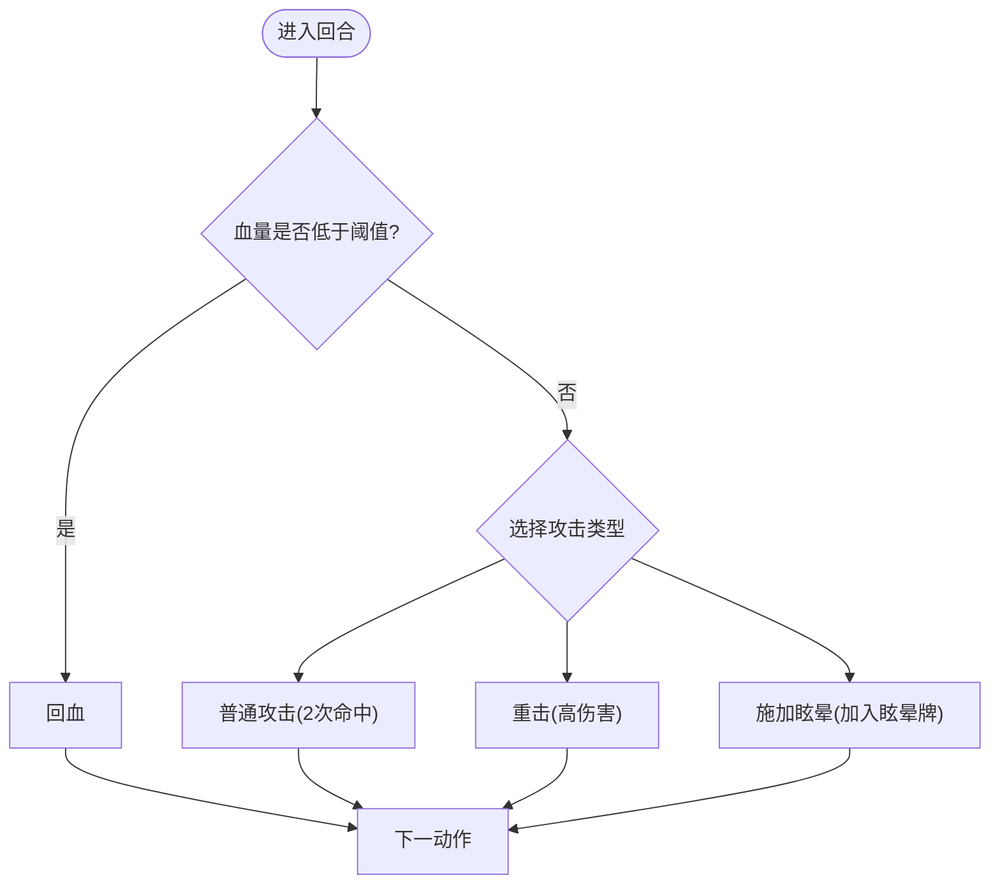
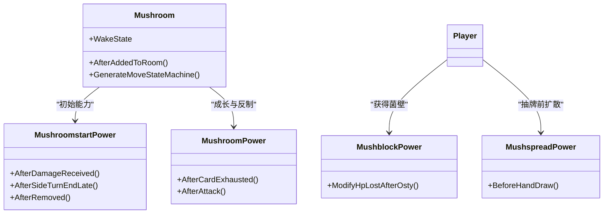
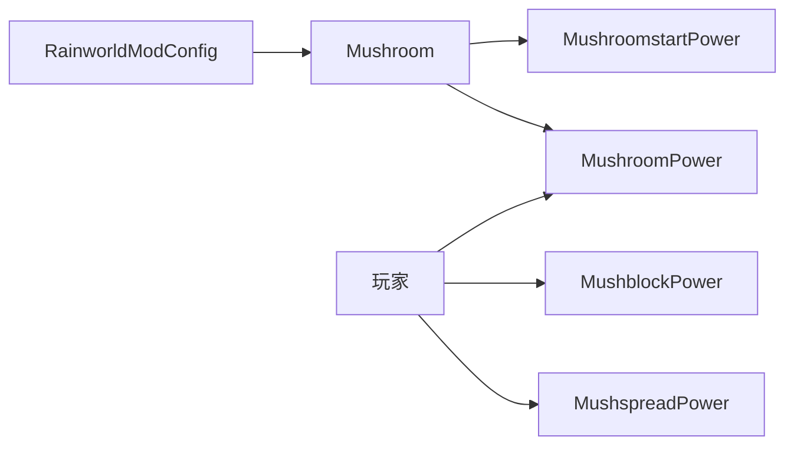

# 蘑菇怪物

<cite>
**本文引用的文件**
- [Scripts/Monster/Mushroom.cs](file://Scripts/Monster/Mushroom.cs)
- [Scripts/Monster/MushroomBoss.cs](file://Scripts/Monster/MushroomBoss.cs)
- [Scripts/Powers/Monster/MushroomPower.cs](file://Scripts/Powers/Monster/MushroomPower.cs)
- [Scripts/Powers/Monster/MushroomstartPower.cs](file://Scripts/Powers/Monster/MushroomstartPower.cs)
- [Scripts/Potions/Mushroompotion.cs](file://Scripts/Potions/Mushroompotion.cs)
- [Scripts/Powers/RedCat/MushblockPower.cs](file://Scripts/Powers/RedCat/MushblockPower.cs)
- [Scripts/Powers/RedCat/MushspreadPower.cs](file://Scripts/Powers/RedCat/MushspreadPower.cs)
- [Scripts/RainworldModConfig.cs](file://Scripts/RainworldModConfig.cs)
- [SlugcatTheSpireII/localization/zhs/powers.json](file://SlugcatTheSpireII/localization/zhs/powers.json)
</cite>

## 目录
1. [简介](#简介)
2. [项目结构](#项目结构)
3. [核心组件](#核心组件)
4. [架构总览](#架构总览)
5. [详细组件分析](#详细组件分析)
6. [依赖关系分析](#依赖关系分析)
7. [性能与平衡性考量](#性能与平衡性考量)
8. [故障排查指南](#故障排查指南)
9. [结论](#结论)
10. [附录：实现示例与开发指南](#附录：实现示例与开发指南)

## 简介
本文件为“蘑菇怪物”的完整实现文档，围绕其孢子传播机制、生长系统与范围攻击模式展开，并对比普通蘑菇与蘑菇Boss的行为差异。内容涵盖生态模拟（繁殖、扩散、死亡影响）、数值与阶段转换、环境交互、难度调节参数以及自定义蘑菇类型的开发指南。所有说明均基于仓库中的实际代码与本地化文本。

## 项目结构
- 怪物主体：Mushroom（状态机驱动的战斗行为）
- Boss 遭遇：MushroomBoss（Boss房间配置）
- 能力系统：
  - MushroomstartPower：初始休眠与苏醒控制
  - MushroomPower：腐化成长与受击反制
  - MushblockPower：菌壁护盾
  - MushspreadPower：菌壁扩散
- 药水：Mushroompotion：提供菌壁与环境腐化值
- 配置：RainworldModConfig：开关蘑菇怪物等特性

图表来源
- [Scripts/Monster/Mushroom.cs:84-167](file://Scripts/Monster/Mushroom.cs#L84-L167)
- [Scripts/Monster/MushroomBoss.cs:10-33](file://Scripts/Monster/MushroomBoss.cs#L10-L33)
- [Scripts/Powers/Monster/MushroomstartPower.cs:45-98](file://Scripts/Powers/Monster/MushroomstartPower.cs#L45-L98)
- [Scripts/Powers/Monster/MushroomPower.cs:43-91](file://Scripts/Powers/Monster/MushroomPower.cs#L43-L91)
- [Scripts/Potions/Mushroompotion.cs:45-49](file://Scripts/Potions/Mushroompotion.cs#L45-L49)
- [Scripts/Powers/RedCat/MushblockPower.cs:41-60](file://Scripts/Powers/RedCat/MushblockPower.cs#L41-L60)
- [Scripts/Powers/RedCat/MushspreadPower.cs:37-46](file://Scripts/Powers/RedCat/MushspreadPower.cs#L37-L46)
- [Scripts/RainworldModConfig.cs:11-30](file://Scripts/RainworldModConfig.cs#L11-L30)

章节来源
- [Scripts/Monster/Mushroom.cs:31-214](file://Scripts/Monster/Mushroom.cs#L31-L214)
- [Scripts/Monster/MushroomBoss.cs:10-33](file://Scripts/Monster/MushroomBoss.cs#L10-L33)
- [Scripts/RainworldModConfig.cs:11-30](file://Scripts/RainworldModConfig.cs#L11-L30)

## 核心组件
- 蘑菇怪物（Mushroom）：通过状态机管理睡眠、唤醒、普通攻击、重击、眩晕与回血等行为；具备随血量阈值切换行为的条件分支。
- 蘑菇Boss（MushroomBoss）：将蘑菇作为Boss遭遇，使用专属BGM与地图节点。
- 能力：
  - MushroomstartPower：回合末增长最大生命，并在受伤或计数结束时触发苏醒。
  - MushroomPower：玩家每消耗一张牌，怪物获得力量与最大生命；玩家受到未格挡伤害时，向弃牌堆加入“眩晕”牌。
  - MushblockPower：吸收伤害的“菌壁”，可被消耗或移除。
  - MushspreadPower：在抽牌前根据现有菌壁生成新的菌壁，体现“扩散”。
- 药水：Mushroompotion：增加腐化值并赋予菌壁。

章节来源
- [Scripts/Monster/Mushroom.cs:84-167](file://Scripts/Monster/Mushroom.cs#L84-L167)
- [Scripts/Powers/Monster/MushroomstartPower.cs:45-98](file://Scripts/Powers/Monster/MushroomstartPower.cs#L45-L98)
- [Scripts/Powers/Monster/MushroomPower.cs:43-91](file://Scripts/Powers/Monster/MushroomPower.cs#L43-L91)
- [Scripts/Potions/Mushroompotion.cs:45-49](file://Scripts/Potions/Mushroompotion.cs#L45-L49)
- [Scripts/Powers/RedCat/MushblockPower.cs:41-60](file://Scripts/Powers/RedCat/MushblockPower.cs#L41-L60)
- [Scripts/Powers/RedCat/MushspreadPower.cs:37-46](file://Scripts/Powers/RedCat/MushspreadPower.cs#L37-L46)

## 架构总览
蘑菇怪物的战斗由状态机驱动，结合能力系统实现“休眠—苏醒—攻击/治疗—条件分支”的循环。玩家侧的腐化值与菌壁体系与怪物形成生态互动：玩家通过药水与卡牌获得菌壁，怪物通过能力对玩家的出牌与受击进行反馈。

图表来源
- [Scripts/Monster/Mushroom.cs:84-167](file://Scripts/Monster/Mushroom.cs#L84-L167)
- [Scripts/Powers/Monster/MushroomstartPower.cs:68-83](file://Scripts/Powers/Monster/MushroomstartPower.cs#L68-L83)
- [Scripts/Powers/Monster/MushroomPower.cs:43-91](file://Scripts/Powers/Monster/MushroomPower.cs#L43-L91)
- [Scripts/Potions/Mushroompotion.cs:45-49](file://Scripts/Potions/Mushroompotion.cs#L45-L49)
- [Scripts/Powers/RedCat/MushblockPower.cs:41-60](file://Scripts/Powers/RedCat/MushblockPower.cs#L41-L60)

## 详细组件分析

### 蘑菇怪物（Mushroom）
- 行为特征
  - 睡眠态：默认进入休眠，播放循环动画。
  - 唤醒态：通过能力移除后或受到伤害触发，进入活跃状态。
  - 攻击模式：
    - 普通攻击：多段伤害（命中次数为2）。
    - 重击：高伤害单体攻击。
    - 眩晕：向玩家弃牌堆与抽牌堆加入“眩晕”牌，数量按进阶调整。
  - 治疗：当生命值低于阈值时优先选择回血。
  - 条件分支：根据needHealth决定后续动作（攻击/眩晕/回血）。
- 动画与视觉
  - 支持idle、attack、hurt、sleep、sleeptoidle等状态，睡眠为循环播放。
- 数值与进阶
  - 基础伤害、眩晕数量、治疗量、重击伤害均随进阶等级变化。

图表来源
- [Scripts/Monster/Mushroom.cs:89-167](file://Scripts/Monster/Mushroom.cs#L89-L167)

章节来源
- [Scripts/Monster/Mushroom.cs:31-214](file://Scripts/Monster/Mushroom.cs#L31-L214)

### 蘑菇Boss（MushroomBoss）
- 将蘑菇作为Boss遭遇，使用专属背景音乐与地图图标。
- 生成怪物模型为蘑菇实例。

章节来源
- [Scripts/Monster/MushroomBoss.cs:10-33](file://Scripts/Monster/MushroomBoss.cs#L10-L33)

### 能力系统
- MushroomstartPower（休眠/苏醒）
  - 回合末增长最大生命百分比。
  - 收到伤害时立即唤醒并移除自身。
  - 计数归零时将下一动作设置为唤醒。
  - 移除后播放苏醒动画并标记怪物为活跃。
- MushroomPower（腐化成长/反制）
  - 玩家每消耗一张牌，怪物获得力量与最大生命。
  - 玩家受到未格挡伤害时，向弃牌堆加入“眩晕”牌。
- MushblockPower（菌壁）
  - 吸收伤害，达到阈值时移除或递减。
- MushspreadPower（扩散）
  - 抽牌前根据现有菌壁生成新的菌壁，体现“孢子扩散”。

图表来源
- [Scripts/Monster/Mushroom.cs:84-167](file://Scripts/Monster/Mushroom.cs#L84-L167)
- [Scripts/Powers/Monster/MushroomstartPower.cs:45-98](file://Scripts/Powers/Monster/MushroomstartPower.cs#L45-L98)
- [Scripts/Powers/Monster/MushroomPower.cs:43-91](file://Scripts/Powers/Monster/MushroomPower.cs#L43-L91)
- [Scripts/Powers/RedCat/MushblockPower.cs:41-60](file://Scripts/Powers/RedCat/MushblockPower.cs#L41-L60)
- [Scripts/Powers/RedCat/MushspreadPower.cs:37-46](file://Scripts/Powers/RedCat/MushspreadPower.cs#L37-L46)

章节来源
- [Scripts/Powers/Monster/MushroomstartPower.cs:45-98](file://Scripts/Powers/Monster/MushroomstartPower.cs#L45-L98)
- [Scripts/Powers/Monster/MushroomPower.cs:43-91](file://Scripts/Powers/Monster/MushroomPower.cs#L43-L91)
- [Scripts/Powers/RedCat/MushblockPower.cs:41-60](file://Scripts/Powers/RedCat/MushblockPower.cs#L41-L60)
- [Scripts/Powers/RedCat/MushspreadPower.cs:37-46](file://Scripts/Powers/RedCat/MushspreadPower.cs#L37-L46)

### 药水与环境交互
- Mushroompotion：在战斗中增加腐化值并赋予菌壁，体现“孢子污染”的环境效果。
- 玩家可通过其他卡牌/能力获得菌壁，并与扩散能力联动。

章节来源
- [Scripts/Potions/Mushroompotion.cs:45-49](file://Scripts/Potions/Mushroompotion.cs#L45-L49)

## 依赖关系分析
- 怪物与能力：
  - 蘑菇通过状态机调用能力（如应用MushroomstartPower、MushroomPower）。
  - 能力回调影响怪物状态（如唤醒、增长生命、添加眩晕）。
- 玩家与能力：
  - 玩家消耗牌触发怪物成长；玩家受击触发反制。
  - 玩家获得菌壁并通过扩散能力增强防御。
- 配置：
  - RainworldModConfig提供启用/禁用蘑菇怪物的开关。

图表来源
- [Scripts/Monster/Mushroom.cs:84-167](file://Scripts/Monster/Mushroom.cs#L84-L167)
- [Scripts/Powers/Monster/MushroomstartPower.cs:45-98](file://Scripts/Powers/Monster/MushroomstartPower.cs#L45-L98)
- [Scripts/Powers/Monster/MushroomPower.cs:43-91](file://Scripts/Powers/Monster/MushroomPower.cs#L43-L91)
- [Scripts/Powers/RedCat/MushblockPower.cs:41-60](file://Scripts/Powers/RedCat/MushblockPower.cs#L41-L60)
- [Scripts/Powers/RedCat/MushspreadPower.cs:37-46](file://Scripts/Powers/RedCat/MushspreadPower.cs#L37-L46)
- [Scripts/RainworldModConfig.cs:11-30](file://Scripts/RainworldModConfig.cs#L11-L30)

章节来源
- [Scripts/RainworldModConfig.cs:11-30](file://Scripts/RainworldModConfig.cs#L11-L30)

## 性能与平衡性考量
- 状态机复杂度：条件分支较多，但逻辑清晰，建议保持最小化状态数以降低维护成本。
- 数值平衡：
  - 基础伤害、重击伤害、眩晕数量、治疗量随进阶变化，避免过高导致不可应对。
  - 菌壁与扩散需与玩家卡组强度匹配，防止过强或过弱。
- 动画与特效：
  - 睡眠循环动画需注意帧率与内存占用。
  - 觉醒与攻击特效应简洁，避免卡顿。

[本节为通用指导，不直接分析具体文件]

## 故障排查指南
- 怪物未苏醒：
  - 检查MushroomstartPower的AfterDamageReceived与AfterSideTurnEndLate是否正确触发。
  - 确认计数归零后NextMove.FollowUpState已设置为唤醒。
- 眩晕牌未加入：
  - 检查MushroomPower的AfterAttack中UnblockedDamage判断与AddToCombatAndPreview调用。
- 菌壁未生效：
  - 检查MushblockPower的ModifyHpLostAfterOsty是否拦截伤害并递减。
  - 确认MushspreadPower的BeforeHandDraw是否正确计算并应用新菌壁。
- 配置未生效：
  - 检查RainworldModConfig中EnableMushroomMonster开关是否启用。

章节来源
- [Scripts/Powers/Monster/MushroomstartPower.cs:45-98](file://Scripts/Powers/Monster/MushroomstartPower.cs#L45-L98)
- [Scripts/Powers/Monster/MushroomPower.cs:43-91](file://Scripts/Powers/Monster/MushroomPower.cs#L43-L91)
- [Scripts/Powers/RedCat/MushblockPower.cs:41-60](file://Scripts/Powers/RedCat/MushblockPower.cs#L41-L60)
- [Scripts/Powers/RedCat/MushspreadPower.cs:37-46](file://Scripts/Powers/RedCat/MushspreadPower.cs#L37-L46)
- [Scripts/RainworldModConfig.cs:11-30](file://Scripts/RainworldModConfig.cs#L11-L30)

## 结论
蘑菇怪物通过状态机与能力系统实现了“休眠—苏醒—攻击/治疗—条件分支”的生态循环，配合玩家侧的腐化值与菌壁体系，形成独特的互动体验。普通蘑菇与Boss共享同一怪物模板，Boss仅改变遭遇配置。数值与进阶提供了可调的难度曲线，适合不同水平的玩家。

[本节为总结，不直接分析具体文件]

## 附录：实现示例与开发指南

### 孢子生成（以“眩晕”为例）
- 在怪物状态中，通过命令向玩家弃牌堆与抽牌堆加入“眩晕”牌，数量由进阶决定。
- 参考路径：[Scripts/Monster/Mushroom.cs:169-175](file://Scripts/Monster/Mushroom.cs#L169-L175)

### 毒伤计算（以“未格挡伤害反制”为例）
- 在玩家受到未格挡伤害时，统计有效伤害次数并向弃牌堆加入对应数量的“眩晕”牌。
- 参考路径：[Scripts/Powers/Monster/MushroomPower.cs:50-91](file://Scripts/Powers/Monster/MushroomPower.cs#L50-L91)

### 环境交互（菌壁与扩散）
- 使用药水增加腐化值并赋予菌壁，体现“孢子污染”。
- 抽牌前根据现有菌壁生成新的菌壁，体现“扩散”。
- 参考路径：
  - [Scripts/Potions/Mushroompotion.cs:45-49](file://Scripts/Potions/Mushroompotion.cs#L45-L49)
  - [Scripts/Powers/RedCat/MushspreadPower.cs:37-46](file://Scripts/Powers/RedCat/MushspreadPower.cs#L37-L46)
  - [Scripts/Powers/RedCat/MushblockPower.cs:41-60](file://Scripts/Powers/RedCat/MushblockPower.cs#L41-L60)

### 难度调节参数
- 进阶相关数值：
  - 基础伤害、重击伤害、眩晕数量、治疗量随进阶变化。
  - 参考路径：[Scripts/Monster/Mushroom.cs:39-50](file://Scripts/Monster/Mushroom.cs#L39-L50)
- 全局开关：
  - 启用/禁用蘑菇怪物。
  - 参考路径：[Scripts/RainworldModConfig.cs:11-30](file://Scripts/RainworldModConfig.cs#L11-L30)

### 自定义蘑菇类型开发指南
- 继承ModMonsterTemplate并注册为怪物。
- 定义状态机：睡眠、唤醒、攻击、眩晕、治疗等。
- 使用能力系统扩展行为（如腐化成长、菌壁、扩散）。
- 配置Boss遭遇：设置房间类型、BGM与图标。
- 参考路径：
  - [Scripts/Monster/Mushroom.cs:31-214](file://Scripts/Monster/Mushroom.cs#L31-L214)
  - [Scripts/Monster/MushroomBoss.cs:10-33](file://Scripts/Monster/MushroomBoss.cs#L10-L33)

章节来源
- [Scripts/Monster/Mushroom.cs:39-50](file://Scripts/Monster/Mushroom.cs#L39-L50)
- [Scripts/RainworldModConfig.cs:11-30](file://Scripts/RainworldModConfig.cs#L11-L30)
- [Scripts/Monster/Mushroom.cs:169-175](file://Scripts/Monster/Mushroom.cs#L169-L175)
- [Scripts/Powers/Monster/MushroomPower.cs:50-91](file://Scripts/Powers/Monster/MushroomPower.cs#L50-L91)
- [Scripts/Potions/Mushroompotion.cs:45-49](file://Scripts/Potions/Mushroompotion.cs#L45-L49)
- [Scripts/Powers/RedCat/MushspreadPower.cs:37-46](file://Scripts/Powers/RedCat/MushspreadPower.cs#L37-L46)
- [Scripts/Powers/RedCat/MushblockPower.cs:41-60](file://Scripts/Powers/RedCat/MushblockPower.cs#L41-L60)
- [Scripts/Monster/Mushroom.cs:31-214](file://Scripts/Monster/Mushroom.cs#L31-L214)
- [Scripts/Monster/MushroomBoss.cs:10-33](file://Scripts/Monster/MushroomBoss.cs#L10-L33)