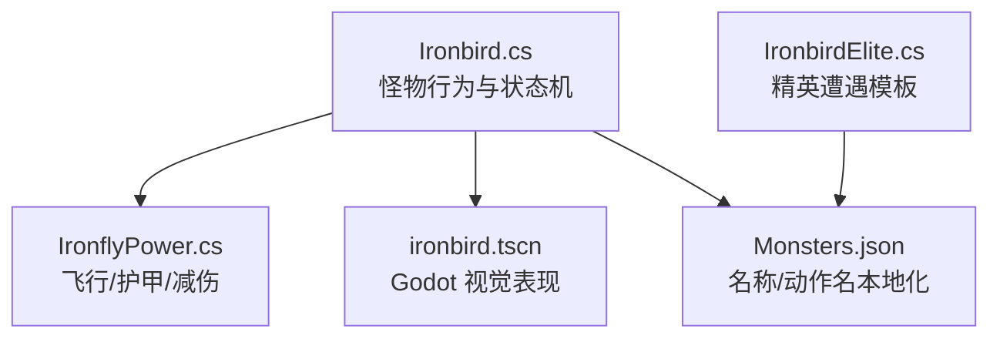
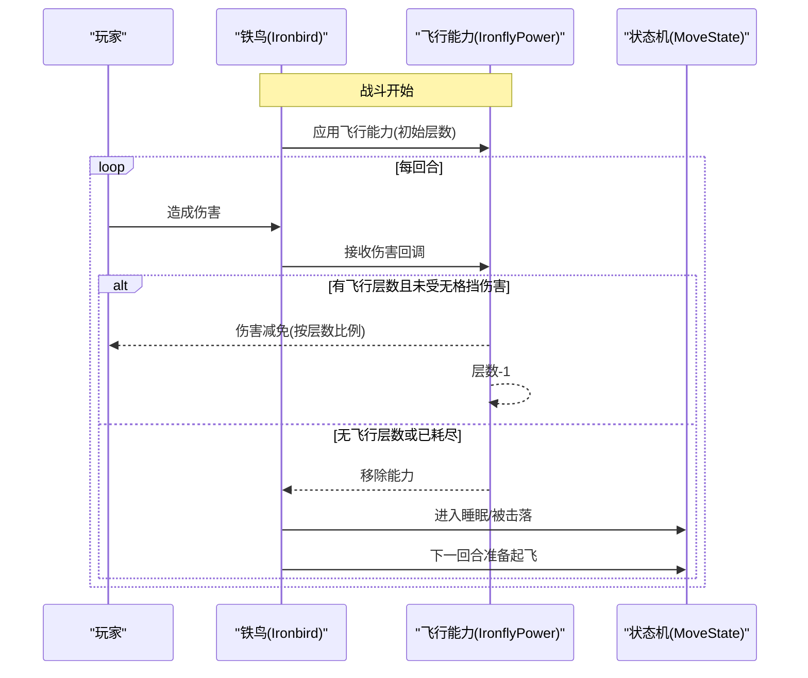
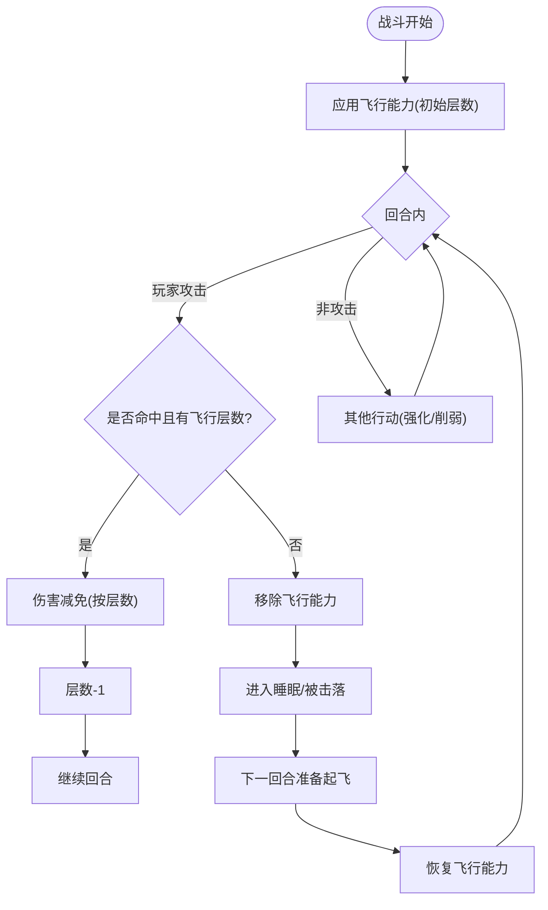
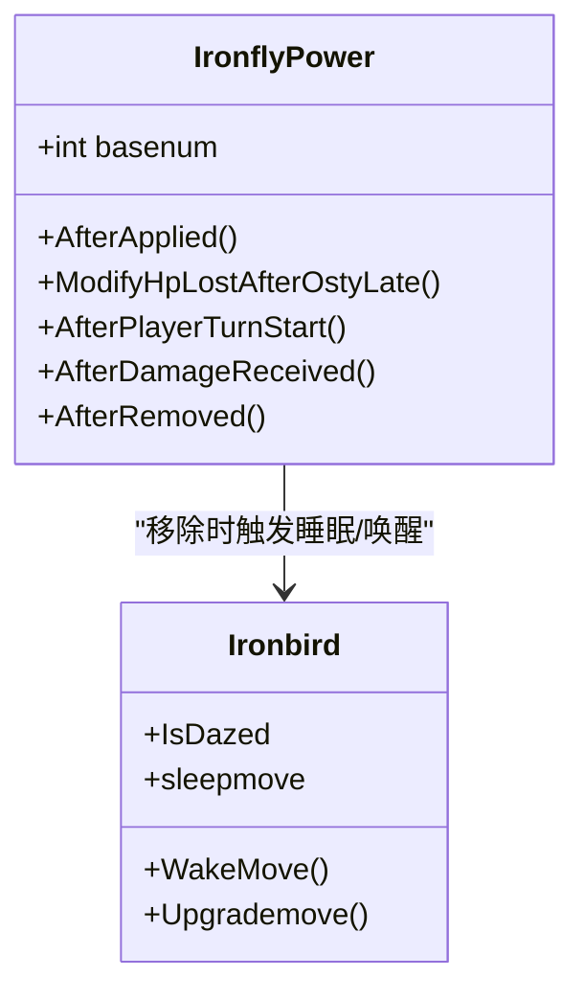
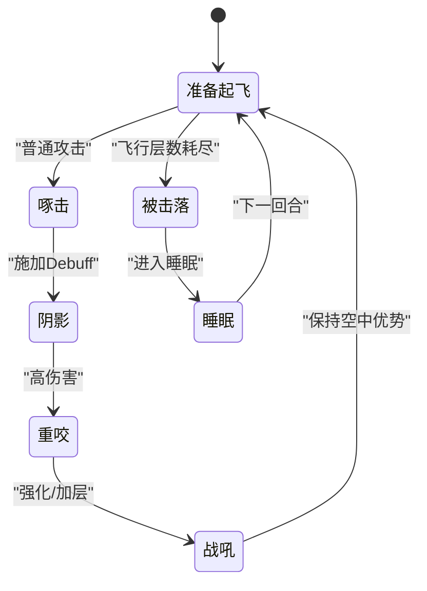
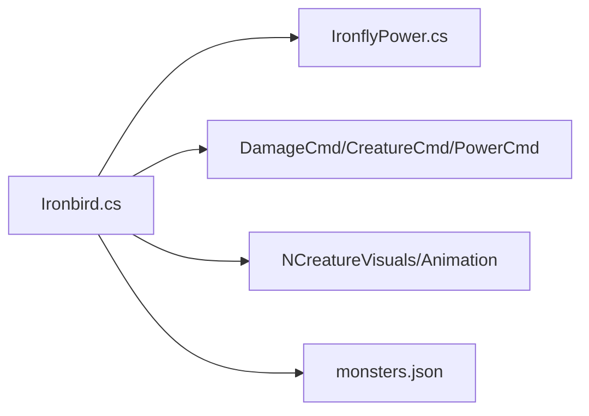

# 铁鸟怪物

<cite>
**本文引用的文件**
- [Ironbird.cs](file://Scripts/Monster/Ironbird.cs)
- [IronbirdElite.cs](file://Scripts/Monster/IronbirdElite.cs)
- [IronflyPower.cs](file://Scripts/Powers/Monster/IronflyPower.cs)
- [Firecab.cs](file://Scripts/Monster/Firecab.cs)
- [Watercent.cs](file://Scripts/Monster/Watercent.cs)
- [monsters.json（英文）](file://SlugcatTheSpireII/localization/eng/monsters.json)
- [monsters.json（中文）](file://SlugcatTheSpireII/localization/zhs/monsters.json)
</cite>

## 目录
1. [简介](#简介)
2. [项目结构](#项目结构)
3. [核心组件](#核心组件)
4. [架构总览](#架构总览)
5. [详细组件分析](#详细组件分析)
6. [依赖关系分析](#依赖关系分析)
7. [性能与平衡性考量](#性能与平衡性考量)
8. [故障排查指南](#故障排查指南)
9. [结论](#结论)
10. [附录：实现参考与扩展](#附录：实现参考与扩展)

## 简介
本文件为“铁鸟”怪物的完整实现文档，聚焦以下目标：
- 飞行机制：以“飞行层数”为核心的回合制护甲/减伤系统，模拟空中优势与受击后坠落的空战体验。
- 俯冲攻击：通过多段普通攻击与重击组合，体现空中压制与爆发输出。
- 金属护甲系统：基于可消耗层数的伤害减免与状态切换，提供清晰的反制窗口。
- 普通铁鸟与精英铁鸟的能力差异：在血量、攻击频率、护甲强度等维度的数值设计建议。
- 空战AI：盘旋、锁定目标、战术规避的状态机流程。
- 三维移动、碰撞检测与护甲值管理的代码级实现参考（结合Godot场景与STS2框架）。
- 空战平衡性设计与自定义飞行怪物的开发参考。

## 项目结构
铁鸟相关代码主要分布在以下位置：
- 怪物逻辑：Scripts/Monster/Ironbird.cs
- 精英遭遇模板：Scripts/Monster/IronbirdElite.cs
- 飞行能力（护甲/减伤/坠落）：Scripts/Powers/Monster/IronflyPower.cs
- 可视化资源：Godot/Monster/ironbird.tscn 及 Ironbird 子目录资源
- 本地化文案：SlugcatTheSpireII/localization/{eng,zhs}/monsters.json

图表来源
- [Ironbird.cs:62-79](file://Scripts/Monster/Ironbird.cs#L62-L79)
- [IronflyPower.cs:31-89](file://Scripts/Powers/Monster/IronflyPower.cs#L31-L89)
- [IronbirdElite.cs:10-34](file://Scripts/Monster/IronbirdElite.cs#L10-L34)
- [monsters.json（英文）:9-16](file://SlugcatTheSpireII/localization/eng/monsters.json#L9-L16)
- [monsters.json（中文）:10-16](file://SlugcatTheSpireII/localization/zhs/monsters.json#L10-L16)

章节来源
- [Ironbird.cs:26-79](file://Scripts/Monster/Ironbird.cs#L26-L79)
- [IronbirdElite.cs:10-34](file://Scripts/Monster/IronbirdElite.cs#L10-L34)
- [IronflyPower.cs:31-89](file://Scripts/Powers/Monster/IronflyPower.cs#L31-L89)
- [monsters.json（英文）:9-16](file://SlugcatTheSpireII/localization/eng/monsters.json#L9-L16)
- [monsters.json（中文）:10-16](file://SlugcatTheSpireII/localization/zhs/monsters.json#L10-L16)

## 核心组件
- 铁鸟怪物（Ironbird）：定义初始血量、基础/重击伤害、状态机、动画绑定、战斗开始时的飞行能力施加。
- 飞行能力（IronflyPower）：提供每回合递减的“飞行层数”，用于伤害减免；层数为0时触发“被击落”状态并进入睡眠/准备起飞循环。
- 精英遭遇（IronbirdElite）：将铁鸟作为精英房间出现，复用同一怪物模型。

章节来源
- [Ironbird.cs:31-79](file://Scripts/Monster/Ironbird.cs#L31-L79)
- [IronflyPower.cs:31-89](file://Scripts/Powers/Monster/IronflyPower.cs#L31-L89)
- [IronbirdElite.cs:10-34](file://Scripts/Monster/IronbirdElite.cs#L10-L34)

## 架构总览
铁鸟的空战循环由“飞行层数”驱动，形成“空中优势—受击—坠落—重新起飞”的节奏。其核心交互如下：

图表来源
- [Ironbird.cs:71-79](file://Scripts/Monster/Ironbird.cs#L71-L79)
- [IronflyPower.cs:45-89](file://Scripts/Powers/Monster/IronflyPower.cs#L45-L89)

章节来源
- [Ironbird.cs:71-79](file://Scripts/Monster/Ironbird.cs#L71-L79)
- [IronflyPower.cs:45-89](file://Scripts/Powers/Monster/IronflyPower.cs#L45-L89)

## 详细组件分析

### 铁鸟怪物（Ironbird）
- 初始血量：根据进阶等级调整最小/最大血量，确保难度曲线合理。
- 攻击策略：
  - 普通攻击：多段啄击，适合持续压制。
  - 重击：高伤害单次/多次打击，配合后续强化或控制。
- 状态机：
  - BASIC_ATTACK → DEBUFF → HEAVY_ATTACK → UPGRADE → WAKE → SLEEP 等流转，形成“攻击—削弱—爆发—强化—起身—休眠”的循环。
  - 睡眠/被击落：当飞行能力移除时进入睡眠，下一回合准备起飞并恢复飞行能力。
- 动画：
  - Idle、Attack、Hurt、Sleep、Fall-to-Idle 等状态，增强空战沉浸感。

图表来源
- [Ironbird.cs:80-145](file://Scripts/Monster/Ironbird.cs#L80-L145)
- [Ironbird.cs:146-183](file://Scripts/Monster/Ironbird.cs#L146-L183)
- [IronflyPower.cs:64-89](file://Scripts/Powers/Monster/IronflyPower.cs#L64-L89)

章节来源
- [Ironbird.cs:31-183](file://Scripts/Monster/Ironbird.cs#L31-L183)
- [IronflyPower.cs:64-89](file://Scripts/Powers/Monster/IronflyPower.cs#L64-L89)

### 飞行能力（IronflyPower）
- 类型：Buff，计数型堆叠（Counter），用于表示剩余飞行层数。
- 伤害减免：在受伤时按比例减少受到的伤害（例如降至四分之一），体现“空中护甲”。
- 层数管理：
  - 每回合开始时若当前层数小于初始层数，则恢复到初始层数（模拟“重新获得高度”）。
  - 受到未被格挡的伤害时，层数递减。
  - 当层数归零并被移除时，触发“被击落”：设置怪物眩晕/睡眠状态，播放相应动画。
- 与怪物联动：移除能力时调用怪物方法进入睡眠状态，并在下一回合唤醒恢复飞行。

图表来源
- [IronflyPower.cs:31-89](file://Scripts/Powers/Monster/IronflyPower.cs#L31-L89)
- [Ironbird.cs:146-183](file://Scripts/Monster/Ironbird.cs#L146-L183)

章节来源
- [IronflyPower.cs:31-89](file://Scripts/Powers/Monster/IronflyPower.cs#L31-L89)
- [Ironbird.cs:146-183](file://Scripts/Monster/Ironbird.cs#L146-L183)

### 精英铁鸟（IronbirdElite）
- 作为精英房间出现的模板，复用铁鸟怪物模型。
- 可通过配置不同的初始属性（如血量、层数）来区分精英与普通版本。

章节来源
- [IronbirdElite.cs:10-34](file://Scripts/Monster/IronbirdElite.cs#L10-L34)

### 空战AI与状态机
- 意图与状态：
  - BASIC_ATTACK：多段啄击，附带命中特效与音效。
  - HEAVY_ATTACK：重咬，高伤害，可能伴随后续强化。
  - DEBUFF：对玩家施加虚弱/易伤等负面效果，提升后续伤害收益。
  - UPGRADE：为自身增加力量或飞行层数，体现“空中优势”的维持。
  - WAKE/SLEEP：被击落后进入睡眠，下一回合准备起飞并恢复飞行能力。
- 状态流转：
  - 攻击→削弱→重击→强化→准备起飞→睡眠，形成稳定的节奏。
  - 睡眠/被击落提供明确的反制窗口，鼓励玩家集中火力快速破盾。

图表来源
- [Ironbird.cs:80-145](file://Scripts/Monster/Ironbird.cs#L80-L145)
- [Ironbird.cs:146-183](file://Scripts/Monster/Ironbird.cs#L146-L183)

章节来源
- [Ironbird.cs:80-183](file://Scripts/Monster/Ironbird.cs#L80-L183)

## 依赖关系分析
- 铁鸟依赖飞行能力进行伤害减免与状态切换。
- 状态机依赖命令系统执行伤害、增益、动画等动作。
- 可视化依赖Godot场景与动画控制器。
- 本地化依赖 monsters.json 中的名称与动作标题。

图表来源
- [Ironbird.cs:71-145](file://Scripts/Monster/Ironbird.cs#L71-L145)
- [IronflyPower.cs:45-89](file://Scripts/Powers/Monster/IronflyPower.cs#L45-L89)
- [monsters.json（英文）:9-16](file://SlugcatTheSpireII/localization/eng/monsters.json#L9-L16)
- [monsters.json（中文）:10-16](file://SlugcatTheSpireII/localization/zhs/monsters.json#L10-L16)

章节来源
- [Ironbird.cs:71-145](file://Scripts/Monster/Ironbird.cs#L71-L145)
- [IronflyPower.cs:45-89](file://Scripts/Powers/Monster/IronflyPower.cs#L45-L89)
- [monsters.json（英文）:9-16](file://SlugcatTheSpireII/localization/eng/monsters.json#L9-L16)
- [monsters.json（中文）:10-16](file://SlugcatTheSpireII/localization/zhs/monsters.json#L10-L16)

## 性能与平衡性考量
- 飞行层数与伤害减免：
  - 建议初始层数与玩家数量正相关，避免单人/多人模式下难度失衡。
  - 伤害减免比例不宜过高，确保玩家有稳定输出空间。
- 攻击频率与伤害：
  - 普通攻击多段但单体伤害适中，重击高伤害但冷却较长。
  - Debuff与强化组合应限制单回合收益，防止滚雪球。
- 状态切换时机：
  - 飞行层数耗尽后立即进入睡眠，提供明确反制窗口。
  - 唤醒后恢复飞行能力，保证回合节奏。
- 与其他怪物对比：
  - 烈焰蜥蜴（Firecab）与水蜈蚣（Watercent）展示了不同攻击模式与状态机设计，可作为参照。

章节来源
- [Firecab.cs:65-144](file://Scripts/Monster/Firecab.cs#L65-L144)
- [Watercent.cs:60-124](file://Scripts/Monster/Watercent.cs#L60-L124)

## 故障排查指南
- 飞行能力未生效：
  - 检查战斗开始是否成功应用 IronflyPower。
  - 确认 AfterAddedToRoom 中 Apply 调用参数正确。
- 层数不递减：
  - 检查 AfterDamageReceived 是否正确判断 UnblockedDamage 与 ValueProp。
  - 确认 ModifyHpLostAfterOstyLate 的比例计算无误。
- 被击落后未进入睡眠：
  - 检查 AfterRemoved 中是否设置 IsDazed 并切换到 sleepmove。
  - 确认动画触发与状态机切换顺序正确。
- 动画不播放：
  - 核对 SetupCustomCreatureAnimator 中状态名与 Godot 场景动画名一致。
  - 确认 AddAnyState 绑定的条件函数（如 !IsDazed）不会阻止播放。

章节来源
- [Ironbird.cs:71-79](file://Scripts/Monster/Ironbird.cs#L71-L79)
- [IronflyPower.cs:45-89](file://Scripts/Powers/Monster/IronflyPower.cs#L45-L89)
- [Ironbird.cs:186-214](file://Scripts/Monster/Ironbird.cs#L186-L214)

## 结论
铁鸟通过“飞行层数”实现了清晰的空战节奏：空中优势带来伤害减免与压制力，层数耗尽后进入可被利用的脆弱期。状态机围绕攻击、削弱、强化与睡眠展开，提供了稳定的挑战曲线与反制窗口。结合Godot可视化与STS2命令系统，可实现丰富的空战体验。精英版本可通过配置差异化数值进一步提升难度与多样性。

## 附录：实现参考与扩展

### 三维移动与碰撞检测（概念与参考）
- 在STS2+Godot项目中，怪物通常通过 NCreatureVisuals 与动画控制器驱动表现；实际的“三维移动”更多体现在回合制的位置/高度变化与动画状态切换上。
- 碰撞检测在回合制中常简化为“命中判定”与“范围选择”，而非实时物理碰撞。
- 如需实现更复杂的空战位移（如盘旋、锁定、规避），可在 Godot 场景中通过节点变换与动画曲线控制，并在 STS2 侧通过状态机触发对应动作。

[本节为概念性说明，不直接分析具体文件]

### 代码级实现要点（路径引用）
- 飞行能力应用与层数管理：
  - 应用飞行能力：[Ironbird.cs:71-79](file://Scripts/Monster/Ironbird.cs#L71-L79)
  - 层数递减与伤害减免：[IronflyPower.cs:45-89](file://Scripts/Powers/Monster/IronflyPower.cs#L45-L89)
- 状态机与攻击流程：
  - 状态机构建与流转：[Ironbird.cs:80-145](file://Scripts/Monster/Ironbird.cs#L80-L145)
  - 睡眠/唤醒与能力恢复：[Ironbird.cs:146-183](file://Scripts/Monster/Ironbird.cs#L146-L183)
- 动画与视觉反馈：
  - 自定义动画器与状态绑定：[Ironbird.cs:186-214](file://Scripts/Monster/Ironbird.cs#L186-L214)
- 精英遭遇模板：
  - 精英房间生成：[IronbirdElite.cs:10-34](file://Scripts/Monster/IronbirdElite.cs#L10-L34)

章节来源
- [Ironbird.cs:71-214](file://Scripts/Monster/Ironbird.cs#L71-L214)
- [IronflyPower.cs:45-89](file://Scripts/Powers/Monster/IronflyPower.cs#L45-L89)
- [IronbirdElite.cs:10-34](file://Scripts/Monster/IronbirdElite.cs#L10-L34)

### 空战平衡性设计建议
- 初始飞行层数：随玩家数量线性增长，避免单人过难/多人过易。
- 伤害减免比例：建议中等偏下（如25%），确保玩家有稳定输出。
- 攻击频率：普通攻击多段但低伤，重击高伤但间隔长。
- Debuff强度：虚弱/易伤叠加需限制回合收益，防止过度放大伤害。
- 睡眠时长：1回合，提供明确反制窗口。

[本节为通用设计建议，不直接分析具体文件]

### 自定义飞行怪物开发参考
- 复用 IronflyPower 作为飞行/护甲核心，修改层数与减免比例。
- 扩展状态机，加入盘旋、锁定、规避等新动作。
- 在 Godot 场景中增加高度变化与轨迹动画，增强空战表现。
- 使用 monsters.json 添加本地化文案，确保UI显示一致。

[本节为通用开发指导，不直接分析具体文件]