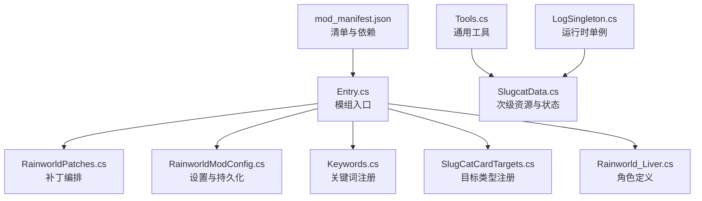
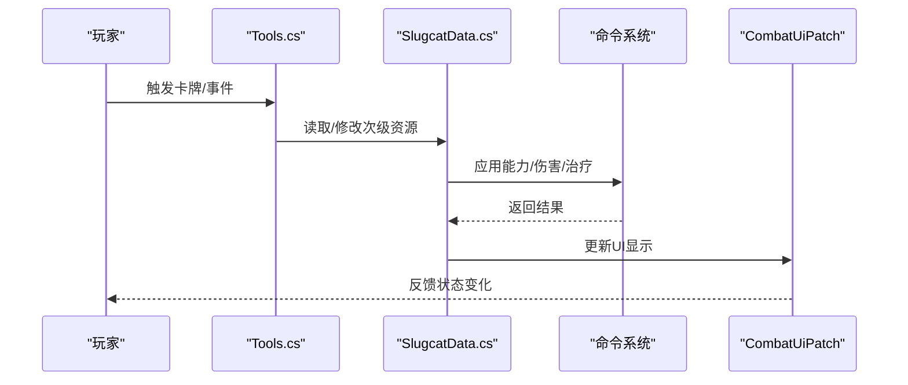
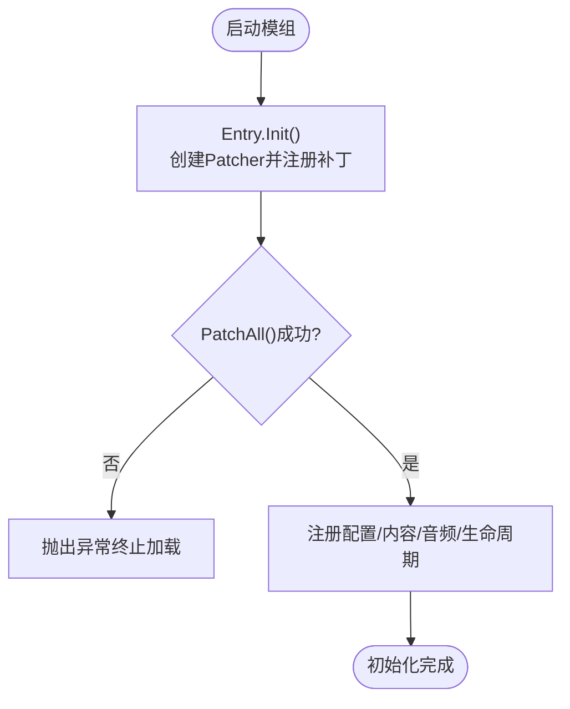
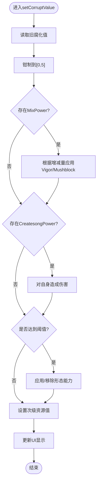
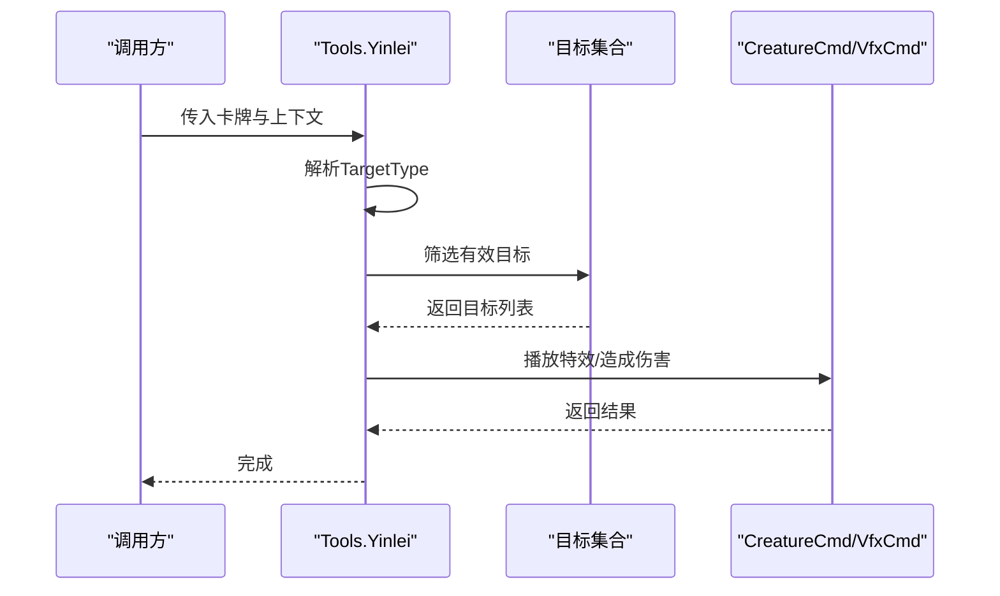
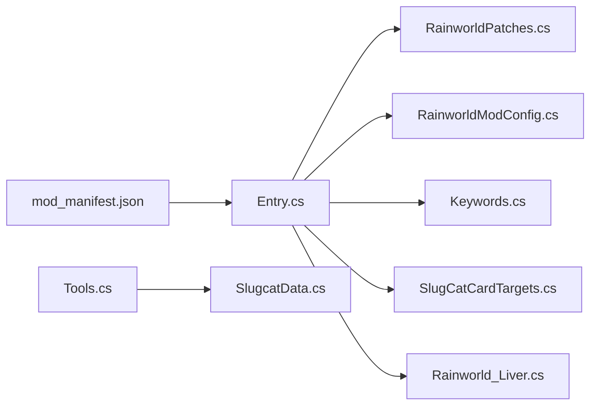

# 最佳实践

<cite>
**本文引用的文件**
- [Entry.cs](file://Scripts/Entry.cs)
- [RainworldModConfig.cs](file://Scripts/RainworldModConfig.cs)
- [Tools.cs](file://Scripts/Tools.cs)
- [Keywords.cs](file://Scripts/Keywords.cs)
- [mod_manifest.json](file://mod_manifest.json)
- [RainworldPatches.cs](file://Scripts/patches/RainworldPatches.cs)
- [SlugcatData.cs](file://Scripts/Slugcat/SlugcatData.cs)
- [LogSingleton.cs](file://Scripts/patches/Singleton/LogSingleton.cs)
- [SlugCatCardTargets.cs](file://Scripts/Card/SlugCatCardTargets.cs)
- [Rainworld_Liver.cs](file://Scripts/Slugcat/Rainworld_Liver.cs)
</cite>

## 目录
1. [简介](#简介)
2. [项目结构](#项目结构)
3. [核心组件](#核心组件)
4. [架构总览](#架构总览)
5. [详细组件分析](#详细组件分析)
6. [依赖关系分析](#依赖关系分析)
7. [性能与资源管理](#性能与资源管理)
8. [故障排查指南](#故障排查指南)
9. [结论](#结论)
10. [附录：代码规范与重构建议](#附录：代码规范与重构建议)

## 简介
本指南面向参与 SlugcatTheSpireII 模组开发的工程师与维护者，聚焦可维护性、性能优化、错误处理、日志与调试、团队协作与安全兼容等最佳实践。内容基于仓库现有实现提炼而成，强调以最小侵入的方式扩展游戏行为（通过 RitsuLib 的注册与补丁机制），并给出可视化流程图与时序图帮助理解关键路径。

## 项目结构
该模组采用“按功能域组织”的结构：
- 入口与初始化：Entry.cs 负责补丁注册、配置、内容发现、音频银行注册、生命周期钩子订阅等。
- 配置系统：RainworldModConfig.cs 提供用户可开关的功能项，并通过 RitsuLib 的 ModSettingsValueBinding 持久化。
- 工具与业务逻辑：Tools.cs 封装卡牌操作、目标选择、战斗事件等通用流程；SlugcatData.cs 管理角色次级资源（饱食度、业力、腐化值）与状态变更。
- 关键词与目标类型：Keywords.cs 集中定义自定义关键词；SlugCatCardTargets.cs 注册自定义目标类型。
- 补丁编排：RainworldPatches.cs 统一注册所有 Harmony 补丁。
- 角色与资源：Rainworld_Liver.cs 定义角色资产、起始牌组、初始遗物等。
- 单例与日志：LogSingleton.cs 作为运行时单例占位，便于后续扩展日志或全局状态。
- 清单与依赖：mod_manifest.json 声明模组元数据与依赖。

图表来源
- [Entry.cs:20-76](file://Scripts/Entry.cs#L20-L76)
- [RainworldPatches.cs:8-33](file://Scripts/patches/RainworldPatches.cs#L8-L33)
- [RainworldModConfig.cs:32-235](file://Scripts/RainworldModConfig.cs#L32-L235)
- [Keywords.cs:9-50](file://Scripts/Keywords.cs#L9-L50)
- [SlugCatCardTargets.cs:8-34](file://Scripts/Card/SlugCatCardTargets.cs#L8-L34)
- [Rainworld_Liver.cs:28-117](file://Scripts/Slugcat/Rainworld_Liver.cs#L28-L117)
- [mod_manifest.json:1-14](file://mod_manifest.json#L1-L14)

章节来源
- [Entry.cs:20-76](file://Scripts/Entry.cs#L20-L76)
- [mod_manifest.json:1-14](file://mod_manifest.json#L1-L14)

## 核心组件
- 模组入口与初始化（Entry.cs）
  - 使用 RitsuLib 创建 Patcher 并批量注册补丁，失败时抛出异常中断加载，确保核心补丁可用。
  - 注册模组配置、次级资源、Godot 脚本、自动内容发现、卡牌手牌边框规则、FMOD 音频银行与 GUID 映射。
  - 订阅生命周期观察者，用于跨阶段事件处理。
- 配置系统（RainworldModConfig.cs）
  - 通过 ModSettingsValueBinding 将布尔开关与 UI 绑定，支持全局持久化。
  - 使用本地化键为设置项提供可读标题与说明，提升用户体验。
- 工具与业务逻辑（Tools.cs）
  - 提供获取随机牌、污化卡牌、回手动作、雷击伤害计算等通用方法，封装复杂条件判断与命令调用。
- 关键词与目标类型（Keywords.cs, SlugCatCardTargets.cs）
  - 集中管理自定义关键词，避免散落各处导致不一致。
  - 注册自定义目标类型，使卡牌能精准选择目标（如“不可命中我”、“腐蚀敌人”、“蛞蝓猫盟友”）。
- 角色与资源（Rainworld_Liver.cs）
  - 定义角色属性、资产路径、起始牌组与遗物，整合 Godot 场景与音效。
- 运行时单例（LogSingleton.cs）
  - 作为 HookedSingletonModel 的基类示例，可用于挂载运行期全局状态或日志通道。

章节来源
- [Entry.cs:20-76](file://Scripts/Entry.cs#L20-L76)
- [RainworldModConfig.cs:32-235](file://Scripts/RainworldModConfig.cs#L32-L235)
- [Tools.cs:27-221](file://Scripts/Tools.cs#L27-L221)
- [Keywords.cs:9-50](file://Scripts/Keywords.cs#L9-L50)
- [SlugCatCardTargets.cs:8-34](file://Scripts/Card/SlugCatCardTargets.cs#L8-L34)
- [Rainworld_Liver.cs:28-117](file://Scripts/Slugcat/Rainworld_Liver.cs#L28-L117)
- [LogSingleton.cs:23-33](file://Scripts/patches/Singleton/LogSingleton.cs#L23-L33)

## 架构总览
模组遵循“入口初始化 + 内容注册 + 补丁编排 + 运行时交互”的分层模式：
- 初始化阶段：Entry.Init 完成补丁、配置、内容、音频、生命周期的注册。
- 运行时阶段：Tools 与 SlugcatData 在战斗与房间事件中驱动状态变化；RainworldPatches 协调对原版的修改点。
- 数据流：玩家动作触发 Tools/SlugcatData 的方法，调用命令（如 CreatureCmd、PowerCmd、CardCmd）改变游戏状态，并通过 UI Patch 更新界面。

图表来源
- [Tools.cs:54-221](file://Scripts/Tools.cs#L54-L221)
- [SlugcatData.cs:76-367](file://Scripts/Slugcat/SlugcatData.cs#L76-L367)

章节来源
- [Entry.cs:20-76](file://Scripts/Entry.cs#L20-L76)
- [Tools.cs:54-221](file://Scripts/Tools.cs#L54-L221)
- [SlugcatData.cs:76-367](file://Scripts/Slugcat/SlugcatData.cs#L76-L367)

## 详细组件分析

### 组件A：初始化与补丁编排（Entry.cs, RainworldPatches.cs）
- 职责
  - Entry.cs 负责创建 Patcher 并注册补丁集合，确保核心补丁成功加载。
  - RainworldPatches.cs 集中列出所有需要启用的补丁，便于管理与审计。
- 设计要点
  - 使用 RitsuLib 的 patcher.PatchAll() 进行批量打补丁，失败即抛异常，快速暴露问题。
  - 将内容注册（卡牌、遗物、能力）与补丁解耦，提高可测试性与可维护性。
- 风险与对策
  - 若补丁顺序不当可能导致状态不一致，建议在 RainworldPatches 中按依赖顺序注册。
  - 对关键补丁增加日志输出，便于定位失败原因。

图表来源
- [Entry.cs:26-76](file://Scripts/Entry.cs#L26-L76)
- [RainworldPatches.cs:8-33](file://Scripts/patches/RainworldPatches.cs#L8-L33)

章节来源
- [Entry.cs:26-76](file://Scripts/Entry.cs#L26-L76)
- [RainworldPatches.cs:8-33](file://Scripts/patches/RainworldPatches.cs#L8-L33)

### 组件B：次级资源与状态管理（SlugcatData.cs）
- 职责
  - 管理饱食度、业力、腐化值等次级资源，提供安全增减与边界检查。
  - 在特定条件下触发重生、治疗、能力应用与 UI 更新。
- 算法要点
  - addfood：限制最大值，溢出时根据能力转化为增益。
  - setCorruptValue：限制范围，联动能力（如 Twistform、Mix、Createsong），并在阈值处切换形态。
  - reLive：依据能力与遗物决定重生或扣血，并执行工作回报。
- 复杂度
  - 大多数操作为 O(1) 或 O(n) 遍历少量集合（如牌堆、能力列表），整体开销可控。
- 错误处理
  - 多处使用 try/catch 包裹初始化逻辑，防止异常传播影响主流程。
  - 对非法输入（负值、越界）进行钳制，保证状态一致性。

图表来源
- [SlugcatData.cs:239-313](file://Scripts/Slugcat/SlugcatData.cs#L239-L313)

章节来源
- [SlugcatData.cs:76-367](file://Scripts/Slugcat/SlugcatData.cs#L76-L367)

### 组件C：工具方法与卡牌流程（Tools.cs）
- 职责
  - 提供 getrandomSpear、CorruptCard、BackToHand、Yinlei 等常用流程，减少重复代码。
- 设计要点
  - 使用 CardCmd、CreatureCmd、PowerCmd 等命令式 API，保持副作用集中且可追踪。
  - 针对多目标场景（如 AllEnemies、Self）进行分支处理，确保空目标集时的安全返回。
- 性能考虑
  - 对集合操作使用 LINQ 过滤与 Any/Count，注意在高频路径中避免不必要的分配。
  - 异步方法（async Task）配合 await，避免阻塞主线程。

图表来源
- [Tools.cs:157-221](file://Scripts/Tools.cs#L157-L221)

章节来源
- [Tools.cs:27-221](file://Scripts/Tools.cs#L27-L221)

### 组件D：关键词与目标类型（Keywords.cs, SlugCatCardTargets.cs）
- 职责
  - Keywords.cs 集中注册自定义关键词，并提供静态访问器。
  - SlugCatCardTargets.cs 注册自定义目标类型，供卡牌选择器使用。
- 设计要点
  - 使用 ModContentRegistry 获取限定化的关键词 ID，避免硬编码字符串。
  - 目标类型注册使用 CustomTargetType.RegisterSingleTargetType，确保类型安全与可复用。
- 可维护性
  - 新增关键词或目标类型时，只需在对应文件中添加一行注册，降低耦合。

章节来源
- [Keywords.cs:9-50](file://Scripts/Keywords.cs#L9-L50)
- [SlugCatCardTargets.cs:8-34](file://Scripts/Card/SlugCatCardTargets.cs#L8-L34)

### 组件E：角色定义（Rainworld_Liver.cs）
- 职责
  - 定义角色属性、资产路径、起始牌组与遗物，整合 Godot 场景与音效。
- 设计要点
  - 使用 CharacterAssetProfiles.Merge 合并默认与自定义资产，便于扩展。
  - 通过 Scenes、Ui、Audio、Multiplayer 等配置块，清晰分离不同维度的资源。
- 兼容性
  - 对原版遗物的视觉覆盖使用 VanillaRelicVisualOverrides，避免破坏原版行为。

章节来源
- [Rainworld_Liver.cs:28-117](file://Scripts/Slugcat/Rainworld_Liver.cs#L28-L117)

## 依赖关系分析
- 外部依赖
  - mod_manifest.json 声明依赖 STS2-RitsuLib，确保运行时具备所需框架能力。
- 内部依赖
  - Entry.cs 依赖 RainworldPatches、RainworldModConfig、Keywords、SlugCatCardTargets 等模块。
  - Tools.cs 与 SlugcatData.cs 通过命令系统与游戏核心交互，形成松耦合。
- 潜在循环
  - 当前结构未见明显循环依赖；如需新增跨模块引用，建议使用接口或事件总线降低耦合。

图表来源
- [mod_manifest.json:1-14](file://mod_manifest.json#L1-L14)
- [Entry.cs:20-76](file://Scripts/Entry.cs#L20-L76)
- [RainworldPatches.cs:8-33](file://Scripts/patches/RainworldPatches.cs#L8-L33)
- [RainworldModConfig.cs:32-235](file://Scripts/RainworldModConfig.cs#L32-L235)
- [Keywords.cs:9-50](file://Scripts/Keywords.cs#L9-L50)
- [SlugCatCardTargets.cs:8-34](file://Scripts/Card/SlugCatCardTargets.cs#L8-L34)
- [Rainworld_Liver.cs:28-117](file://Scripts/Slugcat/Rainworld_Liver.cs#L28-L117)
- [Tools.cs:27-221](file://Scripts/Tools.cs#L27-L221)
- [SlugcatData.cs:76-367](file://Scripts/Slugcat/SlugcatData.cs#L76-L367)

章节来源
- [mod_manifest.json:1-14](file://mod_manifest.json#L1-L14)
- [Entry.cs:20-76](file://Scripts/Entry.cs#L20-L76)

## 性能与资源管理
- 初始化性能
  - 使用 RitsuLib 的内容发现与注册机制，避免手动扫描带来的开销。
  - 音频银行延迟注册（FmodStudioDeferredBankRegistration），减少启动时 I/O 压力。
- 运行时性能
  - 工具方法中使用异步命令（await），避免阻塞主线程。
  - 对集合操作尽量使用一次性过滤与 Any/Count，减少中间分配。
- 内存管理
  - 避免在高频路径中创建大量临时对象；必要时复用集合或对象池。
  - 次级资源修改后及时同步 UI，减少重复渲染。
- 资源使用最佳实践
  - 通过 CharacterAssetProfiles 合并资产，避免重复加载。
  - 使用 PreloadManager.Cache 获取纹理，减少重复加载。

章节来源
- [Entry.cs:42-71](file://Scripts/Entry.cs#L42-L71)
- [Tools.cs:27-221](file://Scripts/Tools.cs#L27-L221)
- [Rainworld_Liver.cs:41-79](file://Scripts/Slugcat/Rainworld_Liver.cs#L41-L79)

## 故障排查指南
- 常见问题
  - 补丁失败：Entry.Init 中 PatchAll 失败会抛出异常，检查 RainworldPatches 中注册的补丁是否正确。
  - 配置未生效：确认 RainworldModConfig 中的 Binding 与 UI 注册是否匹配，检查本地化键是否存在。
  - 次级资源异常：检查 SlugcatData 中的边界钳制逻辑，确保不会越界或负值。
- 日志与调试
  - 使用 LogSingleton 作为扩展点，接入更详细的日志输出。
  - 在关键路径（如 setCorruptValue、addfood）添加调试日志，记录输入与输出。
- 兼容性处理
  - 通过 mod_manifest.json 声明最低游戏版本，避免不兼容环境。
  - 对原版行为修改集中在补丁中，便于回滚与测试。

章节来源
- [Entry.cs:30-35](file://Scripts/Entry.cs#L30-L35)
- [RainworldModConfig.cs:163-235](file://Scripts/RainworldModConfig.cs#L163-L235)
- [SlugcatData.cs:239-313](file://Scripts/Slugcat/SlugcatData.cs#L239-L313)
- [LogSingleton.cs:23-33](file://Scripts/patches/Singleton/LogSingleton.cs#L23-L33)
- [mod_manifest.json:1-14](file://mod_manifest.json#L1-L14)

## 结论
本模组通过 RitsuLib 的注册与补丁机制，实现了低侵入、高内聚的扩展方式。Entry 作为统一入口，结合 RainworldPatches 的集中管理，确保了可维护性与可扩展性。Tools 与 SlugcatData 封装了复杂业务逻辑，提升了代码复用率。未来可在 LogSingleton 中完善日志体系，进一步提升可观测性。

## 附录：代码规范与重构建议
- 代码规范
  - 统一使用 RitsuLib 的注册与命令式 API，避免直接操作游戏内部状态。
  - 关键词与目标类型集中管理，禁止散落硬编码字符串。
  - 异步方法使用 async/await，避免阻塞主线程。
- 设计模式
  - 工厂模式：使用 CardFactory、CreatureFactory 等创建对象。
  - 策略模式：针对不同 TargetType 的策略分支，便于扩展新目标类型。
  - 观察者模式：通过生命周期观察者订阅事件，解耦事件源与处理器。
- 重构建议
  - 将 Tools 中的长方法拆分为更小单元，提升可读性与可测试性。
  - 对复杂条件判断引入枚举或策略表，降低分支复杂度。
  - 增加单元测试覆盖关键路径（如 setCorruptValue、getrandomSpear）。
- 团队协作
  - 使用 Git 分支管理功能开发，提交前进行构建验证。
  - 在 PR 中附带变更说明与测试用例，确保质量。
- 常见陷阱
  - 忽略边界检查导致越界或负值。
  - 在高频路径中创建大量临时对象导致 GC 压力。
  - 未正确处理异步回调导致状态不一致。
- 安全考虑
  - 对用户输入（如配置项）进行校验，防止恶意值。
  - 对网络或文件系统访问进行权限控制与异常处理。
- 兼容性处理
  - 通过 mod_manifest.json 声明依赖与最低版本。
  - 对原版行为修改集中在补丁中，便于回滚与测试。