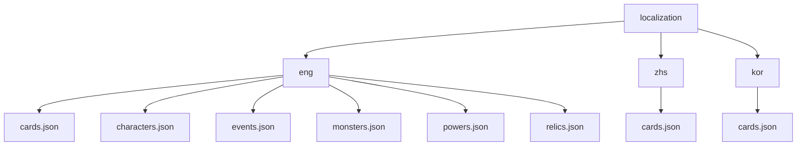
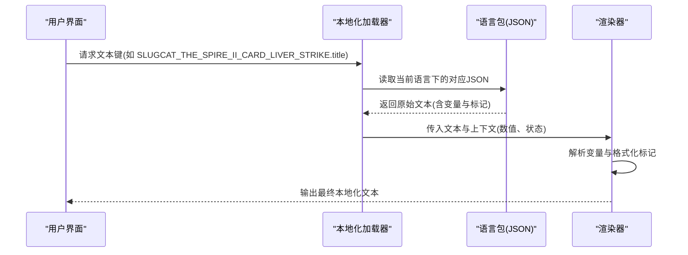
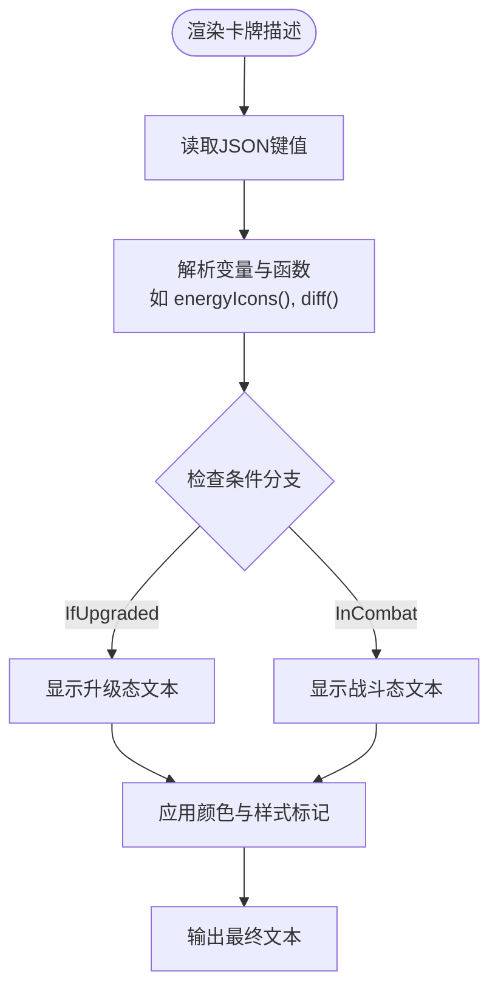
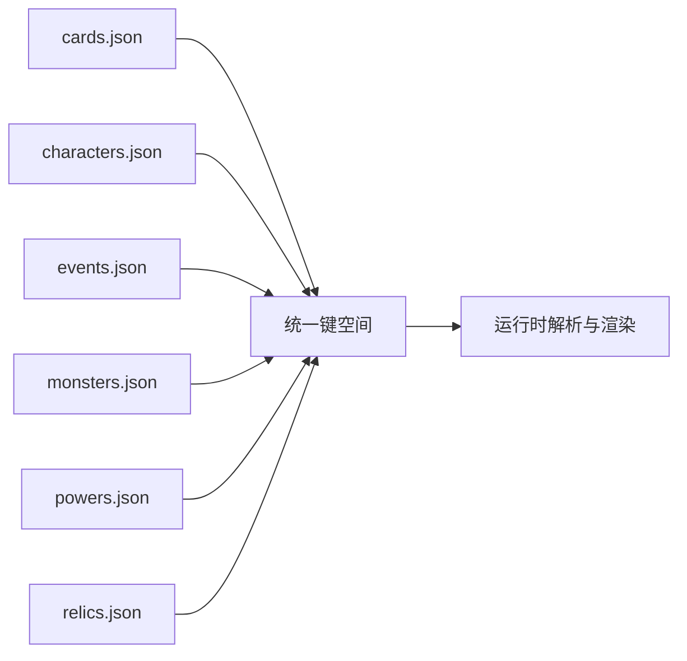

# 本地化支持

<cite>
**本文引用的文件**
- [SlugcatTheSpireII/localization/eng/cards.json](file://SlugcatTheSpireII/localization/eng/cards.json)
- [SlugcatTheSpireII/localization/zhs/cards.json](file://SlugcatTheSpireII/localization/zhs/cards.json)
- [SlugcatTheSpireII/localization/kor/cards.json](file://SlugcatTheSpireII/localization/kor/cards.json)
- [SlugcatTheSpireII/localization/eng/characters.json](file://SlugcatTheSpireII/localization/eng/characters.json)
- [SlugcatTheSpireII/localization/eng/events.json](file://SlugcatTheSpireII/localization/eng/events.json)
- [SlugcatTheSpireII/localization/eng/monsters.json](file://SlugcatTheSpireII/localization/eng/monsters.json)
- [SlugcatTheSpireII/localization/eng/powers.json](file://SlugcatTheSpireII/localization/eng/powers.json)
- [SlugcatTheSpireII/localization/eng/relics.json](file://SlugcatTheSpireII/localization/eng/relics.json)
</cite>

## 目录
1. [简介](#简介)
2. [项目结构](#项目结构)
3. [核心组件](#核心组件)
4. [架构总览](#架构总览)
5. [详细组件分析](#详细组件分析)
6. [依赖关系分析](#依赖关系分析)
7. [性能考虑](#性能考虑)
8. [故障排查指南](#故障排查指南)
9. [结论](#结论)
10. [附录](#附录)

## 简介
本文件为“本地化支持系统”的实现文档，聚焦多语言文本管理机制、动态文本加载与本地化文件格式。项目已实现三种语言的本地化：中文（zhs）、英文（eng）、韩文（kor），覆盖卡牌、角色、怪物、事件、能力、遗物等分类。文本采用 JSON 键值对组织，键名遵循统一命名规范，便于按模块与实体维度进行检索与维护。文本内容支持变量插值与格式化标记，用于在运行时根据游戏状态动态渲染数值、图标与条件分支。

## 项目结构
本地化资源位于 SlugcatTheSpireII/localization 目录下，按语言子目录组织，每个语言下包含多个 JSON 文件，分别对应不同内容分类：
- cards.json：卡牌标题与描述
- characters.json：角色信息、称谓、代词、台词片段
- events.json：事件页面、选项、结果文案
- monsters.json：怪物名称与招式名称
- powers.json：能力说明、智能提示、标题
- relics.json：遗物标题、描述、风味文本
- ancients.json、encounters.json、potions.json、card_keywords.json、rest_site_ui.json、settings_ui.json、static_hover_tips.json：其他界面与词条文本

**图表来源**
- [SlugcatTheSpireII/localization/eng/cards.json:1-676](file://SlugcatTheSpireII/localization/eng/cards.json#L1-L676)
- [SlugcatTheSpireII/localization/zhs/cards.json:1-789](file://SlugcatTheSpireII/localization/zhs/cards.json#L1-L789)
- [SlugcatTheSpireII/localization/kor/cards.json:1-669](file://SlugcatTheSpireII/localization/kor/cards.json#L1-L669)
- [SlugcatTheSpireII/localization/eng/characters.json:1-49](file://SlugcatTheSpireII/localization/eng/characters.json#L1-L49)
- [SlugcatTheSpireII/localization/eng/events.json:1-31](file://SlugcatTheSpireII/localization/eng/events.json#L1-L31)
- [SlugcatTheSpireII/localization/eng/monsters.json:1-49](file://SlugcatTheSpireII/localization/eng/monsters.json#L1-L49)
- [SlugcatTheSpireII/localization/eng/powers.json:1-336](file://SlugcatTheSpireII/localization/eng/powers.json#L1-L336)
- [SlugcatTheSpireII/localization/eng/relics.json:1-93](file://SlugcatTheSpireII/localization/eng/relics.json#L1-L93)

**章节来源**
- [SlugcatTheSpireII/localization/eng/cards.json:1-676](file://SlugcatTheSpireII/localization/eng/cards.json#L1-L676)
- [SlugcatTheSpireII/localization/zhs/cards.json:1-789](file://SlugcatTheSpireII/localization/zhs/cards.json#L1-L789)
- [SlugcatTheSpireII/localization/kor/cards.json:1-669](file://SlugcatTheSpireII/localization/kor/cards.json#L1-L669)
- [SlugcatTheSpireII/localization/eng/characters.json:1-49](file://SlugcatTheSpireII/localization/eng/characters.json#L1-L49)
- [SlugcatTheSpireII/localization/eng/events.json:1-31](file://SlugcatTheSpireII/localization/eng/events.json#L1-L31)
- [SlugcatTheSpireII/localization/eng/monsters.json:1-49](file://SlugcatTheSpireII/localization/eng/monsters.json#L1-L49)
- [SlugcatTheSpireII/localization/eng/powers.json:1-336](file://SlugcatTheSpireII/localization/eng/powers.json#L1-L336)
- [SlugcatTheSpireII/localization/eng/relics.json:1-93](file://SlugcatTheSpireII/localization/eng/relics.json#L1-L93)

## 核心组件
- 多语言键空间：所有文本通过唯一键引用，键名体现模块与实体标识，例如卡牌键以 SLUGCAT_THE_SPIRE_II_CARD_RAINWORLD_* 开头，能力键以 SLUGCAT_THE_SPIRE_II_POWER_* 开头，事件键以 SLUGCAT_THE_SPIRE_II_EVENT_* 开头。
- 文本分类：
  - 卡牌：title、description、selectionScreenPrompt、speech
  - 角色：title、titleObject、description、pronounSubject/Object/Possessive、possessiveAdjective、banter.*、goldMonologue、unlockText、cardsModifierTitle/Description、eventDeathPrevention、aromaPrinciple
  - 事件：title、loss、pages.INITIAL/FINISH/FIGHT.description/options.*.title/description
  - 怪物：name、moves.*.title
  - 能力：title、description、smartDescription、selectionScreenPrompt
  - 遗物：title、description、flavor
- 变量与格式化：
  - 数值占位符：{Damage:diff()}、{Block:diff()}、{Cards:diff()}、{Gold:diff()}、{Energy:energyIcons()}、{CalculatedDamage:diff()}、{CalculatedBlock:diff()}、{Special:diff()}、{Amount:diff()}、{Increase:diff()}、{Corrode:diff()}、{Summon:diff()}、{Mushblock:diff()}、{VigorPower:diff()}、{WeakPower:diff()}、{Chuang:diff()}、{Nimble:diff()}、{Hunt:diff()}、{StrengthLoss:diff()}、{Blur:diff()}、{HpLoss}、{Food:diff()}、{Energy:energyIcons()}、{Cards:diff()}、{Amount:diff()}、{Special:diff()}、{Corrode:diff()}、{Summon:diff()}、{Mushblock:diff()}、{VigorPower:diff()}、{WeakPower:diff()}、{Chuang:diff()}、{Nimble:diff()}、{Hunt:diff()}、{StrengthLoss:diff()}、{Blur:diff()}、{HpLoss}、{Food:diff()}
  - 条件分支：{IfUpgraded:show:...}、{InCombat:...|...}
  - 颜色与样式标记：[gold]、[blue]、[red]、[purple]、[green]、[sine]、[jitter]
  - 特殊函数：energyIcons()、diff()、show(...)

这些机制允许同一份模板在不同上下文（如升级态、战斗内/外）中显示不同的数值或文本片段，从而实现高度可配置的本地化体验。

**章节来源**
- [SlugcatTheSpireII/localization/eng/cards.json:1-676](file://SlugcatTheSpireII/localization/eng/cards.json#L1-L676)
- [SlugcatTheSpireII/localization/zhs/cards.json:1-789](file://SlugcatTheSpireII/localization/zhs/cards.json#L1-L789)
- [SlugcatTheSpireII/localization/kor/cards.json:1-669](file://SlugcatTheSpireII/localization/kor/cards.json#L1-L669)
- [SlugcatTheSpireII/localization/eng/characters.json:1-49](file://SlugcatTheSpireII/localization/eng/characters.json#L1-L49)
- [SlugcatTheSpireII/localization/eng/events.json:1-31](file://SlugcatTheSpireII/localization/eng/events.json#L1-L31)
- [SlugcatTheSpireII/localization/eng/monsters.json:1-49](file://SlugcatTheSpireII/localization/eng/monsters.json#L1-L49)
- [SlugcatTheSpireII/localization/eng/powers.json:1-336](file://SlugcatTheSpireII/localization/eng/powers.json#L1-L336)
- [SlugcatTheSpireII/localization/eng/relics.json:1-93](file://SlugcatTheSpireII/localization/eng/relics.json#L1-L93)

## 架构总览
本地化数据以 JSON 形式存储于各语言目录，运行时由引擎或模组加载当前语言包，并通过键查找对应文本。文本中的变量与格式化标记会在渲染阶段被解析，结合游戏状态生成最终显示字符串。

**图表来源**
- [SlugcatTheSpireII/localization/eng/cards.json:1-676](file://SlugcatTheSpireII/localization/eng/cards.json#L1-L676)
- [SlugcatTheSpireII/localization/zhs/cards.json:1-789](file://SlugcatTheSpireII/localization/zhs/cards.json#L1-L789)
- [SlugcatTheSpireII/localization/kor/cards.json:1-669](file://SlugcatTheSpireII/localization/kor/cards.json#L1-L669)

## 详细组件分析

### 卡牌本地化（cards.json）
- 键命名：SLUGCAT_THE_SPIRE_II_CARD_RAINWORLD_*，区分角色与卡牌类型（如 LIVER、REDCAT、RIVER、FUTURE、MONK）。
- 字段：
  - title：卡牌标题
  - description：卡牌描述，包含大量变量与格式化标记
  - selectionScreenPrompt：选择提示语
  - speech：语音或对话片段（部分卡牌）
- 变量示例：
  - {Damage:diff()}、{Block:diff()}、{Cards:diff()}、{Gold:diff()}、{Energy:energyIcons()}、{CalculatedDamage:diff()}、{CalculatedBlock:diff()}、{Special:diff()}、{Amount:diff()}、{Increase:diff()}、{Corrode:diff()}、{Summon:diff()}、{Mushblock:diff()}、{VigorPower:diff()}、{WeakPower:diff()}、{Chuang:diff()}、{Nimble:diff()}、{Hunt:diff()}、{StrengthLoss:diff()}、{Blur:diff()}、{HpLoss}、{Food:diff()}
- 条件与分支：
  - {IfUpgraded:show:...}：根据是否升级显示不同文本
  - {InCombat:...|...}：根据是否在战斗中切换文本片段
- 颜色与样式：
  - [gold]、[blue]、[red]、[purple]、[green]、[sine]、[jitter]

**图表来源**
- [SlugcatTheSpireII/localization/eng/cards.json:1-676](file://SlugcatTheSpireII/localization/eng/cards.json#L1-L676)
- [SlugcatTheSpireII/localization/zhs/cards.json:1-789](file://SlugcatTheSpireII/localization/zhs/cards.json#L1-L789)
- [SlugcatTheSpireII/localization/kor/cards.json:1-669](file://SlugcatTheSpireII/localization/kor/cards.json#L1-L669)

**章节来源**
- [SlugcatTheSpireII/localization/eng/cards.json:1-676](file://SlugcatTheSpireII/localization/eng/cards.json#L1-L676)
- [SlugcatTheSpireII/localization/zhs/cards.json:1-789](file://SlugcatTheSpireII/localization/zhs/cards.json#L1-L789)
- [SlugcatTheSpireII/localization/kor/cards.json:1-669](file://SlugcatTheSpireII/localization/kor/cards.json#L1-L669)

### 角色本地化（characters.json）
- 字段：
  - title/titleObject：角色名与对象名
  - description：角色背景描述
  - pronounSubject/Object/Possessive、possessiveAdjective：代词与所有格
  - banter.alive.dead.endTurnPing：回合结束时的闲聊片段
  - goldMonologue：金币相关独白
  - unlockText：解锁提示
  - cardsModifierTitle/Description：卡牌池修饰说明
  - eventDeathPrevention：事件死亡预防提示
  - aromaPrinciple：气味/氛围提示
- 示例键：SLUGCAT_THE_SPIRE_II_CHARACTER_RAINWORLD_LIVER.*、REDCAT.*、RIVER.*

**章节来源**
- [SlugcatTheSpireII/localization/eng/characters.json:1-49](file://SlugcatTheSpireII/localization/eng/characters.json#L1-L49)

### 事件本地化（events.json）
- 字段：
  - title：事件标题
  - loss：失败结果文案
  - pages.INITIAL/FINISH/FIGHT.description/options.*.title/description：事件流程页与选项
- 示例键：SLUGCAT_THE_SPIRE_II_EVENT_RAINDEER_EVENT.*、EVENT_WATCHER_EVENT.*

**章节来源**
- [SlugcatTheSpireII/localization/eng/events.json:1-31](file://SlugcatTheSpireII/localization/eng/events.json#L1-L31)

### 怪物本地化（monsters.json）
- 字段：
  - name：怪物名称
  - moves.*.title：招式名称（如 BASIC_ATTACK、HEAVY_ATTACK、SLEEP、RUN、BLOCK、UPGRADE、DEBUFF、DAZED、GET、WATCH、THINK）
- 示例键：SLUGCAT_THE_SPIRE_II_MONSTER_MUSHROOM.*、IRONBIRD.*、FIRECAB.*、GREENCAB.*、WATERCENT.*、THREECHICKEN.*

**章节来源**
- [SlugcatTheSpireII/localization/eng/monsters.json:1-49](file://SlugcatTheSpireII/localization/eng/monsters.json#L1-L49)

### 能力本地化（powers.json）
- 字段：
  - title：能力标题
  - description：基础描述
  - smartDescription：智能提示（带数值占位符）
  - selectionScreenPrompt：选择提示
- 示例键：SLUGCAT_THE_SPIRE_II_POWER_*

**章节来源**
- [SlugcatTheSpireII/localization/eng/powers.json:1-336](file://SlugcatTheSpireII/localization/eng/powers.json#L1-L336)

### 遗物本地化（relics.json）
- 字段：
  - title：遗物标题
  - description：效果描述
  - flavor：风味文本
- 示例键：SLUGCAT_THE_SPIRE_II_RELIC_*、SEA_GLASS.SLUGCAT_THE_SPIRE_II_CHARACTER_*

**章节来源**
- [SlugcatTheSpireII/localization/eng/relics.json:1-93](file://SlugcatTheSpireII/localization/eng/relics.json#L1-L93)

## 依赖关系分析
- 键空间一致性：所有语言共享相同的键空间，确保跨语言替换时不会丢失映射。
- 模块化组织：按内容分类拆分 JSON，降低维护成本并提高可读性。
- 变量与格式化耦合：文本与渲染逻辑通过变量与标记解耦，便于扩展新变量与新格式。
- 潜在循环依赖：无代码级循环依赖；纯数据驱动，风险较低。
- 外部依赖：引擎或模组需在启动时加载当前语言包并在渲染时解析变量。

**图表来源**
- [SlugcatTheSpireII/localization/eng/cards.json:1-676](file://SlugcatTheSpireII/localization/eng/cards.json#L1-L676)
- [SlugcatTheSpireII/localization/eng/characters.json:1-49](file://SlugcatTheSpireII/localization/eng/characters.json#L1-L49)
- [SlugcatTheSpireII/localization/eng/events.json:1-31](file://SlugcatTheSpireII/localization/eng/events.json#L1-L31)
- [SlugcatTheSpireII/localization/eng/monsters.json:1-49](file://SlugcatTheSpireII/localization/eng/monsters.json#L1-L49)
- [SlugcatTheSpireII/localization/eng/powers.json:1-336](file://SlugcatTheSpireII/localization/eng/powers.json#L1-L336)
- [SlugcatTheSpireII/localization/eng/relics.json:1-93](file://SlugcatTheSpireII/localization/eng/relics.json#L1-L93)

**章节来源**
- [SlugcatTheSpireII/localization/eng/cards.json:1-676](file://SlugcatTheSpireII/localization/eng/cards.json#L1-L676)
- [SlugcatTheSpireII/localization/eng/characters.json:1-49](file://SlugcatTheSpireII/localization/eng/characters.json#L1-L49)
- [SlugcatTheSpireII/localization/eng/events.json:1-31](file://SlugcatTheSpireII/localization/eng/events.json#L1-L31)
- [SlugcatTheSpireII/localization/eng/monsters.json:1-49](file://SlugcatTheSpireII/localization/eng/monsters.json#L1-L49)
- [SlugcatTheSpireII/localization/eng/powers.json:1-336](file://SlugcatTheSpireII/localization/eng/powers.json#L1-L336)
- [SlugcatTheSpireII/localization/eng/relics.json:1-93](file://SlugcatTheSpireII/localization/eng/relics.json#L1-L93)

## 性能考虑
- JSON 体积：卡牌文本量较大，建议按需加载与缓存常用键值，减少重复解析开销。
- 变量解析：复杂表达式（如嵌套条件、函数调用）应在渲染前预计算或缓存结果，避免每帧重复计算。
- 颜色与样式：标记解析应轻量，避免频繁字符串拼接；可使用模板引擎或预编译方案提升性能。
- 内存占用：多语言同时驻留会增大内存，建议仅加载当前语言包，并在切换语言时释放旧包。

## 故障排查指南
- 缺失键：若运行时找不到对应键，检查 JSON 中是否存在该键且拼写正确。
- 变量未解析：确认变量名与函数名是否与渲染器一致，检查大小写与括号匹配。
- 条件分支异常：验证 IfUpgraded 与 InCombat 的语法是否正确，确保分隔符与管道符使用无误。
- 颜色标记乱码：确认颜色标签闭合完整，避免遗漏闭合标签导致渲染异常。
- 多语言不一致：对比 eng 与 zhs/kor 的键集合，确保新增键在所有语言中均有对应条目。

**章节来源**
- [SlugcatTheSpireII/localization/eng/cards.json:1-676](file://SlugcatTheSpireII/localization/eng/cards.json#L1-L676)
- [SlugcatTheSpireII/localization/zhs/cards.json:1-789](file://SlugcatTheSpireII/localization/zhs/cards.json#L1-L789)
- [SlugcatTheSpireII/localization/kor/cards.json:1-669](file://SlugcatTheSpireII/localization/kor/cards.json#L1-L669)

## 结论
本项目实现了完善的多语言本地化体系，通过统一的键空间、清晰的模块化 JSON 结构与强大的变量/格式化机制，支持卡牌、角色、事件、怪物、能力、遗物等多类内容的多语言展示。建议在后续开发中持续保持键空间一致性，优化变量解析性能，并建立翻译工作流与质量检查流程，以确保多语言文本的质量与可维护性。

## 附录

### 支持的语种与文本分类
- 语种：中文（zhs）、英文（eng）、韩文（kor）
- 文本分类：卡牌、角色、事件、怪物、能力、遗物、设置与静态提示等

**章节来源**
- [SlugcatTheSpireII/localization/eng/cards.json:1-676](file://SlugcatTheSpireII/localization/eng/cards.json#L1-L676)
- [SlugcatTheSpireII/localization/zhs/cards.json:1-789](file://SlugcatTheSpireII/localization/zhs/cards.json#L1-L789)
- [SlugcatTheSpireII/localization/kor/cards.json:1-669](file://SlugcatTheSpireII/localization/kor/cards.json#L1-L669)
- [SlugcatTheSpireII/localization/eng/characters.json:1-49](file://SlugcatTheSpireII/localization/eng/characters.json#L1-L49)
- [SlugcatTheSpireII/localization/eng/events.json:1-31](file://SlugcatTheSpireII/localization/eng/events.json#L1-L31)
- [SlugcatTheSpireII/localization/eng/monsters.json:1-49](file://SlugcatTheSpireII/localization/eng/monsters.json#L1-L49)
- [SlugcatTheSpireII/localization/eng/powers.json:1-336](file://SlugcatTheSpireII/localization/eng/powers.json#L1-L336)
- [SlugcatTheSpireII/localization/eng/relics.json:1-93](file://SlugcatTheSpireII/localization/eng/relics.json#L1-L93)

### 文本替换规则、变量插值与格式化选项
- 变量插值：
  - 数值与计数：{Damage:diff()}、{Block:diff()}、{Cards:diff()}、{Gold:diff()}、{Amount:diff()}、{Increase:diff()}、{Special:diff()}、{Corrode:diff()}、{Summon:diff()}、{Mushblock:diff()}、{VigorPower:diff()}、{WeakPower:diff()}、{Chuang:diff()}、{Nimble:diff()}、{Hunt:diff()}、{StrengthLoss:diff()}、{Blur:diff()}、{HpLoss}、{Food:diff()}
  - 能量图标：{Energy:energyIcons()}
  - 计算值：{CalculatedDamage:diff()}、{CalculatedBlock:diff()}
- 条件分支：
  - {IfUpgraded:show:...}：根据升级状态显示不同文本
  - {InCombat:...|...}：根据战斗内外切换文本片段
- 颜色与样式：
  - [gold]、[blue]、[red]、[purple]、[green]、[sine]、[jitter]

**章节来源**
- [SlugcatTheSpireII/localization/eng/cards.json:1-676](file://SlugcatTheSpireII/localization/eng/cards.json#L1-L676)
- [SlugcatTheSpireII/localization/zhs/cards.json:1-789](file://SlugcatTheSpireII/localization/zhs/cards.json#L1-L789)
- [SlugcatTheSpireII/localization/kor/cards.json:1-669](file://SlugcatTheSpireII/localization/kor/cards.json#L1-L669)
- [SlugcatTheSpireII/localization/eng/powers.json:1-336](file://SlugcatTheSpireII/localization/eng/powers.json#L1-L336)

### 添加新语言支持与翻译工作流程
- 步骤：
  - 复制现有语言目录（如 eng）为新语言目录（如 fra）
  - 逐文件翻译 JSON 值，保持键不变
  - 新增键时需同步添加到所有语言文件
  - 运行测试用例验证键存在性与渲染正确性
- 建议：
  - 使用翻译管理工具进行协作与版本控制
  - 建立术语表，确保关键概念翻译一致
  - 定期执行一致性检查脚本，检测缺失键与不一致项

**章节来源**
- [SlugcatTheSpireII/localization/eng/cards.json:1-676](file://SlugcatTheSpireII/localization/eng/cards.json#L1-L676)
- [SlugcatTheSpireII/localization/zhs/cards.json:1-789](file://SlugcatTheSpireII/localization/zhs/cards.json#L1-L789)
- [SlugcatTheSpireII/localization/kor/cards.json:1-669](file://SlugcatTheSpireII/localization/kor/cards.json#L1-L669)

### 质量检查与测试方法
- 键完整性检查：对比各语言 JSON 的键集合，确保无缺失
- 变量语法检查：校验变量与函数名、括号与分隔符
- 条件分支检查：验证 IfUpgraded 与 InCombat 的语法与逻辑
- 颜色标记检查：确保颜色标签闭合完整
- 运行时测试：在不同语言下运行关键场景，验证文本渲染正确性

**章节来源**
- [SlugcatTheSpireII/localization/eng/cards.json:1-676](file://SlugcatTheSpireII/localization/eng/cards.json#L1-L676)
- [SlugcatTheSpireII/localization/zhs/cards.json:1-789](file://SlugcatTheSpireII/localization/zhs/cards.json#L1-L789)
- [SlugcatTheSpireII/localization/kor/cards.json:1-669](file://SlugcatTheSpireII/localization/kor/cards.json#L1-L669)

### 本地化最佳实践与文化适配建议
- 最佳实践：
  - 保持键空间稳定，避免重命名或删除已有键
  - 将可变内容抽象为变量，减少硬编码
  - 使用条件分支处理差异化文本，避免冗余
- 文化适配：
  - 注意语气与措辞符合目标语言习惯
  - 避免直译导致的歧义或不自然表达
  - 针对特定文化调整示例与比喻

### 配置文件示例与集成代码
- 配置示例：
  - 语言包路径：SlugcatTheSpireII/localization/{lang}/
  - 文件命名：cards.json、characters.json、events.json、monsters.json、powers.json、relics.json
- 集成要点：
  - 启动时加载当前语言包
  - 渲染时根据键查找文本并解析变量
  - 切换语言时重新加载对应语言包

**章节来源**
- [SlugcatTheSpireII/localization/eng/cards.json:1-676](file://SlugcatTheSpireII/localization/eng/cards.json#L1-L676)
- [SlugcatTheSpireII/localization/zhs/cards.json:1-789](file://SlugcatTheSpireII/localization/zhs/cards.json#L1-L789)
- [SlugcatTheSpireII/localization/kor/cards.json:1-669](file://SlugcatTheSpireII/localization/kor/cards.json#L1-L669)
- [SlugcatTheSpireII/localization/eng/characters.json:1-49](file://SlugcatTheSpireII/localization/eng/characters.json#L1-L49)
- [SlugcatTheSpireII/localization/eng/events.json:1-31](file://SlugcatTheSpireII/localization/eng/events.json#L1-L31)
- [SlugcatTheSpireII/localization/eng/monsters.json:1-49](file://SlugcatTheSpireII/localization/eng/monsters.json#L1-L49)
- [SlugcatTheSpireII/localization/eng/powers.json:1-336](file://SlugcatTheSpireII/localization/eng/powers.json#L1-L336)
- [SlugcatTheSpireII/localization/eng/relics.json:1-93](file://SlugcatTheSpireII/localization/eng/relics.json#L1-L93)