# 核心架构

<cite>
**本文引用的文件**
- [Entry.cs](file://Scripts/Entry.cs)
- [RainworldModConfig.cs](file://Scripts/RainworldModConfig.cs)
- [Slugcat.cs](file://Scripts/Slugcat/Slugcat.cs)
- [Rainworld_Liver.cs](file://Scripts/Slugcat/Rainworld_Liver.cs)
- [Rainworld_Redcat.cs](file://Scripts/Slugcat/Rainworld_Redcat.cs)
- [Rainworld_River.cs](file://Scripts/Slugcat/Rainworld_River.cs)
- [RainworldPatches.cs](file://Scripts/patches/RainworldPatches.cs)
- [MaxhpFixPatch.cs](file://Scripts/patches/MaxhpFixPatch.cs)
- [CreatureDeathObserver.cs](file://Scripts/patches/Lifecycle/CreatureDeathObserver.cs)
- [SlugcatResources.cs](file://Scripts/Slugcat/SecondaryResource/SlugcatResources.cs)
- [SlugcatRunData.cs](file://Scripts/Slugcat/SecondaryResource/SlugcatRunData.cs)
- [mod_manifest.json](file://mod_manifest.json)
- [project.godot](file://project.godot)
</cite>

## 目录
1. [简介](#简介)
2. [项目结构](#项目结构)
3. [核心组件](#核心组件)
4. [架构总览](#架构总览)
5. [详细组件分析](#详细组件分析)
6. [依赖关系分析](#依赖关系分析)
7. [性能考虑](#性能考虑)
8. [故障排查指南](#故障排查指南)
9. [结论](#结论)
10. [附录](#附录)

## 简介
本文件为 SlugcatTheSpireII 模组的核心架构文档，聚焦高层设计、架构模式与系统边界。重点说明：
- Entry.cs 作为模组入口的初始化流程与注册职责
- RainworldModConfig 的配置管理机制（设置项、持久化、UI绑定）
- Slugcat 基类的设计模式与角色扩展点
- 组件交互、数据流与集成模式（补丁、生命周期、次级资源）
- 技术决策、权衡与约束
- 基础设施要求、可扩展性与部署拓扑
- 横切关注点：安全性、监控、灾难恢复
- 技术栈、第三方依赖与版本兼容性

## 项目结构
该模组基于 STS2（Slay the Spire II）框架与 RitsuLib 扩展，采用 C# + Godot 混合工程：
- C# 层负责游戏逻辑、内容注册、补丁注入、配置与运行时数据
- Godot 层提供角色场景、动画、能量计数器等可视化资源
- 本地化资源通过 JSON 管理多语言文本
- 模组清单与引擎配置分别由 mod_manifest.json 与 project.godot 描述

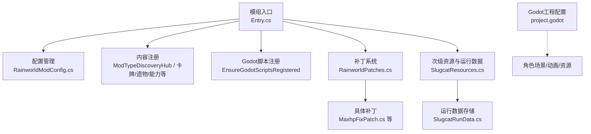

图表来源
- [Entry.cs:20-76](file://Scripts/Entry.cs#L20-L76)
- [RainworldModConfig.cs:166-234](file://Scripts/RainworldModConfig.cs#L166-L234)
- [RainworldPatches.cs:10-33](file://Scripts/patches/RainworldPatches.cs#L10-L33)
- [SlugcatResources.cs:15-48](file://Scripts/Slugcat/SecondaryResource/SlugcatResources.cs#L15-L48)
- [project.godot:11-27](file://project.godot#L11-L27)

章节来源
- [Entry.cs:20-76](file://Scripts/Entry.cs#L20-L76)
- [project.godot:11-27](file://project.godot#L11-L27)

## 核心组件
- Entry.cs：模组初始化入口，负责创建日志、注册补丁、注册配置、注册次级资源、注册 Godot 脚本、自动发现并注册内容、注册卡牌边框规则、音频库延迟注册、订阅生命周期观察者等。
- RainworldModConfig：定义设置模型与绑定，提供全局持久化存储与设置 UI 页面注册，支持按模块分组开关（通用修复、怪物启用、事件启用）。
- Slugcat 基类：抽象角色模板，统一动画状态机、攻击/施法动画延迟、颜色主题、自定义生物视觉创建；派生角色（Liver/Redcat/River）实现各自资产、起始牌组、起始遗物与视觉资源。
- 补丁体系：集中注册各类补丁（最大生命上限修正、战斗UI、过滤、覆盖等），以方法拦截方式修改或增强原行为。
- 生命周期观察器：监听关键事件（如生物死亡），在特定条件下调整运行数据（如工作等级重置）。
- 次级资源与运行数据：注册“腐化值”次级资源与玩家/房间级运行数据，用于跨回合/对局的数据同步与持久化。

章节来源
- [Entry.cs:20-76](file://Scripts/Entry.cs#L20-L76)
- [RainworldModConfig.cs:11-234](file://Scripts/RainworldModConfig.cs#L11-L234)
- [Slugcat.cs:40-135](file://Scripts/Slugcat/Slugcat.cs#L40-L135)
- [RainworldPatches.cs:10-33](file://Scripts/patches/RainworldPatches.cs#L10-L33)
- [CreatureDeathObserver.cs:11-27](file://Scripts/patches/Lifecycle/CreatureDeathObserver.cs#L11-L27)
- [SlugcatResources.cs:15-48](file://Scripts/Slugcat/SecondaryResource/SlugcatResources.cs#L15-L48)

## 架构总览
整体采用“入口初始化 + 内容注册 + 补丁注入 + 生命周期钩子 + 配置与数据持久化”的分层架构：
- 入口层：Entry.cs 串联所有子系统初始化
- 内容层：角色、卡牌、遗物、能力、事件等通过自动发现机制注册
- 适配层：补丁系统在不侵入原代码的前提下修改行为
- 数据层：运行数据与次级资源提供跨回合/多人同步
- 表现层：Godot 场景与资源驱动角色外观与动画
- 配置层：设置项通过 UI 暴露并持久化到全局存储

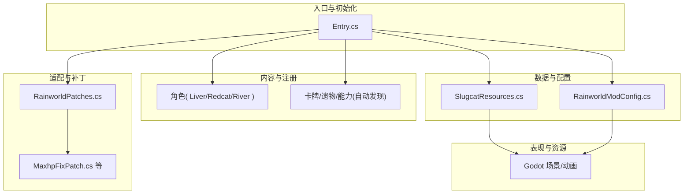

图表来源
- [Entry.cs:20-76](file://Scripts/Entry.cs#L20-L76)
- [RainworldPatches.cs:10-33](file://Scripts/patches/RainworldPatches.cs#L10-L33)
- [MaxhpFixPatch.cs:11-91](file://Scripts/patches/MaxhpFixPatch.cs#L11-L91)
- [SlugcatResources.cs:15-48](file://Scripts/Slugcat/SecondaryResource/SlugcatResources.cs#L15-L48)
- [RainworldModConfig.cs:166-234](file://Scripts/RainworldModConfig.cs#L166-L234)

## 详细组件分析

### 模组入口 Entry.cs
- 职责：创建日志、构建补丁器并注册核心补丁、注册配置、注册次级资源、确保 Godot 脚本注册、自动发现内容、注册卡牌边框规则、注册 FMOD 音频库、订阅生命周期观察者。
- 关键点：
  - 使用 RitsuLib 封装的补丁系统，集中管理补丁注册与执行
  - 通过 ModTypeDiscoveryHub 自动扫描并注册内容，降低耦合
  - 将卡牌边框高亮规则与关键词关联，提升可玩性提示
  - 延迟注册音频资源，避免启动时阻塞

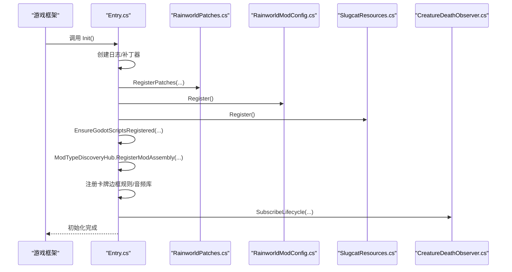

图表来源
- [Entry.cs:20-76](file://Scripts/Entry.cs#L20-L76)
- [RainworldPatches.cs:10-33](file://Scripts/patches/RainworldPatches.cs#L10-L33)
- [RainworldModConfig.cs:166-234](file://Scripts/RainworldModConfig.cs#L166-L234)
- [SlugcatResources.cs:15-48](file://Scripts/Slugcat/SecondaryResource/SlugcatResources.cs#L15-L48)
- [CreatureDeathObserver.cs:11-27](file://Scripts/patches/Lifecycle/CreatureDeathObserver.cs#L11-L27)

章节来源
- [Entry.cs:20-76](file://Scripts/Entry.cs#L20-L76)

### 配置管理 RainworldModConfig
- 设计：定义设置模型 RainworldModSettings，使用 ModSettingsValueBinding 将布尔选项与全局存储绑定，并提供便捷属性读写。
- 功能：
  - 注册设置页与分组（通用修复、怪物启用、事件启用）
  - 通过本地化键渲染标题与说明
  - 写操作自动保存，读操作从持久化读取
- 影响范围：补丁与逻辑根据开关动态生效（例如最大生命上限丢失控制）

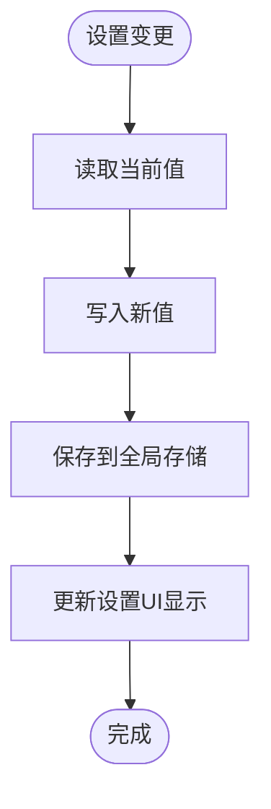

图表来源
- [RainworldModConfig.cs:36-161](file://Scripts/RainworldModConfig.cs#L36-L161)
- [RainworldModConfig.cs:166-234](file://Scripts/RainworldModConfig.cs#L166-L234)

章节来源
- [RainworldModConfig.cs:11-234](file://Scripts/RainworldModConfig.cs#L11-L234)

### Slugcat 基类与角色实现
- 基类设计：
  - 继承自 ModCharacterTemplate，泛型参数指定卡牌池、遗物池、药水池类型
  - 统一动画状态机（Idle/Attack/Cast/Hurt/Die/Relaxed/Sleep/Corrupt/Meow/FakeDeath）
  - 提供攻击/施法动画延迟、颜色主题、自定义生物视觉创建
  - 实现接口 Slugcat，暴露工作等级、食物、睡眠消耗等属性
- 角色实现：
  - Liver/Redcat/River 分别定义资产配置、起始牌组、起始遗物、音效与多人模式图标
  - 通过 CharacterAssetProfiles.Merge 合并默认资产与自定义资源
  - 使用 RitsuGodotNodeFactories 加载 Godot 场景作为角色视觉

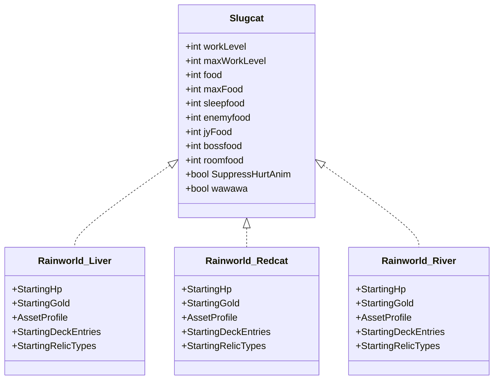

图表来源
- [Slugcat.cs:40-135](file://Scripts/Slugcat/Slugcat.cs#L40-L135)
- [Rainworld_Liver.cs:28-117](file://Scripts/Slugcat/Rainworld_Liver.cs#L28-L117)
- [Rainworld_Redcat.cs:29-128](file://Scripts/Slugcat/Rainworld_Redcat.cs#L29-L128)
- [Rainworld_River.cs:31-114](file://Scripts/Slugcat/Rainworld_River.cs#L31-L114)

章节来源
- [Slugcat.cs:40-135](file://Scripts/Slugcat/Slugcat.cs#L40-L135)
- [Rainworld_Liver.cs:28-117](file://Scripts/Slugcat/Rainworld_Liver.cs#L28-L117)
- [Rainworld_Redcat.cs:29-128](file://Scripts/Slugcat/Rainworld_Redcat.cs#L29-L128)
- [Rainworld_River.cs:31-114](file://Scripts/Slugcat/Rainworld_River.cs#L31-L114)

### 补丁系统与 MaxhpFixPatch
- 补丁注册：RainworldPatches 集中注册各类补丁（最大生命上限修正、战斗UI、过滤、覆盖等）
- 最大生命上限修正：
  - 目标：拦截 CreatureCmd.GainMaxHp
  - 条件：当玩家角色为 Slugcat 且未持有特定遗物时，将增益转为增加食物或按比例增加最大生命并治疗
  - 副作用：记录历史条目中的最大生命获取量
- 最大生命丢失限制：
  - 目标：拦截 CreatureCmd.LoseMaxHp
  - 条件：根据配置开关，将单次失去的最大生命固定为 1 或 0

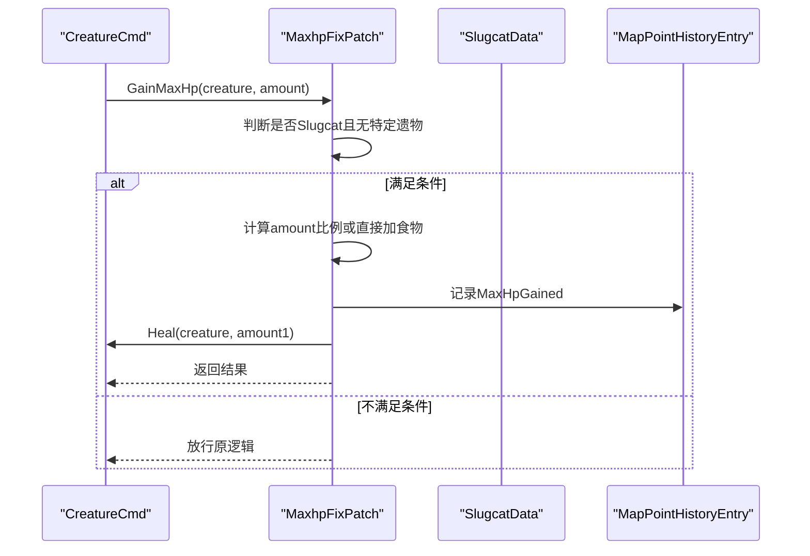

图表来源
- [MaxhpFixPatch.cs:11-91](file://Scripts/patches/MaxhpFixPatch.cs#L11-L91)
- [RainworldPatches.cs:10-33](file://Scripts/patches/RainworldPatches.cs#L10-L33)

章节来源
- [MaxhpFixPatch.cs:11-91](file://Scripts/patches/MaxhpFixPatch.cs#L11-L91)
- [RainworldPatches.cs:10-33](file://Scripts/patches/RainworldPatches.cs#L10-L33)

### 生命周期观察器 CreatureDeathObserver
- 作用：监听生物死亡事件，当玩家为 Slugcat 且拥有特定能力/遗物时，重置工作等级
- 集成：通过 Entry 订阅生命周期，确保事件触发时执行相应逻辑

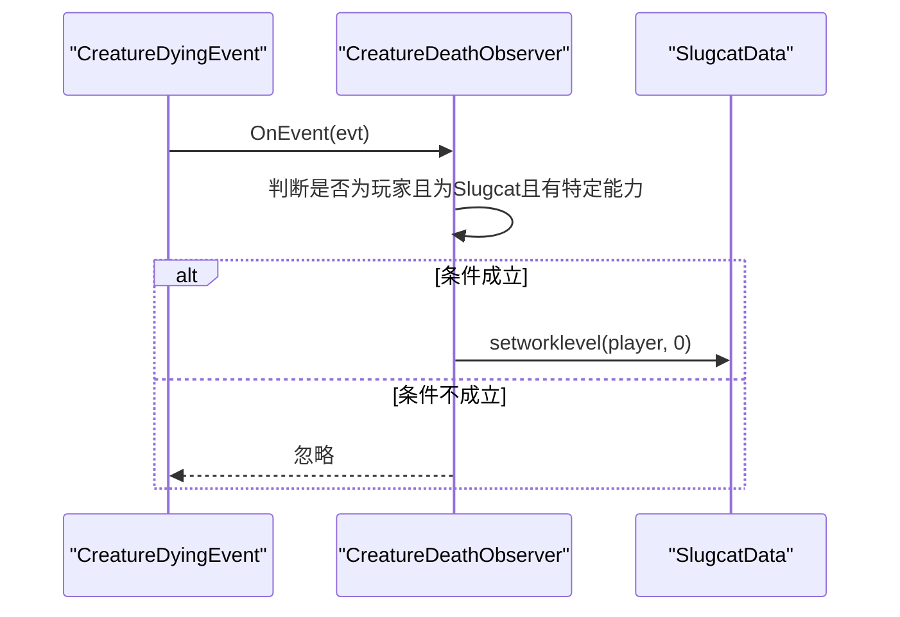

图表来源
- [CreatureDeathObserver.cs:11-27](file://Scripts/patches/Lifecycle/CreatureDeathObserver.cs#L11-L27)

章节来源
- [CreatureDeathObserver.cs:11-27](file://Scripts/patches/Lifecycle/CreatureDeathObserver.cs#L11-L27)

### 次级资源与运行数据
- 次级资源：注册“腐化值”（CorruptValue），定义默认值、最大值、回合策略与持久化策略
- 运行数据：
  - 玩家级数据：工作等级、食物、睡眠消耗、初始化标记、特殊标志位
  - 房间级数据：遗物过滤相关数据
- 同步：开启对局内变化同步，保证多人一致性

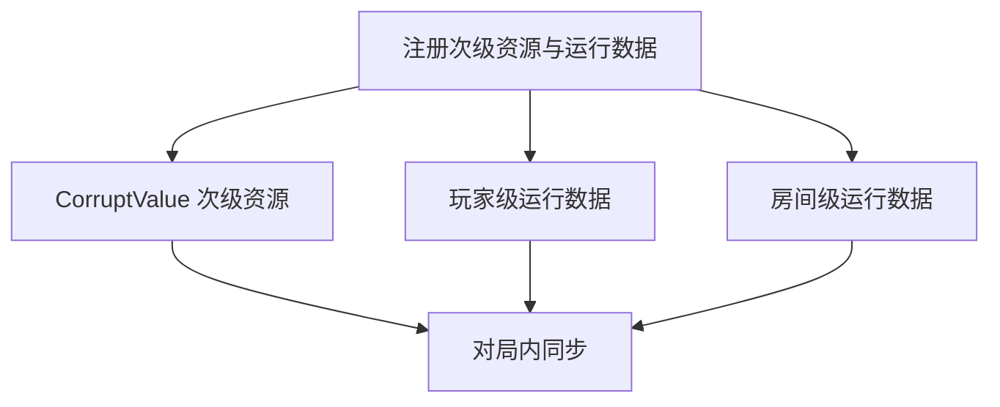

图表来源
- [SlugcatResources.cs:15-48](file://Scripts/Slugcat/SecondaryResource/SlugcatResources.cs#L15-L48)
- [SlugcatRunData.cs:1-14](file://Scripts/Slugcat/SecondaryResource/SlugcatRunData.cs#L1-L14)

章节来源
- [SlugcatResources.cs:15-48](file://Scripts/Slugcat/SecondaryResource/SlugcatResources.cs#L15-L48)
- [SlugcatRunData.cs:1-14](file://Scripts/Slugcat/SecondaryResource/SlugcatRunData.cs#L1-L14)

## 依赖关系分析
- 外部依赖：
  - STS2-RitsuLib：提供补丁、设置、内容注册、生命周期、Godot 集成等能力
  - Godot：用于角色场景、动画、能量计数器等资源
- 内部依赖：
  - Entry 依赖补丁、配置、资源、生命周期等子系统
  - 角色实现依赖基类与 Godot 资源
  - 补丁依赖运行数据与配置开关

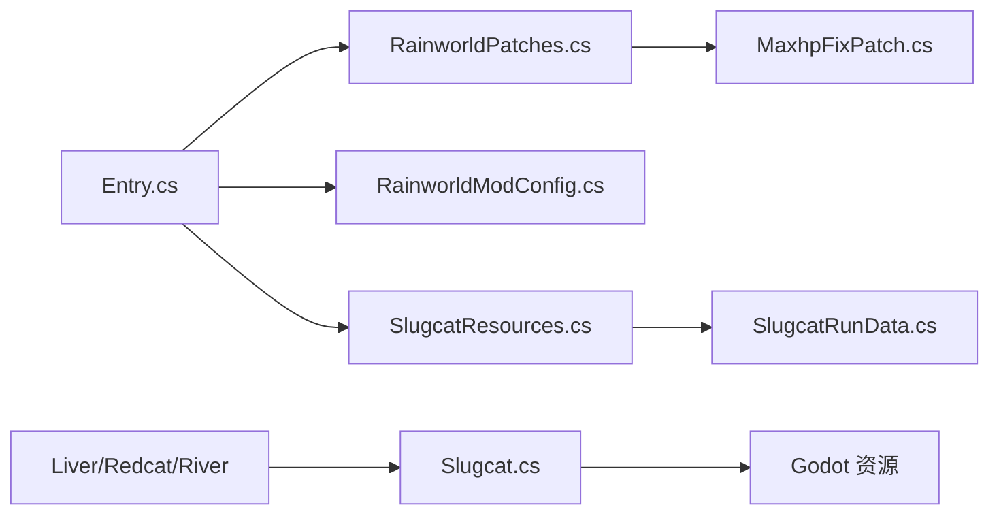

图表来源
- [Entry.cs:20-76](file://Scripts/Entry.cs#L20-L76)
- [RainworldPatches.cs:10-33](file://Scripts/patches/RainworldPatches.cs#L10-L33)
- [MaxhpFixPatch.cs:11-91](file://Scripts/patches/MaxhpFixPatch.cs#L11-L91)
- [SlugcatResources.cs:15-48](file://Scripts/Slugcat/SecondaryResource/SlugcatResources.cs#L15-L48)
- [Slugcat.cs:40-135](file://Scripts/Slugcat/Slugcat.cs#L40-L135)

章节来源
- [Entry.cs:20-76](file://Scripts/Entry.cs#L20-L76)
- [RainworldPatches.cs:10-33](file://Scripts/patches/RainworldPatches.cs#L10-L33)
- [MaxhpFixPatch.cs:11-91](file://Scripts/patches/MaxhpFixPatch.cs#L11-L91)
- [SlugcatResources.cs:15-48](file://Scripts/Slugcat/SecondaryResource/SlugcatResources.cs#L15-L48)
- [Slugcat.cs:40-135](file://Scripts/Slugcat/Slugcat.cs#L40-L135)

## 性能考虑
- 启动阶段：
  - 延迟注册音频库，减少初始加载时间
  - 使用自动内容发现，避免手动维护注册表
- 运行时：
  - 补丁仅在必要时拦截方法，减少开销
  - 运行数据按需写入与同步，避免频繁序列化
- 资源：
  - Godot 场景按需加载，复用共享资源
  - 动画状态机合理设置循环与非循环，避免多余帧

[本节为通用指导，无需特定文件来源]

## 故障排查指南
- 启动失败：
  - 检查 Entry 中补丁注册是否成功，若失败会抛出异常
  - 确认 RitsuLib 版本与游戏版本兼容
- 配置不生效：
  - 检查设置项是否正确绑定与保存
  - 确认对应补丁逻辑是否读取了最新配置
- 角色动画异常：
  - 检查 Godot 场景路径是否正确
  - 确认动画状态名与绑定一致
- 数据不同步：
  - 检查运行数据是否开启对局内同步
  - 确认写入策略为“仅设置时写入”，避免冗余

章节来源
- [Entry.cs:20-76](file://Scripts/Entry.cs#L20-L76)
- [RainworldModConfig.cs:166-234](file://Scripts/RainworldModConfig.cs#L166-L234)
- [SlugcatResources.cs:15-48](file://Scripts/Slugcat/SecondaryResource/SlugcatResources.cs#L15-L48)

## 结论
SlugcatTheSpireII 通过清晰的入口初始化、模块化内容注册、补丁适配与生命周期钩子，实现了与 STS2 框架的深度集成。Slugcat 基类提供了统一的角色扩展点，配合 Godot 资源实现丰富的表现层。配置管理与运行数据确保了可玩性与稳定性。未来可在以下方面持续优化：
- 进一步解耦补丁与业务逻辑，提升可测试性
- 引入更细粒度的性能监控与日志分级
- 完善错误恢复与回滚机制，提升容错能力

[本节为总结，无需特定文件来源]

## 附录

### 系统上下文图
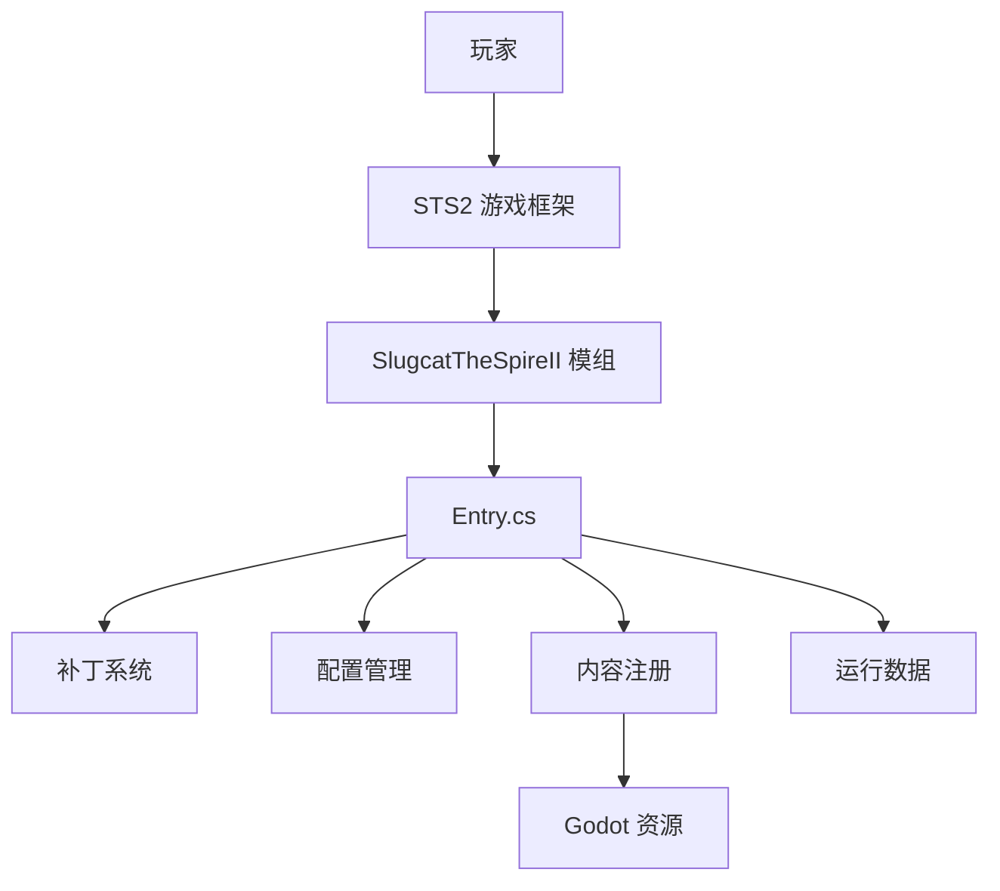

图表来源
- [Entry.cs:20-76](file://Scripts/Entry.cs#L20-L76)
- [project.godot:11-27](file://project.godot#L11-L27)

### 组件分解图
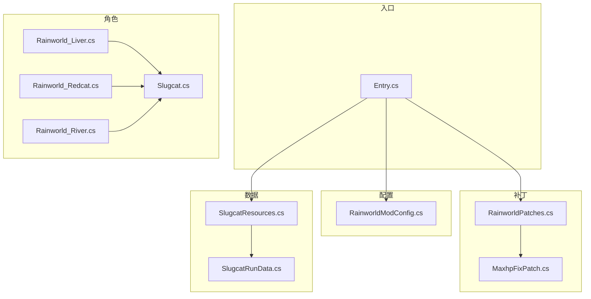

图表来源
- [Entry.cs:20-76](file://Scripts/Entry.cs#L20-L76)
- [RainworldModConfig.cs:166-234](file://Scripts/RainworldModConfig.cs#L166-L234)
- [Rainworld_Liver.cs:28-117](file://Scripts/Slugcat/Rainworld_Liver.cs#L28-L117)
- [Rainworld_Redcat.cs:29-128](file://Scripts/Slugcat/Rainworld_Redcat.cs#L29-L128)
- [Rainworld_River.cs:31-114](file://Scripts/Slugcat/Rainworld_River.cs#L31-L114)
- [Slugcat.cs:40-135](file://Scripts/Slugcat/Slugcat.cs#L40-L135)
- [RainworldPatches.cs:10-33](file://Scripts/patches/RainworldPatches.cs#L10-L33)
- [MaxhpFixPatch.cs:11-91](file://Scripts/patches/MaxhpFixPatch.cs#L11-L91)
- [SlugcatResources.cs:15-48](file://Scripts/Slugcat/SecondaryResource/SlugcatResources.cs#L15-L48)
- [SlugcatRunData.cs:1-14](file://Scripts/Slugcat/SecondaryResource/SlugcatRunData.cs#L1-L14)

### 技术栈与依赖
- 技术栈：C#、Godot 4.5、STS2 框架
- 第三方依赖：STS2-RitsuLib（最低版本 0.4.41）
- 版本兼容：最小游戏版本 0.110.0
- 工程特性：包含 PCK 与 DLL，影响游戏玩法

章节来源
- [mod_manifest.json:1-14](file://mod_manifest.json#L1-L14)
- [project.godot:11-27](file://project.godot#L11-L27)

### 部署拓扑
- 单实例部署：模组随游戏加载，入口在模组初始化时执行
- 资源路径：Godot 资源通过 res:// 路径引用，需确保导出时包含
- 本地化：多语言 JSON 文件随模组打包，运行时按语言选择

[本节为概念性说明，无需特定文件来源]

### 横切关注点
- 安全性：
  - 补丁仅修改必要方法，避免破坏游戏平衡
  - 配置项提供开关，允许禁用潜在风险功能
- 监控：
  - 使用 RitsuLib 日志记录关键事件
  - 建议在补丁中添加调试日志以便定位问题
- 灾难恢复：
  - 运行数据写入策略为“仅设置时写入”，减少不一致
  - 对局内同步开启，确保多人一致性
  - 启动失败时抛出明确异常，便于快速定位

[本节为通用指导，无需特定文件来源]