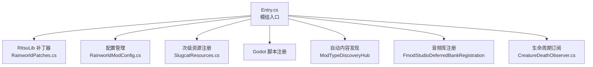
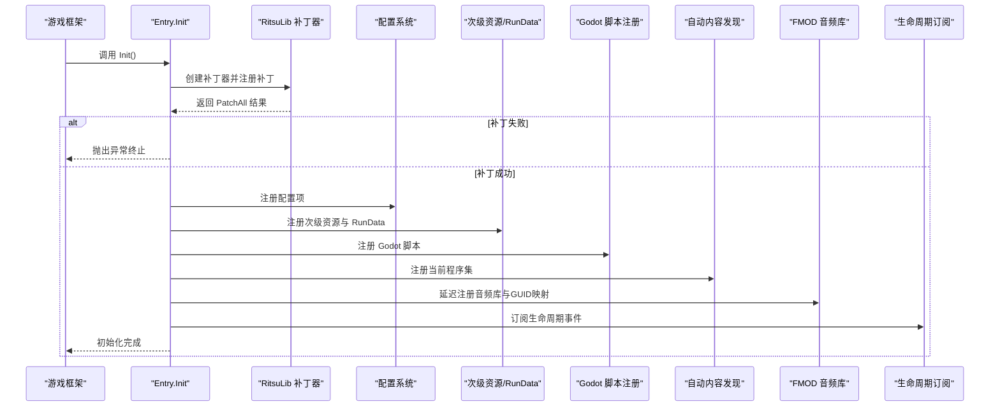
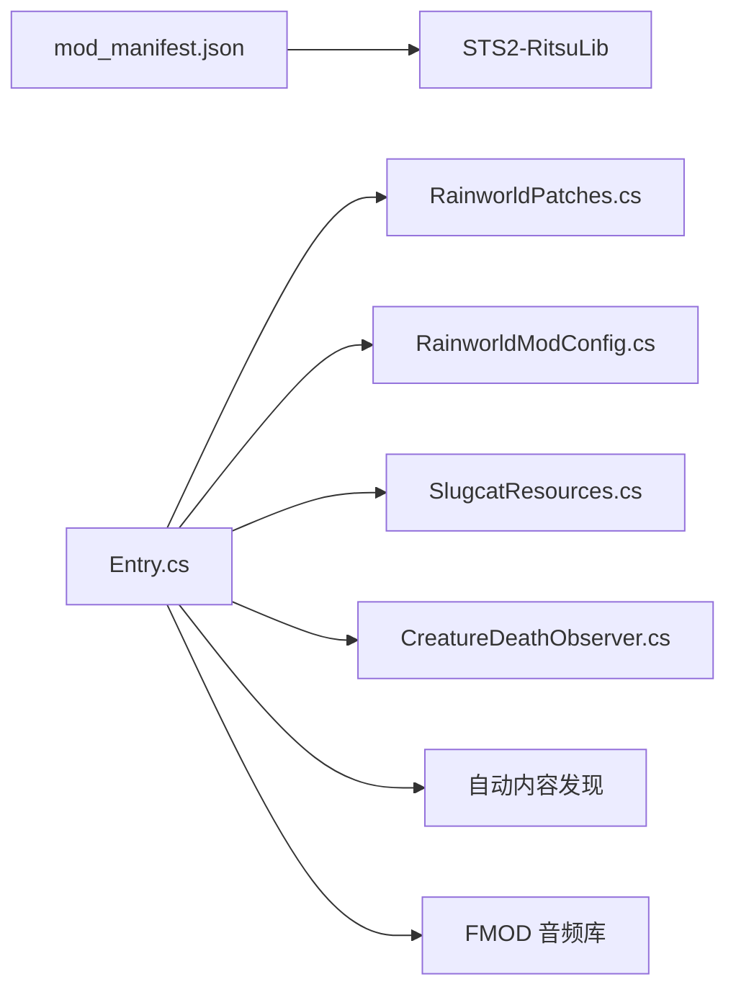
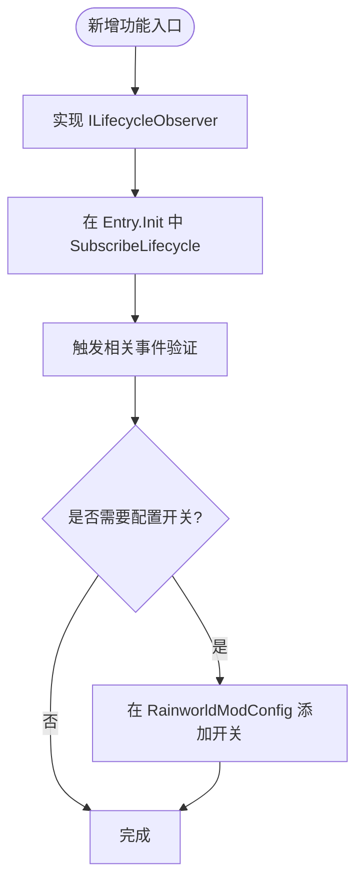

# 模组初始化系统

<cite>
**本文引用的文件**
- [Entry.cs](file://Scripts/Entry.cs)
- [RainworldModConfig.cs](file://Scripts/RainworldModConfig.cs)
- [mod_manifest.json](file://mod_manifest.json)
- [RainworldPatches.cs](file://Scripts/patches/RainworldPatches.cs)
- [SlugcatResources.cs](file://Scripts/Slugcat/SecondaryResource/SlugcatResources.cs)
- [CreatureDeathObserver.cs](file://Scripts/patches/Lifecycle/CreatureDeathObserver.cs)
- [log.txt](file://log.txt)
</cite>

## 目录
1. [简介](#简介)
2. [项目结构](#项目结构)
3. [核心组件](#核心组件)
4. [架构总览](#架构总览)
5. [详细组件分析](#详细组件分析)
6. [依赖关系分析](#依赖关系分析)
7. [性能考虑](#性能考虑)
8. [故障排查指南](#故障排查指南)
9. [结论](#结论)
10. [附录：扩展初始化流程示例](#附录扩展初始化流程示例)

## 简介
本文件面向 SlugcatTheSpireII 模组的“初始化系统”，聚焦 Entry.cs 作为模组入口点的作用，系统阐述 Init 方法的执行流程、补丁系统注册、配置管理、次级资源注册、Godot 脚本注册与自动内容发现机制。同时说明 RitsuLib 框架的集成方式（补丁器创建、生命周期订阅、音频库注册等），记录模组启动顺序、依赖加载机制与错误处理策略，并提供扩展初始化流程的具体实践建议与常见问题排查、性能优化建议。

## 项目结构
该模组采用分层组织：
- 入口与初始化：Entry.cs
- 配置管理：RainworldModConfig.cs
- 补丁集合：patches 目录下的各类 Patch 类，统一在 RainworldPatches.cs 中集中注册
- 运行时数据与次级资源：Slugcat/SecondaryResource 下定义并注册
- 生命周期事件：Lifecycle 目录下观察者实现
- 资源与本地化：Godot 场景与 localization JSON
- 模组清单：mod_manifest.json 声明依赖与版本信息

图表来源
- [Entry.cs:26-74](file://Scripts/Entry.cs#L26-L74)
- [RainworldPatches.cs:10-33](file://Scripts/patches/RainworldPatches.cs#L10-L33)
- [RainworldModConfig.cs:166-234](file://Scripts/RainworldModConfig.cs#L166-L234)
- [SlugcatResources.cs:15-48](file://Scripts/Slugcat/SecondaryResource/SlugcatResources.cs#L15-L48)
- [CreatureDeathObserver.cs:11-24](file://Scripts/patches/Lifecycle/CreatureDeathObserver.cs#L11-L24)

章节来源
- [Entry.cs:20-76](file://Scripts/Entry.cs#L20-L76)
- [mod_manifest.json:1-14](file://mod_manifest.json#L1-L14)

## 核心组件
- Entry.cs：模组入口，负责初始化流水线编排与关键子系统注册。
- RainworldPatches.cs：集中注册所有游戏行为补丁，确保核心逻辑被正确拦截与增强。
- RainworldModConfig.cs：定义可配置的开关项，并通过 RitsuLib 设置框架持久化与 UI 绑定。
- SlugcatResources.cs：注册次级资源（如腐化值）与运行期数据存储（玩家/全局）。
- CreatureDeathObserver.cs：通过生命周期事件监听怪物/玩家死亡，触发业务逻辑（如工作等级重置）。
- mod_manifest.json：声明模组 ID、版本、最低游戏版本、是否包含 PCK/DLL 以及依赖 STS2-RitsuLib。

章节来源
- [Entry.cs:20-76](file://Scripts/Entry.cs#L20-L76)
- [RainworldPatches.cs:8-33](file://Scripts/patches/RainworldPatches.cs#L8-L33)
- [RainworldModConfig.cs:11-234](file://Scripts/RainworldModConfig.cs#L11-L234)
- [SlugcatResources.cs:7-48](file://Scripts/Slugcat/SecondaryResource/SlugcatResources.cs#L7-L48)
- [CreatureDeathObserver.cs:11-24](file://Scripts/patches/Lifecycle/CreatureDeathObserver.cs#L11-L24)
- [mod_manifest.json:1-14](file://mod_manifest.json#L1-L14)

## 架构总览
Entry.Init 是模组初始化的中枢，按固定顺序完成以下任务：
1) 创建并使用 RitsuLib 提供的补丁器，注册并应用核心补丁；若失败则抛出异常中断初始化。
2) 注册模组配置，暴露给游戏设置界面并持久化。
3) 注册次级资源与运行期数据存储。
4) 注册 Godot 脚本，使 Godot 资源能被引擎识别与加载。
5) 将当前程序集提交到自动内容发现中心，以便卡牌、遗物、能力等按约定自动注册。
6) 注册卡牌手牌轮廓规则（用于视觉提示）。
7) 延迟注册 FMOD 音频库与 GUID 映射，避免阻塞启动。
8) 订阅生命周期事件，响应运行时事件（如生物死亡）。

图表来源
- [Entry.cs:26-74](file://Scripts/Entry.cs#L26-L74)
- [RainworldPatches.cs:10-33](file://Scripts/patches/RainworldPatches.cs#L10-L33)
- [RainworldModConfig.cs:166-234](file://Scripts/RainworldModConfig.cs#L166-L234)
- [SlugcatResources.cs:15-48](file://Scripts/Slugcat/SecondaryResource/SlugcatResources.cs#L15-L48)
- [CreatureDeathObserver.cs:11-24](file://Scripts/patches/Lifecycle/CreatureDeathObserver.cs#L11-L24)

## 详细组件分析

### Entry.cs 初始化流程
- 补丁系统：使用 RitsuLibFramework.CreatePatcher 创建补丁器，注册 RainworldPatches 并调用 PatchAll；失败时抛出异常，保证核心补丁必须生效。
- 配置管理：调用 RainworldModConfig.Register 将配置项注册到设置界面并持久化。
- 次级资源：调用 SlugcatResources.Register 注册腐化值等资源及运行期数据。
- Godot 脚本：通过 RitsuLibFramework.EnsureGodotScriptsRegistered 扫描并注册当前程序集中的 Godot 脚本。
- 自动内容发现：通过 ModTypeDiscoveryHub.RegisterModAssembly 将当前程序集加入发现中心，后续由框架自动发现并注册卡牌、遗物、能力等。
- 卡牌手牌轮廓：注册基于关键词的发光边框规则，提升可读性。
- 音频库：延迟注册 FMOD 银行与 GUID 映射，减少启动开销。
- 生命周期：订阅 CreatureDeathObserver，处理生物死亡事件。

章节来源
- [Entry.cs:26-74](file://Scripts/Entry.cs#L26-L74)

### 补丁系统注册（RainworldPatches）
- 集中式注册：所有补丁类型在 AddTo 方法中通过 patcher.RegisterPatch 逐一注册。
- 覆盖范围：包括战斗 UI、血量修正、药水过滤、遗物池过滤、蘑菇块叠加、遭遇获取过滤等。
- 可扩展性：新增补丁只需在此处注册，便于统一管理。

章节来源
- [RainworldPatches.cs:10-33](file://Scripts/patches/RainworldPatches.cs#L10-L33)

### 配置管理（RainworldModConfig）
- 配置模型：RainworldModSettings 定义布尔型开关，控制怪物、事件、修复等功能启用与否。
- 持久化与 UI：通过 ModSettingsValueBinding 将字段绑定到设置界面，并在写入时保存；Register 方法构建设置页并挂载到 RitsuLib 设置框架。
- 本地化：文本键通过 LocString 引用，支持多语言。

章节来源
- [RainworldModConfig.cs:11-234](file://Scripts/RainworldModConfig.cs#L11-L234)

### 次级资源与运行期数据（SlugcatResources）
- 运行期数据：使用 RitsuLib 的 RunSavedDataStore 注册玩家级与全局级数据（如 slugcat_data、relic_filter），支持同步与按需写入。
- 次级资源：注册 CorruptValue（腐化值），定义默认值、上限、回合策略与持久化策略。
- 作用域：在 BeginModDataRegistration 上下文中完成注册，确保命名空间隔离。

章节来源
- [SlugcatResources.cs:15-48](file://Scripts/Slugcat/SecondaryResource/SlugcatResources.cs#L15-L48)

### Godot 脚本注册
- 通过 RitsuLibFramework.EnsureGodotScriptsRegistered 扫描当前程序集并注册 Godot 脚本，使 Godot 场景、控制器等可在运行时被引擎加载。
- 与资源路径配合：Godot 资源位于 Godot 目录，脚本与场景需保持对应关系。

章节来源
- [Entry.cs:42-43](file://Scripts/Entry.cs#L42-L43)

### 自动内容发现机制
- 通过 ModTypeDiscoveryHub.RegisterModAssembly 将当前程序集加入发现中心，框架会扫描并自动注册卡牌、遗物、能力等内容。
- 优势：减少手工注册工作量，提高扩展性与一致性。

章节来源
- [Entry.cs:45-46](file://Scripts/Entry.cs#L45-L46)

### 音频库注册（FMOD）
- 延迟注册：使用 FmodStudioDeferredBankRegistration 注册音频银行与 GUID 映射文件，避免阻塞启动。
- 好处：将耗时 I/O 推迟到合适时机，提升启动性能。

章节来源
- [Entry.cs:70-71](file://Scripts/Entry.cs#L70-L71)

### 生命周期订阅（CreatureDeathObserver）
- 订阅 ILifecycleObserver，监听 CreatureDyingEvent。
- 业务逻辑：当玩家角色为 Slugcat 且拥有特定能力时，在死亡事件中调整工作等级等状态。

章节来源
- [CreatureDeathObserver.cs:11-24](file://Scripts/patches/Lifecycle/CreatureDeathObserver.cs#L11-L24)
- [Entry.cs:73](file://Scripts/Entry.cs#L73)

## 依赖关系分析
- 模组依赖：mod_manifest.json 声明依赖 STS2-RitsuLib 最低版本，确保补丁器、设置、生命周期等 API 可用。
- 内部耦合：Entry 作为协调者，依赖补丁器、配置、资源、自动发现、音频与生命周期模块；各模块职责清晰，耦合度低。
- 外部集成：RitsuLib 提供统一的框架能力；Godot 引擎负责资源加载；FMOD 负责音频。

图表来源
- [mod_manifest.json:10-12](file://mod_manifest.json#L10-L12)
- [Entry.cs:26-74](file://Scripts/Entry.cs#L26-L74)

章节来源
- [mod_manifest.json:1-14](file://mod_manifest.json#L1-L14)
- [Entry.cs:26-74](file://Scripts/Entry.cs#L26-L74)

## 性能考虑
- 延迟音频注册：将 FMOD 银行与 GUID 映射注册推迟，减少启动阶段 I/O 压力。
- 补丁一次性应用：PatchAll 在初始化阶段集中执行，避免运行时重复开销。
- 运行期数据按需写入：RunSavedData 使用 WhenSet 策略，降低频繁序列化成本。
- 自动内容发现：通过框架扫描减少手工注册，但需注意程序集大小对扫描时间的影响。
- 配置读写：设置项写入后立即保存，注意在高频率更新场景下合并写操作以降低磁盘 IO。

[本节为通用性能建议，不直接分析具体代码文件]

## 故障排查指南
- 补丁失败导致初始化中断：Entry.Init 在 PatchAll 失败时抛出异常，检查日志定位具体补丁问题。
- 配置未生效：确认 RainworldModConfig.Register 已调用，且设置项键名与本地化键一致。
- 次级资源不可用：检查 SlugcatResources.Register 是否在正确上下文调用，并确保资源 ID 唯一。
- Godot 脚本未加载：确认 EnsureGodotScriptsRegistered 已执行，且脚本与场景路径正确。
- 音频无声或报错：检查 FMOD 银行路径与 GUIDs.txt 是否存在且格式正确。
- 生命周期事件未触发：确认已订阅相应 ILifecycleObserver，并检查事件条件是否符合预期。
- 日志参考：查看 log.txt 中的版本更新与已知问题记录，辅助定位问题。

章节来源
- [Entry.cs:33-34](file://Scripts/Entry.cs#L33-L34)
- [RainworldModConfig.cs:166-234](file://Scripts/RainworldModConfig.cs#L166-L234)
- [SlugcatResources.cs:15-48](file://Scripts/Slugcat/SecondaryResource/SlugcatResources.cs#L15-L48)
- [log.txt:132-215](file://log.txt#L132-L215)

## 结论
Entry.cs 作为模组入口，以清晰的顺序编排了补丁、配置、资源、脚本、内容与音频的初始化流程，结合 RitsuLib 的统一框架能力，实现了高内聚、低耦合的模块化设计。通过自动内容发现与延迟音频注册等手段，兼顾了扩展性与性能。遵循本文档的实践建议，可稳定地扩展初始化流程并快速定位问题。

[本节为总结性内容，不直接分析具体代码文件]

## 附录：扩展初始化流程示例
以下为在现有初始化流程中扩展功能的推荐步骤（以新增一个运行时观察器为例）：
- 新增生命周期观察者：实现 ILifecycleObserver 接口，并在 OnEvent 中处理目标事件。
- 在 Entry.Init 中订阅：调用 RitsuLibFramework.SubscribeLifecycle 注册新的观察者。
- 验证：确保事件条件与业务逻辑符合预期，必要时添加日志输出。
- 配置联动：如需开关控制，可在 RainworldModConfig 中添加布尔开关，并在观察者中读取配置。

[本节为概念性流程图，不直接映射到具体源码文件]