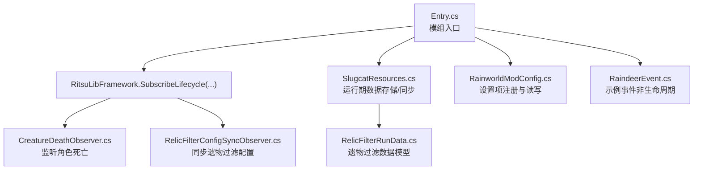
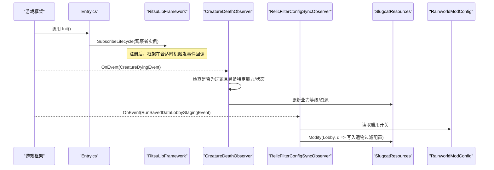
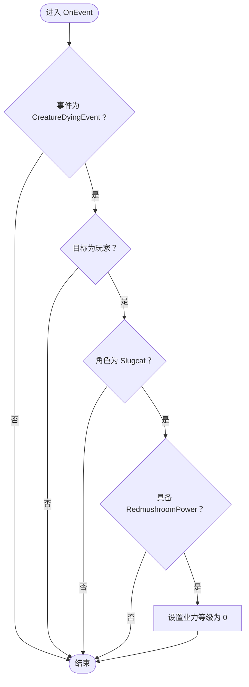
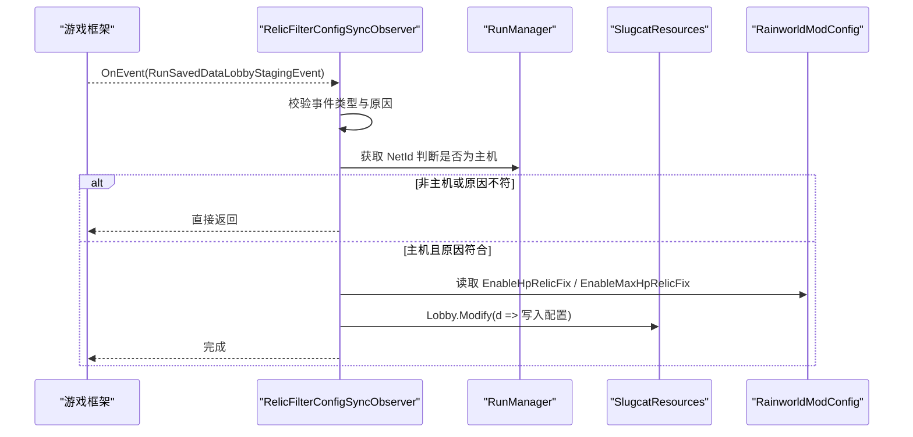
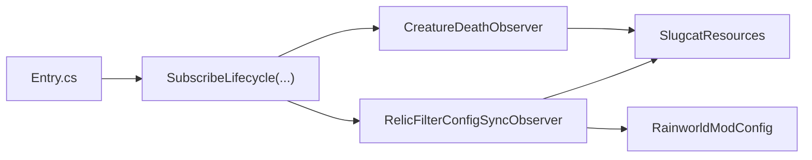

# 生命周期事件系统

<cite>
**本文引用的文件**
- [Entry.cs](file://Scripts/Entry.cs)
- [CreatureDeathObserver.cs](file://Scripts/patches/Lifecycle/CreatureDeathObserver.cs)
- [RelicFilterConfigSyncObserver.cs](file://Scripts/patches/Lifecycle/RelicFilterConfigSyncObserver.cs)
- [SlugcatResources.cs](file://Scripts/Slugcat/SecondaryResource/SlugcatResources.cs)
- [RelicFilterRunData.cs](file://Scripts/Slugcat/SecondaryResource/RelicFilterRunData.cs)
- [RainworldModConfig.cs](file://Scripts/RainworldModConfig.cs)
- [RaindeerEvent.cs](file://Scripts/Event/RaindeerEvent.cs)
</cite>

## 目录
1. [简介](#简介)
2. [项目结构](#项目结构)
3. [核心组件](#核心组件)
4. [架构总览](#架构总览)
5. [详细组件分析](#详细组件分析)
6. [依赖关系分析](#依赖关系分析)
7. [性能考虑](#性能考虑)
8. [故障排除指南](#故障排除指南)
9. [结论](#结论)
10. [附录](#附录)

## 简介
本文件为 SlugcatTheSpireII 的生命周期事件系统提供系统化文档，重点说明基于 RitsuLib 框架的观察者模式实现、事件注册与回调机制、异常处理策略，以及游戏关键生命周期阶段（启动、战斗开始、回合切换、角色死亡等）的事件接入方式。同时给出自定义事件监听器的开发指南、调试技巧与常见问题排查方法。

## 项目结构
本项目将生命周期事件相关逻辑集中在 Scripts/patches/Lifecycle 目录下，并通过 Entry 初始化时统一订阅；运行时数据与配置通过 SecondaryResource 与 ModSettings 管理；事件内容以 ModEventTemplate 形式扩展。

图表来源
- [Entry.cs:26-76](file://Scripts/Entry.cs#L26-L76)
- [CreatureDeathObserver.cs:11-24](file://Scripts/patches/Lifecycle/CreatureDeathObserver.cs#L11-L24)
- [RelicFilterConfigSyncObserver.cs:7-30](file://Scripts/patches/Lifecycle/RelicFilterConfigSyncObserver.cs#L7-L30)
- [SlugcatResources.cs:15-48](file://Scripts/Slugcat/SecondaryResource/SlugcatResources.cs#L15-L48)
- [RelicFilterRunData.cs:3-8](file://Scripts/Slugcat/SecondaryResource/RelicFilterRunData.cs#L3-L8)
- [RainworldModConfig.cs:166-234](file://Scripts/RainworldModConfig.cs#L166-L234)
- [RaindeerEvent.cs:27-54](file://Scripts/Event/RaindeerEvent.cs#L27-L54)

章节来源
- [Entry.cs:26-76](file://Scripts/Entry.cs#L26-L76)

## 核心组件
- 生命周期观察者接口与实现
  - ILifecycleObserver：由 RitsuLib 提供的统一生命周期事件回调接口。
  - CreatureDeathObserver：监听“生物即将死亡”事件，结合能力与状态进行业务处理。
  - RelicFilterConfigSyncObserver：在多人联机大厅提交保存数据时，同步遗物过滤相关配置到房间数据。
- 运行期数据与配置
  - SlugcatResources：注册玩家级与全局运行期数据，支持跨房间同步。
  - RainworldModConfig：集中管理模组开关与设置项，并提供持久化绑定。
- 事件模板（参考）
  - RaindeerEvent：展示如何定义可共享事件、选项与条件判断，便于理解事件驱动风格。

章节来源
- [CreatureDeathObserver.cs:11-24](file://Scripts/patches/Lifecycle/CreatureDeathObserver.cs#L11-L24)
- [RelicFilterConfigSyncObserver.cs:7-30](file://Scripts/patches/Lifecycle/RelicFilterConfigSyncObserver.cs#L7-L30)
- [SlugcatResources.cs:15-48](file://Scripts/Slugcat/SecondaryResource/SlugcatResources.cs#L15-L48)
- [RainworldModConfig.cs:166-234](file://Scripts/RainworldModConfig.cs#L166-L234)
- [RaindeerEvent.cs:27-54](file://Scripts/Event/RaindeerEvent.cs#L27-L54)

## 架构总览
下图展示了从模组初始化到生命周期事件分发与处理的完整流程，包括数据同步与配置读取。

图表来源
- [Entry.cs:73-74](file://Scripts/Entry.cs#L73-L74)
- [CreatureDeathObserver.cs:13-22](file://Scripts/patches/Lifecycle/CreatureDeathObserver.cs#L13-L22)
- [RelicFilterConfigSyncObserver.cs:9-29](file://Scripts/patches/Lifecycle/RelicFilterConfigSyncObserver.cs#L9-L29)
- [SlugcatResources.cs:15-48](file://Scripts/Slugcat/SecondaryResource/SlugcatResources.cs#L15-L48)
- [RainworldModConfig.cs:166-234](file://Scripts/RainworldModConfig.cs#L166-L234)

## 详细组件分析

### 观察者：CreatureDeathObserver
- 职责
  - 监听“生物即将死亡”事件，针对玩家角色进行特殊处理（如根据能力与状态调整业力等级）。
- 关键点
  - 事件类型匹配：仅处理 CreatureDyingEvent。
  - 条件校验：确认目标为玩家、角色类型、是否具备特定能力与状态。
  - 副作用：调用资源更新接口修改业力等级。
- 异常与健壮性
  - 通过类型判断与空引用防护避免无效调用。
  - 建议在复杂分支中加入日志记录以便定位问题。

图表来源
- [CreatureDeathObserver.cs:13-22](file://Scripts/patches/Lifecycle/CreatureDeathObserver.cs#L13-L22)

章节来源
- [CreatureDeathObserver.cs:11-24](file://Scripts/patches/Lifecycle/CreatureDeathObserver.cs#L11-L24)

### 观察者：RelicFilterConfigSyncObserver
- 职责
  - 在多人联机大厅提交保存数据时，将当前模组的遗物过滤配置同步到房间数据，确保所有客户端一致。
- 关键点
  - 事件类型：RunSavedDataLobbyStagingEvent，且 Reason 为 Committing。
  - 网络角色：仅主机执行同步（NetId == 1）。
  - 数据写入：通过 SlugcatResources.RelicFilterData.Lobby.Modify 写入配置。
- 异常与健壮性
  - 提前返回避免非预期场景下的错误执行。
  - 建议对 RunManager.Instance?.NetService?.NetId 访问做空引用保护。

图表来源
- [RelicFilterConfigSyncObserver.cs:9-29](file://Scripts/patches/Lifecycle/RelicFilterConfigSyncObserver.cs#L9-L29)
- [SlugcatResources.cs:15-48](file://Scripts/Slugcat/SecondaryResource/SlugcatResources.cs#L15-L48)
- [RainworldModConfig.cs:166-234](file://Scripts/RainworldModConfig.cs#L166-L234)

章节来源
- [RelicFilterConfigSyncObserver.cs:7-30](file://Scripts/patches/Lifecycle/RelicFilterConfigSyncObserver.cs#L7-L30)

### 运行期数据与配置：SlugcatResources 与 RainworldModConfig
- SlugcatResources
  - 注册玩家级数据（如业力等级、饱食度）与全局数据（如遗物过滤配置），并开启房间变更时的自动同步。
  - 提供 CorruptValue 等次级资源的定义与 ID。
- RainworldModConfig
  - 集中声明所有可配置项，并通过 ModSettingsValueBinding 绑定到 UI 与持久化存储。
  - 提供 Register 方法将设置页注册到游戏内设置界面。

章节来源
- [SlugcatResources.cs:15-48](file://Scripts/Slugcat/SecondaryResource/SlugcatResources.cs#L15-L48)
- [RelicFilterRunData.cs:3-8](file://Scripts/Slugcat/SecondaryResource/RelicFilterRunData.cs#L3-L8)
- [RainworldModConfig.cs:166-234](file://Scripts/RainworldModConfig.cs#L166-L234)

### 事件模板（参考）：RaindeerEvent
- 作用
  - 展示如何定义一个可共享事件，包含资产、动态变量、生成条件、初始选项与后续页面跳转。
- 与生命周期的关系
  - 该事件属于内容层事件，不直接参与生命周期事件分发，但体现了事件驱动的编程风格，可作为自定义事件的参考。

章节来源
- [RaindeerEvent.cs:27-54](file://Scripts/Event/RaindeerEvent.cs#L27-L54)

## 依赖关系分析
- Entry 负责初始化与订阅生命周期观察者。
- 观察者依赖 RitsuLib 框架事件系统与运行期数据服务。
- 配置项通过 RainworldModConfig 暴露给观察者在运行时读取。
- 运行期数据通过 SlugcatResources 统一管理，并在多人场景中同步。

图表来源
- [Entry.cs:73-74](file://Scripts/Entry.cs#L73-L74)
- [CreatureDeathObserver.cs:13-22](file://Scripts/patches/Lifecycle/CreatureDeathObserver.cs#L13-L22)
- [RelicFilterConfigSyncObserver.cs:9-29](file://Scripts/patches/Lifecycle/RelicFilterConfigSyncObserver.cs#L9-L29)
- [SlugcatResources.cs:15-48](file://Scripts/Slugcat/SecondaryResource/SlugcatResources.cs#L15-L48)
- [RainworldModConfig.cs:166-234](file://Scripts/RainworldModConfig.cs#L166-L234)

章节来源
- [Entry.cs:73-74](file://Scripts/Entry.cs#L73-L74)

## 性能考虑
- 事件回调中尽量减少昂贵操作，优先进行快速条件判断与必要的数据写入。
- 使用 SlugcatResources 的 WhenSet 写策略与 Lobby 同步，减少不必要的广播。
- 在多人场景中，仅在主机执行配置同步，避免重复计算与网络开销。
- 对可能频繁触发的生命周期事件（如回合切换）建议采用节流或批量更新策略（若未来扩展）。

[本节为通用指导，无需具体文件引用]

## 故障排除指南
- 事件未触发
  - 确认 Entry.Init 中已调用 SubscribeLifecycle 并传入正确的观察者实例。
  - 检查事件类型与条件分支是否匹配实际运行环境。
- 多人不同步
  - 确认 RelicFilterConfigSyncObserver 仅在主机执行，且 Reason 为 Committing。
  - 检查 SlugcatResources 的 WritePolicy 与 SyncLobbyOnChange 是否开启。
- 配置未生效
  - 确认 RainworldModConfig.Register 已调用，UI 设置项已正确绑定。
  - 检查运行时读取的配置键是否与存储键一致。
- 崩溃或空引用
  - 对 RunManager.Instance?.NetService?.NetId 等外部对象访问增加空引用保护。
  - 在复杂分支加入日志输出，定位失败路径。

章节来源
- [Entry.cs:73-74](file://Scripts/Entry.cs#L73-L74)
- [RelicFilterConfigSyncObserver.cs:9-29](file://Scripts/patches/Lifecycle/RelicFilterConfigSyncObserver.cs#L9-L29)
- [SlugcatResources.cs:15-48](file://Scripts/Slugcat/SecondaryResource/SlugcatResources.cs#L15-L48)
- [RainworldModConfig.cs:166-234](file://Scripts/RainworldModConfig.cs#L166-L234)

## 结论
本项目的生命周期事件系统基于 RitsuLib 的观察者模式，实现了简洁、可扩展的事件订阅与分发机制。通过 CreatureDeathObserver 与 RelicFilterConfigSyncObserver 两个典型实现，展示了如何在关键生命周期阶段执行业务逻辑，并与运行期数据、配置系统进行集成。配合统一的资源管理与设置项注册，保证了系统的可维护性与扩展性。

[本节为总结性内容，无需具体文件引用]

## 附录

### 自定义事件监听器开发指南
- 步骤
  - 新建类实现 ILifecycleObserver 接口，并在 OnEvent 中处理目标事件。
  - 在 Entry.Init 中通过 RitsuLibFramework.SubscribeLifecycle 注册观察者。
  - 如需读取/写入运行期数据，使用 SlugcatResources 提供的 API。
  - 如需读取配置，使用 RainworldModConfig 暴露的属性。
- 最佳实践
  - 在回调中进行快速条件判断，避免阻塞主线程。
  - 对网络相关访问做空引用保护。
  - 使用日志记录关键路径，便于调试。
- 代码示例路径
  - 参考现有观察者实现：
    - [CreatureDeathObserver.cs:11-24](file://Scripts/patches/Lifecycle/CreatureDeathObserver.cs#L11-L24)
    - [RelicFilterConfigSyncObserver.cs:7-30](file://Scripts/patches/Lifecycle/RelicFilterConfigSyncObserver.cs#L7-L30)
  - 参考注册位置：
    - [Entry.cs:73-74](file://Scripts/Entry.cs#L73-L74)

章节来源
- [CreatureDeathObserver.cs:11-24](file://Scripts/patches/Lifecycle/CreatureDeathObserver.cs#L11-L24)
- [RelicFilterConfigSyncObserver.cs:7-30](file://Scripts/patches/Lifecycle/RelicFilterConfigSyncObserver.cs#L7-L30)
- [Entry.cs:73-74](file://Scripts/Entry.cs#L73-L74)

### 生命周期阶段与事件映射（概念性）
- 游戏启动：Entry.Init 中完成补丁、配置、资源与观察者的注册。
- 战斗开始：可通过订阅相应生命周期事件（由框架提供）触发入场逻辑。
- 回合切换：可在回合开始时执行轻量刷新或统计。
- 角色死亡：通过 CreatureDyingEvent 进行状态修正与资源更新。
- 房间/存档提交：通过 RunSavedDataLobbyStagingEvent 进行配置同步。

[本节为概念性说明，无需具体文件引用]