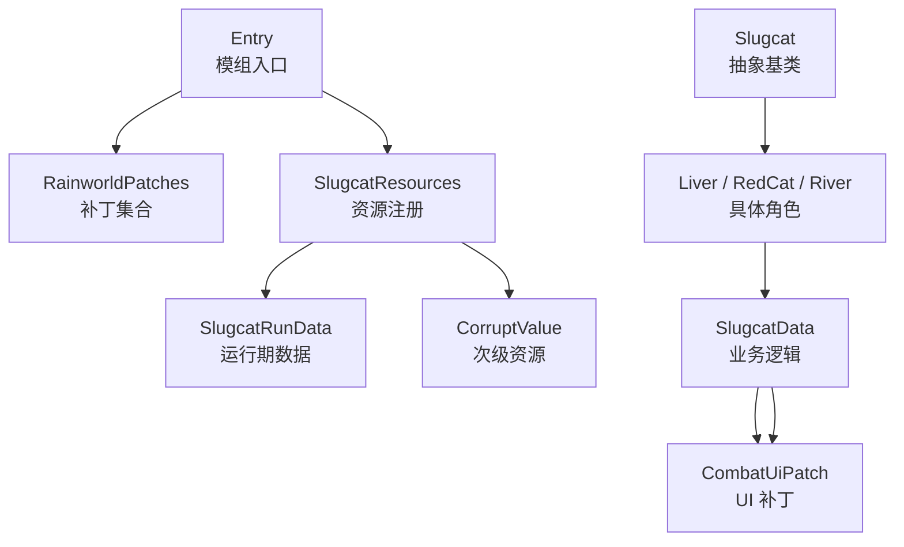
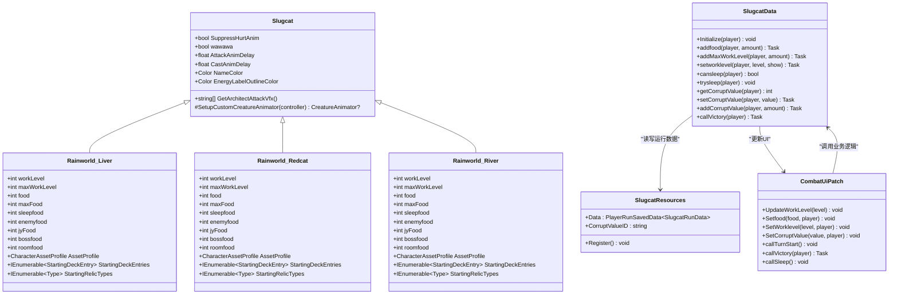
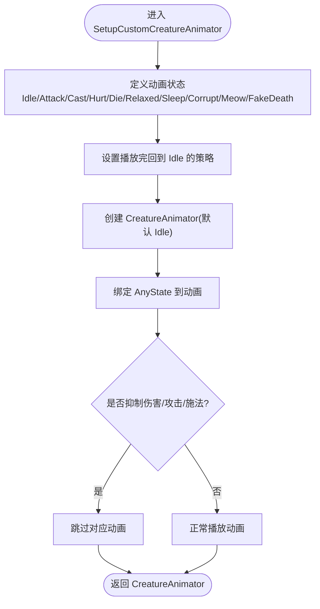
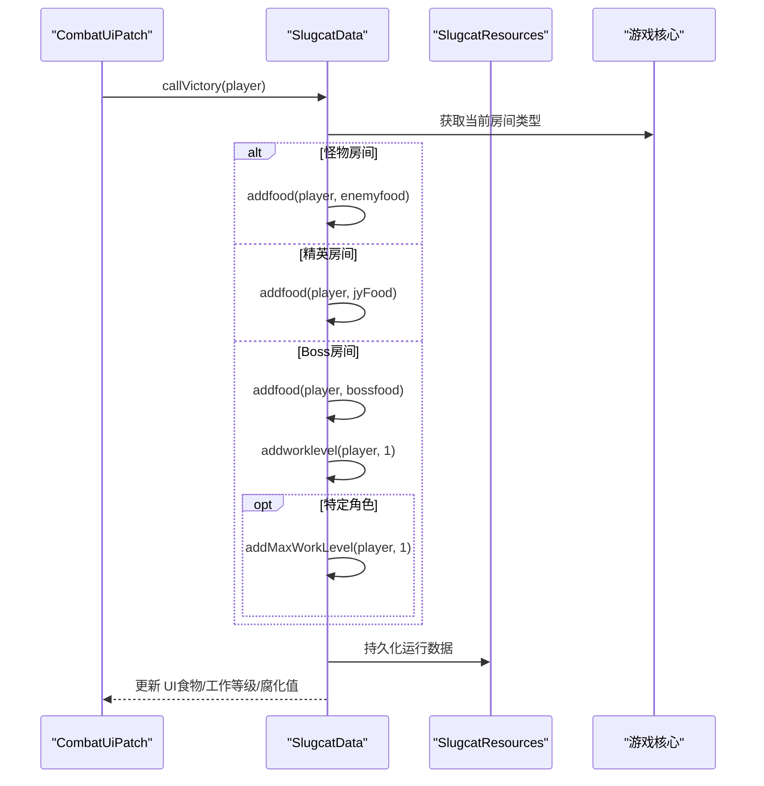
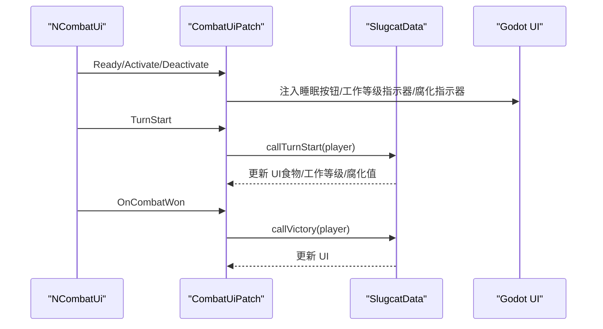
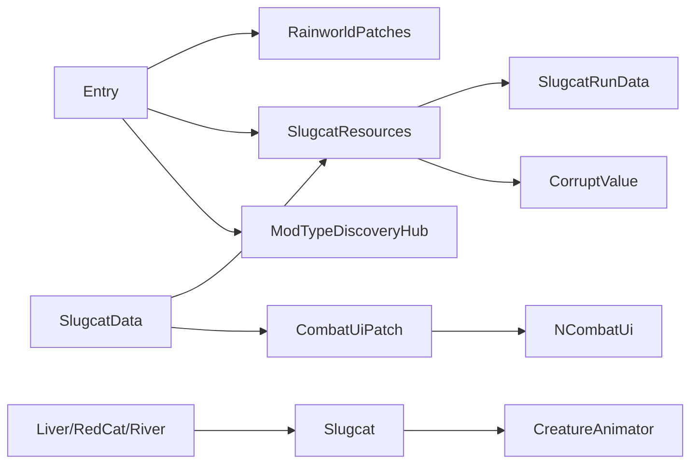

# 角色基类架构

<cite>
**本文引用的文件**
- [Slugcat.cs](file://Scripts/Slugcat/Slugcat.cs)
- [SlugcatData.cs](file://Scripts/Slugcat/SlugcatData.cs)
- [Rainworld_Liver.cs](file://Scripts/Slugcat/Rainworld_Liver.cs)
- [Rainworld_Redcat.cs](file://Scripts/Slugcat/Rainworld_Redcat.cs)
- [Rainworld_River.cs](file://Scripts/Slugcat/Rainworld_River.cs)
- [SlugcatResources.cs](file://Scripts/Slugcat/SecondaryResource/SlugcatResources.cs)
- [SlugcatRunData.cs](file://Scripts/Slugcat/SecondaryResource/SlugcatRunData.cs)
- [Entry.cs](file://Scripts/Entry.cs)
- [CombatUiPatch.cs](file://Scripts/patches/CombatUiPatch.cs)
- [RainworldPatches.cs](file://Scripts/patches/RainworldPatches.cs)
</cite>

## 目录
1. [简介](#简介)
2. [项目结构](#项目结构)
3. [核心组件](#核心组件)
4. [架构总览](#架构总览)
5. [详细组件分析](#详细组件分析)
6. [依赖关系分析](#依赖关系分析)
7. [性能考量](#性能考量)
8. [故障排查指南](#故障排查指南)
9. [结论](#结论)
10. [附录](#附录)

## 简介
本文件围绕 SlugcatTheSpireII 的角色基类架构，系统性阐述 Slugcat 抽象基类的设计模式与扩展点，覆盖模板方法模式、通用行为定义、状态管理、动画系统、战斗行为抽象、资源管理与数据持久化，以及与卡牌、能力、怪物系统的集成方式。同时提供角色开发指导原则与最佳实践，帮助开发者基于现有基类快速继承并扩展现有角色。

## 项目结构
- 角色基类与具体角色：
  - 抽象基类：Slugcat（定义通用行为、动画、接口）
  - 具体角色：Liver、RedCat、River（配置初始牌组、遗物、资源、视觉等）
- 数据与资源：
  - 运行期数据：SlugcatRunData（工作等级、食物、睡眠阈值等）
  - 次级资源：CorruptValue（腐化值，战斗内持久化）
  - 资源注册：SlugcatResources（统一注册运行数据与次级资源）
- 交互与补丁：
  - 战斗 UI 补丁：CombatUiPatch（注入按钮、指示器，同步状态）
  - 模组入口：Entry（初始化补丁、资源、内容发现）
  - 补丁集合：RainworldPatches（集中注册补丁）

图表来源
- [Entry.cs:26-76](file://Scripts/Entry.cs#L26-L76)
- [RainworldPatches.cs:8-33](file://Scripts/patches/RainworldPatches.cs#L8-L33)
- [SlugcatResources.cs:7-48](file://Scripts/Slugcat/SecondaryResource/SlugcatResources.cs#L7-L48)
- [Slugcat.cs:61-135](file://Scripts/Slugcat/Slugcat.cs#L61-L135)
- [SlugcatData.cs:32-367](file://Scripts/Slugcat/SlugcatData.cs#L32-L367)
- [CombatUiPatch.cs:16-295](file://Scripts/patches/CombatUiPatch.cs#L16-L295)

章节来源
- [Entry.cs:26-76](file://Scripts/Entry.cs#L26-L76)
- [RainworldPatches.cs:8-33](file://Scripts/patches/RainworldPatches.cs#L8-L33)
- [SlugcatResources.cs:7-48](file://Scripts/Slugcat/SecondaryResource/SlugcatResources.cs#L7-L48)

## 核心组件
- Slugcat 抽象基类
  - 实现 Slugcat 接口，暴露工作等级、食物、睡眠阈值等属性
  - 通过模板方法 SetupCustomCreatureAnimator 定义动画状态机与切换规则
  - 提供攻击/施法动画延迟、颜色主题、VFX 列表等通用外观与行为
- 具体角色（Liver/RedCat/River）
  - 配置起始生命、金币、初始牌组、起始遗物
  - 设置角色专属资源（workLevel、maxWorkLevel、food、sleepfood 等）
  - 绑定 Godot 场景与 UI 资源（能量条、商店动画、休息站动画、图标等）
- 数据与资源
  - SlugcatRunData：保存工作等级、最大工作等级、食物、最大食物、睡眠阈值、初始化标记、特殊标志位
  - SlugcatResources：按玩家维度注册运行数据，注册“腐化值”次级资源（战斗内持久化）
- 业务逻辑
  - SlugcatData：封装食物增减、工作等级变更、睡眠判定与执行、腐化值变化联动能力、胜利奖励分发、存活判定等
- 战斗 UI 集成
  - CombatUiPatch：在战斗 UI 就绪时注入“睡眠”按钮与工作等级/腐化指示器；在回合开始、胜利、死亡等时机调用业务逻辑并更新 UI

章节来源
- [Slugcat.cs:40-135](file://Scripts/Slugcat/Slugcat.cs#L40-L135)
- [Rainworld_Liver.cs:28-117](file://Scripts/Slugcat/Rainworld_Liver.cs#L28-L117)
- [Rainworld_Redcat.cs:29-128](file://Scripts/Slugcat/Rainworld_Redcat.cs#L29-L128)
- [Rainworld_River.cs:31-114](file://Scripts/Slugcat/Rainworld_River.cs#L31-L114)
- [SlugcatRunData.cs:1-14](file://Scripts/Slugcat/SecondaryResource/SlugcatRunData.cs#L1-L14)
- [SlugcatResources.cs:7-48](file://Scripts/Slugcat/SecondaryResource/SlugcatResources.cs#L7-L48)
- [SlugcatData.cs:32-367](file://Scripts/Slugcat/SlugcatData.cs#L32-L367)
- [CombatUiPatch.cs:16-295](file://Scripts/patches/CombatUiPatch.cs#L16-L295)

## 架构总览
Slugcat 采用模板方法模式：基类定义通用流程（如动画状态机、攻击/施法延迟、名称/地图颜色、VFX），具体角色通过重写或配置来定制行为与外观。数据层通过运行期数据与次级资源解耦持久化与展示层，业务逻辑集中在 SlugcatData，UI 通过补丁在关键生命周期钩子中同步状态。

图表来源
- [Slugcat.cs:61-135](file://Scripts/Slugcat/Slugcat.cs#L61-L135)
- [Rainworld_Liver.cs:28-117](file://Scripts/Slugcat/Rainworld_Liver.cs#L28-L117)
- [Rainworld_Redcat.cs:29-128](file://Scripts/Slugcat/Rainworld_Redcat.cs#L29-L128)
- [Rainworld_River.cs:31-114](file://Scripts/Slugcat/Rainworld_River.cs#L31-L114)
- [SlugcatData.cs:32-367](file://Scripts/Slugcat/SlugcatData.cs#L32-L367)
- [SlugcatResources.cs:7-48](file://Scripts/Slugcat/SecondaryResource/SlugcatResources.cs#L7-L48)
- [CombatUiPatch.cs:16-295](file://Scripts/patches/CombatUiPatch.cs#L16-L295)

## 详细组件分析

### Slugcat 抽象基类：模板方法与扩展点
- 模板方法应用
  - SetupCustomCreatureAnimator：定义默认动画状态（待机、攻击、施法、受伤、死亡、放松、睡眠、畸变、猫叫、假死）及自动回退到待机的策略，作为子类可复用的动画流程骨架
  - 攻击/施法延迟、名称颜色、能量标签描边色、地图绘制色、远程目标线颜色等统一外观与行为
  - GetArchitectAttackVfx：统一攻击特效清单，便于后续替换或扩展
- 扩展点设计
  - 通过接口 Slugcat 暴露 workLevel、maxWorkLevel、food、maxFood、sleepfood、enemyfood、jyFood、bossfood、roomfood、SuppressHurtAnim、wawawa 等属性，供具体角色实现差异化数值
  - 子类可通过重写 StartingDeckEntries、StartingRelicTypes、AssetProfile 等完成牌组、遗物与资源的个性化配置
- 动画系统集成
  - 使用 CreatureAnimator 管理状态机，支持条件触发（如抑制受伤/攻击/施法动画）
  - 新增 Sleep、Corrupt、Meow、FakeDeath 等状态，满足游戏机制需求

图表来源
- [Slugcat.cs:93-133](file://Scripts/Slugcat/Slugcat.cs#L93-L133)

章节来源
- [Slugcat.cs:40-135](file://Scripts/Slugcat/Slugcat.cs#L40-L135)

### 具体角色：Liver、RedCat、River
- 共同点
  - 均继承自 Slugcat，实现 Slugcat 接口
  - 配置起始生命、金币、初始牌组、起始遗物
  - 设置角色专属资源（工作等级、食物、睡眠阈值等）
  - 绑定 Godot 场景与 UI 资源（能量计数器、商店动画、休息站动画、图标、多人手势图等）
- 差异点
  - Liver：起始生命 9，初始牌组包含基础攻击/防御/技能，起始遗物为 Liver_Fruit1
  - RedCat：起始生命 11，初始牌组包含基础攻击/防御/技能/腐化相关卡，起始遗物为 Redcat_Book1
  - River：起始生命 8，初始牌组包含基础攻击/防御/技能，起始遗物为 River_Waterball1
- 扩展建议
  - 新增角色只需继承 Slugcat，实现接口属性，配置 AssetProfile、StartingDeckEntries、StartingRelicTypes 即可接入系统

章节来源
- [Rainworld_Liver.cs:28-117](file://Scripts/Slugcat/Rainworld_Liver.cs#L28-L117)
- [Rainworld_Redcat.cs:29-128](file://Scripts/Slugcat/Rainworld_Redcat.cs#L29-L128)
- [Rainworld_River.cs:31-114](file://Scripts/Slugcat/Rainworld_River.cs#L31-L114)

### 数据持久化：SlugcatData 与 SlugcatResources
- 运行期数据（SlugcatRunData）
  - 字段：WorkLevel、MaxWorkLevel、Food、MaxFood、SleepFood、IsInitialized、HaveChaoshengt
  - 作用：跨房间/回合持久化工作等级、食物、睡眠阈值等
- 资源注册（SlugcatResources）
  - 按玩家维度注册运行数据（WritePolicy=WhenSet，SyncLobbyOnChange=true）
  - 注册“腐化值”次级资源（Combat 持久化，默认 0，上限 5）
- 业务逻辑（SlugcatData）
  - 初始化：将角色属性写入运行数据，标记已初始化
  - 食物管理：addfood 增加食物，溢出时可转化为力量（受能力影响），更新 UI 并持久化
  - 工作等级：addMaxWorkLevel/setworklevel 限制范围，负数扣血，更新 UI 并持久化
  - 睡眠：cansleep/trysleep/sleep 判定与执行，结合 RunManager ActionQueue
  - 腐化值：getCorruptValue/setCorruptValue/addCorruptValue 联动能力（融合、创造者之歌扣血、菌化形态力量、红菇能力）
  - 胜利奖励：根据房间类型发放食物与工作等级提升，特定角色额外提升最大工作等级
  - 存活判定：canbekill 考虑遗物与能力影响

图表来源
- [SlugcatData.cs:339-365](file://Scripts/Slugcat/SlugcatData.cs#L339-L365)
- [SlugcatData.cs:117-142](file://Scripts/Slugcat/SlugcatData.cs#L117-L142)
- [SlugcatData.cs:185-221](file://Scripts/Slugcat/SlugcatData.cs#L185-L221)
- [SlugcatData.cs:239-325](file://Scripts/Slugcat/SlugcatData.cs#L239-L325)
- [SlugcatResources.cs:15-48](file://Scripts/Slugcat/SecondaryResource/SlugcatResources.cs#L15-L48)

章节来源
- [SlugcatData.cs:32-367](file://Scripts/Slugcat/SlugcatData.cs#L32-L367)
- [SlugcatResources.cs:7-48](file://Scripts/Slugcat/SecondaryResource/SlugcatResources.cs#L7-L48)
- [SlugcatRunData.cs:1-14](file://Scripts/Slugcat/SecondaryResource/SlugcatRunData.cs#L1-L14)

### 战斗行为抽象与 UI 集成
- 回合开始：CombatUiPatch.callTurnStart 减少睡眠冷却，检查睡眠可用性，调用 SlugcatData.callTurnStart
- 胜利回调：CombatUiPatch.callVictory 调用 SlugcatData.callVictory，分发奖励并更新 UI
- 睡眠按钮：CombatUiPatch 注入 NAutoButton，根据 cansleep 动态启用/禁用，点击后执行 trysleep
- 指示器：注入 WorkLevelIndicator 与 CorruptionIndicator，实时同步工作等级、食物、腐化值
- 角色可见性：仅当玩家角色为 Slugcat 时显示相关 UI，非 Slugcat 隐藏

图表来源
- [CombatUiPatch.cs:138-295](file://Scripts/patches/CombatUiPatch.cs#L138-L295)
- [SlugcatData.cs:335-365](file://Scripts/Slugcat/SlugcatData.cs#L335-L365)

章节来源
- [CombatUiPatch.cs:16-295](file://Scripts/patches/CombatUiPatch.cs#L16-L295)

### 与卡牌、能力、怪物系统的集成
- 卡牌系统
  - 各角色通过 StartingDeckEntries 配置初始牌组，卡牌关键词（如 Corrupt、Treasurespear）在手牌边框发光效果由 Entry 中的 ModCardHandOutlineRegistry 控制
  - 旧牙升华/精炼映射：Entry 中注册卡牌的升华与精炼关系，便于扩展
- 能力系统
  - 腐化值变化联动多种能力（MixPower、CreatesongPower、TwistformPower、RedmushroomPower 等），通过 PowerCmd 施加/移除能力
- 怪物系统
  - 胜利奖励根据房间类型（Monster/Elite/Boss）发放食物与工作等级，Boss 房间额外提升工作等级，特定角色（Liver）额外提升最大工作等级

章节来源
- [Entry.cs:48-70](file://Scripts/Entry.cs#L48-L70)
- [SlugcatData.cs:239-325](file://Scripts/Slugcat/SlugcatData.cs#L239-L325)
- [SlugcatData.cs:339-365](file://Scripts/Slugcat/SlugcatData.cs#L339-L365)

## 依赖关系分析
- 模块耦合
  - Entry 负责初始化补丁、资源、内容发现，低耦合高内聚
  - Slugcat 抽象基类与具体角色通过继承与接口解耦，易于扩展新角色
  - SlugcatData 与 SlugcatResources 解耦业务逻辑与持久化，便于测试与维护
  - CombatUiPatch 通过补丁注入 UI，与核心系统松耦合
- 外部依赖
  - STS2RitsuLib：补丁框架、运行数据、次级资源、内容发现
  - Godot：场景、节点、音频事件
  - MegaCrit.Sts2.Core：战斗、实体、房间、运行管理等核心系统

图表来源
- [Entry.cs:26-76](file://Scripts/Entry.cs#L26-L76)
- [RainworldPatches.cs:8-33](file://Scripts/patches/RainworldPatches.cs#L8-L33)
- [SlugcatResources.cs:7-48](file://Scripts/Slugcat/SecondaryResource/SlugcatResources.cs#L7-L48)
- [Slugcat.cs:93-133](file://Scripts/Slugcat/Slugcat.cs#L93-L133)
- [SlugcatData.cs:32-367](file://Scripts/Slugcat/SlugcatData.cs#L32-L367)
- [CombatUiPatch.cs:138-295](file://Scripts/patches/CombatUiPatch.cs#L138-L295)

章节来源
- [Entry.cs:26-76](file://Scripts/Entry.cs#L26-L76)
- [RainworldPatches.cs:8-33](file://Scripts/patches/RainworldPatches.cs#L8-L33)
- [SlugcatResources.cs:7-48](file://Scripts/Slugcat/SecondaryResource/SlugcatResources.cs#L7-L48)
- [Slugcat.cs:93-133](file://Scripts/Slugcat/Slugcat.cs#L93-L133)
- [SlugcatData.cs:32-367](file://Scripts/Slugcat/SlugcatData.cs#L32-L367)
- [CombatUiPatch.cs:138-295](file://Scripts/patches/CombatUiPatch.cs#L138-L295)

## 性能考量
- 动画状态机
  - 使用 CreatureAnimator 统一管理状态切换，避免频繁实例化与销毁
  - 抑制动画（SuppressHurtAnim）可减少不必要的渲染开销
- 数据持久化
  - 运行数据 WritePolicy=WhenSet，仅在设置时写入，降低 IO 频率
  - 次级资源 Combat 持久化，避免跨局数据污染
- UI 更新
  - 仅在必要时机（回合开始、胜利、状态变化）更新 UI，减少帧率抖动
- 异步操作
  - 使用 async/await 处理可能阻塞的操作（如能力施加、伤害计算），避免主线程卡顿

[本节为通用性能建议，不直接分析具体文件]

## 故障排查指南
- 常见问题
  - UI 未显示：检查 CombatUiPatch 是否在 NCombatUi Ready/Activate 阶段正确注入；确认玩家角色是否为 Slugcat
  - 食物/工作等级不同步：确认 SlugcatData 修改后是否调用 SavetoRelic 与 UI 更新方法
  - 腐化值异常：检查 setCorruptValue 的范围限制与能力联动逻辑（如 TwistformPower、CreatesongPower、RedmushroomPower）
  - 睡眠不可用：确认 cansleep 条件（食物充足、存活、无假死能力）
- 调试建议
  - 在 Entry 中启用日志，观察资源注册与补丁加载过程
  - 在 SlugcatData 关键路径添加日志，追踪数据变化与能力联动
  - 使用 Godot 调试器检查 UI 节点是否存在与可见性

章节来源
- [CombatUiPatch.cs:138-295](file://Scripts/patches/CombatUiPatch.cs#L138-L295)
- [SlugcatData.cs:117-325](file://Scripts/Slugcat/SlugcatData.cs#L117-L325)
- [Entry.cs:26-76](file://Scripts/Entry.cs#L26-L76)

## 结论
Slugcat 抽象基类通过模板方法模式提供了稳定的动画与行为骨架，具体角色仅需配置资源与牌组即可快速接入系统。数据层通过运行数据与次级资源实现解耦持久化，业务逻辑集中在 SlugcatData，UI 通过补丁在关键生命周期钩子中同步状态。该架构具备良好的可扩展性与维护性，适合持续扩展新角色与机制。

[本节为总结性内容，不直接分析具体文件]

## 附录
- 角色开发指导原则
  - 继承 Slugcat 并实现 Slugcat 接口，配置 workLevel、maxWorkLevel、food、maxFood、sleepfood 等属性
  - 重写 StartingDeckEntries 与 StartingRelicTypes 以定制初始牌组与遗物
  - 通过 AssetProfile 绑定 Godot 场景与 UI 资源，确保视觉与交互一致
  - 如需新增动画状态，参考 SetupCustomCreatureAnimator 的模式进行扩展
  - 数据变更统一通过 SlugcatData 方法，确保持久化与 UI 同步
- 最佳实践
  - 避免在角色类中直接操作运行数据，统一通过 SlugcatData
  - 使用次级资源（如 CorruptValue）管理战斗内状态，确保多人与存档一致性
  - 谨慎修改动画抑制逻辑，避免影响用户体验
  - 在 Entry 中集中注册内容映射与外观规则，保持模块化

[本节为通用指导内容，不直接分析具体文件]