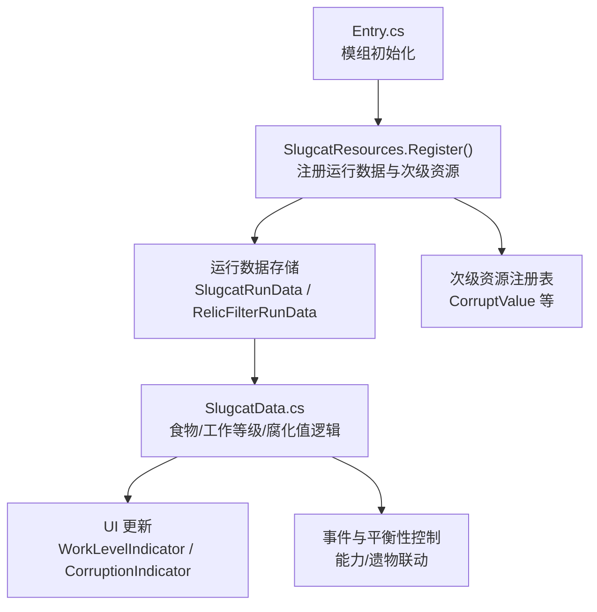
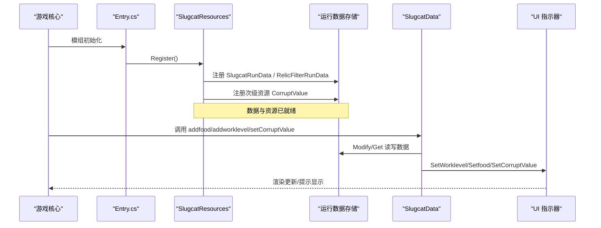
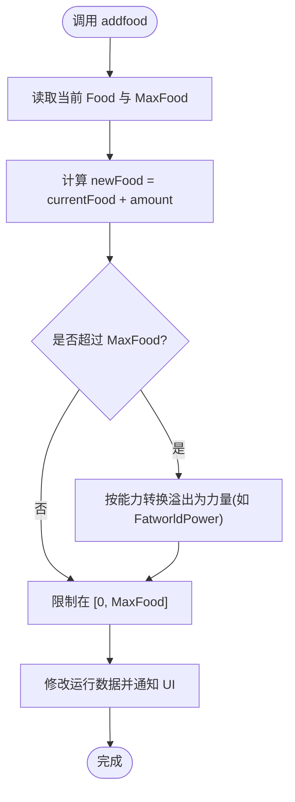
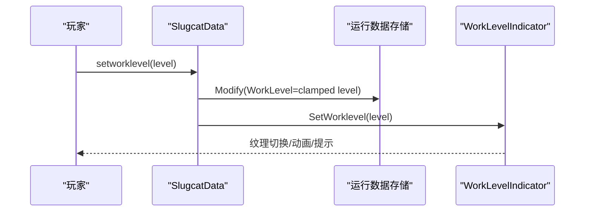
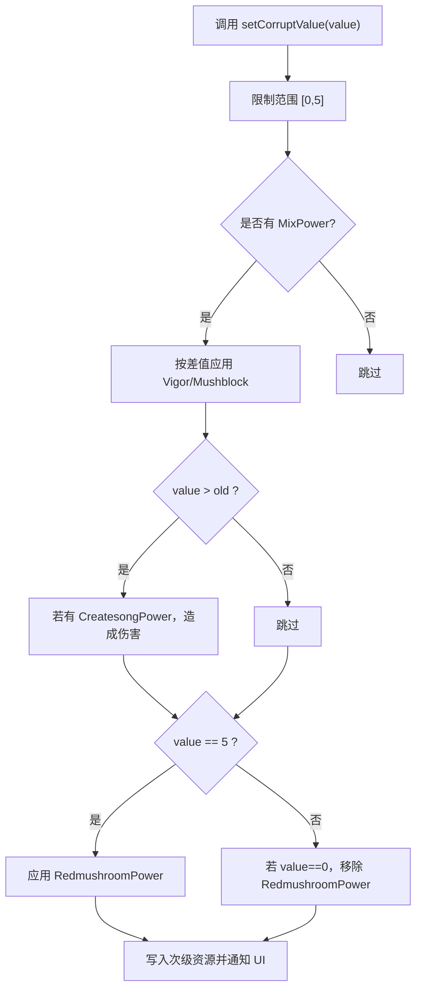
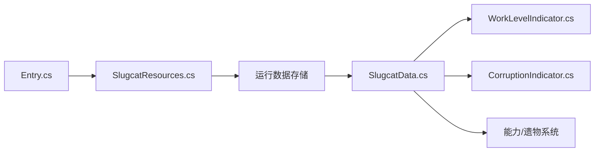

# 资源管理系统

<cite>
**本文引用的文件**
- [SlugcatResources.cs](file://Scripts/Slugcat/SecondaryResource/SlugcatResources.cs)
- [SlugcatRunData.cs](file://Scripts/Slugcat/SecondaryResource/SlugcatRunData.cs)
- [RelicFilterRunData.cs](file://Scripts/Slugcat/SecondaryResource/RelicFilterRunData.cs)
- [SlugcatData.cs](file://Scripts/Slugcat/SlugcatData.cs)
- [Entry.cs](file://Scripts/Entry.cs)
- [CorruptionIndicator.cs](file://Godot/CombatUI/CorruptionIndicator.cs)
- [WorkLevelIndicator.cs](file://Godot/CombatUI/WorkLevelIndicator.cs)
</cite>

## 目录
1. [简介](#简介)
2. [项目结构](#项目结构)
3. [核心组件](#核心组件)
4. [架构总览](#架构总览)
5. [详细组件分析](#详细组件分析)
6. [依赖关系分析](#依赖关系分析)
7. [性能与内存管理](#性能与内存管理)
8. [故障排查指南](#故障排查指南)
9. [结论](#结论)
10. [附录：扩展次级资源类型](#附录：扩展次级资源类型)

## 简介
本模块为 SlugcatTheSpireII 的资源管理系统，围绕“食物系统”“工作等级（业力）系统”“腐化值系统”三大核心机制展开。通过统一的运行时数据模型、次级资源注册与计算、以及 UI 同步与事件触发，实现与游戏核心系统的深度集成。文档将详细说明：
- 次级资源的定义、注册、数值计算与状态同步
- 运行时数据 SlugcatRunData 与 RelicFilterRunData 的结构与持久化策略
- 资源系统与 UI、事件、平衡性控制的集成方式
- 如何扩展新的次级资源类型
- 性能优化与内存管理建议

## 项目结构
资源管理相关代码主要分布在以下位置：
- 资源定义与注册：Scripts/Slugcat/SecondaryResource
- 运行时数据与业务逻辑：Scripts/Slugcat
- 战斗 UI 指示器：Godot/CombatUI
- 模组入口与初始化：Scripts/Entry.cs

图表来源
- [Entry.cs:26-43](file://Scripts/Entry.cs#L26-L43)
- [SlugcatResources.cs:15-48](file://Scripts/Slugcat/SecondaryResource/SlugcatResources.cs#L15-L48)
- [SlugcatData.cs:76-104](file://Scripts/Slugcat/SlugcatData.cs#L76-L104)
- [WorkLevelIndicator.cs:53-75](file://Godot/CombatUI/WorkLevelIndicator.cs#L53-L75)
- [CorruptionIndicator.cs:38-91](file://Godot/CombatUI/CorruptionIndicator.cs#L38-L91)

章节来源
- [Entry.cs:26-43](file://Scripts/Entry.cs#L26-L43)
- [SlugcatResources.cs:15-48](file://Scripts/Slugcat/SecondaryResource/SlugcatResources.cs#L15-L48)

## 核心组件
- SlugcatResources：集中注册运行期数据与次级资源，提供全局访问点
- SlugcatRunData：玩家运行时数据，包含工作等级、饱食度、休眠阈值、初始化标记等
- RelicFilterRunData：遗物过滤配置数据，用于运行时开关某些遗物效果
- SlugcatData：资源系统的业务层，封装食物增减、工作等级变更、腐化值设置、休眠等行为
- UI 指示器：WorkLevelIndicator 与 CorruptionIndicator 负责展示与交互提示

章节来源
- [SlugcatResources.cs:7-48](file://Scripts/Slugcat/SecondaryResource/SlugcatResources.cs#L7-L48)
- [SlugcatRunData.cs:3-14](file://Scripts/Slugcat/SecondaryResource/SlugcatRunData.cs#L3-L14)
- [RelicFilterRunData.cs:3-8](file://Scripts/Slugcat/SecondaryResource/RelicFilterRunData.cs#L3-L8)
- [SlugcatData.cs:32-367](file://Scripts/Slugcat/SlugcatData.cs#L32-L367)
- [WorkLevelIndicator.cs:14-270](file://Godot/CombatUI/WorkLevelIndicator.cs#L14-L270)
- [CorruptionIndicator.cs:12-148](file://Godot/CombatUI/CorruptionIndicator.cs#L12-L148)

## 架构总览
资源系统采用“数据-逻辑-表现”分层设计：
- 数据层：通过 RitsuLib 的 RunSavedDataStore 注册并持久化玩家数据；次级资源通过 SecondaryResourceRegistry 注册
- 逻辑层：SlugcatData 统一处理资源变更、边界约束、能力/遗物联动、音效与 UI 通知
- 表现层：Godot UI 组件订阅或主动读取当前资源值进行渲染与交互

图表来源
- [Entry.cs:26-43](file://Scripts/Entry.cs#L26-L43)
- [SlugcatResources.cs:15-48](file://Scripts/Slugcat/SecondaryResource/SlugcatResources.cs#L15-L48)
- [SlugcatData.cs:117-142](file://Scripts/Slugcat/SlugcatData.cs#L117-L142)
- [WorkLevelIndicator.cs:143-161](file://Godot/CombatUI/WorkLevelIndicator.cs#L143-L161)
- [CorruptionIndicator.cs:135-147](file://Godot/CombatUI/CorruptionIndicator.cs#L135-L147)

## 详细组件分析

### 食物系统
- 数据来源：SlugcatRunData.Food / MaxFood / SleepFood
- 增加逻辑：addfood 支持溢出处理、角色特性（如 FatworldPower）、上限限制、音效播放、UI 同步
- 休眠判定：cansleep 检查 Food >= SleepFood、存活状态、无假死能力；执行 sleep 进入休眠队列
- 胜利奖励：callVictory/getRewordFood 根据房间类型给予不同饱食度，Boss 战额外提升工作等级

图表来源
- [SlugcatData.cs:117-142](file://Scripts/Slugcat/SlugcatData.cs#L117-L142)
- [WorkLevelIndicator.cs:143-161](file://Godot/CombatUI/WorkLevelIndicator.cs#L143-L161)

章节来源
- [SlugcatData.cs:117-142](file://Scripts/Slugcat/SlugcatData.cs#L117-L142)
- [SlugcatData.cs:223-238](file://Scripts/Slugcat/SlugcatData.cs#L223-L238)
- [SlugcatData.cs:339-365](file://Scripts/Slugcat/SlugcatData.cs#L339-L365)
- [WorkLevelIndicator.cs:127-161](file://Godot/CombatUI/WorkLevelIndicator.cs#L127-L161)

### 工作等级系统（业力）
- 数据结构：WorkLevel / MaxWorkLevel
- 增加/设置：addworklevel/setworklevel 包含边界限制、音效、能力影响（WorkerrorPower）、死亡回退逻辑
- 重生与保护：reLive 在致命伤害时尝试重生，优先使用 WorklockPower 保护，否则扣减工作等级
- UI 展示：WorkLevelIndicator 动态切换纹理、动画过渡、锁定/菌化状态检测

图表来源
- [SlugcatData.cs:185-221](file://Scripts/Slugcat/SlugcatData.cs#L185-L221)
- [WorkLevelIndicator.cs:239-256](file://Godot/CombatUI/WorkLevelIndicator.cs#L239-L256)

章节来源
- [SlugcatData.cs:185-221](file://Scripts/Slugcat/SlugcatData.cs#L185-L221)
- [SlugcatData.cs:165-183](file://Scripts/Slugcat/SlugcatData.cs#L165-L183)
- [WorkLevelIndicator.cs:229-256](file://Godot/CombatUI/WorkLevelIndicator.cs#L229-L256)

### 腐化值系统
- 次级资源定义：CorruptValue 通过 SecondaryResourceDefinition 注册，默认值 0，基础上限 5，战斗内持久化
- 数值操作：getCorruptValue/setCorruptValue/addCorruptValue 提供读取、设置、增量；含能力联动（TwistformPower、MixPower、CreatesongPower、RedmushroomPower）
- UI 展示：CorruptionIndicator 根据值选择填充纹理，悬停显示描述

图表来源
- [SlugcatData.cs:239-325](file://Scripts/Slugcat/SlugcatData.cs#L239-L325)
- [CorruptionIndicator.cs:135-147](file://Godot/CombatUI/CorruptionIndicator.cs#L135-L147)

章节来源
- [SlugcatResources.cs:39-48](file://Scripts/Slugcat/SecondaryResource/SlugcatResources.cs#L39-L48)
- [SlugcatData.cs:239-325](file://Scripts/Slugcat/SlugcatData.cs#L239-L325)
- [CorruptionIndicator.cs:135-147](file://Godot/CombatUI/CorruptionIndicator.cs#L135-L147)

### 运行时数据与持久化
- SlugcatRunData：保存 WorkLevel、MaxWorkLevel、Food、MaxFood、SleepFood、IsInitialized、HaveChaoshengt
- RelicFilterRunData：EnableMaxHpCantUsedRelicFix、EnableHpRelicFix、EnableMaxHpRelicFix
- 持久化策略：通过 RunSavedDataOptions 的 WritePolicy=WhenSet 与 SyncLobbyOnChange=true 确保即时写盘与多人同步

章节来源
- [SlugcatRunData.cs:3-14](file://Scripts/Slugcat/SecondaryResource/SlugcatRunData.cs#L3-L14)
- [RelicFilterRunData.cs:3-8](file://Scripts/Slugcat/SecondaryResource/RelicFilterRunData.cs#L3-L8)
- [SlugcatResources.cs:19-36](file://Scripts/Slugcat/SecondaryResource/SlugcatResources.cs#L19-L36)

### 与游戏核心系统的集成
- 初始化：Entry.Init 中调用 SlugcatResources.Register，随后注册 Godot 脚本与内容发现
- UI 更新：通过 CombatUiPatch.SetWorklevel/Setfood/SetCorruptValue 驱动 UI 组件刷新
- 事件触发：能力/遗物在资源变化时触发副作用（如 MixPower、CreatesongPower、RedmushroomPower）
- 平衡性控制：上限限制（MaxWorkLevel<=9、腐化值上限 5）、能力修正（FatworldPower、TwistformPower、RestrainPower）

章节来源
- [Entry.cs:26-43](file://Scripts/Entry.cs#L26-L43)
- [SlugcatData.cs:117-142](file://Scripts/Slugcat/SlugcatData.cs#L117-L142)
- [SlugcatData.cs:239-325](file://Scripts/Slugcat/SlugcatData.cs#L239-L325)

## 依赖关系分析
- Entry 依赖 SlugcatResources 完成数据与资源注册
- SlugcatData 依赖运行数据存储与次级资源命令，同时与能力/遗物系统交互
- UI 组件依赖运行时数据与补丁接口以获取当前值并渲染

图表来源
- [Entry.cs:26-43](file://Scripts/Entry.cs#L26-L43)
- [SlugcatResources.cs:15-48](file://Scripts/Slugcat/SecondaryResource/SlugcatResources.cs#L15-L48)
- [SlugcatData.cs:32-367](file://Scripts/Slugcat/SlugcatData.cs#L32-L367)

章节来源
- [Entry.cs:26-43](file://Scripts/Entry.cs#L26-L43)
- [SlugcatResources.cs:15-48](file://Scripts/Slugcat/SecondaryResource/SlugcatResources.cs#L15-L48)
- [SlugcatData.cs:32-367](file://Scripts/Slugcat/SlugcatData.cs#L32-L367)

## 性能与内存管理
- 数据写入策略：WritePolicy=WhenSet 减少冗余写盘，避免频繁 IO；SyncLobbyOnChange=true 保证多人一致性
- UI 渲染优化：WorkLevelIndicator 使用纹理切片与 Tween 动画，仅在层级变化时重建图标；CorruptionIndicator 按需切换填充纹理
- 资源释放：WorkLevelIndicator 在退出树时释放纹理与 Tween，防止内存泄漏
- 批量更新：建议在资源变更时合并多次 Modify 调用，降低存储与 UI 刷新开销
- 异步操作：addfood/addworklevel/setCorruptValue 使用 async/await 避免阻塞主线程

章节来源
- [SlugcatResources.cs:19-36](file://Scripts/Slugcat/SecondaryResource/SlugcatResources.cs#L19-L36)
- [WorkLevelIndicator.cs:258-268](file://Godot/CombatUI/WorkLevelIndicator.cs#L258-L268)
- [SlugcatData.cs:117-142](file://Scripts/Slugcat/SlugcatData.cs#L117-L142)

## 故障排查指南
- 食物不增加：检查 MaxFood 上限、能力（如 FatworldPower）是否生效、UI 同步是否调用
- 工作等级异常：确认 MaxWorkLevel 上限、WorkerrorPower 是否阻止增长、reLive 是否正确回退
- 腐化值无效：验证次级资源 ID 是否正确、能力联动（MixPower、CreatesongPower、RedmushroomPower）是否满足条件
- UI 不更新：确认 CombatUiPatch.Set* 方法被调用，且 UI 组件已正确加载纹理与节点

章节来源
- [SlugcatData.cs:117-142](file://Scripts/Slugcat/SlugcatData.cs#L117-L142)
- [SlugcatData.cs:185-221](file://Scripts/Slugcat/SlugcatData.cs#L185-L221)
- [SlugcatData.cs:239-325](file://Scripts/Slugcat/SlugcatData.cs#L239-L325)
- [WorkLevelIndicator.cs:143-161](file://Godot/CombatUI/WorkLevelIndicator.cs#L143-L161)
- [CorruptionIndicator.cs:135-147](file://Godot/CombatUI/CorruptionIndicator.cs#L135-L147)

## 结论
该资源管理系统通过清晰的层次划分与统一的 API，实现了食物、工作等级、腐化值三类核心机制的稳定运行。结合 RitsuLib 的运行数据存储与次级资源框架，系统在多人同步、持久化、UI 同步方面具备良好扩展性与可维护性。后续可通过新增次级资源类型进一步丰富玩法。

## 附录：扩展次级资源类型
步骤概览：
1. 在 SlugcatResources.Register 中通过 SecondaryResourceRegistry 注册新的 SecondaryResourceDefinition，设定默认值、基础上限、回合开始策略、持久化策略
2. 在 SlugcatData 中提供 get/set/add 方法，封装数值计算与能力联动
3. 在 UI 中添加对应指示器或复用现有组件，调用 CombatUiPatch.Set* 进行同步
4. 在能力/遗物中引用新资源 ID，实现联动效果

章节来源
- [SlugcatResources.cs:39-48](file://Scripts/Slugcat/SecondaryResource/SlugcatResources.cs#L39-L48)
- [SlugcatData.cs:239-325](file://Scripts/Slugcat/SlugcatData.cs#L239-L325)
- [WorkLevelIndicator.cs:143-161](file://Godot/CombatUI/WorkLevelIndicator.cs#L143-L161)
- [CorruptionIndicator.cs:135-147](file://Godot/CombatUI/CorruptionIndicator.cs#L135-L147)