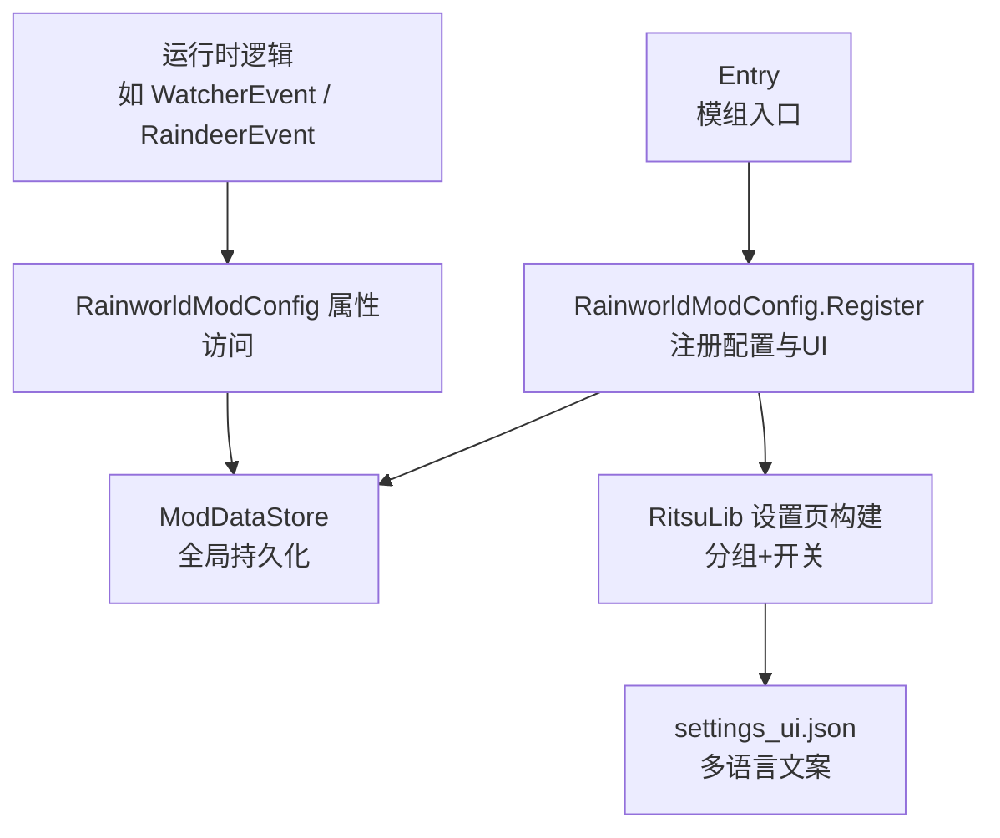
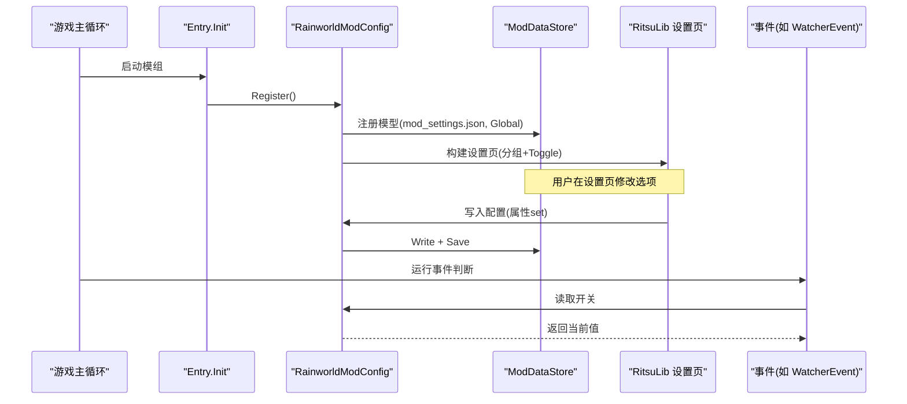
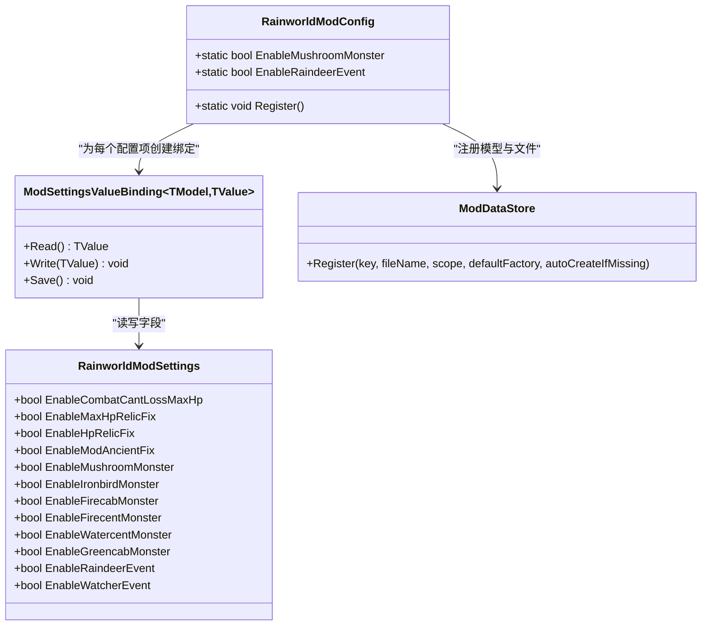
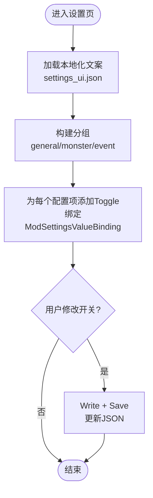
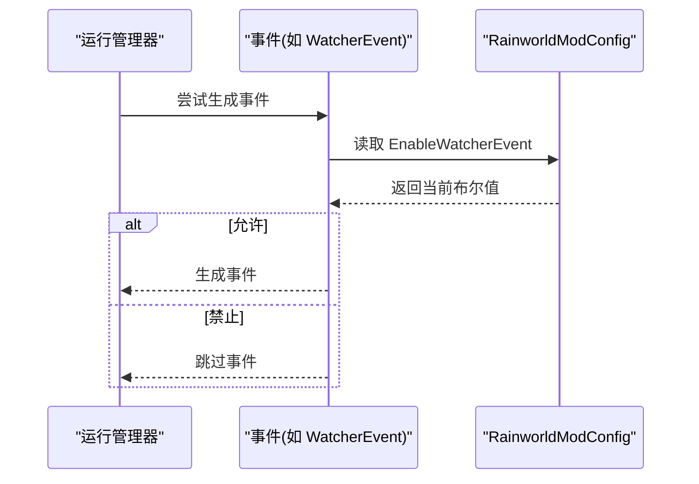
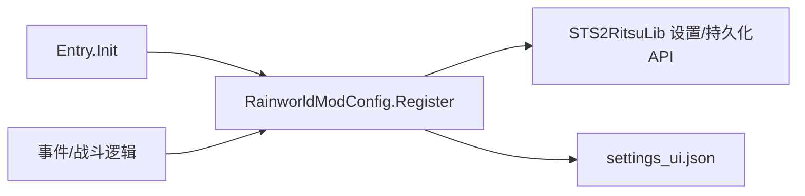

# 配置管理系统

<cite>
**本文引用的文件**
- [RainworldModConfig.cs](file://Scripts/RainworldModConfig.cs)
- [Entry.cs](file://Scripts/Entry.cs)
- [settings_ui.json（英文）](file://SlugcatTheSpireII/localization/eng/settings_ui.json)
- [settings_ui.json（简中）](file://SlugcatTheSpireII/localization/zhs/settings_ui.json)
- [WatcherEvent.cs](file://Scripts/Event/WatcherEvent.cs)
- [RaindeerEvent.cs](file://Scripts/Event/RaindeerEvent.cs)
</cite>

## 目录
1. [简介](#简介)
2. [项目结构](#项目结构)
3. [核心组件](#核心组件)
4. [架构总览](#架构总览)
5. [详细组件分析](#详细组件分析)
6. [依赖关系分析](#依赖关系分析)
7. [性能考虑](#性能考虑)
8. [故障排查指南](#故障排查指南)
9. [结论](#结论)
10. [附录：扩展与最佳实践](#附录：扩展与最佳实践)

## 简介
本文件为 SlugcatTheSpireII 的配置管理系统提供系统化文档，重点围绕 RainworldModConfig 类的设计模式与实现细节，涵盖运行时配置管理、设置界面集成、配置持久化机制。同时说明配置项定义、默认值处理、用户界面绑定、JSON 配置文件结构与格式，并提供扩展方法、热重载策略、版本兼容性与数据迁移建议，以及实际使用示例与最佳实践。

## 项目结构
该配置系统由以下关键部分组成：
- 配置模型与绑定：RainworldModSettings 定义配置项；RainworldModConfig 通过 ModSettingsValueBinding 将每个配置项与持久化存储和 UI 控件绑定。
- 注册与初始化：Entry.Init 中调用 RainworldModConfig.Register，完成配置注册与设置页构建。
- 本地化资源：settings_ui.json 提供设置页标题、分组、开关文案与描述。
- 运行时消费：事件等模块在 IsAllowed 等逻辑中读取配置以控制行为。

图表来源
- [Entry.cs:26-37](file://Scripts/Entry.cs#L26-L37)
- [RainworldModConfig.cs:166-234](file://Scripts/RainworldModConfig.cs#L166-L234)
- [settings_ui.json（英文）:15-46](file://SlugcatTheSpireII/localization/eng/settings_ui.json#L15-L46)

章节来源
- [Entry.cs:26-37](file://Scripts/Entry.cs#L26-L37)
- [RainworldModConfig.cs:166-234](file://Scripts/RainworldModConfig.cs#L166-L234)
- [settings_ui.json（英文）:15-46](file://SlugcatTheSpireII/localization/eng/settings_ui.json#L15-L46)

## 核心组件
- RainworldModSettings：纯数据模型，包含所有可配置布尔开关，并给出默认值。
- RainworldModConfig：静态配置门面，负责：
  - 为每个配置项创建 ModSettingsValueBinding，绑定到全局持久化键 DataKey="mod_settings"。
  - 暴露强类型静态属性，读写时自动触发 Read/Write/Save。
  - Register 中完成：
    - 向 ModDataStore 注册配置模型与文件名 mod_settings.json，作用域 SaveScope.Global。
    - 通过 RitsuLibFramework.RegisterModSettings 构建设置页，按 section 分组，添加 Toggle 控件并绑定对应 Binding。
    - 使用 T(key) 从 settings_ui.json 获取本地化文案。
- 运行时消费：事件类在 IsAllowed 中直接读取配置开关，决定是否允许事件出现。

章节来源
- [RainworldModConfig.cs:11-164](file://Scripts/RainworldModConfig.cs#L11-L164)
- [RainworldModConfig.cs:166-234](file://Scripts/RainworldModConfig.cs#L166-L234)
- [WatcherEvent.cs:46-49](file://Scripts/Event/WatcherEvent.cs#L46-L49)
- [RaindeerEvent.cs:43-46](file://Scripts/Event/RaindeerEvent.cs#L43-L46)

## 架构总览
配置系统采用“模型 + 绑定 + 存储 + UI”的分层设计：
- 模型层：RainworldModSettings 承载配置数据与默认值。
- 绑定层：ModSettingsValueBinding 将模型字段映射到持久化键与 UI 控件。
- 存储层：ModDataStore 负责 JSON 文件的序列化/反序列化与保存。
- UI 层：RitsuLib 设置页框架根据 Register 的 DSL 生成页面，并通过本地化文案显示。

图表来源
- [Entry.cs:26-37](file://Scripts/Entry.cs#L26-L37)
- [RainworldModConfig.cs:166-234](file://Scripts/RainworldModConfig.cs#L166-L234)
- [WatcherEvent.cs:46-49](file://Scripts/Event/WatcherEvent.cs#L46-L49)

## 详细组件分析

### 配置模型与默认值
- RainworldModSettings 定义了所有可配置项，均为 bool 类型，并在声明处赋予默认值。例如怪物与事件的启用开关默认开启，部分修复开关默认关闭或开启，便于开箱即用。
- 这些默认值会在首次加载且无历史存档时生效。

章节来源
- [RainworldModConfig.cs:11-30](file://Scripts/RainworldModConfig.cs#L11-L30)

### 配置绑定与持久化
- 每个配置项都通过 ModSettingsValueBinding 建立绑定：
  - 参数包括 ModId、DataKey、SaveScope.Global、getter/setter。
  - 绑定对象持有对模型字段的读写委托，用于序列化与 UI 同步。
- 静态属性封装了 Read/Write/Save：
  - get 调用 Binding.Read() 从存储读取最新值。
  - set 先 Write 到内存模型，再 Save 到磁盘。
- 存储注册：
  - ModDataStore.For(Entry.ModId).Register<RainworldModSettings>(key: DataKey, fileName: "mod_settings.json", scope: SaveScope.Global, defaultFactory: () => new RainworldModSettings(), autoCreateIfMissing: true)。
  - 这意味着配置以 JSON 形式保存在全局作用域下，文件名为 mod_settings.json，缺失时自动创建并使用默认工厂生成初始实例。

图表来源
- [RainworldModConfig.cs:32-164](file://Scripts/RainworldModConfig.cs#L32-L164)
- [RainworldModConfig.cs:166-173](file://Scripts/RainworldModConfig.cs#L166-L173)

章节来源
- [RainworldModConfig.cs:32-164](file://Scripts/RainworldModConfig.cs#L32-L164)
- [RainworldModConfig.cs:166-173](file://Scripts/RainworldModConfig.cs#L166-L173)

### 设置界面集成与本地化
- 通过 RitsuLibFramework.RegisterModSettings 构建设置页：
  - 页面标题与显示名来自本地化键。
  - 按 section 分组：general（生命值相关补丁）、monster（模组怪物）、event（模组事件）。
  - 每个 Toggle 绑定对应的 ModSettingsValueBinding，并在 UI 上显示标题与描述。
- 本地化文案位于 settings_ui.json，支持英文与简中等多语言。

图表来源
- [RainworldModConfig.cs:166-234](file://Scripts/RainworldModConfig.cs#L166-L234)
- [settings_ui.json（英文）:15-46](file://SlugcatTheSpireII/localization/eng/settings_ui.json#L15-L46)
- [settings_ui.json（简中）:15-46](file://SlugcatTheSpireII/localization/zhs/settings_ui.json#L15-L46)

章节来源
- [RainworldModConfig.cs:166-234](file://Scripts/RainworldModConfig.cs#L166-L234)
- [settings_ui.json（英文）:15-46](file://SlugcatTheSpireII/localization/eng/settings_ui.json#L15-L46)
- [settings_ui.json（简中）:15-46](file://SlugcatTheSpireII/localization/zhs/settings_ui.json#L15-L46)

### 运行时配置消费
- 事件类在 IsAllowed 中读取配置开关，决定事件是否参与生成。
- 示例：
  - WatcherEvent.IsAllowed 返回 RainworldModConfig.EnableWatcherEvent。
  - RaindeerEvent.IsAllowed 返回 RainworldModConfig.EnableRaindeerEvent。

图表来源
- [WatcherEvent.cs:46-49](file://Scripts/Event/WatcherEvent.cs#L46-L49)
- [RaindeerEvent.cs:43-46](file://Scripts/Event/RaindeerEvent.cs#L43-L46)

章节来源
- [WatcherEvent.cs:46-49](file://Scripts/Event/WatcherEvent.cs#L46-L49)
- [RaindeerEvent.cs:43-46](file://Scripts/Event/RaindeerEvent.cs#L43-L46)

## 依赖关系分析
- Entry.Init 作为模组入口，负责：
  - 注册补丁。
  - 调用 RainworldModConfig.Register 完成配置与 UI 注册。
  - 注册其他内容（资源、Godot 脚本、卡牌目标等）。
- RainworldModConfig 依赖：
  - STS2RitsuLib 的设置与持久化 API（ModSettingsValueBinding、ModDataStore、RitsuLibFramework）。
  - 本地化系统（LocString）以加载 settings_ui.json。
- 运行时模块依赖 RainworldModConfig 提供的静态属性进行条件判断。

图表来源
- [Entry.cs:26-37](file://Scripts/Entry.cs#L26-L37)
- [RainworldModConfig.cs:166-234](file://Scripts/RainworldModConfig.cs#L166-L234)

章节来源
- [Entry.cs:26-37](file://Scripts/Entry.cs#L26-L37)
- [RainworldModConfig.cs:166-234](file://Scripts/RainworldModConfig.cs#L166-L234)

## 性能考虑
- 配置读取路径短且轻量：每次读取仅通过 Binding.Read 获取内存值，避免重复 IO。
- 写操作即时持久化：属性 set 后立即 Write + Save，保证设置页与运行时一致，但频繁写盘可能带来 I/O 开销。建议在批量设置后统一 Save 或减少不必要的写操作（当前实现已较合理）。
- JSON 文件较小：mod_settings.json 仅包含布尔开关，序列化/反序列化成本极低。
- 建议：
  - 若未来新增大量数值型配置，可考虑合并写操作或使用缓存策略。
  - 在设置页提交按钮统一保存，可减少多次写盘。

[本节为通用性能讨论，不直接分析具体文件]

## 故障排查指南
- 设置页未显示或空白：
  - 确认 Entry.Init 中已调用 RainworldModConfig.Register。
  - 检查 settings_ui.json 是否存在对应 key，且拼写正确。
- 修改设置后无效：
  - 确认运行时逻辑读取的是同一静态属性（如 EnableWatcherEvent）。
  - 检查 ModDataStore 是否正确注册（key、fileName、scope）。
- 配置文件未生成或丢失：
  - 确认 autoCreateIfMissing 为 true，且作用域为 Global。
  - 检查是否有权限写入全局配置目录。
- 本地化文案不生效：
  - 确认 T(key) 使用的 key 与 settings_ui.json 中的键一致。
  - 切换语言后重新加载设置页。

章节来源
- [Entry.cs:26-37](file://Scripts/Entry.cs#L26-L37)
- [RainworldModConfig.cs:166-234](file://Scripts/RainworldModConfig.cs#L166-L234)
- [settings_ui.json（英文）:15-46](file://SlugcatTheSpireII/localization/eng/settings_ui.json#L15-L46)
- [settings_ui.json（简中）:15-46](file://SlugcatTheSpireII/localization/zhs/settings_ui.json#L15-L46)

## 结论
RainworldModConfig 通过清晰的模型、绑定与存储分层，实现了稳定可靠的配置管理。其设置页集成良好，支持多语言与分组展示；运行时消费简单直观，便于扩展新配置项。整体设计简洁高效，适合当前模组的规模与需求。

[本节为总结性内容，不直接分析具体文件]

## 附录：扩展与最佳实践

### 如何添加新的配置项
步骤：
1. 在 RainworldModSettings 中添加新的 bool 属性，并设置默认值。
2. 在 RainworldModConfig 中为该属性创建 ModSettingsValueBinding，指定 Entry.ModId、DataKey、SaveScope.Global 及 getter/setter。
3. 在静态属性中封装 Read/Write/Save。
4. 在 Register 的对应 section 中添加 AddToggle，并传入 Binding 与本地化 key。
5. 在 settings_ui.json 中补充标题与描述（含 .desc）。
6. 在需要消费的运行时逻辑中读取新属性。

参考路径
- 模型与绑定：[RainworldModConfig.cs:11-164](file://Scripts/RainworldModConfig.cs#L11-L164)
- 设置页注册：[RainworldModConfig.cs:166-234](file://Scripts/RainworldModConfig.cs#L166-L234)
- 本地化文案：[settings_ui.json（英文）:15-46](file://SlugcatTheSpireII/localization/eng/settings_ui.json#L15-L46)

### 配置文件结构与格式
- 文件：mod_settings.json
- 位置：全局作用域（由 SaveScope.Global 决定）
- 结构：JSON 对象，键名对应 RainworldModSettings 的属性名，值为布尔类型。
- 默认值：当文件不存在时，使用 RainworldModSettings 的默认值创建。

章节来源
- [RainworldModConfig.cs:166-173](file://Scripts/RainworldModConfig.cs#L166-L173)

### 热重载策略
- 当前实现：设置页修改即立即 Write + Save，运行时读取静态属性即可获取最新值，具备“准实时”效果。
- 建议：
  - 对于影响全局状态的重大配置变更，可在设置页增加“应用”按钮，统一 Save 并通知相关系统刷新。
  - 若涉及运行时不可热更新的资源，应在下次关卡/事件开始时重新加载。

[本节为通用指导，不直接分析具体文件]

### 版本兼容性与数据迁移
- 现状：当前配置为纯布尔开关，结构简单，向后兼容性好。
- 建议：
  - 引入版本号字段（如 configVersion），在加载时检测并执行迁移逻辑。
  - 对新增配置项提供合理的默认值，避免旧存档因缺少字段而异常。
  - 对删除或重命名的配置项，提供降级或映射策略。

[本节为通用指导，不直接分析具体文件]

### 实际使用示例
- 事件控制：
  - WatcherEvent.IsAllowed 读取 EnableWatcherEvent，决定是否生成事件。
  - RaindeerEvent.IsAllowed 读取 EnableRaindeerEvent，决定是否生成事件。
- 设置页：
  - 在 general/monster/event 分组中，通过 Toggle 控制各功能开关。
  - 文案来自 settings_ui.json，支持多语言。

章节来源
- [WatcherEvent.cs:46-49](file://Scripts/Event/WatcherEvent.cs#L46-L49)
- [RaindeerEvent.cs:43-46](file://Scripts/Event/RaindeerEvent.cs#L43-L46)
- [RainworldModConfig.cs:166-234](file://Scripts/RainworldModConfig.cs#L166-L234)
- [settings_ui.json（英文）:15-46](file://SlugcatTheSpireII/localization/eng/settings_ui.json#L15-L46)
- [settings_ui.json（简中）:15-46](file://SlugcatTheSpireII/localization/zhs/settings_ui.json#L15-L46)